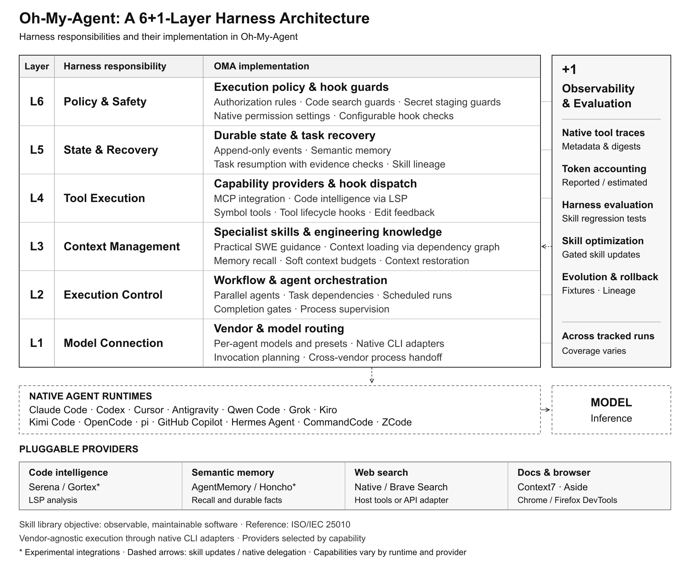

# oh-my-agent

**Liefere über 400 Commits am Tag.**

[](https://www.npmjs.com/package/oh-my-agent) [](https://www.npmjs.com/package/oh-my-agent) [](https://github.com/first-fluke/oh-my-agent) [](https://github.com/first-fluke/oh-my-agent/blob/main/LICENSE) [](https://github.com/first-fluke/oh-my-agent/commits/main)

[English](../README.md) | [한국어](./README.ko.md) | [中文](./README.zh.md) | [Português](./README.pt.md) | [日本語](./README.ja.md) | [Français](./README.fr.md) | [Español](./README.es.md) | [Nederlands](./README.nl.md) | [Polski](./README.pl.md) | [Русский](./README.ru.md) | [Tiếng Việt](./README.vi.md) | [ภาษาไทย](./README.th.md)

<a id="install"></a>
## Installation

### Für Menschen

Führe das im Wurzelverzeichnis deines Projekts aus.

```bash
curl -fsSL https://raw.githubusercontent.com/first-fluke/oh-my-agent/main/cli/install.sh | bash
```

### Für KI-Agenten

Füge das in deinen Coding-Agenten ein:

```text
Install and configure oh-my-agent in this project by following this guide:
https://raw.githubusercontent.com/first-fluke/oh-my-agent/main/docs/agent-install.md
```

Der [Installationsleitfaden für Agenten](./agent-install.md) beschreibt das nicht-interaktive Setup und die Prüfung. Wenn du der Agent bist, lies diesen Leitfaden und führe die Installation aus.

Öffne danach deinen Agenten und tippe `/orchestrate build a TODO app with login`.

oh-my-agent (`oma`) macht aus Claude Code, Codex CLI, Cursor und 11 weiteren Coding-Agenten ein Team. Ein Planer zerlegt die Arbeit, Engineers bauen parallel, ein Reviewer prüft das Ergebnis, und ein Debugger behebt die Ursache.

<a id="start-with-your-task"></a>
## Starte mit deiner Aufgabe

Wähle eine Aufgabe. Lade einen Skill in den Agenten, den du schon nutzt, oder installiere das ganze Team.

| Deine Aufgabe | Starte hier | Erste Anfrage |
|---|---|---|
| [Von KI geschriebenen Code prüfen](../web/docs/tasks/review-ai-code.md) | `bunx skills use first-fluke/oh-my-agent@oma-qa` | „Prüfe diesen Diff auf Bugs und fehlende Prüfungen. Zitiere die betroffenen Zeilen.“ |
| [Einen Admin-Bildschirm entwerfen](../web/docs/tasks/design-admin-ui.md) | `bunx skills use first-fluke/oh-my-agent@oma-design` | „Prüfe die Hierarchie und die Tabellendichte unserer Admin-Seite.“ |
| [Einen fehlschlagenden Test beheben](../web/docs/tasks/debug-failing-tests.md) | `bunx skills use first-fluke/oh-my-agent@oma-debug` | „Reproduziere diesen Testfehler, behebe die Ursache und führe die betroffenen Prüfungen aus.“ |
| Systemgrenzen prüfen | `bunx skills use first-fluke/oh-my-agent@oma-architecture` | „Prüfe die Grenze zwischen unserer API und dem Worker.“ |
| Das ganze Team einsetzen | [oma installieren](#install) | `/orchestrate add login to this app` |

Führe den Befehl `skills use` im Terminal deines Agenten aus. Er lädt genau diesen einen Skill. Für das ganze Team mit Workflows [installiere oma](#install). Weitere Möglichkeiten stehen unter [Setup wählen](../web/docs/getting-started/choose-setup.md).

[](./assets/architecture/oh-my-agent-architecture.svg)

Führe nach der Installation `oma doctor` aus. [Deine ersten 5 Minuten](#your-first-5-minutes) beginnen mit einer Nur-Lese-Aufgabe, bevor die Team-Workflows kommen.

## Was du bekommst

**Workflows** sind das, was du tippst (oder einfach sagst). Sie holen **Rollen** hinzu, die Spezialisten. **Skills** sind das Know-how: Jede Rolle bringt ihre eigenen mit, und dein Agent lädt die übrigen, sobald eine Aufgabe sie braucht.

| | Was du davon hast | Probier es aus |
|---|---|---|
| **12 Spezialistenrollen** | PM, Architekt, Backend-, Frontend-, Mobile-, Datenbank- und Infra-Engineers, QA-Reviewer, Debugger, Refactorer, Docs-Kurator, Researcher ([lerne sie kennen](#meet-the-team)) | `/orchestrate build a TODO app with login` |
| **20 Workflows** | Slash Commands von `/brainstorm` und `/plan` bis `/review`, `/debug` und `/scm`. Die vier Multi-Agenten-Modi starten auch, wenn eine einfache Anfrage sie beim Namen nennt | „ultrawork: add rate limiting“ |
| **33 Skills** | Domänenwissen, das nur geladen wird, wenn eine Aufgabe es braucht: UI, APIs, Schemas, Terraform, CI, Security, Git, Observability | lädt sich von selbst, z. B. „add a Terraform S3 bucket“ |
| **Dateien, die du öffnen kannst** | Pläne, Design-Dokumente, API-Verträge, ADRs, Bug-Notizen, Ergebnisse pro Agent, Security-Nachweise, HTML-Explainer, Recaps | `ls .agents/results` |
| **Research und Content** | Suche mit Quellenangaben, Marktforschung, Paper, Slide-Decks, MP4-Videos, Bilder, lokale Sprachausgabe, PDF/HWP zu Markdown | `/video`, `/convert` |
| **Ein Ordner, 14 Runtimes** | Ein portables `.agents/`-Verzeichnis, geschrieben in die eigenen Konfigurationsdateien jeder Runtime | `oma link cursor` |

**[Installation](#install)** · **[Erste 5 Minuten](#your-first-5-minutes)** · **[Das Team](#meet-the-team)** · **[Welcher Workflow?](#how-the-team-works-together)** · **[Alles im Paket](#everything-in-the-box)** · **[Funktioniert mit](#works-with)** · **[FAQ](#faq)** · **[Docs](https://firstfluke.com/oh-my-agent/)**

## Installationsdetails

Das Skript installiert [bun](https://bun.sh), falls es fehlt, installiert den Befehl `oma` global (`bun install --global oh-my-agent`, entfällt, wenn `oma` bereits in deinem PATH liegt) und startet dann das interaktive Setup. Die Hooks (Keyword-Erkennung und das Stop-Gate) und mehrere Workflows rufen den global installierten Befehl `oma` auf. Die Hooks tun stillschweigend nichts, wenn sie ihn nicht finden. Wenn du das Skript auslässt, installiere ihn selbst mit `bun install --global oh-my-agent` (`npm install --global oh-my-agent` oder `brew install oh-my-agent` funktionieren ebenfalls).

<details>
<summary>Windows oder ohne Install-Skript</summary>

```powershell
# Windows (PowerShell)
irm https://raw.githubusercontent.com/first-fluke/oh-my-agent/main/cli/install.ps1 | iex
```

```bash
# Jedes OS mit installiertem bun: dasselbe Setup, plus der globale `oma`-Befehl
bun install --global oh-my-agent
oma
```

Unter Windows blendet der Installer Antigravity, Hermes und Kimi aus, und der Hook-Wrapper ist ein Bash-Skript. Das standardmäßige Aside-Browser-MCP wird über `bash` installiert; wähle es also ab, wenn du kein Bash hast.

</details>

Das Setup behält deine gespeicherte Antwortsprache oder erkennt sie aus dem System. Es fragt, welche Agenten-Runtimes angebunden werden, nach Fähigkeits-Providern, einem Browser-MCP, einem Modell-Preset und einem Skill-Preset. **Wähle `All` für die Skill-Referenzen, die in jedem Workflow verwendet werden**: Domänen-Presets lassen einige dieser Skills weg. Die Verfügbarkeit der Provider und die Aufgabenprüfung bleiben getrennte Prüfungen.

Wähle ein Preset ausdrücklich, wenn du die Skills einer Domäne willst:

```bash
oma install --preset frontend --yes
```

Damit werden die acht Skills des Frontend-Presets ausgewählt. Der Installer konfiguriert weiterhin die Runtime, die Provider und die gemeinsamen Workflow-Dateien und behält zuvor installierte Skills. Die eigene Auswahl gibt es im interaktiven Installer. Siehe [Preset-Werte](../web/docs/getting-started/installation.md#presets) und [Workflow-Abhängigkeiten](../web/docs/getting-started/installation.md#workflows-that-need-skills-outside-a-preset).

<details>
<summary>Was der Installer standardmäßig außerdem tut</summary>

- Installiert **bun** (erforderlich). Versucht **uv**, **Serena** (`uv tool install`) und **CUE** (`brew install cue` oder `winget`) zu installieren und macht mit einer Warnung weiter, falls eines davon fehlschlägt.
- Wählt im interaktiven Setup das **Aside**-Browser-MCP vor und installiert es mit `curl -fsSL https://releases.aside.com/install.sh | bash` nur, wenn du es ausgewählt lässt. Wähle es im Browser-MCP-Schritt ab oder ändere es später mit `oma update mcp`.
- Nutzt **AgentMemory** als semantisches Gedächtnis; dabei wird `bun install -g @agentmemory/agentmemory` ausgeführt und AgentMemory als Login-Dienst registriert (launchd, systemd-User-Unit oder geplante Windows-Aufgabe). Wähle den Provider `none` oder setze `OMA_NO_AGENTMEMORY=1`, um das zu überspringen.
- Fragt nach, bevor es Skills in Vendor-Ordner in deinem Home-Verzeichnis verlinkt (Antigravity, Hermes, Kimi). In `$HOME` ohne `--global` bittet es um Bestätigung.
- Schreibt einige Dateien außerhalb des Projekts, ohne zu fragen: `~/.claude.json` (markiert das Projekt als vertrauenswürdigen Claude-Code-Workspace), `~/.serena/` (OMA-Kontext, Mindestgröße für Antworten, Projektregistrierung), `~/.cursor/cli-config.json` (schaltet die Commit-Attribution von Cursor ab), `~/.grok/config.toml` (Telemetrie) und `~/.gemini/antigravity-cli/` (HUD), jeweils nur für einen Vendor, den du ausgewählt hast.
- Schreibt **Telemetrie-Opt-outs** in die Vendor-Einstellungen (Claude `DISABLE_TELEMETRY=1`, was auch Claude Code Remote Control abschaltet; Nutzungsstatistiken von Gemini, Qwen, Codex und Grok). Setze `telemetry: true`, um die Vendor-Standards beizubehalten.
- Deaktiviert das **automatische Memory-Speichern von Qwen Code**, indem `memory.enableManagedAutoMemory: false` ergänzt wird, wenn die Einstellung fehlt. Ausdrückliche Präferenzen `true` oder `false` und andere Memory-Einstellungen bleiben erhalten.
- Ergänzt nicht gesetzte Claude-Code-Einstellungen in `.claude/settings.json`, darunter `skipDangerousModePermissionPrompt: true`, `effortLevel: high`, `cleanupPeriodDays: 180` sowie env-Flags, die Auto Memory, Adaptive Thinking, Fehlerberichte und die eingebauten Git-Anweisungen abschalten. Werte, die du bereits gesetzt hast, bleiben erhalten.
- Fügt einen **Co-Author-Trailer** hinzu: Die Commit-Attribution von Claude Code wird zu `Co-Authored-By: First Fluke <our.first.fluke@gmail.com>`, und PRs erhalten eine Zeile "Generated with oh-my-agent". Setze `scm.co_author.enabled: false`, um das abzuschalten.
- Installiert einen **commit-msg-Guard** in `.githooks/`, der nicht gelistete `Co-authored-by`-Adressen ablehnt, und setzt `git config --local core.hooksPath .githooks`, wenn keine anderen Hooks aktiv sind. Setze `scm.co_author.enforce_hook: false`, um darauf zu verzichten.
- `oma update` aktualisiert die `oma`-CLI im Hintergrund (`auto_update_cli: false` oder `OMA_SKIP_VERSION_CHECK=1` stoppt das) und führt `uv tool upgrade serena-agent --prerelease=allow` aus (`serena.auto_update: false`).
- Mit Serena im Standardmodus `bridge` registriert die erste Agent-Session, die einen gemeinsamen Serena-Server startet, einen **Cleanup-Timer**, der inaktive gemeinsame Serena-Server alle 5 Minuten stoppt (launchd `dev.oma.serena-daemon-gc`, systemd-User-Timer `oma-serena-daemon-gc.timer` oder geplante Windows-Aufgabe `OMA Serena Daemon GC`). Setze `serena.mode: stdio`, um den gemeinsamen Server und seinen Timer zu überspringen. `oma uninstall` entfernt den Timer nicht.
- Nicht-interaktive Läufe (`-y`, `OMA_YES=1`, `CI=true`) verwenden das Skill-Preset `All`, sofern nicht `--preset` ein anderes wählt, dazu `model_preset: auto` und Python als Backend-Sprache. Dabei wird kein Browser-MCP ausgewählt (und das Aside-Installationsskript übersprungen), sofern `mcp.devtools_browsers` nicht bereits eines enthält.

</details>

<details>
<summary>Skill-Presets</summary>

| Preset | Skills |
|--------|--------|
| **All** | **Alle 33 Skills** (empfohlen) |
| Fullstack | architecture, backend, brainstorm, db, debug, design, dev-workflow, frontend, mobile, pm, qa, scm, tf-infra |
| Fullstack Web | Fullstack ohne mobile und tf-infra |
| Fullstack Mobile | Fullstack ohne frontend und tf-infra |
| Frontend | architecture, brainstorm, debug, design, frontend, pm, qa, scm |
| Backend | architecture, backend, brainstorm, db, debug, dev-workflow, pm, qa, scm |
| Mobile | architecture, brainstorm, debug, mobile, pm, qa, scm |
| DevOps | architecture, brainstorm, debug, dev-workflow, observability, pm, qa, scm, tf-infra |
| Research | academic-writing, hwp, market, pdf, scholar, scm, search, translation |
| Content | academic-writing, design, image, scm, translation, voice |
| Custom | Skills einzeln auswählen |

Von den benannten Presets enthält nur `All` coordination, orchestration, docs, security, refactor, explanation, recap, video, slide und skill-creation (oder du wählst sie unter `Custom` aus). Den Presets Research und Content fehlen die Skills, auf denen `/plan`, `/review`, `/debug`, `/architecture` und `/brainstorm` aufbauen. Siehe [Workflows, die Skills außerhalb eines Presets brauchen](../web/docs/getting-started/installation.md#workflows-that-need-skills-outside-a-preset).

</details>

<a id="your-first-5-minutes"></a>
## Deine ersten 5 Minuten

1. **Wähle dein Setup.** Lade für die Aufgabe unten `oma-scm` mit `bunx skills use first-fluke/oh-my-agent@oma-scm`, oder nutze den Installationsbefehl für die Runtime oben. [Setup wählen](../web/docs/getting-started/choose-setup.md) erklärt beide Wege.
2. **Prüfe bei einer Runtime-Installation die Installation:**

   ```bash
   oma doctor
   ```

   Der Bericht zeigt den Status der CLI und der Skill-Dateien. Die Skill-Zahlen geben die vorhandenen Dateien wieder, einschließlich behaltener Skills; sie können von der Auswahl des aktuellen Presets abweichen. Wird `oma` nicht gefunden, öffne ein neues Terminal oder führe `bun install --global oh-my-agent` aus.
3. **Öffne ein bestehendes Git-Repository und führe eine Nur-Lese-Aufgabe aus.** `oma-scm` ist in jedem benannten Preset enthalten; nimm es bei der Auswahl Custom dazu.

   ```text
   Use oma-scm to inspect this repository's current branch and working tree. Do not edit, stage, commit, or contact remotes. Report staged, unstaged, and untracked changes, with the Git commands and exit statuses actually observed.
   ```

4. **Prüfe das Ergebnis.** Der gemeldete Branch und die Änderungen sollten zur Git-Ausgabe passen. Dass Anweisungen geladen oder die Installation abgeschlossen wurde, belegt nicht, dass diese Aufgabe gelaufen ist.

Für größere Arbeit wähle einen Workflow, dessen referenzierte Skills installiert sind. Beginne mit `/plan`, wenn der Planungs-Skill vorhanden ist, und fahre mit `/work` oder `/orchestrate` fort, wenn deren Abhängigkeiten verfügbar sind.

<a id="meet-the-team"></a>
## Lerne das Team kennen

Dein eigener Agent leitet das Team. In `/work`, `/orchestrate` und `/ultrawork` übergibt er jeden Job an den passenden Spezialisten, der als eigener Subagent läuft. `/plan`, `/architecture` und `/docs` laufen in deiner aktuellen Session mit dem Skill der jeweiligen Rolle, und `/review` und `/debug` ziehen bei großem Umfang ihren Spezialisten hinzu. Liegt eine Rolle auf der CLI eines anderen Vendors, führt `oma agent spawn` sie dort aus.

| Dein Spezialist | Bringt mit | Aufruf | Hinterlässt |
|---|---|---|---|
| **Produktmanager** (`pm-planner`) | oma-pm | `/plan` | Ein Plan-JSON und einen Tracker in `docs/plans/work/` für Arbeit der Stufen Medium und Complex (Simple-Anfragen bekommen eine direkte Empfehlung) |
| **Architekt** (`architecture-reviewer`) | oma-architecture | `/architecture` | Einen ADR oder eine Empfehlung in `.agents/results/architecture/` |
| **Backend-, Frontend-, Mobile-, Datenbank- und Infra-Engineers** | oma-backend, oma-frontend + oma-design, oma-mobile, oma-db, oma-tf-infra | `/work`, `/orchestrate` | Code, Tests und eine `result-<agent>`-Datei pro Aufgabe |
| **QA-Reviewer** (`qa-reviewer`) | oma-qa | `/review` | Befunde, eingestuft von CRITICAL bis LOW, jeweils mit file:line und Fix-Code |
| **Debugger** (`debug-investigator`) | oma-debug | `/debug` | Einen minimalen Fix, einen Regressionstest und, wenn angebracht, eine Bug-Notiz in `.agents/results/bugs/` |

<details>
<summary>Die drei übrigen Rollen und die Skills ohne Rolle</summary>

| Dein Spezialist | Bringt mit | Aufruf | Hinterlässt |
|---|---|---|---|
| **Refactorer** (`refactor-engineer`) | oma-refactor | die REFINE-Phase von `/ultrawork` | Verhaltenserhaltende `refactor:`-Commits und einen `result-refactor-<session>.md`-Bericht |
| **Docs-Kurator** (`docs-curator`) | oma-docs | `/docs` oder „verify docs“ | `docs/generated/doc-refs.json` und die Doku-Patches, die du freigibst |
| **Researcher** (`research-explorer`) | oma-search, oma-market, oma-scholar | eine Recherche-Anfrage | Belegte Quellen mit Herkunftsangabe; Markt-Briefings in `.agents/results/market/` |

Der Infra-Engineer (`tf-infra-engineer`) ist angewiesen, vor jedem destruktiven oder produktiven `apply` oder `destroy` nachzufragen. Die übrigen Skills (brainstorm, security, scm, dev-workflow, observability, explanation, recap, translation, coordination, orchestration, skill-creation, Content und Medien) haben keine eigene Rolle. Dein Agent lädt sie selbst, und für die meisten schlägt der Skill-Injector anhand deines Prompts den passenden vor.

</details>

<a id="how-the-team-works-together"></a>
## Wie das Team zusammenarbeitet

```text
 THINK   /brainstorm ......................... docs/decisions/<NNN>-<feature>.md
 PLAN    /plan · /architecture ............... plan JSON, API contracts, ADR
 DESIGN  /design ............................. DESIGN.md + tokens
 BUILD   /work · /orchestrate · /ultrawork ... code + result-<agent> files, engineers in parallel
 CHECK   /review · /security · /debug ........ findings, security evidence, regression test
 SHIP    /scm · /docs ........................ Conventional Commits, doc fixes
```

Jeder Schritt übergibt dem nächsten eine Datei. `/brainstorm` speichert ein Design, das `/plan` liest, und `/plan` schreibt einen Plan, in dem jede Aufgabe einen Agenten, Abhängigkeiten, Akzeptanzkriterien und einen Prüfbefehl hat. `/orchestrate` führt diesen Plan aus (es lädt die neueste `plan-*.json` oder schreibt eine). `/work` und `/ultrawork` lassen zu Beginn den PM einen eigenen Plan schreiben. Überspring jede Stufe, die du nicht brauchst; jede Stufe funktioniert auch für sich.

**Welcher Workflow soll das Team steuern?**

| Du willst | Ausführen | Wie es endet |
|---|---|---|
| Nur einen Plan | `/plan` | Eine Plan-Datei bei Arbeit über mehrere Bereiche oder eine direkte Empfehlung bei kleiner Arbeit |
| Einen vom PM geführten Build, den du Schritt für Schritt verfolgst | `/work` | PM, dann Engineers Stufe für Stufe, dann QA. CRITICAL- und HIGH-Befunde gehen in eine Fix-Schleife (bis zu 5 Zyklen) |
| Einen parallelen Build, um den du dich nicht kümmern musst | `/orchestrate` | Nur Aufgaben, deren Checks bestehen, gelten als erledigt; jede Aufgabe bekommt bis zu 3 Versuche und wird dann als teilweise erledigt oder fehlgeschlagen markiert |
| Fünf-Phasen-Workflow | `/ultrawork` | Fünf Phasen mit Gates (PLAN, IMPL, VERIFY, REFINE, SHIP); jedes Review läuft in einer frischen Reviewer-Session |
| „Hör nicht auf, bevor es wirklich fertig ist“ | `/ralph` | Wiederholt `/ultrawork` mit einem separat gespawnten Judge mit frischem Kontext, bis jedes Kriterium besteht; stoppt mit einem Teilbericht, wenn Kriterien blockiert sind, oder nach 5 Iterationen |
| Das Team nach Zeitplan | `oma schedule create qa-reviewer "review open PRs" --every 2h` | Ein Markdown-Log pro Lauf in `~/.oma/schedule/runs/<id>/` |

Ein Slash Command startet einen Workflow. Eine einfache Anfrage tut das nicht, bekommt auf Runtimes mit Prompt-Hook aber trotzdem einen Skill-Hinweis: Keyword-Sets in bis zu 11 Sprachen gleichen den Prompt ab und weisen deinen Agenten auf die passenden Skills hin („run a security audit“ holt `oma-qa` hinzu). Der Hinweis ist unverbindlich, und Keywords in Codeblöcken werden ignoriert.

`/orchestrate`, `/work`, `/ultrawork` und `/ralph` sind **persistent**, wenn du sie beim Namen aufrufst, als Slash Command oder im Klartext („ultrawork: add rate limiting“). Der Agent wird dann zurück an die Arbeit geschickt, wenn er zu früh aufhören will (bis zu 5-mal oder 2 Stunden lang), bis du **„workflow done“** sagst. Nur diese vier Workflows lassen sich mit einem einfachen Satz starten, und auch das nur beim Namen.

**Gemessen, mit Vorbehalten.** Im [Benchmark](../benchmarks/README.md) (ein Prompt, Claude Code mit fünf verschiedenen Add-on-Setups einschließlich der Basisvariante, `claude-opus-4-6`, ein Build je Setup) erreichte oma 80,6 gegenüber 70,7 für reines Claude Code, bei den 1,7-fachen Kosten (4,04 $ gegenüber 2,37 $) und der 1,8-fachen Zeit.

<details>
<summary>Alle 20 Workflows</summary>

| Befehl | Was er tut |
|---------|--------------|
| `/architecture` | Wägt Design-Trade-offs ab und liefert eine Empfehlung, ein Review oder einen ADR |
| `/brainstorm` | Erkundet Ideen und Rahmenbedingungen und liefert vor der Planung ein abgestimmtes Design |
| `/convert` | Konvertiert PDF/HWP in Markdown oder transkodiert Bilder, Video und Audio mit ffmpeg |
| `/debug` | Reproduziert einen Bug, behebt die Ursache, schreibt einen Regressionstest und sucht nach ähnlichen Mustern |
| `/deepinit` | Bildet eine bestehende Codebasis in AGENTS.md, ARCHITECTURE.md und einer Wissensbasis unter docs/ ab |
| `/design` | Grenzt eine Design-Aufgabe ein und liefert über oma-design Befunde, DESIGN.md oder Tokens |
| `/docs` | Findet defekte Verweise in der Doku und schlägt Patches für Docs vor, die ein Diff berührt hat |
| `/explain` | Verwandelt einen Diff, PR, Branch oder ein Thema in einen eigenständigen interaktiven HTML-Explainer |
| `/orchestrate` | Lässt Agenten parallel laufen, koordiniert sie über File-State und verifiziert das Ergebnis (persistent) |
| `/plan` | Zerlegt ein Feature in priorisierte Aufgaben mit API-Verträgen |
| `/ralph` | Wiederholt `/ultrawork` mit einem separat gespawnten Judge, bis zu 5 Iterationen (persistent) |
| `/recap` | Fasst deinen KI-Gesprächsverlauf für einen Tag oder Zeitraum zusammen |
| `/review` | Prüft Sicherheit (OWASP Top 10), Performance, Barrierefreiheit (WCAG 2.2 AA) und Codequalität |
| `/schedule` | Registriert einen Agenten-Job, der in einem wiederkehrenden Intervall läuft |
| `/scm` | Kümmert sich um Branches, Merges, Konflikte, Worktrees und Conventional Commits |
| `/security` | Scannt Quellcode, Agenten-Skills und MCP-Komponenten, validiert Befunde und richtet CI-Gates ein |
| `/stack-set` | Erkennt deinen Tech-Stack und erzeugt stack-spezifische Referenzen für Domain-Skills |
| `/ultrawork` | Fünf Phasen (PLAN, IMPL, VERIFY, REFINE, SHIP), jedes Review in einer frischen Reviewer-Session (persistent) |
| `/video` | Macht aus einem Briefing ein fertiges MP4, über eine Pipeline, die auch ohne Keys funktioniert |
| `/work` | Koordiniert mehrere Agenten in einem domänenübergreifenden Projekt mit PM-Planung und QA-Review (persistent) |

`oma verify triggers` bewertet die Trigger-Genauigkeit anhand eines annotierten Korpus aus 212 englischen und koreanischen Prompts. Die CI schlägt fehl, wenn die False-Fire-Rate 10 % oder die Missed-Fire-Rate 20 % übersteigt. Bei der letzten Messung lagen die Werte bei **0 % Missed-Fire und 0 % False-Fire**. Vollständige Referenz: [Workflows](https://first-fluke.github.io/oh-my-agent/docs/core-concepts/workflows/).

</details>

<a id="everything-in-the-box"></a>
## Alles im Paket

<details>
<summary><strong>Planen und entwerfen</strong>: <code>/brainstorm</code>, <code>/plan</code>, <code>/architecture</code>, <code>/design</code></summary>

| Befehl | Was er tut | Schreibt |
|---|---|---|
| `/brainstorm` | Stellt klärende Fragen, immer nur eine auf einmal, schlägt 2-3 Ansätze vor, die unterschiedlich funktionieren, und übergibt dann an `/plan`. Schreibt keinen Code | `docs/decisions/<NNN>-<feature>.md` |
| `/plan` | Stuft die Arbeit als Simple, Medium oder Complex ein; Arbeit der Stufen Medium und Complex zerlegt es in Aufgaben, jede mit einem Agenten, Abhängigkeiten, Akzeptanzkriterien und einem Prüfbefehl, und definiert API-Verträge, wenn die Arbeit eine Grenze überschreitet | `.agents/results/plan-<sid>.json`, `docs/plans/work/<NNN>-<name>.md`, bei Bedarf Verträge in `.agents/results/api-contracts/` |
| `/architecture` | Liest zuerst frühere Entscheidungen, vergleicht mindestens 2 Optionen und markiert ersetzte ADRs als superseded | Einen ADR oder eine Empfehlung in `.agents/results/architecture/` |
| `/design` | Klärt Umfang und Kontext, wählt die Design-Leitlinien für die Aufgabe aus und liefert dann Audit-Befunde, `DESIGN.md` oder Tokens, die auf das bestehende Token-System des Projekts abgebildet sind | Befunde, `DESIGN.md`, Design-Tokens |

</details>

<details>
<summary><strong>Bauen</strong>: 7 Domain-Skills, dazu <code>/stack-set</code>, um sie an deinen Stack anzupassen</summary>

| Skill | Baut |
|---|---|
| oma-frontend | React/Next.js- oder Angular-UI, die deinen Tokens sowie deinen i18n- und Barrierefreiheitsregeln folgt |
| oma-backend | APIs, Auth und Datenzugriff, geschichtet als router → service → repository |
| oma-mobile | Flutter-, React-Native- oder Swift-Apps |
| oma-db | Schemas, Migrationen, Query-Tuning, Pläne für Vector/RAG-Retrieval |
| oma-tf-infra | Terraform für jede Cloud, mit ausgewiesenen Risiken für Drift, destruktive Änderungen und Kosten |
| oma-dev-workflow | mise-Tasks, Lint/Format/Typecheck, commitlint, Git-Hooks, CI/CD und Releases |
| oma-observability | OpenTelemetry, SLOs, Alerting und Incident-Forensik |

`/stack-set` liest deine Manifeste und schreibt stack-spezifische Referenzen für die Backend-, Frontend- und Mobile-Skills. In einem Monorepo werden Frontend-, Backend- und Mobile-Engineers auf ihren Workspace verwiesen (pnpm, npm/yarn/bun-Workspaces, lerna, nx, turbo, `mise.toml`).

</details>

<details>
<summary><strong>Prüfen, fixen und ausliefern</strong>: <code>/review</code>, <code>/security</code>, <code>/debug</code>, refactor, <code>/scm</code></summary>

| Befehl oder Skill | Was er tut | Schreibt |
|---|---|---|
| `/review` | Ein Dependency-Audit, dann OWASP Top 10, Performance, WCAG 2.2 AA und Codequalität. Jeder Befund bekommt file:line und Fix-Code | Den Bericht im Chat plus einen Memory-Eintrag; keine Berichtsdatei |
| `/security` | Scannt deinen Quellcode, Agenten-Skills und MCP-Server (Deepsec, Cisco Skill and MCP Scanner) und validiert die Befunde. Pentests laufen nur auf ausdrückliche Anfrage und nur gegen eine Laufzeitplattform, die du selbst bereitstellst und geprüft hast. Der Workflow verlangt, dass eine Engine, die nicht laufen konnte, als fehlgeschlagen gemeldet wird, nicht als sauber | `.agents/results/security/<run-id>/` |
| `/debug` | Reproduziert den Fehler, behebt die Ursache mit einer minimalen Änderung, ergänzt einen Regressionstest und sucht andernorts nach demselben Muster | Den Fix und den Test; eine Bug-Notiz in `.agents/results/bugs/`, wenn angebracht |
| oma-refactor | Ändert die Struktur, ohne das Verhalten zu ändern: zuerst Charakterisierungstests, dann reine Refactor-Commits | `.agents/results/refactor/` |
| `/scm` | Conventional Commits, aufgeteilt nach logischer Änderung; Branches, Merges, Rebases und Worktrees | Commits und Branches |

</details>

<details>
<summary><strong>Docs und Wissen</strong>: <code>/deepinit</code>, <code>/docs</code>, <code>/explain</code>, <code>/recap</code>, translation</summary>

| Befehl oder Skill | Was er tut | Schreibt |
|---|---|---|
| `/deepinit` | Macht aus einem bestehenden Repo eine Wissensbasis, mit der Agenten arbeiten können | `AGENTS.md`, `ARCHITECTURE.md`, `docs/` |
| `/docs` | Findet defekte Verweise, patcht die Docs, die ein Diff berührt hat (nur die Patches, die du freigibst), und findet veraltete Übersetzungen | `docs/generated/doc-refs.json`, gepatchte Docs |
| `/explain` | Macht aus einem PR, Branch oder Staged Change einen HTML-Walkthrough mit 5-Fragen-Quiz oder aus einem Thema einen einseitigen visuellen Explainer | `.agents/results/explain/<date>-<slug>.html` |
| `/recap` | Fasst deine KI-Gespräche über Tools hinweg für einen Tag oder Zeitraum zusammen | `.agents/results/recap/<date>.md` |
| oma-translation | Übersetzungen, die sich muttersprachlich lesen; Platzhalter, Code und Locale-Keys bleiben unverändert | Übersetzter Text |

</details>

<details>
<summary><strong>Research</strong>: Suche, Markt, Paper, akademisches Schreiben</summary>

| Skill | Was er tut | Schreibt |
|---|---|---|
| oma-search | Suche in Docs, Web und Code, mit dem Vermerk, was gelesen und was nur auszugsweise erfasst wurde | Ergebnisse mit Quellenangaben |
| oma-market | Pain Points, Trends und Wettbewerber aus Community-Signalen, eingeordnet mit SWOT, Porter's 5 Forces und PESTEL | `.agents/results/market/<topic>-<date>.md` |
| oma-scholar | Paper-Suche, die eine kompakte Claims-Datei liest (Knows-Format, etwa 700 Tokens) statt des vollständigen PDFs (etwa 10K Tokens) | `<paper>.knows.yaml` |
| oma-academic-writing | Entwirft und prüft akademische Prosa anhand einer Bewertungsrubrik | Deine Datei |

</details>

<details>
<summary><strong>Content und Medien</strong>: <code>/video</code>, <code>/convert</code>, Slides, Bilder, Voice</summary>

| Befehl oder Skill | Was er erzeugt | Schreibt |
|---|---|---|
| `/video` | Shorts, Explainer oder Demos als fertiges MP4; Provider, die einen Key brauchen, haben Fallbacks ohne Key | `.agents/results/videos/<run>/` mit einem Manifest |
| oma-slide | HTML-Decks in 1920×1080, exportiert nach PDF, PNG oder PPTX | `.agents/results/slides/<session>/` |
| oma-image | Bilder über die Vendor-CLIs, bei denen du angemeldet bist, nebeneinander verglichen | `.agents/results/images/<run>/` |
| oma-voice | Lokale Sprachsynthese und Transkription über die Voicebox-App | `.agents/results/voice/<run>/` |
| `/convert` | PDF oder HWP zu Markdown; Bild-, Video- und Audiokonvertierung über ffmpeg | Neben der Eingabedatei |

Diese Pipelines melden eine fehlende Quelle oder einen fehlenden Vendor-Key, statt stillschweigend ein dünneres Ergebnis zu liefern.

</details>

<details>
<summary><strong>Hooks, die ungefragt laufen</strong></summary>

| Hook | Was er tut | Ausschalter / Limit |
|---|---|---|
| Keyword-Start | Startet `/orchestrate`, `/work`, `/ultrawork` oder `/ralph`, wenn eine einfache Anfrage den Workflow beim Namen nennt | Fragen, eingefügter Text und Codeblöcke werden übersprungen |
| Skill-Injector | Weist deinen Agenten auf die passenden Skills für den Prompt hin | Pausiert, solange ein persistenter Workflow aktiv ist |
| Stop-Gate | Schickt einen persistenten Workflow zurück an die Arbeit; mit `oma goal set --gate test` ist der Stopp erlaubt, wenn dieses Skript innerhalb von 25 s mit Exit-Code 0 endet | Sag „workflow done“; die Blockade löst sich außerdem nach 5 Blocks oder 2 Stunden |
| Refactor-Guard | Markiert beim Stopp bearbeitete Dateien mit über 500 Zeilen für `refactor-engineer` | Opt-in: `refactor_guard.enabled` |
| Secret-Guard | Blockiert `git add` von `*.env`, `*.pem`, `id_rsa*`, `*.tfstate` und ähnlichen Dateien | Stelle genau diesem einen Befehl `OMA_SCM_ALLOW_SECRETS=1` voran |
| Code-Search-Guard | Blockiert die native rekursive Suche im Projekt, damit der Agent Serena oder Gortex nutzt | `providers.code_intelligence_guard: off` |
| Testfilter | Behält aus der Testausgabe nur Fehlschläge und Zusammenfassungen, damit weniger Tokens verbraucht werden | `OMA_TEST_FILTER=0` |
| Session-Gedächtnis | Wenn du eine Session wechselst oder fortsetzt (oder nach einer Compaction), injiziert es die jüngsten Events der aktiven Session erneut, dazu den AgentMemory-Recall | Memory-Provider `none` oder `OMA_NO_AGENTMEMORY=1` schaltet den Recall ab; der lokale Event-Snapshot bleibt |

`oma hook probe` prüft, ob die Prompt-Hooks von oma die Hook-Eingabe jeder Runtime akzeptieren (die Runtime selbst wird dabei nicht gestartet). Welche Hooks jede Runtime anbindet, steht unter [Host-Unterschiede](#host-differences).

</details>

<details>
<summary><strong>Parallele Agenten, Sessions und Dashboards</strong></summary>

- `oma agent spawn <role> "<task>" <sid>` führt eine Rolle auf Antigravity, Claude Code, Codex, Cursor, Grok, Kimi Code, Kiro, OpenCode, pi oder Qwen Code aus, mit `--isolation worktree` und `--fallback-vendors`. `oma agent parallel` führt mehrere gleichzeitig aus. Diese 10 Dispatch-Ziele sind eine Teilmenge der 14 Installer-Integrationen.
- Füge `--read-only` hinzu, wenn vor dem Start eine Vendor-Beschränkung gelten soll. Codex nutzt seine Nur-Lese-Sandbox, Claude den Plan-Modus, und Pi schließt `edit`, `write`, `bash` und `powershell` aus. Andere CLIs brauchen ein ausdrückliches `read_only_flag`; fehlende, leere oder bekanntermaßen widersprüchliche Flags stoppen den Dispatch. Eigene Flags erklären die Unterstützung in deiner CLI oder deinem Wrapper. Die Tool-Ausschlüsse von Pi beschränken beliebige Extension- oder MCP-Tools nicht; OMA fügt keine Betriebssystem-Sandbox hinzu.
- `oma state list --all-projects` und `oma state get <sid>`: Sessions und jedes aufgezeichnete Event.
- `oma dashboard terminal` / `oma dashboard web`: Live-Status der Agenten (das Web-Dashboard lauscht nur auf `127.0.0.1`). [Dashboard-Guide](../web/docs/guide/dashboard-monitoring.md).
- `oma stats get` (Produktivitätsmetriken), `oma retro` (eine Git-Retrospektive), `oma recap --window 7d` (was du über alle KI-Tools hinweg getan hast).
- `oma visualize --affected <paths>`: welche Skills, Workflows, Agenten und Checks von den `.agents/`-Dateien abhängen, die du geändert hast.

</details>

<details>
<summary><strong>Code-Intelligenz, Gedächtnis und MCP</strong></summary>

| Slot | Standard | Alternativen |
|---|---|---|
| Docs | Context7 | — |
| Websuche | Native Suche der Runtime | Brave Search |
| Code-Intelligenz | Serena, ein gemeinsamer Server pro Projekt | Gortex (experimentell) |
| Semantisches Gedächtnis | AgentMemory | Honcho (experimentell), none |
| Browser-MCP | Aside | Chrome DevTools, Firefox DevTools |

Serena bietet LSP-basierte Codenavigation und Diagnosen, einschließlich Rückmeldungen zu nativen Bearbeitungen, sofern unterstützt. Die Provider-Auswahl ist unabhängig von der Agent-Runtime; die Fähigkeiten variieren je nach Provider und Host.

Agenten koordinieren sich über einfache Dateien in `.agents/state/`, ohne externen Dienst. Details: [Fähigkeits-Provider](./capability-providers.md).

</details>

<details>
<summary><strong>Mit der Zeit besser werden</strong></summary>

- `oma skill eval` misst den Lift eines Skills gegenüber einer Baseline anhand zurückgehaltener Aufgaben (Held-out). `oma skill optimize` schlägt Änderungen vor, die ihn erhöhen, und `--apply` übernimmt sie ([skill-eval-Guide](../web/docs/guide/skill-eval.md)).
- `oma harness evolution enable --max-dispatches <n>` plant einen nächtlichen Zyklus, der fehlgeschlagene Läufe in Regressions-Fixtures verwandelt und Skill-Verbesserungen, die die Evaluation bestehen, als Projekt-Overlays anwendet. Mit `--mode propose` werden sie nur aufgezeichnet.
- `oma emit` exportiert die `.agents/`-Quelle als Agent-Skills-Paket, als Agent-Plugins-Paket, als Claude-Code-Plugin-Marketplace oder als `AGENTS.md`.

</details>

<details>
<summary><strong>Konfiguration und Leitplanken</strong></summary>

- Eine einzige `.agents/oma-config.yaml`, die dir gehört, übersteht Updates (nur `oma update --force` setzt sie zurück); private `.local.yaml`- oder `.local.cue`-Overlays können darüber liegen. `language` legt die Antwortsprache fest.
- 13 Projektregeln (backend, commit, database, debug, design und weitere) werden in Claude Code und Cursor als native Regeln geladen und im verwalteten `AGENTS.md`-Block indiziert, der für Codex, Qwen Code und Pi geschrieben wird.
- Updates legen Konfigurations- und Migrations-Backups in `.agents/backup/` ab; mitgelieferte Skills und Workflows werden an Ort und Stelle ersetzt, also halte lokale Änderungen außerhalb davon. `oma uninstall --dry-run` zeigt, was entfernt würde. `first-fluke/oma-update-action@v1` führt `oma update` in der CI aus und öffnet einen PR.

</details>

<details>
<summary><strong>Alle 33 Skills</strong></summary>

| Skill | Was er tut |
|---|---|
| **oma-academic-writing** | Entwirft, überarbeitet und prüft akademische Texte |
| **oma-architecture** | Wägt Architektur-Trade-offs ab und zieht Modulgrenzen — mit ADR/ATAM/CBAM-Analyse |
| **oma-backend** | Baut APIs, Authentifizierung und Datenzugriff in Python, Node.js oder Rust |
| **oma-brainstorm** | Erkundet Ideen gemeinsam mit dir, bevor du dich aufs Bauen festlegst |
| **oma-coordination** | Führt dich Schritt für Schritt durch die manuelle Koordination von PM-, Frontend-, Backend-, Mobile- und QA-Agenten |
| **oma-db** | Entwirft Schemas, Migrationen, Indizes und Vector Stores |
| **oma-debug** | Findet die Ursache, behebt den Bug und schreibt einen Regressionstest |
| **oma-design** | Baut Design-Systeme mit Tokens, Barrierefreiheit und Responsive Layouts |
| **oma-dev-workflow** | Automatisiert CI/CD, Releases und Monorepo-Aufgaben |
| **oma-docs** | Prüft Docs auf defekte Referenzen, gleicht sie mit Code-Änderungen ab und meldet Übersetzungsdrift |
| **oma-explanation** | Macht aus einem Diff, PR, Branch oder Thema einen eigenständigen HTML-Explainer, bei Code-Änderungen mit Quiz |
| **oma-frontend** | Baut UIs mit React/Next.js oder Angular |
| **oma-hwp** | Konvertiert HWP-, HWPX- und HWPML-Dateien in Markdown |
| **oma-image** | Generiert Bilder und referenzbasierte Varianten und kann KI-Anbieter direkt nebeneinander vergleichen |
| **oma-market** | Recherchiert deinen Markt anhand von Community-Signalen und ordnet ihn mit SWOT, 5F und PESTEL ein |
| **oma-mobile** | Baut mobile Apps mit Flutter, React Native oder nativem Swift |
| **oma-observability** | Routet Observability-Arbeit über Metriken, Logs, Traces, SLOs und Incident-Forensik |
| **oma-orchestration** | Führt mehrere Agenten parallel über die CLI aus |
| **oma-pdf** | Konvertiert PDF-Dateien in Markdown |
| **oma-pm** | Plant Aufgaben, zerlegt Anforderungen und definiert API-Verträge |
| **oma-qa** | Prüft Änderungen auf Korrektheit, OWASP-Sicherheit, Performance und Barrierefreiheit |
| **oma-recap** | Fasst deinen Gesprächsverlauf zu thematischen Arbeitszusammenfassungen zusammen |
| **oma-refactor** | Refaktoriert ohne Verhaltensänderung, mit Hotspot-Auswahl, Charakterisierungstests und reinen Refactor-Commits |
| **oma-scholar** | Durchsucht akademische Literatur und erstellt Knows-Paper-Sidecars für Thesen, Belege und Peer-Review |
| **oma-scm** | Verwaltet Branches, Merges, Worktrees und Conventional Commits |
| **oma-search** | Leitet jede Suchanfrage an die beste Quelle weiter und gibt an, woher jedes Ergebnis stammt und ob es tatsächlich gelesen wurde |
| **oma-security** | Scannt Quellcode, Agenten-Skills und MCP-Komponenten und validiert Befunde; Pentests laufen nur auf einer vom Nutzer bereitgestellten, geprüften Plattform |
| **oma-skill-creation** | Schreibt und prüft neue OMA-Skills |
| **oma-slide** | Erzeugt HTML-Präsentationsdecks und exportiert sie nach PDF/PNG/PPTX |
| **oma-tf-infra** | Provisioniert Multi-Cloud-Infrastruktur mit Terraform |
| **oma-translation** | Übersetzt so, dass das Ergebnis klingt, als hätte es ein Muttersprachler geschrieben |
| **oma-video** | Erzeugt Kurzvideos, Erklärvideos und Demos über eine auch ohne Schlüssel nutzbare HyperFrames-Pipeline |
| **oma-voice** | Erzeugt Voiceovers und transkribiert Audio direkt auf dem Gerät |

</details>

<a id="works-with"></a>
## Funktioniert mit

14 Installer-Ziele: Claude Code, Codex CLI, Cursor, Antigravity, Qwen Code, Grok, Kiro, Kimi, OpenCode, Pi, GitHub Copilot, Hermes, CommandCode und ZCode. Eine übersprungene Runtime bindest du mit `oma link <vendor>` nachträglich an. Runtimes unterscheiden sich darin, welche Hooks sie anbieten; die vollständige Matrix steht unter [Unterstützte Agenten](./SUPPORTED_AGENTS.md).

- **Orca IDE:** [OMA for Orca](../integrations/orca/README.md) ergänzt ein Seitenleisten-Panel und Command-Palette-Aktionen (Orca 1.4.197+ mit experimentellen Plugins).
- **DeepSeek Harness:** [OMA for DeepSeek Harness](../integrations/dsh/README.md) bindet OMA-Checks über ein Cordis-Plugin an. Dafür muss `oma` in deinem `PATH` liegen.

<details>
<summary>Runtime-Logos (Installer-Ziele plus Amp und DeepSeek Harness)</summary>

nativ = oma schreibt die eigenen Konfigurationsdateien der Runtime; Adapter = oma ergänzt zusätzlich Hook- oder Agent-Shims. Amp liest `.agents/skills/` von sich aus und ist kein Installer-Ziel.

<table>
<colgroup>
<col span="6" style="width:16.67%" />
</colgroup>
<tr>
<td align="center">
<a href="https://claude.com/product/claude-code"></a><br/>
<strong>Claude Code</strong><br/>
<sub>nativ + Adapter</sub>
</td>
<td align="center">
<a href="https://github.com/openai/codex"></a><br/>
<strong>Codex CLI</strong><br/>
<sub>nativ + Adapter</sub>
</td>
<td align="center">
<a href="https://antigravity.google"></a><br/>
<strong>Antigravity</strong><br/>
<sub>natives SSOT</sub>
</td>
<td align="center">
<a href="https://cursor.com"></a><br/>
<strong>Cursor</strong><br/>
<sub>nativ + Adapter</sub>
</td>
<td align="center">
<a href="https://github.com/QwenLM/qwen-code"></a><br/>
<strong>Qwen Code</strong><br/>
<sub>natives Dispatch</sub>
</td>
<td align="center">
<a href="https://github.com/deepseek-ai/deepseek-harness"></a><br/>
<strong>DeepSeek Harness</strong><br/>
<sub>Cordis plugin</sub>
</td>
</tr>
<tr>
<td align="center">
<a href="https://pi.dev/"></a><br/>
<strong>Pi</strong><br/>
<sub>nativ kompatibel</sub>
</td>
<td align="center">
<a href="https://github.com/anomalyco/opencode"></a><br/>
<strong>OpenCode</strong><br/>
<sub>nativ kompatibel</sub>
</td>
<td align="center">
<a href="https://ampcode.com"></a><br/>
<strong>Amp</strong><br/>
<sub>liest .agents/skills</sub>
</td>
<td align="center">
<a href="https://github.com/features/copilot"></a><br/>
<strong>GitHub Copilot</strong><br/>
<sub>Skills per Symlink</sub>
</td>
<td align="center">
<a href="https://grok.x.ai"></a><br/>
<strong>Grok Build</strong><br/>
<sub>native Hooks</sub>
</td>
<td align="center">
<a href="https://kiro.dev"></a><br/>
<strong>Kiro CLI</strong><br/>
<sub>native Hooks + Agents</sub>
</td>
</tr>
</table>

<p align="center"><sub><a href="./SUPPORTED_AGENTS.md">& mehr</a></sub></p>

</details>

<a id="host-differences"></a>
<details>
<summary>Host-Unterschiede: welche Runtimes Keyword-Erkennung und das Stop-Gate bekommen</summary>

| Runtime | Keyword-Erkennung | Stop-Gate |
|---|---|---|
| Claude Code, Codex CLI, Qwen Code, Grok, Kimi | ja | ja |
| Cursor | ja | ja (kommt als Folgenachricht zurück) |
| Antigravity | ja | ja (führt Handler über bun aus, nicht über den `oma`-Wrapper) |
| OpenCode, Pi | ja | Best-Effort (Pi braucht einen Build mit `agent_settled`) |
| Kiro | ja | nein: Kiro ignoriert die Ausgabe des Stop-Hooks |
| CommandCode | kein Prompt-Hook | ja |
| GitHub Copilot, Hermes, ZCode | keine Hooks | keine Hooks |

</details>

<a id="per-agent-models"></a>
<details>
<summary>Per-Agent-Modelle</summary>

`model_preset` in `.agents/oma-config.yaml` legt fest, welches Modell jede Agentenrolle nutzt. Der Standardwert `auto` folgt den eigenen Agenten- und Modelleinstellungen der laufenden Runtime.

```yaml
language: en
model_preset: auto   # auto | free | antigravity | claude | codex | cursor | kiro | mixed | qwen | <custom_presets key>

# Optional per-agent overrides; they win over the preset
agents:
  backend: { model: openai/gpt-6.1-terra, effort: high }
```

- `mixed` nutzt Claude für Orchestrator, Architektur, QA, PM und Docs und Codex `gpt-6.1-terra` für Implementierungsrollen; dafür brauchst du sowohl Claude Code als auch Codex CLI.
- `free` läuft über ein FreeLLMAPI-Gateway und braucht `FREELLM_API_KEY` sowie einen laufenden Server.
- `kiro` steht nicht im Installer-Menü; setze es direkt in der Konfigurationsdatei.
- `oma doctor --profile` gibt das aufgelöste Modell für jede Rolle aus.
- Vollständige Anleitung: [Per-Agent-Modelle](https://first-fluke.github.io/oh-my-agent/docs/guide/per-agent-models/)

</details>

## FAQ

<details>
<summary><strong>Brauche ich jeden Skill?</strong></summary>

Nein. Siehe [Skill-Presets](#install); `All` ist die sichere Standardwahl.

</details>

<details>
<summary><strong>Woran erkenne ich, dass es funktioniert?</strong></summary>

`oma doctor` zeigt die installierten Skills und warnt, wenn Hooks `oma` nicht finden. Während eines persistenten Workflows zeigt `oma state list` die aktive Session und `oma state get <sid>` ihre Gate-Events.

</details>

<details>
<summary><strong>Kostet es mehr Tokens?</strong></summary>

Meistens ja. Skills werden nur geladen, wenn eine Aufgabe sie braucht, aber Multi-Agenten-Workflows und Reviews mit frischem Kontext verbrauchen mehr. Im [Ein-Prompt-Benchmark](../benchmarks/README.md) kostete oma das 1,7-Fache von reinem Claude Code.

</details>

<details>
<summary><strong>Der Stop-Hook blockiert ständig. Wie komme ich raus?</strong></summary>

Sag „workflow done“ (oder „workflow complete“ / „workflow finished“ bzw. die Entsprechung in den anderen unterstützten Sprachen) oder lösche `.agents/state/<workflow>-state-<sid>.json`. Tust du beides nicht, löst sich die Blockade nach 5 Blocks oder 2 Stunden von selbst.

</details>

<details>
<summary><strong>Wie aktualisiere oder deinstalliere ich es?</strong></summary>

`oma update` aktualisiert Skills, Workflows und Hooks und behält deine Konfiguration (`--with-new-skills` ergänzt Skills, die im Release neu sind; `oma update mcp` wählt das Browser-MCP neu). `oma uninstall --dry-run` zeigt, was entfernt würde; `oma uninstall` entfernt es und behält `oma-config.yaml`, `mcp.json` und selbst geschriebene Skills. Weitere Lösungen: [Troubleshooting](https://first-fluke.github.io/oh-my-agent/docs/guide/troubleshooting/).

</details>

<details>
<summary><strong>Was überlässt oh-my-agent dem Modell?</strong></summary>

Die Planung und die Wahl des nächsten Schritts bleiben beim Modell deines Agenten; oma hat keinen festen Workflow-Graphen. Was oma außerhalb des Modells durchsetzt: Tool-Guardrails (Secret- und Search-Guards), Budgets, Retry- und Stopp-Limits, ein Event-Log und, wenn du ein Gate setzt, einen Stopp, der wartet, bis deine eigenen Checks bestehen.

</details>

## Mehr erfahren

- **[Docs-Site](https://first-fluke.github.io/oh-my-agent/)**: Guides, Tutorials und CLI-Referenz. Beginne mit [Schnellstart](https://first-fluke.github.io/oh-my-agent/docs/getting-started/quick-start/) und [Installation](https://first-fluke.github.io/oh-my-agent/docs/getting-started/installation/).
- **[Warum oh-my-agent](https://first-fluke.github.io/oh-my-agent/docs/getting-started/why-oh-my-agent/)**: wann es die richtige Wahl ist und welche Trade-offs es mitbringt
- **[Benchmark-Report](../benchmarks/README.md)**: wie es bei einem Prompt im Vergleich mit superpowers, ECC und oh-my-claudecode abschneidet, mit Methode, Scores, Screenshots und Vorbehalten
- **[Unterstützte Agenten](./SUPPORTED_AGENTS.md)**: Support-Matrix über alle Runtimes
- **[Detaillierte Dokumentation](./AGENTS_SPEC.md)**: technische Spec und Architektur
- **[Fähigkeits-Provider](./capability-providers.md)**: experimentelle Konfiguration, Routing und Grenzen von Gortex und Honcho
- **[Skill-Kompatibilitätsmatrix](./skills-matrix.md)**: nativer Skill-Inhalt, Referenzen und Antwort-Contracts in Claude und Codex

> GitHub-Stern vergeben:
>
> ```bash
> gh api --method PUT /user/starred/first-fluke/oh-my-agent
> ```
>
> Starter-Template: [fullstack-starter](https://github.com/first-fluke/fullstack-starter)

## Star History

[](https://star-history.dera.page/#first-fluke/oh-my-agent&type=date&legend=bottom-right)

## Literatur

<details>
<summary>Forschung, auf der das Projekt aufbaut (7 Paper)</summary>

- Li, X., Liu, Y., Chen, W., You, B., Di, Z., He, Y., Zheng, S., Choe, K. W., Sun, J., Wang, S., Tao, C., Li, B., Zhao, X., Geng, H., Wu, X., Zhou, J., Chen, X., Xing, H., Li, Y., … Song, D. (2026). *SkillsBench: Benchmarking how well agent skills work across diverse tasks* (Version 4) [Preprint]. arXiv. https://doi.org/10.48550/arXiv.2602.12670
- Yu, G., & Wang, X. (2026). *Knows: Agent-native structured research representations* (Version 1) [Preprint]. arXiv. https://doi.org/10.48550/arXiv.2604.17309
- Liang, Q., Wang, H., Liang, Z., & Liu, Y. (2026). *From skill text to skill structure: The scheduling-structural-logical representation for agent skills* (Version 4) [Preprint]. arXiv. https://doi.org/10.48550/arXiv.2604.24026
- Chen, C., Yu, Q., Gu, Y., Huang, Z., Li, H., Liu, H., Liu, S., Liu, J., Peng, D., Wang, J., Yan, Z., Meng, F., Qin, E., Che, C., & Hu, M. (2026). *The scaling laws of skills in LLM agent systems* (Version 1) [Preprint]. arXiv. https://doi.org/10.48550/arXiv.2605.16508
- Tang, L., Rashtchian, C., Ferng, C.-S., Tomkins, A., Juan, D.-C., & Vu, T. (2026). *WikiSkill: Compiling agent experience into persistent knowledge for skill evolution* [Preprint]. arXiv. https://doi.org/10.48550/arXiv.2608.27454
- Huang, Z., Xu, J., Yang, Y., Gong, Z., Yang, Q., Tian, M., Wang, X., Lv, C., Gao, X., Dai, Q., Liu, B., Qiu, K., Yang, X., Chen, D., Zheng, X., & Luo, C. (2026). *From raw experience to skill consumption: A systematic study of model-generated agent skills* [Preprint]. arXiv. https://doi.org/10.48550/arXiv.2605.23899
- Hong, D. B., Imani, A., & Ahmed, I. (2026). *From anatomy to smells: An empirical study of SKILL.md in agent skills* (Version 2) [Preprint]. arXiv. https://doi.org/10.48550/arXiv.2607.01456

</details>

## Lizenz

MIT
