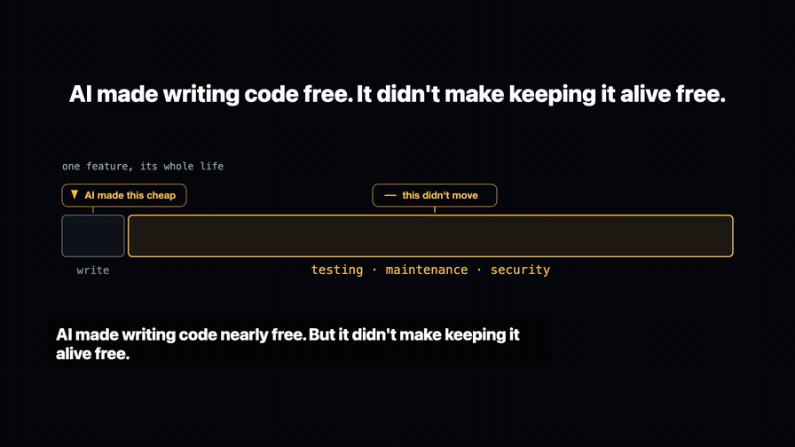
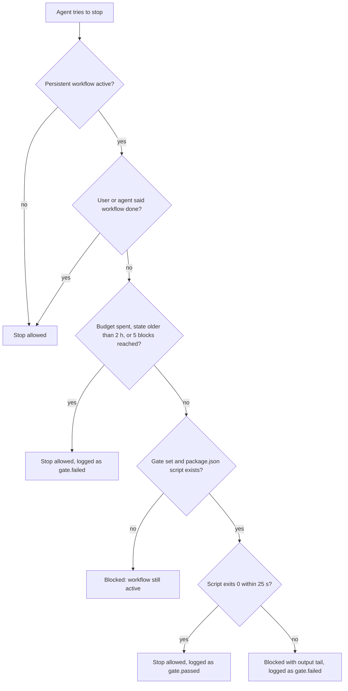

# oh-my-agent: Un Equipo de Especialistas para el Agente de Código Que Ya Usas

[](https://www.npmjs.com/package/oh-my-agent) [](https://www.npmjs.com/package/oh-my-agent) [](https://github.com/first-fluke/oh-my-agent) [](https://github.com/first-fluke/oh-my-agent/blob/main/LICENSE) [](https://github.com/first-fluke/oh-my-agent/commits/main)

[English](../README.md) | [한국어](./README.ko.md) | [中文](./README.zh.md) | [Português](./README.pt.md) | [日本語](./README.ja.md) | [Français](./README.fr.md) | [Nederlands](./README.nl.md) | [Polski](./README.pl.md) | [Русский](./README.ru.md) | [Deutsch](./README.de.md) | [Tiếng Việt](./README.vi.md) | [ภาษาไทย](./README.th.md)

**oh-my-agent (`oma`) añade un equipo de especialistas al agente de código que ya usas: Claude Code, Codex CLI, Cursor y 11 más.** Un planificador desglosa el trabajo, los ingenieros construyen en paralelo, un revisor comprueba el resultado y un depurador corrige las causas raíz. También hace investigación con citas, presentaciones, videos e imágenes. La mayoría de los pasos dejan un archivo que puedes abrir, y en los workflows de larga duración un gate puede devolver al agente al trabajo hasta que tu propio script `test`, `lint` o `typecheck` pase.

Ejecuta esto desde la raíz de tu proyecto:

```bash
curl -fsSL https://raw.githubusercontent.com/first-fluke/oh-my-agent/main/cli/install.sh | bash
```

Después ejecuta `oma doctor` y escribe `/plan add user accounts with a settings page` en tu agente. [Tus primeros 5 minutos](#your-first-5-minutes) te guía paso a paso.



[Ver el video completo (35s)](./assets/video/oh-my-agent-explainer.mp4)

## Qué obtienes

Los **workflows** son lo que escribes (o simplemente dices). Convocan a los **roles**, los especialistas. Las **skills** son el conocimiento práctico: cada rol lleva las suyas, y tu agente carga el resto cada vez que una tarea las necesita.

| | Qué te da | Pruébalo |
|---|---|---|
| **12 roles especialistas** | PM, arquitecto, ingenieros de backend, frontend, móvil, base de datos e infraestructura, revisor de QA, depurador, refactorizador, curador de docs, investigador ([conócelos](#meet-the-team)) | `/orchestrate build a TODO app with login` |
| **21 workflows** | Slash commands desde `/brainstorm` y `/plan` hasta `/review`, `/debug` y `/scm`. La mayoría también arranca con una petición en lenguaje natural (bancos de palabras clave en hasta 11 idiomas) | "review this PR" |
| **33 skills** | Conocimiento de dominio que solo se carga cuando una tarea lo necesita: UI, APIs, esquemas, Terraform, CI, seguridad, git, observabilidad | se carga sola, p. ej. "add a Terraform S3 bucket" |
| **Archivos que puedes abrir** | Planes, documentos de diseño, contratos de API, ADRs, notas de bugs, resultados por agente, evidencias de seguridad, explicadores HTML, resúmenes | `ls .agents/results` |
| **Comprobaciones que no se fían de la palabra del agente** | En un workflow de larga duración, tu propio script `test`, `lint` o `typecheck` debe pasar antes de que el agente pueda detenerse; `oma ralph verify` comprueba que una ejecución de `/ralph` dejó sus archivos de plan, QA y refactor | `/ultrawork …`, después `oma goal set --gate test` |
| **Investigación y contenido** | Búsqueda con citas, investigación de mercado, artículos académicos, presentaciones, videos MP4, imágenes, voz local, PDF/HWP a Markdown | `/video`, `/convert` |
| **Una carpeta, 14 runtimes** | Un único directorio `.agents/` portable, escrito en los propios archivos de configuración de cada runtime | `oma link cursor` |

**[Instalación](#install)** · **[Primeros 5 minutos](#your-first-5-minutes)** · **[El equipo](#meet-the-team)** · **[¿Qué workflow?](#how-the-team-works-together)** · **[Todo lo que incluye](#everything-in-the-box)** · **[Compatibilidad](#works-with)** · **[Verificación](#verification-not-narration)** · **[Preguntas frecuentes](#faq)** · **[Docs](https://first-fluke.github.io/oh-my-agent/)**

<a id="install"></a>
## Instalación

El script instala [bun](https://bun.sh) si falta, instala el comando `oma` de forma global (`bun install --global oh-my-agent`; se omite si `oma` ya está en tu PATH) y luego inicia la configuración interactiva. El comando global importa: los hooks (detección de palabras clave, el Stop gate) y varios workflows llaman a `oma`, y los hooks no hacen nada, sin avisar, cuando no lo encuentran. Si te saltas el script, instálalo tú mismo con `bun install --global oh-my-agent` (`npm install --global oh-my-agent` o `brew install oh-my-agent` también sirven).

<details>
<summary>Windows, o sin el script de instalación</summary>

```powershell
# Windows (PowerShell)
irm https://raw.githubusercontent.com/first-fluke/oh-my-agent/main/cli/install.ps1 | iex
```

```bash
# Cualquier OS con bun instalado: la misma configuración, más el comando global `oma`
bun install --global oh-my-agent
oma
```

En Windows el instalador oculta Antigravity, Hermes y Kimi, y el wrapper de hooks es un script de bash. El MCP de navegador Aside, que viene por defecto, se instala con `bash`, así que desmárcalo si no tienes bash.

</details>

La configuración te pide el idioma de respuesta, qué runtimes de agentes conectar, los proveedores de capacidades, un MCP de navegador, un preset de modelos y un preset de skills. **Elige `All` como preset de skills si no estás seguro**: los workflows se instalan siempre, y varios de ellos (`/orchestrate`, `/work`, `/ultrawork`, `/ralph`, `/docs`, `/security`) necesitan skills que solo incluye `All`.

<details>
<summary>Qué más hace el instalador por defecto</summary>

- Instala **bun** (obligatorio). Intenta instalar **uv**, **Serena** (`uv tool install`) y **CUE** (`brew install cue` o `winget`), y continúa con una advertencia si alguno falla.
- Preselecciona el MCP de navegador **Aside** en la configuración interactiva y solo lo instala con `curl -fsSL https://releases.aside.com/install.sh | bash` si lo mantienes seleccionado. Desmárcalo en el paso del MCP de navegador o cámbialo más tarde con `oma update mcp`.
- Usa **AgentMemory** para la memoria semántica, lo que ejecuta `bun install -g @agentmemory/agentmemory` y lo registra como servicio de inicio de sesión (launchd, unidad de usuario de systemd o tarea programada de Windows). Elige el proveedor `none` o define `OMA_NO_AGENTMEMORY=1` para omitirlo.
- Pregunta antes de enlazar skills en las carpetas de vendors de tu directorio personal (Antigravity, Hermes, Kimi). En `$HOME` sin `--global` pide confirmación.
- Escribe algunos archivos fuera del proyecto sin preguntar: `~/.claude.json` (marca el proyecto como espacio de trabajo de confianza de Claude Code), `~/.serena/` (contexto de OMA, tamaño mínimo de respuesta, registro del proyecto), `~/.cursor/cli-config.json` (desactiva la atribución de commits de Cursor), `~/.grok/config.toml` (telemetría) y `~/.gemini/antigravity-cli/` (HUD), cada uno solo para un vendor que hayas seleccionado.
- Escribe **exclusiones de telemetría** en los ajustes de los vendors (Claude `DISABLE_TELEMETRY=1`, que también desactiva Claude Code Remote Control; estadísticas de uso de Gemini, Qwen, Codex y Grok). Define `telemetry: true` para conservar los valores predeterminados de los vendors.
- Añade a `.claude/settings.json` los ajustes de Claude Code que no estén definidos, entre ellos `skipDangerousModePermissionPrompt: true`, `effortLevel: high`, `cleanupPeriodDays: 180` y flags de env que desactivan la auto memory, el adaptive thinking, el reporte de errores y las instrucciones de git integradas. Los valores que ya hayas definido se conservan.
- Añade un **trailer de coautoría**: la atribución de commits de Claude Code pasa a ser `Co-Authored-By: First Fluke <our.first.fluke@gmail.com>` y las PR reciben una línea "Generated with oh-my-agent". Define `scm.co_author.enabled: false` para desactivarlo.
- Instala en `.githooks/` una **protección commit-msg** que rechaza las direcciones `Co-authored-by` que no están en la lista, y configura `git config --local core.hooksPath .githooks` cuando no hay otros hooks activos. Define `scm.co_author.enforce_hook: false` para desactivarla.
- `oma update` actualiza la CLI de `oma` en segundo plano (`auto_update_cli: false` u `OMA_SKIP_VERSION_CHECK=1` para detenerlo) y ejecuta `uv tool upgrade serena-agent --prerelease=allow` (`serena.auto_update: false`).
- Con Serena en el modo `bridge` predeterminado, la primera sesión de agente que inicia un servidor Serena compartido registra un **temporizador de limpieza** que detiene cada 5 minutos los servidores Serena compartidos inactivos (launchd `dev.oma.serena-daemon-gc`, temporizador de usuario de systemd `oma-serena-daemon-gc.timer` o tarea programada de Windows `OMA Serena Daemon GC`). Define `serena.mode: stdio` para omitir el servidor compartido y su temporizador. `oma uninstall` no elimina el temporizador.
- Las ejecuciones no interactivas (`-y`, `OMA_YES=1`, `CI=true`) usan el preset de skills `All`, `model_preset: auto` y Python como lenguaje de backend. No seleccionan ningún MCP de navegador (y omiten el script de instalación de Aside) salvo que `mcp.devtools_browsers` ya incluya uno.

</details>

<details>
<summary>Presets de skills</summary>

| Preset | Skills |
|--------|--------|
| **All** | **Las 33 skills** (recomendado) |
| Fullstack | architecture, backend, brainstorm, db, debug, design, dev-workflow, frontend, mobile, pm, qa, scm, tf-infra |
| Fullstack Web | Fullstack sin mobile ni tf-infra |
| Fullstack Mobile | Fullstack sin frontend ni tf-infra |
| Frontend | architecture, brainstorm, debug, design, frontend, pm, qa, scm |
| Backend | architecture, backend, brainstorm, db, debug, dev-workflow, pm, qa, scm |
| Mobile | architecture, brainstorm, debug, mobile, pm, qa, scm |
| DevOps | architecture, brainstorm, debug, dev-workflow, observability, pm, qa, scm, tf-infra |
| Research | academic-writing, hwp, market, pdf, scholar, scm, search, translation |
| Content | academic-writing, design, image, scm, translation, voice |
| Custom | Elige las skills una a una |

De los presets con nombre, solo `All` incluye coordination, orchestration, docs, security, refactor, explanation, recap, video, slide y skill-creation (o elígelas en `Custom`). A Research y Content les faltan las skills en las que se apoyan `/plan`, `/review`, `/debug`, `/architecture` y `/brainstorm`. Consulta [Workflows que necesitan skills fuera de un preset](../web/docs/getting-started/installation.md#workflows-that-need-skills-outside-a-preset).

</details>

<a id="your-first-5-minutes"></a>
## Tus primeros 5 minutos

1. **Instala** con el comando de arriba.
2. **Comprueba la instalación:**

   ```bash
   oma doctor
   ```

   Deberías ver `CLI Status` (qué CLI de agentes están instaladas y con sesión iniciada) y `Skills Status` (por ejemplo `Skills (33/33 installed, 33 complete)`). Si no se encuentra `oma`, abre una terminal nueva (puede que el instalador acabe de añadir `~/.bun/bin` a tu PATH) o ejecuta `bun install --global oh-my-agent`.
3. **Abre tu agente en el proyecto y pide un plan:**

   ```text
   /plan add user accounts with a settings page
   ```

   O simplemente escribe "plan user accounts with a settings page": en los runtimes con prompt hook, la palabra clave inicia el mismo workflow.
4. **Revisa lo que obtuviste.** `/plan` se ejecuta en la sesión actual. Para un trabajo que abarca varias áreas, como este, escribe `.agents/results/plan-<session-id>.json` y un tracker en `docs/plans/work/<NNN>-<name>.md`. Una petición pequeña, de una sola área, recibe una recomendación directa en lugar de un archivo de plan.

Detente ahí. Sabrás si esto es para ti. Cuando quieras más, ejecuta `/work` o `/orchestrate` sobre el plan.

<a id="meet-the-team"></a>
## Conoce al equipo

Tu propio agente dirige el equipo. En `/work`, `/orchestrate` y `/ultrawork` asigna cada trabajo al especialista adecuado, que se ejecuta como su propio subagente. `/plan`, `/architecture` y `/docs` se ejecutan en tu sesión actual con la skill de ese rol, y `/review` y `/debug` llaman a su especialista cuando el alcance es grande. Cuando un rol está en la CLI de otro vendor, `oma agent spawn` lo ejecuta allí.

| Tu especialista | Lleva | Llámalo con | Deja |
|---|---|---|---|
| **Product manager** (`pm-planner`) | oma-pm | `/plan`, o "plan the payment feature" | Un JSON de plan y un tracker en `docs/plans/work/` para trabajo mediano y complejo (las peticiones simples reciben una recomendación directa) |
| **Arquitecto** (`architecture-reviewer`) | oma-architecture | `/architecture` | Un ADR o una recomendación en `.agents/results/architecture/` |
| **Ingenieros de backend, frontend, móvil, base de datos e infraestructura** | oma-backend, oma-frontend + oma-design, oma-mobile, oma-db, oma-tf-infra | `/work`, `/orchestrate` | Código, tests y un archivo `result-<agent>` por tarea |
| **Revisor de QA** (`qa-reviewer`) | oma-qa | `/review`, o "review this PR" | Hallazgos clasificados de CRITICAL a LOW, cada uno con file:line y código de corrección |
| **Depurador** (`debug-investigator`) | oma-debug | `/debug`, o "fix this bug" | Una corrección mínima, un test de regresión y una nota del bug en `.agents/results/bugs/` cuando se justifica |

<details>
<summary>Los otros tres roles, y las skills sin rol</summary>

| Tu especialista | Lleva | Llámalo con | Deja |
|---|---|---|---|
| **Refactorizador** (`refactor-engineer`) | oma-refactor | la fase REFINE de `/ultrawork` | Commits `refactor:` que preservan el comportamiento y un informe `result-refactor-<session>.md` |
| **Curador de docs** (`docs-curator`) | oma-docs | `/docs`, o "verify docs" | `docs/generated/doc-refs.json` y los parches de documentación que apruebes |
| **Investigador** (`research-explorer`) | oma-search, oma-market, oma-scholar | una petición de investigación | Fuentes citadas con etiquetas de confianza; informes de mercado en `.agents/results/market/` |

Al ingeniero de infraestructura (`tf-infra-engineer`) se le indica que pregunte antes de cualquier `apply` o `destroy` destructivo o en producción. Las skills restantes (brainstorm, security, scm, dev-workflow, observability, explanation, recap, translation, coordination, orchestration, skill-creation, contenido y medios) no tienen un rol dedicado. Tu agente las carga por sí mismo, y para la mayoría el skill injector sugiere la adecuada a partir de tu prompt.

</details>

<a id="how-the-team-works-together"></a>
## Cómo trabaja el equipo en conjunto

```text
 THINK   /brainstorm ......................... docs/plans/designs/<NNN>-<feature>.md
 PLAN    /plan · /architecture ............... plan JSON, API contracts, ADR
 DESIGN  /design ............................. DESIGN.md + tokens
 BUILD   /work · /orchestrate · /ultrawork ... code + result-<agent> files, engineers in parallel
 CHECK   /review · /security · /debug ........ findings, security evidence, regression test
 SHIP    /scm · /docs ........................ Conventional Commits, doc fixes
```

Cada paso le entrega un archivo al siguiente. `/brainstorm` guarda un diseño que `/plan` lee, y `/plan` escribe un plan en el que cada tarea tiene un agente, dependencias, criterios de aceptación y un comando de comprobación. `/orchestrate` ejecuta ese plan (carga el `plan-*.json` más reciente, o escribe uno). `/work` y `/ultrawork` empiezan haciendo que el PM escriba su propio plan. Sáltate cualquier etapa que no necesites; cada etapa también funciona por sí sola.

**¿Qué workflow debería dirigir al equipo?**

| Lo que quieres | Ejecuta | Cómo termina |
|---|---|---|
| Solo un plan | `/plan` | Un archivo de plan para trabajo de varias áreas, o una recomendación directa para trabajo pequeño |
| Un desarrollo dirigido por el PM que sigues paso a paso | `/work` | El PM, después los ingenieros nivel por nivel, después QA. Los hallazgos CRITICAL y HIGH entran en un bucle de corrección (hasta 5 ciclos) |
| Un desarrollo en paralelo sin intervenir | `/orchestrate` | Solo cuentan como hechas las tareas cuyas comprobaciones pasan; cada tarea tiene hasta 3 intentos y después se marca como parcial o fallida |
| El máximo cuidado | `/ultrawork` | Cinco fases con gates (PLAN, IMPL, VERIFY, REFINE, SHIP); cada revisión se ejecuta en una sesión de revisor nueva |
| "No pares hasta que esté terminado de verdad" | `/ralph` | Repite `/ultrawork` con un juez de contexto nuevo lanzado por separado hasta que pasan todos los criterios; se detiene con un informe parcial cuando hay criterios bloqueados o tras 5 iteraciones |
| El equipo con temporizador | `oma schedule create qa-reviewer "review open PRs" --every 2h` | Un log en Markdown por ejecución en `~/.oma/schedule/runs/<id>/` |

No necesitas slash commands. En los runtimes con prompt hook, las peticiones en lenguaje natural (bancos de palabras clave en hasta 11 idiomas) pueden iniciar la mayoría de los workflows: "review this PR" inicia `/review`. Describir una app completa ("Build a TODO app with user authentication") sugiere `/orchestrate`, y tu agente decide si lo ejecuta. Las palabras clave dentro de bloques de código se ignoran.

`/orchestrate`, `/work`, `/ultrawork` y `/ralph` son **persistentes** cuando los invocas por su nombre, como slash command o en texto plano ("ultrawork: add rate limiting"). Entonces, cuando el agente intenta detenerse antes de tiempo, se le devuelve al trabajo (hasta 5 veces o 2 horas) hasta que digas **"workflow done"**. Una petición que solo coincide de forma aproximada se limita a sugerirlos.

**Medido, con salvedades.** En el [benchmark](../benchmarks/README.md) (un prompt, Claude Code con cinco configuraciones de complementos distintas, incluida la versión sin complementos, `claude-opus-4-6`, una build cada una), oma obtuvo 80,6 frente a 70,7 de Claude Code sin más, con 1,7 veces el coste (4,04 $ frente a 2,37 $) y 1,8 veces el tiempo.

<details>
<summary>Los 21 workflows</summary>

| Comando | Qué hace |
|---------|--------------|
| `/architecture` | Sopesa los trade-offs de diseño y produce una recomendación, una revisión o un ADR |
| `/brainstorm` | Explora ideas y restricciones y produce un diseño aprobado antes de planificar |
| `/convert` | Convierte PDF/HWP a Markdown, o transcodifica imágenes, video y audio con ffmpeg |
| `/debug` | Reproduce un bug, corrige la causa raíz, escribe un test de regresión y busca patrones similares |
| `/deepinit` | Mapea una base de código existente en AGENTS.md, ARCHITECTURE.md y una base de conocimiento en docs/ |
| `/design` | Construye un sistema de diseño, DESIGN.md y tokens con comprobaciones de accesibilidad |
| `/docs` | Encuentra referencias rotas en la documentación y propone parches para los docs que tocó un diff |
| `/explain` | Convierte un diff, PR, rama o tema en un explicador HTML interactivo y autónomo |
| `/orchestrate` | Ejecuta agentes en paralelo, los coordina mediante estado en archivos y verifica el resultado (persistente) |
| `/plan` | Desglosa una feature en tareas priorizadas con contratos de API |
| `/ralph` | Repite `/ultrawork` con un juez lanzado por separado, hasta 5 iteraciones (persistente) |
| `/recap` | Resume tu historial de conversaciones con IA de un día o un periodo |
| `/review` | Revisa seguridad (OWASP Top 10), rendimiento, accesibilidad (WCAG 2.2 AA) y calidad del código |
| `/schedule` | Registra un trabajo de agente que se ejecuta en un intervalo recurrente |
| `/scm` | Gestiona ramas, merges, conflictos, worktrees y Conventional Commits |
| `/security` | Escanea código fuente, skills de agentes y componentes MCP, valida hallazgos y configura gates de CI |
| `/stack-set` | Detecta tu stack tecnológico y genera referencias específicas del stack para las skills de dominio |
| `/tools` | Lista, activa y desactiva herramientas MCP en lenguaje natural |
| `/ultrawork` | Cinco fases (PLAN, IMPL, VERIFY, REFINE, SHIP), cada revisión en una sesión de revisor nueva (persistente) |
| `/video` | Convierte un brief en un MP4 terminado mediante un pipeline en el que las claves son opcionales |
| `/work` | Coordina varios agentes en un proyecto multidominio con planificación de PM y revisión de QA (persistente) |

La precisión de activación se mide, no se supone: `oma verify triggers` evalúa el detector contra un corpus etiquetado de 212 prompts en inglés y coreano, y CI falla por encima del 10 % de false-fire o del 20 % de missed-fire. Última medición: **0 % de missed-fire, 5,3 % de false-fire**. Referencia completa: [Workflows](https://first-fluke.github.io/oh-my-agent/docs/core-concepts/workflows/).

</details>

<a id="see-it-work"></a>
## En acción

Una sesión de `/ultrawork` a modo de ejemplo. El bloque `[OMA PERSISTENT MODE: ULTRAWORK]` es exactamente el formato que imprime el Stop hook; las demás líneas están parafraseadas:

```text
you    /ultrawork add rate limiting to POST /login
agent  runs `oma goal set --gate test`
agent  PLAN writes .agents/results/plan-<run-id>.json
agent  IMPL -> VERIFY -> REFINE -> SHIP  (each review runs in a fresh reviewer session)
agent  "Rate limiting added. All tests pass."
oma    [OMA PERSISTENT MODE: ULTRAWORK]
       Stop gate 'test' FAILED (reinforcement 1/5).
       Fix the failures below, then finish the workflow — the stop is allowed only when the gate passes.
       --- gate output (tail) ---
       FAIL  src/auth/login.test.ts > returns 429 after 5 attempts
       To abandon instead: delete .agents/state/ultrawork-state-<host-session>.json or say "workflow done".
agent  fixes the limiter and stops again
oma    `test` exits 0: stop allowed, gate.passed appended to the session log
```

Después, `oma state list` encuentra la sesión y `oma state get <oma-sid>` (el ID que imprime `state list`) muestra cada evento de gate. Con `/ralph`, `oma ralph verify --json` también comprueba que las fases dejaron sus archivos (salida recortada):

```json
{ "ok": false,
  "missing": [{ "id": "A3", "description": "a distinct QA agent ran (VERIFY phase)",
                "pattern": ".agents/state/memories/result-qa*.md or .agents/results/result-qa*.md",
                "status": "missing" }] }
```

<a id="everything-in-the-box"></a>
## Todo lo que incluye

<details>
<summary><strong>Planificar y diseñar</strong>: <code>/brainstorm</code>, <code>/plan</code>, <code>/architecture</code>, <code>/design</code></summary>

| Comando | Qué hace | Escribe |
|---|---|---|
| `/brainstorm` | Hace las preguntas aclaratorias de una en una y propone 2-3 enfoques que funcionan de forma distinta, y después pasa el relevo a `/plan`. No escribe código | `docs/plans/designs/<NNN>-<feature>.md` |
| `/plan` | Clasifica el trabajo como simple, mediano o complejo; si es mediano o complejo, lo divide en tareas, cada una con un agente, dependencias, criterios de aceptación y un comando de comprobación, y define contratos de API cuando el trabajo cruza un límite | `.agents/results/plan-<sid>.json`, `docs/plans/work/<NNN>-<name>.md`, contratos en `.agents/results/api-contracts/` cuando hacen falta |
| `/architecture` | Lee primero las decisiones anteriores, compara al menos 2 opciones y marca como superseded los ADR reemplazados | Un ADR o una recomendación en `.agents/results/architecture/` |
| `/design` | Propone 2-3 direcciones, después escribe `DESIGN.md` con tokens y audita el layout responsive y la accesibilidad | `DESIGN.md`, tokens de CSS/Tailwind/shadcn |

</details>

<details>
<summary><strong>Construir</strong>: 7 skills de dominio, más <code>/stack-set</code> para adaptarlas a tu stack</summary>

| Skill | Construye |
|---|---|
| oma-frontend | UI en React/Next.js o Angular que sigue tus tokens y tus reglas de i18n y accesibilidad |
| oma-backend | APIs, autenticación y acceso a datos, en capas router → service → repository |
| oma-mobile | Apps con Flutter, React Native o Swift |
| oma-db | Esquemas, migraciones, optimización de consultas, planes de recuperación vectorial/RAG |
| oma-tf-infra | Terraform para cualquier nube, señalando los riesgos de drift, de cambios destructivos y de coste |
| oma-dev-workflow | Tareas de mise, lint/format/typecheck, commitlint, git hooks, CI/CD y releases |
| oma-observability | OpenTelemetry, SLOs, alertas y forense de incidentes |

`/stack-set` lee tus manifiestos y escribe referencias específicas del stack para las skills de backend, frontend y móvil. En un monorepo, a los ingenieros de frontend, backend y móvil se les dirige a su workspace (pnpm, workspaces de npm/yarn/bun, lerna, nx, turbo, `mise.toml`).

</details>

<details>
<summary><strong>Revisar, corregir y entregar</strong>: <code>/review</code>, <code>/security</code>, <code>/debug</code>, refactor, <code>/scm</code></summary>

| Comando o skill | Qué hace | Escribe |
|---|---|---|
| `/review` | Una auditoría de dependencias y después OWASP Top 10, rendimiento, WCAG 2.2 AA y calidad del código. Cada hallazgo lleva file:line y código de corrección | El informe en el chat más un registro en memoria; ningún archivo de informe |
| `/security` | Escanea tu código fuente, skills de agentes y servidores MCP (Deepsec, Cisco Skill and MCP Scanner) y, si hay un despliegue de prueba acotado, ejecuta pruebas de penetración ARTEX. El workflow exige que un motor que no llegó a ejecutarse se informe como fallido, no como limpio | `.agents/results/security/<run-id>/` |
| `/debug` | Reproduce el fallo, corrige la causa raíz con un cambio mínimo, añade un test de regresión y busca el mismo patrón en otras partes | La corrección y el test; una nota del bug en `.agents/results/bugs/` cuando se justifica |
| oma-refactor | Cambia la estructura sin cambiar el comportamiento: primero tests de caracterización, después commits solo de refactor | `.agents/results/refactor/` |
| `/scm` | Conventional Commits divididos por cambio lógico; ramas, merges, rebases y worktrees | Commits y ramas |

</details>

<details>
<summary><strong>Documentación y conocimiento</strong>: <code>/deepinit</code>, <code>/docs</code>, <code>/explain</code>, <code>/recap</code>, traducción</summary>

| Comando o skill | Qué hace | Escribe |
|---|---|---|
| `/deepinit` | Convierte un repo existente en una base de conocimiento lista para agentes | `AGENTS.md`, `ARCHITECTURE.md`, `docs/` |
| `/docs` | Encuentra referencias rotas, aplica parches a los docs que tocó un diff (solo los parches que apruebes) y detecta traducciones desactualizadas | `docs/generated/doc-refs.json`, docs parcheados |
| `/explain` | Convierte un PR, una rama o un cambio en staging en un recorrido HTML con un cuestionario de 5 preguntas, o un tema en un explicador visual de una página | `.agents/results/explain/<date>-<slug>.html` |
| `/recap` | Resume tus conversaciones con IA en todas tus herramientas para un día o un periodo | `.agents/results/recap/<date>.md` |
| oma-translation | Traducción que se lee como escrita por un nativo; los placeholders, el código y las claves de locale no cambian | Texto traducido |

</details>

<details>
<summary><strong>Investigación</strong>: búsqueda, mercado, artículos, escritura académica</summary>

| Skill | Qué hace | Escribe |
|---|---|---|
| oma-search | Búsqueda en documentación, web y código, con una etiqueta de confianza en cada fuente | Resultados con citas |
| oma-market | Puntos de dolor, tendencias y competidores a partir de señales de comunidad, enmarcados con SWOT, las 5 fuerzas de Porter y PESTEL | `.agents/results/market/<topic>-<date>.md` |
| oma-scholar | Búsqueda de artículos que lee un archivo compacto de afirmaciones (formato Knows, unos 700 tokens) en lugar del PDF completo (unos 10K tokens) | `<paper>.knows.yaml` |
| oma-academic-writing | Redacta y audita prosa académica según una rúbrica | Tu archivo |

</details>

<details>
<summary><strong>Contenido y medios</strong>: <code>/video</code>, <code>/convert</code>, presentaciones, imágenes, voz</summary>

| Comando o skill | Qué crea | Escribe |
|---|---|---|
| `/video` | Shorts, explicadores o demos como MP4 terminado; los proveedores con clave tienen alternativas sin clave | `.agents/results/videos/<run>/` con un manifiesto |
| oma-slide | Decks HTML de 1920×1080, exportados a PDF, PNG o PPTX | `.agents/results/slides/<session>/` |
| oma-image | Imágenes a través de las CLI de los vendors en las que tienes sesión iniciada, comparadas lado a lado | `.agents/results/images/<run>/` |
| oma-voice | Texto a voz y transcripción locales a través de la app Voicebox | `.agents/results/voice/<run>/` |
| `/convert` | PDF o HWP a Markdown; conversión de imagen, video y audio con ffmpeg | Junto al archivo de entrada |

Estos pipelines informan de que falta una fuente o una clave de vendor en lugar de devolver en silencio un resultado más pobre.

</details>

<details>
<summary><strong>Hooks que se ejecutan sin que se lo pidas</strong></summary>

| Hook | Qué hace | Desactivación / límite |
|---|---|---|
| Inicio por palabra clave | Inicia el workflow correspondiente a partir de una petición en lenguaje natural | Se omiten las preguntas, el texto pegado y los bloques de código |
| Skill injector | Dirige a tu agente hacia las skills adecuadas para el prompt | En pausa mientras hay un workflow persistente activo |
| Stop gate | Devuelve al trabajo un workflow persistente; con `oma goal set --gate test`, la parada se permite cuando ese script sale con código 0 en menos de 25 s | Di "workflow done"; también se libera tras 5 bloqueos o 2 horas |
| Refactor guard | Al detenerse, marca para `refactor-engineer` los archivos editados de más de 500 líneas | Hay que activarlo: `refactor_guard.enabled` |
| Secret guard | Bloquea `git add` de `*.env`, `*.pem`, `id_rsa*`, `*.tfstate` y archivos similares | Antepón `OMA_SCM_ALLOW_SECRETS=1` a ese comando concreto |
| Code-search guard | Bloquea la búsqueda recursiva nativa en el proyecto para que el agente use Serena o Gortex | `providers.code_intelligence_guard: off` |
| Filtro de tests | Conserva solo los fallos y los resúmenes de la salida de los tests, para gastar menos tokens | `OMA_TEST_FILTER=0` |
| Memoria de sesión | Cuando cambias de sesión o la reanudas (o tras una compactación), vuelve a inyectar los eventos recientes de la sesión activa más lo que recupera AgentMemory | El proveedor de memoria `none` o `OMA_NO_AGENTMEMORY=1` desactiva la recuperación; la instantánea local de eventos se mantiene |

`oma hook probe` comprueba que los prompt hooks de oma aceptan la entrada de hooks de cada runtime (no lanza el runtime). Qué hooks conecta cada runtime se detalla en [Diferencias entre hosts](#host-differences).

</details>

<details>
<summary><strong>Agentes en paralelo, sesiones y dashboards</strong></summary>

- `oma agent spawn <role> "<task>" <sid>` ejecuta un rol en Antigravity, Claude, Codex, Cursor, OpenCode, Qwen, Grok o Pi, con `--isolation worktree` y `--fallback-vendors`. `oma agent parallel` ejecuta varios a la vez.
- `oma state list --all-projects` y `oma state get <sid>`: las sesiones y cada evento registrado.
- `oma dashboard terminal` / `oma dashboard web`: estado de los agentes en vivo (el dashboard web solo escucha en `127.0.0.1`). [Guía del dashboard](../web/docs/guide/dashboard-monitoring.md).
- `oma stats get` (métricas de productividad), `oma retro` (una retrospectiva de git), `oma recap --window 7d` (lo que hiciste en tus herramientas de IA).
- `oma visualize --affected <paths>`: qué skills, workflows, agentes y comprobaciones dependen de los archivos de `.agents/` que cambiaste.

</details>

<details>
<summary><strong>Code intelligence, memoria y MCP</strong></summary>

| Ranura | Por defecto | Alternativas |
|---|---|---|
| Docs | Context7 | — |
| Code intelligence | Serena, un servidor compartido por proyecto | Gortex (experimental) |
| Memoria semántica | AgentMemory | Honcho (experimental), none |
| MCP de navegador | Aside | Chrome DevTools, Firefox DevTools |

Los agentes se coordinan mediante archivos simples en `.agents/state/`, sin ningún servicio externo. `/tools` activa o desactiva herramientas MCP en lenguaje natural. Detalles: [Proveedores de Capacidades](./capability-providers.md).

</details>

<details>
<summary><strong>Mejora con el tiempo</strong></summary>

- `oma skill eval` mide la mejora que aporta una skill frente a una baseline en tareas held-out. `oma skill optimize` propone ediciones que la aumentan, y `--apply` las conserva ([guía de skill-eval](../web/docs/guide/skill-eval.md)).
- `oma harness evolution enable --max-dispatches <n>` programa un ciclo nocturno que convierte las ejecuciones fallidas en fixtures de regresión y aplica como overlays del proyecto las mejoras de skills que superan la evaluación. Añade `--mode propose` para solo registrarlas.
- `oma emit` exporta el código fuente de `.agents/` como un paquete de Agent Skills, un paquete de Agent Plugins, un marketplace de plugins de Claude Code o `AGENTS.md`.

</details>

<details>
<summary><strong>Configuración y salvaguardas</strong></summary>

- Un único `.agents/oma-config.yaml`, propiedad del usuario, sobrevive a las actualizaciones (solo `oma update --force` lo restablece); encima pueden ir overlays privados `.local.yaml` o `.local.cue`. `language` define el idioma de respuesta.
- 13 reglas de proyecto (backend, commit, database, debug, design y más) se cargan como reglas nativas en Claude Code y Cursor, y se indexan en el bloque gestionado de `AGENTS.md` que se escribe para Codex, Qwen Code y Pi.
- Las actualizaciones guardan copias de seguridad de la configuración y de las migraciones en `.agents/backup/`; las skills y los workflows incluidos se sustituyen en su sitio, así que mantén los cambios locales fuera de ellos. `oma uninstall --dry-run` muestra lo que se eliminaría. `first-fluke/oma-update-action@v1` ejecuta `oma update` en CI y abre un PR.

</details>

<details>
<summary><strong>Los 33 skills</strong></summary>

| Skill | Qué hace |
|---|---|
| **oma-academic-writing** | Redacta, revisa y audita prosa académica |
| **oma-architecture** | Evalúa trade-offs arquitectónicos y define límites de módulos con análisis ADR/ATAM/CBAM |
| **oma-backend** | Construye APIs, autenticación y acceso a datos en Python, Node.js o Rust |
| **oma-brainstorm** | Explora ideas contigo antes de que te comprometas a construir |
| **oma-coordination** | Guía la coordinación manual paso a paso de los agentes PM, frontend, backend, móvil y QA |
| **oma-db** | Diseña esquemas, migraciones, índices y almacenes vectoriales |
| **oma-debug** | Encuentra la causa raíz, corrige el bug y escribe un test de regresión |
| **oma-design** | Construye sistemas de diseño con tokens, accesibilidad y layouts responsive |
| **oma-dev-workflow** | Automatiza CI/CD, releases y tareas de monorepo |
| **oma-docs** | Detecta referencias rotas en la documentación, la sincroniza con los cambios de código y señala la deriva de traducción |
| **oma-explanation** | Convierte un diff, PR, rama o tema en un explicador HTML autónomo, con cuestionario para los cambios de código |
| **oma-frontend** | Construye UI con React/Next.js o Angular |
| **oma-hwp** | Convierte archivos HWP, HWPX y HWPML a Markdown |
| **oma-image** | Genera imágenes y variaciones guiadas por referencias, y puede comparar proveedores de IA lado a lado |
| **oma-market** | Investiga tu mercado a partir de señales de comunidad y lo encuadra con SWOT, 5F y PESTEL |
| **oma-mobile** | Construye apps móviles con Flutter, React Native o Swift nativo |
| **oma-observability** | Enruta el trabajo de observabilidad entre métricas, logs, trazas, SLOs y forense de incidentes |
| **oma-orchestration** | Ejecuta múltiples agentes en paralelo desde el CLI |
| **oma-pdf** | Convierte archivos PDF a Markdown |
| **oma-pm** | Planifica tareas, desglosa requisitos y define contratos de API |
| **oma-qa** | Revisa los cambios en cuanto a corrección, seguridad OWASP, rendimiento y accesibilidad |
| **oma-recap** | Convierte tu historial de conversaciones en resúmenes de trabajo organizados por tema |
| **oma-refactor** | Refactoriza sin cambiar el comportamiento, con selección de hotspots, pruebas de caracterización y commits solo de refactor |
| **oma-scholar** | Busca literatura académica y genera sidecars de artículos Knows para afirmaciones, evidencias y revisión por pares |
| **oma-scm** | Gestiona ramas, fusiones, worktrees y Conventional Commits |
| **oma-search** | Dirige cada consulta a la mejor fuente y puntúa cuánto puedes confiar en el resultado |
| **oma-security** | Escanea código fuente, habilidades de agentes y componentes MCP; prueba aplicaciones web desplegadas y valida hallazgos |
| **oma-skill-creation** | Escribe y audita nuevos skills de OMA |
| **oma-slide** | Genera decks de presentación HTML y los exporta a PDF/PNG/PPTX |
| **oma-tf-infra** | Aprovisiona infraestructura multi-cloud con Terraform |
| **oma-translation** | Traduce para que el resultado parezca escrito por un hablante nativo |
| **oma-video** | Genera videos cortos, explicativos y demos mediante un pipeline de HyperFrames que funciona sin claves |
| **oma-voice** | Genera voiceovers y transcribe audio en el propio dispositivo |

</details>

<a id="works-with"></a>
## Compatibilidad

14 destinos del instalador: Claude Code, Codex CLI, Cursor, Antigravity, Qwen Code, Grok, Kiro, Kimi, OpenCode, Pi, GitHub Copilot, Hermes, CommandCode y ZCode. Conecta un runtime que te saltaste con `oma link <vendor>`. Los runtimes difieren en los hooks que ofrecen; la matriz completa está en [Agentes soportados](./SUPPORTED_AGENTS.md).

- **Orca IDE:** [OMA for Orca](../integrations/orca/README.md) añade un panel lateral y acciones en la paleta de comandos (Orca 1.4.197+ con plugins experimentales).
- **DeepSeek Harness:** [OMA for DeepSeek Harness](../integrations/dsh/README.md) conecta las comprobaciones de OMA mediante un plugin de Cordis. Necesita `oma` en tu `PATH`.

<details>
<summary>Logos de runtimes (destinos del instalador más Amp y DeepSeek Harness)</summary>

nativo = oma escribe los propios archivos de configuración del runtime; adaptador = oma además añade shims de hooks o de agentes. Amp lee `.agents/skills/` por sí mismo y no es un destino del instalador.

<table>
<colgroup>
<col span="6" style="width:16.67%" />
</colgroup>
<tr>
<td align="center">
<a href="https://claude.com/product/claude-code"></a><br/>
<strong>Claude Code</strong><br/>
<sub>nativo + adaptador</sub>
</td>
<td align="center">
<a href="https://github.com/openai/codex"></a><br/>
<strong>Codex CLI</strong><br/>
<sub>nativo + adaptador</sub>
</td>
<td align="center">
<a href="https://antigravity.google"></a><br/>
<strong>Antigravity</strong><br/>
<sub>SSOT nativo</sub>
</td>
<td align="center">
<a href="https://cursor.com"></a><br/>
<strong>Cursor</strong><br/>
<sub>nativo + adaptador</sub>
</td>
<td align="center">
<a href="https://github.com/QwenLM/qwen-code"></a><br/>
<strong>Qwen Code</strong><br/>
<sub>dispatch nativo</sub>
</td>
<td align="center">
<a href="https://github.com/deepseek-ai/deepseek-harness"></a><br/>
<strong>DeepSeek Harness</strong><br/>
<sub>Cordis plugin</sub>
</td>
</tr>
<tr>
<td align="center">
<a href="https://pi.dev/"></a><br/>
<strong>Pi</strong><br/>
<sub>compatible nativamente</sub>
</td>
<td align="center">
<a href="https://github.com/anomalyco/opencode"></a><br/>
<strong>OpenCode</strong><br/>
<sub>compatible nativamente</sub>
</td>
<td align="center">
<a href="https://ampcode.com"></a><br/>
<strong>Amp</strong><br/>
<sub>lee .agents/skills</sub>
</td>
<td align="center">
<a href="https://github.com/features/copilot"></a><br/>
<strong>GitHub Copilot</strong><br/>
<sub>skills por symlink</sub>
</td>
<td align="center">
<a href="https://grok.x.ai"></a><br/>
<strong>Grok Build</strong><br/>
<sub>hooks nativos</sub>
</td>
<td align="center">
<a href="https://kiro.dev"></a><br/>
<strong>Kiro CLI</strong><br/>
<sub>hooks nativos + agentes</sub>
</td>
</tr>
</table>

<p align="center"><sub><a href="./SUPPORTED_AGENTS.md">& más</a></sub></p>

</details>

<a id="host-differences"></a>
<details>
<summary>Diferencias entre hosts: qué runtimes tienen detección de palabras clave y Stop gate</summary>

| Runtime | Detección de palabras clave | Stop gate |
|---|---|---|
| Claude Code, Codex CLI, Qwen Code, Grok, Kimi | sí | sí |
| Cursor | sí | sí (vuelve a entrar como mensaje de seguimiento) |
| Antigravity | sí | sí (ejecuta los handlers con bun, no con el wrapper de `oma`) |
| OpenCode, Pi | sí | best-effort (Pi necesita una build con `agent_settled`) |
| Kiro | sí | no: Kiro ignora la salida del Stop hook |
| CommandCode | sin prompt hook | sí |
| GitHub Copilot, Hermes, ZCode | sin hooks | sin hooks |

</details>

<a id="per-agent-models"></a>
<details>
<summary>Modelos por agente</summary>

`model_preset` en `.agents/oma-config.yaml` elige qué modelo usa cada rol de agente. El valor por defecto, `auto`, sigue la configuración de agentes y modelos del propio runtime en ejecución.

```yaml
language: en
model_preset: auto   # auto | free | antigravity | claude | codex | cursor | kiro | mixed | qwen | <custom_presets key>

# Optional per-agent overrides; they win over the preset
agents:
  backend: { model: openai/gpt-5.5, effort: high }
```

- `mixed` usa Claude para el orquestador, arquitectura, QA, PM y docs, y Codex `gpt-5.5` para los roles de implementación, así que necesita tanto Claude Code como Codex CLI.
- `free` pasa por un gateway de FreeLLMAPI y necesita `FREELLM_API_KEY` y un servidor en ejecución.
- `kiro` no aparece en el menú del instalador; defínelo en el archivo de configuración.
- `oma doctor --profile` imprime el modelo resuelto para cada rol.
- Guía completa: [Modelos por agente](https://first-fluke.github.io/oh-my-agent/docs/guide/per-agent-models/)

</details>

<a id="verification-not-narration"></a>
## Verificación, No Narración

Los agentes narran éxitos. oh-my-agent verifica los artefactos. [En acción](#see-it-work) muestra el Stop gate funcionando; aquí están todas las comprobaciones que ejecuta oma y lo que demuestra cada una.

Todos los mecanismos de abajo, salvo el juez basado en prompt, son mecánicos: un comando sale con código 0 o no, un archivo está en disco o no está. Ninguno le pregunta a un LLM si el trabajo "parece correcto".

| Mecanismo | Qué comprueba | Fuente |
|-----------|----------------|--------|
| **Stop-hook gate** | Durante un workflow persistente, `oma goal set --gate test` (o `lint`, `typecheck`) solo permite la parada cuando el script de package.json con ese nombre sale con código 0 en menos de 25 s. | [`persistent-mode.ts`](../.agents/hooks/core/persistent-mode.ts) |
| **Gate de artefactos** | `oma ralph verify --json` comprueba que existan los registros de fase, el JSON del plan y los archivos de resultado de un **agente QA distinto** y de un **agente refactor distinto**, cada uno vinculado a ejecuciones de agente registradas. | [`ralph.md`](../.agents/workflows/ralph.md) |
| **Juez basado en prompt** | No es mecánico: el prompt de `/ralph` le indica al orquestador que lance un juez con contexto nuevo que vuelva a comprobar **cada** criterio en cada iteración. Nada comprueba que ese spawn haya ocurrido. | [`judge-protocol.md`](../.agents/workflows/ralph/resources/judge-protocol.md) |
| **Event log** | En una sesión de OMA, cada gate superado, cada gate fallido y cada decisión añaden una línea JSON al `events.jsonl` de la sesión. | [`state-core.ts`](../.agents/hooks/core/state-core.ts) · [`event-spec.md`](../.agents/skills/_shared/runtime/event-spec.md) |
| **Chequeos por agente** | `oma verify agent <type>` ejecuta Scope Check, Charter Preflight, Hardcoded Secrets, TODO/FIXME Comments, Declared outputs y TDD Evidence, además de chequeos por tipo como TypeScript, Any Types, SQL Injection y tests. | `oma verify agent --help` |

> **Sin sesión, sin rastro.** El Stop hook registra los eventos de gate en la sesión de OMA que se abrió al iniciarse el workflow persistente. La escritura de eventos es best-effort. Si esa sesión no se pudo crear (en stderr aparece `[oma] L1 session activation failed`), un gate que falla sigue bloqueando la parada, pero no se escribe ninguna línea `gate.failed`. Antes de confiar en el rastro, o de mostrarlo en una demo, comprueba que `oma state list` muestra una sesión activa; entonces `oma state get <sid>` muestra sus eventos.

<details>
<summary>Límites, detalles y cómo decide el Stop hook</summary>

**Límites que conviene conocer:**

- El Stop gate solo se aplica a los workflows persistentes (`/orchestrate`, `/work`, `/ultrawork`, `/ralph`). Sin `oma goal set --gate`, solo vuelve a pedirle al agente que continúe. `/ultrawork` le indica al agente que defina un gate cuando el proyecto tiene una comprobación barata, pero nada lo impone. Ejecuta `oma goal set --gate test` tú mismo si quieres asegurarte; los demás workflows persistentes nunca definen uno.
- Solo se aceptan las palabras clave `typecheck`, `test` y `lint`, y ejecutan el script de package.json con ese nombre. Sin package.json, o sin un script con ese nombre, el gate no se ejecuta. Los proyectos que no son JS necesitan un script wrapper en un package.json.
- El bloqueo se libera y se registra como fallido tras 5 refuerzos, tras 2 horas o cuando se agota `--budget-minutes`, así que un gate permanentemente en rojo no puede dejarte atrapado.
- Presupuestos: `session.quota_cap` limita tokens, número de spawns y tokens por vendor; el orquestador rechaza el siguiente spawn cuando se excede alguna dimensión.

**Gate de artefactos.** Si falta un artefacto, la fase no se ejecutó, diga lo que diga la narración. La comprobación de refactor también pasa como `skip-recorded` cuando el log de la sesión registra un motivo para omitir REFINE.

**Juez basado en prompt.** El prompt del workflow `/ralph` le indica al orquestador que lance al juez como un agente aparte con contexto nuevo, informado solo de los criterios (nunca de lo que el implementador dice haber arreglado), y que vuelva a verificar **cada** criterio en cada iteración, incluidos los PASS previos, porque arreglar C2 es justo la forma en que C1 sufre una regresión silenciosa. Nada comprueba que el spawn haya ocurrido: `oma ralph verify` aplica el gate a los artefactos de EXEC, no al juez, y a un runtime que no puede lanzar subagentes se le indica que juzgue inline y registre `ralph.judge-inline-fallback`. `/ralph` se detiene tras 5 iteraciones con un informe parcial.

**Event log.** Encuentra la sesión con `oma state list` y léela con `oma state get <sid>`. Cada evento lleva el sello del vendor y del id de sesión del runtime. La ubicación del archivo depende de `OMA_HOME`, `OMA_STATE_HOME`, `OMA_PROFILE` y de las antiguas carpetas de sesión dentro del proyecto, así que no la dejes fija en el código.

**Chequeos por agente.** Tipos: `backend`, `frontend`, `mobile`, `qa`, `debug`, `pm`. El comando sale con código 1 cuando falla algún chequeo; TODO/FIXME Comments e Inline Styles solo avisan.

- `backend`: `<Language> Syntax`, `SQL Injection` (patrones de SQL sin procesar) y `<Language> Tests`, a partir de los comandos de `stack/stack.yaml`. Sin ese archivo (genéralo con `/stack-set`) se omiten.
- `frontend`: los comandos de sintaxis y de tests de `stack/stack.yaml` (en `oma-frontend`, o en `angular-developer` si esa skill está instalada), o TypeScript (`tsc --noEmit`) y Frontend Tests (Vitest). Inline Styles y Any Types se ejecutan siempre.
- `mobile`: los comandos de sintaxis y de tests de `stack/stack.yaml`, o Flutter/Dart Analysis y Flutter Tests.
- `debug`: Python Tests (pytest a través de uv) o Frontend Tests (Vitest).
- `pm`: PM Plan (el archivo del plan es JSON válido).
- `qa`: sin chequeos mecánicos.



</details>

<a id="faq"></a>
## Preguntas frecuentes

<details>
<summary><strong>¿Necesito todas las skills?</strong></summary>

No. Consulta [Presets de skills](#install); `All` es la opción segura por defecto.

</details>

<details>
<summary><strong>¿Cómo sé que está funcionando?</strong></summary>

`oma doctor` muestra las skills instaladas y avisa cuando los hooks no encuentran `oma`. Durante un workflow persistente, `oma state list` muestra la sesión activa y `oma state get <sid>` sus eventos de gate.

</details>

<details>
<summary><strong>¿Gasta más tokens?</strong></summary>

Normalmente, sí. Las skills solo se cargan cuando una tarea las necesita, pero los workflows multiagente y las revisiones con contexto nuevo gastan más. En el [benchmark de un solo prompt](../benchmarks/README.md), oma costó 1,7 veces lo que Claude Code sin más.

</details>

<details>
<summary><strong>El Stop hook no deja de bloquear. ¿Cómo salgo?</strong></summary>

Di "workflow done" (o "workflow complete" / "workflow finished", o su equivalente en los demás idiomas soportados), o borra `.agents/state/<workflow>-state-<sid>.json`. Si no haces ninguna de las dos cosas, se libera solo tras 5 bloqueos o 2 horas.

</details>

<details>
<summary><strong>¿Cómo actualizo o desinstalo?</strong></summary>

`oma update` actualiza skills, workflows y hooks y conserva tu configuración (`--with-new-skills` añade las skills nuevas de la release; `oma update mcp` vuelve a elegir el MCP de navegador). `oma uninstall --dry-run` muestra lo que se eliminaría; `oma uninstall` lo elimina y conserva `oma-config.yaml`, `mcp.json` y las skills que escribiste tú. Más soluciones: [Solución de problemas](https://first-fluke.github.io/oh-my-agent/docs/guide/troubleshooting/).

</details>

<details>
<summary><strong>¿Qué deja oh-my-agent en manos del modelo?</strong></summary>

La planificación y la elección del siguiente paso quedan en manos del modelo de tu agente; oma no tiene un grafo de workflow fijo. Lo que oma impone fuera del modelo: guardarraíles de herramientas (los guards de secretos y de búsqueda), presupuestos, límites de reintentos y de parada, un event log y, cuando defines un gate, una parada que espera a que pasen tus propias comprobaciones.

</details>

## Más Información

- **[Sitio de documentación](https://first-fluke.github.io/oh-my-agent/)**: guías, tutoriales y referencia del CLI. Empieza por [Inicio rápido](https://first-fluke.github.io/oh-my-agent/docs/getting-started/quick-start/) e [Instalación](https://first-fluke.github.io/oh-my-agent/docs/getting-started/installation/).
- **[Por qué oh-my-agent](https://first-fluke.github.io/oh-my-agent/docs/getting-started/why-oh-my-agent/)**: cuándo elegirlo y qué concesiones implica
- **[Informe de Benchmark](../benchmarks/README.md)**: cómo se compara con superpowers, ECC y oh-my-claudecode en un prompt, con método, puntuaciones, capturas y salvedades
- **[Agentes Soportados](./SUPPORTED_AGENTS.md)**: matriz de soporte entre runtimes
- **[Documentación Detallada](./AGENTS_SPEC.md)**: spec técnico y arquitectura
- **[Proveedores de Capacidades](./capability-providers.md)**: configuración experimental de Gortex y Honcho, enrutamiento y límites
- **[Matriz de Compatibilidad de Skills](./skills-matrix.md)**: contenido nativo de las skills, referencias y contratos de respuesta en Claude y Codex

> **¿Te gusta este proyecto?** ¡Dale una estrella!
>
> ```bash
> gh api --method PUT /user/starred/first-fluke/oh-my-agent
> ```
>
> Prueba nuestra plantilla starter optimizada: [fullstack-starter](https://github.com/first-fluke/fullstack-starter)

## Star History

[](https://star-history.dera.page/#first-fluke/oh-my-agent&type=date&legend=bottom-right)

## Referencias

<details>
<summary>Investigación en la que se basa (7 artículos)</summary>

- Li, X., Liu, Y., Chen, W., You, B., Di, Z., He, Y., Zheng, S., Choe, K. W., Sun, J., Wang, S., Tao, C., Li, B., Zhao, X., Geng, H., Wu, X., Zhou, J., Chen, X., Xing, H., Li, Y., … Song, D. (2026). *SkillsBench: Benchmarking how well agent skills work across diverse tasks* (Version 4) [Preprint]. arXiv. https://doi.org/10.48550/arXiv.2602.12670
- Yu, G., & Wang, X. (2026). *Knows: Agent-native structured research representations* (Version 1) [Preprint]. arXiv. https://doi.org/10.48550/arXiv.2604.17309
- Liang, Q., Wang, H., Liang, Z., & Liu, Y. (2026). *From skill text to skill structure: The scheduling-structural-logical representation for agent skills* (Version 4) [Preprint]. arXiv. https://doi.org/10.48550/arXiv.2604.24026
- Chen, C., Yu, Q., Gu, Y., Huang, Z., Li, H., Liu, H., Liu, S., Liu, J., Peng, D., Wang, J., Yan, Z., Meng, F., Qin, E., Che, C., & Hu, M. (2026). *The scaling laws of skills in LLM agent systems* (Version 1) [Preprint]. arXiv. https://doi.org/10.48550/arXiv.2605.16508
- Tang, L., Rashtchian, C., Ferng, C.-S., Tomkins, A., Juan, D.-C., & Vu, T. (2026). *WikiSkill: Compiling agent experience into persistent knowledge for skill evolution* [Preprint]. arXiv. https://doi.org/10.48550/arXiv.2608.27454
- Huang, Z., Xu, J., Yang, Y., Gong, Z., Yang, Q., Tian, M., Wang, X., Lv, C., Gao, X., Dai, Q., Liu, B., Qiu, K., Yang, X., Chen, D., Zheng, X., & Luo, C. (2026). *From raw experience to skill consumption: A systematic study of model-generated agent skills* [Preprint]. arXiv. https://doi.org/10.48550/arXiv.2605.23899
- Hong, D. B., Imani, A., & Ahmed, I. (2026). *From anatomy to smells: An empirical study of SKILL.md in agent skills* (Version 2) [Preprint]. arXiv. https://doi.org/10.48550/arXiv.2607.01456

</details>

## Licencia

MIT
