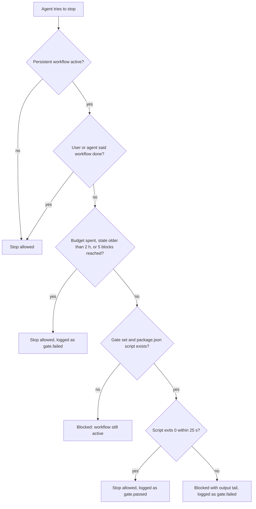

# oh-my-agent : une équipe de spécialistes pour l'agent de code que tu utilises déjà

[](https://www.npmjs.com/package/oh-my-agent) [](https://www.npmjs.com/package/oh-my-agent) [](https://github.com/first-fluke/oh-my-agent) [](https://github.com/first-fluke/oh-my-agent/blob/main/LICENSE) [](https://github.com/first-fluke/oh-my-agent/commits/main)

[English](../README.md) | [한국어](./README.ko.md) | [中文](./README.zh.md) | [Português](./README.pt.md) | [日本語](./README.ja.md) | [Español](./README.es.md) | [Nederlands](./README.nl.md) | [Polski](./README.pl.md) | [Русский](./README.ru.md) | [Deutsch](./README.de.md) | [Tiếng Việt](./README.vi.md) | [ภาษาไทย](./README.th.md)

**oh-my-agent (`oma`) est un harness indépendant des vendors qui ajoute une équipe de spécialistes à l'agent de code que tu utilises déjà : Claude Code, Codex CLI, Cursor et 11 autres.** Un planificateur découpe le travail, des ingénieurs construisent en parallèle, un relecteur vérifie le résultat et un débogueur corrige les causes racines. Il fait aussi de la recherche sourcée, des decks de slides, des vidéos et des images. La plupart des étapes laissent un fichier que tu peux ouvrir et, dans les workflows de longue durée, un gate peut renvoyer l'agent au travail jusqu'à ce que ton propre script `test`, `lint` ou `typecheck` passe.

[](./assets/architecture/oh-my-agent-architecture.svg)

Lance ceci depuis la racine de ton projet :

```bash
curl -fsSL https://raw.githubusercontent.com/first-fluke/oh-my-agent/main/cli/install.sh | bash
```

Lance ensuite `oma doctor` et tape `/plan add user accounts with a settings page` dans ton agent. [Tes 5 premières minutes](#your-first-5-minutes) détaille la marche à suivre.


[Voir la vidéo complète (35 s)](./assets/video/oh-my-agent-explainer.mp4)

## Ce que tu obtiens

Les **workflows**, c'est ce que tu tapes (ou que tu dis, tout simplement). Ils font appel aux **rôles**, les spécialistes. Les **skills**, c'est le savoir-faire : chaque rôle porte les siens, et ton agent charge les autres dès qu'une tâche en a besoin.

| | Ce que ça t'apporte | À essayer |
|---|---|---|
| **12 rôles spécialisés** | PM, architecte, ingénieurs backend, frontend, mobile, base de données et infra, relecteur QA, débogueur, refactoriseur, curateur de docs, chercheur ([fais-leur connaissance](#meet-the-team)) | `/orchestrate build a TODO app with login` |
| **21 workflows** | Des slash commands, de `/brainstorm` et `/plan` à `/review`, `/debug` et `/scm`. La plupart se lancent aussi à partir d'une simple demande (banques de mots-clés couvrant jusqu'à 11 langues) | « review this PR » |
| **33 skills** | Du savoir-faire métier qui ne se charge que lorsqu'une tâche en a besoin : UI, APIs, schémas, Terraform, CI, sécurité, git, observabilité | se charge tout seul, p. ex. « add a Terraform S3 bucket » |
| **Des fichiers que tu peux ouvrir** | Plans, documents de conception, contrats d'API, ADR, notes de bug, résultats par agent, preuves de sécurité, explicateurs HTML, récapitulatifs | `ls .agents/results` |
| **Vérifications des workflows** | Dans les workflows de longue durée, ton propre script `test`, `lint` ou `typecheck` doit réussir avant que l'agent puisse s'arrêter. `oma ralph verify` vérifie qu'une exécution `/ralph` a laissé ses fichiers de plan, de QA et de refactor | `/ultrawork …`, puis `oma goal set --gate test` |
| **Recherche et contenu** | Recherche sourcée, études de marché, articles scientifiques, decks de slides, vidéos MP4, images, voix en local, PDF/HWP vers Markdown | `/video`, `/convert` |
| **Un dossier, 14 runtimes** | Un seul répertoire `.agents/` portable, écrit dans les fichiers de configuration propres à chaque runtime | `oma link cursor` |

**[Installation](#install)** · **[5 premières minutes](#your-first-5-minutes)** · **[L'équipe](#meet-the-team)** · **[Quel workflow ?](#how-the-team-works-together)** · **[Tout ce qu'il contient](#everything-in-the-box)** · **[Compatibilité](#works-with)** · **[Vérification](#verification-not-narration)** · **[FAQ](#faq)** · **[Docs](https://first-fluke.github.io/oh-my-agent/)**

<a id="install"></a>
## Installation

Le script installe [bun](https://bun.sh) s'il manque, installe la commande `oma` globalement (`bun install --global oh-my-agent`, étape sautée si `oma` est déjà dans ton PATH), puis lance la configuration interactive. La commande globale compte : les hooks (détection de mots-clés, le Stop gate) et plusieurs workflows appellent `oma`, et les hooks ne font silencieusement rien quand ils ne la trouvent pas. Si tu te passes du script, installe-la toi-même avec `bun install --global oh-my-agent` (`npm install --global oh-my-agent` ou `brew install oh-my-agent` fonctionnent aussi).

<details>
<summary>Windows, ou sans le script d'installation</summary>

```powershell
# Windows (PowerShell)
irm https://raw.githubusercontent.com/first-fluke/oh-my-agent/main/cli/install.ps1 | iex
```

```bash
# Tout OS avec bun installé : la même installation, plus la commande globale `oma`
bun install --global oh-my-agent
oma
```

Sous Windows, l'installateur masque Antigravity, Hermes et Kimi, et le wrapper des hooks est un script bash. Le MCP navigateur Aside, sélectionné par défaut, s'installe via `bash` : désélectionne-le si tu n'as pas bash.

</details>

La configuration te demande ta langue de réponse, les runtimes d'agents à connecter, les fournisseurs de capacités, un MCP navigateur, un preset de modèles et un preset de skills. **Choisis `All` comme preset de skills si tu hésites** : les workflows sont toujours installés, et plusieurs d'entre eux (`/orchestrate`, `/work`, `/ultrawork`, `/ralph`, `/docs`, `/security`) ont besoin de skills que seul `All` inclut.

<details>
<summary>Ce que fait aussi l'installateur par défaut</summary>

- Installe **bun** (obligatoire). Tente d'installer **uv**, **Serena** (`uv tool install`) et **CUE** (`brew install cue` ou `winget`), et continue avec un avertissement si l'un d'eux échoue.
- Présélectionne le MCP navigateur **Aside** dans la configuration interactive, et ne l'installe avec `curl -fsSL https://releases.aside.com/install.sh | bash` que si tu le laisses sélectionné. Désélectionne-le à l'étape du MCP navigateur, ou change-le plus tard avec `oma update mcp`.
- Utilise **AgentMemory** pour la mémoire sémantique, ce qui exécute `bun install -g @agentmemory/agentmemory` et l'enregistre comme service de connexion (launchd, unité utilisateur systemd ou tâche planifiée Windows). Choisis le fournisseur `none` ou définis `OMA_NO_AGENTMEMORY=1` pour t'en passer.
- Demande avant de lier des skills dans les dossiers des vendors de ton répertoire personnel (Antigravity, Hermes, Kimi). Dans `$HOME` sans `--global`, il demande une confirmation.
- Écrit certains fichiers hors du projet sans demander : `~/.claude.json` (marque le projet comme espace de travail Claude Code de confiance), `~/.serena/` (contexte OMA, taille minimale des réponses, enregistrement du projet), `~/.cursor/cli-config.json` (désactive l'attribution des commits de Cursor), `~/.grok/config.toml` (télémétrie) et `~/.gemini/antigravity-cli/` (HUD), chacun uniquement pour un vendor que tu as sélectionné.
- Écrit des **désactivations de télémétrie** dans les paramètres des vendors (Claude `DISABLE_TELEMETRY=1`, qui désactive aussi Claude Code Remote Control ; statistiques d'utilisation de Gemini, Qwen, Codex et Grok). Définis `telemetry: true` pour garder les valeurs par défaut des vendors.
- Ajoute à `.claude/settings.json` les paramètres Claude Code non définis, dont `skipDangerousModePermissionPrompt: true`, `effortLevel: high`, `cleanupPeriodDays: 180` et des flags env qui désactivent l'auto memory, l'adaptive thinking, le signalement d'erreurs et les instructions git intégrées. Les valeurs que tu as déjà définies sont conservées.
- Ajoute un **trailer de co-auteur** : l'attribution des commits de Claude Code devient `Co-Authored-By: First Fluke <our.first.fluke@gmail.com>` et les PR reçoivent une ligne "Generated with oh-my-agent". Définis `scm.co_author.enabled: false` pour le désactiver.
- Installe dans `.githooks/` un **garde commit-msg** qui rejette les adresses `Co-authored-by` non listées, et définit `git config --local core.hooksPath .githooks` quand aucun autre hook n'est actif. Définis `scm.co_author.enforce_hook: false` pour t'en dispenser.
- `oma update` met à jour la CLI `oma` en arrière-plan (`auto_update_cli: false` ou `OMA_SKIP_VERSION_CHECK=1` pour l'arrêter) et exécute `uv tool upgrade serena-agent --prerelease=allow` (`serena.auto_update: false`).
- Avec Serena dans le mode `bridge` par défaut, la première session d'agent qui démarre un serveur Serena partagé enregistre un **minuteur de nettoyage** qui arrête toutes les 5 minutes les serveurs Serena partagés inactifs (launchd `dev.oma.serena-daemon-gc`, minuteur utilisateur systemd `oma-serena-daemon-gc.timer` ou tâche planifiée Windows `OMA Serena Daemon GC`). Définis `serena.mode: stdio` pour te passer du serveur partagé et de son minuteur. `oma uninstall` ne supprime pas le minuteur.
- Les exécutions non interactives (`-y`, `OMA_YES=1`, `CI=true`) utilisent le preset de skills `All`, `model_preset: auto` et Python comme langage backend. Elles ne sélectionnent aucun MCP navigateur (et sautent le script d'installation d'Aside), sauf si `mcp.devtools_browsers` en liste déjà un.

</details>

<details>
<summary>Presets de skills</summary>

| Preset | Skills |
|--------|--------|
| **All** | **Les 33 skills** (recommandé) |
| Fullstack | architecture, backend, brainstorm, db, debug, design, dev-workflow, frontend, mobile, pm, qa, scm, tf-infra |
| Fullstack Web | Fullstack sans mobile ni tf-infra |
| Fullstack Mobile | Fullstack sans frontend ni tf-infra |
| Frontend | architecture, brainstorm, debug, design, frontend, pm, qa, scm |
| Backend | architecture, backend, brainstorm, db, debug, dev-workflow, pm, qa, scm |
| Mobile | architecture, brainstorm, debug, mobile, pm, qa, scm |
| DevOps | architecture, brainstorm, debug, dev-workflow, observability, pm, qa, scm, tf-infra |
| Research | academic-writing, hwp, market, pdf, scholar, scm, search, translation |
| Content | academic-writing, design, image, scm, translation, voice |
| Custom | Choisis les skills un par un |

Parmi les presets nommés, seul `All` inclut coordination, orchestration, docs, security, refactor, explanation, recap, video, slide et skill-creation (ou choisis-les dans `Custom`). Research et Content n'ont pas les skills sur lesquels reposent `/plan`, `/review`, `/debug`, `/architecture` et `/brainstorm`. Voir [Workflows qui ont besoin de skills hors d'un preset](../web/docs/getting-started/installation.md#workflows-that-need-skills-outside-a-preset).

</details>

<a id="your-first-5-minutes"></a>
## Tes 5 premières minutes

1. **Installe** avec la commande ci-dessus.
2. **Vérifie l'installation :**

   ```bash
   oma doctor
   ```

   Tu devrais voir `CLI Status` (quelles CLI d'agents sont installées et connectées) et `Skills Status` (par exemple `Skills (33/33 installed, 33 complete)`). Si `oma` est introuvable, ouvre un nouveau terminal (l'installateur vient peut-être d'ajouter `~/.bun/bin` à ton PATH) ou lance `bun install --global oh-my-agent`.
3. **Ouvre ton agent dans le projet et demande un plan :**

   ```text
   /plan add user accounts with a settings page
   ```

   Ou écris simplement « plan user accounts with a settings page » : sur les runtimes dotés d'un prompt hook, le mot-clé lance le même workflow.
4. **Regarde ce que tu as obtenu.** `/plan` s'exécute dans la session courante. Pour un travail qui touche plusieurs domaines, comme celui-ci, il écrit `.agents/results/plan-<session-id>.json` et un tracker dans `docs/plans/work/<NNN>-<name>.md`. Une petite demande limitée à un seul domaine reçoit une recommandation directe au lieu d'un fichier de plan.

Ces étapes produisent un premier plan. Tu peux le poursuivre avec `/work` ou `/orchestrate`.

<a id="meet-the-team"></a>
## Fais connaissance avec l'équipe

Ton propre agent dirige l'équipe. Dans `/work`, `/orchestrate` et `/ultrawork`, il confie chaque tâche au bon spécialiste, qui s'exécute comme son propre sous-agent. `/plan`, `/architecture` et `/docs` s'exécutent dans ta session courante avec le skill du rôle concerné, et `/review` et `/debug` font appel à leur spécialiste quand le périmètre est large. Quand un rôle tourne sur la CLI d'un autre vendor, `oma agent spawn` l'y exécute.

| Ton spécialiste | Porte | Pour l'appeler | Ce qu'il laisse |
|---|---|---|---|
| **Product manager** (`pm-planner`) | oma-pm | `/plan`, ou « plan the payment feature » | Un JSON de plan et un tracker dans `docs/plans/work/` pour le travail Medium et Complex (les demandes Simple reçoivent une recommandation directe) |
| **Architecte** (`architecture-reviewer`) | oma-architecture | `/architecture` | Un ADR ou une recommandation dans `.agents/results/architecture/` |
| **Ingénieurs backend, frontend, mobile, base de données et infra** | oma-backend, oma-frontend + oma-design, oma-mobile, oma-db, oma-tf-infra | `/work`, `/orchestrate` | Du code, des tests et un fichier `result-<agent>` par tâche |
| **Relecteur QA** (`qa-reviewer`) | oma-qa | `/review`, ou « review this PR » | Des constats classés de CRITICAL à LOW, chacun avec file:line et du code de correction |
| **Débogueur** (`debug-investigator`) | oma-debug | `/debug`, ou « fix this bug » | Un correctif minimal, un test de régression et, si nécessaire, une note de bug dans `.agents/results/bugs/` |

<details>
<summary>Les trois autres rôles, et les skills sans rôle</summary>

| Ton spécialiste | Porte | Pour l'appeler | Ce qu'il laisse |
|---|---|---|---|
| **Refactoriseur** (`refactor-engineer`) | oma-refactor | la phase REFINE de `/ultrawork` | Des commits `refactor:` qui préservent le comportement et un rapport `result-refactor-<session>.md` |
| **Curateur de docs** (`docs-curator`) | oma-docs | `/docs`, ou « verify docs » | `docs/generated/doc-refs.json` et les patchs de doc que tu approuves |
| **Chercheur** (`research-explorer`) | oma-search, oma-market, oma-scholar | une demande de recherche | Des sources citées avec des labels de confiance ; des briefs de marché dans `.agents/results/market/` |

L'ingénieur infra (`tf-infra-engineer`) a pour consigne de demander avant tout `apply` ou `destroy` destructif ou en production. Les autres skills (brainstorm, security, scm, dev-workflow, observability, explanation, recap, translation, coordination, orchestration, skill-creation, contenu et médias) n'ont pas de rôle dédié. Ton agent les charge lui-même et, pour la plupart, l'injecteur de skills suggère le bon à partir de ton prompt.

</details>

<a id="how-the-team-works-together"></a>
## Comment l'équipe travaille ensemble

```text
 THINK   /brainstorm ......................... docs/plans/designs/<NNN>-<feature>.md
 PLAN    /plan · /architecture ............... plan JSON, API contracts, ADR
 DESIGN  /design ............................. DESIGN.md + tokens
 BUILD   /work · /orchestrate · /ultrawork ... code + result-<agent> files, engineers in parallel
 CHECK   /review · /security · /debug ........ findings, security evidence, regression test
 SHIP    /scm · /docs ........................ Conventional Commits, doc fixes
```

Chaque étape passe un fichier à la suivante. `/brainstorm` enregistre une conception que `/plan` lit, et `/plan` écrit un plan dans lequel chaque tâche a un agent, des dépendances, des critères d'acceptation et une commande de vérification. `/orchestrate` exécute ce plan (il charge le `plan-*.json` le plus récent, ou en écrit un). `/work` et `/ultrawork` commencent par faire écrire leur propre plan au PM. Saute les étapes dont tu n'as pas besoin ; chaque étape fonctionne aussi seule.

**Quel workflow doit piloter l'équipe ?**

| Tu veux | Lance | Comment ça se termine |
|---|---|---|
| Juste un plan | `/plan` | Un fichier de plan pour un travail multi-domaines, ou une recommandation directe pour un petit travail |
| Un build mené par le PM, que tu suis étape par étape | `/work` | Le PM, puis les ingénieurs palier par palier, puis la QA. Les constats CRITICAL et HIGH partent dans une boucle de correction (jusqu'à 5 cycles) |
| Un build parallèle sans avoir à intervenir | `/orchestrate` | Seules les tâches dont les vérifications passent comptent comme terminées ; chaque tâche a droit à 3 tentatives au plus, puis elle est marquée partielle ou en échec |
| Le maximum de rigueur | `/ultrawork` | Cinq phases à gates (PLAN, IMPL, VERIFY, REFINE, SHIP) ; chaque revue s'exécute dans une session de relecteur neuve |
| « Ne t'arrête pas avant que ce soit vraiment fini » | `/ralph` | Répète `/ultrawork` avec un juge en contexte neuf, lancé séparément, jusqu'à ce que chaque critère passe ; s'arrête avec un rapport partiel quand des critères sont bloqués ou après 5 itérations |
| L'équipe sur minuterie | `oma schedule create qa-reviewer "review open PRs" --every 2h` | Un log Markdown par exécution dans `~/.oma/schedule/runs/<id>/` |

Les slash commands sont facultatives. Sur les runtimes dotés d'un prompt hook, de simples demandes (banques de mots-clés couvrant jusqu'à 11 langues) peuvent lancer la plupart des workflows : « review this PR » lance `/review`. Décrire une application entière (« Build a TODO app with user authentication ») suggère `/orchestrate`, et ton agent décide s'il le lance. Les mots-clés à l'intérieur des blocs de code sont ignorés.

`/orchestrate`, `/work`, `/ultrawork` et `/ralph` sont **persistants** quand tu les invoques par leur nom, en slash command ou en texte libre (« ultrawork: add rate limiting »). L'agent est alors renvoyé au travail quand il essaie de s'arrêter trop tôt (jusqu'à 5 fois ou pendant 2 heures), jusqu'à ce que tu dises **« workflow done »**. Une demande qui ne correspond que vaguement se contente de les suggérer.

Le [benchmark](../benchmarks/README.md) utilisait un prompt, Claude Code avec cinq configurations d’extensions dont la configuration de base, `claude-opus-4-6` et un build par configuration. oma a obtenu 80,6 contre 70,7 pour Claude Code seul. Le coût était de 4,04 $ contre 2,37 $ (soit 1,7 fois plus) et le temps d’exécution était 1,8 fois plus long.

<details>
<summary>Les 21 workflows</summary>

| Commande | Ce qu'elle fait |
|---------|--------------|
| `/architecture` | Pèse les arbitrages de conception et produit une recommandation, une revue ou un ADR |
| `/brainstorm` | Explore idées et contraintes, et produit une conception validée avant la planification |
| `/convert` | Convertit des PDF/HWP en Markdown, ou transcode images, vidéo et audio avec ffmpeg |
| `/debug` | Reproduit un bug, corrige la cause racine, écrit un test de régression et cherche des motifs similaires |
| `/deepinit` | Cartographie une base de code existante dans AGENTS.md, ARCHITECTURE.md et une base de connaissances docs/ |
| `/design` | Construit un système de design, DESIGN.md et des tokens, avec des contrôles d'accessibilité |
| `/docs` | Trouve les références de doc cassées et propose des patchs pour les docs touchées par un diff |
| `/explain` | Transforme un diff, une PR, une branche ou un sujet en explicateur HTML interactif autonome |
| `/orchestrate` | Lance des agents en parallèle, les coordonne via un état sur fichiers et vérifie le résultat (persistant) |
| `/plan` | Découpe une feature en tâches priorisées avec des contrats d'API |
| `/ralph` | Répète `/ultrawork` avec un juge lancé séparément, jusqu'à 5 itérations (persistant) |
| `/recap` | Résume ton historique de conversations IA sur une journée ou une période |
| `/review` | Passe en revue la sécurité (OWASP Top 10), la performance, l'accessibilité (WCAG 2.2 AA) et la qualité du code |
| `/schedule` | Enregistre une tâche d'agent qui s'exécute à intervalle récurrent |
| `/scm` | Gère branches, merges, conflits, worktrees et Conventional Commits |
| `/security` | Scanne le code source, les skills d'agents et les composants MCP, valide les constats et met en place des gates CI |
| `/stack-set` | Détecte ta stack technique et génère des références spécifiques pour les skills de domaine |
| `/tools` | Liste, active et désactive les outils MCP en langage courant |
| `/ultrawork` | Cinq phases (PLAN, IMPL, VERIFY, REFINE, SHIP), chaque revue dans une session de relecteur neuve (persistant) |
| `/video` | Transforme un brief en MP4 fini via un pipeline utilisable sans clés |
| `/work` | Coordonne plusieurs agents sur un projet multi-domaines avec planification PM et revue QA (persistant) |

`oma verify triggers` évalue la précision du déclenchement sur un corpus annoté de 212 prompts en anglais et en coréen. La CI échoue si le taux de false-fire dépasse 10 % ou si celui de missed-fire dépasse 20 %. Lors de la dernière mesure, ces taux étaient de **0 % de missed-fire et 5,3 % de false-fire**. Référence complète : [Workflows](https://first-fluke.github.io/oh-my-agent/docs/core-concepts/workflows/).

</details>

<a id="see-it-work"></a>
## En action

Une session `/ultrawork` à titre d'illustration. Le bloc `[OMA PERSISTENT MODE: ULTRAWORK]` reprend exactement le format qu'affiche le Stop hook ; les autres lignes sont paraphrasées :

```text
you    /ultrawork add rate limiting to POST /login
agent  runs `oma goal set --gate test`
agent  PLAN writes .agents/results/plan-<run-id>.json
agent  IMPL -> VERIFY -> REFINE -> SHIP  (each review runs in a fresh reviewer session)
agent  "Rate limiting added. All tests pass."
oma    [OMA PERSISTENT MODE: ULTRAWORK]
       Stop gate 'test' FAILED (reinforcement 1/5).
       Fix the failures below, then finish the workflow — the stop is allowed only when the gate passes.
       --- gate output (tail) ---
       FAIL  src/auth/login.test.ts > returns 429 after 5 attempts
       To abandon instead: delete .agents/state/ultrawork-state-<host-session>.json or say "workflow done".
agent  fixes the limiter and stops again
oma    `test` exits 0: stop allowed, gate.passed appended to the session log
```

Ensuite, `oma state list` retrouve la session et `oma state get <oma-sid>` (l'ID qu'affiche `state list`) affiche chaque événement de gate. Sous `/ralph`, `oma ralph verify --json` vérifie aussi que les phases ont laissé leurs fichiers derrière elles (sortie tronquée) :

```json
{ "ok": false,
  "missing": [{ "id": "A3", "description": "a distinct QA agent ran (VERIFY phase)",
                "pattern": ".agents/state/memories/result-qa*.md or .agents/results/result-qa*.md",
                "status": "missing" }] }
```

<a id="everything-in-the-box"></a>
## Tout ce qu'il contient

<details>
<summary><strong>Planifier et concevoir</strong> : <code>/brainstorm</code>, <code>/plan</code>, <code>/architecture</code>, <code>/design</code></summary>

| Commande | Ce qu'elle fait | Écrit |
|---|---|---|
| `/brainstorm` | Pose une question de clarification à la fois et propose 2-3 approches qui fonctionnent différemment, puis passe la main à `/plan`. N'écrit pas de code | `docs/plans/designs/<NNN>-<feature>.md` |
| `/plan` | Classe le travail en Simple, Medium ou Complex ; pour le travail Medium et Complex, le découpe en tâches, chacune avec un agent, des dépendances, des critères d'acceptation et une commande de vérification, et définit des contrats d'API quand le travail franchit une frontière | `.agents/results/plan-<sid>.json`, `docs/plans/work/<NNN>-<name>.md`, des contrats dans `.agents/results/api-contracts/` si nécessaire |
| `/architecture` | Lit d'abord les décisions antérieures, compare au moins 2 options et marque les ADR remplacés comme superseded | Un ADR ou une recommandation dans `.agents/results/architecture/` |
| `/design` | Propose 2-3 directions, puis écrit `DESIGN.md` avec des tokens et audite le layout responsive et l'accessibilité | `DESIGN.md`, tokens CSS/Tailwind/shadcn |

</details>

<details>
<summary><strong>Construire</strong> : 7 skills de domaine, plus <code>/stack-set</code> pour les adapter à ta stack</summary>

| Skill | Construit |
|---|---|
| oma-frontend | Des UI React/Next.js ou Angular qui suivent tes tokens et tes règles d'i18n et d'accessibilité |
| oma-backend | APIs, auth et accès aux données, en couches router → service → repository |
| oma-mobile | Des apps Flutter, React Native ou Swift |
| oma-db | Schémas, migrations, optimisation de requêtes, plans de récupération vectorielle/RAG |
| oma-tf-infra | Du Terraform pour n'importe quel cloud, avec les risques de drift, de changements destructifs et de coût signalés |
| oma-dev-workflow | Tâches mise, lint/format/typecheck, commitlint, hooks git, CI/CD et releases |
| oma-observability | OpenTelemetry, SLOs, alerting et forensique d'incidents |

`/stack-set` lit tes manifestes et écrit des références spécifiques à ta stack pour les skills backend, frontend et mobile. Dans un monorepo, les ingénieurs frontend, backend et mobile sont orientés vers leur workspace (pnpm, workspaces npm/yarn/bun, lerna, nx, turbo, `mise.toml`).

</details>

<details>
<summary><strong>Relire, corriger et livrer</strong> : <code>/review</code>, <code>/security</code>, <code>/debug</code>, refactor, <code>/scm</code></summary>

| Commande ou skill | Ce qu'elle fait | Écrit |
|---|---|---|
| `/review` | Un audit des dépendances, puis OWASP Top 10, performance, WCAG 2.2 AA et qualité du code. Chaque constat reçoit file:line et du code de correction | Le rapport dans le chat plus un enregistrement en mémoire ; pas de fichier de rapport |
| `/security` | Scanne ton code source, tes skills d'agents et tes serveurs MCP (Deepsec, Cisco Skill and MCP Scanner) et, si tu fournis un déploiement de test délimité, lance des tests d'intrusion ARTEX. Le workflow exige qu'un moteur qui n'a pas pu s'exécuter soit signalé en échec, et non comme propre | `.agents/results/security/<run-id>/` |
| `/debug` | Reproduit l'échec, corrige la cause racine avec un changement minimal, ajoute un test de régression et cherche le même motif ailleurs | Le correctif et le test ; une note de bug dans `.agents/results/bugs/` si nécessaire |
| oma-refactor | Change la structure sans changer le comportement : d'abord des tests de caractérisation, puis des commits de refactor uniquement | `.agents/results/refactor/` |
| `/scm` | Conventional Commits découpés par changement logique ; branches, merges, rebases et worktrees | Commits et branches |

</details>

<details>
<summary><strong>Docs et connaissances</strong> : <code>/deepinit</code>, <code>/docs</code>, <code>/explain</code>, <code>/recap</code>, translation</summary>

| Commande ou skill | Ce qu'elle fait | Écrit |
|---|---|---|
| `/deepinit` | Transforme un repo existant en base de connaissances prête pour les agents | `AGENTS.md`, `ARCHITECTURE.md`, `docs/` |
| `/docs` | Trouve les références cassées, patche les docs touchées par un diff (uniquement les patchs que tu approuves) et repère les traductions obsolètes | `docs/generated/doc-refs.json`, docs patchées |
| `/explain` | Transforme une PR, une branche ou un changement indexé en walkthrough HTML avec un quiz de 5 questions, ou un sujet en explicateur visuel d'une page | `.agents/results/explain/<date>-<slug>.html` |
| `/recap` | Résume tes conversations IA, tous outils confondus, sur une journée ou une période | `.agents/results/recap/<date>.md` |
| oma-translation | Une traduction qui se lit comme un texte natif ; placeholders, code et clés de locale restent inchangés | Texte traduit |

</details>

<details>
<summary><strong>Recherche</strong> : recherche, marché, articles, rédaction académique</summary>

| Skill | Ce qu'il fait | Écrit |
|---|---|---|
| oma-search | Recherche dans les docs, le web et le code, avec un label de confiance sur chaque source | Résultats sourcés |
| oma-market | Pain points, tendances et concurrents à partir de signaux communautaires, structurés avec SWOT, les 5 forces de Porter et PESTEL | `.agents/results/market/<topic>-<date>.md` |
| oma-scholar | Recherche d'articles qui lit un fichier compact d'affirmations (format Knows, environ 700 tokens) au lieu du PDF complet (environ 10K tokens) | `<paper>.knows.yaml` |
| oma-academic-writing | Rédige et audite de la prose académique selon une grille d'évaluation | Ton fichier |

</details>

<details>
<summary><strong>Contenu et médias</strong> : <code>/video</code>, <code>/convert</code>, slides, images, voix</summary>

| Commande ou skill | Ce qu'elle produit | Écrit |
|---|---|---|
| `/video` | Shorts, vidéos explicatives ou démos en MP4 fini ; les fournisseurs à clé ont des solutions de repli sans clé | `.agents/results/videos/<run>/` avec un manifeste |
| oma-slide | Decks HTML en 1920×1080, exportés en PDF, PNG ou PPTX | `.agents/results/slides/<session>/` |
| oma-image | Des images via les CLI de vendors auxquelles tu es connecté, comparées côte à côte | `.agents/results/images/<run>/` |
| oma-voice | Synthèse vocale et transcription en local via l'app Voicebox | `.agents/results/voice/<run>/` |
| `/convert` | PDF ou HWP vers Markdown ; conversion d'images, de vidéo et d'audio via ffmpeg | À côté du fichier d'entrée |

Ces pipelines signalent une source ou une clé vendor manquante au lieu de renvoyer en silence un résultat appauvri.

</details>

<details>
<summary><strong>Des hooks qui s'exécutent sans qu'on les appelle</strong></summary>

| Hook | Ce qu'il fait | Désactivation / limite |
|---|---|---|
| Lancement par mot-clé | Lance le workflow correspondant à partir d'une simple demande | Les questions, le texte collé et les blocs de code sont ignorés |
| Injecteur de skills | Oriente ton agent vers les bons skills pour le prompt | En pause tant qu'un workflow persistant est actif |
| Stop gate | Renvoie un workflow persistant au travail ; avec `oma goal set --gate test`, l'arrêt est autorisé quand ce script sort avec le code 0 en moins de 25 s | Dis « workflow done » ; le blocage se lève aussi après 5 blocages ou 2 heures |
| Garde refactor | À l'arrêt, signale à `refactor-engineer` les fichiers modifiés de plus de 500 lignes | Opt-in : `refactor_guard.enabled` |
| Garde secrets | Bloque `git add` de `*.env`, `*.pem`, `id_rsa*`, `*.tfstate` et fichiers similaires | Préfixe cette seule commande par `OMA_SCM_ALLOW_SECRETS=1` |
| Garde recherche de code | Bloque la recherche récursive native dans le projet pour que l'agent utilise Serena ou Gortex | `providers.code_intelligence_guard: off` |
| Filtre de tests | Ne garde que les échecs et les résumés de la sortie des tests, pour dépenser moins de tokens | `OMA_TEST_FILTER=0` |
| Mémoire de session | Quand tu changes de session ou en reprends une (ou après une compaction), réinjecte les événements récents de la session active, plus le rappel AgentMemory | Le fournisseur de mémoire `none` ou `OMA_NO_AGENTMEMORY=1` désactive le rappel ; le snapshot local des événements reste |

`oma hook probe` vérifie que les prompt hooks d'oma acceptent l'entrée de hook de chaque runtime (il ne lance pas le runtime). Les hooks branchés par chaque runtime figurent dans [Différences entre hôtes](#host-differences).

</details>

<details>
<summary><strong>Agents parallèles, sessions et dashboards</strong></summary>

- `oma agent spawn <role> "<task>" <sid>` exécute un rôle sur Antigravity, Claude Code, Codex, Cursor, Grok, Kimi Code, Kiro, OpenCode, pi ou Qwen Code, avec `--isolation worktree` et `--fallback-vendors`. `oma agent parallel` en lance plusieurs à la fois. Ces 10 cibles de dispatch font partie des 14 intégrations de l’installateur.
- `oma state list --all-projects` et `oma state get <sid>` : les sessions et chaque événement enregistré.
- `oma dashboard terminal` / `oma dashboard web` : statut des agents en direct (le dashboard web n'écoute que sur `127.0.0.1`). [Guide du dashboard](../web/docs/guide/dashboard-monitoring.md).
- `oma stats get` (métriques de productivité), `oma retro` (une rétrospective git), `oma recap --window 7d` (ce que tu as fait dans tes outils IA).
- `oma visualize --affected <paths>` : quels skills, workflows, agents et vérifications dépendent des fichiers `.agents/` que tu as modifiés.

</details>

<details>
<summary><strong>Intelligence de code, mémoire et MCP</strong></summary>

| Emplacement | Par défaut | Alternatives |
|---|---|---|
| Docs | Context7 | — |
| Recherche Web | Recherche native du runtime | Brave Search |
| Intelligence de code | Serena, un serveur partagé par projet | Gortex (expérimental) |
| Mémoire sémantique | AgentMemory | Honcho (expérimental), none |
| MCP navigateur | Aside | Chrome DevTools, Firefox DevTools |

Serena fournit la navigation de code et les diagnostics basés sur LSP, y compris le retour sur les modifications natives lorsque cette fonction est prise en charge. Le choix du fournisseur est indépendant du runtime de l’agent ; les capacités varient selon le fournisseur et l’hôte.

Les agents se coordonnent via de simples fichiers dans `.agents/state/`, sans service externe. `/tools` active ou désactive les outils MCP en langage courant. Détails : [Fournisseurs de capacités](./capability-providers.md).

</details>

<details>
<summary><strong>S'améliorer avec le temps</strong></summary>

- `oma skill eval` mesure le gain d'un skill par rapport à une baseline sur des tâches mises de côté (held-out). `oma skill optimize` propose des modifications qui l'augmentent, et `--apply` les conserve ([guide skill-eval](../web/docs/guide/skill-eval.md)).
- `oma harness evolution enable --max-dispatches <n>` planifie un cycle nocturne qui transforme les exécutions en échec en fixtures de régression et applique comme overlays de projet les améliorations de skills qui passent l'évaluation. Ajoute `--mode propose` pour seulement les enregistrer.
- `oma emit` exporte la source `.agents/` en package Agent Skills, en package Agent Plugins, en marketplace de plugins Claude Code ou en `AGENTS.md`.

</details>

<details>
<summary><strong>Configuration et garde-fous</strong></summary>

- Un unique `.agents/oma-config.yaml`, qui t'appartient, survit aux mises à jour (seul `oma update --force` le réinitialise) ; des overlays privés `.local.yaml` ou `.local.cue` peuvent s'y superposer. `language` définit la langue de réponse.
- 13 règles de projet (backend, commit, database, debug, design, etc.) se chargent comme règles natives dans Claude Code et Cursor, et sont indexées dans le bloc `AGENTS.md` géré, écrit pour Codex, Qwen Code et Pi.
- Les mises à jour conservent des sauvegardes de configuration et de migration dans `.agents/backup/` ; les skills et workflows livrés sont remplacés sur place, alors garde tes modifications locales en dehors. `oma uninstall --dry-run` montre ce qui serait supprimé. `first-fluke/oma-update-action@v1` lance `oma update` en CI et ouvre une PR.

</details>

<details>
<summary><strong>Les 33 skills</strong></summary>

| Skill | Ce qu'il fait |
|---|---|
| **oma-academic-writing** | Rédige, révise et audite la prose académique |
| **oma-architecture** | Évalue les arbitrages d'architecture et trace les frontières de modules avec une analyse ADR/ATAM/CBAM |
| **oma-backend** | Construit des APIs, l'authentification et l'accès aux données en Python, Node.js ou Rust |
| **oma-brainstorm** | Explore les idées avec toi avant que tu te lances dans la construction |
| **oma-coordination** | Guide la coordination manuelle pas à pas des agents PM, frontend, backend, mobile et QA |
| **oma-db** | Conçoit schémas, migrations, index et vector stores |
| **oma-debug** | Identifie la cause racine, corrige le bug et écrit un test de régression |
| **oma-design** | Construit des systèmes de design avec tokens, accessibilité et layouts responsive |
| **oma-dev-workflow** | Automatise le CI/CD, les releases et les tâches monorepo |
| **oma-docs** | Vérifie les références cassées dans la doc, la synchronise avec les changements de code et signale les dérives de traduction |
| **oma-explanation** | Transforme un diff, une PR, une branche ou un sujet en explicateur HTML autonome, avec un quiz pour les changements de code |
| **oma-frontend** | Construit l'UI en React/Next.js ou Angular |
| **oma-hwp** | Convertit les fichiers HWP, HWPX et HWPML en Markdown |
| **oma-image** | Génère des images et des variations à partir de références, et peut comparer les fournisseurs d'IA côte à côte |
| **oma-market** | Étudie ton marché à partir de signaux communautaires et le structure avec SWOT, 5F et PESTEL |
| **oma-mobile** | Construit des apps mobiles avec Flutter, React Native ou Swift natif |
| **oma-observability** | Route les tâches d'observabilité entre métriques, logs, traces, SLOs et forensique d'incidents |
| **oma-orchestration** | Lance plusieurs agents en parallèle depuis la CLI |
| **oma-pdf** | Convertit les fichiers PDF en Markdown |
| **oma-pm** | Planifie les tâches, découpe les exigences et définit les contrats d'API |
| **oma-qa** | Revoit les changements sous l'angle de l'exactitude, de la sécurité OWASP, des performances et de l'accessibilité |
| **oma-recap** | Résume ton historique de conversations en synthèses de travail organisées par thème |
| **oma-refactor** | Refactorise sans changer le comportement, grâce au ciblage des hotspots, aux tests de caractérisation et aux commits dédiés au refactor |
| **oma-scholar** | Explore la littérature académique et crée des sidecars d'articles Knows pour les affirmations, les preuves et l'évaluation par les pairs |
| **oma-scm** | Gère branches, merges, worktrees et Conventional Commits |
| **oma-search** | Route chaque requête vers la meilleure source et évalue à quel point tu peux te fier au résultat |
| **oma-security** | Scanne le code source, les skills d'agents et les composants MCP ; teste les applications web déployées et valide les constats |
| **oma-skill-creation** | Rédige et audite de nouveaux skills OMA |
| **oma-slide** | Génère des decks de présentation HTML et les exporte en PDF/PNG/PPTX |
| **oma-tf-infra** | Provisionne une infrastructure multi-cloud avec Terraform |
| **oma-translation** | Traduit pour que le résultat semble écrit par un locuteur natif |
| **oma-video** | Génère des vidéos courtes, explicatives et de démo via un pipeline HyperFrames utilisable sans clés |
| **oma-voice** | Génère des voix off et transcrit l'audio directement sur l'appareil |

</details>

<a id="works-with"></a>
## Compatibilité

14 cibles d'installation : Claude Code, Codex CLI, Cursor, Antigravity, Qwen Code, Grok, Kiro, Kimi, OpenCode, Pi, GitHub Copilot, Hermes, CommandCode et ZCode. Connecte un runtime laissé de côté à l'installation avec `oma link <vendor>`. Les runtimes n'offrent pas tous les mêmes hooks ; la matrice complète se trouve dans [Agents supportés](./SUPPORTED_AGENTS.md).

- **Orca IDE :** [OMA for Orca](../integrations/orca/README.md) ajoute un panneau latéral et des actions dans la palette de commandes (Orca 1.4.197+ avec les plugins expérimentaux).
- **DeepSeek Harness :** [OMA for DeepSeek Harness](../integrations/dsh/README.md) branche les vérifications OMA via un plugin Cordis. Il faut que `oma` soit dans ton `PATH`.

<details>
<summary>Logos des runtimes (cibles d'installation, plus Amp et DeepSeek Harness)</summary>

natif = oma écrit les fichiers de configuration propres au runtime ; adaptateur = oma ajoute aussi des shims de hooks ou d'agents. Amp lit `.agents/skills/` de lui-même et n'est pas une cible d'installation.

<table>
<colgroup>
<col span="6" style="width:16.67%" />
</colgroup>
<tr>
<td align="center">
<a href="https://claude.com/product/claude-code"></a><br/>
<strong>Claude Code</strong><br/>
<sub>natif + adaptateur</sub>
</td>
<td align="center">
<a href="https://github.com/openai/codex"></a><br/>
<strong>Codex CLI</strong><br/>
<sub>natif + adaptateur</sub>
</td>
<td align="center">
<a href="https://antigravity.google"></a><br/>
<strong>Antigravity</strong><br/>
<sub>SSOT natif</sub>
</td>
<td align="center">
<a href="https://cursor.com"></a><br/>
<strong>Cursor</strong><br/>
<sub>natif + adaptateur</sub>
</td>
<td align="center">
<a href="https://github.com/QwenLM/qwen-code"></a><br/>
<strong>Qwen Code</strong><br/>
<sub>dispatch natif</sub>
</td>
<td align="center">
<a href="https://github.com/deepseek-ai/deepseek-harness"></a><br/>
<strong>DeepSeek Harness</strong><br/>
<sub>Cordis plugin</sub>
</td>
</tr>
<tr>
<td align="center">
<a href="https://pi.dev/"></a><br/>
<strong>Pi</strong><br/>
<sub>compatible nativement</sub>
</td>
<td align="center">
<a href="https://github.com/anomalyco/opencode"></a><br/>
<strong>OpenCode</strong><br/>
<sub>compatible nativement</sub>
</td>
<td align="center">
<a href="https://ampcode.com"></a><br/>
<strong>Amp</strong><br/>
<sub>lit .agents/skills</sub>
</td>
<td align="center">
<a href="https://github.com/features/copilot"></a><br/>
<strong>GitHub Copilot</strong><br/>
<sub>skills via symlink</sub>
</td>
<td align="center">
<a href="https://grok.x.ai"></a><br/>
<strong>Grok Build</strong><br/>
<sub>hooks natifs</sub>
</td>
<td align="center">
<a href="https://kiro.dev"></a><br/>
<strong>Kiro CLI</strong><br/>
<sub>hooks natifs + agents</sub>
</td>
</tr>
</table>

<p align="center"><sub><a href="./SUPPORTED_AGENTS.md">& plus</a></sub></p>

</details>

<a id="host-differences"></a>
<details>
<summary>Différences entre hôtes : quels runtimes ont la détection de mots-clés et le Stop gate</summary>

| Runtime | Détection de mots-clés | Stop gate |
|---|---|---|
| Claude Code, Codex CLI, Qwen Code, Grok, Kimi | oui | oui |
| Cursor | oui | oui (revient sous forme de message de suivi) |
| Antigravity | oui | oui (exécute les handlers via bun, pas via le wrapper `oma`) |
| OpenCode, Pi | oui | au mieux (Pi nécessite un build avec `agent_settled`) |
| Kiro | oui | non : Kiro ignore la sortie du Stop hook |
| CommandCode | pas de prompt hook | oui |
| GitHub Copilot, Hermes, ZCode | pas de hooks | pas de hooks |

</details>

<a id="per-agent-models"></a>
<details>
<summary>Modèles par agent</summary>

`model_preset` dans `.agents/oma-config.yaml` choisit le modèle utilisé par chaque rôle d'agent. La valeur par défaut, `auto`, suit les réglages d'agent et de modèle propres au runtime en cours d'exécution.

```yaml
language: en
model_preset: auto   # auto | free | antigravity | claude | codex | cursor | kiro | mixed | qwen | <custom_presets key>

# Optional per-agent overrides; they win over the preset
agents:
  backend: { model: openai/gpt-5.5, effort: high }
```

- `mixed` utilise Claude pour l'orchestrateur, l'architecture, la QA, le PM et les docs, et Codex `gpt-5.5` pour les rôles d'implémentation ; il faut donc Claude Code et Codex CLI.
- `free` passe par une passerelle FreeLLMAPI et nécessite `FREELLM_API_KEY` ainsi qu'un serveur en marche.
- `kiro` ne figure pas dans le menu de l'installateur ; définis-le dans le fichier de configuration.
- `oma doctor --profile` affiche le modèle résolu pour chaque rôle.
- Guide complet : [Modèles par agent](https://first-fluke.github.io/oh-my-agent/docs/guide/per-agent-models/)

</details>

<a id="verification-not-narration"></a>
## Vérifications et preuves

oh-my-agent vérifie les artefacts des workflows. [En action](#see-it-work) montre un exemple du Stop gate.

OMA enregistre aussi les métadonnées des appels d’outils et les condensats des payloads pour les exécutions du harness Claude Code et Codex suivies, distingue l’utilisation de tokens rapportée des estimations et évalue les régressions des skills. Ces fonctions +1 couvrent les couches ; la couverture des traces varie selon le runtime et l’exécution.

À l’exception du juge piloté par prompt, les vérifications mécaniques utilisent les codes de sortie (0 indique la réussite) et vérifient la présence des fichiers requis. Elles ne demandent pas à un LLM si le travail semble correct.

| Mécanisme | Ce qu'il vérifie | Source |
|-----------|----------------|--------|
| **Stop-hook gate** | Pendant un workflow persistant, `oma goal set --gate test` (ou `lint`, `typecheck`) n'autorise l'arrêt que si le script package.json du même nom sort avec le code 0 en moins de 25 s. | [`persistent-mode.ts`](../.agents/hooks/core/persistent-mode.ts) |
| **Gate d'artefacts** | `oma ralph verify --json` vérifie la présence des enregistrements de phase, du JSON du plan et des fichiers de résultat d'un **agent QA distinct** et d'un **agent refactor distinct**, chacun rattaché à des exécutions d'agent enregistrées. | [`ralph.md`](../.agents/workflows/ralph.md) |
| **Juge piloté par prompt** | Non mécanique : le prompt de `/ralph` demande à l'orchestrateur de lancer un juge en contexte neuf qui revérifie **chaque** critère à chaque itération. Rien ne vérifie que ce lancement a eu lieu. | [`judge-protocol.md`](../.agents/workflows/ralph/resources/judge-protocol.md) |
| **Event log** | Dans une session OMA, chaque gate passé, chaque gate échoué et chaque décision ajoutent une ligne JSON au fichier `events.jsonl` de la session. | [`state-core.ts`](../.agents/hooks/core/state-core.ts) · [`event-spec.md`](../.agents/skills/_shared/runtime/event-spec.md) |
| **Vérifications par agent** | `oma verify agent <type>` exécute Scope Check, Charter Preflight, Hardcoded Secrets, TODO/FIXME Comments, Declared outputs et TDD Evidence, plus des vérifications propres au type comme TypeScript, Any Types, SQL Injection et les tests. | `oma verify agent --help` |

> Le Stop hook enregistre les événements de gate dans la session OMA ouverte au démarrage du workflow persistant. L'écriture des événements se fait au mieux. Si cette session n'a pas pu être créée (stderr affiche `[oma] L1 session activation failed`), un gate qui échoue bloque quand même l'arrêt, mais aucune ligne `gate.failed` n'est écrite. Avant de te fier à la trace, ou de la montrer en démo, vérifie que `oma state list` affiche une session active ; `oma state get <sid>` affiche alors ses événements.

<details>
<summary>Limites, détails et façon dont le Stop hook décide</summary>

**Limites du Stop gate :**

- Le Stop gate ne s'applique qu'aux workflows persistants (`/orchestrate`, `/work`, `/ultrawork`, `/ralph`). Sans `oma goal set --gate`, il se contente de relancer l'agent pour qu'il continue. `/ultrawork` demande à l'agent de définir un gate quand le projet dispose d'une vérification peu coûteuse, mais rien ne l'impose. Lance `oma goal set --gate test` toi-même si tu veux en être sûr ; les autres workflows persistants n'en définissent jamais.
- Seuls les mots-clés `typecheck`, `test` et `lint` sont acceptés, et ils lancent le script package.json de ce nom. Sans package.json, ou sans script de ce nom, le gate ne s'exécute pas. Les projets non JS ont besoin d'un script wrapper dans un package.json.
- Le blocage est levé et consigné comme échoué après 5 relances, 2 heures ou l’épuisement de `--budget-minutes`.
- Budgets : `session.quota_cap` plafonne les tokens, le nombre de spawns et les tokens par vendor ; l'orchestrateur refuse le spawn suivant dès qu'une dimension est dépassée.

**Gate d’artefacts.** Sans artefact, l’exécution de la phase n’est pas attestée. La vérification refactor passe aussi en `skip-recorded` quand le log de session consigne une raison de sauter REFINE.

**Juge piloté par prompt.** Le prompt de `/ralph` demande à l’orchestrateur de lancer le juge comme agent séparé, avec un contexte neuf et uniquement les critères. Le juge doit revérifier tous les critères à chaque itération, y compris ceux déjà validés, car corriger un critère peut en faire régresser un autre. `oma ralph verify` contrôle uniquement les artefacts EXEC ; il ne vérifie pas si le juge a été lancé. Si un runtime ne peut pas démarrer de sous-agents, il doit juger inline et consigner `ralph.judge-inline-fallback`. `/ralph` s’arrête après 5 itérations avec un rapport partiel.

**Event log.** Retrouve la session avec `oma state list` et lis-la avec `oma state get <sid>`. Chaque événement est estampillé avec le vendor et l'id de session du runtime. L'emplacement du fichier dépend de `OMA_HOME`, `OMA_STATE_HOME`, `OMA_PROFILE` et des anciens dossiers de session locaux au projet, alors ne le code pas en dur.

**Vérifications par agent.** Types : `backend`, `frontend`, `mobile`, `qa`, `debug`, `pm`. La commande sort avec le code 1 dès qu'une vérification échoue ; TODO/FIXME Comments et Inline Styles ne font qu'avertir.

<!-- Stack manifests in this list are optional outputs of /stack-set, not shipped files. -->
<!-- oma-docs:ignore-start -->
- `backend` : `<Language> Syntax`, `SQL Injection` (motifs de SQL brut) et `<Language> Tests`, à partir des commandes de `stack/stack.yaml`. Sans ce fichier (génère-le avec `/stack-set`), elles sont ignorées.
- `frontend` : les commandes de syntaxe et de test de `stack/stack.yaml` (sous `oma-frontend`, ou sous `angular-developer` si ce skill est installé), ou TypeScript (`tsc --noEmit`) et Frontend Tests (Vitest). Inline Styles et Any Types s'exécutent toujours.
- `mobile` : les commandes de syntaxe et de test de `stack/stack.yaml`, ou Flutter/Dart Analysis et Flutter Tests.
- `debug` : Python Tests (pytest via uv) ou Frontend Tests (Vitest).
- `pm` : PM Plan (le fichier de plan est un JSON valide).
- `qa` : aucune vérification mécanique.
<!-- oma-docs:ignore-end -->



</details>

## FAQ

<details>
<summary><strong>Ai-je besoin de tous les skills ?</strong></summary>

Non. Voir [Presets de skills](#install) ; `All` est le choix par défaut sans risque.

</details>

<details>
<summary><strong>Comment savoir si ça fonctionne ?</strong></summary>

`oma doctor` affiche les skills installés et avertit quand les hooks ne trouvent pas `oma`. Pendant un workflow persistant, `oma state list` affiche la session active et `oma state get <sid>` ses événements de gate.

</details>

<details>
<summary><strong>Est-ce que ça consomme plus de tokens ?</strong></summary>

En général, oui. Les skills ne se chargent que lorsqu'une tâche en a besoin, mais les workflows multi-agents et les revues en contexte neuf consomment davantage. Dans le [benchmark à un seul prompt](../benchmarks/README.md), oma a coûté 1,7 fois plus que Claude Code seul.

</details>

<details>
<summary><strong>Le Stop hook bloque sans arrêt. Comment en sortir ?</strong></summary>

Dis « workflow done » (ou « workflow complete » / « workflow finished », ou l'équivalent dans les autres langues prises en charge), ou supprime `.agents/state/<workflow>-state-<sid>.json`. Si tu ne fais ni l'un ni l'autre, le blocage se lève tout seul après 5 blocages ou 2 heures.

</details>

<details>
<summary><strong>Comment mettre à jour ou désinstaller ?</strong></summary>

`oma update` actualise les skills, les workflows et les hooks, et conserve ta configuration (`--with-new-skills` ajoute les skills apparus dans la release ; `oma update mcp` permet de rechoisir le MCP navigateur). `oma uninstall --dry-run` montre ce qui serait supprimé ; `oma uninstall` le supprime et conserve `oma-config.yaml`, `mcp.json` et les skills que tu as écrits. Autres solutions : [Dépannage](https://first-fluke.github.io/oh-my-agent/docs/guide/troubleshooting/).

</details>

<details>
<summary><strong>Qu'est-ce qu'oh-my-agent laisse au modèle ?</strong></summary>

La planification et le choix de la prochaine étape restent au modèle de ton agent ; oma n'a pas de graphe de workflow figé. Ce qu'oma impose en dehors du modèle : des garde-fous sur les outils (gardes secrets et recherche), des budgets, des limites de retry et d'arrêt, un event log et, quand tu définis un gate, un arrêt qui attend que tes propres vérifications passent.

</details>

## En savoir plus

- **[Site de documentation](https://first-fluke.github.io/oh-my-agent/)** : guides, tutoriels et référence CLI. Commence par le [Démarrage rapide](https://first-fluke.github.io/oh-my-agent/docs/getting-started/quick-start/) et l'[Installation](https://first-fluke.github.io/oh-my-agent/docs/getting-started/installation/).
- **[Pourquoi oh-my-agent](https://first-fluke.github.io/oh-my-agent/docs/getting-started/why-oh-my-agent/)** : quand le choisir et quels compromis il implique
- **[Rapport de benchmark](../benchmarks/README.md)** : comment il se compare à superpowers, ECC et oh-my-claudecode sur un prompt, avec méthode, scores, captures et limites
- **[Agents supportés](./SUPPORTED_AGENTS.md)** : matrice de support entre runtimes
- **[Documentation détaillée](./AGENTS_SPEC.md)** : spec technique et architecture
- **[Fournisseurs de capacités](./capability-providers.md)** : configuration, routage et limites expérimentaux de Gortex et Honcho
- **[Matrice de compatibilité des skills](./skills-matrix.md)** : contenu natif des skills, références et contrats de réponse dans Claude et Codex

> Ajouter une étoile au projet sur GitHub :
>
> ```bash
> gh api --method PUT /user/starred/first-fluke/oh-my-agent
> ```
>
> Template starter : [fullstack-starter](https://github.com/first-fluke/fullstack-starter)

## Star History

[](https://star-history.dera.page/#first-fluke/oh-my-agent&type=date&legend=bottom-right)

## Références

<details>
<summary>Travaux de recherche sur lesquels il s'appuie (7 articles)</summary>

- Li, X., Liu, Y., Chen, W., You, B., Di, Z., He, Y., Zheng, S., Choe, K. W., Sun, J., Wang, S., Tao, C., Li, B., Zhao, X., Geng, H., Wu, X., Zhou, J., Chen, X., Xing, H., Li, Y., … Song, D. (2026). *SkillsBench: Benchmarking how well agent skills work across diverse tasks* (Version 4) [Preprint]. arXiv. https://doi.org/10.48550/arXiv.2602.12670
- Yu, G., & Wang, X. (2026). *Knows: Agent-native structured research representations* (Version 1) [Preprint]. arXiv. https://doi.org/10.48550/arXiv.2604.17309
- Liang, Q., Wang, H., Liang, Z., & Liu, Y. (2026). *From skill text to skill structure: The scheduling-structural-logical representation for agent skills* (Version 4) [Preprint]. arXiv. https://doi.org/10.48550/arXiv.2604.24026
- Chen, C., Yu, Q., Gu, Y., Huang, Z., Li, H., Liu, H., Liu, S., Liu, J., Peng, D., Wang, J., Yan, Z., Meng, F., Qin, E., Che, C., & Hu, M. (2026). *The scaling laws of skills in LLM agent systems* (Version 1) [Preprint]. arXiv. https://doi.org/10.48550/arXiv.2605.16508
- Tang, L., Rashtchian, C., Ferng, C.-S., Tomkins, A., Juan, D.-C., & Vu, T. (2026). *WikiSkill: Compiling agent experience into persistent knowledge for skill evolution* [Preprint]. arXiv. https://doi.org/10.48550/arXiv.2608.27454
- Huang, Z., Xu, J., Yang, Y., Gong, Z., Yang, Q., Tian, M., Wang, X., Lv, C., Gao, X., Dai, Q., Liu, B., Qiu, K., Yang, X., Chen, D., Zheng, X., & Luo, C. (2026). *From raw experience to skill consumption: A systematic study of model-generated agent skills* [Preprint]. arXiv. https://doi.org/10.48550/arXiv.2605.23899
- Hong, D. B., Imani, A., & Ahmed, I. (2026). *From anatomy to smells: An empirical study of SKILL.md in agent skills* (Version 2) [Preprint]. arXiv. https://doi.org/10.48550/arXiv.2607.01456

</details>

## Licence

MIT
