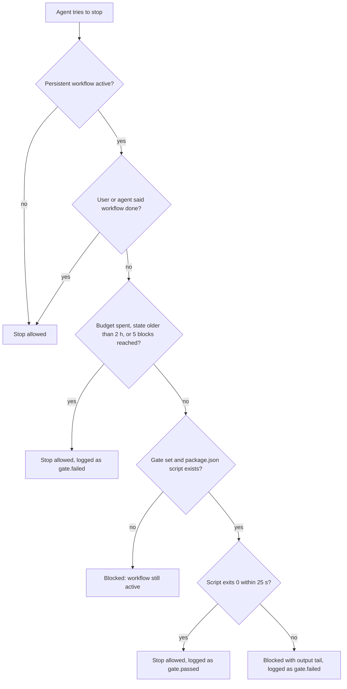

# oh-my-agent: いま使っているコーディングエージェントに加わる専門家チーム

[](https://www.npmjs.com/package/oh-my-agent) [](https://www.npmjs.com/package/oh-my-agent) [](https://github.com/first-fluke/oh-my-agent) [](https://github.com/first-fluke/oh-my-agent/blob/main/LICENSE) [](https://github.com/first-fluke/oh-my-agent/commits/main)

[English](../README.md) | [한국어](./README.ko.md) | [中文](./README.zh.md) | [Português](./README.pt.md) | [Français](./README.fr.md) | [Español](./README.es.md) | [Nederlands](./README.nl.md) | [Polski](./README.pl.md) | [Русский](./README.ru.md) | [Deutsch](./README.de.md) | [Tiếng Việt](./README.vi.md) | [ภาษาไทย](./README.th.md)

**oh-my-agent（`oma`）はベンダーに依存しないハーネスで、いま使っているコーディングエージェント（Claude Code、Codex CLI、Cursor ほか 11 種類）に専門家チームを加えます。** プランナーが作業を分解し、エンジニアが並列で構築し、レビューアーが結果を確認し、デバッガーが根本原因を修正します。出典つきのリサーチ、スライドデッキ、動画、画像も作れます。ほとんどのステップは開いて確認できるファイルを残します。長時間のワークフローでは、プロジェクト自身の `test`、`lint`、`typecheck` スクリプトが通るまで、ゲートがエージェントを作業に戻すことができます。

[](./assets/architecture/oh-my-agent-architecture.svg)

プロジェクトのルートで次を実行してください。

```bash
curl -fsSL https://raw.githubusercontent.com/first-fluke/oh-my-agent/main/cli/install.sh | bash
```

続いて `oma doctor` を実行し、エージェントに `/plan add user accounts with a settings page` と入力します。手順は [最初の 5 分](#your-first-5-minutes) で説明しています。


[フル動画を見る（35 秒）](./assets/video/oh-my-agent-explainer.mp4)

## 手に入るもの

**ワークフロー** は、入力する（あるいは話しかけるだけの）ものです。ワークフローは専門家である **ロール** を呼び出します。**スキル** はノウハウです。各ロールは自分のスキルを持ち、それ以外のスキルはタスクが必要とするたびにエージェントが読み込みます。

| | 得られるもの | 試してみる |
|---|---|---|
| **12 の専門ロール** | PM、アーキテクト、バックエンド・フロントエンド・モバイル・データベース・インフラの各エンジニア、QA レビューアー、デバッガー、リファクタラー、ドキュメントキュレーター、リサーチャー（[チームを紹介](#meet-the-team)） | `/orchestrate build a TODO app with login` |
| **21 のワークフロー** | `/brainstorm` や `/plan` から `/review`、`/debug`、`/scm` までのスラッシュコマンド。ほとんどは普通の依頼からも始まります（最大 11 言語のキーワードバンク） | "review this PR" |
| **33 のスキル** | タスクが必要とするときだけ読み込まれるドメインのノウハウ: UI、API、スキーマ、Terraform、CI、セキュリティ、git、オブザーバビリティ | 自動で読み込まれる。例: "add a Terraform S3 bucket" |
| **開いて確認できるファイル** | 計画、設計ドキュメント、API コントラクト、ADR、バグノート、エージェント別の結果、セキュリティのエビデンス、HTML 解説、振り返りサマリー | `ls .agents/results` |
| **ワークフローのチェック** | 長時間のワークフローでは、プロジェクト自身の `test`、`lint`、`typecheck` スクリプトが通らないとエージェントは終了できません。`oma ralph verify` は、`/ralph` の実行が plan、QA、refactor のファイルを残したかを確認します | `/ultrawork …` のあと `oma goal set --gate test` |
| **リサーチとコンテンツ** | 出典つき検索、市場調査、論文、スライドデッキ、MP4 動画、画像、ローカル音声、PDF/HWP から Markdown への変換 | `/video`、`/convert` |
| **1 つのフォルダー、14 のランタイム** | 移植可能な `.agents/` ディレクトリ 1 つを、各ランタイム自身の設定ファイルに書き出す | `oma link cursor` |

**[インストール](#install)** · **[最初の 5 分](#your-first-5-minutes)** · **[チーム](#meet-the-team)** · **[どのワークフロー？](#how-the-team-works-together)** · **[機能一覧](#everything-in-the-box)** · **[対応ランタイム](#works-with)** · **[検証](#verification-not-narration)** · **[FAQ](#faq)** · **[ドキュメント](https://first-fluke.github.io/oh-my-agent/)**

<a id="install"></a>
## インストール

スクリプトは [bun](https://bun.sh) がなければインストールし、`oma` コマンドをグローバルにインストールしてから（`bun install --global oh-my-agent`。`oma` がすでに PATH にあればスキップ）、対話式のセットアップを開始します。hook（キーワード検出と Stop ゲート）および複数のワークフローは、グローバルにインストールされた `oma` を呼び出します。見つからない場合、hook は動作しません。スクリプトを使わない場合は、`bun install --global oh-my-agent` で自分でインストールしてください（`npm install --global oh-my-agent` や `brew install oh-my-agent` でもかまいません）。

<details>
<summary>Windows、またはインストールスクリプトを使わない場合</summary>

```powershell
# Windows (PowerShell)
irm https://raw.githubusercontent.com/first-fluke/oh-my-agent/main/cli/install.ps1 | iex
```

```bash
# bun が入っている任意の OS: 同じセットアップに加えてグローバルな `oma` コマンド
bun install --global oh-my-agent
oma
```

Windows ではインストーラーに Antigravity、Hermes、Kimi が表示されず、hook ラッパーは bash スクリプトです。デフォルトの Aside ブラウザ MCP は `bash` 経由でインストールされるため、bash がない場合は選択を外してください。

</details>

セットアップでは、応答言語、接続するエージェントランタイム、機能プロバイダー、ブラウザ MCP、モデルプリセット、スキルプリセットを尋ねられます。**迷ったらスキルプリセットは `All` を選んでください。** ワークフローは常にインストールされますが、そのうちいくつか（`/orchestrate`、`/work`、`/ultrawork`、`/ralph`、`/docs`、`/security`）は `All` にしか含まれないスキルを必要とします。

<details>
<summary>インストーラーがデフォルトで行うこと</summary>

- **bun** をインストールします（必須）。**uv**、**Serena**（`uv tool install`）、**CUE**（`brew install cue` または `winget`）のインストールも試み、どれかが失敗しても警告を出して続行します。
- 対話式セットアップでは **Aside** ブラウザ MCP があらかじめ選択されており、選択したままにした場合にのみ `curl -fsSL https://releases.aside.com/install.sh | bash` でインストールします。ブラウザ MCP のステップで選択を外すか、後から `oma update mcp` で変更できます。
- セマンティックメモリには **AgentMemory** を使います。`bun install -g @agentmemory/agentmemory` を実行し、ログインサービス（launchd、systemd ユーザーユニット、または Windows のスケジュールされたタスク）として登録します。スキップするにはプロバイダーに `none` を選ぶか、`OMA_NO_AGENTMEMORY=1` を設定してください。
- ホームディレクトリにあるベンダーフォルダー（Antigravity、Hermes、Kimi）にスキルをリンクする前に確認します。`--global` なしで `$HOME` にいる場合も確認を求めます。
- プロジェクト外のいくつかのファイルには確認なしで書き込みます。対象は `~/.claude.json`（プロジェクトを信頼済みの Claude Code ワークスペースとしてマーク）、`~/.serena/`（OMA コンテキスト、回答サイズの下限、プロジェクト登録）、`~/.cursor/cli-config.json`（Cursor のコミット attribution をオフ）、`~/.grok/config.toml`（テレメトリー）、`~/.gemini/antigravity-cli/`（HUD）で、いずれも選択したベンダーの分だけです。
- ベンダー設定に**テレメトリーのオプトアウト**を書き込みます。Claude には `DISABLE_TELEMETRY=1` を設定し（これで Claude Code の Remote Control もオフになります）、Gemini、Qwen、Codex、Grok では使用統計をオフにします。ベンダーのデフォルトを維持するには `telemetry: true` を設定してください。
- `.claude/settings.json` に未設定の Claude Code 設定を追加します。`skipDangerousModePermissionPrompt: true`、`effortLevel: high`、`cleanupPeriodDays: 180` に加え、auto memory、adaptive thinking、エラーレポート、組み込みの git 指示をオフにする env フラグが含まれます。すでに設定している値はそのまま保持されます。
- **co-author トレーラー**を追加します。Claude Code のコミット attribution が `Co-Authored-By: First Fluke <our.first.fluke@gmail.com>` になり、PR には "Generated with oh-my-agent" の一行が付きます。オフにするには `scm.co_author.enabled: false` を設定してください。
- リストにない `Co-authored-by` アドレスを拒否する **commit-msg ガード**を `.githooks/` にインストールし、ほかのフックが有効でなければ `git config --local core.hooksPath .githooks` を設定します。オプトアウトするには `scm.co_author.enforce_hook: false` を設定してください。
- `oma update` はバックグラウンドで `oma` CLI を更新し（止めるには `auto_update_cli: false` または `OMA_SKIP_VERSION_CHECK=1`）、`uv tool upgrade serena-agent --prerelease=allow` を実行します（`serena.auto_update: false`）。
- Serena がデフォルトの `bridge` モードのとき、共有 Serena サーバーを最初に起動したエージェントセッションが**クリーンアップタイマー**を登録し、アイドル状態の共有 Serena サーバーを 5 分ごとに停止します（launchd `dev.oma.serena-daemon-gc`、systemd ユーザータイマー `oma-serena-daemon-gc.timer`、または Windows のスケジュールされたタスク `OMA Serena Daemon GC`）。共有サーバーとタイマーを使わない場合は `serena.mode: stdio` を設定してください。`oma uninstall` はこのタイマーを削除しません。
- 非対話の実行（`-y`、`OMA_YES=1`、`CI=true`）では、`All` スキルプリセット、`model_preset: auto`、バックエンド言語として Python を使います。`mcp.devtools_browsers` にブラウザがすでに登録されていない限り、ブラウザ MCP は選択されません（Aside のインストールスクリプトも実行しません）。

</details>

<details>
<summary>スキルプリセット</summary>

| プリセット | スキル |
|--------|--------|
| **All** | **全 33 スキル**（推奨） |
| Fullstack | architecture, backend, brainstorm, db, debug, design, dev-workflow, frontend, mobile, pm, qa, scm, tf-infra |
| Fullstack Web | Fullstack から mobile と tf-infra を除いたもの |
| Fullstack Mobile | Fullstack から frontend と tf-infra を除いたもの |
| Frontend | architecture, brainstorm, debug, design, frontend, pm, qa, scm |
| Backend | architecture, backend, brainstorm, db, debug, dev-workflow, pm, qa, scm |
| Mobile | architecture, brainstorm, debug, mobile, pm, qa, scm |
| DevOps | architecture, brainstorm, debug, dev-workflow, observability, pm, qa, scm, tf-infra |
| Research | academic-writing, hwp, market, pdf, scholar, scm, search, translation |
| Content | academic-writing, design, image, scm, translation, voice |
| Custom | スキルを 1 つずつ選択 |

名前付きのプリセットのうち、coordination、orchestration、docs、security、refactor、explanation、recap、video、slide、skill-creation を含むのは `All` だけです（または `Custom` で個別に選んでください）。Research と Content には、`/plan`、`/review`、`/debug`、`/architecture`、`/brainstorm` が使うスキルが含まれていません。詳しくは [プリセット外のスキルが必要なワークフロー](../web/docs/getting-started/installation.md#workflows-that-need-skills-outside-a-preset) を参照してください。

</details>

<a id="your-first-5-minutes"></a>
## 最初の 5 分

1. 上のコマンドで **インストール** します。
2. **インストールを確認します:**

   ```bash
   oma doctor
   ```

   `CLI Status`（どのエージェント CLI がインストール・サインイン済みか）と `Skills Status`（例: `Skills (33/33 installed, 33 complete)`）が表示されるはずです。`oma` が見つからない場合は、新しいターミナルを開くか（インストーラーが `~/.bun/bin` を PATH に追加した直後かもしれません）、`bun install --global oh-my-agent` を実行してください。
3. **プロジェクトでエージェントを開き、計画を依頼します:**

   ```text
   /plan add user accounts with a settings page
   ```

   「plan user accounts with a settings page」と書くだけでもかまいません。プロンプト hook のあるランタイムでは、キーワードから同じワークフローが始まります。
4. **得られたものを確認します。** `/plan` は現在のセッションで実行されます。この例のように複数の領域にまたがる作業では、`.agents/results/plan-<session-id>.json` と、`docs/plans/work/<NNN>-<name>.md` のトラッカーを書き出します。1 つの領域で完結する小さな依頼には、計画ファイルの代わりに直接の推奨案を返します。

複数の領域にまたがる作業では、この計画に対して `/work` または `/orchestrate` を実行してください。

<a id="meet-the-team"></a>
## チームの紹介

チームを率いるのは、いま使っているエージェント自身です。`/work`、`/orchestrate`、`/ultrawork` では、各作業を適切な専門家に渡し、専門家はそれぞれ独自のサブエージェントとして動きます。`/plan`、`/architecture`、`/docs` はそのロールのスキルを使って現在のセッションで実行され、`/review` と `/debug` はスコープが大きいときに担当の専門家を呼び出します。ロールが別ベンダーの CLI に割り当てられている場合は、`oma agent spawn` がその CLI で実行します。

| 専門家 | 持っているスキル | 呼び出し方 | 残すもの |
|---|---|---|---|
| **プロダクトマネージャー** (`pm-planner`) | oma-pm | `/plan`、または "plan the payment feature" | Medium と Complex の作業では plan JSON と `docs/plans/work/` のトラッカー（Simple な依頼には直接の推奨案） |
| **アーキテクト** (`architecture-reviewer`) | oma-architecture | `/architecture` | `.agents/results/architecture/` の ADR または推奨案 |
| **バックエンド、フロントエンド、モバイル、データベース、インフラの各エンジニア** | oma-backend, oma-frontend + oma-design, oma-mobile, oma-db, oma-tf-infra | `/work`、`/orchestrate` | コード、テスト、タスクごとの `result-<agent>` ファイル |
| **QA レビューアー** (`qa-reviewer`) | oma-qa | `/review`、または "review this PR" | CRITICAL から LOW まで順位付けされた指摘。それぞれ file:line と修正コードつき |
| **デバッガー** (`debug-investigator`) | oma-debug | `/debug`、または "fix this bug" | 最小限の修正、リグレッションテスト、必要に応じて `.agents/results/bugs/` のバグノート |

<details>
<summary>残り 3 つのロールと、ロールを持たないスキル</summary>

| 専門家 | 持っているスキル | 呼び出し方 | 残すもの |
|---|---|---|---|
| **リファクタラー** (`refactor-engineer`) | oma-refactor | `/ultrawork` の REFINE フェーズ | 挙動を保つ `refactor:` コミットと `result-refactor-<session>.md` レポート |
| **ドキュメントキュレーター** (`docs-curator`) | oma-docs | `/docs`、または "verify docs" | `docs/generated/doc-refs.json` と、承認したドキュメントパッチ |
| **リサーチャー** (`research-explorer`) | oma-search, oma-market, oma-scholar | リサーチの依頼 | 信頼度ラベルつきの出典。市場ブリーフは `.agents/results/market/` |

インフラエンジニア（`tf-infra-engineer`）は、破壊的な、または本番環境に対する `apply` や `destroy` の前に必ず確認するよう指示されています。残りのスキル（brainstorm、security、scm、dev-workflow、observability、explanation、recap、translation、coordination、orchestration、skill-creation、コンテンツとメディア）には専任のロールがありません。エージェントが自分で読み込み、その多くはスキルインジェクターがプロンプトから適切なものを提案します。

</details>

<a id="how-the-team-works-together"></a>
## チームの連携のしかた

```text
 THINK   /brainstorm ......................... docs/plans/designs/<NNN>-<feature>.md
 PLAN    /plan · /architecture ............... plan JSON, API contracts, ADR
 DESIGN  /design ............................. DESIGN.md + tokens
 BUILD   /work · /orchestrate · /ultrawork ... code + result-<agent> files, engineers in parallel
 CHECK   /review · /security · /debug ........ findings, security evidence, regression test
 SHIP    /scm · /docs ........................ Conventional Commits, doc fixes
```

各ステップは次のステップにファイルを渡します。`/brainstorm` が保存した設計を `/plan` が読み、`/plan` はすべてのタスクにエージェント、依存関係、受け入れ基準、確認コマンドを持たせた計画を書き出します。`/orchestrate` はその計画を実行します（最新の `plan-*.json` を読み込み、なければ書き出します）。`/work` と `/ultrawork` は、まず PM に独自の計画を書かせるところから始めます。不要な段階は飛ばしてかまいません。どの段階も単独で動きます。

**どのワークフローでチームを動かすか？**

| やりたいこと | 実行 | 終わり方 |
|---|---|---|
| 計画だけ | `/plan` | 複数領域の作業なら計画ファイル、小さな作業なら直接の推奨案 |
| ステップごとに追いかける PM 主導の構築 | `/work` | PM、次にティアごとのエンジニア、最後に QA。CRITICAL と HIGH の指摘は修正ループへ（最大 5 サイクル） |
| 任せきりの並列構築 | `/orchestrate` | チェックが通ったタスクだけを完了とみなす。各タスクは最大 3 回試行し、その後 partial または failed とマーク |
| 5 段階のワークフロー | `/ultrawork` | ゲート付きの 5 フェーズ（PLAN、IMPL、VERIFY、REFINE、SHIP）。レビューはすべて新しいレビューアーセッションで実行 |
| 「本当に終わるまで止まらないで」 | `/ralph` | 別途 spawn した、まっさらなコンテキストの judge がすべての基準を PASS と判定するまで `/ultrawork` を繰り返す。基準がブロックされたとき、または 5 回の iteration 後は部分的なレポートを出して停止 |
| タイマーで動くチーム | `oma schedule create qa-reviewer "review open PRs" --every 2h` | 実行ごとに `~/.oma/schedule/runs/<id>/` に Markdown ログを 1 つ |

スラッシュコマンドは必須ではありません。プロンプト hook のあるランタイムでは、普通の依頼（最大 11 言語のキーワードバンク）でほとんどのワークフローを始められます。「review this PR」なら `/review` が始まります。アプリ全体を説明すると（「Build a TODO app with user authentication」）`/orchestrate` が提案され、実行するかどうかはエージェントが判断します。コードブロック内のキーワードは無視されます。

`/orchestrate`、`/work`、`/ultrawork`、`/ralph` は、スラッシュコマンドでも平文（「ultrawork: add rate limiting」）でも、名前で呼び出すと **persistent** になります。その場合、エージェントが早めに終了しようとすると、「**workflow done**」と言うまで作業に戻されます（最大 5 回または 2 時間）。ゆるく一致しただけの依頼では、これらのワークフローは提案されるだけです。

**計測結果と注意点。** [ベンチマーク](../benchmarks/README.md)（プロンプト 1 つ、素の構成を含むアドオン構成の異なる 5 種類の Claude Code、`claude-opus-4-6`、それぞれ 1 回のビルド）では、oma は素の Claude Code の 70.7 に対して 80.6 を記録しました。コストは 1.7 倍（$4.04 対 $2.37）、時間は 1.8 倍でした。

<details>
<summary>全 21 ワークフロー</summary>

| コマンド | 内容 |
|---------|--------------|
| `/architecture` | 設計のトレードオフを比較検討し、推奨案、レビュー、または ADR を作成 |
| `/brainstorm` | アイデアと制約を探り、計画前に承認済みの設計をまとめる |
| `/convert` | PDF/HWP を Markdown に変換、または ffmpeg で画像・動画・音声をトランスコード |
| `/debug` | バグを再現して根本原因を修正し、リグレッションテストを書き、類似パターンをスキャン |
| `/deepinit` | 既存のコードベースを AGENTS.md、ARCHITECTURE.md、docs/ ナレッジベースに整理 |
| `/design` | アクセシビリティチェック付きでデザインシステム、DESIGN.md、トークンを構築 |
| `/docs` | ドキュメントの壊れた参照を見つけ、diff が触れたドキュメントにパッチを提案 |
| `/explain` | diff、PR、ブランチ、トピックを自己完結型のインタラクティブ HTML 解説に変換 |
| `/orchestrate` | エージェントを並列実行し、ファイル状態で連携させ、結果を検証（persistent） |
| `/plan` | 機能を API コントラクト付きの優先度付きタスクに分解 |
| `/ralph` | 別途 spawn した judge で `/ultrawork` を最大 5 回繰り返す（persistent） |
| `/recap` | 1 日または期間内の AI 会話履歴を要約 |
| `/review` | セキュリティ（OWASP Top 10）、パフォーマンス、アクセシビリティ（WCAG 2.2 AA）、コード品質をレビュー |
| `/schedule` | 定期的な間隔で実行するエージェントジョブを登録 |
| `/scm` | ブランチ、マージ、コンフリクト、ワークツリー、Conventional Commits を扱う |
| `/security` | ソース、エージェントスキル、MCP コンポーネントをスキャンし、指摘を検証して CI ゲートを設定 |
| `/stack-set` | 技術スタックを検出し、ドメインスキル向けのスタック別リファレンスを生成 |
| `/tools` | MCP ツールを平易な言葉で一覧・有効化・無効化 |
| `/ultrawork` | 5 フェーズ（PLAN、IMPL、VERIFY、REFINE、SHIP）。各レビューは新しいレビューアーセッションで実行（persistent） |
| `/video` | ブリーフからキー不要でも動くパイプラインで完成した MP4 を作成 |
| `/work` | PM の計画と QA レビューで、マルチドメインのプロジェクトに複数エージェントを連携させる（persistent） |

`oma verify triggers` は、ラベル付きの英語・韓国語 212 プロンプトのコーパスで検出器を評価します。誤検出が 10% を超えるか見逃しが 20% を超えると CI が失敗します。最新の計測結果は **見逃し 0%、誤検出 5.3%** です。詳細なリファレンス: [Workflows](https://first-fluke.github.io/oh-my-agent/docs/core-concepts/workflows/)。

</details>

<a id="see-it-work"></a>
## 動作の様子

`/ultrawork` セッションの例です。`[OMA PERSISTENT MODE: ULTRAWORK]` ブロックは Stop hook が出力する実際の形式で、ほかの行は言い換えです。

```text
you    /ultrawork add rate limiting to POST /login
agent  runs `oma goal set --gate test`
agent  PLAN writes .agents/results/plan-<run-id>.json
agent  IMPL -> VERIFY -> REFINE -> SHIP  (each review runs in a fresh reviewer session)
agent  "Rate limiting added. All tests pass."
oma    [OMA PERSISTENT MODE: ULTRAWORK]
       Stop gate 'test' FAILED (reinforcement 1/5).
       Fix the failures below, then finish the workflow — the stop is allowed only when the gate passes.
       --- gate output (tail) ---
       FAIL  src/auth/login.test.ts > returns 429 after 5 attempts
       To abandon instead: delete .agents/state/ultrawork-state-<host-session>.json or say "workflow done".
agent  fixes the limiter and stops again
oma    `test` exits 0: stop allowed, gate.passed appended to the session log
```

その後、`oma state list` でセッションを見つけ、`oma state get <oma-sid>`（`state list` が表示する ID）ですべてのゲートイベントを確認できます。`/ralph` では、`oma ralph verify --json` が各フェーズのファイルが残っているかどうかも確認します（出力は一部省略）。

```json
{ "ok": false,
  "missing": [{ "id": "A3", "description": "a distinct QA agent ran (VERIFY phase)",
                "pattern": ".agents/state/memories/result-qa*.md or .agents/results/result-qa*.md",
                "status": "missing" }] }
```

<a id="everything-in-the-box"></a>
## 機能一覧

<details>
<summary><strong>計画と設計</strong>: <code>/brainstorm</code>, <code>/plan</code>, <code>/architecture</code>, <code>/design</code></summary>

| コマンド | 内容 | 書き出すもの |
|---|---|---|
| `/brainstorm` | 確認の質問を 1 つずつ投げかけ、異なる仕組みのアプローチを 2〜3 案提示してから `/plan` に引き継ぎます。コードは書きません | `docs/plans/designs/<NNN>-<feature>.md` |
| `/plan` | 作業の規模を Simple、Medium、Complex で見積もります。Medium と Complex の作業はタスクに分割し、各タスクにエージェント、依存関係、受け入れ基準、確認コマンドを持たせます。作業が境界をまたぐ場合は API コントラクトを定義します | `.agents/results/plan-<sid>.json`、`docs/plans/work/<NNN>-<name>.md`、必要に応じて `.agents/results/api-contracts/` のコントラクト |
| `/architecture` | まず過去の決定を読み、少なくとも 2 つの選択肢を比較し、置き換えられた ADR を superseded とマークします | `.agents/results/architecture/` の ADR または推奨案 |
| `/design` | 2〜3 の方向性を提案してから、トークン付きの `DESIGN.md` を書き、レスポンシブレイアウトとアクセシビリティを監査します | `DESIGN.md`、CSS/Tailwind/shadcn トークン |

</details>

<details>
<summary><strong>構築</strong>: 7 つのドメインスキルと、それらをスタックに合わせる <code>/stack-set</code></summary>

| スキル | 作るもの |
|---|---|
| oma-frontend | トークン、i18n、アクセシビリティのルールに従う React/Next.js または Angular の UI |
| oma-backend | API、認証、データアクセス。router → service → repository のレイヤー構成 |
| oma-mobile | Flutter、React Native、Swift のアプリ |
| oma-db | スキーマ、マイグレーション、クエリチューニング、ベクトル/RAG 検索の計画 |
| oma-tf-infra | あらゆるクラウド向けの Terraform。ドリフト、破壊的変更、コストのリスクを明示 |
| oma-dev-workflow | mise タスク、lint/format/typecheck、commitlint、git hook、CI/CD、リリース |
| oma-observability | OpenTelemetry、SLO、アラート、インシデント調査 |

`/stack-set` はマニフェストを読み、backend、frontend、mobile の各スキル向けにスタック別のリファレンスを書き出します。monorepo では、フロントエンド・バックエンド・モバイルの各エンジニアがそれぞれの workspace（pnpm、npm/yarn/bun workspaces、lerna、nx、turbo、`mise.toml`）に向けられます。

</details>

<details>
<summary><strong>レビュー、修正、出荷</strong>: <code>/review</code>, <code>/security</code>, <code>/debug</code>, refactor, <code>/scm</code></summary>

| コマンドまたはスキル | 内容 | 書き出すもの |
|---|---|---|
| `/review` | 依存関係の監査のあと、OWASP Top 10、パフォーマンス、WCAG 2.2 AA、コード品質をレビューします。すべての指摘に file:line と修正コードが付きます | チャット上のレポートとメモリ記録。レポートファイルはなし |
| `/security` | ソース、エージェントスキル、MCP サーバーをスキャンし（Deepsec、Cisco Skill and MCP Scanner）、スコープを決めたテスト用デプロイがあれば ARTEX のペネトレーションテストを実行します。ワークフローは、実行に失敗したエンジンを問題なしではなく失敗として報告するよう求めます | `.agents/results/security/<run-id>/` |
| `/debug` | 失敗を再現し、最小限の変更で根本原因を修正し、リグレッションテストを追加し、同じパターンがほかにないかスキャンします | 修正とテスト。必要に応じて `.agents/results/bugs/` のバグノート |
| oma-refactor | 挙動を変えずに構造を変えます。先に特性化テストを書き、それからリファクタリング専用のコミットを作ります | `.agents/results/refactor/` |
| `/scm` | 論理的な変更ごとに分けた Conventional Commits。ブランチ、マージ、リベース、ワークツリー | コミットとブランチ |

</details>

<details>
<summary><strong>ドキュメントとナレッジ</strong>: <code>/deepinit</code>, <code>/docs</code>, <code>/explain</code>, <code>/recap</code>, translation</summary>

| コマンドまたはスキル | 内容 | 書き出すもの |
|---|---|---|
| `/deepinit` | 既存のリポジトリを、エージェントがすぐ使えるナレッジベースに変えます | `AGENTS.md`、`ARCHITECTURE.md`、`docs/` |
| `/docs` | 壊れた参照を見つけ、diff が触れたドキュメントにパッチを当て（承認したパッチのみ）、古くなった翻訳を見つけます | `docs/generated/doc-refs.json`、パッチ済みのドキュメント |
| `/explain` | PR、ブランチ、ステージ済みの変更を 5 問のクイズ付き HTML ウォークスルーに、トピックを 1 ページのビジュアル解説に変換します | `.agents/results/explain/<date>-<slug>.html` |
| `/recap` | 複数のツールにまたがる AI との会話を、1 日または期間単位で要約します | `.agents/results/recap/<date>.md` |
| oma-translation | ネイティブが書いたように読める翻訳。プレースホルダー、コード、ロケールキーは変わりません | 翻訳されたテキスト |

</details>

<details>
<summary><strong>リサーチ</strong>: 検索、市場調査、論文、アカデミックライティング</summary>

| スキル | 内容 | 書き出すもの |
|---|---|---|
| oma-search | ドキュメント、Web、コードの検索。出典ごとに信頼度ラベルを付けます | 出典つきの結果 |
| oma-market | コミュニティシグナルからペインポイント、トレンド、競合を調べ、SWOT、Porter's 5 Forces、PESTEL で整理します | `.agents/results/market/<topic>-<date>.md` |
| oma-scholar | PDF 全文（約 10K トークン）の代わりに、コンパクトな claims ファイル（Knows 形式、約 700 トークン）を読む論文検索 | `<paper>.knows.yaml` |
| oma-academic-writing | ルーブリックに照らしてアカデミックな文章を起草・監査します | 手元のファイル |

</details>

<details>
<summary><strong>コンテンツとメディア</strong>: <code>/video</code>, <code>/convert</code>, スライド、画像、音声</summary>

| コマンドまたはスキル | 作るもの | 書き出すもの |
|---|---|---|
| `/video` | ショート動画、解説動画、デモを完成した MP4 として作成。キーが必要なプロバイダーにはキー不要のフォールバックがあります | manifest 付きの `.agents/results/videos/<run>/` |
| oma-slide | 1920×1080 の HTML デッキ。PDF、PNG、PPTX にエクスポート | `.agents/results/slides/<session>/` |
| oma-image | サインイン済みのベンダー CLI で画像を生成し、並べて比較 | `.agents/results/images/<run>/` |
| oma-voice | Voicebox アプリによるローカルの音声合成と文字起こし | `.agents/results/voice/<run>/` |
| `/convert` | PDF や HWP から Markdown への変換。ffmpeg による画像・動画・音声の変換 | 入力ファイルの隣 |

これらのパイプラインは、ソースやベンダーキーがないとき、黙って中身の薄い結果を返さずにそのことを報告します。

</details>

<details>
<summary><strong>指示しなくても動く hook</strong></summary>

| Hook | 内容 | オフにする方法 / 上限 |
|---|---|---|
| キーワード起動 | 普通の依頼から対応するワークフローを始めます | 質問、貼り付けたテキスト、コードブロックはスキップ |
| スキルインジェクター | プロンプトに合ったスキルをエージェントに示します | persistent workflow が動いている間は一時停止 |
| Stop ゲート | persistent workflow を作業に戻します。`oma goal set --gate test` を設定すると、そのスクリプトが 25 秒以内に 0 で終了したときに終了を許可します | 「workflow done」と言う。5 回のブロックまたは 2 時間でも解除 |
| リファクタガード | 終了時に、500 行を超える編集済みファイルを `refactor-engineer` 向けにフラグ付けします | オプトイン: `refactor_guard.enabled` |
| シークレットガード | `*.env`、`*.pem`、`id_rsa*`、`*.tfstate` などのファイルの `git add` をブロックします | そのコマンドにだけ `OMA_SCM_ALLOW_SECRETS=1` を前置 |
| コード検索ガード | プロジェクト内でのネイティブな再帰検索をブロックし、エージェントに Serena か Gortex を使わせます | `providers.code_intelligence_guard: off` |
| テストフィルター | テスト出力から失敗とサマリーだけを残し、消費トークンを減らします | `OMA_TEST_FILTER=0` |
| セッションメモリー | セッションを切り替えたり再開したりしたとき（またはコンパクション後）、アクティブなセッションの最近のイベントと AgentMemory の想起結果を再注入します | メモリープロバイダー `none` または `OMA_NO_AGENTMEMORY=1` で想起をオフ。ローカルのイベントスナップショットは残る |

`oma hook probe` は、oma のプロンプト hook が各ランタイムの hook 入力を受け付けるかを確認します（ランタイム自体は起動しません）。各ランタイムがどの hook を接続するかは [ホストごとの違い](#host-differences) にあります。

</details>

<details>
<summary><strong>並列エージェント、セッション、ダッシュボード</strong></summary>

- `oma agent spawn <role> "<task>" <sid>` は Antigravity、Claude Code、Codex、Cursor、Grok、Kimi Code、Kiro、OpenCode、pi、Qwen Code でロールを実行し、`--isolation worktree` と `--fallback-vendors` を指定できます。`oma agent parallel` は複数を同時に実行します。この 10 個のディスパッチ先は、インストーラー連携先 14 個の一部です。
- `oma state list --all-projects` と `oma state get <sid>`: セッションと記録されたすべてのイベント。
- `oma dashboard terminal` / `oma dashboard web`: エージェントのライブステータス（Web ダッシュボードは `127.0.0.1` でのみ待ち受け）。[ダッシュボードガイド](../web/docs/guide/dashboard-monitoring.md)。
- `oma stats get`（生産性メトリクス）、`oma retro`（git の振り返り）、`oma recap --window 7d`（複数の AI ツールでやったこと）。
- `oma visualize --affected <paths>`: 変更した `.agents/` ファイルに依存するスキル、ワークフロー、エージェント、チェック。

</details>

<details>
<summary><strong>コードインテリジェンス、メモリー、MCP</strong></summary>

| スロット | デフォルト | 代替 |
|---|---|---|
| ドキュメント | Context7 | — |
| Web 検索 | ランタイム標準の検索 | Brave Search |
| コードインテリジェンス | Serena（プロジェクトごとに共有サーバー 1 つ） | Gortex（実験的） |
| セマンティックメモリー | AgentMemory | Honcho（実験的）、none |
| ブラウザ MCP | Aside | Chrome DevTools、Firefox DevTools |

Serena は LSP ベースのコードナビゲーションと診断を提供し、対応する場合はネイティブ編集のフィードバックも提供します。プロバイダーの選択はエージェントのランタイムとは独立しており、利用できる機能はプロバイダーとホストによって異なります。

エージェントは外部サービスを使わず、`.agents/state/` のプレーンなファイルで連携します。`/tools` は平易な言葉で MCP ツールをオン・オフします。詳細: [機能プロバイダー](./capability-providers.md)。

</details>

<details>
<summary><strong>使うほど良くなる仕組み</strong></summary>

- `oma skill eval` は、ホールドアウトタスクでスキルの向上幅を baseline と比べて測定します。`oma skill optimize` はそれを高める編集を提案し、`--apply` でその編集を反映します（[skill-eval ガイド](../web/docs/guide/skill-eval.md)）。
- `oma harness evolution enable --max-dispatches <n>` は、毎晩のサイクルをスケジュールします。このサイクルは失敗した実行をリグレッションフィクスチャに変え、評価に合格したスキル改善をプロジェクトのオーバーレイとして適用します。`--mode propose` を付けると記録だけを行います。
- `oma emit` は、`.agents/` のソースを Agent Skills パッケージ、Agent Plugins パッケージ、Claude Code プラグインマーケットプレイス、または `AGENTS.md` としてエクスポートします。

</details>

<details>
<summary><strong>設定と安全装置</strong></summary>

- ユーザーが所有する `.agents/oma-config.yaml` 1 つは、アップデート後も残ります（リセットするのは `oma update --force` だけです）。その上にプライベートな `.local.yaml` や `.local.cue` のオーバーレイを重ねられます。`language` は応答言語を設定します。
- 13 のプロジェクトルール（backend、commit、database、debug、design など）は、Claude Code と Cursor ではネイティブのルールとして読み込まれ、Codex、Qwen Code、Pi 向けに書き出される管理対象の `AGENTS.md` ブロックにインデックスされます。
- アップデート時には、設定とマイグレーションのバックアップが `.agents/backup/` に残ります。同梱のスキルとワークフローはその場で置き換えられるため、ローカルの変更はそれらの外に置いてください。`oma uninstall --dry-run` は削除される内容を表示します。`first-fluke/oma-update-action@v1` は CI で `oma update` を実行し、PR を作成します。

</details>

<details>
<summary><strong>全 33 スキル</strong></summary>

| スキル | 内容 |
|---|---|
| **oma-academic-writing** | アカデミックな文章を起草・改稿・監査する |
| **oma-architecture** | アーキテクチャのトレードオフを評価してモジュール境界を定め、ADR/ATAM/CBAMで分析する |
| **oma-backend** | Python、Node.js、RustでAPI、認証、データアクセスを構築する |
| **oma-brainstorm** | 作り始める前に、いっしょにアイデアを探る |
| **oma-coordination** | PM・フロントエンド・バックエンド・モバイル・QAエージェントの手動連携を段階的にガイドする |
| **oma-db** | スキーマ、マイグレーション、インデックス、ベクトルストアを設計する |
| **oma-debug** | 根本原因を特定してバグを修正し、リグレッションテストを書く |
| **oma-design** | トークン、アクセシビリティ、レスポンシブレイアウトを備えたデザインシステムを構築する |
| **oma-dev-workflow** | CI/CD、リリース、monorepoタスクを自動化する |
| **oma-docs** | ドキュメントの参照切れを検出してコード変更に同期させ、翻訳のずれを指摘する |
| **oma-explanation** | diff、PR、ブランチ、トピックを自己完結型のHTML解説にまとめる（コード変更にはクイズ付き） |
| **oma-frontend** | React/Next.jsまたはAngularでUIを構築する |
| **oma-hwp** | HWP、HWPX、HWPMLファイルをMarkdownに変換する |
| **oma-image** | 画像や参照画像ベースのバリエーションを生成し、AIベンダーを並べて比較することもできる |
| **oma-market** | コミュニティのシグナルから市場を調査し、SWOT・5F・PESTELで整理する |
| **oma-mobile** | Flutter、React Native、ネイティブSwiftでモバイルアプリを構築する |
| **oma-observability** | メトリクス、ログ、トレース、SLO、インシデント調査にまたがるオブザーバビリティ作業をルーティングする |
| **oma-orchestration** | CLIから複数のエージェントを並列で実行する |
| **oma-pdf** | PDFファイルをMarkdownに変換する |
| **oma-pm** | タスクを計画し、要件を分解し、APIコントラクトを定義する |
| **oma-qa** | 変更内容を正確性、OWASPセキュリティ、パフォーマンス、アクセシビリティの観点でレビューする |
| **oma-recap** | 会話履歴をテーマ別の作業サマリーにまとめる |
| **oma-refactor** | ホットスポットの絞り込み、特性化テスト、リファクタリング専用コミットで、挙動を変えずにリファクタリングする |
| **oma-scholar** | 学術文献を検索し、主張・根拠・ピアレビューをまとめたKnows論文サイドカーを作成する |
| **oma-scm** | ブランチ、マージ、ワークツリー、Conventional Commitsを管理する |
| **oma-search** | クエリごとに最適なソースへルーティングし、結果をどこまで信頼できるかをスコア化する |
| **oma-security** | ソース、エージェントスキル、MCPコンポーネントをスキャンし、デプロイ済みWebアプリをテストして指摘を検証する |
| **oma-skill-creation** | 新しいOMAスキルを作成・監査する |
| **oma-slide** | HTMLプレゼンテーションデッキを生成し、PDF/PNG/PPTXへエクスポートする |
| **oma-tf-infra** | Terraformでマルチクラウドインフラをプロビジョニングする |
| **oma-translation** | ネイティブスピーカーが書いたように読める文章に翻訳する |
| **oma-video** | キー不要でも動くHyperFramesパイプラインで、ショート動画・解説動画・デモ動画を生成する |
| **oma-voice** | オンデバイスでボイスオーバーを生成し、音声を文字起こしする |

</details>

<a id="works-with"></a>
## 対応ランタイム

インストーラーの対象は 14 種類です。Claude Code、Codex CLI、Cursor、Antigravity、Qwen Code、Grok、Kiro、Kimi、OpenCode、Pi、GitHub Copilot、Hermes、CommandCode、ZCode。スキップしたランタイムは `oma link <vendor>` で接続できます。ランタイムによって提供される hook が異なります。完全なマトリクスは [対応エージェント](./SUPPORTED_AGENTS.md) にあります。

- **Orca IDE:** [OMA for Orca](../integrations/orca/README.md) は、サイドバーパネルとコマンドパレットのアクションを追加します（Orca 1.4.197 以上で実験的プラグインを有効化）。
- **DeepSeek Harness:** [OMA for DeepSeek Harness](../integrations/dsh/README.md) は、Cordis プラグインを通じて OMA のチェックを接続します。`PATH` 上に `oma` が必要です。

<details>
<summary>ランタイムのロゴ（インストーラーの対象と Amp、DeepSeek Harness）</summary>

ネイティブ = oma がランタイム自身の設定ファイルを書き出します。アダプター = oma が hook やエージェントの shim も追加します。Amp は `.agents/skills/` を自分で読み込み、インストーラーの対象ではありません。

<table>
<colgroup>
<col span="6" style="width:16.67%" />
</colgroup>
<tr>
<td align="center">
<a href="https://claude.com/product/claude-code"></a><br/>
<strong>Claude Code</strong><br/>
<sub>ネイティブ + アダプター</sub>
</td>
<td align="center">
<a href="https://github.com/openai/codex"></a><br/>
<strong>Codex CLI</strong><br/>
<sub>ネイティブ + アダプター</sub>
</td>
<td align="center">
<a href="https://antigravity.google"></a><br/>
<strong>Antigravity</strong><br/>
<sub>ネイティブ SSOT</sub>
</td>
<td align="center">
<a href="https://cursor.com"></a><br/>
<strong>Cursor</strong><br/>
<sub>ネイティブ + アダプター</sub>
</td>
<td align="center">
<a href="https://github.com/QwenLM/qwen-code"></a><br/>
<strong>Qwen Code</strong><br/>
<sub>ネイティブディスパッチ</sub>
</td>
<td align="center">
<a href="https://github.com/deepseek-ai/deepseek-harness"></a><br/>
<strong>DeepSeek Harness</strong><br/>
<sub>Cordis プラグイン</sub>
</td>
</tr>
<tr>
<td align="center">
<a href="https://pi.dev/"></a><br/>
<strong>Pi</strong><br/>
<sub>ネイティブ互換</sub>
</td>
<td align="center">
<a href="https://github.com/anomalyco/opencode"></a><br/>
<strong>OpenCode</strong><br/>
<sub>ネイティブ互換</sub>
</td>
<td align="center">
<a href="https://ampcode.com"></a><br/>
<strong>Amp</strong><br/>
<sub>.agents/skills を読み込む</sub>
</td>
<td align="center">
<a href="https://github.com/features/copilot"></a><br/>
<strong>GitHub Copilot</strong><br/>
<sub>シンボリックリンクのスキル</sub>
</td>
<td align="center">
<a href="https://grok.x.ai"></a><br/>
<strong>Grok Build</strong><br/>
<sub>ネイティブ hook</sub>
</td>
<td align="center">
<a href="https://kiro.dev"></a><br/>
<strong>Kiro CLI</strong><br/>
<sub>ネイティブ hook + エージェント</sub>
</td>
</tr>
</table>

<p align="center"><sub><a href="./SUPPORTED_AGENTS.md">& その他</a></sub></p>

</details>

<a id="host-differences"></a>
<details>
<summary>ホストごとの違い: キーワード検出と Stop ゲートが使えるランタイム</summary>

| ランタイム | キーワード検出 | Stop ゲート |
|---|---|---|
| Claude Code, Codex CLI, Qwen Code, Grok, Kimi | あり | あり |
| Cursor | あり | あり（フォローアップメッセージとして再投入） |
| Antigravity | あり | あり（`oma` ラッパーではなく bun でハンドラーを実行） |
| OpenCode, Pi | あり | ベストエフォート（Pi は `agent_settled` を含むビルドが必要） |
| Kiro | あり | なし: Kiro は Stop hook の出力を無視する |
| CommandCode | プロンプト hook なし | あり |
| GitHub Copilot, Hermes, ZCode | hook なし | hook なし |

</details>

<a id="per-agent-models"></a>
<details>
<summary>エージェント別モデル</summary>

`.agents/oma-config.yaml` の `model_preset` で、各エージェントロールが使うモデルを選びます。デフォルトの `auto` は、実行中のランタイム自身のエージェント・モデル設定に従います。

```yaml
language: en
model_preset: auto   # auto | free | antigravity | claude | codex | cursor | kiro | mixed | qwen | <custom_presets key>

# Optional per-agent overrides; they win over the preset
agents:
  backend: { model: openai/gpt-5.5, effort: high }
```

- `mixed` は、オーケストレーター、アーキテクチャ、QA、PM、docs に Claude を、実装ロールに Codex の `gpt-5.5` を使うため、Claude Code と Codex CLI の両方が必要です。
- `free` は FreeLLMAPI ゲートウェイを経由するため、`FREELLM_API_KEY` と稼働中のサーバーが必要です。
- `kiro` はインストーラーのメニューにありません。設定ファイルで指定してください。
- `oma doctor --profile` は、ロールごとに解決されたモデルを出力します。
- 完全ガイド: [エージェント別モデル](https://first-fluke.github.io/oh-my-agent/docs/guide/per-agent-models/)

</details>

<a id="verification-not-narration"></a>
## 検証

OMA はワークフローが生成した成果物を確認します。[動作の様子](#see-it-work) では Stop ゲートの動作を示しています。

OMA は、追跡対象の Claude Code と Codex のハーネス実行について、ツール呼び出しのメタデータとペイロードダイジェストも記録します。報告されたトークン使用量と推定値を区別し、スキルのリグレッションも評価します。この +1 の機能は各レイヤーにまたがり、トレースの対象範囲はランタイムと実行ごとに異なります。

ほとんどのチェックは機械的に動作します。コマンドは終了コード 0 またはそれ以外で終了し、ファイルはディスク上に存在するか、存在しません。プロンプトで指示される judge は例外です。機械的なチェックでは、作業が「正しそうに見えるか」を LLM に尋ねません。

| メカニズム | 確認する内容 | ソース |
|-----------|----------------|--------|
| **Stop hook ゲート** | persistent workflow の間、`oma goal set --gate test`（または `lint`、`typecheck`）を設定すると、その package.json スクリプトが 25 秒以内に 0 で終了したときだけ終了を許可します。 | [`persistent-mode.ts`](../.agents/hooks/core/persistent-mode.ts) |
| **成果物ゲート** | `oma ralph verify --json` は、phase 記録、plan JSON、**別個の QA エージェント** と **別個の refactor エージェント** の result ファイルがあるかを確認します。それぞれ記録済みのエージェント実行に紐づいています。 | [`ralph.md`](../.agents/workflows/ralph.md) |
| **プロンプトで指示される judge** | 機械的ではありません。`/ralph` のプロンプトはオーケストレーターに、まっさらなコンテキストの judge を spawn し、毎 iteration **すべての** 基準を確認し直すよう指示します。spawn が実際に行われたかを確かめる仕組みはありません。 | [`judge-protocol.md`](../.agents/workflows/ralph/resources/judge-protocol.md) |
| **イベントログ** | OMA セッション内では、ゲートの通過、ゲートの失敗、判定がそれぞれ JSON 1 行としてセッションの `events.jsonl` に追記されます。 | [`state-core.ts`](../.agents/hooks/core/state-core.ts) · [`event-spec.md`](../.agents/skills/_shared/runtime/event-spec.md) |
| **エージェント別チェック** | `oma verify agent <type>` は、Scope Check、Charter Preflight、Hardcoded Secrets、TODO/FIXME Comments、Declared outputs、TDD Evidence に加え、TypeScript、Any Types、SQL Injection、テストなどのタイプ別チェックを実行します。 | `oma verify agent --help` |

> **セッションイベントの記録:** Stop hook は、persistent workflow の開始時に開かれた OMA セッションにゲートイベントを記録します。イベントの書き込みはベストエフォートです。そのセッションを作成できなかった場合（stderr に `[oma] L1 session activation failed` と表示されます）、失敗したゲートは終了をブロックしますが、`gate.failed` の行は書き込まれません。記録を当てにしたりデモで見せたりする前に、`oma state list` にアクティブなセッションが表示されることを確認してください。その後、`oma state get <sid>` でそのイベントを確認できます。

<details>
<summary>制限、詳細、Stop hook の判定方法</summary>

**制限:**

- Stop ゲートが適用されるのは persistent workflow（`/orchestrate`、`/work`、`/ultrawork`、`/ralph`）だけです。`oma goal set --gate` がなければ、エージェントに続行を促すだけです。`/ultrawork` は、プロジェクトに手軽なチェックがあればゲートを設定するようエージェントに指示しますが、それを強制する仕組みはありません。確実にしたい場合は、自分で `oma goal set --gate test` を実行してください。ほかの persistent workflow がゲートを設定することはありません。
- 受け付けるのは `typecheck`、`test`、`lint` のキーワードだけで、同名の package.json スクリプトを実行します。package.json がない、またはその名前のスクリプトがない場合、ゲートは実行されません。JS 以外のプロジェクトでは package.json のラッパースクリプトが必要です。
- ブロックは 5 回の再強制後、2 時間後、または `--budget-minutes` が尽きたときに解除され、失敗として記録されます。
- 予算: `session.quota_cap` はトークン、spawn 回数、ベンダー別トークンに上限をかけます。いずれかの項目が上限を超えると、オーケストレーターは次の spawn を拒否します。

**成果物ゲート。** 成果物がなければ、そのフェーズは実行されていません。セッションログに REFINE をスキップした理由が記録されていれば、refactor のチェックは `skip-recorded` として通過します。

**プロンプトで指示される judge。** `/ralph` のワークフロープロンプトはオーケストレーターに、judge をまっさらなコンテキストを持つ別エージェントとして spawn するよう指示します。judge には基準だけを伝え、実装側が何を直したと主張しているかは知らせません。そして毎 iteration、以前の PASS も含めて **すべての** 基準を検証し直すよう指示します。ある基準の修正で別の基準がリグレッションを起こすことがあるためです。spawn が実際に行われたかを確かめる仕組みはありません。`oma ralph verify` がゲートの対象にするのは EXEC の成果物で、judge ではありません。サブエージェントを spawn できないランタイムは、インラインで判定して `ralph.judge-inline-fallback` を記録するよう指示されます。`/ralph` は 5 回の iteration で停止し、部分的なレポートを出します。

**イベントログ。** `oma state list` でセッションを見つけ、`oma state get <sid>` で読みます。各イベントにはベンダーとランタイムのセッション id が刻まれます。ファイルの場所は `OMA_HOME`、`OMA_STATE_HOME`、`OMA_PROFILE`、そしてプロジェクト内の旧来のセッションフォルダーによって変わるため、ハードコードしないでください。

**エージェント別チェック。** タイプ: `backend`、`frontend`、`mobile`、`qa`、`debug`、`pm`。いずれかのチェックが失敗するとコマンドは 1 で終了します。TODO/FIXME Comments と Inline Styles は警告だけです。

<!-- Stack manifests in this list are optional outputs of /stack-set, not shipped files. -->
<!-- oma-docs:ignore-start -->
- `backend`: `stack/stack.yaml` のコマンドによる `<Language> Syntax`、`SQL Injection`（raw SQL のパターン）、`<Language> Tests`。このファイルがない場合（`/stack-set` で生成できます）はスキップされます。
- `frontend`: `stack/stack.yaml`（`oma-frontend` 配下、または `angular-developer` スキルがインストールされていればその配下）の構文・テストコマンド、または TypeScript（`tsc --noEmit`）と Frontend Tests（Vitest）。Inline Styles と Any Types は常に実行されます。
- `mobile`: `stack/stack.yaml` の構文・テストコマンド、または Flutter/Dart Analysis と Flutter Tests。
- `debug`: Python Tests（uv 経由の pytest）または Frontend Tests（Vitest）。
- `pm`: PM Plan（計画ファイルが有効な JSON であること）。
- `qa`: 機械的なチェックはありません。
<!-- oma-docs:ignore-end -->



</details>

## FAQ

<details>
<summary><strong>すべてのスキルが必要ですか？</strong></summary>

いいえ。[スキルプリセット](#install) を参照してください。`All` が無難なデフォルトです。

</details>

<details>
<summary><strong>動いているかどうかはどうやってわかりますか？</strong></summary>

`oma doctor` はインストール済みのスキルを表示し、hook が `oma` を見つけられないときに警告します。persistent workflow の間は、`oma state list` でアクティブなセッションを、`oma state get <sid>` でそのゲートイベントを確認できます。

</details>

<details>
<summary><strong>トークンは多くかかりますか？</strong></summary>

たいていは、かかります。スキルはタスクが必要とするときだけ読み込まれますが、マルチエージェントのワークフローやまっさらなコンテキストでのレビューはそのぶん多く消費します。[プロンプト 1 つのベンチマーク](../benchmarks/README.md) では、oma のコストは素の Claude Code の 1.7 倍でした。

</details>

<details>
<summary><strong>Stop hook がブロックし続けます。どうすれば抜けられますか？</strong></summary>

「workflow done」と言うか（「workflow complete」/「workflow finished」、またはほかの対応言語での同等の表現でもかまいません）、`.agents/state/<workflow>-state-<sid>.json` を削除してください。どちらもしなくても、5 回のブロックまたは 2 時間で自動的に解除されます。

</details>

<details>
<summary><strong>アップデートやアンインストールはどうしますか？</strong></summary>

`oma update` は設定を保ったままスキル、ワークフロー、hook を更新します（`--with-new-skills` でそのリリースの新しいスキルを追加し、`oma update mcp` でブラウザ MCP を選び直します）。`oma uninstall --dry-run` は削除される内容を表示し、`oma uninstall` は実際に削除します。`oma-config.yaml`、`mcp.json`、自分で書いたスキルは残ります。そのほかの対処法: [Troubleshooting](https://first-fluke.github.io/oh-my-agent/docs/guide/troubleshooting/)。

</details>

<details>
<summary><strong>oh-my-agent はモデルに何を任せていますか？</strong></summary>

計画と次のステップの選択は、エージェントのモデルに任せています。oma には固定のワークフローグラフはありません。oma がモデルの外側で強制するのは、ツールのガードレール（シークレットガードと検索ガード）、予算、リトライと停止の上限、イベントログ、そしてゲートを設定した場合の、プロジェクト自身のチェックが通るまで待つ終了です。

</details>

## 詳細

- **[ドキュメントサイト](https://first-fluke.github.io/oh-my-agent/)**: ガイド、チュートリアル、CLI リファレンス。まずは [Quick Start](https://first-fluke.github.io/oh-my-agent/docs/getting-started/quick-start/) と [Installation](https://first-fluke.github.io/oh-my-agent/docs/getting-started/installation/) から。
- **[なぜ oh-my-agent なのか](https://first-fluke.github.io/oh-my-agent/docs/getting-started/why-oh-my-agent/)**: 選ぶべき場面とトレードオフ
- **[ベンチマークレポート](../benchmarks/README.md)**: 1 つのプロンプトで superpowers、ECC、oh-my-claudecode と比較した結果。方法論、スコア、スクリーンショット、注意点つき
- **[対応エージェント](./SUPPORTED_AGENTS.md)**: ランタイムごとの対応マトリクス
- **[詳細ドキュメント](./AGENTS_SPEC.md)**: 技術仕様とアーキテクチャ
- **[機能プロバイダー](./capability-providers.md)**: 実験的な Gortex と Honcho の設定、ルーティング、制限
- **[スキル互換性マトリクス](./skills-matrix.md)**: Claude と Codex におけるネイティブスキルの内容、リファレンス、レスポンス契約

> GitHub でプロジェクトにスターを付けるには:
>
> ```bash
> gh api --method PUT /user/starred/first-fluke/oh-my-agent
> ```
>
> スターターテンプレート: [fullstack-starter](https://github.com/first-fluke/fullstack-starter)

## Star History

[](https://star-history.dera.page/#first-fluke/oh-my-agent&type=date&legend=bottom-right)

## 参考文献

<details>
<summary>このプロジェクトが基づく研究（論文 7 本）</summary>

- Li, X., Liu, Y., Chen, W., You, B., Di, Z., He, Y., Zheng, S., Choe, K. W., Sun, J., Wang, S., Tao, C., Li, B., Zhao, X., Geng, H., Wu, X., Zhou, J., Chen, X., Xing, H., Li, Y., … Song, D. (2026). *SkillsBench: Benchmarking how well agent skills work across diverse tasks* (Version 4) [Preprint]. arXiv. https://doi.org/10.48550/arXiv.2602.12670
- Yu, G., & Wang, X. (2026). *Knows: Agent-native structured research representations* (Version 1) [Preprint]. arXiv. https://doi.org/10.48550/arXiv.2604.17309
- Liang, Q., Wang, H., Liang, Z., & Liu, Y. (2026). *From skill text to skill structure: The scheduling-structural-logical representation for agent skills* (Version 4) [Preprint]. arXiv. https://doi.org/10.48550/arXiv.2604.24026
- Chen, C., Yu, Q., Gu, Y., Huang, Z., Li, H., Liu, H., Liu, S., Liu, J., Peng, D., Wang, J., Yan, Z., Meng, F., Qin, E., Che, C., & Hu, M. (2026). *The scaling laws of skills in LLM agent systems* (Version 1) [Preprint]. arXiv. https://doi.org/10.48550/arXiv.2605.16508
- Tang, L., Rashtchian, C., Ferng, C.-S., Tomkins, A., Juan, D.-C., & Vu, T. (2026). *WikiSkill: Compiling agent experience into persistent knowledge for skill evolution* [Preprint]. arXiv. https://doi.org/10.48550/arXiv.2608.27454
- Huang, Z., Xu, J., Yang, Y., Gong, Z., Yang, Q., Tian, M., Wang, X., Lv, C., Gao, X., Dai, Q., Liu, B., Qiu, K., Yang, X., Chen, D., Zheng, X., & Luo, C. (2026). *From raw experience to skill consumption: A systematic study of model-generated agent skills* [Preprint]. arXiv. https://doi.org/10.48550/arXiv.2605.23899
- Hong, D. B., Imani, A., & Ahmed, I. (2026). *From anatomy to smells: An empirical study of SKILL.md in agent skills* (Version 2) [Preprint]. arXiv. https://doi.org/10.48550/arXiv.2607.01456

</details>

## ライセンス

MIT
