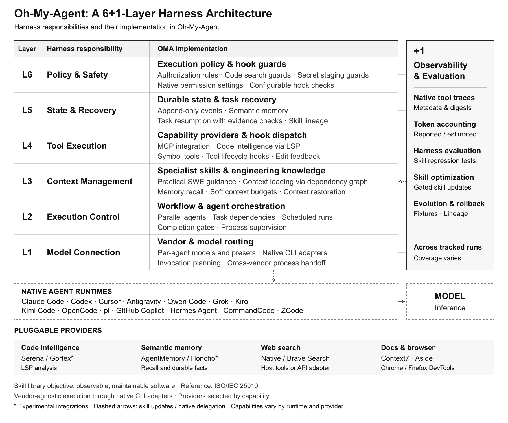
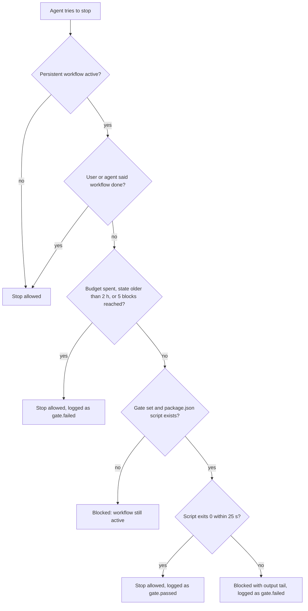

# oh-my-agent: 지금 쓰는 코딩 에이전트에 더하는 전문가 팀

[](https://www.npmjs.com/package/oh-my-agent) [](https://www.npmjs.com/package/oh-my-agent) [](https://github.com/first-fluke/oh-my-agent) [](https://github.com/first-fluke/oh-my-agent/blob/main/LICENSE) [](https://github.com/first-fluke/oh-my-agent/commits/main)

[English](../README.md) | [中文](./README.zh.md) | [Português](./README.pt.md) | [日本語](./README.ja.md) | [Français](./README.fr.md) | [Español](./README.es.md) | [Nederlands](./README.nl.md) | [Polski](./README.pl.md) | [Русский](./README.ru.md) | [Deutsch](./README.de.md) | [Tiếng Việt](./README.vi.md) | [ภาษาไทย](./README.th.md)

**oh-my-agent(`oma`)는 특정 벤더에 종속되지 않는 하네스로, 이미 쓰고 있는 코딩 에이전트(Claude Code, Codex CLI, Cursor 외 11개)에 전문가 팀을 더해 줍니다.** 플래너가 작업을 나누고, 엔지니어들이 병렬로 구축하고, 리뷰어가 결과를 확인하고, 디버거가 근본 원인을 고칩니다. 출처가 달린 리서치, 슬라이드 덱, 영상, 이미지도 만듭니다. 대부분의 단계는 직접 열어 볼 수 있는 파일을 남기며, 오래 실행되는 워크플로우에서는 프로젝트의 `test`, `lint`, `typecheck` 스크립트가 통과할 때까지 게이트가 에이전트를 다시 작업으로 돌려보낼 수 있습니다.

## 작업에 맞게 시작하기

지금 쓰는 코딩 에이전트에서 스킬 하나를 불러오거나, 프로젝트 훅과 팀 워크플로우를 위한 런타임을 설치할 수 있습니다.

| 할 일 | 시작 방법 | 첫 요청 예시 |
|---|---|---|
| 어드민 화면 설계·기존 UI 검토 | `bunx skills use first-fluke/oh-my-agent@oma-design` | "어드민 화면의 정보 위계와 테이블 밀도를 검토해 줘." |
| 재현 가능한 버그 진단 | `bunx skills use first-fluke/oh-my-agent@oma-debug` | "이 오류를 재현하고 원인을 고쳐 줘." |
| 시스템 경계 검토 | `bunx skills use first-fluke/oh-my-agent@oma-architecture` | "API와 워커의 책임 경계를 검토해 줘." |
| 프로젝트 훅·전문 에이전트·워크플로우 사용 | [런타임 설치](#install) | "oma-scm으로 브랜치와 작업 트리를 확인해 줘. 파일 수정이나 원격 접근은 하지 마." |

에이전트의 터미널에서 `skills use`를 실행하면 선택한 지침과 참고 파일 경로를 받습니다. 이 명령은 지침을 불러옵니다. 스킬이 사용하는 CLI 기능, 다른 스킬, 프로젝트 규칙, 외부 서비스는 각각 별도 의존성입니다. [설치 방식 선택](../web/docs/getting-started/choose-setup.md)에서 범위를 확인할 수 있습니다.

[](./assets/architecture/oh-my-agent-architecture.svg)

런타임을 설치하려면 프로젝트 루트에서 다음을 실행하세요.

```bash
curl -fsSL https://raw.githubusercontent.com/first-fluke/oh-my-agent/main/cli/install.sh | bash
```

런타임 설치 후에는 `oma doctor`를 실행하세요. [처음 5분](#your-first-5-minutes)에서는 팀 워크플로우에 앞서 읽기 전용 작업으로 결과를 확인합니다.

## 얻을 수 있는 것

**워크플로우**는 직접 입력하는(또는 그냥 말로 요청하는) 것입니다. 워크플로우는 전문가인 **역할**을 불러옵니다. **스킬**은 노하우입니다. 역할마다 자기 스킬을 갖고 있고, 나머지 스킬은 태스크에 필요할 때마다 에이전트가 불러옵니다.

| | 제공하는 것 | 써 보기 |
|---|---|---|
| **전문 역할 12개** | PM, 아키텍트, 백엔드·프런트엔드·모바일·데이터베이스·인프라 엔지니어, QA 리뷰어, 디버거, 리팩터러, 문서 큐레이터, 리서처([팀 소개](#meet-the-team)) | `/orchestrate build a TODO app with login` |
| **워크플로우 21개** | `/brainstorm`, `/plan`부터 `/review`, `/debug`, `/scm`까지의 슬래시 커맨드. 대부분은 평범한 요청으로도 시작됩니다(최대 11개 언어의 키워드 뱅크) | "review this PR" |
| **스킬 33개** | 태스크에 필요할 때만 불러오는 도메인 노하우: UI, API, 스키마, Terraform, CI, 보안, git, 관측성 | 저절로 불러옴. 예: "add a Terraform S3 bucket" |
| **직접 열어 볼 수 있는 파일** | 계획, 설계 문서, API 계약, ADR, 버그 노트, 에이전트별 결과, 보안 증거, HTML 설명서, 요약 | `ls .agents/results` |
| **워크플로우 검사** | 오래 실행되는 워크플로우에서는 프로젝트의 `test`, `lint`, `typecheck` 스크립트가 통과해야 에이전트가 멈출 수 있습니다. `oma ralph verify`는 `/ralph` 실행이 plan, QA, refactor 파일을 남겼는지 확인합니다 | `/ultrawork …` 후 `oma goal set --gate test` |
| **리서치와 콘텐츠** | 출처가 달린 검색, 시장 조사, 논문, 슬라이드 덱, MP4 영상, 이미지, 로컬 음성, PDF/HWP를 Markdown으로 변환 | `/video`, `/convert` |
| **폴더 하나, 런타임 14개** | 이식 가능한 `.agents/` 디렉터리 하나를 각 런타임의 자체 설정 파일에 기록 | `oma link cursor` |

**[설치](#install)** · **[처음 5분](#your-first-5-minutes)** · **[팀 소개](#meet-the-team)** · **[어떤 워크플로우?](#how-the-team-works-together)** · **[전체 구성](#everything-in-the-box)** · **[지원 런타임](#works-with)** · **[검증](#verification-not-narration)** · **[FAQ](#faq)** · **[문서](https://first-fluke.github.io/oh-my-agent/)**

<a id="install"></a>
## 설치

스크립트는 [bun](https://bun.sh)이 없으면 설치하고, `oma` 커맨드를 전역으로 설치한 뒤(`bun install --global oh-my-agent`, PATH에 이미 `oma`가 있으면 건너뜀) 대화형 설정을 시작합니다. hook(키워드 감지와 Stop 게이트) 및 여러 워크플로우는 전역 설치된 `oma` 커맨드를 호출합니다. hook은 `oma`를 찾지 못하면 경고 없이 아무 작업도 하지 않습니다. 스크립트를 쓰지 않는다면 `bun install --global oh-my-agent`로 직접 설치하세요(`npm install --global oh-my-agent`나 `brew install oh-my-agent`도 됩니다).

<details>
<summary>Windows, 또는 설치 스크립트 없이 설치하기</summary>

```powershell
# Windows (PowerShell)
irm https://raw.githubusercontent.com/first-fluke/oh-my-agent/main/cli/install.ps1 | iex
```

```bash
# bun이 설치된 모든 OS: 같은 설정에 전역 `oma` 커맨드까지 설치
bun install --global oh-my-agent
oma
```

Windows에서는 설치 프로그램이 Antigravity, Hermes, Kimi를 숨기고, hook 래퍼는 bash 스크립트입니다. 기본 Aside 브라우저 MCP는 `bash`로 설치되므로, bash가 없다면 선택을 해제하세요.

</details>

설정 과정에서는 응답 언어, 연결할 에이전트 런타임, 기능 프로바이더, 브라우저 MCP, 모델 프리셋, 스킬 프리셋을 묻습니다. **모든 워크플로우가 참조하는 스킬을 포함하려면 `All`을 고르세요.** 분야별 프리셋에는 일부 스킬이 빠져 있습니다. 프로바이더의 사용 가능 여부와 실제 작업 검증은 별도로 확인합니다.

특정 분야의 스킬을 선택하려면 프리셋을 지정하세요.

```bash
oma install --preset frontend --yes
```

이 명령은 프런트엔드 프리셋의 스킬 8개를 선택합니다. 런타임·프로바이더·공통 워크플로우 파일 설정은 그대로 진행하며, 기존 스킬도 남겨 둡니다. 개별 스킬 선택은 대화형 설치의 Custom에서 할 수 있습니다. [프리셋 값](../web/docs/getting-started/installation.md#presets)과 [워크플로우 의존성](../web/docs/getting-started/installation.md#workflows-that-need-skills-outside-a-preset)을 확인하세요.

<details>
<summary>설치 프로그램이 기본으로 함께 하는 일</summary>

- **bun**을 설치합니다(필수). **uv**, **Serena**(`uv tool install`), **CUE**(`brew install cue` 또는 `winget`) 설치도 시도하며, 이 중 하나가 실패해도 경고만 남기고 계속 진행합니다.
- 대화형 설정에서 **Aside** 브라우저 MCP를 미리 선택해 두며, 선택을 유지한 경우에만 `curl -fsSL https://releases.aside.com/install.sh | bash`로 설치합니다. 브라우저 MCP 단계에서 선택을 해제하거나, 나중에 `oma update mcp`로 바꿀 수 있습니다.
- 시맨틱 메모리로 **AgentMemory**를 사용합니다. 이때 `bun install -g @agentmemory/agentmemory`를 실행하고 로그인 서비스(launchd, systemd 사용자 유닛 또는 Windows 예약 작업)로 등록합니다. 건너뛰려면 프로바이더로 `none`을 고르거나 `OMA_NO_AGENTMEMORY=1`을 설정하세요.
- 홈 디렉터리의 벤더 폴더(Antigravity, Hermes, Kimi)에 스킬을 링크하기 전에는 먼저 묻습니다. `--global` 없이 `$HOME`에서 실행하면 확인을 요청합니다.
- 프로젝트 밖의 일부 파일은 묻지 않고 씁니다. `~/.claude.json`(프로젝트를 신뢰할 수 있는 Claude Code 워크스페이스로 표시), `~/.serena/`(OMA 컨텍스트, 응답 크기 하한, 프로젝트 등록), `~/.cursor/cli-config.json`(Cursor의 커밋 attribution 끄기), `~/.grok/config.toml`(텔레메트리), `~/.gemini/antigravity-cli/`(HUD)이며, 각 파일은 선택한 벤더에 대해서만 씁니다.
- 벤더 설정에 **텔레메트리 옵트아웃**을 씁니다. Claude에는 `DISABLE_TELEMETRY=1`을 넣고(이 값은 Claude Code Remote Control도 끕니다), Gemini, Qwen, Codex, Grok에서는 사용 통계를 끕니다. 벤더 기본값을 유지하려면 `telemetry: true`를 설정하세요.
- `.claude/settings.json`에 아직 설정하지 않은 Claude Code 설정을 추가합니다. `skipDangerousModePermissionPrompt: true`, `effortLevel: high`, `cleanupPeriodDays: 180`과 함께 auto memory, adaptive thinking, 오류 보고, 내장 git 지침을 끄는 env 플래그가 포함됩니다. 이미 설정한 값은 그대로 유지됩니다.
- **공동 작성자 트레일러**를 추가합니다. Claude Code의 커밋 attribution이 `Co-Authored-By: First Fluke <our.first.fluke@gmail.com>`이 되고, PR에는 "Generated with oh-my-agent" 줄이 붙습니다. 끄려면 `scm.co_author.enabled: false`를 설정하세요.
- 목록에 없는 `Co-authored-by` 주소를 거부하는 **commit-msg 가드**를 `.githooks/`에 설치하고, 다른 hook이 활성화되어 있지 않으면 `git config --local core.hooksPath .githooks`를 설정합니다. 사용하지 않으려면 `scm.co_author.enforce_hook: false`를 설정하세요.
- `oma update`는 백그라운드에서 `oma` CLI를 업데이트하고(멈추려면 `auto_update_cli: false` 또는 `OMA_SKIP_VERSION_CHECK=1`), `uv tool upgrade serena-agent --prerelease=allow`를 실행합니다(`serena.auto_update: false`).
- Serena가 기본 `bridge` 모드일 때, 공유 Serena 서버를 처음 시작한 에이전트 세션이 **정리 타이머**를 등록합니다. 이 타이머는 유휴 상태인 공유 Serena 서버를 5분마다 중지합니다(launchd `dev.oma.serena-daemon-gc`, systemd 사용자 타이머 `oma-serena-daemon-gc.timer` 또는 Windows 예약 작업 `OMA Serena Daemon GC`). 공유 서버와 타이머를 건너뛰려면 `serena.mode: stdio`를 설정하세요. `oma uninstall`은 이 타이머를 제거하지 않습니다.
- 비대화형 실행(`-y`, `OMA_YES=1`, `CI=true`)은 `--preset`으로 지정한 스킬 프리셋을 사용하며, 생략하면 `All`을 사용합니다. `model_preset: auto`, 백엔드 언어 Python을 사용하고, `mcp.devtools_browsers`에 이미 브라우저가 들어 있지 않으면 브라우저 MCP를 선택하지 않습니다(Aside 설치 스크립트도 건너뜁니다).

</details>

<details>
<summary>스킬 프리셋</summary>

| 프리셋 | 스킬 |
|--------|--------|
| **All** | **스킬 33개 전체** (권장) |
| Fullstack | architecture, backend, brainstorm, db, debug, design, dev-workflow, frontend, mobile, pm, qa, scm, tf-infra |
| Fullstack Web | Fullstack에서 mobile, tf-infra 제외 |
| Fullstack Mobile | Fullstack에서 frontend, tf-infra 제외 |
| Frontend | architecture, brainstorm, debug, design, frontend, pm, qa, scm |
| Backend | architecture, backend, brainstorm, db, debug, dev-workflow, pm, qa, scm |
| Mobile | architecture, brainstorm, debug, mobile, pm, qa, scm |
| DevOps | architecture, brainstorm, debug, dev-workflow, observability, pm, qa, scm, tf-infra |
| Research | academic-writing, hwp, market, pdf, scholar, scm, search, translation |
| Content | academic-writing, design, image, scm, translation, voice |
| Custom | 스킬을 하나씩 직접 선택 |

이름이 붙은 프리셋 중에서 coordination, orchestration, docs, security, refactor, explanation, recap, video, slide, skill-creation을 포함하는 것은 `All`뿐입니다(또는 `Custom`에서 직접 고르세요). Research와 Content에는 `/plan`, `/review`, `/debug`, `/architecture`, `/brainstorm`이 쓰는 스킬이 없습니다. [프리셋 밖의 스킬이 필요한 워크플로우](../web/docs/getting-started/installation.md#workflows-that-need-skills-outside-a-preset)를 참고하세요.

</details>

<a id="your-first-5-minutes"></a>
## 처음 5분

1. **설치 범위를 고릅니다.** 아래 작업만 하려면 `bunx skills use first-fluke/oh-my-agent@oma-scm`으로 `oma-scm`을 불러오세요. 프로젝트 훅과 워크플로우가 필요하면 위의 런타임 설치 커맨드를 사용하세요. [설치 방식 선택](../web/docs/getting-started/choose-setup.md)에서 두 경로를 확인할 수 있습니다.
2. **런타임을 설치했다면 상태를 확인합니다.**

   ```bash
   oma doctor
   ```

   CLI와 스킬 파일 상태가 표시됩니다. 스킬 수에는 기존에 남아 있는 스킬도 포함되므로, 이번 프리셋에서 선택한 수와 다를 수 있습니다. `oma`를 찾지 못하면 새 터미널을 열거나 `bun install --global oh-my-agent`를 실행하세요.
3. **기존 Git 저장소에서 읽기 전용 작업 하나를 요청합니다.** `oma-scm`은 이름이 있는 모든 프리셋에 포함됩니다. Custom으로 개별 선택할 때는 이 스킬을 포함하세요.

   ```text
   Use oma-scm to inspect this repository's current branch and working tree. Do not edit, stage, commit, or contact remotes. Report staged, unstaged, and untracked changes, with the Git commands and exit statuses actually observed.
   ```

4. **결과를 확인합니다.** 보고한 브랜치와 변경 내역이 실제 Git 출력과 일치해야 합니다. 지침을 불러왔거나 설치가 끝났다는 사실만으로 작업 실행이 확인되지는 않습니다.

더 큰 작업에는 필요한 스킬이 설치된 워크플로우를 선택하세요. 계획 스킬이 있으면 `/plan`으로 시작하고, 의존성을 갖춘 뒤 `/work`나 `/orchestrate`로 이어 갈 수 있습니다.

<a id="meet-the-team"></a>
## 팀 소개

팀을 이끄는 것은 지금 쓰는 에이전트 자신입니다. `/work`, `/orchestrate`, `/ultrawork`에서는 각 작업을 알맞은 전문가에게 넘기고, 전문가는 각자 서브에이전트로 실행됩니다. `/plan`, `/architecture`, `/docs`는 해당 역할의 스킬을 가지고 현재 세션에서 실행되며, `/review`와 `/debug`는 범위가 클 때 해당 전문가를 부릅니다. 역할이 다른 벤더의 CLI에 배정되어 있으면 `oma agent spawn`이 그 CLI에서 실행합니다.

| 전문가 | 갖춘 스킬 | 부르는 방법 | 남기는 것 |
|---|---|---|---|
| **프로덕트 매니저** (`pm-planner`) | oma-pm | `/plan`, 또는 "plan the payment feature" | Medium·Complex 작업에는 plan JSON과 `docs/plans/work/`의 트래커(Simple 요청에는 바로 권고안) |
| **아키텍트** (`architecture-reviewer`) | oma-architecture | `/architecture` | `.agents/results/architecture/`의 ADR 또는 권고안 |
| **백엔드, 프런트엔드, 모바일, 데이터베이스, 인프라 엔지니어** | oma-backend, oma-frontend + oma-design, oma-mobile, oma-db, oma-tf-infra | `/work`, `/orchestrate` | 코드, 테스트, 태스크마다 `result-<agent>` 파일 |
| **QA 리뷰어** (`qa-reviewer`) | oma-qa | `/review`, 또는 "review this PR" | CRITICAL부터 LOW까지 순위를 매긴 발견 사항. 각각 file:line과 수정 코드 포함 |
| **디버거** (`debug-investigator`) | oma-debug | `/debug`, 또는 "fix this bug" | 최소한의 수정, 회귀 테스트, 필요할 때 `.agents/results/bugs/`의 버그 노트 |

<details>
<summary>나머지 세 역할, 그리고 역할이 없는 스킬</summary>

| 전문가 | 갖춘 스킬 | 부르는 방법 | 남기는 것 |
|---|---|---|---|
| **리팩터러** (`refactor-engineer`) | oma-refactor | `/ultrawork`의 REFINE phase | 동작을 보존하는 `refactor:` 커밋과 `result-refactor-<session>.md` 보고서 |
| **문서 큐레이터** (`docs-curator`) | oma-docs | `/docs`, 또는 "verify docs" | `docs/generated/doc-refs.json`과 승인한 문서 패치 |
| **리서처** (`research-explorer`) | oma-search, oma-market, oma-scholar | 리서치 요청 | 신뢰도 라벨이 붙은 출처, `.agents/results/market/`의 시장 브리프 |

인프라 엔지니어(`tf-infra-engineer`)는 파괴적이거나 프로덕션을 대상으로 하는 `apply`, `destroy`를 실행하기 전에 먼저 묻도록 지시받습니다. 나머지 스킬(brainstorm, security, scm, dev-workflow, observability, explanation, recap, translation, coordination, orchestration, skill-creation, 콘텐츠와 미디어)에는 전담 역할이 없습니다. 에이전트가 직접 불러오며, 대부분은 스킬 인젝터가 프롬프트를 보고 알맞은 스킬을 제안합니다.

</details>

<a id="how-the-team-works-together"></a>
## 팀이 함께 일하는 방식

```text
 THINK   /brainstorm ......................... docs/plans/designs/<NNN>-<feature>.md
 PLAN    /plan · /architecture ............... plan JSON, API contracts, ADR
 DESIGN  /design ............................. DESIGN.md + tokens
 BUILD   /work · /orchestrate · /ultrawork ... code + result-<agent> files, engineers in parallel
 CHECK   /review · /security · /debug ........ findings, security evidence, regression test
 SHIP    /scm · /docs ........................ Conventional Commits, doc fixes
```

각 단계는 다음 단계에 파일을 넘깁니다. `/brainstorm`이 저장한 설계를 `/plan`이 읽고, `/plan`은 모든 태스크에 에이전트, 의존성, 인수 기준, 확인 커맨드가 지정된 계획을 씁니다. `/orchestrate`는 그 계획을 실행합니다(가장 최근의 `plan-*.json`을 불러오거나, 없으면 새로 씁니다). `/work`와 `/ultrawork`는 PM이 자체 계획을 쓰는 것으로 시작합니다. 필요 없는 단계는 건너뛰세요. 모든 단계는 단독으로도 동작합니다.

**어떤 워크플로우로 팀을 움직일까요?**

| 원하는 것 | 실행 | 끝나는 방식 |
|---|---|---|
| 계획만 | `/plan` | 여러 영역에 걸친 작업이면 계획 파일, 작은 작업이면 바로 권고안 |
| 단계별로 따라가는 PM 주도 구축 | `/work` | PM, 이어서 티어별 엔지니어, 그다음 QA. CRITICAL과 HIGH 발견 사항은 수정 루프로 들어감(최대 5사이클) |
| 손을 떼고 맡기는 병렬 구축 | `/orchestrate` | 체크를 통과한 태스크만 완료로 인정. 각 태스크는 최대 3번 시도한 뒤 partial 또는 failed로 표시 |
| 5단계 워크플로우 | `/ultrawork` | 게이트가 있는 다섯 phase(PLAN, IMPL, VERIFY, REFINE, SHIP). 모든 리뷰는 새 리뷰어 세션에서 실행 |
| "정말 끝날 때까지 멈추지 마" | `/ralph` | 별도로 띄운 새 컨텍스트의 judge가 모든 기준을 통과로 판정할 때까지 `/ultrawork`를 반복. 기준이 막히거나 5회 iteration이 지나면 부분 보고서를 내고 멈춤 |
| 정해진 주기로 일하는 팀 | `oma schedule create qa-reviewer "review open PRs" --every 2h` | 실행마다 `~/.oma/schedule/runs/<id>/`에 Markdown 로그 하나 |

슬래시 커맨드를 꼭 쓰지 않아도 됩니다. 프롬프트 hook이 있는 런타임에서는 평범한 요청(최대 11개 언어의 키워드 뱅크)으로 대부분의 워크플로우를 시작할 수 있습니다. "review this PR"은 `/review`를 시작합니다. 앱 전체를 설명하면("Build a TODO app with user authentication") `/orchestrate`를 제안하고, 실행할지는 에이전트가 판단합니다. 코드 블록 안의 키워드는 무시됩니다.

`/orchestrate`, `/work`, `/ultrawork`, `/ralph`는 슬래시 커맨드로든 평문으로든("ultrawork: add rate limiting") 이름으로 호출하면 **persistent** 워크플로우가 됩니다. 이때 에이전트가 일찍 멈추려 하면 "**workflow done**"이라고 말할 때까지 다시 작업으로 돌려보냅니다(최대 5회 또는 2시간). 느슨하게 일치하는 요청은 이 워크플로우를 제안만 합니다.

**측정 결과와 유의사항.** [벤치마크](../benchmarks/README.md)(프롬프트 하나, 아무것도 더하지 않은 구성을 포함해 애드온 구성이 서로 다른 Claude Code 다섯 개, `claude-opus-4-6`, 구성당 빌드 1회)에서 oma는 80.6점으로 순수 Claude Code의 70.7점보다 높았지만, 비용은 1.7배($4.04 대 $2.37), 시간은 1.8배가 들었습니다.

<details>
<summary>워크플로우 21개 전체</summary>

| 커맨드 | 하는 일 |
|---------|--------------|
| `/architecture` | 설계 트레이드오프를 따져 권고안, 리뷰, ADR을 작성 |
| `/brainstorm` | 아이디어와 제약을 탐색해 계획 전에 승인된 설계를 도출 |
| `/convert` | PDF/HWP를 Markdown으로 변환하거나 ffmpeg로 이미지, 영상, 오디오를 트랜스코딩 |
| `/debug` | 버그를 재현하고 근본 원인을 고친 뒤 회귀 테스트를 작성하고 비슷한 패턴을 찾아봄 |
| `/deepinit` | 기존 코드베이스를 AGENTS.md, ARCHITECTURE.md, docs/ 지식 베이스로 정리 |
| `/design` | 접근성 검사를 거친 디자인 시스템, DESIGN.md, 토큰을 구축 |
| `/docs` | 깨진 문서 참조를 찾고 diff가 건드린 문서에 대한 패치를 제안 |
| `/explain` | diff, PR, 브랜치, 주제를 self-contained 인터랙티브 HTML 설명서로 변환 |
| `/orchestrate` | 에이전트를 병렬로 실행하고 파일 상태로 조율한 뒤 결과를 검증 (persistent) |
| `/plan` | 기능을 API 계약이 포함된 우선순위 태스크로 분해 |
| `/ralph` | 별도로 띄운 judge와 함께 `/ultrawork`를 최대 5회 반복 (persistent) |
| `/recap` | 하루 또는 기간 단위로 AI 대화 이력을 요약 |
| `/review` | 보안(OWASP Top 10), 성능, 접근성(WCAG 2.2 AA), 코드 품질을 리뷰 |
| `/schedule` | 정해진 주기로 반복 실행되는 에이전트 작업을 등록 |
| `/scm` | 브랜치, 머지, 충돌, 워크트리, Conventional Commits를 처리 |
| `/security` | 소스, 에이전트 스킬, MCP 구성 요소를 스캔하고 발견 사항을 검증한 뒤 CI 게이트를 설정 |
| `/stack-set` | 기술 스택을 감지해 도메인 스킬용 스택별 레퍼런스를 생성 |
| `/tools` | MCP 도구를 평이한 말로 조회하고 켜고 끔 |
| `/ultrawork` | 다섯 phase(PLAN, IMPL, VERIFY, REFINE, SHIP), 리뷰마다 새 리뷰어 세션에서 실행 (persistent) |
| `/video` | 키 없이도 동작하는 파이프라인으로 브리프를 완성된 MP4로 제작 |
| `/work` | PM 계획과 QA 리뷰를 곁들여 여러 도메인에 걸친 프로젝트에서 여러 에이전트를 조율 (persistent) |

`oma verify triggers`는 라벨링된 영어·한국어 프롬프트 212개 코퍼스로 감지기를 평가합니다. 오발화가 10%를 넘거나 미발화가 20%를 넘으면 CI가 실패합니다. 최근 측정값: **미발화 0%, 오발화 5.3%**. 전체 레퍼런스: [Workflows](https://first-fluke.github.io/oh-my-agent/docs/core-concepts/workflows/).

</details>

<a id="see-it-work"></a>
## 동작 예시

`/ultrawork` 세션의 예시입니다. `[OMA PERSISTENT MODE: ULTRAWORK]` 블록은 Stop hook이 실제로 출력하는 형식 그대로이고, 나머지 줄은 의역한 것입니다.

```text
you    /ultrawork add rate limiting to POST /login
agent  runs `oma goal set --gate test`
agent  PLAN writes .agents/results/plan-<run-id>.json
agent  IMPL -> VERIFY -> REFINE -> SHIP  (each review runs in a fresh reviewer session)
agent  "Rate limiting added. All tests pass."
oma    [OMA PERSISTENT MODE: ULTRAWORK]
       Stop gate 'test' FAILED (reinforcement 1/5).
       Fix the failures below, then finish the workflow — the stop is allowed only when the gate passes.
       --- gate output (tail) ---
       FAIL  src/auth/login.test.ts > returns 429 after 5 attempts
       To abandon instead: delete .agents/state/ultrawork-state-<host-session>.json or say "workflow done".
agent  fixes the limiter and stops again
oma    `test` exits 0: stop allowed, gate.passed appended to the session log
```

끝난 뒤에는 `oma state list`로 세션을 찾고 `oma state get <oma-sid>`(`state list`가 출력하는 ID)로 모든 게이트 이벤트를 볼 수 있습니다. `/ralph`에서는 `oma ralph verify --json`이 각 phase가 파일을 남겼는지도 확인합니다(출력 일부 생략).

```json
{ "ok": false,
  "missing": [{ "id": "A3", "description": "a distinct QA agent ran (VERIFY phase)",
                "pattern": ".agents/state/memories/result-qa*.md or .agents/results/result-qa*.md",
                "status": "missing" }] }
```

<a id="everything-in-the-box"></a>
## 들어 있는 모든 것

<details>
<summary><strong>계획과 설계</strong>: <code>/brainstorm</code>, <code>/plan</code>, <code>/architecture</code>, <code>/design</code></summary>

| 커맨드 | 하는 일 | 쓰는 파일 |
|---|---|---|
| `/brainstorm` | 한 번에 하나씩 확인 질문을 던지고, 서로 다르게 동작하는 접근법 2~3가지를 제안한 뒤 `/plan`으로 넘깁니다. 코드는 쓰지 않습니다 | `docs/plans/designs/<NNN>-<feature>.md` |
| `/plan` | 작업 규모를 Simple, Medium, Complex로 판정합니다. Medium과 Complex 작업은 태스크로 나누어 각 태스크에 에이전트, 의존성, 인수 기준, 확인 커맨드를 지정하고, 작업이 경계를 넘으면 API 계약을 정의합니다 | `.agents/results/plan-<sid>.json`, `docs/plans/work/<NNN>-<name>.md`, 필요하면 `.agents/results/api-contracts/`의 계약 |
| `/architecture` | 이전 결정부터 읽고, 최소 2개의 옵션을 비교하며, 대체된 ADR은 superseded로 표시합니다 | `.agents/results/architecture/`의 ADR 또는 권고안 |
| `/design` | 2~3가지 방향을 제안한 뒤 토큰이 포함된 `DESIGN.md`를 쓰고, 반응형 레이아웃과 접근성을 감사합니다 | `DESIGN.md`, CSS/Tailwind/shadcn 토큰 |

</details>

<details>
<summary><strong>구축</strong>: 도메인 스킬 7개, 그리고 스택에 맞춰 주는 <code>/stack-set</code></summary>

| 스킬 | 만드는 것 |
|---|---|
| oma-frontend | 토큰, i18n, 접근성 규칙을 따르는 React/Next.js 또는 Angular UI |
| oma-backend | API, 인증, 데이터 접근. router → service → repository 계층 구조 |
| oma-mobile | Flutter, React Native, Swift 앱 |
| oma-db | 스키마, 마이그레이션, 쿼리 튜닝, 벡터/RAG 검색 계획 |
| oma-tf-infra | 모든 클라우드용 Terraform. drift, 파괴적 변경, 비용 위험을 짚어 줌 |
| oma-dev-workflow | mise 태스크, lint/format/typecheck, commitlint, git hook, CI/CD, 릴리스 |
| oma-observability | OpenTelemetry, SLO, 알림, 인시던트 포렌식 |

`/stack-set`은 매니페스트를 읽어 backend, frontend, mobile 스킬용 스택별 레퍼런스를 씁니다. 모노레포에서는 프런트엔드, 백엔드, 모바일 엔지니어가 각자의 workspace(pnpm, npm/yarn/bun workspaces, lerna, nx, turbo, `mise.toml`)로 안내됩니다.

</details>

<details>
<summary><strong>리뷰, 수정, 배포</strong>: <code>/review</code>, <code>/security</code>, <code>/debug</code>, refactor, <code>/scm</code></summary>

| 커맨드 또는 스킬 | 하는 일 | 쓰는 파일 |
|---|---|---|
| `/review` | 의존성 감사를 한 뒤 OWASP Top 10, 성능, WCAG 2.2 AA, 코드 품질을 리뷰합니다. 모든 발견 사항에 file:line과 수정 코드가 붙습니다 | 채팅의 보고서와 메모리 기록. 보고서 파일은 없음 |
| `/security` | 소스, 에이전트 스킬, MCP 서버를 스캔하고(Deepsec, Cisco Skill and MCP Scanner), 범위가 정해진 테스트 배포가 있으면 ARTEX 펜테스트를 실행합니다. 워크플로우는 실행에 실패한 엔진을 깨끗하다고 보고하지 말고 실패로 보고하도록 요구합니다 | `.agents/results/security/<run-id>/` |
| `/debug` | 실패를 재현하고, 최소한의 변경으로 근본 원인을 고치고, 회귀 테스트를 추가한 뒤, 같은 패턴이 다른 곳에도 있는지 찾아봅니다 | 수정과 테스트. 필요할 때 `.agents/results/bugs/`의 버그 노트 |
| oma-refactor | 동작은 그대로 두고 구조만 바꿉니다. 특성화 테스트를 먼저 쓰고, 그다음 리팩토링만 담은 커밋을 만듭니다 | `.agents/results/refactor/` |
| `/scm` | 논리적 변경 단위로 나눈 Conventional Commits. 브랜치, 머지, 리베이스, 워크트리 | 커밋과 브랜치 |

</details>

<details>
<summary><strong>문서와 지식</strong>: <code>/deepinit</code>, <code>/docs</code>, <code>/explain</code>, <code>/recap</code>, translation</summary>

| 커맨드 또는 스킬 | 하는 일 | 쓰는 파일 |
|---|---|---|
| `/deepinit` | 기존 리포지토리를 에이전트가 바로 쓸 수 있는 지식 베이스로 만듭니다 | `AGENTS.md`, `ARCHITECTURE.md`, `docs/` |
| `/docs` | 깨진 참조를 찾고, diff가 건드린 문서를 패치하고(승인한 패치만), 오래된 번역을 찾습니다 | `docs/generated/doc-refs.json`, 패치된 문서 |
| `/explain` | PR, 브랜치, 스테이징된 변경을 5문항 퀴즈가 있는 HTML 해설로, 주제를 한 페이지짜리 시각 설명서로 만듭니다 | `.agents/results/explain/<date>-<slug>.html` |
| `/recap` | 여러 도구에 걸친 AI 대화를 하루 또는 기간 단위로 요약합니다 | `.agents/results/recap/<date>.md` |
| oma-translation | 원어민이 쓴 것처럼 읽히는 번역. 플레이스홀더, 코드, 로케일 키는 바뀌지 않습니다 | 번역된 텍스트 |

</details>

<details>
<summary><strong>리서치</strong>: 검색, 시장 조사, 논문, 학술 글쓰기</summary>

| 스킬 | 하는 일 | 쓰는 파일 |
|---|---|---|
| oma-search | 문서, 웹, 코드 검색. 출처마다 신뢰도 라벨을 붙입니다 | 출처가 달린 결과 |
| oma-market | 커뮤니티 시그널에서 페인 포인트, 트렌드, 경쟁사를 찾아 SWOT, Porter's 5 Forces, PESTEL로 정리합니다 | `.agents/results/market/<topic>-<date>.md` |
| oma-scholar | 전체 PDF(약 10K 토큰) 대신 압축된 claims 파일(Knows 형식, 약 700 토큰)을 읽는 논문 검색 | `<paper>.knows.yaml` |
| oma-academic-writing | 루브릭에 맞춰 학술 문장을 작성하고 감사합니다 | 사용자의 파일 |

</details>

<details>
<summary><strong>콘텐츠와 미디어</strong>: <code>/video</code>, <code>/convert</code>, 슬라이드, 이미지, 음성</summary>

| 커맨드 또는 스킬 | 만드는 것 | 쓰는 파일 |
|---|---|---|
| `/video` | 숏폼, 설명 영상, 데모를 완성된 MP4로. 키가 필요한 프로바이더에는 키 없이 쓰는 대체 경로가 있습니다 | manifest가 포함된 `.agents/results/videos/<run>/` |
| oma-slide | 1920×1080 HTML 덱. PDF, PNG, PPTX로 내보내기 | `.agents/results/slides/<session>/` |
| oma-image | 로그인되어 있는 벤더 CLI로 만든 이미지를 나란히 비교 | `.agents/results/images/<run>/` |
| oma-voice | Voicebox 앱을 통한 로컬 TTS와 음성 인식 | `.agents/results/voice/<run>/` |
| `/convert` | PDF나 HWP를 Markdown으로 변환. ffmpeg로 이미지, 영상, 오디오 변환 | 입력 파일 옆 |

이 파이프라인들은 소스나 벤더 키가 없을 때 빈약한 결과를 조용히 돌려주는 대신 그 사실을 보고합니다.

</details>

<details>
<summary><strong>요청하지 않아도 실행되는 hook</strong></summary>

| Hook | 하는 일 | 끄는 방법 / 한도 |
|---|---|---|
| 키워드 시작 | 평범한 요청에서 맞는 워크플로우를 시작합니다 | 질문, 붙여 넣은 텍스트, 코드 블록은 건너뜀 |
| 스킬 인젝터 | 프롬프트에 맞는 스킬을 에이전트에 알려 줍니다 | persistent workflow가 활성 상태인 동안 일시 중지 |
| Stop 게이트 | persistent workflow를 다시 작업으로 돌려보냅니다. `oma goal set --gate test`를 설정하면 그 스크립트가 25초 안에 0으로 종료될 때 종료를 허용합니다 | "workflow done"이라고 말하기. 5번 차단되거나 2시간이 지나도 풀림 |
| 리팩터 가드 | 종료 시점에 500줄이 넘는 수정 파일을 `refactor-engineer`용으로 표시합니다 | 옵트인: `refactor_guard.enabled` |
| 시크릿 가드 | `*.env`, `*.pem`, `id_rsa*`, `*.tfstate` 같은 파일의 `git add`를 막습니다 | 그 커맨드 하나 앞에 `OMA_SCM_ALLOW_SECRETS=1`을 붙이기 |
| 코드 검색 가드 | 프로젝트 안에서 네이티브 재귀 검색을 막아 에이전트가 Serena나 Gortex를 쓰게 합니다 | `providers.code_intelligence_guard: off` |
| 테스트 필터 | 테스트 출력에서 실패와 요약만 남겨 토큰을 덜 씁니다 | `OMA_TEST_FILTER=0` |
| 세션 메모리 | 세션을 전환하거나 재개할 때(또는 컴팩션 후) 활성 세션의 최근 이벤트와 AgentMemory 회상 결과를 다시 주입합니다 | 메모리 프로바이더 `none` 또는 `OMA_NO_AGENTMEMORY=1`로 회상을 끔. 로컬 이벤트 스냅샷은 유지 |

`oma hook probe`는 oma의 프롬프트 hook이 각 런타임의 hook 입력을 받아들이는지 확인합니다(런타임을 실행하지는 않습니다). 런타임별로 어떤 hook이 연결되는지는 [호스트별 차이](#host-differences)에 있습니다.

</details>

<details>
<summary><strong>병렬 에이전트, 세션, 대시보드</strong></summary>

- `oma agent spawn <role> "<task>" <sid>`는 Antigravity, Claude Code, Codex, Cursor, Grok, Kimi Code, Kiro, OpenCode, pi, Qwen Code에서 역할을 실행하며 `--isolation worktree`와 `--fallback-vendors`를 지원합니다. `oma agent parallel`은 여러 역할을 한꺼번에 실행합니다. 이 10개 디스패치 대상은 설치 프로그램이 연동하는 14개 중 일부입니다.
- `oma state list --all-projects`와 `oma state get <sid>`: 세션과 기록된 모든 이벤트.
- `oma dashboard terminal` / `oma dashboard web`: 실시간 에이전트 상태(웹 대시보드는 `127.0.0.1`에서만 수신). [대시보드 가이드](../web/docs/guide/dashboard-monitoring.md).
- `oma stats get`(생산성 지표), `oma retro`(git 회고), `oma recap --window 7d`(여러 AI 도구에서 한 일).
- `oma visualize --affected <paths>`: 변경한 `.agents/` 파일에 의존하는 스킬, 워크플로우, 에이전트, 체크.

</details>

<details>
<summary><strong>코드 인텔리전스, 메모리, MCP</strong></summary>

| 슬롯 | 기본값 | 대안 |
|---|---|---|
| 문서 | Context7 | — |
| 웹 검색 | 런타임 네이티브 검색 | Brave Search |
| 코드 인텔리전스 | Serena, 프로젝트당 공유 서버 하나 | Gortex(실험적) |
| 시맨틱 메모리 | AgentMemory | Honcho(실험적), none |
| 브라우저 MCP | Aside | Chrome DevTools, Firefox DevTools |

Serena는 LSP 기반 코드 탐색과 진단을 제공하며, 지원되는 경우 네이티브 편집 피드백도 제공합니다. 프로바이더 선택은 에이전트 런타임과 별개이며, 기능은 프로바이더와 호스트에 따라 다릅니다.

에이전트는 외부 서비스 없이 `.agents/state/`의 평범한 파일로 서로 조율합니다. `/tools`는 평이한 말로 MCP 도구를 켜고 끕니다. 자세한 내용: [기능 프로바이더](./capability-providers.md).

</details>

<details>
<summary><strong>쓸수록 나아지는 구조</strong></summary>

- `oma skill eval`은 홀드아웃 태스크에서 baseline과 비교해 스킬이 성능을 얼마나 끌어올리는지 측정합니다. `oma skill optimize`는 그 수치를 높이는 수정을 제안하고, `--apply`를 붙이면 그 수정을 반영합니다([skill-eval 가이드](../web/docs/guide/skill-eval.md)).
- `oma harness evolution enable --max-dispatches <n>`은 매일 밤 실행되는 사이클을 예약합니다. 이 사이클은 실패한 실행을 회귀 픽스처로 바꾸고, 평가를 통과한 스킬 개선을 프로젝트 오버레이로 적용합니다. `--mode propose`를 붙이면 기록만 합니다.
- `oma emit`은 `.agents/` 소스를 Agent Skills 패키지, Agent Plugins 패키지, Claude Code 플러그인 마켓플레이스, 또는 `AGENTS.md`로 내보냅니다.

</details>

<details>
<summary><strong>설정과 안전장치</strong></summary>

- 사용자가 소유하는 `.agents/oma-config.yaml` 하나는 업데이트 후에도 유지됩니다(`oma update --force`만 초기화합니다). 그 위에 비공개 `.local.yaml`이나 `.local.cue` 오버레이를 얹을 수 있습니다. `language`는 응답 언어를 정합니다.
- 프로젝트 규칙 13개(backend, commit, database, debug, design 등)는 Claude Code와 Cursor에서 네이티브 규칙으로 불러오고, Codex, Qwen Code, Pi용으로 작성되는 관리형 `AGENTS.md` 블록에 색인됩니다.
- 업데이트할 때 설정과 마이그레이션 백업이 `.agents/backup/`에 남습니다. 기본 제공 스킬과 워크플로우는 그 자리에서 교체되므로 로컬 변경은 그 밖에 두세요. `oma uninstall --dry-run`은 무엇이 제거될지 보여 줍니다. `first-fluke/oma-update-action@v1`은 CI에서 `oma update`를 실행하고 PR을 엽니다.

</details>

<details>
<summary><strong>스킬 33개 전체</strong></summary>

| 스킬 | 하는 일 |
|---|---|
| **oma-academic-writing** | 학술 문장을 작성하고 수정하며 점검 |
| **oma-architecture** | 아키텍처 트레이드오프를 검토하고 모듈 경계를 정의하며 ADR/ATAM/CBAM 분석 수행 |
| **oma-backend** | Python, Node.js, Rust로 API, 인증, 데이터 접근을 구현 |
| **oma-brainstorm** | 구현에 들어가기 전에 함께 아이디어를 탐색 |
| **oma-coordination** | PM, 프론트엔드, 백엔드, 모바일, QA 에이전트를 단계별로 수동 조율하도록 안내 |
| **oma-db** | 스키마, 마이그레이션, 인덱스, vector store 설계 |
| **oma-debug** | 근본 원인을 찾아 버그를 수정하고 회귀 테스트 작성 |
| **oma-design** | 토큰, 접근성, 반응형 레이아웃을 갖춘 디자인 시스템 구축 |
| **oma-dev-workflow** | CI/CD, 릴리스, monorepo 작업 자동화 |
| **oma-docs** | 문서의 깨진 참조를 점검하고 코드 변경에 맞춰 동기화하며 번역 드리프트를 표시 |
| **oma-explanation** | diff, PR, 브랜치 또는 주제를 self-contained HTML 설명서로 만들고, 코드 변경에는 퀴즈를 추가 |
| **oma-frontend** | React/Next.js 또는 Angular로 UI 구축 |
| **oma-hwp** | HWP, HWPX, HWPML 파일을 Markdown으로 변환 |
| **oma-image** | 이미지와 레퍼런스 기반 변형을 생성하고, AI 공급업체별 결과를 나란히 비교 |
| **oma-market** | 커뮤니티 시그널로 시장을 조사하고 SWOT, 5F, PESTEL로 정리 |
| **oma-mobile** | Flutter, React Native, 네이티브 Swift로 모바일 앱 구축 |
| **oma-observability** | 메트릭, 로그, 트레이스, SLO, 인시던트 포렌식을 아우르는 관측성 작업을 라우팅 |
| **oma-orchestration** | CLI에서 여러 에이전트를 병렬로 실행 |
| **oma-pdf** | PDF 파일을 Markdown으로 변환 |
| **oma-pm** | 태스크를 계획하고 요구사항을 분해하며 API 계약을 정의 |
| **oma-qa** | 변경 사항을 정확성, OWASP 보안, 성능, 접근성 관점에서 리뷰 |
| **oma-recap** | 대화 이력을 주제별 작업 요약으로 정리 |
| **oma-refactor** | 핫스팟 선정, 특성화 테스트, 리팩토링 전용 커밋으로 동작을 바꾸지 않고 리팩토링 |
| **oma-scholar** | 학술 문헌을 검색하고, 주장·근거·동료 평가를 담은 Knows 논문 sidecar를 생성 |
| **oma-scm** | 브랜치, 머지, 워크트리, Conventional Commits 관리 |
| **oma-search** | 각 쿼리를 가장 적합한 소스로 라우팅하고 결과를 얼마나 신뢰할 수 있는지 점수화 |
| **oma-security** | 소스, 에이전트 스킬, MCP 구성 요소를 스캔하고, 배포된 웹 앱을 테스트하며 발견 사항을 검증 |
| **oma-skill-creation** | 새 OMA 스킬을 작성하고 점검 |
| **oma-slide** | HTML 프레젠테이션 덱을 생성하고 PDF/PNG/PPTX로 내보냄 |
| **oma-tf-infra** | Terraform으로 멀티 클라우드 인프라를 프로비저닝 |
| **oma-translation** | 원어민이 쓴 것처럼 읽히도록 번역 |
| **oma-video** | 키 없이도 동작하는 HyperFrames 파이프라인으로 숏폼, 설명 영상, 데모 영상 생성 |
| **oma-voice** | 온디바이스로 보이스오버를 생성하고 오디오를 텍스트로 변환 |

</details>

<a id="works-with"></a>
## 지원 런타임

설치 프로그램 대상 14개: Claude Code, Codex CLI, Cursor, Antigravity, Qwen Code, Grok, Kiro, Kimi, OpenCode, Pi, GitHub Copilot, Hermes, CommandCode, ZCode. 건너뛴 런타임은 `oma link <vendor>`로 연결하세요. 런타임마다 제공하는 hook이 다르며, 전체 매트릭스는 [지원 에이전트](./SUPPORTED_AGENTS.md)에 있습니다.

- **Orca IDE:** [OMA for Orca](../integrations/orca/README.md)는 사이드바 패널과 명령 팔레트 액션을 추가합니다(실험적 플러그인을 켠 Orca 1.4.197 이상).
- **DeepSeek Harness:** [OMA for DeepSeek Harness](../integrations/dsh/README.md)는 Cordis 플러그인으로 OMA 검사를 연결합니다. `PATH`에 `oma`가 있어야 합니다.

<details>
<summary>런타임 로고(설치 프로그램 대상과 Amp, DeepSeek Harness)</summary>

네이티브 = oma가 런타임 자체의 설정 파일을 씁니다. 어댑터 = oma가 hook이나 에이전트 shim도 추가합니다. Amp는 `.agents/skills/`를 스스로 읽으며 설치 프로그램 대상이 아닙니다.

<table>
<colgroup>
<col span="6" style="width:16.67%" />
</colgroup>
<tr>
<td align="center">
<a href="https://claude.com/product/claude-code"></a><br/>
<strong>Claude Code</strong><br/>
<sub>네이티브 + 어댑터</sub>
</td>
<td align="center">
<a href="https://github.com/openai/codex"></a><br/>
<strong>Codex CLI</strong><br/>
<sub>네이티브 + 어댑터</sub>
</td>
<td align="center">
<a href="https://antigravity.google"></a><br/>
<strong>Antigravity</strong><br/>
<sub>네이티브 SSOT</sub>
</td>
<td align="center">
<a href="https://cursor.com"></a><br/>
<strong>Cursor</strong><br/>
<sub>네이티브 + 어댑터</sub>
</td>
<td align="center">
<a href="https://github.com/QwenLM/qwen-code"></a><br/>
<strong>Qwen Code</strong><br/>
<sub>네이티브 디스패치</sub>
</td>
<td align="center">
<a href="https://github.com/deepseek-ai/deepseek-harness"></a><br/>
<strong>DeepSeek Harness</strong><br/>
<sub>Cordis 플러그인</sub>
</td>
</tr>
<tr>
<td align="center">
<a href="https://pi.dev/"></a><br/>
<strong>Pi</strong><br/>
<sub>네이티브 호환</sub>
</td>
<td align="center">
<a href="https://github.com/anomalyco/opencode"></a><br/>
<strong>OpenCode</strong><br/>
<sub>네이티브 호환</sub>
</td>
<td align="center">
<a href="https://ampcode.com"></a><br/>
<strong>Amp</strong><br/>
<sub>.agents/skills 읽기</sub>
</td>
<td align="center">
<a href="https://github.com/features/copilot"></a><br/>
<strong>GitHub Copilot</strong><br/>
<sub>심볼릭 링크 스킬</sub>
</td>
<td align="center">
<a href="https://grok.x.ai"></a><br/>
<strong>Grok Build</strong><br/>
<sub>네이티브 hook</sub>
</td>
<td align="center">
<a href="https://kiro.dev"></a><br/>
<strong>Kiro CLI</strong><br/>
<sub>네이티브 hook + 에이전트</sub>
</td>
</tr>
</table>

<p align="center"><sub><a href="./SUPPORTED_AGENTS.md">& 더 보기</a></sub></p>

</details>

<a id="host-differences"></a>
<details>
<summary>호스트별 차이: 키워드 감지와 Stop 게이트를 지원하는 런타임</summary>

| 런타임 | 키워드 감지 | Stop 게이트 |
|---|---|---|
| Claude Code, Codex CLI, Qwen Code, Grok, Kimi | 예 | 예 |
| Cursor | 예 | 예(후속 메시지로 다시 진입) |
| Antigravity | 예 | 예(`oma` 래퍼가 아니라 bun으로 핸들러 실행) |
| OpenCode, Pi | 예 | 최선 노력(Pi는 `agent_settled`가 있는 빌드 필요) |
| Kiro | 예 | 아니요: Kiro는 Stop hook 출력을 무시 |
| CommandCode | 프롬프트 hook 없음 | 예 |
| GitHub Copilot, Hermes, ZCode | hook 없음 | hook 없음 |

</details>

<a id="per-agent-models"></a>
<details>
<summary>에이전트별 모델</summary>

`.agents/oma-config.yaml`의 `model_preset`으로 에이전트 역할마다 어떤 모델을 쓸지 정합니다. 기본값 `auto`는 실행 중인 런타임 자체의 에이전트·모델 설정을 따릅니다.

```yaml
language: en
model_preset: auto   # auto | free | antigravity | claude | codex | cursor | kiro | mixed | qwen | <custom_presets key>

# Optional per-agent overrides; they win over the preset
agents:
  backend: { model: openai/gpt-5.5, effort: high }
```

- `mixed`는 오케스트레이터, 아키텍처, QA, PM, 문서에 Claude를, 구현 역할에 Codex `gpt-5.5`를 사용하므로 Claude Code와 Codex CLI가 모두 필요합니다.
- `free`는 FreeLLMAPI 게이트웨이를 거치며, `FREELLM_API_KEY`와 실행 중인 서버가 필요합니다.
- `kiro`는 설치 프로그램 메뉴에 없으므로 설정 파일에서 지정하세요.
- `oma doctor --profile`은 역할별로 해석된 모델을 출력합니다.
- 전체 가이드: [에이전트별 모델](https://first-fluke.github.io/oh-my-agent/docs/guide/per-agent-models/)

</details>

<a id="verification-not-narration"></a>
## 검증

OMA는 워크플로우가 만든 산출물을 확인합니다. [동작 예시](#see-it-work)는 Stop 게이트의 동작을 보여 줍니다.

OMA는 추적 대상인 Claude Code 및 Codex 하네스 실행에서 도구 호출 메타데이터와 페이로드 다이제스트도 기록하고, 보고된 토큰 사용량과 추정치를 구분하며, 스킬 회귀를 평가합니다. 이 +1 기능은 여러 계층에 걸쳐 있으며, 트레이스 범위는 런타임과 실행에 따라 다릅니다.

대부분의 검사는 기계적으로 동작합니다. 커맨드는 종료 코드 0 또는 다른 코드로 끝나고, 파일은 디스크에 있거나 없습니다. 프롬프트 기반 judge만 지시에 따라 판단합니다. 기계적 검사는 작업이 "맞아 보이는지" LLM에게 묻지 않습니다.

| 메커니즘 | 확인하는 것 | 소스 |
|-----------|----------------|--------|
| **Stop hook 게이트** | persistent workflow 동안 `oma goal set --gate test`(또는 `lint`, `typecheck`)는 해당 package.json 스크립트가 25초 안에 0으로 종료될 때만 종료를 허용합니다. | [`persistent-mode.ts`](../.agents/hooks/core/persistent-mode.ts) |
| **산출물 게이트** | `oma ralph verify --json`은 phase 기록, plan JSON, **별개의 QA 에이전트**와 **별개의 refactor 에이전트**가 남긴 result 파일을 확인하며, 각각은 기록된 에이전트 실행과 연결되어 있어야 합니다. | [`ralph.md`](../.agents/workflows/ralph.md) |
| **프롬프트 기반 judge** | 기계적이지 않습니다. `/ralph` 프롬프트는 오케스트레이터에게 새 컨텍스트의 judge를 띄워 매 iteration마다 **모든** 기준을 다시 확인하라고 지시합니다. judge를 실제로 띄웠는지 확인하는 장치는 없습니다. | [`judge-protocol.md`](../.agents/workflows/ralph/resources/judge-protocol.md) |
| **이벤트 로그** | OMA 세션 안에서는 게이트 통과, 게이트 실패, 판정이 각각 JSON 한 줄로 세션의 `events.jsonl`에 추가됩니다. | [`state-core.ts`](../.agents/hooks/core/state-core.ts) · [`event-spec.md`](../.agents/skills/_shared/runtime/event-spec.md) |
| **에이전트별 체크** | `oma verify agent <type>`은 Scope Check, Charter Preflight, Hardcoded Secrets, TODO/FIXME Comments, Declared outputs, TDD Evidence에 TypeScript, Any Types, SQL Injection, 테스트 같은 유형별 체크를 더해 실행합니다. | `oma verify agent --help` |

> **세션 이벤트 기록.** Stop hook은 persistent workflow가 시작될 때 열린 OMA 세션에 게이트 이벤트를 기록합니다. 이벤트 기록은 최선 노력 방식입니다. 그 세션을 만들지 못하면(stderr에 `[oma] L1 session activation failed`가 출력됨) 실패한 게이트는 여전히 종료를 막지만 `gate.failed` 줄은 기록되지 않습니다. 기록에 의존하거나 데모로 보여 주기 전에 `oma state list`에 활성 세션이 표시되는지 확인하세요. 그러면 `oma state get <sid>`로 이벤트를 볼 수 있습니다.

<details>
<summary>제한 사항, 세부 내용, Stop hook의 판정 방식</summary>

**제한 사항:**

- Stop 게이트는 persistent workflow(`/orchestrate`, `/work`, `/ultrawork`, `/ralph`)에만 적용됩니다. `oma goal set --gate`가 없으면 에이전트에게 계속하라고 다시 프롬프트할 뿐입니다. `/ultrawork`는 프로젝트에 가벼운 체크가 있으면 게이트를 설정하라고 에이전트에게 지시하지만, 이를 강제하는 장치는 없습니다. 확실히 하고 싶다면 `oma goal set --gate test`를 직접 실행하세요. 나머지 persistent workflow는 게이트를 설정하지 않습니다.
- 받아들이는 키워드는 `typecheck`, `test`, `lint`뿐이며, 같은 이름의 package.json 스크립트를 실행합니다. package.json이 없거나 그 이름의 스크립트가 없으면 게이트는 실행되지 않습니다. JS가 아닌 프로젝트는 package.json 래퍼 스크립트가 필요합니다.
- 재강제가 5회에 이르거나 2시간이 지나거나 `--budget-minutes`가 소진되면 차단이 풀리고 실패로 기록됩니다.
- 예산: `session.quota_cap`은 토큰, spawn 횟수, 벤더별 토큰에 상한을 겁니다. 어느 한 항목이라도 넘으면 오케스트레이터가 다음 spawn을 거부합니다.

**산출물 게이트.** 산출물이 없으면 해당 phase는 실행되지 않은 것입니다. 세션 로그에 REFINE을 건너뛴 이유가 기록되어 있으면 refactor 체크도 `skip-recorded`로 통과합니다.

**프롬프트 기반 judge.** `/ralph` 워크플로우 프롬프트는 오케스트레이터에게 judge를 새 컨텍스트를 가진 별도 에이전트로 띄워 기준만 브리핑하고(구현자가 무엇을 고쳤다고 주장하는지는 절대 알려 주지 않음), 매 iteration마다 이미 PASS한 것까지 포함해 **모든** 기준을 다시 검증하라고 지시합니다. 한 기준을 수정하면 다른 기준이 회귀할 수 있기 때문입니다. judge를 실제로 띄웠는지 확인하는 장치는 없습니다. `oma ralph verify`는 judge가 아니라 EXEC 산출물을 검사하는 게이트이고, 서브에이전트를 띄울 수 없는 런타임은 인라인으로 판정하고 `ralph.judge-inline-fallback`을 기록하라는 지시를 받습니다. `/ralph`는 5회 iteration 후 부분 보고서를 내고 멈춥니다.

**이벤트 로그.** 세션은 `oma state list`로 찾고 `oma state get <sid>`로 읽으세요. 각 이벤트에는 벤더와 런타임 세션 id가 찍힙니다. 파일 위치는 `OMA_HOME`, `OMA_STATE_HOME`, `OMA_PROFILE`과 예전 프로젝트 로컬 세션 폴더에 따라 달라지므로 하드코딩하지 마세요.

**에이전트별 체크.** 유형: `backend`, `frontend`, `mobile`, `qa`, `debug`, `pm`. 체크가 하나라도 실패하면 커맨드는 1로 종료됩니다. TODO/FIXME Comments와 Inline Styles는 경고만 합니다.

<!-- Stack manifests in this list are optional outputs of /stack-set, not shipped files. -->
<!-- oma-docs:ignore-start -->
- `backend`: `stack/stack.yaml`의 커맨드로 실행하는 `<Language> Syntax`, `SQL Injection`(raw SQL 패턴), `<Language> Tests`. 그 파일이 없으면(`/stack-set`으로 생성) 건너뜁니다.
- `frontend`: `stack/stack.yaml`(`oma-frontend` 아래, 또는 `angular-developer` 스킬이 설치되어 있으면 그 아래)의 문법·테스트 커맨드, 또는 TypeScript(`tsc --noEmit`)와 Frontend Tests(Vitest). Inline Styles와 Any Types는 항상 실행됩니다.
- `mobile`: `stack/stack.yaml`의 문법·테스트 커맨드, 또는 Flutter/Dart Analysis와 Flutter Tests.
- `debug`: Python Tests(uv를 통한 pytest) 또는 Frontend Tests(Vitest).
- `pm`: PM Plan(plan 파일이 유효한 JSON인지).
- `qa`: 기계적 체크 없음.
<!-- oma-docs:ignore-end -->



</details>

## FAQ

<details>
<summary><strong>모든 스킬이 필요한가요?</strong></summary>

아닙니다. [스킬 프리셋](#install)을 참고하세요. `All`이 안전한 기본값입니다.

</details>

<details>
<summary><strong>제대로 동작하는지 어떻게 알 수 있나요?</strong></summary>

`oma doctor`는 설치된 스킬을 보여 주고, hook이 `oma`를 찾지 못하면 경고합니다. persistent workflow 중에는 `oma state list`가 활성 세션을, `oma state get <sid>`가 그 세션의 게이트 이벤트를 보여 줍니다.

</details>

<details>
<summary><strong>토큰이 더 드나요?</strong></summary>

대체로 그렇습니다. 스킬은 태스크에 필요할 때만 불러오지만, 멀티 에이전트 워크플로우와 새 컨텍스트 리뷰에는 더 많이 듭니다. [단일 프롬프트 벤치마크](../benchmarks/README.md)에서 oma의 비용은 순수 Claude Code의 1.7배였습니다.

</details>

<details>
<summary><strong>Stop hook이 계속 막아요. 어떻게 빠져나오나요?</strong></summary>

"workflow done"(또는 "workflow complete" / "workflow finished", 지원하는 다른 언어의 같은 표현)이라고 말하거나 `.agents/state/<workflow>-state-<sid>.json`을 삭제하세요. 둘 다 하지 않아도 5번 차단되거나 2시간이 지나면 저절로 풀립니다.

</details>

<details>
<summary><strong>업데이트나 제거는 어떻게 하나요?</strong></summary>

`oma update`는 설정은 그대로 두고 스킬, 워크플로우, hook을 새로 고칩니다(`--with-new-skills`는 이번 릴리스에서 새로 나온 스킬을 추가하고, `oma update mcp`는 브라우저 MCP를 다시 고릅니다). `oma uninstall --dry-run`은 무엇이 제거될지 보여 주고, `oma uninstall`은 실제로 제거하되 `oma-config.yaml`, `mcp.json`, 직접 작성한 스킬은 남겨 둡니다. 다른 해결 방법: [Troubleshooting](https://first-fluke.github.io/oh-my-agent/docs/guide/troubleshooting/).

</details>

<details>
<summary><strong>oh-my-agent는 무엇을 모델에 맡기나요?</strong></summary>

계획과 다음 단계 선택은 에이전트의 모델이 맡습니다. oma에는 고정된 워크플로우 그래프가 없습니다. oma가 모델 바깥에서 강제하는 것은 도구 가드레일(시크릿 가드와 검색 가드), 예산, 재시도와 종료 한도, 이벤트 로그, 그리고 게이트를 설정했을 때 프로젝트 자체 체크가 통과할 때까지 기다리는 종료입니다.

</details>

## 더 알아보기

- **[문서 사이트](https://first-fluke.github.io/oh-my-agent/)**: 가이드, 튜토리얼, CLI 레퍼런스. [Quick Start](https://first-fluke.github.io/oh-my-agent/docs/getting-started/quick-start/)와 [Installation](https://first-fluke.github.io/oh-my-agent/docs/getting-started/installation/)부터 시작하세요.
- **[왜 oh-my-agent인가](https://first-fluke.github.io/oh-my-agent/docs/getting-started/why-oh-my-agent/)**: 언제 선택하면 좋은지와 트레이드오프
- **[벤치마크 리포트](../benchmarks/README.md)**: 프롬프트 하나로 superpowers, ECC, oh-my-claudecode와 비교한 결과. 방법론, 점수, 스크린샷, 유의사항 포함
- **[지원 에이전트](./SUPPORTED_AGENTS.md)**: 런타임별 지원 현황
- **[상세 문서](./AGENTS_SPEC.md)**: 기술 스펙과 아키텍처
- **[기능 프로바이더](./capability-providers.md)**: 실험적 Gortex와 Honcho의 설정, 라우팅, 제약
- **[스킬 호환성 매트릭스](./skills-matrix.md)**: Claude와 Codex에서의 네이티브 스킬 콘텐츠, 레퍼런스, 응답 계약

> GitHub에서 프로젝트에 별표를 표시하려면:
>
> ```bash
> gh api --method PUT /user/starred/first-fluke/oh-my-agent
> ```
>
> 스타터 템플릿: [fullstack-starter](https://github.com/first-fluke/fullstack-starter)

## Star History

[](https://star-history.dera.page/#first-fluke/oh-my-agent&type=date&legend=bottom-right)

## 참고문헌

<details>
<summary>기반이 된 연구 (논문 7편)</summary>

- Li, X., Liu, Y., Chen, W., You, B., Di, Z., He, Y., Zheng, S., Choe, K. W., Sun, J., Wang, S., Tao, C., Li, B., Zhao, X., Geng, H., Wu, X., Zhou, J., Chen, X., Xing, H., Li, Y., … Song, D. (2026). *SkillsBench: Benchmarking how well agent skills work across diverse tasks* (Version 4) [Preprint]. arXiv. https://doi.org/10.48550/arXiv.2602.12670
- Yu, G., & Wang, X. (2026). *Knows: Agent-native structured research representations* (Version 1) [Preprint]. arXiv. https://doi.org/10.48550/arXiv.2604.17309
- Liang, Q., Wang, H., Liang, Z., & Liu, Y. (2026). *From skill text to skill structure: The scheduling-structural-logical representation for agent skills* (Version 4) [Preprint]. arXiv. https://doi.org/10.48550/arXiv.2604.24026
- Chen, C., Yu, Q., Gu, Y., Huang, Z., Li, H., Liu, H., Liu, S., Liu, J., Peng, D., Wang, J., Yan, Z., Meng, F., Qin, E., Che, C., & Hu, M. (2026). *The scaling laws of skills in LLM agent systems* (Version 1) [Preprint]. arXiv. https://doi.org/10.48550/arXiv.2605.16508
- Tang, L., Rashtchian, C., Ferng, C.-S., Tomkins, A., Juan, D.-C., & Vu, T. (2026). *WikiSkill: Compiling agent experience into persistent knowledge for skill evolution* [Preprint]. arXiv. https://doi.org/10.48550/arXiv.2608.27454
- Huang, Z., Xu, J., Yang, Y., Gong, Z., Yang, Q., Tian, M., Wang, X., Lv, C., Gao, X., Dai, Q., Liu, B., Qiu, K., Yang, X., Chen, D., Zheng, X., & Luo, C. (2026). *From raw experience to skill consumption: A systematic study of model-generated agent skills* [Preprint]. arXiv. https://doi.org/10.48550/arXiv.2605.23899
- Hong, D. B., Imani, A., & Ahmed, I. (2026). *From anatomy to smells: An empirical study of SKILL.md in agent skills* (Version 2) [Preprint]. arXiv. https://doi.org/10.48550/arXiv.2607.01456

</details>

## 라이선스

MIT
