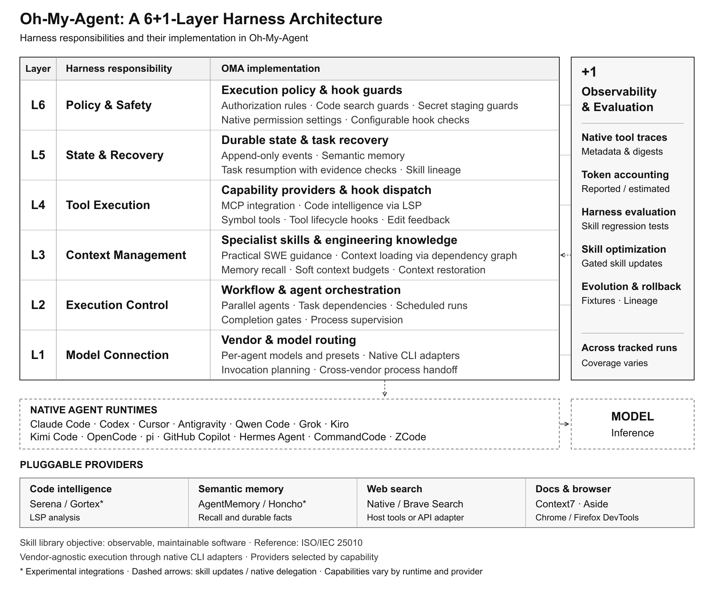

# oh-my-agent

**Lever 400+ commits per dag.**

[](https://www.npmjs.com/package/oh-my-agent) [](https://www.npmjs.com/package/oh-my-agent) [](https://github.com/first-fluke/oh-my-agent) [](https://github.com/first-fluke/oh-my-agent/blob/main/LICENSE) [](https://github.com/first-fluke/oh-my-agent/commits/main)

[English](../README.md) | [한국어](./README.ko.md) | [中文](./README.zh.md) | [Português](./README.pt.md) | [日本語](./README.ja.md) | [Français](./README.fr.md) | [Español](./README.es.md) | [Polski](./README.pl.md) | [Русский](./README.ru.md) | [Deutsch](./README.de.md) | [Tiếng Việt](./README.vi.md) | [ภาษาไทย](./README.th.md)

<a id="install"></a>
## Installatie

### Voor mensen

Voer dit uit in de root van je project.

```bash
curl -fsSL https://raw.githubusercontent.com/first-fluke/oh-my-agent/main/cli/install.sh | bash
```

### Voor AI-agenten

Plak dit in je coding agent:

```text
Install and configure oh-my-agent in this project by following this guide:
https://raw.githubusercontent.com/first-fluke/oh-my-agent/main/docs/agent-install.md
```

De [installatiegids voor agenten](./agent-install.md) behandelt niet-interactieve setup en verificatie. Ben je de agent, lees die gids dan en voer de installatie uit.

Open daarna je agent en typ `/orchestrate build a TODO app with login`.

oh-my-agent (`oma`) maakt van Claude Code, Codex CLI, Cursor en 11 andere coding agents een team. Een planner deelt het werk op, engineers bouwen parallel, een reviewer controleert het resultaat en een debugger pakt de root cause aan.

## Begin met je taak

Kies een taak. Laad één skill in de agent die je al gebruikt, of installeer het hele team.

| Jouw taak | Begin hier | Eerste verzoek |
|---|---|---|
| [AI-geschreven code reviewen](../web/docs/tasks/review-ai-code.md) | `bunx skills use first-fluke/oh-my-agent@oma-qa` | "Review this diff for bugs and missing checks. Cite the affected lines." |
| [Een adminscherm ontwerpen](../web/docs/tasks/design-admin-ui.md) | `bunx skills use first-fluke/oh-my-agent@oma-design` | "Review the hierarchy and table density of our admin page." |
| [Een falende test repareren](../web/docs/tasks/debug-failing-tests.md) | `bunx skills use first-fluke/oh-my-agent@oma-debug` | "Reproduce this test failure, fix its cause, and run the affected checks." |
| Systeemgrenzen reviewen | `bunx skills use first-fluke/oh-my-agent@oma-architecture` | "Review the boundary between our API and worker." |
| Het hele team laten draaien | [oma installeren](#install) | `/orchestrate add login to this app` |

Voer het `skills use`-commando uit in de terminal van je agent. Het laadt die ene skill. Voor het volledige team met workflows, [installeer oma](#install). Andere opties staan in [Een setup kiezen](../web/docs/getting-started/choose-setup.md).

[](./assets/architecture/oh-my-agent-architecture.svg)

Draai na de installatie `oma doctor`. [Je eerste 5 minuten](#your-first-5-minutes) begint met een alleen-lezen taak, vóór de teamworkflows.

## Wat je krijgt

**Workflows** zijn wat je typt (of gewoon zegt). Ze roepen **rollen** in, de specialisten. **Skills** zijn de knowhow: elke rol heeft zijn eigen skills, en je agent laadt de rest zodra een taak ze nodig heeft.

| | Wat het je geeft | Probeer het |
|---|---|---|
| **12 specialistische rollen** | PM, architect, backend-, frontend-, mobile-, database- en infra-engineers, QA-reviewer, debugger, refactorer, docs-curator, researcher ([maak kennis](#meet-the-team)) | `/orchestrate build a TODO app with login` |
| **20 workflows** | Slash commands van `/brainstorm` en `/plan` tot `/review`, `/debug` en `/scm`. De vier multi-agentmodi starten ook wanneer een gewoon verzoek ze bij naam noemt | "ultrawork: add rate limiting" |
| **33 skills** | Domeinkennis die alleen laadt wanneer een taak die nodig heeft: UI, API's, schema's, Terraform, CI, beveiliging, git, observability | laadt vanzelf, bijv. "add a Terraform S3 bucket" |
| **Bestanden die je kunt openen** | Plannen, ontwerpdocumenten, API-contracten, ADR's, bugnotities, resultaten per agent, beveiligingsbewijs, HTML-uitleg, recaps | `ls .agents/results` |
| **Onderzoek en content** | Zoeken met bronvermelding, marktonderzoek, papers, slidedecks, MP4-video's, afbeeldingen, lokale spraak, PDF/HWP naar Markdown | `/video`, `/convert` |
| **Eén map, 14 runtimes** | Eén draagbare `.agents/`-map, weggeschreven naar de eigen configuratiebestanden van elke runtime | `oma link cursor` |

**[Installatie](#install)** · **[Eerste 5 minuten](#your-first-5-minutes)** · **[Het team](#meet-the-team)** · **[Welke workflow?](#how-the-team-works-together)** · **[Alles wat erin zit](#everything-in-the-box)** · **[Werkt met](#works-with)** · **[FAQ](#faq)** · **[Docs](https://firstfluke.com/oh-my-agent/)**

## Installatiedetails

Het script installeert [bun](https://bun.sh) als dat ontbreekt, installeert het `oma`-commando globaal (`bun install --global oh-my-agent`, overgeslagen als `oma` al in je PATH staat) en start daarna de interactieve setup. De hooks (keyworddetectie en de Stop-gate) en verschillende workflows roepen het globaal geïnstalleerde `oma`-commando aan. De hooks doen ongemerkt niets als ze het niet kunnen vinden. Sla je het script over, installeer het dan zelf met `bun install --global oh-my-agent` (`npm install --global oh-my-agent` of `brew install oh-my-agent` werken ook).

<details>
<summary>Windows, of zonder het installatiescript</summary>

```powershell
# Windows (PowerShell)
irm https://raw.githubusercontent.com/first-fluke/oh-my-agent/main/cli/install.ps1 | iex
```

```bash
# Elk OS met bun geïnstalleerd: dezelfde setup, plus het globale `oma`-commando
bun install --global oh-my-agent
oma
```

Op Windows verbergt de installer Antigravity, Hermes en Kimi, en is de hook-wrapper een bash-script. De standaard browser-MCP Aside wordt via `bash` geïnstalleerd, dus deselecteer die als je geen bash hebt.

</details>

De setup behoudt je opgeslagen antwoordtaal of leidt die af uit het systeem. Hij vraagt welke agent-runtimes je wilt koppelen, capability-providers, een browser-MCP, een modelpreset en een skillpreset. **Kies `All` voor de skillreferenties die elke workflow gebruikt**: domeinpresets laten een deel van die skills weg. Beschikbaarheid van providers en verificatie van taken blijven aparte controles.

Kies een preset expliciet wanneer je de skills van een domein wilt:

```bash
oma install --preset frontend --yes
```

Dit selecteert de acht skills van de frontend-preset. De installer configureert nog steeds de runtime, de providers en de gedeelde workflowbestanden, en behoudt eerder geïnstalleerde skills. Een eigen selectie is beschikbaar in de interactieve installer. Zie [presetwaarden](../web/docs/getting-started/installation.md#presets) en [workflowafhankelijkheden](../web/docs/getting-started/installation.md#workflows-that-need-skills-outside-a-preset).

<details>
<summary>Wat de installer standaard nog meer doet</summary>

- Installeert **bun** (vereist). Probeert **uv**, **Serena** (`uv tool install`) en **CUE** (`brew install cue` of `winget`) te installeren en gaat met een waarschuwing verder als een daarvan mislukt.
- Selecteert in de interactieve setup vooraf de **Aside**-browser-MCP en installeert die alleen met `curl -fsSL https://releases.aside.com/install.sh | bash` als je hem geselecteerd laat. Deselecteer die in de browser-MCP-stap, of wijzig het later met `oma update mcp`.
- Gebruikt **AgentMemory** voor semantisch geheugen; dat voert `bun install -g @agentmemory/agentmemory` uit en registreert het als login-service (launchd, systemd-user-unit of geplande taak in Windows). Kies provider `none` of stel `OMA_NO_AGENTMEMORY=1` in om dit over te slaan.
- Vraagt het eerst voordat skills worden gelinkt in vendormappen in je homedirectory (Antigravity, Hermes, Kimi). In `$HOME` zonder `--global` vraagt het om bevestiging.
- Schrijft zonder te vragen enkele bestanden buiten het project: `~/.claude.json` (markeert het project als vertrouwde Claude Code-workspace), `~/.serena/` (OMA-context, minimale antwoordgrootte, projectregistratie), `~/.cursor/cli-config.json` (zet de commit-attributie van Cursor uit), `~/.grok/config.toml` (telemetrie) en `~/.gemini/antigravity-cli/` (HUD), elk alleen voor een vendor die je hebt geselecteerd.
- Schrijft **telemetrie-opt-outs** in de vendorinstellingen (Claude `DISABLE_TELEMETRY=1`, wat ook Claude Code Remote Control uitzet; gebruiksstatistieken van Gemini, Qwen, Codex en Grok). Stel `telemetry: true` in om de standaardinstellingen van de vendors te behouden.
- Zet **automatisch geheugen opslaan in Qwen Code** uit door `memory.enableManagedAutoMemory: false` toe te voegen wanneer de instelling ontbreekt. Expliciete voorkeuren `true` of `false` en andere geheugeninstellingen blijven behouden.
- Voegt niet-ingestelde Claude Code-instellingen toe aan `.claude/settings.json`, waaronder `skipDangerousModePermissionPrompt: true`, `effortLevel: high`, `cleanupPeriodDays: 180` en env-flags die auto memory, adaptive thinking, foutrapportage en de ingebouwde git-instructies uitzetten. Waarden die je al hebt ingesteld, blijven behouden.
- Voegt een **co-author-trailer** toe: de commit-attributie van Claude Code wordt `Co-Authored-By: First Fluke <our.first.fluke@gmail.com>` en PR's krijgen een regel "Generated with oh-my-agent". Stel `scm.co_author.enabled: false` in om dit uit te zetten.
- Installeert in `.githooks/` een **commit-msg-guard** die niet-vermelde `Co-authored-by`-adressen weigert, en stelt `git config --local core.hooksPath .githooks` in als er geen andere hooks actief zijn. Stel `scm.co_author.enforce_hook: false` in om je af te melden.
- `oma update` werkt de `oma`-CLI op de achtergrond bij (`auto_update_cli: false` of `OMA_SKIP_VERSION_CHECK=1` om dat te stoppen) en voert `uv tool upgrade serena-agent --prerelease=allow` uit (`serena.auto_update: false`).
- Met Serena in de standaardmodus `bridge` registreert de eerste agentsessie die een gedeelde Serena-server start een **opruimtimer** die inactieve gedeelde Serena-servers elke 5 minuten stopt (launchd `dev.oma.serena-daemon-gc`, systemd-user-timer `oma-serena-daemon-gc.timer` of geplande taak in Windows `OMA Serena Daemon GC`). Stel `serena.mode: stdio` in om de gedeelde server en de timer over te slaan. `oma uninstall` verwijdert de timer niet.
- Niet-interactieve runs (`-y`, `OMA_YES=1`, `CI=true`) gebruiken de skillpreset `All`, tenzij `--preset` een andere kiest, plus `model_preset: auto` en Python als backendtaal. Ze selecteren geen browser-MCP (en slaan het installatiescript van Aside over), tenzij `mcp.devtools_browsers` er al een bevat.

</details>

<details>
<summary>Skillpresets</summary>

| Preset | Skills |
|--------|--------|
| **All** | **Alle 33 skills** (aanbevolen) |
| Fullstack | architecture, backend, brainstorm, db, debug, design, dev-workflow, frontend, mobile, pm, qa, scm, tf-infra |
| Fullstack Web | Fullstack zonder mobile en tf-infra |
| Fullstack Mobile | Fullstack zonder frontend en tf-infra |
| Frontend | architecture, brainstorm, debug, design, frontend, pm, qa, scm |
| Backend | architecture, backend, brainstorm, db, debug, dev-workflow, pm, qa, scm |
| Mobile | architecture, brainstorm, debug, mobile, pm, qa, scm |
| DevOps | architecture, brainstorm, debug, dev-workflow, observability, pm, qa, scm, tf-infra |
| Research | academic-writing, hwp, market, pdf, scholar, scm, search, translation |
| Content | academic-writing, design, image, scm, translation, voice |
| Custom | Kies skills één voor één |

Van de benoemde presets bevat alleen `All` coordination, orchestration, docs, security, refactor, explanation, recap, video, slide en skill-creation (of kies ze onder `Custom`). Research en Content missen de skills achter `/plan`, `/review`, `/debug`, `/architecture` en `/brainstorm`. Zie [Workflows die skills buiten een preset nodig hebben](../web/docs/getting-started/installation.md#workflows-that-need-skills-outside-a-preset).

</details>

<a id="your-first-5-minutes"></a>
## Je eerste 5 minuten

1. **Kies je setup.** Voor de taak hieronder laad je `oma-scm` met `bunx skills use first-fluke/oh-my-agent@oma-scm`, of gebruik je het runtime-installatiecommando hierboven. [Een setup kiezen](../web/docs/getting-started/choose-setup.md) legt beide paden uit.
2. **Controleer bij een runtime-installatie de installatie:**

   ```bash
   oma doctor
   ```

   Het rapport toont de status van de CLI en de skillbestanden. De skilltellingen geven de aanwezige bestanden weer, inclusief behouden skills; ze kunnen afwijken van de selectie van de huidige preset. Wordt `oma` niet gevonden, open dan een nieuwe terminal of voer `bun install --global oh-my-agent` uit.
3. **Open een bestaande Git-repository en voer één alleen-lezen taak uit.** `oma-scm` zit in elke benoemde preset; neem het op bij een Custom-selectie.

   ```text
   Use oma-scm to inspect this repository's current branch and working tree. Do not edit, stage, commit, or contact remotes. Report staged, unstaged, and untracked changes, with the Git commands and exit statuses actually observed.
   ```

4. **Controleer het resultaat.** De gerapporteerde branch en wijzigingen moeten overeenkomen met de Git-uitvoer. Het laden van instructies of het afronden van de installatie bewijst niet dat deze taak heeft gedraaid.

Voor groter werk kies je een workflow waarvan de skills waarnaar die verwijst geïnstalleerd zijn. Begin met `/plan` wanneer de planningsskill aanwezig is, en ga daarna verder met `/work` of `/orchestrate` wanneer hun afhankelijkheden beschikbaar zijn.

<a id="meet-the-team"></a>
## Maak kennis met het team

Je eigen agent leidt het team. In `/work`, `/orchestrate` en `/ultrawork` geeft hij elke klus aan de juiste specialist, die als eigen subagent draait. `/plan`, `/architecture` en `/docs` draaien in je huidige sessie met de skill van die rol, en `/review` en `/debug` roepen bij een grote scope hun specialist in. Staat een rol op de CLI van een andere vendor, dan draait `oma agent spawn` hem daar.

| Je specialist | Heeft bij zich | Roep aan met | Laat achter |
|---|---|---|---|
| **Productmanager** (`pm-planner`) | oma-pm | `/plan` | Een plan-JSON en een tracker in `docs/plans/work/` voor Medium- en Complex-werk (Simple-verzoeken krijgen een direct advies) |
| **Architect** (`architecture-reviewer`) | oma-architecture | `/architecture` | Een ADR of advies in `.agents/results/architecture/` |
| **Backend-, frontend-, mobile-, database- en infra-engineers** | oma-backend, oma-frontend + oma-design, oma-mobile, oma-db, oma-tf-infra | `/work`, `/orchestrate` | Code, tests en een `result-<agent>`-bestand per taak |
| **QA-reviewer** (`qa-reviewer`) | oma-qa | `/review` | Bevindingen gerangschikt van CRITICAL tot LOW, elk met file:line en fixcode |
| **Debugger** (`debug-investigator`) | oma-debug | `/debug` | Een minimale fix, een regressietest en, als dat nodig is, een bugnotitie in `.agents/results/bugs/` |

<details>
<summary>De andere drie rollen, en de skills zonder rol</summary>

| Je specialist | Heeft bij zich | Roep aan met | Laat achter |
|---|---|---|---|
| **Refactorer** (`refactor-engineer`) | oma-refactor | de REFINE-fase van `/ultrawork` | Gedragsbehoudende `refactor:`-commits en een `result-refactor-<session>.md`-rapport |
| **Docs-curator** (`docs-curator`) | oma-docs | `/docs`, of "verify docs" | `docs/generated/doc-refs.json` en de doc-patches die je goedkeurt |
| **Researcher** (`research-explorer`) | oma-search, oma-market, oma-scholar | een onderzoeksverzoek | Geciteerde bronnen met hun herkomst; marktbriefings in `.agents/results/market/` |

De infra-engineer (`tf-infra-engineer`) heeft de instructie om het eerst te vragen vóór elke destructieve of productie-`apply` of -`destroy`. De overige skills (brainstorm, security, scm, dev-workflow, observability, explanation, recap, translation, coordination, orchestration, skill-creation, content en media) hebben geen eigen rol. Je agent laadt ze zelf, en voor de meeste stelt de skill-injector op basis van je prompt de juiste voor.

</details>

<a id="how-the-team-works-together"></a>
## Hoe het team samenwerkt

```text
 THINK   /brainstorm ......................... docs/decisions/<NNN>-<feature>.md
 PLAN    /plan · /architecture ............... plan JSON, API contracts, ADR
 DESIGN  /design ............................. DESIGN.md + tokens
 BUILD   /work · /orchestrate · /ultrawork ... code + result-<agent> files, engineers in parallel
 CHECK   /review · /security · /debug ........ findings, security evidence, regression test
 SHIP    /scm · /docs ........................ Conventional Commits, doc fixes
```

Elke stap geeft een bestand door aan de volgende. `/brainstorm` slaat een ontwerp op dat `/plan` leest, en `/plan` schrijft een plan waarin elke taak een agent, afhankelijkheden, acceptatiecriteria en een controlecommando heeft. `/orchestrate` voert dat plan uit (het laadt de meest recente `plan-*.json`, of schrijft er een). `/work` en `/ultrawork` beginnen door de PM hun eigen plan te laten schrijven. Sla elke fase over die je niet nodig hebt; elke fase werkt ook op zichzelf.

**Welke workflow moet het team aansturen?**

| Je wilt | Draai | Hoe het eindigt |
|---|---|---|
| Alleen een plan | `/plan` | Een planbestand voor werk over meerdere gebieden, of een direct advies voor klein werk |
| Een door de PM geleide build die je stap voor stap volgt | `/work` | PM, daarna engineers laag voor laag, daarna QA. CRITICAL- en HIGH-bevindingen gaan een fix-loop in (maximaal 5 cycli) |
| Een parallelle build zonder omkijken | `/orchestrate` | Alleen taken waarvan de checks slagen tellen als klaar; elke taak krijgt maximaal 3 pogingen en wordt daarna als gedeeltelijk of mislukt gemarkeerd |
| Workflow in vijf fasen | `/ultrawork` | Vijf fasen met gates (PLAN, IMPL, VERIFY, REFINE, SHIP); elke review draait in een verse reviewer-sessie |
| "Stop pas als het echt klaar is" | `/ralph` | Herhaalt `/ultrawork` met een apart gespawnde judge met verse context tot elk criterium slaagt; stopt met een gedeeltelijk rapport wanneer criteria geblokkeerd zijn of na 5 iteraties |
| Het team op een timer | `oma schedule create qa-reviewer "review open PRs" --every 2h` | Eén Markdown-log per run in `~/.oma/schedule/runs/<id>/` |

Een slash command start een workflow. Een gewoon verzoek doet dat niet, maar krijgt op runtimes met een prompt-hook wel een skill-hint: keywordbanken in maximaal 11 talen matchen de prompt en wijzen je agent op de bijbehorende skills ("run a security audit" haalt `oma-qa` erbij). De hint is adviserend, en keywords binnen codeblokken worden genegeerd.

`/orchestrate`, `/work`, `/ultrawork` en `/ralph` zijn **persistent** wanneer je ze bij naam aanroept, als slash command of in gewone tekst ("ultrawork: add rate limiting"). De agent wordt dan weer aan het werk gezet als hij te vroeg probeert te stoppen (maximaal 5 keer of 2 uur), totdat je **"workflow done"** zegt. Deze vier zijn de enige workflows die een gewone zin kan starten, en alleen bij naam.

**Gemeten, met kanttekeningen.** In de [benchmark](../benchmarks/README.md) (één prompt, Claude Code met vijf verschillende add-on-opstellingen waaronder kaal, `claude-opus-4-6`, één build per opstelling) scoorde oma 80.6 tegenover 70.7 voor kale Claude Code, bij 1.7x de kosten ($4.04 vs $2.37) en 1.8x de tijd.

<details>
<summary>Alle 20 workflows</summary>

| Commando | Wat het doet |
|---------|--------------|
| `/architecture` | Weegt design-trade-offs af en levert een aanbeveling, review of ADR op |
| `/brainstorm` | Verkent ideeën en randvoorwaarden en levert een goedgekeurd ontwerp op vóór de planning |
| `/convert` | Converteert PDF/HWP naar Markdown, of transcodeert afbeeldingen, video en audio met ffmpeg |
| `/debug` | Reproduceert een bug, fixt de root cause, schrijft een regressietest en zoekt naar vergelijkbare patronen |
| `/deepinit` | Brengt een bestaande codebase in kaart in AGENTS.md, ARCHITECTURE.md en een kennisbank in docs/ |
| `/design` | Bakent een designtaak af en levert via oma-design bevindingen, DESIGN.md of tokens op |
| `/docs` | Vindt kapotte verwijzingen in docs en stelt patches voor voor docs die een diff heeft geraakt |
| `/explain` | Zet een diff, PR, branch of onderwerp om in een zelfstandige, interactieve HTML-uitleg |
| `/orchestrate` | Draait agents parallel, coördineert ze via state in bestanden en verifieert het resultaat (persistent) |
| `/plan` | Splitst een feature op in geprioriteerde taken met API-contracten |
| `/ralph` | Herhaalt `/ultrawork` met een apart gespawnde judge, tot 5 iteraties (persistent) |
| `/recap` | Vat je AI-gespreksgeschiedenis van een dag of periode samen |
| `/review` | Reviewt beveiliging (OWASP Top 10), performance, toegankelijkheid (WCAG 2.2 AA) en codekwaliteit |
| `/schedule` | Registreert een agent-job die met een terugkerend interval draait |
| `/scm` | Regelt branches, merges, conflicten, worktrees en Conventional Commits |
| `/security` | Scant broncode, agentskills en MCP-componenten, valideert bevindingen en zet CI-gates op |
| `/stack-set` | Detecteert je techstack en genereert stack-specifieke referenties voor domeinskills |
| `/ultrawork` | Vijf fasen (PLAN, IMPL, VERIFY, REFINE, SHIP), elke review in een verse reviewer-sessie (persistent) |
| `/video` | Zet een briefing om in een afgewerkte MP4 via een pijplijn die ook zonder sleutels werkt |
| `/work` | Coördineert meerdere agents in een multidomeinproject met PM-planning en QA-review (persistent) |

`oma verify triggers` evalueert de detector tegen een gelabeld Engels en Koreaans corpus van 212 prompts. CI faalt boven 10% false fires of 20% missed fires. Laatste meting: **0% missed-fire, 0% false-fire**. Volledige referentie: [Workflows](https://first-fluke.github.io/oh-my-agent/docs/core-concepts/workflows/).

</details>

<a id="everything-in-the-box"></a>
## Alles wat erin zit

<details>
<summary><strong>Plannen en ontwerpen</strong>: <code>/brainstorm</code>, <code>/plan</code>, <code>/architecture</code>, <code>/design</code></summary>

| Commando | Wat het doet | Schrijft |
|---|---|---|
| `/brainstorm` | Stelt telkens één verduidelijkende vraag, doet 2-3 voorstellen die elk anders werken en geeft daarna over aan `/plan`. Schrijft geen code | `docs/decisions/<NNN>-<feature>.md` |
| `/plan` | Schat het werk in als Simple, Medium of Complex; splitst Medium- en Complex-werk op in taken, elk met een agent, afhankelijkheden, acceptatiecriteria en een controlecommando, en definieert API-contracten wanneer het werk een grens overschrijdt | `.agents/results/plan-<sid>.json`, `docs/plans/work/<NNN>-<name>.md`, contracten in `.agents/results/api-contracts/` wanneer nodig |
| `/architecture` | Leest eerst eerdere beslissingen, vergelijkt minstens 2 opties en markeert vervangen ADR's als superseded | Een ADR of advies in `.agents/results/architecture/` |
| `/design` | Stelt scope en context vast, kiest de designrichtlijnen voor de taak en levert daarna auditbevindingen, `DESIGN.md` of tokens op die aansluiten op het bestaande tokensysteem van het project | Bevindingen, `DESIGN.md`, designtokens |

</details>

<details>
<summary><strong>Bouwen</strong>: 7 domeinskills, plus <code>/stack-set</code> om ze op je stack af te stemmen</summary>

| Skill | Bouwt |
|---|---|
| oma-frontend | React/Next.js- of Angular-UI die je tokens, i18n- en toegankelijkheidsregels volgt |
| oma-backend | API's, auth en data-access, gelaagd als router → service → repository |
| oma-mobile | Flutter-, React Native- of Swift-apps |
| oma-db | Schema's, migraties, query-tuning, retrievalplannen voor vector/RAG |
| oma-tf-infra | Terraform voor elke cloud, waarbij risico's van drift, destructieve wijzigingen en kosten expliciet worden benoemd |
| oma-dev-workflow | mise-taken, lint/format/typecheck, commitlint, git hooks, CI/CD en releases |
| oma-observability | OpenTelemetry, SLO's, alerting en incident forensics |

`/stack-set` leest je manifests en schrijft stack-specifieke referenties voor de backend-, frontend- en mobile-skills. In een monorepo worden frontend-, backend- en mobile-engineers naar hun eigen workspace geleid (pnpm, npm/yarn/bun-workspaces, lerna, nx, turbo, `mise.toml`).

</details>

<details>
<summary><strong>Reviewen, fixen en opleveren</strong>: <code>/review</code>, <code>/security</code>, <code>/debug</code>, refactor, <code>/scm</code></summary>

| Commando of skill | Wat het doet | Schrijft |
|---|---|---|
| `/review` | Een dependency-audit, daarna OWASP Top 10, performance, WCAG 2.2 AA en codekwaliteit. Elke bevinding krijgt file:line en fixcode | Het rapport in de chat plus een geheugenrecord; geen rapportbestand |
| `/security` | Scant je broncode, agentskills en MCP-servers (Deepsec, Cisco Skill and MCP Scanner) en valideert de bevindingen. Pentests draaien alleen op uitdrukkelijk verzoek, tegen een runtimeplatform dat je zelf aanlevert en hebt beoordeeld. De workflow vereist dat een engine die niet kon draaien als gefaald wordt gemeld, niet als schoon | `.agents/results/security/<run-id>/` |
| `/debug` | Reproduceert de fout, fixt de root cause met een minimale wijziging, voegt een regressietest toe en zoekt elders naar hetzelfde patroon | De fix en de test; als dat nodig is, een bugnotitie in `.agents/results/bugs/` |
| oma-refactor | Verandert de structuur zonder het gedrag te veranderen: eerst karakterisatietests, daarna refactor-only commits | `.agents/results/refactor/` |
| `/scm` | Conventional Commits, opgesplitst per logische wijziging; branches, merges, rebases en worktrees | Commits en branches |

</details>

<details>
<summary><strong>Docs en kennis</strong>: <code>/deepinit</code>, <code>/docs</code>, <code>/explain</code>, <code>/recap</code>, vertaling</summary>

| Commando of skill | Wat het doet | Schrijft |
|---|---|---|
| `/deepinit` | Maakt van een bestaande repo een kennisbank waar agents direct mee aan de slag kunnen | `AGENTS.md`, `ARCHITECTURE.md`, `docs/` |
| `/docs` | Vindt kapotte verwijzingen, patcht de docs die een diff heeft geraakt (alleen de patches die je goedkeurt) en spoort verouderde vertalingen op | `docs/generated/doc-refs.json`, gepatchte docs |
| `/explain` | Zet een PR, branch of gestagede wijziging om in een HTML-walkthrough met een quiz van 5 vragen, of een onderwerp in een visuele uitleg van één pagina | `.agents/results/explain/<date>-<slug>.html` |
| `/recap` | Vat je AI-gesprekken over verschillende tools heen samen voor een dag of periode | `.agents/results/recap/<date>.md` |
| oma-translation | Vertalingen die natuurlijk lezen; placeholders, code en locale-keys blijven ongewijzigd | Vertaalde tekst |

</details>

<details>
<summary><strong>Onderzoek</strong>: zoeken, markt, papers, academisch schrijven</summary>

| Skill | Wat het doet | Schrijft |
|---|---|---|
| oma-search | Zoeken in docs, web en code, met vermelding van wat is gelezen en wat alleen als fragment is gezien | Resultaten met bronvermelding |
| oma-market | Pijnpunten, trends en concurrenten uit community-signalen, gestructureerd met SWOT, Porter's 5 Forces en PESTEL | `.agents/results/market/<topic>-<date>.md` |
| oma-scholar | Zoekt papers en leest daarbij een compact claimsbestand (Knows-formaat, ongeveer 700 tokens) in plaats van de volledige PDF (ongeveer 10K tokens) | `<paper>.knows.yaml` |
| oma-academic-writing | Schrijft en auditeert academisch proza aan de hand van een rubric | Je eigen bestand |

</details>

<details>
<summary><strong>Content en media</strong>: <code>/video</code>, <code>/convert</code>, slides, afbeeldingen, spraak</summary>

| Commando of skill | Wat het maakt | Schrijft |
|---|---|---|
| `/video` | Shorts, uitlegvideo's of demo's als afgewerkte MP4; providers die een sleutel vereisen hebben sleutelvrije fallbacks | `.agents/results/videos/<run>/` met een manifest |
| oma-slide | HTML-decks van 1920×1080, geëxporteerd naar PDF, PNG of PPTX | `.agents/results/slides/<session>/` |
| oma-image | Afbeeldingen via de vendor-CLI's waarbij je bent ingelogd, naast elkaar vergeleken | `.agents/results/images/<run>/` |
| oma-voice | Lokale text-to-speech en transcriptie via de Voicebox-app | `.agents/results/voice/<run>/` |
| `/convert` | PDF of HWP naar Markdown; conversie van afbeeldingen, video en audio via ffmpeg | Naast het invoerbestand |

Deze pijplijnen melden een ontbrekende bron of vendor-sleutel in plaats van stilletjes een magerder resultaat terug te geven.

</details>

<details>
<summary><strong>Hooks die draaien zonder dat je erom vraagt</strong></summary>

| Hook | Wat het doet | Uitschakelen / limiet |
|---|---|---|
| Keyword-start | Start `/orchestrate`, `/work`, `/ultrawork` of `/ralph` wanneer een gewoon verzoek die bij naam noemt | Vragen, geplakte tekst en codeblokken worden overgeslagen |
| Skill-injector | Wijst je agent op de juiste skills voor de prompt | Gepauzeerd zolang een persistente workflow actief is |
| Stop-gate | Zet een persistente workflow weer aan het werk; met `oma goal set --gate test` is stoppen toegestaan zodra dat script binnen 25 s met 0 eindigt | Zeg "workflow done"; hij stopt ook met blokkeren na 5 blokkades of 2 uur |
| Refactor-guard | Markeert bij het stoppen bewerkte bestanden van meer dan 500 regels voor `refactor-engineer` | Opt-in: `refactor_guard.enabled` |
| Secret-guard | Blokkeert `git add` van `*.env`, `*.pem`, `id_rsa*`, `*.tfstate` en vergelijkbare bestanden | Zet `OMA_SCM_ALLOW_SECRETS=1` vóór dat ene commando |
| Code-search-guard | Blokkeert native recursief zoeken in het project, zodat de agent Serena of Gortex gebruikt | `providers.code_intelligence_guard: off` |
| Testfilter | Houdt alleen fouten en samenvattingen uit de testuitvoer over, zodat er minder tokens worden verbruikt | `OMA_TEST_FILTER=0` |
| Sessiegeheugen | Wanneer je van sessie wisselt of een sessie hervat (of na compaction), injecteert het opnieuw de recente events van de actieve sessie plus AgentMemory-recall | Geheugenprovider `none` of `OMA_NO_AGENTMEMORY=1` schakelt de recall uit; de lokale event-snapshot blijft |

`oma hook probe` controleert of de prompt-hooks van oma de hook-input van elke runtime accepteren (het start de runtime zelf niet). Welke hooks elke runtime koppelt, staat in [Verschillen tussen hosts](#host-differences).

</details>

<details>
<summary><strong>Parallelle agents, sessies en dashboards</strong></summary>

- `oma agent spawn <role> "<task>" <sid>` voert een rol uit op Antigravity, Claude Code, Codex, Cursor, Grok, Kimi Code, Kiro, OpenCode, pi of Qwen Code, met `--isolation worktree` en `--fallback-vendors`. `oma agent parallel` voert er meerdere tegelijk uit. Deze 10 dispatchdoelen zijn een deelverzameling van de 14 installerintegraties.
- Voeg `--read-only` toe om vóór de start een vendorbeperking te eisen. Codex gebruikt zijn read-only sandbox, Claude gebruikt plan mode, en Pi sluit `edit`, `write`, `bash` en `powershell` uit. Andere CLI's vereisen een expliciete `read_only_flag`; ontbrekende, lege of bekende conflicterende flags stoppen de dispatch. Eigen flags verklaren ondersteuning in je CLI of wrapper. De tooluitsluitingen van Pi beperken willekeurige extensie- of MCP-tools niet; OMA voegt geen sandbox op besturingssysteemniveau toe.
- `oma state list --all-projects` en `oma state get <sid>`: sessies en elk vastgelegd event.
- `oma dashboard terminal` / `oma dashboard web`: live agentstatus (het webdashboard luistert alleen op `127.0.0.1`). [Dashboardgids](../web/docs/guide/dashboard-monitoring.md).
- `oma stats get` (productiviteitsmetrics), `oma retro` (een git-retrospectief), `oma recap --window 7d` (wat je in verschillende AI-tools hebt gedaan).
- `oma visualize --affected <paths>`: welke skills, workflows, agents en checks afhangen van de `.agents/`-bestanden die je hebt gewijzigd.

</details>

<details>
<summary><strong>Code-intelligence, geheugen en MCP</strong></summary>

| Slot | Standaard | Alternatieven |
|---|---|---|
| Docs | Context7 | — |
| Web zoeken | Runtime-native zoekfunctie | Brave Search |
| Code-intelligence | Serena, één gedeelde server per project | Gortex (experimenteel) |
| Semantisch geheugen | AgentMemory | Honcho (experimenteel), none |
| Browser-MCP | Aside | Chrome DevTools, Firefox DevTools |

Serena biedt LSP-gebaseerde codenavigatie en diagnostiek, inclusief feedback bij native bewerkingen waar dat wordt ondersteund. De providerkeuze staat los van de agentruntime; mogelijkheden verschillen per provider en host.

Agents coördineren via gewone bestanden in `.agents/state/`, zonder externe dienst. Details: [Capability-providers](./capability-providers.md).

</details>

<details>
<summary><strong>Steeds beter worden</strong></summary>

- `oma skill eval` meet de lift van een skill ten opzichte van een baseline op achtergehouden taken. `oma skill optimize` stelt wijzigingen voor die die lift verhogen, en `--apply` behoudt ze ([skill-eval-gids](../web/docs/guide/skill-eval.md)).
- `oma harness evolution enable --max-dispatches <n>` plant een nachtelijke cyclus die mislukte runs omzet in regressie-fixtures en skillverbeteringen die de evaluatie doorstaan als project-overlays toepast. Voeg `--mode propose` toe om ze alleen vast te leggen.
- `oma emit` exporteert de `.agents/`-bron als een Agent Skills-pakket, een Agent Plugins-pakket, een Claude Code-pluginmarketplace of `AGENTS.md`.

</details>

<details>
<summary><strong>Configuratie en vangrails</strong></summary>

- Eén `.agents/oma-config.yaml` die van jou is, blijft bij updates behouden (alleen `oma update --force` zet hem terug); privé-overlays in `.local.yaml` of `.local.cue` kunnen erbovenop liggen. `language` bepaalt de antwoordtaal.
- 13 projectregels (backend, commit, database, debug, design en meer) laden als native rules in Claude Code en Cursor, en worden geïndexeerd in het beheerde `AGENTS.md`-blok dat voor Codex, Qwen Code en Pi wordt geschreven.
- Updates bewaren back-ups van configuratie en migraties in `.agents/backup/`; meegeleverde skills en workflows worden ter plekke vervangen, dus houd lokale wijzigingen erbuiten. `oma uninstall --dry-run` toont wat er verwijderd zou worden. `first-fluke/oma-update-action@v1` draait `oma update` in CI en opent een PR.

</details>

<details>
<summary><strong>Alle 33 skills</strong></summary>

| Skill | Wat het doet |
|---|---|
| **oma-academic-writing** | Schrijft, herziet en controleert academische teksten |
| **oma-architecture** | Weegt architectuurafwegingen af en bepaalt modulegrenzen met ADR/ATAM/CBAM-analyse |
| **oma-backend** | Bouwt API's, authenticatie en datatoegang in Python, Node.js of Rust |
| **oma-brainstorm** | Verkent ideeën samen met jou voordat je begint met bouwen |
| **oma-coordination** | Begeleidt stap voor stap de handmatige coördinatie van PM-, frontend-, backend-, mobile- en QA-agents |
| **oma-db** | Ontwerpt schema's, migraties, indexes en vector stores |
| **oma-debug** | Zoekt de root cause, lost de bug op en schrijft een regressietest |
| **oma-design** | Bouwt design systems met tokens, toegankelijkheid en responsive layouts |
| **oma-dev-workflow** | Automatiseert CI/CD, releases en monorepo-taken |
| **oma-docs** | Controleert docs op gebroken verwijzingen, houdt ze in sync met codewijzigingen en signaleert vertaaldrift |
| **oma-explanation** | Zet een diff, PR, branch of onderwerp om in een zelfstandige HTML-uitleg, met een quiz bij codewijzigingen |
| **oma-frontend** | Bouwt UI in React/Next.js of Angular |
| **oma-hwp** | Converteert HWP-, HWPX- en HWPML-bestanden naar Markdown |
| **oma-image** | Genereert afbeeldingen en variaties op basis van referenties, en kan AI-providers naast elkaar vergelijken |
| **oma-market** | Onderzoekt je markt op basis van community-signalen en structureert dit met SWOT, 5F en PESTEL |
| **oma-mobile** | Bouwt mobiele apps met Flutter, React Native of native Swift |
| **oma-observability** | Routeert observability-werk over metrics, logs, traces, SLO's en incident forensics |
| **oma-orchestration** | Draait meerdere agents parallel via de CLI |
| **oma-pdf** | Converteert PDF-bestanden naar Markdown |
| **oma-pm** | Plant taken, splitst requirements op en definieert API-contracten |
| **oma-qa** | Reviewt wijzigingen op correctheid, OWASP-beveiliging, performance en toegankelijkheid |
| **oma-recap** | Vat je gespreksgeschiedenis samen in thematische werkoverzichten |
| **oma-refactor** | Refactort zonder gedragsverandering, met hotspot-targeting, karakterisatietests en refactor-only commits |
| **oma-scholar** | Doorzoekt academische literatuur en maakt Knows-paper-sidecars voor claims, bewijs en peer review |
| **oma-scm** | Beheert branches, merges, worktrees en Conventional Commits |
| **oma-search** | Routeert elke zoekopdracht naar de beste bron en meldt waar elk resultaat vandaan komt en of het daadwerkelijk is gelezen |
| **oma-security** | Scant broncode, agentskills en MCP-componenten en valideert bevindingen; pentests draaien alleen op een door de gebruiker aangeleverd en beoordeeld platform |
| **oma-skill-creation** | Schrijft en auditeert nieuwe OMA-skills |
| **oma-slide** | Genereert HTML-presentatiedecks en exporteert ze naar PDF/PNG/PPTX |
| **oma-tf-infra** | Provisioneert multi-cloud infrastructuur met Terraform |
| **oma-translation** | Vertaalt zo dat het resultaat leest alsof een moedertaalspreker het schreef |
| **oma-video** | Genereert korte video's, uitlegvideo's en demo's via een HyperFrames-pijplijn die ook zonder sleutels werkt |
| **oma-voice** | Genereert voice-overs en transcribeert audio op het apparaat zelf |

</details>

<a id="works-with"></a>
## Werkt met

14 installatiedoelen: Claude Code, Codex CLI, Cursor, Antigravity, Qwen Code, Grok, Kiro, Kimi, OpenCode, Pi, GitHub Copilot, Hermes, CommandCode en ZCode. Koppel een runtime die je hebt overgeslagen met `oma link <vendor>`. Runtimes verschillen in de hooks die ze bieden; de volledige matrix staat in [Ondersteunde agents](./SUPPORTED_AGENTS.md).

- **Orca IDE:** [OMA for Orca](../integrations/orca/README.md) voegt een zijbalkpaneel en command-palette-acties toe (Orca 1.4.197+ met experimentele plugins).
- **DeepSeek Harness:** [OMA for DeepSeek Harness](../integrations/dsh/README.md) koppelt OMA-controles via een Cordis-plugin. Het heeft `oma` in je `PATH` nodig.

<details>
<summary>Runtime-logo's (installatiedoelen plus Amp en DeepSeek Harness)</summary>

native = oma schrijft de eigen configuratiebestanden van de runtime; adapter = oma voegt ook hook- of agent-shims toe. Amp leest `.agents/skills/` zelf en is geen installatiedoel.

<table>
<colgroup>
<col span="6" style="width:16.67%" />
</colgroup>
<tr>
<td align="center">
<a href="https://claude.com/product/claude-code"></a><br/>
<strong>Claude Code</strong><br/>
<sub>native + adapter</sub>
</td>
<td align="center">
<a href="https://github.com/openai/codex"></a><br/>
<strong>Codex CLI</strong><br/>
<sub>native + adapter</sub>
</td>
<td align="center">
<a href="https://antigravity.google"></a><br/>
<strong>Antigravity</strong><br/>
<sub>native SSOT</sub>
</td>
<td align="center">
<a href="https://cursor.com"></a><br/>
<strong>Cursor</strong><br/>
<sub>native + adapter</sub>
</td>
<td align="center">
<a href="https://github.com/QwenLM/qwen-code"></a><br/>
<strong>Qwen Code</strong><br/>
<sub>native dispatch</sub>
</td>
<td align="center">
<a href="https://github.com/deepseek-ai/deepseek-harness"></a><br/>
<strong>DeepSeek Harness</strong><br/>
<sub>Cordis plugin</sub>
</td>
</tr>
<tr>
<td align="center">
<a href="https://pi.dev/"></a><br/>
<strong>Pi</strong><br/>
<sub>native compatibel</sub>
</td>
<td align="center">
<a href="https://github.com/anomalyco/opencode"></a><br/>
<strong>OpenCode</strong><br/>
<sub>native compatibel</sub>
</td>
<td align="center">
<a href="https://ampcode.com"></a><br/>
<strong>Amp</strong><br/>
<sub>leest .agents/skills</sub>
</td>
<td align="center">
<a href="https://github.com/features/copilot"></a><br/>
<strong>GitHub Copilot</strong><br/>
<sub>skills via symlink</sub>
</td>
<td align="center">
<a href="https://grok.x.ai"></a><br/>
<strong>Grok Build</strong><br/>
<sub>native hooks</sub>
</td>
<td align="center">
<a href="https://kiro.dev"></a><br/>
<strong>Kiro CLI</strong><br/>
<sub>native hooks + agents</sub>
</td>
</tr>
</table>

<p align="center"><sub><a href="./SUPPORTED_AGENTS.md">& meer</a></sub></p>

</details>

<a id="host-differences"></a>
<details>
<summary>Verschillen tussen hosts: welke runtimes keyworddetectie en de Stop-gate krijgen</summary>

| Runtime | Keyworddetectie | Stop-gate |
|---|---|---|
| Claude Code, Codex CLI, Qwen Code, Grok, Kimi | ja | ja |
| Cursor | ja | ja (komt terug als vervolgbericht) |
| Antigravity | ja | ja (draait handlers via bun, niet via de `oma`-wrapper) |
| OpenCode, Pi | ja | best-effort (Pi heeft een build met `agent_settled` nodig) |
| Kiro | ja | nee: Kiro negeert de uitvoer van de Stop-hook |
| CommandCode | geen prompt-hook | ja |
| GitHub Copilot, Hermes, ZCode | geen hooks | geen hooks |

</details>

<a id="per-agent-models"></a>
<details>
<summary>Modellen per agent</summary>

`model_preset` in `.agents/oma-config.yaml` bepaalt welk model elke agentrol gebruikt. De standaardwaarde, `auto`, volgt de eigen agent- en modelinstellingen van de draaiende runtime.

```yaml
language: en
model_preset: auto   # auto | free | antigravity | claude | codex | cursor | kiro | mixed | qwen | <custom_presets key>

# Optional per-agent overrides; they win over the preset
agents:
  backend: { model: openai/gpt-6.1-terra, effort: high }
```

- `mixed` gebruikt Claude voor orchestrator, architecture, QA, PM en docs, en Codex `gpt-6.1-terra` voor implementatierollen, dus het heeft zowel Claude Code als Codex CLI nodig.
- `free` loopt via een FreeLLMAPI-gateway en heeft `FREELLM_API_KEY` plus een draaiende server nodig.
- `kiro` staat niet in het installermenu; stel het in het configuratiebestand in.
- `oma doctor --profile` print het opgeloste model voor elke rol.
- Volledige gids: [Modellen per agent](https://first-fluke.github.io/oh-my-agent/docs/guide/per-agent-models/)

</details>

## FAQ

<details>
<summary><strong>Heb ik elke skill nodig?</strong></summary>

Nee. Zie [Skillpresets](#install); `All` is de veilige standaardkeuze.

</details>

<details>
<summary><strong>Hoe weet ik of het werkt?</strong></summary>

`oma doctor` toont de geïnstalleerde skills en waarschuwt als hooks `oma` niet kunnen vinden. Tijdens een persistente workflow toont `oma state list` de actieve sessie en `oma state get <sid>` de gate-events daarvan.

</details>

<details>
<summary><strong>Kost het meer tokens?</strong></summary>

Meestal wel. Skills worden alleen geladen als een taak ze nodig heeft, maar multi-agent workflows en reviews in verse context kosten meer. In de [benchmark met één prompt](../benchmarks/README.md) kostte oma 1.7x zoveel als kale Claude Code.

</details>

<details>
<summary><strong>De Stop-hook blijft blokkeren. Hoe kom ik eruit?</strong></summary>

Zeg "workflow done" (of "workflow complete" / "workflow finished", of het equivalent in de andere ondersteunde talen), of verwijder `.agents/state/<workflow>-state-<sid>.json`. Doe je geen van beide, dan stopt hij vanzelf met blokkeren na 5 blokkades of 2 uur.

</details>

<details>
<summary><strong>Hoe update of verwijder ik het?</strong></summary>

`oma update` ververst skills, workflows en hooks en behoudt je configuratie (`--with-new-skills` voegt skills toe die nieuw zijn in de release; `oma update mcp` laat je de browser-MCP opnieuw kiezen). `oma uninstall --dry-run` toont wat er verwijderd zou worden; `oma uninstall` verwijdert het en behoudt `oma-config.yaml`, `mcp.json` en skills die je zelf hebt geschreven. Meer oplossingen: [Troubleshooting](https://first-fluke.github.io/oh-my-agent/docs/guide/troubleshooting/).

</details>

<details>
<summary><strong>Wat laat oh-my-agent over aan het model?</strong></summary>

Plannen en het kiezen van de volgende stap blijven bij het model van je agent; oma heeft geen vaste workflowgraaf. Wat oma buiten het model afdwingt: tool-guardrails (secret- en search-guards), budgetten, retry- en stoplimieten, een event log en, als je een gate instelt, een stop die wacht tot je eigen checks slagen.

</details>

## Meer informatie

- **[Docs-site](https://first-fluke.github.io/oh-my-agent/)**: gidsen, tutorials en CLI-referentie. Begin met [Snel starten](https://first-fluke.github.io/oh-my-agent/docs/getting-started/quick-start/) en [Installatie](https://first-fluke.github.io/oh-my-agent/docs/getting-started/installation/).
- **[Waarom oh-my-agent](https://first-fluke.github.io/oh-my-agent/docs/getting-started/why-oh-my-agent/)**: wanneer je het kiest en welke trade-offs erbij horen
- **[Benchmarkrapport](../benchmarks/README.md)**: hoe het zich op één prompt verhoudt tot superpowers, ECC en oh-my-claudecode, met methode, scores, screenshots en kanttekeningen
- **[Ondersteunde agents](./SUPPORTED_AGENTS.md)**: ondersteuningsmatrix over runtimes heen
- **[Uitgebreide documentatie](./AGENTS_SPEC.md)**: technische spec en architectuur
- **[Capability-providers](./capability-providers.md)**: experimentele configuratie, routing en beperkingen van Gortex en Honcho
- **[Skill-compatibiliteitsmatrix](./skills-matrix.md)**: native skill-inhoud, referenties en responscontracten in Claude en Codex

> Geef het project een ster op GitHub.
>
> ```bash
> gh api --method PUT /user/starred/first-fluke/oh-my-agent
> ```
>
> Startertemplate: [fullstack-starter](https://github.com/first-fluke/fullstack-starter)

## Star History

[](https://star-history.dera.page/#first-fluke/oh-my-agent&type=date&legend=bottom-right)

## Referenties

<details>
<summary>Onderzoek waarop dit voortbouwt (7 papers)</summary>

- Li, X., Liu, Y., Chen, W., You, B., Di, Z., He, Y., Zheng, S., Choe, K. W., Sun, J., Wang, S., Tao, C., Li, B., Zhao, X., Geng, H., Wu, X., Zhou, J., Chen, X., Xing, H., Li, Y., … Song, D. (2026). *SkillsBench: Benchmarking how well agent skills work across diverse tasks* (Version 4) [Preprint]. arXiv. https://doi.org/10.48550/arXiv.2602.12670
- Yu, G., & Wang, X. (2026). *Knows: Agent-native structured research representations* (Version 1) [Preprint]. arXiv. https://doi.org/10.48550/arXiv.2604.17309
- Liang, Q., Wang, H., Liang, Z., & Liu, Y. (2026). *From skill text to skill structure: The scheduling-structural-logical representation for agent skills* (Version 4) [Preprint]. arXiv. https://doi.org/10.48550/arXiv.2604.24026
- Chen, C., Yu, Q., Gu, Y., Huang, Z., Li, H., Liu, H., Liu, S., Liu, J., Peng, D., Wang, J., Yan, Z., Meng, F., Qin, E., Che, C., & Hu, M. (2026). *The scaling laws of skills in LLM agent systems* (Version 1) [Preprint]. arXiv. https://doi.org/10.48550/arXiv.2605.16508
- Tang, L., Rashtchian, C., Ferng, C.-S., Tomkins, A., Juan, D.-C., & Vu, T. (2026). *WikiSkill: Compiling agent experience into persistent knowledge for skill evolution* [Preprint]. arXiv. https://doi.org/10.48550/arXiv.2608.27454
- Huang, Z., Xu, J., Yang, Y., Gong, Z., Yang, Q., Tian, M., Wang, X., Lv, C., Gao, X., Dai, Q., Liu, B., Qiu, K., Yang, X., Chen, D., Zheng, X., & Luo, C. (2026). *From raw experience to skill consumption: A systematic study of model-generated agent skills* [Preprint]. arXiv. https://doi.org/10.48550/arXiv.2605.23899
- Hong, D. B., Imani, A., & Ahmed, I. (2026). *From anatomy to smells: An empirical study of SKILL.md in agent skills* (Version 2) [Preprint]. arXiv. https://doi.org/10.48550/arXiv.2607.01456

</details>

## Licentie

MIT
