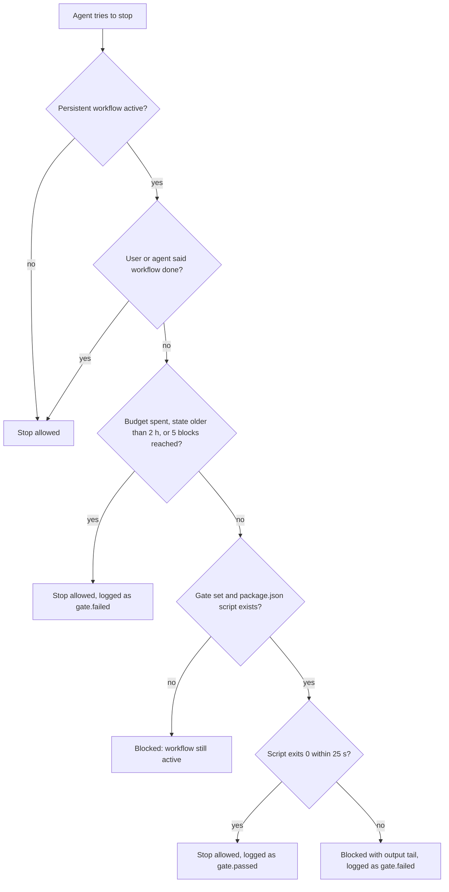

# oh-my-agent: Een specialistenteam voor de coding agent die je al gebruikt

[](https://www.npmjs.com/package/oh-my-agent) [](https://www.npmjs.com/package/oh-my-agent) [](https://github.com/first-fluke/oh-my-agent) [](https://github.com/first-fluke/oh-my-agent/blob/main/LICENSE) [](https://github.com/first-fluke/oh-my-agent/commits/main)

[English](../README.md) | [한국어](./README.ko.md) | [中文](./README.zh.md) | [Português](./README.pt.md) | [日本語](./README.ja.md) | [Français](./README.fr.md) | [Español](./README.es.md) | [Polski](./README.pl.md) | [Русский](./README.ru.md) | [Deutsch](./README.de.md) | [Tiếng Việt](./README.vi.md) | [ภาษาไทย](./README.th.md)

**oh-my-agent (`oma`) voegt een team van specialisten toe aan de coding agent die je al gebruikt: Claude Code, Codex CLI, Cursor en 11 andere.** Een planner deelt het werk op, engineers bouwen parallel, een reviewer controleert het resultaat en een debugger pakt root causes aan. Het doet ook onderzoek met bronvermelding, slidedecks, video's en afbeeldingen. De meeste stappen laten een bestand achter dat je kunt openen, en in de langlopende workflows kan een gate de agent weer aan het werk zetten totdat je eigen `test`-, `lint`- of `typecheck`-script slaagt.

Voer dit uit in de root van je project:

```bash
curl -fsSL https://raw.githubusercontent.com/first-fluke/oh-my-agent/main/cli/install.sh | bash
```

Voer daarna `oma doctor` uit en typ `/plan add user accounts with a settings page` in je agent. [Je eerste 5 minuten](#your-first-5-minutes) neemt je er stap voor stap doorheen.


[Bekijk de volledige video (35s)](./assets/video/oh-my-agent-explainer.mp4)

## Wat je krijgt

**Workflows** zijn wat je typt (of gewoon zegt). Ze roepen **rollen** in, de specialisten. **Skills** zijn de knowhow: elke rol heeft zijn eigen skills, en je agent laadt de rest zodra een taak ze nodig heeft.

| | Wat het je geeft | Probeer het |
|---|---|---|
| **12 specialistische rollen** | PM, architect, backend-, frontend-, mobile-, database- en infra-engineers, QA-reviewer, debugger, refactorer, docs-curator, researcher ([maak kennis](#meet-the-team)) | `/orchestrate build a TODO app with login` |
| **21 workflows** | Slash commands van `/brainstorm` en `/plan` tot `/review`, `/debug` en `/scm`. De meeste starten ook vanuit een gewoon verzoek (keywordbanken in maximaal 11 talen) | "review this PR" |
| **33 skills** | Domeinkennis die alleen laadt wanneer een taak die nodig heeft: UI, API's, schema's, Terraform, CI, beveiliging, git, observability | laadt vanzelf, bijv. "add a Terraform S3 bucket" |
| **Bestanden die je kunt openen** | Plannen, ontwerpdocumenten, API-contracten, ADR's, bugnotities, resultaten per agent, beveiligingsbewijs, HTML-uitleg, recaps | `ls .agents/results` |
| **Checks die de agent niet op zijn woord geloven** | In een langlopende workflow moet je eigen `test`-, `lint`- of `typecheck`-script slagen voordat de agent mag stoppen; `oma ralph verify` controleert of een `/ralph`-run zijn plan-, QA- en refactorbestanden heeft achtergelaten | `/ultrawork …`, daarna `oma goal set --gate test` |
| **Onderzoek en content** | Zoeken met bronvermelding, marktonderzoek, papers, slidedecks, MP4-video's, afbeeldingen, lokale spraak, PDF/HWP naar Markdown | `/video`, `/convert` |
| **Eén map, 14 runtimes** | Eén draagbare `.agents/`-map, weggeschreven naar de eigen configuratiebestanden van elke runtime | `oma link cursor` |

**[Installatie](#install)** · **[Eerste 5 minuten](#your-first-5-minutes)** · **[Het team](#meet-the-team)** · **[Welke workflow?](#how-the-team-works-together)** · **[Alles wat erin zit](#everything-in-the-box)** · **[Werkt met](#works-with)** · **[Verificatie](#verification-not-narration)** · **[FAQ](#faq)** · **[Docs](https://first-fluke.github.io/oh-my-agent/)**

<a id="install"></a>
## Installatie

Het script installeert [bun](https://bun.sh) als dat ontbreekt, installeert het `oma`-commando globaal (`bun install --global oh-my-agent`, overgeslagen als `oma` al in je PATH staat) en start daarna de interactieve setup. Dat globale commando is belangrijk: de hooks (keyworddetectie, de Stop-gate) en verschillende workflows roepen `oma` aan, en de hooks doen ongemerkt niets als ze het niet kunnen vinden. Sla je het script over, installeer het dan zelf met `bun install --global oh-my-agent` (`npm install --global oh-my-agent` of `brew install oh-my-agent` werken ook).

<details>
<summary>Windows, of zonder het installatiescript</summary>

```powershell
# Windows (PowerShell)
irm https://raw.githubusercontent.com/first-fluke/oh-my-agent/main/cli/install.ps1 | iex
```

```bash
# Elk OS met bun geïnstalleerd: dezelfde setup, plus het globale `oma`-commando
bun install --global oh-my-agent
oma
```

Op Windows verbergt de installer Antigravity, Hermes en Kimi, en is de hook-wrapper een bash-script. De standaard browser-MCP Aside wordt via `bash` geïnstalleerd, dus deselecteer die als je geen bash hebt.

</details>

De setup vraagt naar je antwoordtaal, welke agent-runtimes je wilt koppelen, capability-providers, een browser-MCP, een modelpreset en een skillpreset. **Kies `All` als skillpreset als je twijfelt**: workflows worden altijd geïnstalleerd, en verschillende daarvan (`/orchestrate`, `/work`, `/ultrawork`, `/ralph`, `/docs`, `/security`) hebben skills nodig die alleen `All` bevat.

<details>
<summary>Wat de installer standaard nog meer doet</summary>

- Installeert **bun** (vereist). Probeert **uv**, **Serena** en **CUE** te installeren en gaat met een waarschuwing verder als een daarvan mislukt.
- Selecteert vooraf de **Aside**-browser-MCP en installeert die met `curl -fsSL https://releases.aside.com/install.sh | bash`. Deselecteer die in de browser-MCP-stap, of wijzig het later met `oma update mcp`.
- Gebruikt **AgentMemory** voor semantisch geheugen; dat voert `bun install -g @agentmemory/agentmemory` uit en start een daemon. Kies provider `none` of stel `OMA_NO_AGENTMEMORY=1` in om dit over te slaan.
- Vraagt het eerst voordat er naar je homedirectory wordt geschreven (Antigravity, Hermes, Kimi). In `$HOME` zonder `--global` vraagt het om bevestiging.
- Niet-interactieve runs (`-y`, `OMA_YES=1`, `CI=true`) gebruiken de skillpreset `All`, `model_preset: auto` en Python als backendtaal.

</details>

<details>
<summary>Skillpresets</summary>

| Preset | Skills |
|--------|--------|
| **All** | **Alle 33 skills** (aanbevolen) |
| Fullstack | architecture, backend, brainstorm, db, debug, design, dev-workflow, frontend, mobile, pm, qa, scm, tf-infra |
| Fullstack Web | Fullstack zonder mobile en tf-infra |
| Fullstack Mobile | Fullstack zonder frontend en tf-infra |
| Frontend | architecture, brainstorm, debug, design, frontend, pm, qa, scm |
| Backend | architecture, backend, brainstorm, db, debug, dev-workflow, pm, qa, scm |
| Mobile | architecture, brainstorm, debug, mobile, pm, qa, scm |
| DevOps | architecture, brainstorm, debug, dev-workflow, observability, pm, qa, scm, tf-infra |
| Research | academic-writing, hwp, market, pdf, scholar, scm, search, translation |
| Content | academic-writing, design, image, scm, translation, voice |
| Custom | Kies skills één voor één |

Van de benoemde presets bevat alleen `All` coordination, orchestration, docs, security, refactor, explanation, recap, video, slide en skill-creation (of kies ze onder `Custom`). Research en Content missen de skills achter `/plan`, `/review`, `/debug`, `/architecture` en `/brainstorm`. Zie [Workflows die skills buiten een preset nodig hebben](../web/docs/getting-started/installation.md#workflows-that-need-skills-outside-a-preset).

</details>

<a id="your-first-5-minutes"></a>
## Je eerste 5 minuten

1. **Installeer** met het commando hierboven.
2. **Controleer de installatie:**

   ```bash
   oma doctor
   ```

   Je zou `CLI Status` (welke agent-CLI's geïnstalleerd en ingelogd zijn) en `Skills Status` (bijvoorbeeld `Skills (33/33 installed, 33 complete)`) moeten zien. Wordt `oma` niet gevonden, open dan een nieuwe terminal (de installer heeft mogelijk net `~/.bun/bin` aan je PATH toegevoegd) of voer `bun install --global oh-my-agent` uit.
3. **Open je agent in het project en vraag om een plan:**

   ```text
   /plan add user accounts with a settings page
   ```

   Of schrijf gewoon "plan user accounts with a settings page": op runtimes met een prompt-hook start het keyword dezelfde workflow.
4. **Bekijk wat je hebt gekregen.** `/plan` draait in de huidige sessie. Voor werk dat meerdere gebieden beslaat, zoals dit, schrijft het `.agents/results/plan-<session-id>.json` en een tracker in `docs/plans/work/<NNN>-<name>.md`. Een klein verzoek binnen één gebied krijgt in plaats van een planbestand een direct advies.

Stop daar. Dan weet je of dit iets voor je is. Wil je meer, voer dan `/work` of `/orchestrate` uit op het plan.

<a id="meet-the-team"></a>
## Maak kennis met het team

Je eigen agent leidt het team. In `/work`, `/orchestrate` en `/ultrawork` geeft hij elke klus aan de juiste specialist, die als eigen subagent draait. `/plan`, `/architecture` en `/docs` draaien in je huidige sessie met de skill van die rol, en `/review` en `/debug` roepen bij een grote scope hun specialist in. Staat een rol op de CLI van een andere vendor, dan draait `oma agent spawn` hem daar.

| Je specialist | Heeft bij zich | Roep aan met | Laat achter |
|---|---|---|---|
| **Productmanager** (`pm-planner`) | oma-pm | `/plan`, of "plan the payment feature" | Een plan-JSON en een tracker in `docs/plans/work/` voor Medium- en Complex-werk (Simple-verzoeken krijgen een direct advies) |
| **Architect** (`architecture-reviewer`) | oma-architecture | `/architecture` | Een ADR of advies in `.agents/results/architecture/` |
| **Backend-, frontend-, mobile-, database- en infra-engineers** | oma-backend, oma-frontend + oma-design, oma-mobile, oma-db, oma-tf-infra | `/work`, `/orchestrate` | Code, tests en een `result-<agent>`-bestand per taak |
| **QA-reviewer** (`qa-reviewer`) | oma-qa | `/review`, of "review this PR" | Bevindingen gerangschikt van CRITICAL tot LOW, elk met file:line en fixcode |
| **Debugger** (`debug-investigator`) | oma-debug | `/debug`, of "fix this bug" | Een minimale fix, een regressietest en, als dat nodig is, een bugnotitie in `.agents/results/bugs/` |

<details>
<summary>De andere drie rollen, en de skills zonder rol</summary>

| Je specialist | Heeft bij zich | Roep aan met | Laat achter |
|---|---|---|---|
| **Refactorer** (`refactor-engineer`) | oma-refactor | de REFINE-fase van `/ultrawork` | Gedragsbehoudende `refactor:`-commits en een `result-refactor-<session>.md`-rapport |
| **Docs-curator** (`docs-curator`) | oma-docs | `/docs`, of "verify docs" | `docs/generated/doc-refs.json` en de doc-patches die je goedkeurt |
| **Researcher** (`research-explorer`) | oma-search, oma-market, oma-scholar | een onderzoeksverzoek | Geciteerde bronnen met betrouwbaarheidslabels; marktbriefings in `.agents/results/market/` |

De infra-engineer (`tf-infra-engineer`) heeft de instructie om het eerst te vragen vóór elke destructieve of productie-`apply` of -`destroy`. De overige skills (brainstorm, security, scm, dev-workflow, observability, explanation, recap, translation, coordination, orchestration, skill-creation, content en media) hebben geen eigen rol. Je agent laadt ze zelf, en voor de meeste stelt de skill-injector op basis van je prompt de juiste voor.

</details>

<a id="how-the-team-works-together"></a>
## Hoe het team samenwerkt

```text
 THINK   /brainstorm ......................... docs/plans/designs/<NNN>-<feature>.md
 PLAN    /plan · /architecture ............... plan JSON, API contracts, ADR
 DESIGN  /design ............................. DESIGN.md + tokens
 BUILD   /work · /orchestrate · /ultrawork ... code + result-<agent> files, engineers in parallel
 CHECK   /review · /security · /debug ........ findings, security evidence, regression test
 SHIP    /scm · /docs ........................ Conventional Commits, doc fixes
```

Elke stap geeft een bestand door aan de volgende. `/brainstorm` slaat een ontwerp op dat `/plan` leest, en `/plan` schrijft een plan waarin elke taak een agent, afhankelijkheden, acceptatiecriteria en een controlecommando heeft. `/orchestrate` voert dat plan uit (het laadt de meest recente `plan-*.json`, of schrijft er een). `/work` en `/ultrawork` beginnen door de PM hun eigen plan te laten schrijven. Sla elke fase over die je niet nodig hebt; elke fase werkt ook op zichzelf.

**Welke workflow moet het team aansturen?**

| Je wilt | Draai | Hoe het eindigt |
|---|---|---|
| Alleen een plan | `/plan` | Een planbestand voor werk over meerdere gebieden, of een direct advies voor klein werk |
| Een door de PM geleide build die je stap voor stap volgt | `/work` | PM, daarna engineers laag voor laag, daarna QA. CRITICAL- en HIGH-bevindingen gaan een fix-loop in (maximaal 5 cycli) |
| Een parallelle build zonder omkijken | `/orchestrate` | Alleen taken waarvan de checks slagen tellen als klaar; elke taak krijgt maximaal 3 pogingen en wordt daarna als gedeeltelijk of mislukt gemarkeerd |
| Maximale zorgvuldigheid | `/ultrawork` | Vijf fasen met gates (PLAN, IMPL, VERIFY, REFINE, SHIP); elke review draait in een verse reviewer-sessie |
| "Stop pas als het echt klaar is" | `/ralph` | Herhaalt `/ultrawork` met een apart gespawnde judge met verse context tot elk criterium slaagt; stopt met een gedeeltelijk rapport wanneer criteria geblokkeerd zijn of na 5 iteraties |
| Het team op een timer | `oma schedule create qa-reviewer "review open PRs" --every 2h` | Eén Markdown-log per run in `~/.oma/schedule/runs/<id>/` |

Slash commands zijn niet nodig. Op runtimes met een prompt-hook kunnen gewone verzoeken (keywordbanken in maximaal 11 talen) de meeste workflows starten: "review this PR" start `/review`. Een complete app beschrijven ("Build a TODO app with user authentication") stelt `/orchestrate` voor, en je agent beslist of hij die draait. Keywords binnen codeblokken worden genegeerd.

`/orchestrate`, `/work`, `/ultrawork` en `/ralph` zijn **persistent** wanneer je ze bij naam aanroept, als slash command of in gewone tekst ("ultrawork: add rate limiting"). De agent wordt dan weer aan het werk gezet als hij te vroeg probeert te stoppen (maximaal 5 keer of 2 uur), totdat je **"workflow done"** zegt. Een verzoek dat er maar losjes op lijkt, stelt ze alleen voor.

**Gemeten, met kanttekeningen.** In de [benchmark](../benchmarks/README.md) (één prompt, Claude Code met vijf verschillende add-on-opstellingen waaronder kaal, `claude-opus-4-6`, één build per opstelling) scoorde oma 80.6 tegenover 70.7 voor kale Claude Code, tegen 1.7x de kosten ($4.04 vs $2.37) en 1.8x de tijd.

<details>
<summary>Alle 21 workflows</summary>

| Commando | Wat het doet |
|---------|--------------|
| `/architecture` | Weegt design-trade-offs af en levert een aanbeveling, review of ADR op |
| `/brainstorm` | Verkent ideeën en randvoorwaarden en levert een goedgekeurd ontwerp op vóór de planning |
| `/convert` | Converteert PDF/HWP naar Markdown, of transcodeert afbeeldingen, video en audio met ffmpeg |
| `/debug` | Reproduceert een bug, fixt de root cause, schrijft een regressietest en zoekt naar vergelijkbare patronen |
| `/deepinit` | Brengt een bestaande codebase in kaart in AGENTS.md, ARCHITECTURE.md en een kennisbank in docs/ |
| `/design` | Bouwt een design system, DESIGN.md en tokens met toegankelijkheidscontroles |
| `/docs` | Vindt kapotte verwijzingen in docs en stelt patches voor voor docs die een diff heeft geraakt |
| `/explain` | Zet een diff, PR, branch of onderwerp om in een zelfstandige, interactieve HTML-uitleg |
| `/orchestrate` | Draait agents parallel, coördineert ze via state in bestanden en verifieert het resultaat (persistent) |
| `/plan` | Splitst een feature op in geprioriteerde taken met API-contracten |
| `/ralph` | Herhaalt `/ultrawork` met een apart gespawnde judge, tot 5 iteraties (persistent) |
| `/recap` | Vat je AI-gespreksgeschiedenis van een dag of periode samen |
| `/review` | Reviewt beveiliging (OWASP Top 10), performance, toegankelijkheid (WCAG 2.2 AA) en codekwaliteit |
| `/schedule` | Registreert een agent-job die met een terugkerend interval draait |
| `/scm` | Regelt branches, merges, conflicten, worktrees en Conventional Commits |
| `/security` | Scant broncode, agentskills en MCP-componenten, valideert bevindingen en zet CI-gates op |
| `/stack-set` | Detecteert je techstack en genereert stack-specifieke referenties voor domeinskills |
| `/tools` | Toont, activeert en deactiveert MCP-tools in gewone taal |
| `/ultrawork` | Vijf fasen (PLAN, IMPL, VERIFY, REFINE, SHIP), elke review in een verse reviewer-sessie (persistent) |
| `/video` | Zet een briefing om in een afgewerkte MP4 via een pijplijn die ook zonder sleutels werkt |
| `/work` | Coördineert meerdere agents in een multidomeinproject met PM-planning en QA-review (persistent) |

Triggernauwkeurigheid wordt gemeten, niet aangenomen: `oma verify triggers` scoort de detector tegen een gelabeld Engels en Koreaans corpus van 212 prompts, en CI faalt boven 10% false fires of 20% missed fires. Laatste meting: **0% missed-fire, 5.3% false-fire**. Volledige referentie: [Workflows](https://first-fluke.github.io/oh-my-agent/docs/core-concepts/workflows/).

</details>

<a id="see-it-work"></a>
## Zie het werken

Een illustratieve `/ultrawork`-sessie. Het blok `[OMA PERSISTENT MODE: ULTRAWORK]` is precies het formaat dat de Stop-hook afdrukt; de andere regels zijn geparafraseerd:

```text
you    /ultrawork add rate limiting to POST /login
agent  runs `oma goal set --gate test`
agent  PLAN writes .agents/results/plan-<run-id>.json
agent  IMPL -> VERIFY -> REFINE -> SHIP  (each review runs in a fresh reviewer session)
agent  "Rate limiting added. All tests pass."
oma    [OMA PERSISTENT MODE: ULTRAWORK]
       Stop gate 'test' FAILED (reinforcement 1/5).
       Fix the failures below, then finish the workflow — the stop is allowed only when the gate passes.
       --- gate output (tail) ---
       FAIL  src/auth/login.test.ts > returns 429 after 5 attempts
       To abandon instead: delete .agents/state/ultrawork-state-<host-session>.json or say "workflow done".
agent  fixes the limiter and stops again
oma    `test` exits 0: stop allowed, gate.passed appended to the session log
```

Daarna vindt `oma state list` de sessie en toont `oma state get <oma-sid>` (de ID die `state list` print) elk gate-event. Onder `/ralph` controleert `oma ralph verify --json` bovendien of de fasen hun bestanden hebben achtergelaten (uitvoer ingekort):

```json
{ "ok": false,
  "missing": [{ "id": "A3", "description": "a distinct QA agent ran (VERIFY phase)",
                "pattern": ".agents/state/memories/result-qa*.md or .agents/results/result-qa*.md",
                "status": "missing" }] }
```

<a id="everything-in-the-box"></a>
## Alles wat erin zit

<details>
<summary><strong>Plannen en ontwerpen</strong>: <code>/brainstorm</code>, <code>/plan</code>, <code>/architecture</code>, <code>/design</code></summary>

| Commando | Wat het doet | Schrijft |
|---|---|---|
| `/brainstorm` | Stelt telkens één verduidelijkende vraag, doet 2-3 voorstellen die elk anders werken en geeft daarna over aan `/plan`. Schrijft geen code | `docs/plans/designs/<NNN>-<feature>.md` |
| `/plan` | Schat het werk in als Simple, Medium of Complex; splitst Medium- en Complex-werk op in taken, elk met een agent, afhankelijkheden, acceptatiecriteria en een controlecommando, en definieert API-contracten wanneer het werk een grens overschrijdt | `.agents/results/plan-<sid>.json`, `docs/plans/work/<NNN>-<name>.md`, contracten in `.agents/results/api-contracts/` wanneer nodig |
| `/architecture` | Leest eerst eerdere beslissingen, vergelijkt minstens 2 opties en markeert vervangen ADR's als superseded | Een ADR of advies in `.agents/results/architecture/` |
| `/design` | Stelt 2-3 richtingen voor, schrijft daarna `DESIGN.md` met tokens en auditeert responsive layout en toegankelijkheid | `DESIGN.md`, CSS/Tailwind/shadcn-tokens |

</details>

<details>
<summary><strong>Bouwen</strong>: 7 domeinskills, plus <code>/stack-set</code> om ze op je stack af te stemmen</summary>

| Skill | Bouwt |
|---|---|
| oma-frontend | React/Next.js- of Angular-UI die je tokens, i18n- en toegankelijkheidsregels volgt |
| oma-backend | API's, auth en data-access, gelaagd als router → service → repository |
| oma-mobile | Flutter-, React Native- of Swift-apps |
| oma-db | Schema's, migraties, query-tuning, retrievalplannen voor vector/RAG |
| oma-tf-infra | Terraform voor elke cloud, waarbij risico's van drift, destructieve wijzigingen en kosten expliciet worden benoemd |
| oma-dev-workflow | mise-taken, lint/format/typecheck, commitlint, git hooks, CI/CD en releases |
| oma-observability | OpenTelemetry, SLO's, alerting en incident forensics |

`/stack-set` leest je manifests en schrijft stack-specifieke referenties voor de backend-, frontend- en mobile-skills. In een monorepo worden frontend-, backend- en mobile-engineers naar hun eigen workspace geleid (pnpm, npm/yarn/bun-workspaces, lerna, nx, turbo, `mise.toml`).

</details>

<details>
<summary><strong>Reviewen, fixen en opleveren</strong>: <code>/review</code>, <code>/security</code>, <code>/debug</code>, refactor, <code>/scm</code></summary>

| Commando of skill | Wat het doet | Schrijft |
|---|---|---|
| `/review` | Een dependency-audit, daarna OWASP Top 10, performance, WCAG 2.2 AA en codekwaliteit. Elke bevinding krijgt file:line en fixcode | Het rapport in de chat plus een geheugenrecord; geen rapportbestand |
| `/security` | Scant je broncode, agentskills en MCP-servers (Deepsec, Cisco Skill and MCP Scanner) en draait, als je een afgebakende testdeployment opgeeft, ARTEX-pentests. De workflow vereist dat een engine die niet kon draaien als gefaald wordt gemeld, niet als schoon | `.agents/results/security/<run-id>/` |
| `/debug` | Reproduceert de fout, fixt de root cause met een minimale wijziging, voegt een regressietest toe en zoekt elders naar hetzelfde patroon | De fix en de test; als dat nodig is, een bugnotitie in `.agents/results/bugs/` |
| oma-refactor | Verandert de structuur zonder het gedrag te veranderen: eerst karakterisatietests, daarna refactor-only commits | `.agents/results/refactor/` |
| `/scm` | Conventional Commits, opgesplitst per logische wijziging; branches, merges, rebases en worktrees | Commits en branches |

</details>

<details>
<summary><strong>Docs en kennis</strong>: <code>/deepinit</code>, <code>/docs</code>, <code>/explain</code>, <code>/recap</code>, vertaling</summary>

| Commando of skill | Wat het doet | Schrijft |
|---|---|---|
| `/deepinit` | Maakt van een bestaande repo een kennisbank waar agents direct mee aan de slag kunnen | `AGENTS.md`, `ARCHITECTURE.md`, `docs/` |
| `/docs` | Vindt kapotte verwijzingen, patcht de docs die een diff heeft geraakt (alleen de patches die je goedkeurt) en spoort verouderde vertalingen op | `docs/generated/doc-refs.json`, gepatchte docs |
| `/explain` | Zet een PR, branch of gestagede wijziging om in een HTML-walkthrough met een quiz van 5 vragen, of een onderwerp in een visuele uitleg van één pagina | `.agents/results/explain/<date>-<slug>.html` |
| `/recap` | Vat je AI-gesprekken over verschillende tools heen samen voor een dag of periode | `.agents/results/recap/<date>.md` |
| oma-translation | Vertalingen die natuurlijk lezen; placeholders, code en locale-keys blijven ongewijzigd | Vertaalde tekst |

</details>

<details>
<summary><strong>Onderzoek</strong>: zoeken, markt, papers, academisch schrijven</summary>

| Skill | Wat het doet | Schrijft |
|---|---|---|
| oma-search | Zoeken in docs, web en code, met een betrouwbaarheidslabel bij elke bron | Resultaten met bronvermelding |
| oma-market | Pijnpunten, trends en concurrenten uit community-signalen, gestructureerd met SWOT, Porter's 5 Forces en PESTEL | `.agents/results/market/<topic>-<date>.md` |
| oma-scholar | Zoekt papers en leest daarbij een compact claimsbestand (Knows-formaat, ongeveer 700 tokens) in plaats van de volledige PDF (ongeveer 10K tokens) | `<paper>.knows.yaml` |
| oma-academic-writing | Schrijft en auditeert academisch proza aan de hand van een rubric | Je eigen bestand |

</details>

<details>
<summary><strong>Content en media</strong>: <code>/video</code>, <code>/convert</code>, slides, afbeeldingen, spraak</summary>

| Commando of skill | Wat het maakt | Schrijft |
|---|---|---|
| `/video` | Shorts, uitlegvideo's of demo's als afgewerkte MP4; providers die een sleutel vereisen hebben sleutelvrije fallbacks | `.agents/results/videos/<run>/` met een manifest |
| oma-slide | HTML-decks van 1920×1080, geëxporteerd naar PDF, PNG of PPTX | `.agents/results/slides/<session>/` |
| oma-image | Afbeeldingen via de vendor-CLI's waarbij je bent ingelogd, naast elkaar vergeleken | `.agents/results/images/<run>/` |
| oma-voice | Lokale text-to-speech en transcriptie via de Voicebox-app | `.agents/results/voice/<run>/` |
| `/convert` | PDF of HWP naar Markdown; conversie van afbeeldingen, video en audio via ffmpeg | Naast het invoerbestand |

Deze pijplijnen melden een ontbrekende bron of vendor-sleutel in plaats van stilletjes een magerder resultaat terug te geven.

</details>

<details>
<summary><strong>Hooks die draaien zonder dat je erom vraagt</strong></summary>

| Hook | Wat het doet | Uitschakelen / limiet |
|---|---|---|
| Keyword-start | Start de bijbehorende workflow vanuit een gewoon verzoek | Vragen, geplakte tekst en codeblokken worden overgeslagen |
| Skill-injector | Wijst je agent op de juiste skills voor de prompt | Gepauzeerd zolang een persistente workflow actief is |
| Stop-gate | Zet een persistente workflow weer aan het werk; met `oma goal set --gate test` is stoppen toegestaan zodra dat script binnen 25 s met 0 eindigt | Zeg "workflow done"; hij stopt ook met blokkeren na 5 blokkades of 2 uur |
| Refactor-guard | Markeert bij het stoppen bewerkte bestanden van meer dan 500 regels voor `refactor-engineer` | Opt-in: `refactor_guard.enabled` |
| Secret-guard | Blokkeert `git add` van `*.env`, `*.pem`, `id_rsa*`, `*.tfstate` en vergelijkbare bestanden | Zet `OMA_SCM_ALLOW_SECRETS=1` vóór dat ene commando |
| Code-search-guard | Blokkeert native recursief zoeken in het project, zodat de agent Serena of Gortex gebruikt | `providers.code_intelligence_guard: off` |
| Testfilter | Houdt alleen fouten en samenvattingen uit de testuitvoer over, zodat er minder tokens worden verbruikt | `OMA_TEST_FILTER=0` |
| Sessiegeheugen | Wanneer je van sessie wisselt of een sessie hervat (of na compaction), injecteert het opnieuw de recente events van de actieve sessie plus AgentMemory-recall | Geheugenprovider `none` of `OMA_NO_AGENTMEMORY=1` schakelt de recall uit; de lokale event-snapshot blijft |

`oma hook probe` controleert of de prompt-hooks van oma de hook-input van elke runtime accepteren (het start de runtime zelf niet). Welke hooks elke runtime koppelt, staat in [Verschillen tussen hosts](#host-differences).

</details>

<details>
<summary><strong>Parallelle agents, sessies en dashboards</strong></summary>

- `oma agent spawn <role> "<task>" <sid>` draait een rol op Antigravity, Claude, Codex, Cursor, OpenCode, Qwen, Grok of Pi, met `--isolation worktree` en `--fallback-vendors`. `oma agent parallel` draait er meerdere tegelijk.
- `oma state list --all-projects` en `oma state get <sid>`: sessies en elk vastgelegd event.
- `oma dashboard terminal` / `oma dashboard web`: live agentstatus (het webdashboard luistert alleen op `127.0.0.1`). [Dashboardgids](../web/docs/guide/dashboard-monitoring.md).
- `oma stats get` (productiviteitsmetrics), `oma retro` (een git-retrospectief), `oma recap --window 7d` (wat je in verschillende AI-tools hebt gedaan).
- `oma visualize --affected <paths>`: welke skills, workflows, agents en checks afhangen van de `.agents/`-bestanden die je hebt gewijzigd.

</details>

<details>
<summary><strong>Code-intelligence, geheugen en MCP</strong></summary>

| Slot | Standaard | Alternatieven |
|---|---|---|
| Docs | Context7 | — |
| Code-intelligence | Serena, één gedeelde server per project | Gortex (experimenteel) |
| Semantisch geheugen | AgentMemory | Honcho (experimenteel), none |
| Browser-MCP | Aside | Chrome DevTools, Firefox DevTools |

Agents coördineren via gewone bestanden in `.agents/state/`, zonder externe dienst. `/tools` zet MCP-tools aan of uit in gewone taal. Details: [Capability-providers](./capability-providers.md).

</details>

<details>
<summary><strong>Steeds beter worden</strong></summary>

- `oma skill eval` meet de lift van een skill ten opzichte van een baseline op achtergehouden taken. `oma skill optimize` stelt wijzigingen voor die die lift verhogen, en `--apply` behoudt ze ([skill-eval-gids](../web/docs/guide/skill-eval.md)).
- `oma harness evolution enable --max-dispatches <n>` plant een nachtelijke cyclus die mislukte runs omzet in regressie-fixtures en skillverbeteringen die de evaluatie doorstaan als project-overlays toepast. Voeg `--mode propose` toe om ze alleen vast te leggen.
- `oma emit` exporteert de `.agents/`-bron als een Agent Skills-pakket, een Agent Plugins-pakket, een Claude Code-pluginmarketplace of `AGENTS.md`.

</details>

<details>
<summary><strong>Configuratie en vangrails</strong></summary>

- Eén `.agents/oma-config.yaml` die van jou is, blijft bij updates behouden (alleen `oma update --force` zet hem terug); privé-overlays in `.local.yaml` of `.local.cue` kunnen erbovenop liggen. `language` bepaalt de antwoordtaal.
- 13 projectregels (backend, commit, database, debug, design en meer) laden als native rules in Claude Code en Cursor, en worden geïndexeerd in het beheerde `AGENTS.md`-blok dat voor Codex, Qwen Code en Pi wordt geschreven.
- Updates bewaren back-ups van configuratie en migraties in `.agents/backup/`; meegeleverde skills en workflows worden ter plekke vervangen, dus houd lokale wijzigingen erbuiten. `oma uninstall --dry-run` toont wat er verwijderd zou worden. `first-fluke/oma-update-action@v1` draait `oma update` in CI en opent een PR.

</details>

<details>
<summary><strong>Alle 33 skills</strong></summary>

| Skill | Wat het doet |
|---|---|
| **oma-academic-writing** | Schrijft, herziet en auditeert academisch proza tot publicatiekwaliteit |
| **oma-architecture** | Weegt architectuurafwegingen af en bepaalt modulegrenzen met ADR/ATAM/CBAM-analyse |
| **oma-backend** | Bouwt en beveiligt je API's in Python, Node.js of Rust |
| **oma-brainstorm** | Verkent ideeën samen met jou voordat je begint met bouwen |
| **oma-coordination** | Begeleidt stap voor stap de handmatige coördinatie van PM-, frontend-, backend-, mobile- en QA-agents |
| **oma-db** | Ontwerpt je schema, migraties, indexes en vector stores |
| **oma-debug** | Zoekt de root cause, lost de bug op en schrijft een regressietest |
| **oma-design** | Bouwt design systems met tokens, toegankelijkheid en responsive layouts |
| **oma-dev-workflow** | Automatiseert je CI/CD, releases en monorepo-taken |
| **oma-docs** | Controleert je docs op gebroken verwijzingen en markeert wat een codewijziging heeft geraakt |
| **oma-explanation** | Zet een diff, PR of branch om in een zelfstandige interactieve HTML-uitleg met quiz |
| **oma-frontend** | Bouwt je UI met React/Next.js, TypeScript, Tailwind CSS v4 en shadcn/ui |
| **oma-hwp** | Converteert HWP-, HWPX- en HWPML-bestanden naar Markdown |
| **oma-image** | Genereert afbeeldingen via meerdere AI-providers tegelijk |
| **oma-market** | Onderzoekt je markt op basis van community-signalen en structureert dit met SWOT, Porter's 5F en PESTEL |
| **oma-mobile** | Bouwt cross-platform mobiele apps met Flutter |
| **oma-observability** | Routeert observability-werk over metrics, logs, traces, SLO's en incident forensics |
| **oma-orchestration** | Draait meerdere agents parallel via de CLI |
| **oma-pdf** | Converteert PDF-bestanden naar Markdown |
| **oma-pm** | Plant taken, splitst requirements op en definieert API-contracten |
| **oma-qa** | Reviewt je code op OWASP-beveiliging, performance en toegankelijkheid |
| **oma-recap** | Vat je gespreksgeschiedenis samen in thematische werkoverviews |
| **oma-refactor** | Refactort code zonder gedragsverandering met hotspot-targeting, karakterisatietests als vangnet en refactor-only commits |
| **oma-scholar** | Doorzoekt academische literatuur en helpt je bij peer review |
| **oma-scm** | Beheert je branches, merges, worktrees en Conventional Commits |
| **oma-search** | Routeert elke zoekopdracht naar de beste bron en geeft een vertrouwensscore |
| **oma-security** | Scant broncode, agentskills en MCP-componenten; test gedeployde webapps en valideert bevindingen |
| **oma-skill-creation** | Schrijft en auditeert nieuwe OMA-skills in het SSL-lite-formaat |
| **oma-slide** | Genereert onderscheidende, animatierijke HTML-presentatiedecks en exporteert naar PDF/PNG/PPTX |
| **oma-tf-infra** | Provisioneert multi-cloud infrastructuur met Terraform |
| **oma-translation** | Vertaalt tussen talen zodat het klinkt alsof een native het heeft geschreven |
| **oma-video** | Genereert korte video's, uitlegvideo's en demo's via een HyperFrames-pijplijn die ook zonder sleutels werkt |
| **oma-voice** | Genereert voice-overs en transcribeert audio lokaal, zonder cloud |

</details>

<a id="works-with"></a>
## Werkt met

14 installatiedoelen: Claude Code, Codex CLI, Cursor, Antigravity, Qwen Code, Grok, Kiro, Kimi, OpenCode, Pi, GitHub Copilot, Hermes, CommandCode en ZCode. Koppel een runtime die je hebt overgeslagen met `oma link <vendor>`. Runtimes verschillen in de hooks die ze bieden; de volledige matrix staat in [Ondersteunde agents](./SUPPORTED_AGENTS.md).

- **Orca IDE:** [OMA for Orca](../integrations/orca/README.md) voegt een zijbalkpaneel en command-palette-acties toe (Orca 1.4.197+ met experimentele plugins).
- **DeepSeek Harness:** [OMA for DeepSeek Harness](../integrations/dsh/README.md) koppelt OMA-controles via een Cordis-plugin. Het heeft `oma` in je `PATH` nodig.

<details>
<summary>Runtime-logo's (installatiedoelen plus Amp en DeepSeek Harness)</summary>

native = oma schrijft de eigen configuratiebestanden van de runtime; adapter = oma voegt ook hook- of agent-shims toe. Amp leest `.agents/skills/` zelf en is geen installatiedoel.

<table>
<colgroup>
<col span="6" style="width:16.67%" />
</colgroup>
<tr>
<td align="center">
<a href="https://claude.com/product/claude-code"></a><br/>
<strong>Claude Code</strong><br/>
<sub>native + adapter</sub>
</td>
<td align="center">
<a href="https://github.com/openai/codex"></a><br/>
<strong>Codex CLI</strong><br/>
<sub>native + adapter</sub>
</td>
<td align="center">
<a href="https://antigravity.google"></a><br/>
<strong>Antigravity</strong><br/>
<sub>native SSOT</sub>
</td>
<td align="center">
<a href="https://cursor.com"></a><br/>
<strong>Cursor</strong><br/>
<sub>native + adapter</sub>
</td>
<td align="center">
<a href="https://github.com/QwenLM/qwen-code"></a><br/>
<strong>Qwen Code</strong><br/>
<sub>native dispatch</sub>
</td>
<td align="center">
<a href="https://github.com/deepseek-ai/deepseek-harness"></a><br/>
<strong>DeepSeek Harness</strong><br/>
<sub>Cordis plugin</sub>
</td>
</tr>
<tr>
<td align="center">
<a href="https://pi.dev/"></a><br/>
<strong>Pi</strong><br/>
<sub>native compatibel</sub>
</td>
<td align="center">
<a href="https://github.com/anomalyco/opencode"></a><br/>
<strong>OpenCode</strong><br/>
<sub>native compatibel</sub>
</td>
<td align="center">
<a href="https://ampcode.com"></a><br/>
<strong>Amp</strong><br/>
<sub>leest .agents/skills</sub>
</td>
<td align="center">
<a href="https://github.com/features/copilot"></a><br/>
<strong>GitHub Copilot</strong><br/>
<sub>skills via symlink</sub>
</td>
<td align="center">
<a href="https://grok.x.ai"></a><br/>
<strong>Grok Build</strong><br/>
<sub>native hooks</sub>
</td>
<td align="center">
<a href="https://kiro.dev"></a><br/>
<strong>Kiro CLI</strong><br/>
<sub>native hooks + agents</sub>
</td>
</tr>
</table>

<p align="center"><sub><a href="./SUPPORTED_AGENTS.md">& meer</a></sub></p>

</details>

<a id="host-differences"></a>
<details>
<summary>Verschillen tussen hosts: welke runtimes keyworddetectie en de Stop-gate krijgen</summary>

| Runtime | Keyworddetectie | Stop-gate |
|---|---|---|
| Claude Code, Codex CLI, Qwen Code, Grok, Kimi | ja | ja |
| Cursor | ja | ja (komt terug als vervolgbericht) |
| Antigravity | ja | ja (draait handlers via bun, niet via de `oma`-wrapper) |
| OpenCode, Pi | ja | best-effort (Pi heeft een build met `agent_settled` nodig) |
| Kiro | ja | nee: Kiro negeert de uitvoer van de Stop-hook |
| CommandCode | geen prompt-hook | ja |
| GitHub Copilot, Hermes, ZCode | geen hooks | geen hooks |

</details>

<a id="per-agent-models"></a>
<details>
<summary>Modellen per agent</summary>

`model_preset` in `.agents/oma-config.yaml` bepaalt welk model elke agentrol gebruikt. De standaardwaarde, `auto`, volgt de eigen agent- en modelinstellingen van de draaiende runtime.

```yaml
language: en
model_preset: auto   # auto | free | antigravity | claude | codex | cursor | kiro | mixed | qwen | <custom_presets key>

# Optional per-agent overrides; they win over the preset
agents:
  backend: { model: openai/gpt-5.5, effort: high }
```

- `mixed` gebruikt Claude voor orchestrator, architecture, QA, PM en docs, en Codex `gpt-5.5` voor implementatierollen, dus het heeft zowel Claude Code als Codex CLI nodig.
- `free` loopt via een FreeLLMAPI-gateway en heeft `FREELLM_API_KEY` plus een draaiende server nodig.
- `kiro` staat niet in het installermenu; stel het in het configuratiebestand in.
- `oma doctor --profile` print het opgeloste model voor elke rol.
- Volledige gids: [Modellen per agent](https://first-fluke.github.io/oh-my-agent/docs/guide/per-agent-models/)

</details>

<a id="verification-not-narration"></a>
## Verificatie, geen narratief

Agents vertellen over succes. oh-my-agent controleert de artefacten. [Zie het werken](#see-it-work) laat de Stop-gate in actie zien; hier staat elke check die oma uitvoert, en wat elke check bewijst.

Elk mechanisme hieronder, behalve de promptgestuurde judge, is mechanisch: een commando eindigt met exitcode 0 of niet, een bestand staat op schijf of niet. Geen van die mechanismen vraagt een LLM of het werk er "correct uitziet".

| Mechanisme | Wat het controleert | Bron |
|-----------|----------------|--------|
| **Stop-hook-gate** | Tijdens een persistente workflow staat `oma goal set --gate test` (of `lint`, `typecheck`) het stoppen alleen toe als dat package.json-script binnen 25 s met 0 eindigt. | [`persistent-mode.ts`](../.agents/hooks/core/persistent-mode.ts) |
| **Artefact-gate** | `oma ralph verify --json` controleert op de fase-records, de plan-JSON en resultaatbestanden van een **aparte QA-agent** en een **aparte refactor-agent**, elk gekoppeld aan vastgelegde agent-runs. | [`ralph.md`](../.agents/workflows/ralph.md) |
| **Promptgestuurde judge** | Niet mechanisch: de `/ralph`-prompt draagt de orchestrator op een judge met verse context te spawnen die elke iteratie **elk** criterium opnieuw controleert. Niets controleert of die spawn echt heeft plaatsgevonden. | [`judge-protocol.md`](../.agents/workflows/ralph/resources/judge-protocol.md) |
| **Event log** | In een OMA-sessie voegen geslaagde gates, gefaalde gates en beslissingen elk één JSON-regel toe aan het `events.jsonl` van de sessie. | [`state-core.ts`](../.agents/hooks/core/state-core.ts) · [`event-spec.md`](../.agents/skills/_shared/runtime/event-spec.md) |
| **Checks per agent** | `oma verify agent <type>` draait Scope Check, Charter Preflight, Hardcoded Secrets, TODO/FIXME Comments, Declared outputs en TDD Evidence, plus type-specifieke checks zoals TypeScript, Any Types, SQL Injection en tests. | `oma verify agent --help` |

> **Geen sessie, geen spoor.** De Stop-hook legt gate-events vast onder de OMA-sessie die bij de start van de persistente workflow is geopend. Het schrijven van events is best-effort. Kon die sessie niet worden aangemaakt (op stderr verschijnt `[oma] L1 session activation failed`), dan blokkeert een falende gate het stoppen nog steeds, maar er wordt geen `gate.failed`-regel geschreven. Controleer of `oma state list` een actieve sessie toont voordat je op dat spoor vertrouwt of het in een demo laat zien; `oma state get <sid>` toont daarna de events ervan.

<details>
<summary>Beperkingen, details en hoe de Stop-hook beslist</summary>

**Beperkingen om te kennen:**

- De Stop-gate geldt alleen voor de persistente workflows (`/orchestrate`, `/work`, `/ultrawork`, `/ralph`). Zonder `oma goal set --gate` vraagt hij de agent alleen opnieuw om door te gaan. `/ultrawork` draagt de agent op een gate in te stellen als het project een goedkope check heeft, maar niets dwingt dat af. Voer `oma goal set --gate test` zelf uit als je zeker wilt zijn; de andere persistente workflows stellen er nooit een in.
- Alleen de keywords `typecheck`, `test` en `lint` worden geaccepteerd, en die draaien het package.json-script met die naam. Geen package.json, of geen script met die naam, betekent dat de gate niet draait. Niet-JS-projecten hebben een wrapper-script in package.json nodig.
- De blokkade wordt opgeheven en als gefaald gelogd na 5 reinforcements, na 2 uur of wanneer `--budget-minutes` op is, zodat een permanent rode gate je niet gevangen kan houden.
- Budgetten: `session.quota_cap` begrenst tokens, het aantal spawns en tokens per vendor; de orchestrator weigert de volgende spawn zodra een dimensie wordt overschreden.

**Artefact-gate.** Een ontbrekend artefact betekent dat de fase niet heeft gedraaid, wat het verhaal ook beweert. De refactor-check slaagt ook als `skip-recorded` wanneer het sessielog een reden vastlegt waarom REFINE is overgeslagen.

**Promptgestuurde judge.** De workflowprompt van `/ralph` draagt de orchestrator op om de judge als aparte agent met verse context te spawnen, uitsluitend gebriefd op de criteria (nooit op wat de implementator beweert te hebben opgelost), en om elke iteratie **elk** criterium opnieuw te verifiëren, ook eerdere PASSes, want C2 repareren is precies hoe C1 stilletjes regresseert. Niets controleert of die spawn echt heeft plaatsgevonden: `oma ralph verify` is een gate voor de EXEC-artefacten, niet voor de judge, en een runtime die geen subagents kan spawnen, krijgt de opdracht om inline te oordelen en `ralph.judge-inline-fallback` vast te leggen. `/ralph` stopt na 5 iteraties met een gedeeltelijk rapport.

**Event log.** Zoek de sessie op met `oma state list` en lees die met `oma state get <sid>`. Elk event is gestempeld met vendor en runtime-sessie-id. De locatie van het bestand hangt af van `OMA_HOME`, `OMA_STATE_HOME`, `OMA_PROFILE` en oudere sessiemappen binnen het project, dus hardcode die niet.

**Checks per agent.** Types: `backend`, `frontend`, `mobile`, `qa`, `debug`, `pm`. Het commando eindigt met 1 als een check faalt; TODO/FIXME Comments en Inline Styles geven alleen een waarschuwing.

- `backend`: `<Language> Syntax`, `SQL Injection` (raw-SQL-patronen) en `<Language> Tests`, op basis van de commando's in `stack/stack.yaml`. Zonder dat bestand (genereer het met `/stack-set`) worden ze overgeslagen.
- `frontend`: TypeScript (`tsc --noEmit`), Inline Styles, Any Types, Frontend Tests (Vitest).
- `mobile`: de syntax- en testcommando's uit `stack/stack.yaml`, of Flutter/Dart Analysis en Flutter Tests.
- `debug`: Python Tests (pytest via uv) of Frontend Tests (Vitest).
- `pm`: PM Plan (het planbestand is geldige JSON).
- `qa`: geen mechanische checks.



</details>

## FAQ

<details>
<summary><strong>Heb ik elke skill nodig?</strong></summary>

Nee. Zie [Skillpresets](#install); `All` is de veilige standaardkeuze.

</details>

<details>
<summary><strong>Hoe weet ik of het werkt?</strong></summary>

`oma doctor` toont de geïnstalleerde skills en waarschuwt als hooks `oma` niet kunnen vinden. Tijdens een persistente workflow toont `oma state list` de actieve sessie en `oma state get <sid>` de gate-events daarvan.

</details>

<details>
<summary><strong>Kost het meer tokens?</strong></summary>

Meestal wel. Skills worden alleen geladen als een taak ze nodig heeft, maar multi-agent workflows en reviews in verse context kosten meer. In de [benchmark met één prompt](../benchmarks/README.md) kostte oma 1.7x zoveel als kale Claude Code.

</details>

<details>
<summary><strong>De Stop-hook blijft blokkeren. Hoe kom ik eruit?</strong></summary>

Zeg "workflow done" (of "workflow complete" / "workflow finished", of het equivalent in de andere ondersteunde talen), of verwijder `.agents/state/<workflow>-state-<sid>.json`. Doe je geen van beide, dan stopt hij vanzelf met blokkeren na 5 blokkades of 2 uur.

</details>

<details>
<summary><strong>Hoe update of verwijder ik het?</strong></summary>

`oma update` ververst skills, workflows en hooks en behoudt je configuratie (`--with-new-skills` voegt skills toe die nieuw zijn in de release; `oma update mcp` laat je de browser-MCP opnieuw kiezen). `oma uninstall --dry-run` toont wat er verwijderd zou worden; `oma uninstall` verwijdert het en behoudt `oma-config.yaml`, `mcp.json` en skills die je zelf hebt geschreven. Meer oplossingen: [Troubleshooting](https://first-fluke.github.io/oh-my-agent/docs/guide/troubleshooting/).

</details>

<details>
<summary><strong>Wat laat oh-my-agent over aan het model?</strong></summary>

Plannen en het kiezen van de volgende stap blijven bij het model van je agent; oma heeft geen vaste workflowgraaf. Wat oma buiten het model afdwingt: tool-guardrails (secret- en search-guards), budgetten, retry- en stoplimieten, een event log en, als je een gate instelt, een stop die wacht tot je eigen checks slagen.

</details>

## Meer informatie

- **[Docs-site](https://first-fluke.github.io/oh-my-agent/)**: gidsen, tutorials en CLI-referentie. Begin met [Snel starten](https://first-fluke.github.io/oh-my-agent/docs/getting-started/quick-start/) en [Installatie](https://first-fluke.github.io/oh-my-agent/docs/getting-started/installation/).
- **[Waarom oh-my-agent](https://first-fluke.github.io/oh-my-agent/docs/getting-started/why-oh-my-agent/)**: wanneer je het kiest en welke trade-offs erbij horen
- **[Benchmarkrapport](../benchmarks/README.md)**: hoe het zich op één prompt verhoudt tot superpowers, ECC en oh-my-claudecode, met methode, scores, screenshots en kanttekeningen
- **[Ondersteunde agents](./SUPPORTED_AGENTS.md)**: ondersteuningsmatrix over runtimes heen
- **[Uitgebreide documentatie](./AGENTS_SPEC.md)**: technische spec en architectuur
- **[Capability-providers](./capability-providers.md)**: experimentele configuratie, routing en beperkingen van Gortex en Honcho
- **[Skill-compatibiliteitsmatrix](./skills-matrix.md)**: native skill-inhoud, referenties en responscontracten in Claude en Codex

> **Vind je dit project goed?** Geef het een ster!
>
> ```bash
> gh api --method PUT /user/starred/first-fluke/oh-my-agent
> ```
>
> Probeer onze geoptimaliseerde starter-template: [fullstack-starter](https://github.com/first-fluke/fullstack-starter)

## Star History

[](https://star-history.dera.page/#first-fluke/oh-my-agent&type=date&legend=bottom-right)

## Referenties

<details>
<summary>Onderzoek waarop dit voortbouwt (7 papers)</summary>

- Li, X., Liu, Y., Chen, W., You, B., Di, Z., He, Y., Zheng, S., Choe, K. W., Sun, J., Wang, S., Tao, C., Li, B., Zhao, X., Geng, H., Wu, X., Zhou, J., Chen, X., Xing, H., Li, Y., … Song, D. (2026). *SkillsBench: Benchmarking how well agent skills work across diverse tasks* (Version 4) [Preprint]. arXiv. https://doi.org/10.48550/arXiv.2602.12670
- Yu, G., & Wang, X. (2026). *Knows: Agent-native structured research representations* (Version 1) [Preprint]. arXiv. https://doi.org/10.48550/arXiv.2604.17309
- Liang, Q., Wang, H., Liang, Z., & Liu, Y. (2026). *From skill text to skill structure: The scheduling-structural-logical representation for agent skills* (Version 4) [Preprint]. arXiv. https://doi.org/10.48550/arXiv.2604.24026
- Chen, C., Yu, Q., Gu, Y., Huang, Z., Li, H., Liu, H., Liu, S., Liu, J., Peng, D., Wang, J., Yan, Z., Meng, F., Qin, E., Che, C., & Hu, M. (2026). *The scaling laws of skills in LLM agent systems* (Version 1) [Preprint]. arXiv. https://doi.org/10.48550/arXiv.2605.16508
- Tang, L., Rashtchian, C., Ferng, C.-S., Tomkins, A., Juan, D.-C., & Vu, T. (2026). *WikiSkill: Compiling agent experience into persistent knowledge for skill evolution* [Preprint]. arXiv. https://doi.org/10.48550/arXiv.2608.27454
- Huang, Z., Xu, J., Yang, Y., Gong, Z., Yang, Q., Tian, M., Wang, X., Lv, C., Gao, X., Dai, Q., Liu, B., Qiu, K., Yang, X., Chen, D., Zheng, X., & Luo, C. (2026). *From raw experience to skill consumption: A systematic study of model-generated agent skills* [Preprint]. arXiv. https://doi.org/10.48550/arXiv.2605.23899
- Hong, D. B., Imani, A., & Ahmed, I. (2026). *From anatomy to smells: An empirical study of SKILL.md in agent skills* (Version 2) [Preprint]. arXiv. https://doi.org/10.48550/arXiv.2607.01456

</details>

## Licentie

MIT
