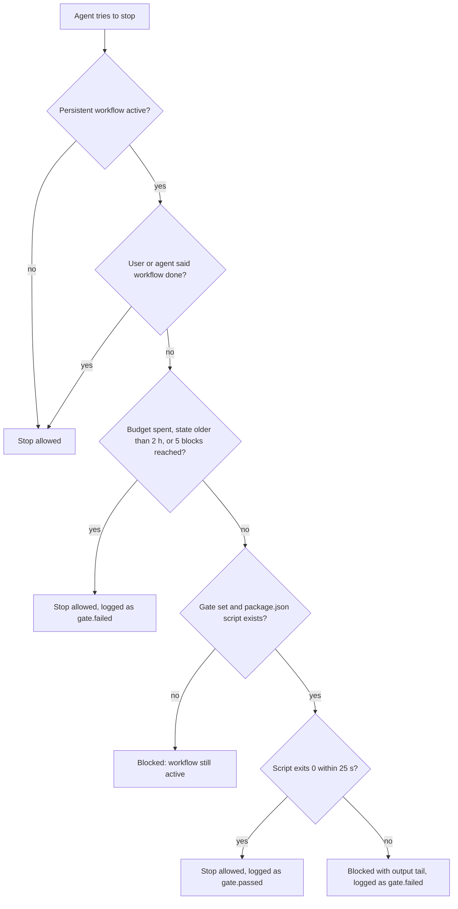

# oh-my-agent: Zespół specjalistów dla agenta kodującego, którego już używasz

[](https://www.npmjs.com/package/oh-my-agent) [](https://www.npmjs.com/package/oh-my-agent) [](https://github.com/first-fluke/oh-my-agent) [](https://github.com/first-fluke/oh-my-agent/blob/main/LICENSE) [](https://github.com/first-fluke/oh-my-agent/commits/main)

[English](../README.md) | [한국어](./README.ko.md) | [中文](./README.zh.md) | [Português](./README.pt.md) | [日本語](./README.ja.md) | [Français](./README.fr.md) | [Español](./README.es.md) | [Nederlands](./README.nl.md) | [Русский](./README.ru.md) | [Deutsch](./README.de.md) | [Tiếng Việt](./README.vi.md) | [ภาษาไทย](./README.th.md)

**oh-my-agent (`oma`) to niezależny od vendora harness, który dodaje zespół specjalistów do agenta kodującego, którego już używasz: Claude Code, Codex CLI, Cursor i 11 innych.** Planista rozbija pracę na części, inżynierowie budują równolegle, recenzent sprawdza wynik, a debuger usuwa przyczyny błędów. oma zajmuje się też researchem ze wskazaniem źródeł, prezentacjami, filmami i obrazami. Większość kroków zostawia plik, który możesz otworzyć, a w długotrwałych workflowach bramka może odsyłać agenta z powrotem do pracy, dopóki Twój własny skrypt `test`, `lint` lub `typecheck` nie przejdzie.

[](./assets/architecture/oh-my-agent-architecture.svg)

Uruchom to w katalogu głównym projektu:

```bash
curl -fsSL https://raw.githubusercontent.com/first-fluke/oh-my-agent/main/cli/install.sh | bash
```

Następnie uruchom `oma doctor` i wpisz w agencie `/plan add user accounts with a settings page`. Sekcja [Pierwsze 5 minut](#your-first-5-minutes) przeprowadzi Cię przez to krok po kroku.


[Obejrzyj pełne wideo (35 s)](./assets/video/oh-my-agent-explainer.mp4)

## Co dostajesz

**Workflowy** to to, co wpisujesz (albo po prostu mówisz). Przywołują one **role**, czyli specjalistów. **Umiejętności** (skills) to wiedza praktyczna: każda rola ma własne, a resztę agent ładuje wtedy, gdy zadanie ich wymaga.

| | Co daje | Wypróbuj |
|---|---|---|
| **12 ról specjalistów** | PM, architekt, inżynierowie backendu, frontendu, mobile, baz danych i infrastruktury, recenzent QA, debuger, refaktoryzator, opiekun dokumentacji, badacz ([poznaj ich](#meet-the-team)) | `/orchestrate build a TODO app with login` |
| **21 workflowów** | Slash commands od `/brainstorm` i `/plan` po `/review`, `/debug` i `/scm`. Większość uruchamia się też ze zwykłej prośby (banki słów kluczowych w maksymalnie 11 językach) | „review this PR” |
| **33 umiejętności** | Wiedza domenowa ładowana tylko wtedy, gdy zadanie jej potrzebuje: UI, API, schematy, Terraform, CI, bezpieczeństwo, git, obserwowalność | ładuje się sama, np. „add a Terraform S3 bucket” |
| **Pliki, które możesz otworzyć** | Plany, dokumenty projektowe, kontrakty API, ADR-y, notatki o błędach, wyniki per agent, dowody z audytu bezpieczeństwa, objaśniacze HTML, podsumowania | `ls .agents/results` |
| **Kontrole testów i artefaktów** | W długotrwałym workflowie Twój własny skrypt `test`, `lint` lub `typecheck` musi przejść, zanim agent będzie mógł się zatrzymać; `oma ralph verify` sprawdza, czy przebieg `/ralph` zostawił pliki planu, QA i refaktoryzacji | `/ultrawork …`, potem `oma goal set --gate test` |
| **Research i treści** | Wyszukiwanie ze wskazaniem źródeł, badania rynku, publikacje naukowe, prezentacje, filmy MP4, obrazy, lokalny głos, PDF/HWP do Markdown | `/video`, `/convert` |
| **Jeden katalog, 14 środowisk** | Jeden przenośny katalog `.agents/`, zapisywany do własnych plików konfiguracyjnych każdego środowiska | `oma link cursor` |

**[Instalacja](#install)** · **[Pierwsze 5 minut](#your-first-5-minutes)** · **[Zespół](#meet-the-team)** · **[Który workflow?](#how-the-team-works-together)** · **[Wszystko w zestawie](#everything-in-the-box)** · **[Działa z](#works-with)** · **[Weryfikacja](#verification-not-narration)** · **[FAQ](#faq)** · **[Dokumentacja](https://first-fluke.github.io/oh-my-agent/)**

<a id="install"></a>
## Instalacja

Skrypt instaluje [bun](https://bun.sh), jeśli go brakuje, instaluje globalnie polecenie `oma` (`bun install --global oh-my-agent`, pomijane, gdy `oma` jest już w PATH), a następnie uruchamia interaktywną konfigurację. Globalne polecenie ma znaczenie: hooki (wykrywanie słów kluczowych, bramka Stop) i kilka workflowów wywołują `oma`, a gdy hooki go nie znajdą, po cichu nic nie robią. Jeśli pomijasz skrypt, zainstaluj je samodzielnie przez `bun install --global oh-my-agent` (działają też `npm install --global oh-my-agent` i `brew install oh-my-agent`).

<details>
<summary>Windows albo instalacja bez skryptu</summary>

```powershell
# Windows (PowerShell)
irm https://raw.githubusercontent.com/first-fluke/oh-my-agent/main/cli/install.ps1 | iex
```

```bash
# Dowolny OS z zainstalowanym bun: ta sama konfiguracja plus globalne polecenie `oma`
bun install --global oh-my-agent
oma
```

Na Windowsie instalator ukrywa Antigravity, Hermes i Kimi, a wrapper hooków jest skryptem bash. Domyślny browser MCP Aside instaluje się przez `bash`, więc odznacz go, jeśli nie masz basha.

</details>

Konfiguracja pyta o język odpowiedzi, środowiska agentowe do podłączenia, dostawców możliwości (capability providers), browser MCP, preset modeli i preset umiejętności. **Jeśli nie masz pewności, wybierz `All` jako preset umiejętności**: workflowy są instalowane zawsze, a kilka z nich (`/orchestrate`, `/work`, `/ultrawork`, `/ralph`, `/docs`, `/security`) wymaga umiejętności, które zawiera tylko `All`.

<details>
<summary>Co instalator robi domyślnie poza tym</summary>

- Instaluje **bun** (wymagany). Próbuje zainstalować **uv**, **Serena** (`uv tool install`) i **CUE** (`brew install cue` albo `winget`), a jeśli któraś instalacja się nie powiedzie, kontynuuje z ostrzeżeniem.
- Wstępnie zaznacza browser MCP **Aside** w interaktywnej konfiguracji i instaluje go przez `curl -fsSL https://releases.aside.com/install.sh | bash` tylko wtedy, gdy zostawisz go zaznaczonego. Odznacz go w kroku wyboru browser MCP albo zmień później przez `oma update mcp`.
- Używa **AgentMemory** jako pamięci semantycznej, co uruchamia `bun install -g @agentmemory/agentmemory` i rejestruje go jako usługę logowania (launchd, jednostka użytkownika systemd albo zaplanowane zadanie Windows). Wybierz dostawcę `none` albo ustaw `OMA_NO_AGENTMEMORY=1`, aby to pominąć.
- Pyta, zanim podlinkuje umiejętności do folderów dostawców w katalogu domowym (Antigravity, Hermes, Kimi). W `$HOME` bez `--global` prosi o potwierdzenie.
- Bez pytania zapisuje kilka plików poza projektem: `~/.claude.json` (oznacza projekt jako zaufany workspace Claude Code), `~/.serena/` (kontekst OMA, minimalny rozmiar odpowiedzi, rejestracja projektu), `~/.cursor/cli-config.json` (wyłącza atrybucję commitów w Cursorze), `~/.grok/config.toml` (telemetria) i `~/.gemini/antigravity-cli/` (HUD), każdy tylko dla wybranego przez ciebie dostawcy.
- Zapisuje **rezygnację z telemetrii** w ustawieniach dostawców (Claude `DISABLE_TELEMETRY=1`, co wyłącza też Claude Code Remote Control; statystyki użycia Gemini, Qwen, Codex i Grok). Ustaw `telemetry: true`, aby zachować domyślne ustawienia dostawców.
- Dodaje do `.claude/settings.json` nieustawione opcje Claude Code, w tym `skipDangerousModePermissionPrompt: true`, `effortLevel: high`, `cleanupPeriodDays: 180` oraz flagi env, które wyłączają auto memory, adaptive thinking, raportowanie błędów i wbudowane instrukcje git. Wartości ustawione wcześniej zostają zachowane.
- Dodaje **trailer współautora**: atrybucja commitów w Claude Code zmienia się na `Co-Authored-By: First Fluke <our.first.fluke@gmail.com>`, a PR-y dostają linię "Generated with oh-my-agent". Ustaw `scm.co_author.enabled: false`, aby to wyłączyć.
- Instaluje w `.githooks/` **strażnika commit-msg**, który odrzuca adresy `Co-authored-by` spoza listy, i ustawia `git config --local core.hooksPath .githooks`, gdy nie są aktywne żadne inne hooki. Ustaw `scm.co_author.enforce_hook: false`, aby zrezygnować.
- `oma update` aktualizuje CLI `oma` w tle (`auto_update_cli: false` albo `OMA_SKIP_VERSION_CHECK=1`, aby to zatrzymać) i uruchamia `uv tool upgrade serena-agent --prerelease=allow` (`serena.auto_update: false`).
- Gdy Serena działa w domyślnym trybie `bridge`, pierwsza sesja agenta, która uruchomi współdzielony serwer Serena, rejestruje **timer czyszczący**, który co 5 minut zatrzymuje bezczynne współdzielone serwery Serena (launchd `dev.oma.serena-daemon-gc`, timer użytkownika systemd `oma-serena-daemon-gc.timer` albo zaplanowane zadanie Windows `OMA Serena Daemon GC`). Ustaw `serena.mode: stdio`, aby pominąć współdzielony serwer i jego timer. `oma uninstall` nie usuwa tego timera.
- Uruchomienia nieinteraktywne (`-y`, `OMA_YES=1`, `CI=true`) używają presetu umiejętności `All`, `model_preset: auto` i Pythona jako języka backendu. Nie wybierają żadnego browser MCP (i pomijają skrypt instalacyjny Aside), chyba że `mcp.devtools_browsers` już jakiś zawiera.

</details>

<details>
<summary>Presety umiejętności</summary>

| Preset | Umiejętności |
|--------|--------|
| **All** | **Wszystkie 33 umiejętności** (zalecane) |
| Fullstack | architecture, backend, brainstorm, db, debug, design, dev-workflow, frontend, mobile, pm, qa, scm, tf-infra |
| Fullstack Web | Fullstack bez mobile i tf-infra |
| Fullstack Mobile | Fullstack bez frontend i tf-infra |
| Frontend | architecture, brainstorm, debug, design, frontend, pm, qa, scm |
| Backend | architecture, backend, brainstorm, db, debug, dev-workflow, pm, qa, scm |
| Mobile | architecture, brainstorm, debug, mobile, pm, qa, scm |
| DevOps | architecture, brainstorm, debug, dev-workflow, observability, pm, qa, scm, tf-infra |
| Research | academic-writing, hwp, market, pdf, scholar, scm, search, translation |
| Content | academic-writing, design, image, scm, translation, voice |
| Custom | Wybierasz umiejętności pojedynczo |

Spośród nazwanych presetów tylko `All` zawiera coordination, orchestration, docs, security, refactor, explanation, recap, video, slide i skill-creation (możesz też wybrać je w `Custom`). W presetach Research i Content brakuje umiejętności, na których opierają się `/plan`, `/review`, `/debug`, `/architecture` i `/brainstorm`. Zobacz [Workflowy wymagające umiejętności spoza presetu](../web/docs/getting-started/installation.md#workflows-that-need-skills-outside-a-preset).

</details>

<a id="your-first-5-minutes"></a>
## Pierwsze 5 minut

1. **Zainstaluj** poleceniem powyżej.
2. **Sprawdź instalację:**

   ```bash
   oma doctor
   ```

   Powinieneś zobaczyć `CLI Status` (które CLI agentów są zainstalowane i zalogowane) oraz `Skills Status` (na przykład `Skills (33/33 installed, 33 complete)`). Jeśli `oma` nie zostanie znalezione, otwórz nowy terminal (instalator mógł właśnie dodać `~/.bun/bin` do PATH) albo uruchom `bun install --global oh-my-agent`.
3. **Otwórz agenta w projekcie i poproś o plan:**

   ```text
   /plan add user accounts with a settings page
   ```

   Możesz też po prostu napisać „plan user accounts with a settings page”: w środowiskach z prompt hookiem słowo kluczowe uruchamia ten sam workflow.
4. **Sprawdź, co dostałeś.** `/plan` działa w bieżącej sesji. Przy pracy obejmującej kilka obszarów, takiej jak ta, zapisuje `.agents/results/plan-<session-id>.json` i tracker w `docs/plans/work/<NNN>-<name>.md`. Mała prośba dotycząca jednego obszaru dostaje zamiast pliku planu bezpośrednią rekomendację.

Po tych krokach możesz ocenić, czy to rozwiązanie Ci odpowiada. Aby wypróbować kolejne workflowy, uruchom `/work` lub `/orchestrate` na tym planie.

<a id="meet-the-team"></a>
## Poznaj zespół

Zespołem kieruje Twój własny agent. W `/work`, `/orchestrate` i `/ultrawork` przekazuje każde zadanie właściwemu specjaliście, który działa jako osobny subagent. `/plan`, `/architecture` i `/docs` działają w bieżącej sesji z umiejętnością danej roli, a `/review` i `/debug` przy dużym zakresie przywołują swojego specjalistę. Gdy rola jest przypisana do CLI innego dostawcy, `oma agent spawn` uruchamia ją tam.

| Twój specjalista | Ma przy sobie | Jak go przywołać | Co zostawia |
|---|---|---|---|
| **Product manager** (`pm-planner`) | oma-pm | `/plan` albo „plan the payment feature” | JSON planu i tracker w `docs/plans/work/` dla pracy Medium i Complex (prośby Simple dostają bezpośrednią rekomendację) |
| **Architekt** (`architecture-reviewer`) | oma-architecture | `/architecture` | ADR lub rekomendacja w `.agents/results/architecture/` |
| **Inżynierowie backendu, frontendu, mobile, baz danych i infrastruktury** | oma-backend, oma-frontend + oma-design, oma-mobile, oma-db, oma-tf-infra | `/work`, `/orchestrate` | Kod, testy i plik `result-<agent>` dla każdego zadania |
| **Recenzent QA** (`qa-reviewer`) | oma-qa | `/review` albo „review this PR” | Ustalenia uszeregowane od CRITICAL do LOW, każde z file:line i kodem poprawki |
| **Debuger** (`debug-investigator`) | oma-debug | `/debug` albo „fix this bug” | Minimalna poprawka, test regresji i, gdy jest uzasadniona, notatka o błędzie w `.agents/results/bugs/` |

<details>
<summary>Pozostałe trzy role i umiejętności bez roli</summary>

| Twój specjalista | Ma przy sobie | Jak go przywołać | Co zostawia |
|---|---|---|---|
| **Refaktoryzator** (`refactor-engineer`) | oma-refactor | faza REFINE w `/ultrawork` | Commity `refactor:` bez zmiany zachowania i raport `result-refactor-<session>.md` |
| **Opiekun dokumentacji** (`docs-curator`) | oma-docs | `/docs` albo „verify docs” | `docs/generated/doc-refs.json` i poprawki dokumentacji, które zatwierdzisz |
| **Badacz** (`research-explorer`) | oma-search, oma-market, oma-scholar | prośba o research | Cytowane źródła z etykietami wiarygodności; briefy rynkowe w `.agents/results/market/` |

Inżynier infrastruktury (`tf-infra-engineer`) ma polecenie pytać przed każdym destrukcyjnym lub produkcyjnym `apply` albo `destroy`. Pozostałe umiejętności (brainstorm, security, scm, dev-workflow, observability, explanation, recap, translation, coordination, orchestration, skill-creation, treści i media) nie mają dedykowanej roli. Agent ładuje je sam, a dla większości z nich skill injector podpowiada właściwą na podstawie Twojego promptu.

</details>

<a id="how-the-team-works-together"></a>
## Jak zespół współpracuje

```text
 THINK   /brainstorm ......................... docs/plans/designs/<NNN>-<feature>.md
 PLAN    /plan · /architecture ............... plan JSON, API contracts, ADR
 DESIGN  /design ............................. DESIGN.md + tokens
 BUILD   /work · /orchestrate · /ultrawork ... code + result-<agent> files, engineers in parallel
 CHECK   /review · /security · /debug ........ findings, security evidence, regression test
 SHIP    /scm · /docs ........................ Conventional Commits, doc fixes
```

Każdy krok przekazuje plik następnemu. `/brainstorm` zapisuje projekt, który czyta `/plan`, a `/plan` zapisuje plan, w którym każde zadanie ma agenta, zależności, kryteria akceptacji i polecenie sprawdzające. `/orchestrate` wykonuje ten plan (ładuje najnowszy `plan-*.json` albo zapisuje nowy). `/work` i `/ultrawork` zaczynają od tego, że PM pisze ich własny plan. Pomiń każdy etap, którego nie potrzebujesz; każdy etap działa też samodzielnie.

**Który workflow ma pokierować zespołem?**

| Czego chcesz | Uruchom | Jak się kończy |
|---|---|---|
| Tylko planu | `/plan` | Plik planu dla pracy obejmującej wiele obszarów albo bezpośrednia rekomendacja dla małej pracy |
| Budowy prowadzonej przez PM, którą śledzisz krok po kroku | `/work` | PM, potem inżynierowie poziom po poziomie, potem QA. Ustalenia CRITICAL i HIGH trafiają do pętli poprawek (do 5 cykli) |
| Równoległej budowy bez Twojego udziału | `/orchestrate` | Za wykonane uznaje się tylko zadania, których sprawdzenia przechodzą; każde zadanie ma do 3 prób, a potem zostaje oznaczone jako częściowe lub nieudane |
| Maksymalnej staranności | `/ultrawork` | Pięć faz z bramkami (PLAN, IMPL, VERIFY, REFINE, SHIP); każdy przegląd odbywa się w świeżej sesji recenzenta |
| „Nie przestawaj, dopóki naprawdę nie skończysz” | `/ralph` | Powtarza `/ultrawork` z osobno uruchamianym sędzią ze świeżym kontekstem, aż każde kryterium przejdzie; zatrzymuje się z raportem częściowym, gdy kryteria są zablokowane, albo po 5 iteracjach |
| Zespołu działającego według harmonogramu | `oma schedule create qa-reviewer "review open PRs" --every 2h` | Jeden log Markdown na przebieg w `~/.oma/schedule/runs/<id>/` |

Slash commands nie są konieczne. W środowiskach z prompt hookiem zwykłe prośby (banki słów kluczowych w maksymalnie 11 językach) mogą uruchomić większość workflowów: „review this PR” uruchamia `/review`. Opis całej aplikacji („Build a TODO app with user authentication”) podsuwa `/orchestrate`, a agent decyduje, czy go uruchomić. Słowa kluczowe w blokach kodu są ignorowane.

`/orchestrate`, `/work`, `/ultrawork` i `/ralph` są **persystentne**, gdy wywołujesz je po nazwie, jako slash command albo zwykłym tekstem („ultrawork: add rate limiting”). Agent jest wtedy odsyłany do pracy, gdy próbuje zatrzymać się zbyt wcześnie (najwyżej 5 razy lub przez najwyżej 2 godziny), dopóki nie powiesz **„workflow done”**. Prośba, która pasuje do nich tylko luźno, jedynie je podsuwa.

W [benchmarku](../benchmarks/README.md) (jeden prompt, Claude Code w pięciu różnych konfiguracjach dodatków, w tym bez dodatków, `claude-opus-4-6`, po jednym buildzie) oma uzyskało 80.6 wobec 70.7 dla czystego Claude Code. Kosztowało 1.7x więcej ($4.04 vs $2.37) i działało 1.8x dłużej.

<details>
<summary>Wszystkie 21 workflowów</summary>

| Komenda | Co robi |
|---------|--------------|
| `/architecture` | Waży kompromisy projektowe i przygotowuje rekomendację, przegląd lub ADR |
| `/brainstorm` | Bada pomysły i ograniczenia, a przed planowaniem przygotowuje zatwierdzony projekt |
| `/convert` | Konwertuje PDF/HWP do Markdown albo transkoduje obrazy, wideo i audio przez ffmpeg |
| `/debug` | Odtwarza błąd, naprawia jego przyczynę, pisze test regresji i szuka podobnych wzorców |
| `/deepinit` | Mapuje istniejącą bazę kodu do AGENTS.md, ARCHITECTURE.md i bazy wiedzy w docs/ |
| `/design` | Buduje design system, DESIGN.md i tokeny ze sprawdzeniem dostępności |
| `/docs` | Znajduje zepsute odwołania w dokumentacji i proponuje poprawki dla dokumentów, których dotknął diff |
| `/explain` | Zamienia diff, PR, gałąź lub temat w samodzielny, interaktywny objaśniacz HTML |
| `/orchestrate` | Uruchamia agentów równolegle, koordynuje ich przez stan w plikach i weryfikuje wynik (persystentny) |
| `/plan` | Rozbija funkcjonalność na zadania z priorytetami i kontraktami API |
| `/ralph` | Powtarza `/ultrawork` z osobno uruchamianym sędzią, maksymalnie 5 iteracji (persystentny) |
| `/recap` | Podsumowuje historię Twoich rozmów z AI z danego dnia lub okresu |
| `/review` | Przegląda bezpieczeństwo (OWASP Top 10), wydajność, dostępność (WCAG 2.2 AA) i jakość kodu |
| `/schedule` | Rejestruje zadanie agenta uruchamiane cyklicznie w zadanym interwale |
| `/scm` | Obsługuje gałęzie, scalenia, konflikty, worktrees i Conventional Commits |
| `/security` | Skanuje kod źródłowy, umiejętności agentów i komponenty MCP, weryfikuje ustalenia i konfiguruje bramki CI |
| `/stack-set` | Wykrywa Twój stos technologiczny i generuje dla umiejętności domenowych referencje specyficzne dla tego stosu |
| `/tools` | Wyświetla, włącza i wyłącza narzędzia MCP za pomocą zwykłego języka |
| `/ultrawork` | Pięć faz (PLAN, IMPL, VERIFY, REFINE, SHIP), każdy przegląd w świeżej sesji recenzenta (persystentny) |
| `/video` | Zamienia brief w gotowy plik MP4 przez pipeline działający także bez kluczy |
| `/work` | Koordynuje kilku agentów w projekcie wielodomenowym z planowaniem PM i przeglądem QA (persystentny) |

Trafność wyzwalania jest mierzona, a nie zakładana: `oma verify triggers` ocenia detektor na oznaczonym korpusie 212 angielskich i koreańskich promptów, a CI kończy się niepowodzeniem powyżej 10% false fire lub 20% missed fire. Ostatni pomiar: **0% missed-fire, 5.3% false-fire**. Pełna dokumentacja: [Workflows](https://first-fluke.github.io/oh-my-agent/docs/core-concepts/workflows/).

</details>

<a id="see-it-work"></a>
## Zobacz w działaniu

Przykładowa sesja `/ultrawork`. Blok `[OMA PERSISTENT MODE: ULTRAWORK]` ma dokładnie taki format, jaki wypisuje hook Stop; pozostałe linie są parafrazą:

```text
you    /ultrawork add rate limiting to POST /login
agent  runs `oma goal set --gate test`
agent  PLAN writes .agents/results/plan-<run-id>.json
agent  IMPL -> VERIFY -> REFINE -> SHIP  (each review runs in a fresh reviewer session)
agent  "Rate limiting added. All tests pass."
oma    [OMA PERSISTENT MODE: ULTRAWORK]
       Stop gate 'test' FAILED (reinforcement 1/5).
       Fix the failures below, then finish the workflow — the stop is allowed only when the gate passes.
       --- gate output (tail) ---
       FAIL  src/auth/login.test.ts > returns 429 after 5 attempts
       To abandon instead: delete .agents/state/ultrawork-state-<host-session>.json or say "workflow done".
agent  fixes the limiter and stops again
oma    `test` exits 0: stop allowed, gate.passed appended to the session log
```

Potem `oma state list` znajduje sesję, a `oma state get <oma-sid>` (identyfikator wypisany przez `state list`) pokazuje każde zdarzenie bramki. W `/ralph` polecenie `oma ralph verify --json` dodatkowo sprawdza, czy fazy zostawiły po sobie pliki (wyjście skrócone):

```json
{ "ok": false,
  "missing": [{ "id": "A3", "description": "a distinct QA agent ran (VERIFY phase)",
                "pattern": ".agents/state/memories/result-qa*.md or .agents/results/result-qa*.md",
                "status": "missing" }] }
```

<a id="everything-in-the-box"></a>
## Wszystko w zestawie

<details>
<summary><strong>Planowanie i projektowanie</strong>: <code>/brainstorm</code>, <code>/plan</code>, <code>/architecture</code>, <code>/design</code></summary>

| Komenda | Co robi | Zapisuje |
|---|---|---|
| `/brainstorm` | Zadaje po jednym pytaniu doprecyzowującym i proponuje 2-3 podejścia, które działają na różne sposoby, a potem przekazuje pracę do `/plan`. Nie pisze kodu | `docs/plans/designs/<NNN>-<feature>.md` |
| `/plan` | Ocenia pracę jako Simple, Medium lub Complex; pracę Medium i Complex dzieli na zadania, każde z agentem, zależnościami, kryteriami akceptacji i poleceniem sprawdzającym, a gdy praca przekracza granicę, definiuje kontrakty API | `.agents/results/plan-<sid>.json`, `docs/plans/work/<NNN>-<name>.md`, kontrakty w `.agents/results/api-contracts/` w razie potrzeby |
| `/architecture` | Najpierw czyta wcześniejsze decyzje, porównuje co najmniej 2 opcje i oznacza zastąpione ADR-y jako superseded | ADR lub rekomendacja w `.agents/results/architecture/` |
| `/design` | Proponuje 2-3 kierunki, potem zapisuje `DESIGN.md` z tokenami i audytuje responsywny layout oraz dostępność | `DESIGN.md`, tokeny CSS/Tailwind/shadcn |

</details>

<details>
<summary><strong>Budowa</strong>: 7 umiejętności domenowych oraz <code>/stack-set</code>, by dopasować je do Twojego stosu</summary>

| Umiejętność | Buduje |
|---|---|
| oma-frontend | UI w React/Next.js lub Angular zgodne z Twoimi tokenami oraz zasadami i18n i dostępności |
| oma-backend | API, uwierzytelnianie i dostęp do danych w warstwach router → service → repository |
| oma-mobile | Aplikacje we Flutterze, React Native lub Swifcie |
| oma-db | Schematy, migracje, strojenie zapytań, plany wyszukiwania wektorowego/RAG |
| oma-tf-infra | Terraform dla dowolnej chmury, z wyraźnie wskazanym ryzykiem dryfu, zmian destrukcyjnych i kosztów |
| oma-dev-workflow | Zadania mise, lint/format/typecheck, commitlint, git hooks, CI/CD i releasy |
| oma-observability | OpenTelemetry, SLO, alerting i analiza incydentów |

`/stack-set` czyta Twoje manifesty i zapisuje referencje specyficzne dla stosu dla umiejętności backend, frontend i mobile. W monorepo inżynierowie frontendu, backendu i mobile są kierowani do swojego workspace'u (pnpm, workspace'y npm/yarn/bun, lerna, nx, turbo, `mise.toml`).

</details>

<details>
<summary><strong>Przegląd, poprawki i wydanie</strong>: <code>/review</code>, <code>/security</code>, <code>/debug</code>, refaktoryzacja, <code>/scm</code></summary>

| Komenda lub umiejętność | Co robi | Zapisuje |
|---|---|---|
| `/review` | Audyt zależności, a potem OWASP Top 10, wydajność, WCAG 2.2 AA i jakość kodu. Każde ustalenie dostaje file:line i kod poprawki | Raport w czacie i wpis w pamięci; bez pliku raportu |
| `/security` | Skanuje Twój kod źródłowy, umiejętności agentów i serwery MCP (Deepsec, Cisco Skill and MCP Scanner), a przy wskazanym, ograniczonym wdrożeniu testowym uruchamia pentesty ARTEX. Workflow wymaga, by silnik, który nie zdołał się uruchomić, był zgłaszany jako nieudany, a nie jako czysty | `.agents/results/security/<run-id>/` |
| `/debug` | Odtwarza błąd, naprawia jego przyczynę minimalną zmianą, dodaje test regresji i szuka tego samego wzorca w innych miejscach | Poprawka i test; notatka o błędzie w `.agents/results/bugs/`, gdy jest uzasadniona |
| oma-refactor | Zmienia strukturę bez zmiany zachowania: najpierw testy charakteryzujące, potem commity zawierające wyłącznie refaktoryzację | `.agents/results/refactor/` |
| `/scm` | Conventional Commits podzielone według logicznych zmian; gałęzie, scalenia, rebase'y i worktrees | Commity i gałęzie |

</details>

<details>
<summary><strong>Dokumentacja i wiedza</strong>: <code>/deepinit</code>, <code>/docs</code>, <code>/explain</code>, <code>/recap</code>, tłumaczenie</summary>

| Komenda lub umiejętność | Co robi | Zapisuje |
|---|---|---|
| `/deepinit` | Zamienia istniejące repo w bazę wiedzy gotową do pracy z agentami | `AGENTS.md`, `ARCHITECTURE.md`, `docs/` |
| `/docs` | Znajduje zepsute odwołania, poprawia dokumenty, których dotknął diff (stosując tylko zatwierdzone przez Ciebie poprawki), i wykrywa nieaktualne tłumaczenia | `docs/generated/doc-refs.json`, poprawione dokumenty |
| `/explain` | Zamienia PR, gałąź lub zmianę w stage'u w przewodnik HTML z quizem z 5 pytań, a temat w jednostronicowy wizualny objaśniacz | `.agents/results/explain/<date>-<slug>.html` |
| `/recap` | Podsumowuje Twoje rozmowy z AI w różnych narzędziach z danego dnia lub okresu | `.agents/results/recap/<date>.md` |
| oma-translation | Tłumaczenie, które brzmi naturalnie; placeholdery, kod i klucze lokalizacji pozostają bez zmian | Przetłumaczony tekst |

</details>

<details>
<summary><strong>Research</strong>: wyszukiwanie, rynek, publikacje, pisanie akademickie</summary>

| Umiejętność | Co robi | Zapisuje |
|---|---|---|
| oma-search | Wyszukiwanie w dokumentacji, sieci i kodzie z etykietą wiarygodności przy każdym źródle | Wyniki ze wskazaniem źródeł |
| oma-market | Problemy klientów, trendy i konkurencja na podstawie sygnałów społecznościowych, ujęte w SWOT, 5 sił Portera i PESTEL | `.agents/results/market/<topic>-<date>.md` |
| oma-scholar | Wyszukuje publikacje, czytając zwięzły plik twierdzeń (format Knows, około 700 tokenów) zamiast pełnego PDF (około 10K tokenów) | `<paper>.knows.yaml` |
| oma-academic-writing | Pisze i audytuje prozę akademicką według rubryki | Twój plik |

</details>

<details>
<summary><strong>Treści i media</strong>: <code>/video</code>, <code>/convert</code>, slajdy, obrazy, głos</summary>

| Komenda lub umiejętność | Co tworzy | Zapisuje |
|---|---|---|
| `/video` | Shorty, materiały objaśniające lub dema jako gotowy plik MP4; dostawcy wymagający kluczy mają zamienniki bez kluczy | `.agents/results/videos/<run>/` z manifestem |
| oma-slide | Decki HTML 1920×1080 eksportowane do PDF, PNG lub PPTX | `.agents/results/slides/<session>/` |
| oma-image | Obrazy przez CLI dostawców, w których jesteś zalogowany, porównane obok siebie | `.agents/results/images/<run>/` |
| oma-voice | Lokalna synteza mowy i transkrypcja przez aplikację Voicebox | `.agents/results/voice/<run>/` |
| `/convert` | PDF lub HWP do Markdown; konwersja obrazów, wideo i audio przez ffmpeg | Obok pliku wejściowego |

Te pipeline'y zgłaszają brak źródła lub klucza dostawcy, zamiast po cichu zwracać uboższy wynik.

</details>

<details>
<summary><strong>Hooki, które działają bez proszenia</strong></summary>

| Hook | Co robi | Wyłączenie / limit |
|---|---|---|
| Start po słowie kluczowym | Uruchamia pasujący workflow ze zwykłej prośby | Pytania, wklejony tekst i bloki kodu są pomijane |
| Skill injector | Wskazuje agentowi właściwe umiejętności dla promptu | Wstrzymany, gdy aktywny jest persystentny workflow |
| Bramka Stop | Odsyła persystentny workflow do pracy; z `oma goal set --gate test` zatrzymanie jest dozwolone, gdy ten skrypt zakończy się kodem 0 w ciągu 25 s | Powiedz „workflow done”; hook przestaje też blokować po 5 blokadach albo 2 godzinach |
| Strażnik refaktoryzacji | Przy zatrzymaniu oznacza dla `refactor-engineer` edytowane pliki dłuższe niż 500 linii | Opt-in: `refactor_guard.enabled` |
| Strażnik sekretów | Blokuje `git add` plików `*.env`, `*.pem`, `id_rsa*`, `*.tfstate` i podobnych | Poprzedź to jedno polecenie `OMA_SCM_ALLOW_SECRETS=1` |
| Strażnik wyszukiwania kodu | Blokuje natywne rekurencyjne wyszukiwanie w projekcie, aby agent używał Serena lub Gortex | `providers.code_intelligence_guard: off` |
| Filtr testów | Zostawia z wyjścia testów tylko błędy i podsumowania, więc zużywa się mniej tokenów | `OMA_TEST_FILTER=0` |
| Pamięć sesji | Gdy przełączasz lub wznawiasz sesję (albo po kompaktowaniu), ponownie wstrzykuje ostatnie zdarzenia aktywnej sesji oraz przywołania z AgentMemory | Dostawca pamięci `none` lub `OMA_NO_AGENTMEMORY=1` wyłącza przywoływanie; lokalny snapshot zdarzeń pozostaje |

`oma hook probe` sprawdza, czy prompt hooki oma akceptują dane wejściowe hooków każdego środowiska (nie uruchamia samego środowiska). To, które hooki podłącza każde środowisko, opisuje sekcja [Różnice między hostami](#host-differences).

</details>

<details>
<summary><strong>Równolegli agenci, sesje i dashboardy</strong></summary>

- `oma agent spawn <role> "<task>" <sid>` uruchamia rolę w Antigravity, Claude Code, Codex, Cursor, Grok, Kimi Code, Kiro, OpenCode, pi lub Qwen Code, z `--isolation worktree` i `--fallback-vendors`. `oma agent parallel` uruchamia kilka ról naraz. Te 10 celów dispatchu to część z 14 integracji instalatora.
- `oma state list --all-projects` i `oma state get <sid>`: sesje i każde zarejestrowane zdarzenie.
- `oma dashboard terminal` / `oma dashboard web`: status agentów na żywo (dashboard webowy nasłuchuje tylko na `127.0.0.1`). [Przewodnik po dashboardzie](../web/docs/guide/dashboard-monitoring.md).
- `oma stats get` (metryki produktywności), `oma retro` (retrospektywa gita), `oma recap --window 7d` (co zrobiłeś w różnych narzędziach AI).
- `oma visualize --affected <paths>`: które umiejętności, workflowy, agenci i sprawdzenia zależą od zmienionych przez Ciebie plików `.agents/`.

</details>

<details>
<summary><strong>Code intelligence, pamięć i MCP</strong></summary>

| Slot | Domyślnie | Alternatywy |
|---|---|---|
| Dokumentacja | Context7 | — |
| Wyszukiwanie w sieci | Natywne wyszukiwanie runtime’u | Brave Search |
| Code intelligence | Serena, jeden współdzielony serwer na projekt | Gortex (eksperymentalny) |
| Pamięć semantyczna | AgentMemory | Honcho (eksperymentalny), none |
| Browser MCP | Aside | Chrome DevTools, Firefox DevTools |

Serena zapewnia nawigację po kodzie i diagnostykę opartą na LSP, w tym informację zwrotną po natywnej edycji tam, gdzie jest obsługiwana. Wybór dostawcy jest niezależny od środowiska uruchomieniowego agenta; możliwości zależą od dostawcy i hosta.

Agenci koordynują się przez zwykłe pliki w `.agents/state/`, bez zewnętrznej usługi. `/tools` włącza i wyłącza narzędzia MCP za pomocą zwykłego języka. Szczegóły: [Dostawcy możliwości](./capability-providers.md).

</details>

<details>
<summary><strong>Coraz lepiej z czasem</strong></summary>

- `oma skill eval` mierzy przyrost, jaki daje umiejętność w porównaniu z baseline na odłożonych zadaniach. `oma skill optimize` proponuje zmiany, które go zwiększają, a `--apply` je zachowuje ([przewodnik skill-eval](../web/docs/guide/skill-eval.md)).
- `oma harness evolution enable --max-dispatches <n>` planuje nocny cykl, który zamienia nieudane przebiegi w fixture'y regresji i stosuje ulepszenia umiejętności, które przeszły ewaluację, jako nakładki projektu. Dodaj `--mode propose`, aby tylko je zapisywać.
- `oma emit` eksportuje źródło `.agents/` jako pakiet Agent Skills, pakiet Agent Plugins, marketplace pluginów Claude Code albo `AGENTS.md`.

</details>

<details>
<summary><strong>Konfiguracja i zabezpieczenia</strong></summary>

- Jeden należący do Ciebie plik `.agents/oma-config.yaml` przetrwa aktualizacje (resetuje go tylko `oma update --force`); nad nim mogą leżeć prywatne nakładki `.local.yaml` lub `.local.cue`. `language` ustawia język odpowiedzi.
- 13 reguł projektu (backend, commit, database, debug, design i inne) ładuje się jako natywne reguły w Claude Code i Cursor, a ich indeks trafia do zarządzanego bloku `AGENTS.md` zapisywanego dla Codex, Qwen Code i Pi.
- Aktualizacje zachowują kopie zapasowe konfiguracji i migracji w `.agents/backup/`; dostarczane umiejętności i workflowy są zastępowane w miejscu, więc lokalne zmiany trzymaj poza nimi. `oma uninstall --dry-run` pokazuje, co zostałoby usunięte. `first-fluke/oma-update-action@v1` uruchamia `oma update` w CI i otwiera PR.

</details>

<details>
<summary><strong>Wszystkie 33 skille</strong></summary>

| Skill | Co robi |
|---|---|
| **oma-academic-writing** | Pisze, redaguje i audytuje prozę akademicką |
| **oma-architecture** | Waży kompromisy architektoniczne i wyznacza granice modułów z analizą ADR/ATAM/CBAM |
| **oma-backend** | Buduje API, uwierzytelnianie i dostęp do danych w Pythonie, Node.js lub Rust |
| **oma-brainstorm** | Eksploruje pomysły razem z Tobą, zanim zaczniesz budować |
| **oma-coordination** | Prowadzi krok po kroku ręczną koordynację agentów PM, frontend, backend, mobile i QA |
| **oma-db** | Projektuje schematy, migracje, indeksy i vector stores |
| **oma-debug** | Znajduje przyczynę błędu, naprawia go i pisze test regresji |
| **oma-design** | Buduje design systemy z tokenami, dostępnością i responsywnymi layoutami |
| **oma-dev-workflow** | Automatyzuje CI/CD, releasy i zadania w monorepo |
| **oma-docs** | Sprawdza dokumentację pod kątem zepsutych odwołań, synchronizuje ją ze zmianami w kodzie i wykrywa rozjazdy tłumaczeń |
| **oma-explanation** | Zamienia diff, PR, gałąź lub temat w samodzielny objaśniacz HTML, z quizem dla zmian w kodzie |
| **oma-frontend** | Buduje UI w React/Next.js lub Angular |
| **oma-hwp** | Konwertuje pliki HWP, HWPX i HWPML do Markdown |
| **oma-image** | Generuje obrazy i warianty na podstawie referencji oraz pozwala porównać dostawców AI obok siebie |
| **oma-market** | Bada Twój rynek na podstawie sygnałów ze społeczności i ujmuje go w ramy SWOT, 5F i PESTEL |
| **oma-mobile** | Buduje aplikacje mobilne we Flutter, React Native lub natywnym Swift |
| **oma-observability** | Kieruje pracę obserwabilności przez metryki, logi, traces, SLO i analizę incydentów |
| **oma-orchestration** | Uruchamia wiele agentów równolegle z poziomu CLI |
| **oma-pdf** | Konwertuje pliki PDF do Markdown |
| **oma-pm** | Planuje zadania, rozbija wymagania i definiuje kontrakty API |
| **oma-qa** | Przegląda zmiany pod kątem poprawności, bezpieczeństwa OWASP, wydajności i dostępności |
| **oma-recap** | Podsumowuje historię rozmów w tematyczne raporty z pracy |
| **oma-refactor** | Refaktoryzuje bez zmiany zachowania, wykorzystując wybór hotspotów, testy charakteryzujące i commity zawierające wyłącznie refactor |
| **oma-scholar** | Przeszukuje literaturę akademicką i tworzy sidecary artykułów Knows z tezami, dowodami i recenzją naukową |
| **oma-scm** | Zarządza branchami, mergami, worktrees i Conventional Commits |
| **oma-search** | Kieruje każde zapytanie do najlepszego źródła i ocenia, na ile możesz ufać wynikowi |
| **oma-security** | Skanuje kod źródłowy, umiejętności agentów i komponenty MCP; testuje wdrożone aplikacje webowe i weryfikuje ustalenia |
| **oma-skill-creation** | Pisze i audytuje nowe skille OMA |
| **oma-slide** | Generuje decki prezentacji HTML i eksportuje je do PDF/PNG/PPTX |
| **oma-tf-infra** | Provisionuje wielochmurową infrastrukturę za pomocą Terraform |
| **oma-translation** | Tłumaczy tak, by tekst brzmiał, jakby napisał go native speaker |
| **oma-video** | Generuje krótkie filmy, materiały objaśniające i dema przez pipeline HyperFrames działający także bez kluczy |
| **oma-voice** | Generuje voiceover i transkrybuje audio bezpośrednio na urządzeniu |

</details>

<a id="works-with"></a>
## Działa z

14 celów instalatora: Claude Code, Codex CLI, Cursor, Antigravity, Qwen Code, Grok, Kiro, Kimi, OpenCode, Pi, GitHub Copilot, Hermes, CommandCode i ZCode. Pominięte środowisko podłączysz przez `oma link <vendor>`. Środowiska różnią się dostępnymi hookami; pełna macierz jest w [Obsługiwanych agentach](./SUPPORTED_AGENTS.md).

- **Orca IDE:** [OMA for Orca](../integrations/orca/README.md) dodaje panel boczny i akcje palety poleceń (Orca 1.4.197+ z wtyczkami eksperymentalnymi).
- **DeepSeek Harness:** [OMA for DeepSeek Harness](../integrations/dsh/README.md) podłącza kontrole OMA przez wtyczkę Cordis. Wymaga `oma` w `PATH`.

<details>
<summary>Logo środowisk (cele instalatora oraz Amp i DeepSeek Harness)</summary>

natywne = oma zapisuje własne pliki konfiguracyjne środowiska; adapter = oma dodaje też shimy hooków lub agentów. Amp sam czyta `.agents/skills/` i nie jest celem instalatora.

<table>
<colgroup>
<col span="6" style="width:16.67%" />
</colgroup>
<tr>
<td align="center">
<a href="https://claude.com/product/claude-code"></a><br/>
<strong>Claude Code</strong><br/>
<sub>natywne + adapter</sub>
</td>
<td align="center">
<a href="https://github.com/openai/codex"></a><br/>
<strong>Codex CLI</strong><br/>
<sub>natywne + adapter</sub>
</td>
<td align="center">
<a href="https://antigravity.google"></a><br/>
<strong>Antigravity</strong><br/>
<sub>natywny SSOT</sub>
</td>
<td align="center">
<a href="https://cursor.com"></a><br/>
<strong>Cursor</strong><br/>
<sub>natywne + adapter</sub>
</td>
<td align="center">
<a href="https://github.com/QwenLM/qwen-code"></a><br/>
<strong>Qwen Code</strong><br/>
<sub>natywny dispatch</sub>
</td>
<td align="center">
<a href="https://github.com/deepseek-ai/deepseek-harness"></a><br/>
<strong>DeepSeek Harness</strong><br/>
<sub>Cordis plugin</sub>
</td>
</tr>
<tr>
<td align="center">
<a href="https://pi.dev/"></a><br/>
<strong>Pi</strong><br/>
<sub>natywnie zgodne</sub>
</td>
<td align="center">
<a href="https://github.com/anomalyco/opencode"></a><br/>
<strong>OpenCode</strong><br/>
<sub>natywnie zgodne</sub>
</td>
<td align="center">
<a href="https://ampcode.com"></a><br/>
<strong>Amp</strong><br/>
<sub>czyta .agents/skills</sub>
</td>
<td align="center">
<a href="https://github.com/features/copilot"></a><br/>
<strong>GitHub Copilot</strong><br/>
<sub>skills przez symlink</sub>
</td>
<td align="center">
<a href="https://grok.x.ai"></a><br/>
<strong>Grok Build</strong><br/>
<sub>natywne hooki</sub>
</td>
<td align="center">
<a href="https://kiro.dev"></a><br/>
<strong>Kiro CLI</strong><br/>
<sub>natywne hooki + agenci</sub>
</td>
</tr>
</table>

<p align="center"><sub><a href="./SUPPORTED_AGENTS.md">& więcej</a></sub></p>

</details>

<a id="host-differences"></a>
<details>
<summary>Różnice między hostami: które środowiska mają wykrywanie słów kluczowych i bramkę Stop</summary>

| Środowisko | Wykrywanie słów kluczowych | Bramka Stop |
|---|---|---|
| Claude Code, Codex CLI, Qwen Code, Grok, Kimi | tak | tak |
| Cursor | tak | tak (wraca jako wiadomość uzupełniająca) |
| Antigravity | tak | tak (uruchamia handlery przez bun, nie przez wrapper `oma`) |
| OpenCode, Pi | tak | best-effort (Pi wymaga buildu z `agent_settled`) |
| Kiro | tak | nie: Kiro ignoruje wyjście hooka Stop |
| CommandCode | brak prompt hooka | tak |
| GitHub Copilot, Hermes, ZCode | brak hooków | brak hooków |

</details>

<a id="per-agent-models"></a>
<details>
<summary>Modele per agent</summary>

`model_preset` w `.agents/oma-config.yaml` określa, którego modelu używa każda rola agenta. Wartość domyślna, `auto`, podąża za własnymi ustawieniami agenta i modelu w działającym środowisku.

```yaml
language: en
model_preset: auto   # auto | free | antigravity | claude | codex | cursor | kiro | mixed | qwen | <custom_presets key>

# Optional per-agent overrides; they win over the preset
agents:
  backend: { model: openai/gpt-5.5, effort: high }
```

- `mixed` używa Claude dla orkiestratora, architektury, QA, PM i dokumentacji, a Codex `gpt-5.5` dla ról implementacyjnych, więc wymaga zarówno Claude Code, jak i Codex CLI.
- `free` kieruje ruch przez bramę FreeLLMAPI i wymaga `FREELLM_API_KEY` oraz działającego serwera.
- `kiro` nie występuje w menu instalatora; ustaw go w pliku konfiguracyjnym.
- `oma doctor --profile` wypisuje rozwiązany model dla każdej roli.
- Pełny przewodnik: [Modele per agent](https://first-fluke.github.io/oh-my-agent/docs/guide/per-agent-models/)

</details>

<a id="verification-not-narration"></a>
## Weryfikacja

oh-my-agent sprawdza artefakty. Sekcja [Zobacz w działaniu](#see-it-work) pokazuje działanie bramki Stop.

OMA zapisuje także metadane wywołań narzędzi i skróty payloadów dla śledzonych uruchomień harnessu Claude Code i Codex, odróżnia raportowane użycie tokenów od szacunków oraz ocenia regresje umiejętności. Te funkcje +1 obejmują wszystkie warstwy; zakres śledzenia zależy od runtime’u i uruchomienia.

Każdy z poniższych mechanizmów, z wyjątkiem sędziego sterowanego promptem, jest mechaniczny: komenda kończy się kodem 0 albo nie, plik jest na dysku albo go nie ma. Żaden z nich nie pyta LLM, czy praca „wygląda poprawnie”.

| Mechanizm | Co sprawdza | Źródło |
|-----------|----------------|--------|
| **Bramka hooka Stop** | W trakcie persystentnego workflowu `oma goal set --gate test` (albo `lint`, `typecheck`) zezwala na zatrzymanie tylko wtedy, gdy ten skrypt z package.json zakończy się kodem 0 w ciągu 25 s. | [`persistent-mode.ts`](../.agents/hooks/core/persistent-mode.ts) |
| **Bramka artefaktów** | `oma ralph verify --json` sprawdza zapisy faz, JSON planu oraz pliki wyników **osobnego agenta QA** i **osobnego agenta refactor**, każdy powiązany z zarejestrowanymi uruchomieniami agentów. | [`ralph.md`](../.agents/workflows/ralph.md) |
| **Sędzia sterowany promptem** | Nie jest mechaniczny: prompt `/ralph` poleca orkiestratorowi uruchomić sędziego ze świeżym kontekstem, który w każdej iteracji sprawdza od nowa **każde** kryterium. Nic nie sprawdza, czy do tego uruchomienia doszło. | [`judge-protocol.md`](../.agents/workflows/ralph/resources/judge-protocol.md) |
| **Dziennik zdarzeń** | W sesji OMA każde zaliczenie bramki, każde jej niepowodzenie i każda decyzja dopisuje jedną linię JSON do pliku `events.jsonl` tej sesji. | [`state-core.ts`](../.agents/hooks/core/state-core.ts) · [`event-spec.md`](../.agents/skills/_shared/runtime/event-spec.md) |
| **Sprawdzenia per agent** | `oma verify agent <type>` uruchamia Scope Check, Charter Preflight, Hardcoded Secrets, TODO/FIXME Comments, Declared outputs i TDD Evidence oraz sprawdzenia zależne od typu, takie jak TypeScript, Any Types, SQL Injection i testy. | `oma verify agent --help` |

> Hook Stop zapisuje zdarzenia bramek w sesji OMA otwieranej przy starcie persystentnego workflowu. Zapis działa na zasadzie best-effort. Jeśli sesji nie uda się utworzyć (stderr zawiera `[oma] L1 session activation failed`), niezaliczona bramka nadal blokuje zatrzymanie, ale linia `gate.failed` nie zostaje zapisana. Przed poleganiem na tych zdarzeniach lub ich demonstracją sprawdź przez `oma state list`, czy istnieje aktywna sesja. Następnie `oma state get <sid>` pokaże jej zdarzenia.

<details>
<summary>Ograniczenia, szczegóły i to, jak decyduje hook Stop</summary>

**Ograniczenia, o których warto wiedzieć:**

- Bramka Stop dotyczy tylko persystentnych workflowów (`/orchestrate`, `/work`, `/ultrawork`, `/ralph`). Bez `oma goal set --gate` jedynie ponownie prosi agenta o kontynuowanie. `/ultrawork` każe agentowi ustawić bramkę, gdy projekt ma tanie sprawdzenie, ale nic tego nie wymusza. Uruchom `oma goal set --gate test` samodzielnie, jeśli chcesz mieć pewność; pozostałe persystentne workflowy nigdy jej nie ustawiają.
- Akceptowane są tylko słowa kluczowe `typecheck`, `test` i `lint`, a uruchamiają one skrypt package.json o tej nazwie. Brak package.json albo brak skryptu o tej nazwie oznacza, że bramka nie zostanie uruchomiona. Projekty spoza ekosystemu JS potrzebują skryptu-wrappera w package.json.
- Blokada zostaje zwolniona i zapisana jako niepowodzenie po 5 wzmocnieniach, po 2 godzinach albo gdy wyczerpie się `--budget-minutes`, więc trwale czerwona bramka Cię nie uwięzi.
- Budżety: `session.quota_cap` ogranicza tokeny, liczbę spawnów i tokeny per vendor; orkiestrator odmawia kolejnego spawnu, gdy któryś z wymiarów zostanie przekroczony.

**Bramka artefaktów.** Brak artefaktu oznacza, że faza się nie wykonała. Sprawdzenie refactor przechodzi też jako `skip-recorded`, gdy dziennik sesji zawiera powód pominięcia REFINE.

**Sędzia sterowany promptem.** Prompt workflowu `/ralph` poleca orkiestratorowi uruchomić sędziego jako osobnego agenta ze świeżym kontekstem, poinstruowanego wyłącznie o kryteriach (nigdy o tym, co implementujący rzekomo naprawił), oraz w każdej iteracji weryfikować od nowa **każde** kryterium, także wcześniejsze PASS-y, bo naprawa C2 to typowa droga do cichej regresji C1. Nic nie sprawdza, czy do tego uruchomienia doszło: `oma ralph verify` bramkuje artefakty EXEC, nie sędziego, a runtime, który nie może uruchamiać subagentów, dostaje polecenie, by pełnić rolę sędziego inline i zapisać `ralph.judge-inline-fallback`. `/ralph` zatrzymuje się po 5 iteracjach z raportem częściowym.

**Dziennik zdarzeń.** Znajdź sesję za pomocą `oma state list` i odczytaj ją przez `oma state get <sid>`. Każde zdarzenie jest ostemplowane vendorem i identyfikatorem sesji runtime'u. Lokalizacja pliku zależy od `OMA_HOME`, `OMA_STATE_HOME`, `OMA_PROFILE` oraz starszych folderów sesji w katalogu projektu, więc nie wpisuj jej na sztywno.

**Sprawdzenia per agent.** Typy: `backend`, `frontend`, `mobile`, `qa`, `debug`, `pm`. Polecenie kończy się kodem 1, gdy którekolwiek sprawdzenie się nie powiedzie; TODO/FIXME Comments i Inline Styles tylko ostrzegają.

<!-- Stack manifests in this list are optional outputs of /stack-set, not shipped files. -->
<!-- oma-docs:ignore-start -->
- `backend`: `<Language> Syntax`, `SQL Injection` (wzorce surowego SQL) i `<Language> Tests`, na podstawie poleceń w `stack/stack.yaml`. Bez tego pliku (wygeneruj go przez `/stack-set`) są pomijane.
- `frontend`: polecenia składni i testów z `stack/stack.yaml` (w `oma-frontend` albo w `angular-developer`, jeśli ta umiejętność jest zainstalowana) albo TypeScript (`tsc --noEmit`) i Frontend Tests (Vitest). Inline Styles i Any Types działają zawsze.
- `mobile`: polecenia składni i testów z `stack/stack.yaml` albo Flutter/Dart Analysis i Flutter Tests.
- `debug`: Python Tests (pytest przez uv) lub Frontend Tests (Vitest).
- `pm`: PM Plan (plik planu jest poprawnym JSON-em).
- `qa`: brak sprawdzeń mechanicznych.
<!-- oma-docs:ignore-end -->



</details>

## FAQ

<details>
<summary><strong>Czy potrzebuję wszystkich umiejętności?</strong></summary>

Nie. Zobacz [Presety umiejętności](#install); `All` to bezpieczny wybór domyślny.

</details>

<details>
<summary><strong>Skąd mam wiedzieć, że to działa?</strong></summary>

`oma doctor` pokazuje zainstalowane umiejętności i ostrzega, gdy hooki nie mogą znaleźć `oma`. W trakcie persystentnego workflowu `oma state list` pokazuje aktywną sesję, a `oma state get <sid>` jej zdarzenia bramek.

</details>

<details>
<summary><strong>Czy to zużywa więcej tokenów?</strong></summary>

Zwykle tak. Umiejętności ładują się tylko wtedy, gdy zadanie ich potrzebuje, ale workflowy wieloagentowe i przeglądy w świeżym kontekście kosztują więcej. W [benchmarku z jednym promptem](../benchmarks/README.md) oma kosztowało 1.7x tyle co czysty Claude Code.

</details>

<details>
<summary><strong>Hook Stop ciągle blokuje. Jak z tego wyjść?</strong></summary>

Powiedz „workflow done” (albo „workflow complete” / „workflow finished”, albo odpowiednik w innych obsługiwanych językach) lub usuń `.agents/state/<workflow>-state-<sid>.json`. Jeśli nie zrobisz żadnej z tych rzeczy, hook sam przestanie blokować po 5 blokadach albo 2 godzinach.

</details>

<details>
<summary><strong>Jak zaktualizować lub odinstalować?</strong></summary>

`oma update` odświeża umiejętności, workflowy i hooki, zachowując Twoją konfigurację (`--with-new-skills` dodaje umiejętności nowe w danym wydaniu; `oma update mcp` pozwala ponownie wybrać browser MCP). `oma uninstall --dry-run` pokazuje, co zostałoby usunięte; `oma uninstall` usuwa to, zachowując `oma-config.yaml`, `mcp.json` i umiejętności, które napisałeś sam. Więcej rozwiązań: [Troubleshooting](https://first-fluke.github.io/oh-my-agent/docs/guide/troubleshooting/).

</details>

<details>
<summary><strong>Co oh-my-agent pozostawia modelowi?</strong></summary>

Planowanie i wybór kolejnego kroku należą do modelu Twojego agenta; oma nie ma stałego grafu workflowów. Co oma wymusza poza modelem: zabezpieczenia narzędzi (strażnicy sekretów i wyszukiwania), budżety, limity ponowień i zatrzymania, dziennik zdarzeń oraz, gdy ustawisz bramkę, zatrzymanie, które czeka, aż Twoje własne sprawdzenia przejdą.

</details>

## Dowiedz się więcej

- **[Strona dokumentacji](https://first-fluke.github.io/oh-my-agent/)**: przewodniki, samouczki i dokumentacja CLI. Zacznij od [Szybkiego startu](https://first-fluke.github.io/oh-my-agent/docs/getting-started/quick-start/) i [Instalacji](https://first-fluke.github.io/oh-my-agent/docs/getting-started/installation/).
- **[Dlaczego oh-my-agent](https://first-fluke.github.io/oh-my-agent/docs/getting-started/why-oh-my-agent/)**: kiedy go wybrać i jakie są kompromisy
- **[Raport z benchmarku](../benchmarks/README.md)**: porównanie z superpowers, ECC i oh-my-claudecode na jednym prompcie, z metodą, wynikami, zrzutami ekranu i zastrzeżeniami
- **[Obsługiwani agenci](./SUPPORTED_AGENTS.md)**: macierz wsparcia dla różnych środowisk
- **[Szczegółowa dokumentacja](./AGENTS_SPEC.md)**: specyfikacja techniczna i architektura
- **[Dostawcy możliwości](./capability-providers.md)**: eksperymentalna konfiguracja, routing i ograniczenia Gortex i Honcho
- **[Macierz zgodności umiejętności](./skills-matrix.md)**: natywna treść umiejętności, referencje i kontrakty odpowiedzi w Claude i Codex

> Dodaj projekt do ulubionych na GitHubie.
>
> ```bash
> gh api --method PUT /user/starred/first-fluke/oh-my-agent
> ```
>
> Szablon startowy: [fullstack-starter](https://github.com/first-fluke/fullstack-starter)

## Star History

[](https://star-history.dera.page/#first-fluke/oh-my-agent&type=date&legend=bottom-right)

## Bibliografia

<details>
<summary>Badania, na których opiera się projekt (7 prac)</summary>

- Li, X., Liu, Y., Chen, W., You, B., Di, Z., He, Y., Zheng, S., Choe, K. W., Sun, J., Wang, S., Tao, C., Li, B., Zhao, X., Geng, H., Wu, X., Zhou, J., Chen, X., Xing, H., Li, Y., … Song, D. (2026). *SkillsBench: Benchmarking how well agent skills work across diverse tasks* (Version 4) [Preprint]. arXiv. https://doi.org/10.48550/arXiv.2602.12670
- Yu, G., & Wang, X. (2026). *Knows: Agent-native structured research representations* (Version 1) [Preprint]. arXiv. https://doi.org/10.48550/arXiv.2604.17309
- Liang, Q., Wang, H., Liang, Z., & Liu, Y. (2026). *From skill text to skill structure: The scheduling-structural-logical representation for agent skills* (Version 4) [Preprint]. arXiv. https://doi.org/10.48550/arXiv.2604.24026
- Chen, C., Yu, Q., Gu, Y., Huang, Z., Li, H., Liu, H., Liu, S., Liu, J., Peng, D., Wang, J., Yan, Z., Meng, F., Qin, E., Che, C., & Hu, M. (2026). *The scaling laws of skills in LLM agent systems* (Version 1) [Preprint]. arXiv. https://doi.org/10.48550/arXiv.2605.16508
- Tang, L., Rashtchian, C., Ferng, C.-S., Tomkins, A., Juan, D.-C., & Vu, T. (2026). *WikiSkill: Compiling agent experience into persistent knowledge for skill evolution* [Preprint]. arXiv. https://doi.org/10.48550/arXiv.2608.27454
- Huang, Z., Xu, J., Yang, Y., Gong, Z., Yang, Q., Tian, M., Wang, X., Lv, C., Gao, X., Dai, Q., Liu, B., Qiu, K., Yang, X., Chen, D., Zheng, X., & Luo, C. (2026). *From raw experience to skill consumption: A systematic study of model-generated agent skills* [Preprint]. arXiv. https://doi.org/10.48550/arXiv.2605.23899
- Hong, D. B., Imani, A., & Ahmed, I. (2026). *From anatomy to smells: An empirical study of SKILL.md in agent skills* (Version 2) [Preprint]. arXiv. https://doi.org/10.48550/arXiv.2607.01456

</details>

## Licencja

MIT
