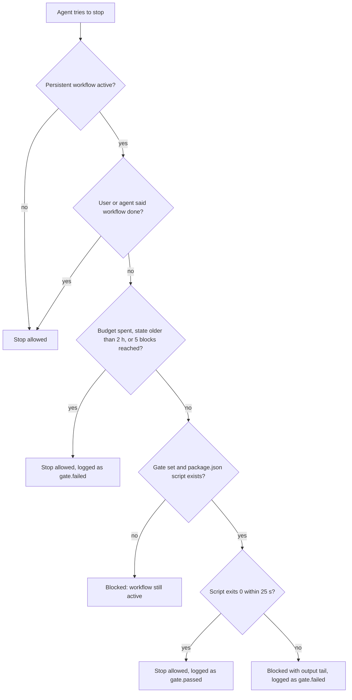

# oh-my-agent: Um Time de Especialistas para o Agente de Código Que Você Já Usa

[](https://www.npmjs.com/package/oh-my-agent) [](https://www.npmjs.com/package/oh-my-agent) [](https://github.com/first-fluke/oh-my-agent) [](https://github.com/first-fluke/oh-my-agent/blob/main/LICENSE) [](https://github.com/first-fluke/oh-my-agent/commits/main)

[English](../README.md) | [한국어](./README.ko.md) | [中文](./README.zh.md) | [日本語](./README.ja.md) | [Français](./README.fr.md) | [Español](./README.es.md) | [Nederlands](./README.nl.md) | [Polski](./README.pl.md) | [Русский](./README.ru.md) | [Deutsch](./README.de.md) | [Tiếng Việt](./README.vi.md) | [ภาษาไทย](./README.th.md)

**O oh-my-agent (`oma`) é um harness independente de vendor que adiciona um time de especialistas ao agente de código que você já usa: Claude Code, Codex CLI, Cursor e mais 11.** Um planejador quebra o trabalho em partes, engenheiros constroem em paralelo, um revisor confere o resultado e um depurador corrige as causas raiz. Ele também faz pesquisa com fontes citadas, apresentações, vídeos e imagens. A maioria das etapas deixa um arquivo que você pode abrir e, nos workflows de longa duração, um gate pode mandar o agente de volta ao trabalho até que o seu próprio script `test`, `lint` ou `typecheck` passe.

[](./assets/architecture/oh-my-agent-architecture.svg)

Execute isto na raiz do seu projeto:

```bash
curl -fsSL https://raw.githubusercontent.com/first-fluke/oh-my-agent/main/cli/install.sh | bash
```

Depois execute `oma doctor` e digite `/plan add user accounts with a settings page` no seu agente. [Seus primeiros 5 minutos](#your-first-5-minutes) mostra o passo a passo.

## O que você ganha

**Workflows** são o que você digita (ou simplesmente diz). Eles convocam os **papéis**, os especialistas. **Skills** são o know-how: cada papel traz as suas, e o seu agente carrega as demais sempre que uma tarefa precisa delas.

| | O que oferece | Experimente |
|---|---|---|
| **12 papéis especialistas** | PM, arquiteto, engenheiros de backend, frontend, mobile, banco de dados e infra, revisor de QA, depurador, refatorador, curador de docs, pesquisador ([conheça o time](#meet-the-team)) | `/orchestrate build a TODO app with login` |
| **21 workflows** | Slash commands de `/brainstorm` e `/plan` até `/review`, `/debug` e `/scm`. A maioria também começa a partir de um pedido em linguagem natural (bancos de palavras-chave em até 11 idiomas) | "review this PR" |
| **33 skills** | Know-how de domínio que só é carregado quando uma tarefa precisa: UI, APIs, schemas, Terraform, CI, segurança, git, observabilidade | carrega sozinha, por exemplo "add a Terraform S3 bucket" |
| **Arquivos que você pode abrir** | Planos, design docs, contratos de API, ADRs, notas de bug, resultados por agente, evidências de segurança, explicadores HTML, recaps | `ls .agents/results` |
| **Verificações de workflows** | Em workflows de longa duração, seu próprio script `test`, `lint` ou `typecheck` precisa passar antes que o agente possa parar. `oma ralph verify` confere se uma execução do `/ralph` deixou os arquivos de plano, QA e refactor | `/ultrawork …`, depois `oma goal set --gate test` |
| **Pesquisa e conteúdo** | Busca com fontes citadas, pesquisa de mercado, artigos acadêmicos, apresentações, vídeos MP4, imagens, voz local, PDF/HWP para Markdown | `/video`, `/convert` |
| **Uma pasta, 14 runtimes** | Um único diretório `.agents/` portátil, gravado nos próprios arquivos de configuração de cada runtime | `oma link cursor` |

**[Instalação](#install)** · **[Primeiros 5 minutos](#your-first-5-minutes)** · **[O time](#meet-the-team)** · **[Qual workflow?](#how-the-team-works-together)** · **[Tudo o que vem na caixa](#everything-in-the-box)** · **[Funciona com](#works-with)** · **[Verificação](#verification-not-narration)** · **[FAQ](#faq)** · **[Docs](https://first-fluke.github.io/oh-my-agent/)**

<a id="install"></a>
## Instalação

O script instala o [bun](https://bun.sh) se ele estiver faltando, instala o comando `oma` globalmente (`bun install --global oh-my-agent`, etapa pulada quando `oma` já está no seu PATH) e então inicia a configuração interativa. O comando global é importante: os hooks (detecção de palavras-chave, o Stop gate) e vários workflows chamam `oma`, e os hooks simplesmente não fazem nada, sem aviso, quando não o encontram. Se você não usar o script, instale-o por conta própria com `bun install --global oh-my-agent` (`npm install --global oh-my-agent` ou `brew install oh-my-agent` também funcionam).

<details>
<summary>Windows, ou sem o script de instalação</summary>

```powershell
# Windows (PowerShell)
irm https://raw.githubusercontent.com/first-fluke/oh-my-agent/main/cli/install.ps1 | iex
```

```bash
# Qualquer OS com bun instalado: a mesma configuração, mais o comando global `oma`
bun install --global oh-my-agent
oma
```

No Windows, o instalador oculta Antigravity, Hermes e Kimi, e o wrapper de hooks é um script bash. O browser MCP padrão, Aside, é instalado via `bash`, então desmarque-o se você não tiver bash.

</details>

A configuração pergunta o idioma das respostas, quais runtimes de agente conectar, os provedores de capacidade, um browser MCP, um preset de modelos e um preset de skills. **Escolha `All` no preset de skills se estiver em dúvida**: os workflows são sempre instalados, e vários deles (`/orchestrate`, `/work`, `/ultrawork`, `/ralph`, `/docs`, `/security`) precisam de skills que só o `All` inclui.

<details>
<summary>O que o instalador também faz por padrão</summary>

- Instala o **bun** (obrigatório). Tenta instalar **uv**, **Serena** (`uv tool install`) e **CUE** (`brew install cue` ou `winget`), e segue com um aviso se algum deles falhar.
- Pré-seleciona o browser MCP **Aside** na configuração interativa e só o instala com `curl -fsSL https://releases.aside.com/install.sh | bash` se você o mantiver selecionado. Desmarque-o na etapa de browser MCP ou troque depois com `oma update mcp`.
- Usa o **AgentMemory** para memória semântica, o que executa `bun install -g @agentmemory/agentmemory` e o registra como serviço de login (launchd, unidade de usuário do systemd ou tarefa agendada do Windows). Escolha o provedor `none` ou defina `OMA_NO_AGENTMEMORY=1` para pular essa etapa.
- Pergunta antes de vincular skills às pastas de vendors no seu diretório home (Antigravity, Hermes, Kimi). Em `$HOME` sem `--global`, ele pede confirmação.
- Grava alguns arquivos fora do projeto sem perguntar: `~/.claude.json` (marca o projeto como workspace confiável do Claude Code), `~/.serena/` (contexto do OMA, tamanho mínimo de resposta, registro do projeto), `~/.cursor/cli-config.json` (desativa a atribuição de commits do Cursor), `~/.grok/config.toml` (telemetria) e `~/.gemini/antigravity-cli/` (HUD), cada um só para um vendor que você selecionou.
- Grava **opt-outs de telemetria** nas configurações dos vendors (Claude `DISABLE_TELEMETRY=1`, que também desativa o Claude Code Remote Control; estatísticas de uso de Gemini, Qwen, Codex e Grok). Defina `telemetry: true` para manter os padrões dos vendors.
- Adiciona ao `.claude/settings.json` as configurações do Claude Code ainda não definidas, incluindo `skipDangerousModePermissionPrompt: true`, `effortLevel: high`, `cleanupPeriodDays: 180` e flags de env que desativam auto memory, adaptive thinking, relatório de erros e as instruções de git embutidas. Os valores que você já definiu são mantidos.
- Adiciona um **trailer de coautoria**: a atribuição de commits do Claude Code passa a ser `Co-Authored-By: First Fluke <our.first.fluke@gmail.com>` e os PRs recebem uma linha "Generated with oh-my-agent". Defina `scm.co_author.enabled: false` para desativar.
- Instala em `.githooks/` uma **guarda de commit-msg** que rejeita endereços `Co-authored-by` fora da lista e define `git config --local core.hooksPath .githooks` quando nenhum outro hook está ativo. Defina `scm.co_author.enforce_hook: false` para desativar.
- `oma update` atualiza a CLI `oma` em segundo plano (`auto_update_cli: false` ou `OMA_SKIP_VERSION_CHECK=1` para interromper) e executa `uv tool upgrade serena-agent --prerelease=allow` (`serena.auto_update: false`).
- Com o Serena no modo `bridge` padrão, a primeira sessão de agente que inicia um servidor Serena compartilhado registra um **timer de limpeza** que para os servidores Serena compartilhados ociosos a cada 5 minutos (launchd `dev.oma.serena-daemon-gc`, timer de usuário do systemd `oma-serena-daemon-gc.timer` ou tarefa agendada do Windows `OMA Serena Daemon GC`). Defina `serena.mode: stdio` para dispensar o servidor compartilhado e o timer. `oma uninstall` não remove o timer.
- Execuções não interativas (`-y`, `OMA_YES=1`, `CI=true`) usam o preset de skills `All`, `model_preset: auto` e Python como linguagem de backend. Elas não selecionam nenhum browser MCP (e pulam o script de instalação do Aside), a menos que `mcp.devtools_browsers` já liste um.

</details>

<details>
<summary>Presets de skills</summary>

| Preset | Skills |
|--------|--------|
| **All** | **Todas as 33 skills** (recomendado) |
| Fullstack | architecture, backend, brainstorm, db, debug, design, dev-workflow, frontend, mobile, pm, qa, scm, tf-infra |
| Fullstack Web | Fullstack sem mobile e tf-infra |
| Fullstack Mobile | Fullstack sem frontend e tf-infra |
| Frontend | architecture, brainstorm, debug, design, frontend, pm, qa, scm |
| Backend | architecture, backend, brainstorm, db, debug, dev-workflow, pm, qa, scm |
| Mobile | architecture, brainstorm, debug, mobile, pm, qa, scm |
| DevOps | architecture, brainstorm, debug, dev-workflow, observability, pm, qa, scm, tf-infra |
| Research | academic-writing, hwp, market, pdf, scholar, scm, search, translation |
| Content | academic-writing, design, image, scm, translation, voice |
| Custom | Escolha as skills uma a uma |

Dos presets nomeados, só o `All` inclui coordination, orchestration, docs, security, refactor, explanation, recap, video, slide e skill-creation (ou escolha-as em `Custom`). Research e Content não têm as skills por trás de `/plan`, `/review`, `/debug`, `/architecture` e `/brainstorm`. Veja [Workflows que precisam de skills fora de um preset](../web/docs/getting-started/installation.md#workflows-that-need-skills-outside-a-preset).

</details>

<a id="your-first-5-minutes"></a>
## Seus primeiros 5 minutos

1. **Instale** com o comando acima.
2. **Confira a instalação:**

   ```bash
   oma doctor
   ```

   Você deve ver `CLI Status` (quais CLIs de agente estão instaladas e autenticadas) e `Skills Status` (por exemplo `Skills (33/33 installed, 33 complete)`). Se `oma` não for encontrado, abra um novo terminal (o instalador pode ter acabado de adicionar `~/.bun/bin` ao seu PATH) ou execute `bun install --global oh-my-agent`.
3. **Abra seu agente no projeto e peça um plano:**

   ```text
   /plan add user accounts with a settings page
   ```

   Ou simplesmente escreva "plan user accounts with a settings page": em runtimes com prompt hook, a palavra-chave inicia o mesmo workflow.
4. **Confira o que você recebeu.** O `/plan` roda na sessão atual. Para trabalhos que envolvem várias áreas, como este, ele grava `.agents/results/plan-<session-id>.json` e um tracker em `docs/plans/work/<NNN>-<name>.md`. Um pedido pequeno, de uma única área, recebe uma recomendação direta em vez de um arquivo de plano.

Com esses passos, você terá um plano inicial. Para continuar, use `/work` ou `/orchestrate` com esse plano.

<a id="meet-the-team"></a>
## Conheça o time

O seu próprio agente lidera o time. No `/work`, no `/orchestrate` e no `/ultrawork`, ele entrega cada tarefa ao especialista certo, que roda como um subagente próprio. `/plan`, `/architecture` e `/docs` rodam na sua sessão atual com a skill desse papel, e `/review` e `/debug` chamam o especialista deles quando o escopo é grande. Quando um papel está na CLI de outro vendor, `oma agent spawn` o executa lá.

| Seu especialista | Carrega | Chame com | Deixa para trás |
|---|---|---|---|
| **Product manager** (`pm-planner`) | oma-pm | `/plan`, ou "plan the payment feature" | Um JSON de plano e um tracker em `docs/plans/work/` para trabalhos médios e complexos (pedidos simples recebem uma recomendação direta) |
| **Arquiteto** (`architecture-reviewer`) | oma-architecture | `/architecture` | Um ADR ou uma recomendação em `.agents/results/architecture/` |
| **Engenheiros de backend, frontend, mobile, banco de dados e infra** | oma-backend, oma-frontend + oma-design, oma-mobile, oma-db, oma-tf-infra | `/work`, `/orchestrate` | Código, testes e um arquivo `result-<agent>` por tarefa |
| **Revisor de QA** (`qa-reviewer`) | oma-qa | `/review`, ou "review this PR" | Achados classificados de CRITICAL a LOW, cada um com file:line e código de correção |
| **Depurador** (`debug-investigator`) | oma-debug | `/debug`, ou "fix this bug" | Uma correção mínima, um teste de regressão e uma nota de bug em `.agents/results/bugs/` quando fizer sentido |

<details>
<summary>Os outros três papéis, e as skills sem papel</summary>

| Seu especialista | Carrega | Chame com | Deixa para trás |
|---|---|---|---|
| **Refatorador** (`refactor-engineer`) | oma-refactor | a fase REFINE do `/ultrawork` | Commits `refactor:` que preservam o comportamento e um relatório `result-refactor-<session>.md` |
| **Curador de docs** (`docs-curator`) | oma-docs | `/docs`, ou "verify docs" | `docs/generated/doc-refs.json` e os patches de documentação que você aprovar |
| **Pesquisador** (`research-explorer`) | oma-search, oma-market, oma-scholar | um pedido de pesquisa | Fontes citadas com rótulos de confiabilidade; briefings de mercado em `.agents/results/market/` |

O engenheiro de infra (`tf-infra-engineer`) é instruído a perguntar antes de qualquer `apply` ou `destroy` destrutivo ou em produção. As demais skills (brainstorm, security, scm, dev-workflow, observability, explanation, recap, translation, coordination, orchestration, skill-creation, conteúdo e mídia) não têm um papel dedicado. O seu agente as carrega por conta própria e, para a maioria delas, o skill injector sugere a skill certa a partir do seu prompt.

</details>

<a id="how-the-team-works-together"></a>
## Como o time trabalha junto

```text
 THINK   /brainstorm ......................... docs/plans/designs/<NNN>-<feature>.md
 PLAN    /plan · /architecture ............... plan JSON, API contracts, ADR
 DESIGN  /design ............................. DESIGN.md + tokens
 BUILD   /work · /orchestrate · /ultrawork ... code + result-<agent> files, engineers in parallel
 CHECK   /review · /security · /debug ........ findings, security evidence, regression test
 SHIP    /scm · /docs ........................ Conventional Commits, doc fixes
```

Cada etapa passa um arquivo para a seguinte. O `/brainstorm` salva um design que o `/plan` lê, e o `/plan` grava um plano em que cada tarefa tem um agente, dependências, critérios de aceitação e um comando de checagem. O `/orchestrate` executa esse plano (ele carrega o `plan-*.json` mais recente, ou grava um). O `/work` e o `/ultrawork` começam pedindo ao PM que escreva o próprio plano. Pule qualquer etapa de que você não precise; cada etapa também funciona sozinha.

**Qual workflow deve comandar o time?**

| Você quer | Execute | Como termina |
|---|---|---|
| Só um plano | `/plan` | Um arquivo de plano para trabalho em várias áreas, ou uma recomendação direta para trabalho pequeno |
| Uma build liderada pelo PM que você acompanha passo a passo | `/work` | PM, depois os engenheiros camada por camada, depois QA. Achados CRITICAL e HIGH entram em um loop de correção (até 5 ciclos) |
| Uma build em paralelo sem intervenção | `/orchestrate` | Só contam como concluídas as tarefas cujas checagens passam; cada tarefa tem até 3 tentativas e depois é marcada como parcial ou com falha |
| Cuidado máximo | `/ultrawork` | Cinco fases com gates (PLAN, IMPL, VERIFY, REFINE, SHIP); cada revisão roda em uma sessão de revisor nova |
| "Não pare até estar realmente pronto" | `/ralph` | Repete o `/ultrawork` com um juiz de contexto novo disparado separadamente até que todos os critérios passem; para com um relatório parcial quando há critérios bloqueados ou depois de 5 iterações |
| O time em um agendamento | `oma schedule create qa-reviewer "review open PRs" --every 2h` | Um log em Markdown por execução em `~/.oma/schedule/runs/<id>/` |

Os slash commands são opcionais. Em runtimes com prompt hook, pedidos em linguagem natural (bancos de palavras-chave em até 11 idiomas) podem iniciar a maioria dos workflows: "review this PR" inicia o `/review`. Descrever um app inteiro ("Build a TODO app with user authentication") sugere o `/orchestrate`, e o seu agente decide se vai executá-lo. Palavras-chave dentro de blocos de código são ignoradas.

`/orchestrate`, `/work`, `/ultrawork` e `/ralph` são **persistentes** quando você os invoca pelo nome, como slash command ou em texto simples ("ultrawork: add rate limiting"). A partir daí, o agente é mandado de volta ao trabalho quando tenta parar antes da hora (até 5 vezes ou 2 horas), até você dizer **"workflow done"**. Um pedido que só corresponde de forma aproximada apenas os sugere.

O [benchmark](../benchmarks/README.md) usou um prompt, Claude Code com cinco configurações de complementos incluindo a versão base, `claude-opus-4-6` e uma build por configuração. O oma marcou 80,6 contra 70,7 do Claude Code sem complementos. O custo foi de US$ 4,04 contra US$ 2,37 (1,7 vez mais); o tempo foi 1,8 vez maior.

<details>
<summary>Todos os 21 workflows</summary>

| Comando | O que faz |
|---------|--------------|
| `/architecture` | Pesa trade-offs de design e produz uma recomendação, revisão ou ADR |
| `/brainstorm` | Explora ideias e restrições e produz um design aprovado antes do planejamento |
| `/convert` | Converte PDF/HWP para Markdown, ou transcodifica imagens, vídeo e áudio com ffmpeg |
| `/debug` | Reproduz um bug, corrige a causa raiz, escreve um teste de regressão e procura padrões semelhantes |
| `/deepinit` | Mapeia uma base de código existente em AGENTS.md, ARCHITECTURE.md e uma base de conhecimento em docs/ |
| `/design` | Monta um design system, DESIGN.md e tokens com checagens de acessibilidade |
| `/docs` | Encontra referências quebradas na documentação e propõe patches para os docs que um diff afetou |
| `/explain` | Transforma um diff, PR, branch ou tema em um explicador HTML interativo e autônomo |
| `/orchestrate` | Roda agentes em paralelo, coordena-os por estado em arquivo e verifica o resultado (persistente) |
| `/plan` | Quebra uma feature em tarefas priorizadas com contratos de API |
| `/ralph` | Repete `/ultrawork` com um juiz disparado separadamente, até 5 iterações (persistente) |
| `/recap` | Resume seu histórico de conversas com IA de um dia ou período |
| `/review` | Revisa segurança (OWASP Top 10), performance, acessibilidade (WCAG 2.2 AA) e qualidade de código |
| `/schedule` | Registra um job de agente que roda em intervalos recorrentes |
| `/scm` | Cuida de branches, merges, conflitos, worktrees e Conventional Commits |
| `/security` | Varre código-fonte, skills de agentes e componentes MCP, valida os achados e configura gates de CI |
| `/stack-set` | Detecta sua stack e gera referências específicas dela para as skills de domínio |
| `/tools` | Lista, habilita e desabilita ferramentas MCP em linguagem natural |
| `/ultrawork` | Cinco fases (PLAN, IMPL, VERIFY, REFINE, SHIP), cada revisão em uma sessão de revisor nova (persistente) |
| `/video` | Transforma um briefing em um MP4 finalizado por um pipeline que funciona mesmo sem chaves |
| `/work` | Coordena vários agentes em um projeto multidomínio com planejamento de PM e revisão de QA (persistente) |

`oma verify triggers` avalia a precisão da detecção com um corpus rotulado de 212 prompts em inglês e coreano. O CI falha se false-fire passar de 10% ou missed-fire passar de 20%. Na última medição, os valores foram **0% de missed-fire e 5,3% de false-fire**. Referência completa: [Workflows](https://first-fluke.github.io/oh-my-agent/docs/core-concepts/workflows/).

</details>

<a id="see-it-work"></a>
## Veja funcionando

Uma sessão ilustrativa de `/ultrawork`. O bloco `[OMA PERSISTENT MODE: ULTRAWORK]` é o formato exato que o Stop hook imprime; as demais linhas são paráfrases:

```text
you    /ultrawork add rate limiting to POST /login
agent  runs `oma goal set --gate test`
agent  PLAN writes .agents/results/plan-<run-id>.json
agent  IMPL -> VERIFY -> REFINE -> SHIP  (each review runs in a fresh reviewer session)
agent  "Rate limiting added. All tests pass."
oma    [OMA PERSISTENT MODE: ULTRAWORK]
       Stop gate 'test' FAILED (reinforcement 1/5).
       Fix the failures below, then finish the workflow — the stop is allowed only when the gate passes.
       --- gate output (tail) ---
       FAIL  src/auth/login.test.ts > returns 429 after 5 attempts
       To abandon instead: delete .agents/state/ultrawork-state-<host-session>.json or say "workflow done".
agent  fixes the limiter and stops again
oma    `test` exits 0: stop allowed, gate.passed appended to the session log
```

Depois, `oma state list` encontra a sessão e `oma state get <oma-sid>` (o ID que o `state list` imprime) mostra cada evento de gate. No `/ralph`, `oma ralph verify --json` também confere se as fases deixaram seus arquivos para trás (saída resumida):

```json
{ "ok": false,
  "missing": [{ "id": "A3", "description": "a distinct QA agent ran (VERIFY phase)",
                "pattern": ".agents/state/memories/result-qa*.md or .agents/results/result-qa*.md",
                "status": "missing" }] }
```

<a id="everything-in-the-box"></a>
## Tudo o que vem na caixa

<details>
<summary><strong>Planejar e projetar</strong>: <code>/brainstorm</code>, <code>/plan</code>, <code>/architecture</code>, <code>/design</code></summary>

| Comando | O que faz | Grava |
|---|---|---|
| `/brainstorm` | Faz uma pergunta de esclarecimento por vez e propõe 2-3 abordagens que funcionam de maneiras diferentes, depois passa o bastão para o `/plan`. Não escreve código | `docs/plans/designs/<NNN>-<feature>.md` |
| `/plan` | Classifica o trabalho como simples, médio ou complexo; para trabalho médio e complexo, divide-o em tarefas, cada uma com um agente, dependências, critérios de aceitação e um comando de checagem, e define contratos de API quando o trabalho cruza uma fronteira | `.agents/results/plan-<sid>.json`, `docs/plans/work/<NNN>-<name>.md`, contratos em `.agents/results/api-contracts/` quando necessário |
| `/architecture` | Lê primeiro as decisões anteriores, compara pelo menos 2 opções e marca como superseded os ADRs substituídos | Um ADR ou uma recomendação em `.agents/results/architecture/` |
| `/design` | Propõe 2-3 direções, depois grava o `DESIGN.md` com tokens e audita o layout responsivo e a acessibilidade | `DESIGN.md`, tokens CSS/Tailwind/shadcn |

</details>

<details>
<summary><strong>Construir</strong>: 7 skills de domínio, mais o <code>/stack-set</code> para ajustá-las à sua stack</summary>

| Skill | Constrói |
|---|---|
| oma-frontend | UI em React/Next.js ou Angular que segue seus tokens e suas regras de i18n e acessibilidade |
| oma-backend | APIs, autenticação e acesso a dados, em camadas router → service → repository |
| oma-mobile | Apps em Flutter, React Native ou Swift |
| oma-db | Schemas, migrations, tuning de queries, planos de recuperação vetorial/RAG |
| oma-tf-infra | Terraform para qualquer nuvem, apontando riscos de drift, de mudanças destrutivas e de custo |
| oma-dev-workflow | Tasks do mise, lint/format/typecheck, commitlint, git hooks, CI/CD e releases |
| oma-observability | OpenTelemetry, SLOs, alertas e forense de incidentes |

O `/stack-set` lê seus manifests e grava referências específicas da stack para as skills de backend, frontend e mobile. Em um monorepo, os engenheiros de frontend, backend e mobile são direcionados ao workspace de cada um (pnpm, workspaces de npm/yarn/bun, lerna, nx, turbo, `mise.toml`).

</details>

<details>
<summary><strong>Revisar, corrigir e entregar</strong>: <code>/review</code>, <code>/security</code>, <code>/debug</code>, refactor, <code>/scm</code></summary>

| Comando ou skill | O que faz | Grava |
|---|---|---|
| `/review` | Uma auditoria de dependências, depois OWASP Top 10, performance, WCAG 2.2 AA e qualidade de código. Cada achado vem com file:line e código de correção | O relatório no chat mais um registro em memória; nenhum arquivo de relatório |
| `/security` | Varre seu código-fonte, skills de agentes e servidores MCP (Deepsec, Cisco Skill and MCP Scanner) e, se houver um deploy de teste com escopo definido, roda pen tests do ARTEX. O workflow exige que um motor que não conseguiu rodar seja reportado como falho, não como limpo | `.agents/results/security/<run-id>/` |
| `/debug` | Reproduz a falha, corrige a causa raiz com uma mudança mínima, adiciona um teste de regressão e procura o mesmo padrão em outros lugares | A correção e o teste; uma nota de bug em `.agents/results/bugs/` quando fizer sentido |
| oma-refactor | Muda a estrutura sem mudar o comportamento: primeiro testes de caracterização, depois commits apenas de refactor | `.agents/results/refactor/` |
| `/scm` | Conventional Commits divididos por mudança lógica; branches, merges, rebases e worktrees | Commits e branches |

</details>

<details>
<summary><strong>Docs e conhecimento</strong>: <code>/deepinit</code>, <code>/docs</code>, <code>/explain</code>, <code>/recap</code>, tradução</summary>

| Comando ou skill | O que faz | Grava |
|---|---|---|
| `/deepinit` | Transforma um repositório existente em uma base de conhecimento pronta para agentes | `AGENTS.md`, `ARCHITECTURE.md`, `docs/` |
| `/docs` | Encontra referências quebradas, aplica patches nos docs que um diff afetou (só os patches que você aprovar) e encontra traduções desatualizadas | `docs/generated/doc-refs.json`, docs corrigidos |
| `/explain` | Transforma um PR, branch ou mudança em staging em um walkthrough HTML com um quiz de 5 perguntas, ou um tema em um explicador visual de uma página | `.agents/results/explain/<date>-<slug>.html` |
| `/recap` | Resume suas conversas com IA em todas as ferramentas, de um dia ou de um período | `.agents/results/recap/<date>.md` |
| oma-translation | Tradução que soa nativa; placeholders, código e chaves de locale ficam inalterados | Texto traduzido |

</details>

<details>
<summary><strong>Pesquisa</strong>: busca, mercado, artigos, escrita acadêmica</summary>

| Skill | O que faz | Grava |
|---|---|---|
| oma-search | Busca em docs, na web e em código, com um rótulo de confiabilidade em cada fonte | Resultados com fontes citadas |
| oma-market | Dores, tendências e concorrentes a partir de sinais de comunidade, estruturados com SWOT, as 5 Forças de Porter e PESTEL | `.agents/results/market/<topic>-<date>.md` |
| oma-scholar | Busca de artigos que lê um arquivo compacto de afirmações (formato Knows, cerca de 700 tokens) em vez do PDF completo (cerca de 10K tokens) | `<paper>.knows.yaml` |
| oma-academic-writing | Redige e audita prosa acadêmica com base em uma rubrica | Seu arquivo |

</details>

<details>
<summary><strong>Conteúdo e mídia</strong>: <code>/video</code>, <code>/convert</code>, slides, imagens, voz</summary>

| Comando ou skill | O que produz | Grava |
|---|---|---|
| `/video` | Shorts, explicativos ou demos como um MP4 finalizado; provedores que exigem chave têm alternativas sem chave | `.agents/results/videos/<run>/` com um manifest |
| oma-slide | Decks HTML em 1920×1080, exportados para PDF, PNG ou PPTX | `.agents/results/slides/<session>/` |
| oma-image | Imagens pelas CLIs de vendors em que você está autenticado, comparadas lado a lado | `.agents/results/images/<run>/` |
| oma-voice | Text-to-speech e transcrição locais pelo app Voicebox | `.agents/results/voice/<run>/` |
| `/convert` | PDF ou HWP para Markdown; conversão de imagem, vídeo e áudio via ffmpeg | Ao lado do arquivo de entrada |

Esses pipelines avisam quando falta uma fonte ou uma chave de vendor, em vez de devolver um resultado silenciosamente mais pobre.

</details>

<details>
<summary><strong>Hooks que rodam sem você pedir</strong></summary>

| Hook | O que faz | Como desligar / limite |
|---|---|---|
| Início por palavra-chave | Inicia o workflow correspondente a partir de um pedido em linguagem natural | Perguntas, texto colado e blocos de código são ignorados |
| Skill injector | Aponta para o seu agente as skills certas para o prompt | Pausado enquanto um workflow persistente está ativo |
| Stop gate | Manda um workflow persistente de volta ao trabalho; com `oma goal set --gate test`, a parada é liberada quando esse script sai com código 0 em até 25 s | Diga "workflow done"; ele também libera depois de 5 bloqueios ou 2 horas |
| Refactor guard | Na parada, sinaliza para o `refactor-engineer` os arquivos editados com mais de 500 linhas | Opt-in: `refactor_guard.enabled` |
| Secret guard | Bloqueia `git add` de `*.env`, `*.pem`, `id_rsa*`, `*.tfstate` e arquivos semelhantes | Prefixe só esse comando com `OMA_SCM_ALLOW_SECRETS=1` |
| Code-search guard | Bloqueia a busca recursiva nativa no projeto para que o agente use Serena ou Gortex | `providers.code_intelligence_guard: off` |
| Filtro de testes | Mantém só as falhas e os resumos da saída dos testes, para gastar menos tokens | `OMA_TEST_FILTER=0` |
| Memória de sessão | Quando você troca ou retoma uma sessão (ou depois de uma compactação), reinjeta os eventos recentes da sessão ativa mais o recall do AgentMemory | O provedor de memória `none` ou `OMA_NO_AGENTMEMORY=1` desliga o recall; o snapshot local de eventos continua |

`oma hook probe` confere se os prompt hooks do oma aceitam a entrada de hook de cada runtime (ele não inicia o runtime). Quais hooks cada runtime conecta está em [Diferenças entre hosts](#host-differences).

</details>

<details>
<summary><strong>Agentes em paralelo, sessões e dashboards</strong></summary>

- `oma agent spawn <role> "<task>" <sid>` executa um papel no Antigravity, Claude Code, Codex, Cursor, Grok, Kimi Code, Kiro, OpenCode, pi ou Qwen Code, com `--isolation worktree` e `--fallback-vendors`. `oma agent parallel` executa vários de uma vez. Esses 10 destinos de dispatch são um subconjunto das 14 integrações do instalador.
- `oma state list --all-projects` e `oma state get <sid>`: sessões e cada evento registrado.
- `oma dashboard terminal` / `oma dashboard web`: status dos agentes ao vivo (o dashboard web escuta apenas em `127.0.0.1`). [Guia do dashboard](../web/docs/guide/dashboard-monitoring.md).
- `oma stats get` (métricas de produtividade), `oma retro` (uma retrospectiva do git), `oma recap --window 7d` (o que você fez nas ferramentas de IA).
- `oma visualize --affected <paths>`: quais skills, workflows, agentes e checagens dependem dos arquivos de `.agents/` que você alterou.

</details>

<details>
<summary><strong>Code intelligence, memória e MCP</strong></summary>

| Slot | Padrão | Alternativas |
|---|---|---|
| Docs | Context7 | — |
| Busca na web | Busca nativa do runtime | Brave Search |
| Code intelligence | Serena, um servidor compartilhado por projeto | Gortex (experimental) |
| Memória semântica | AgentMemory | Honcho (experimental), none |
| Browser MCP | Aside | Chrome DevTools, Firefox DevTools |

Serena fornece navegação de código e diagnósticos baseados em LSP, incluindo retorno sobre edições nativas quando houver suporte. A seleção do provedor é independente do runtime do agente; os recursos variam conforme o provedor e o host.

Os agentes se coordenam por arquivos simples em `.agents/state/`, sem nenhum serviço externo. O `/tools` liga ou desliga ferramentas MCP em linguagem natural. Detalhes: [Provedores de Capacidade](./capability-providers.md).

</details>

<details>
<summary><strong>Melhorando com o tempo</strong></summary>

- `oma skill eval` mede o ganho de uma skill contra um baseline em tarefas held-out. `oma skill optimize` propõe edições que aumentam esse ganho, e `--apply` as mantém ([guia de skill-eval](../web/docs/guide/skill-eval.md)).
- `oma harness evolution enable --max-dispatches <n>` agenda um ciclo noturno que transforma execuções com falha em fixtures de regressão e aplica, como overlays do projeto, as melhorias de skills que passam na avaliação. Adicione `--mode propose` para apenas registrá-las.
- `oma emit` exporta o código-fonte de `.agents/` como um pacote de Agent Skills, um pacote de Agent Plugins, um marketplace de plugins do Claude Code ou `AGENTS.md`.

</details>

<details>
<summary><strong>Configuração e travas de segurança</strong></summary>

- Um único `.agents/oma-config.yaml`, de propriedade do usuário, sobrevive às atualizações (só `oma update --force` o redefine); overlays privados `.local.yaml` ou `.local.cue` podem ficar por cima dele. `language` define o idioma das respostas.
- 13 regras de projeto (backend, commit, database, debug, design e outras) são carregadas como regras nativas no Claude Code e no Cursor, e indexadas no bloco gerenciado do `AGENTS.md` gravado para Codex, Qwen Code e Pi.
- As atualizações mantêm backups de configuração e de migração em `.agents/backup/`; as skills e os workflows distribuídos são substituídos no lugar, então mantenha as mudanças locais fora deles. `oma uninstall --dry-run` mostra o que seria removido. `first-fluke/oma-update-action@v1` roda `oma update` no CI e abre um PR.

</details>

<details>
<summary><strong>Todas as 33 skills</strong></summary>

| Skill | O que faz |
|---|---|
| **oma-academic-writing** | Redige, revisa e audita prosa acadêmica |
| **oma-architecture** | Avalia trade-offs de arquitetura e define limites de módulos com análise ADR/ATAM/CBAM |
| **oma-backend** | Constrói APIs, autenticação e acesso a dados em Python, Node.js ou Rust |
| **oma-brainstorm** | Explora ideias com você antes de partir para a construção |
| **oma-coordination** | Orienta passo a passo a coordenação manual dos agentes de PM, frontend, backend, mobile e QA |
| **oma-db** | Projeta schemas, migrations, índices e vector stores |
| **oma-debug** | Encontra a causa raiz, corrige o bug e escreve um teste de regressão |
| **oma-design** | Constrói design systems com tokens, acessibilidade e layouts responsivos |
| **oma-dev-workflow** | Automatiza CI/CD, releases e tarefas de monorepo |
| **oma-docs** | Verifica referências quebradas na documentação, sincroniza-a com mudanças de código e sinaliza divergências de tradução |
| **oma-explanation** | Transforma um diff, PR, branch ou tópico em um explicador HTML autônomo, com quiz para mudanças de código |
| **oma-frontend** | Constrói UI em React/Next.js ou Angular |
| **oma-hwp** | Converte arquivos HWP, HWPX e HWPML para Markdown |
| **oma-image** | Gera imagens e variações guiadas por referência, e pode comparar provedores de IA lado a lado |
| **oma-market** | Pesquisa seu mercado a partir de sinais de comunidade e estrutura os resultados com SWOT, 5F e PESTEL |
| **oma-mobile** | Constrói apps mobile com Flutter, React Native ou Swift nativo |
| **oma-observability** | Roteia trabalho de observabilidade entre métricas, logs, traces, SLOs e forense de incidentes |
| **oma-orchestration** | Executa múltiplos agentes em paralelo via CLI |
| **oma-pdf** | Converte arquivos PDF para Markdown |
| **oma-pm** | Planeja tarefas, detalha requisitos e define contratos de API |
| **oma-qa** | Revisa mudanças quanto a correção, segurança OWASP, performance e acessibilidade |
| **oma-recap** | Resume seu histórico de conversas em resumos de trabalho por tema |
| **oma-refactor** | Refatora sem mudar o comportamento, com seleção de hotspots, testes de caracterização e commits só de refactor |
| **oma-scholar** | Busca literatura acadêmica e gera sidecars de artigos Knows com afirmações, evidências e revisão por pares |
| **oma-scm** | Gerencia branches, merges, worktrees e Conventional Commits |
| **oma-search** | Roteia cada consulta para a melhor fonte e pontua o quanto você pode confiar no resultado |
| **oma-security** | Varre código-fonte, skills de agentes e componentes MCP; testa aplicações web implantadas e valida achados |
| **oma-skill-creation** | Escreve e audita novas skills do OMA |
| **oma-slide** | Gera decks de apresentação HTML e exporta para PDF/PNG/PPTX |
| **oma-tf-infra** | Provisiona infraestrutura multi-cloud com Terraform |
| **oma-translation** | Traduz para que o resultado pareça escrito por um falante nativo |
| **oma-video** | Gera vídeos curtos, explicativos e demos por um pipeline HyperFrames que funciona mesmo sem chaves |
| **oma-voice** | Gera voiceovers e transcreve áudio no próprio dispositivo |

</details>

<a id="works-with"></a>
## Funciona com

14 alvos de instalação: Claude Code, Codex CLI, Cursor, Antigravity, Qwen Code, Grok, Kiro, Kimi, OpenCode, Pi, GitHub Copilot, Hermes, CommandCode e ZCode. Conecte um runtime que você pulou com `oma link <vendor>`. Os runtimes diferem nos hooks que oferecem; a matriz completa está em [Agentes Suportados](./SUPPORTED_AGENTS.md).

- **Orca IDE:** o [OMA for Orca](../integrations/orca/README.md) adiciona um painel lateral e ações na paleta de comandos (Orca 1.4.197+ com plugins experimentais).
- **DeepSeek Harness:** o [OMA for DeepSeek Harness](../integrations/dsh/README.md) conecta as checagens do OMA por meio de um plugin do Cordis. Ele precisa de `oma` no seu `PATH`.

<details>
<summary>Logos dos runtimes (alvos de instalação mais Amp e DeepSeek Harness)</summary>

nativo = o oma grava os próprios arquivos de configuração do runtime; adaptador = o oma também adiciona shims de hook ou de agente. O Amp lê `.agents/skills/` por conta própria e não é um alvo de instalação.

<table>
<colgroup>
<col span="6" style="width:16.67%" />
</colgroup>
<tr>
<td align="center">
<a href="https://claude.com/product/claude-code"></a><br/>
<strong>Claude Code</strong><br/>
<sub>nativo + adaptador</sub>
</td>
<td align="center">
<a href="https://github.com/openai/codex"></a><br/>
<strong>Codex CLI</strong><br/>
<sub>nativo + adaptador</sub>
</td>
<td align="center">
<a href="https://antigravity.google"></a><br/>
<strong>Antigravity</strong><br/>
<sub>SSOT nativo</sub>
</td>
<td align="center">
<a href="https://cursor.com"></a><br/>
<strong>Cursor</strong><br/>
<sub>nativo + adaptador</sub>
</td>
<td align="center">
<a href="https://github.com/QwenLM/qwen-code"></a><br/>
<strong>Qwen Code</strong><br/>
<sub>dispatch nativo</sub>
</td>
<td align="center">
<a href="https://github.com/deepseek-ai/deepseek-harness"></a><br/>
<strong>DeepSeek Harness</strong><br/>
<sub>Cordis plugin</sub>
</td>
</tr>
<tr>
<td align="center">
<a href="https://pi.dev/"></a><br/>
<strong>Pi</strong><br/>
<sub>compatível nativamente</sub>
</td>
<td align="center">
<a href="https://github.com/anomalyco/opencode"></a><br/>
<strong>OpenCode</strong><br/>
<sub>compatível nativamente</sub>
</td>
<td align="center">
<a href="https://ampcode.com"></a><br/>
<strong>Amp</strong><br/>
<sub>lê .agents/skills</sub>
</td>
<td align="center">
<a href="https://github.com/features/copilot"></a><br/>
<strong>GitHub Copilot</strong><br/>
<sub>skills via symlink</sub>
</td>
<td align="center">
<a href="https://grok.x.ai"></a><br/>
<strong>Grok Build</strong><br/>
<sub>hooks nativos</sub>
</td>
<td align="center">
<a href="https://kiro.dev"></a><br/>
<strong>Kiro CLI</strong><br/>
<sub>hooks nativos + agentes</sub>
</td>
</tr>
</table>

<p align="center"><sub><a href="./SUPPORTED_AGENTS.md">& mais</a></sub></p>

</details>

<a id="host-differences"></a>
<details>
<summary>Diferenças entre hosts: quais runtimes têm detecção de palavras-chave e o Stop gate</summary>

| Runtime | Detecção de palavras-chave | Stop gate |
|---|---|---|
| Claude Code, Codex CLI, Qwen Code, Grok, Kimi | sim | sim |
| Cursor | sim | sim (volta como mensagem de follow-up) |
| Antigravity | sim | sim (roda os handlers via bun, não pelo wrapper `oma`) |
| OpenCode, Pi | sim | best-effort (o Pi precisa de uma build com `agent_settled`) |
| Kiro | sim | não: o Kiro ignora a saída do Stop hook |
| CommandCode | sem prompt hook | sim |
| GitHub Copilot, Hermes, ZCode | sem hooks | sem hooks |

</details>

<a id="per-agent-models"></a>
<details>
<summary>Modelos por agente</summary>

O `model_preset` em `.agents/oma-config.yaml` escolhe qual modelo cada papel de agente usa. O padrão, `auto`, segue as próprias configurações de agente e de modelo do runtime em execução.

```yaml
language: en
model_preset: auto   # auto | free | antigravity | claude | codex | cursor | kiro | mixed | qwen | <custom_presets key>

# Optional per-agent overrides; they win over the preset
agents:
  backend: { model: openai/gpt-6.1-terra, effort: high }
```

- `mixed` usa Claude para orquestrador, arquitetura, QA, PM e docs, e o `gpt-6.1-terra` do Codex para os papéis de implementação, então precisa tanto do Claude Code quanto do Codex CLI.
- `free` passa por um gateway FreeLLMAPI e precisa de `FREELLM_API_KEY` e de um servidor em execução.
- `kiro` não aparece no menu do instalador; defina-o no arquivo de configuração.
- `oma doctor --profile` imprime o modelo resolvido para cada papel.
- Guia completo: [Modelos por agente](https://first-fluke.github.io/oh-my-agent/docs/guide/per-agent-models/)

</details>

<a id="verification-not-narration"></a>
## Verificações e evidências

O oh-my-agent confere os artefatos dos workflows. [Veja funcionando](#see-it-work) mostra um exemplo do Stop gate.

A OMA também registra metadados de chamadas de ferramentas e resumos dos payloads para execuções rastreadas do harness Claude Code e Codex, distingue o uso de tokens informado das estimativas e avalia regressões de skills. Essas funções +1 abrangem as camadas; a cobertura de rastros varia conforme o runtime e a execução.

Com exceção do juiz baseado em prompt, as checagens mecânicas usam códigos de saída (0 indica sucesso) e verificam se os arquivos necessários estão presentes. Elas não perguntam a um LLM se o trabalho parece correto.

| Mecanismo | O que ele confere | Fonte |
|-----------|----------------|--------|
| **Stop-hook gate** | Durante um workflow persistente, `oma goal set --gate test` (ou `lint`, `typecheck`) só libera a parada quando esse script do package.json sai com código 0 em até 25 s. | [`persistent-mode.ts`](../.agents/hooks/core/persistent-mode.ts) |
| **Gate de artefatos** | `oma ralph verify --json` procura os registros de fase, o JSON do plano e os arquivos de resultado de um **agente de QA distinto** e de um **agente de refactor distinto**, cada um vinculado a execuções de agente registradas. | [`ralph.md`](../.agents/workflows/ralph.md) |
| **Juiz baseado em prompt** | Não é mecânico: o prompt do `/ralph` instrui o orquestrador a disparar um juiz de contexto novo que reverifica **cada** critério a cada iteração. Nada confere se o disparo aconteceu. | [`judge-protocol.md`](../.agents/workflows/ralph/resources/judge-protocol.md) |
| **Event log** | Em uma sessão do OMA, gates aprovados, gates reprovados e decisões acrescentam, cada um, uma linha JSON ao `events.jsonl` da sessão. | [`state-core.ts`](../.agents/hooks/core/state-core.ts) · [`event-spec.md`](../.agents/skills/_shared/runtime/event-spec.md) |
| **Checagens por agente** | `oma verify agent <type>` roda Scope Check, Charter Preflight, Hardcoded Secrets, TODO/FIXME Comments, Declared outputs e TDD Evidence, além de checagens por tipo, como TypeScript, Any Types, SQL Injection e testes. | `oma verify agent --help` |

> O Stop hook registra os eventos de gate na sessão do OMA aberta quando o workflow persistente começou. A gravação de eventos é best-effort. Se essa sessão não pôde ser criada (o stderr mostra `[oma] L1 session activation failed`), um gate que falha continua bloqueando a parada, mas nenhuma linha `gate.failed` é gravada. Antes de confiar no rastro, ou de mostrá-lo numa demo, confira se `oma state list` mostra uma sessão ativa; `oma state get <sid>` então mostra os eventos dela.

<details>
<summary>Limites, detalhes e como o Stop hook decide</summary>

**Limites do Stop gate:**

- O Stop gate vale só para os workflows persistentes (`/orchestrate`, `/work`, `/ultrawork`, `/ralph`). Sem `oma goal set --gate`, ele apenas pede de novo ao agente que continue. O `/ultrawork` instrui o agente a definir um gate quando o projeto tem uma checagem barata, mas nada impõe isso. Rode `oma goal set --gate test` você mesmo se quiser ter certeza; os outros workflows persistentes nunca definem um.
- Só as palavras-chave `typecheck`, `test` e `lint` são aceitas, e elas rodam o script do package.json com esse nome. Sem package.json, ou sem script com esse nome, o gate não roda. Projetos que não são JS precisam de um script wrapper no package.json.
- O bloqueio é liberado e registrado como falha depois de 5 reforços, 2 horas ou quando o `--budget-minutes` se esgota.
- Orçamentos: `session.quota_cap` limita tokens, número de spawns e tokens por vendor; o orquestrador recusa o próximo spawn quando alguma dimensão estoura.

**Gate de artefatos.** A ausência de um artefato significa que a execução da fase não foi comprovada. A checagem de refactor também passa como `skip-recorded` quando o log da sessão registra um motivo para pular o REFINE.

**Juiz baseado em prompt.** O prompt do `/ralph` instrui o orquestrador a iniciar o juiz como agente separado, com contexto novo e apenas os critérios. O juiz deve reverificar todos os critérios em cada iteração, inclusive os que já passaram, porque corrigir um critério pode fazer outro regredir. `oma ralph verify` aplica o gate somente aos artefatos de EXEC; não verifica se o juiz foi iniciado. Se um runtime não puder iniciar subagentes, deve julgar inline e registrar `ralph.judge-inline-fallback`. O `/ralph` para depois de 5 iterações com um relatório parcial.

**Event log.** Encontre a sessão com `oma state list` e leia-a com `oma state get <sid>`. Cada evento é carimbado com o vendor e o id de sessão do runtime. A localização do arquivo depende de `OMA_HOME`, `OMA_STATE_HOME`, `OMA_PROFILE` e das antigas pastas de sessão dentro do projeto, então não use um caminho hardcoded.

**Checagens por agente.** Tipos: `backend`, `frontend`, `mobile`, `qa`, `debug`, `pm`. O comando sai com código 1 quando qualquer checagem falha; TODO/FIXME Comments e Inline Styles apenas emitem aviso.

<!-- Stack manifests in this list are optional outputs of /stack-set, not shipped files. -->
<!-- oma-docs:ignore-start -->
- `backend`: `<Language> Syntax`, `SQL Injection` (padrões de SQL cru) e `<Language> Tests`, a partir dos comandos em `stack/stack.yaml`. Sem esse arquivo (gere-o com `/stack-set`), elas são puladas.
- `frontend`: os comandos de sintaxe e de teste de `stack/stack.yaml` (em `oma-frontend`, ou em `angular-developer` se essa skill estiver instalada), ou TypeScript (`tsc --noEmit`) e Frontend Tests (Vitest). Inline Styles e Any Types sempre rodam.
- `mobile`: os comandos de sintaxe e de teste de `stack/stack.yaml`, ou Flutter/Dart Analysis e Flutter Tests.
- `debug`: Python Tests (pytest via uv) ou Frontend Tests (Vitest).
- `pm`: PM Plan (o arquivo do plano é um JSON válido).
- `qa`: nenhuma checagem mecânica.
<!-- oma-docs:ignore-end -->



</details>

## FAQ

<details>
<summary><strong>Preciso de todas as skills?</strong></summary>

Não. Veja [Presets de skills](#install); `All` é o padrão seguro.

</details>

<details>
<summary><strong>Como sei que está funcionando?</strong></summary>

`oma doctor` mostra as skills instaladas e avisa quando os hooks não encontram o `oma`. Durante um workflow persistente, `oma state list` mostra a sessão ativa e `oma state get <sid>` mostra os eventos de gate dela.

</details>

<details>
<summary><strong>Ele gasta mais tokens?</strong></summary>

Normalmente, sim. As skills só são carregadas quando uma tarefa precisa delas, mas workflows multiagente e revisões com contexto novo gastam mais. No [benchmark de um prompt](../benchmarks/README.md), o oma custou 1,7x o Claude Code puro.

</details>

<details>
<summary><strong>O Stop hook continua bloqueando. Como eu saio?</strong></summary>

Diga "workflow done" (ou "workflow complete" / "workflow finished", ou o equivalente nos outros idiomas suportados), ou apague `.agents/state/<workflow>-state-<sid>.json`. Se você não fizer nenhum dos dois, ele se libera sozinho depois de 5 bloqueios ou 2 horas.

</details>

<details>
<summary><strong>Como atualizo ou desinstalo?</strong></summary>

`oma update` atualiza skills, workflows e hooks e mantém sua configuração (`--with-new-skills` adiciona as skills novas da release; `oma update mcp` escolhe de novo o browser MCP). `oma uninstall --dry-run` mostra o que seria removido; `oma uninstall` remove e mantém `oma-config.yaml`, `mcp.json` e as skills que você escreveu. Mais soluções: [Solução de problemas](https://first-fluke.github.io/oh-my-agent/docs/guide/troubleshooting/).

</details>

<details>
<summary><strong>O que o oh-my-agent deixa a cargo do modelo?</strong></summary>

O planejamento e a escolha do próximo passo ficam com o modelo do seu agente; o oma não tem um grafo de workflow fixo. O que o oma impõe fora do modelo: proteções de ferramentas (os guards de segredos e de busca), orçamentos, limites de retry e de parada, um event log e, quando você define um gate, uma parada que espera as suas próprias checagens passarem.

</details>

## Saiba mais

- **[Site de documentação](https://first-fluke.github.io/oh-my-agent/)**: guias, tutoriais e referência da CLI. Comece pelo [Início rápido](https://first-fluke.github.io/oh-my-agent/docs/getting-started/quick-start/) e pela [Instalação](https://first-fluke.github.io/oh-my-agent/docs/getting-started/installation/).
- **[Por que oh-my-agent](https://first-fluke.github.io/oh-my-agent/docs/getting-started/why-oh-my-agent/)**: quando escolhê-lo e quais são os trade-offs
- **[Relatório de Benchmark](../benchmarks/README.md)**: como ele se compara com superpowers, ECC e oh-my-claudecode em um prompt, com método, pontuações, capturas e ressalvas
- **[Agentes Suportados](./SUPPORTED_AGENTS.md)**: matriz de suporte entre runtimes
- **[Documentação Detalhada](./AGENTS_SPEC.md)**: spec técnica e arquitetura
- **[Provedores de Capacidade](./capability-providers.md)**: configuração, roteamento e limites experimentais do Gortex e do Honcho
- **[Matriz de Compatibilidade de Skills](./skills-matrix.md)**: conteúdo nativo das skills, referências e contratos de resposta no Claude e no Codex

> Marque o projeto com uma estrela no GitHub:
>
> ```bash
> gh api --method PUT /user/starred/first-fluke/oh-my-agent
> ```
>
> Template starter: [fullstack-starter](https://github.com/first-fluke/fullstack-starter)

## Star History

[](https://star-history.dera.page/#first-fluke/oh-my-agent&type=date&legend=bottom-right)

## Referências

<details>
<summary>Pesquisas em que este projeto se baseia (7 artigos)</summary>

- Li, X., Liu, Y., Chen, W., You, B., Di, Z., He, Y., Zheng, S., Choe, K. W., Sun, J., Wang, S., Tao, C., Li, B., Zhao, X., Geng, H., Wu, X., Zhou, J., Chen, X., Xing, H., Li, Y., … Song, D. (2026). *SkillsBench: Benchmarking how well agent skills work across diverse tasks* (Version 4) [Preprint]. arXiv. https://doi.org/10.48550/arXiv.2602.12670
- Yu, G., & Wang, X. (2026). *Knows: Agent-native structured research representations* (Version 1) [Preprint]. arXiv. https://doi.org/10.48550/arXiv.2604.17309
- Liang, Q., Wang, H., Liang, Z., & Liu, Y. (2026). *From skill text to skill structure: The scheduling-structural-logical representation for agent skills* (Version 4) [Preprint]. arXiv. https://doi.org/10.48550/arXiv.2604.24026
- Chen, C., Yu, Q., Gu, Y., Huang, Z., Li, H., Liu, H., Liu, S., Liu, J., Peng, D., Wang, J., Yan, Z., Meng, F., Qin, E., Che, C., & Hu, M. (2026). *The scaling laws of skills in LLM agent systems* (Version 1) [Preprint]. arXiv. https://doi.org/10.48550/arXiv.2605.16508
- Tang, L., Rashtchian, C., Ferng, C.-S., Tomkins, A., Juan, D.-C., & Vu, T. (2026). *WikiSkill: Compiling agent experience into persistent knowledge for skill evolution* [Preprint]. arXiv. https://doi.org/10.48550/arXiv.2608.27454
- Huang, Z., Xu, J., Yang, Y., Gong, Z., Yang, Q., Tian, M., Wang, X., Lv, C., Gao, X., Dai, Q., Liu, B., Qiu, K., Yang, X., Chen, D., Zheng, X., & Luo, C. (2026). *From raw experience to skill consumption: A systematic study of model-generated agent skills* [Preprint]. arXiv. https://doi.org/10.48550/arXiv.2605.23899
- Hong, D. B., Imani, A., & Ahmed, I. (2026). *From anatomy to smells: An empirical study of SKILL.md in agent skills* (Version 2) [Preprint]. arXiv. https://doi.org/10.48550/arXiv.2607.01456

</details>

## Licença

MIT
