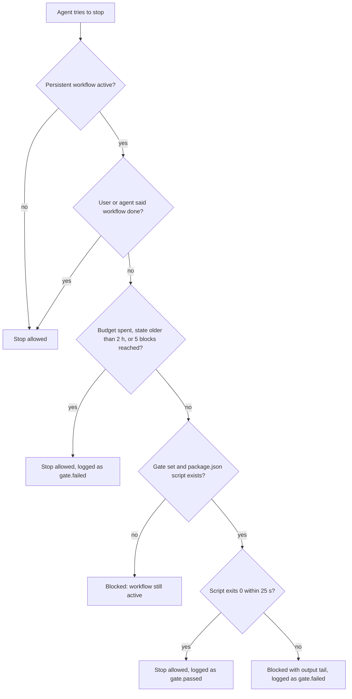

# oh-my-agent: команда специалистов для агента программирования, которым вы уже пользуетесь

[](https://www.npmjs.com/package/oh-my-agent) [](https://www.npmjs.com/package/oh-my-agent) [](https://github.com/first-fluke/oh-my-agent) [](https://github.com/first-fluke/oh-my-agent/blob/main/LICENSE) [](https://github.com/first-fluke/oh-my-agent/commits/main)

[English](../README.md) | [한국어](./README.ko.md) | [中文](./README.zh.md) | [Português](./README.pt.md) | [日本語](./README.ja.md) | [Français](./README.fr.md) | [Español](./README.es.md) | [Nederlands](./README.nl.md) | [Polski](./README.pl.md) | [Deutsch](./README.de.md) | [Tiếng Việt](./README.vi.md) | [ภาษาไทย](./README.th.md)

**oh-my-agent (`oma`) представляет собой независимый от вендора harness, который добавляет команду специалистов к агенту для программирования, которым вы уже пользуетесь: Claude Code, Codex CLI, Cursor и ещё 11 инструментов.** Планировщик разбивает работу на части, инженеры параллельно ведут разработку, ревьюер проверяет результат, а отладчик устраняет корневые причины. Кроме того, он проводит исследования со ссылками на источники, делает презентации, видео и изображения. Большинство шагов оставляет файл, который можно открыть, а в долгих workflows гейт может возвращать агента к работе, пока ваш собственный скрипт `test`, `lint` или `typecheck` не пройдёт.

[](./assets/architecture/oh-my-agent-architecture.svg)

Запустите это из корня проекта:

```bash
curl -fsSL https://raw.githubusercontent.com/first-fluke/oh-my-agent/main/cli/install.sh | bash
```

Затем выполните `oma doctor` и наберите в агенте `/plan add user accounts with a settings page`. Раздел [Первые 5 минут](#your-first-5-minutes) проведёт вас через это по шагам.


[Watch the full video (35s)](./assets/video/oh-my-agent-explainer.mp4)

## Что вы получаете

**Workflows** описывают то, что вы набираете (или просто говорите). Они вызывают **роли**, то есть специалистов. **Навыки (skills)** дают знания и приёмы: у каждой роли есть свои, а остальные ваш агент загружает, когда они нужны задаче.

| | Что это даёт | Попробуйте |
|---|---|---|
| **12 ролей-специалистов** | PM, архитектор, инженеры бэкенда, фронтенда, мобильной разработки, баз данных и инфраструктуры, QA-ревьюер, отладчик, рефакторщик, куратор документации, исследователь ([знакомьтесь](#meet-the-team)) | `/orchestrate build a TODO app with login` |
| **21 workflow** | Slash-команды от `/brainstorm` и `/plan` до `/review`, `/debug` и `/scm`. Большинство из них запускается и обычной просьбой (наборы ключевых слов охватывают до 11 языков) | «review this PR» |
| **33 навыка** | Знания по областям, которые загружаются, только когда они нужны задаче: UI, API, схемы, Terraform, CI, безопасность, git, observability | загружаются сами, например «add a Terraform S3 bucket» |
| **Файлы, которые можно открыть** | Планы, дизайн-документы, API-контракты, ADR, заметки о багах, результаты по агентам, доказательства проверок безопасности, HTML-разборы, сводки | `ls .agents/results` |
| **Проверки тестов и артефактов** | В долгом workflow ваш собственный скрипт `test`, `lint` или `typecheck` должен пройти, прежде чем агенту позволят остановиться; `oma ralph verify` проверяет, что запуск `/ralph` оставил файлы плана, QA и рефакторинга | `/ultrawork …`, затем `oma goal set --gate test` |
| **Исследования и контент** | Поиск со ссылками на источники, исследование рынка, научные статьи, презентации, MP4-видео, изображения, локальный голос, PDF/HWP в Markdown | `/video`, `/convert` |
| **Одна папка, 14 runtime** | Одна портативная директория `.agents/`, которая записывается в собственные конфигурационные файлы каждого runtime | `oma link cursor` |

**[Установка](#install)** · **[Первые 5 минут](#your-first-5-minutes)** · **[Команда](#meet-the-team)** · **[Какой workflow?](#how-the-team-works-together)** · **[Всё, что в комплекте](#everything-in-the-box)** · **[Совместимость](#works-with)** · **[Проверка](#verification-not-narration)** · **[FAQ](#faq)** · **[Документация](https://first-fluke.github.io/oh-my-agent/)**

<a id="install"></a>
## Установка

Скрипт устанавливает [bun](https://bun.sh), если его нет, глобально устанавливает команду `oma` (`bun install --global oh-my-agent`; шаг пропускается, если `oma` уже есть в PATH), а затем запускает интерактивную настройку. Глобальная команда важна: hooks (распознавание ключевых слов, Stop-гейт) и несколько workflows вызывают `oma`, а hooks молча ничего не делают, если не могут её найти. Если вы не используете скрипт, установите её сами через `bun install --global oh-my-agent` (подойдут и `npm install --global oh-my-agent` или `brew install oh-my-agent`).

<details>
<summary>Windows или установка без скрипта</summary>

```powershell
# Windows (PowerShell)
irm https://raw.githubusercontent.com/first-fluke/oh-my-agent/main/cli/install.ps1 | iex
```

```bash
# Любая ОС с установленным bun: та же настройка плюс глобальная команда `oma`
bun install --global oh-my-agent
oma
```

В Windows установщик скрывает Antigravity, Hermes и Kimi, а обёртка hooks написана на bash. Browser MCP по умолчанию, Aside, устанавливается через `bash`, поэтому снимите с него выбор, если bash у вас нет.

</details>

Настройка спросит язык ответов, какие runtime агентов подключить, провайдеров возможностей, browser MCP, preset моделей и preset навыков. **Если сомневаетесь, выберите `All` в качестве preset навыков**: workflows устанавливаются всегда, а нескольким из них (`/orchestrate`, `/work`, `/ultrawork`, `/ralph`, `/docs`, `/security`) нужны навыки, которые есть только в `All`.

<details>
<summary>Что ещё установщик делает по умолчанию</summary>

- Устанавливает **bun** (обязательно). Пытается установить **uv**, **Serena** (`uv tool install`) и **CUE** (`brew install cue` или `winget`) и продолжает с предупреждением, если что-то из них не установилось.
- В интерактивной настройке заранее выбирает browser MCP **Aside** и устанавливает его через `curl -fsSL https://releases.aside.com/install.sh | bash`, только если вы оставите его выбранным. Снимите выбор на шаге browser MCP или поменяйте позже через `oma update mcp`.
- Использует **AgentMemory** для семантической памяти: выполняет `bun install -g @agentmemory/agentmemory` и регистрирует его как службу, запускаемую при входе в систему (launchd, пользовательский unit systemd или запланированная задача Windows). Чтобы пропустить это, выберите провайдер `none` или задайте `OMA_NO_AGENTMEMORY=1`.
- Спрашивает разрешения, прежде чем создавать ссылки на навыки в папках вендоров в домашней директории (Antigravity, Hermes, Kimi). В `$HOME` без `--global` запрашивает подтверждение.
- Без спроса записывает некоторые файлы вне проекта: `~/.claude.json` (помечает проект как доверенное рабочее пространство Claude Code), `~/.serena/` (контекст OMA, минимальный размер ответа, регистрация проекта), `~/.cursor/cli-config.json` (отключает атрибуцию коммитов в Cursor), `~/.grok/config.toml` (телеметрия) и `~/.gemini/antigravity-cli/` (HUD), каждый только для выбранного вами вендора.
- Записывает **отказ от телеметрии** в настройки вендоров (Claude `DISABLE_TELEMETRY=1`, что также отключает Claude Code Remote Control; статистика использования Gemini, Qwen, Codex и Grok). Задайте `telemetry: true`, чтобы оставить настройки вендоров по умолчанию.
- Добавляет в `.claude/settings.json` незаданные настройки Claude Code, включая `skipDangerousModePermissionPrompt: true`, `effortLevel: high`, `cleanupPeriodDays: 180` и env-флаги, которые отключают auto memory, adaptive thinking, отправку отчётов об ошибках и встроенные инструкции git. Уже заданные вами значения сохраняются.
- Добавляет **co-author trailer**: атрибуция коммитов Claude Code становится `Co-Authored-By: First Fluke <our.first.fluke@gmail.com>`, а в PR добавляется строка "Generated with oh-my-agent". Задайте `scm.co_author.enabled: false`, чтобы это отключить.
- Устанавливает в `.githooks/` **commit-msg guard**, который отклоняет адреса `Co-authored-by`, отсутствующие в списке, и выполняет `git config --local core.hooksPath .githooks`, если другие hooks не активны. Чтобы отказаться, задайте `scm.co_author.enforce_hook: false`.
- `oma update` обновляет CLI `oma` в фоне (`auto_update_cli: false` или `OMA_SKIP_VERSION_CHECK=1`, чтобы это остановить) и запускает `uv tool upgrade serena-agent --prerelease=allow` (`serena.auto_update: false`).
- Когда Serena работает в режиме `bridge` по умолчанию, первая сессия агента, запустившая общий сервер Serena, регистрирует **таймер очистки**, который каждые 5 минут останавливает простаивающие общие серверы Serena (launchd `dev.oma.serena-daemon-gc`, пользовательский таймер systemd `oma-serena-daemon-gc.timer` или запланированная задача Windows `OMA Serena Daemon GC`). Задайте `serena.mode: stdio`, чтобы не запускать общий сервер и его таймер. `oma uninstall` не удаляет этот таймер.
- Неинтерактивные запуски (`-y`, `OMA_YES=1`, `CI=true`) используют preset навыков `All`, `model_preset: auto` и Python как язык бэкенда. Они не выбирают browser MCP (и пропускают скрипт установки Aside), если в `mcp.devtools_browsers` ещё нет ни одного.

</details>

<details>
<summary>Пресеты навыков</summary>

| Пресет | Навыки |
|--------|--------|
| **All** | **Все 33 навыка** (рекомендуется) |
| Fullstack | architecture, backend, brainstorm, db, debug, design, dev-workflow, frontend, mobile, pm, qa, scm, tf-infra |
| Fullstack Web | Fullstack без mobile и tf-infra |
| Fullstack Mobile | Fullstack без frontend и tf-infra |
| Frontend | architecture, brainstorm, debug, design, frontend, pm, qa, scm |
| Backend | architecture, backend, brainstorm, db, debug, dev-workflow, pm, qa, scm |
| Mobile | architecture, brainstorm, debug, mobile, pm, qa, scm |
| DevOps | architecture, brainstorm, debug, dev-workflow, observability, pm, qa, scm, tf-infra |
| Research | academic-writing, hwp, market, pdf, scholar, scm, search, translation |
| Content | academic-writing, design, image, scm, translation, voice |
| Custom | Выбор навыков по одному |

Из именованных пресетов только `All` включает coordination, orchestration, docs, security, refactor, explanation, recap, video, slide и skill-creation (или выберите их в `Custom`). В Research и Content нет навыков, на которых построены `/plan`, `/review`, `/debug`, `/architecture` и `/brainstorm`. См. [Workflows, которым нужны навыки вне пресета](../web/docs/getting-started/installation.md#workflows-that-need-skills-outside-a-preset).

</details>

<a id="your-first-5-minutes"></a>
## Первые 5 минут

1. **Установите** командой выше.
2. **Проверьте установку:**

   ```bash
   oma doctor
   ```

   Вы должны увидеть `CLI Status` (какие CLI агентов установлены и авторизованы) и `Skills Status` (например, `Skills (33/33 installed, 33 complete)`). Если `oma` не находится, откройте новый терминал (установщик мог только что добавить `~/.bun/bin` в PATH) или выполните `bun install --global oh-my-agent`.
3. **Откройте агента в проекте и попросите план:**

   ```text
   /plan add user accounts with a settings page
   ```

   Или просто напишите «plan user accounts with a settings page»: в runtime с prompt-хуком ключевое слово запускает тот же workflow.
4. **Посмотрите, что получилось.** `/plan` работает в текущей сессии. Для работы, которая затрагивает несколько областей, как эта, он записывает `.agents/results/plan-<session-id>.json` и трекер в `docs/plans/work/<NNN>-<name>.md`. Небольшой запрос в одной области получает прямую рекомендацию вместо файла плана.

Этих шагов достаточно, чтобы понять, подходит ли вам OMA. Чтобы продолжить, запустите `/work` или `/orchestrate` по этому плану.

<a id="meet-the-team"></a>
## Знакомьтесь с командой

Командой руководит ваш собственный агент. В `/work`, `/orchestrate` и `/ultrawork` он передаёт каждую задачу подходящему специалисту, который работает как отдельный субагент. `/plan`, `/architecture` и `/docs` выполняются в текущей сессии с навыком соответствующей роли, а `/review` и `/debug` подключают своего специалиста при большом объёме работы. Если роль назначена на CLI другого вендора, `oma agent spawn` запускает её там.

| Ваш специалист | Навыки | Как вызвать | Что оставляет |
|---|---|---|---|
| **Продакт-менеджер** (`pm-planner`) | oma-pm | `/plan` или «plan the payment feature» | JSON плана и трекер в `docs/plans/work/` для работы уровня Medium и Complex (запросы уровня Simple получают прямую рекомендацию) |
| **Архитектор** (`architecture-reviewer`) | oma-architecture | `/architecture` | ADR или рекомендация в `.agents/results/architecture/` |
| **Инженеры бэкенда, фронтенда, мобильной разработки, баз данных и инфраструктуры** | oma-backend, oma-frontend + oma-design, oma-mobile, oma-db, oma-tf-infra | `/work`, `/orchestrate` | Код, тесты и файл `result-<agent>` для каждой задачи |
| **QA-ревьюер** (`qa-reviewer`) | oma-qa | `/review` или «review this PR» | Находки ранжируются от CRITICAL до LOW. У каждой есть file:line и код исправления |
| **Отладчик** (`debug-investigator`) | oma-debug | `/debug` или «fix this bug» | Минимальное исправление, регрессионный тест и заметка о баге в `.agents/results/bugs/`, когда она оправдана |

<details>
<summary>Остальные три роли и навыки без роли</summary>

| Ваш специалист | Навыки | Как вызвать | Что оставляет |
|---|---|---|---|
| **Рефакторщик** (`refactor-engineer`) | oma-refactor | фаза REFINE в `/ultrawork` | Коммиты `refactor:`, сохраняющие поведение, и отчёт `result-refactor-<session>.md` |
| **Куратор документации** (`docs-curator`) | oma-docs | `/docs` или «verify docs» | `docs/generated/doc-refs.json` и одобренные вами патчи документации |
| **Исследователь** (`research-explorer`) | oma-search, oma-market, oma-scholar | исследовательский запрос | Источники со ссылками и метками доверия; рыночные обзоры в `.agents/results/market/` |

Инженеру инфраструктуры (`tf-infra-engineer`) предписано спрашивать разрешения перед любым `apply` или `destroy`, который что-то разрушает или затрагивает production. У остальных навыков (brainstorm, security, scm, dev-workflow, observability, explanation, recap, translation, coordination, orchestration, skill-creation, контент и медиа) нет отдельной роли. Ваш агент загружает их сам, а для большинства из них skill injector подсказывает нужный по вашему промпту.

</details>

<a id="how-the-team-works-together"></a>
## Как команда работает вместе

```text
 THINK   /brainstorm ......................... docs/plans/designs/<NNN>-<feature>.md
 PLAN    /plan · /architecture ............... plan JSON, API contracts, ADR
 DESIGN  /design ............................. DESIGN.md + tokens
 BUILD   /work · /orchestrate · /ultrawork ... code + result-<agent> files, engineers in parallel
 CHECK   /review · /security · /debug ........ findings, security evidence, regression test
 SHIP    /scm · /docs ........................ Conventional Commits, doc fixes
```

Каждый шаг передаёт файл следующему. `/brainstorm` сохраняет дизайн, который читает `/plan`, а `/plan` пишет план, в котором у каждой задачи есть агент, зависимости, критерии приёмки и команда проверки. `/orchestrate` выполняет этот план (загружает самый свежий `plan-*.json` или пишет новый). `/work` и `/ultrawork` начинают с того, что PM пишет для них собственный план. Пропускайте ненужные этапы: каждый этап работает и сам по себе.

**Какой workflow запустит команду?**

| Что нужно | Запуск | Чем заканчивается |
|---|---|---|
| Только план | `/plan` | Файл плана для работы в нескольких областях или прямая рекомендация для небольшой работы |
| Разработка под руководством PM, за которой вы следите шаг за шагом | `/work` | PM, затем инженеры уровень за уровнем, затем QA. Находки CRITICAL и HIGH уходят в цикл исправлений (до 5 циклов) |
| Параллельная разработка без вашего участия | `/orchestrate` | Готовыми считаются только задачи, чьи проверки прошли; у каждой задачи до 3 попыток, после чего она помечается как частично выполненная или проваленная |
| Максимальная тщательность | `/ultrawork` | Пять фаз с гейтами (PLAN, IMPL, VERIFY, REFINE, SHIP); каждое ревью проходит в свежей сессии ревьюера |
| «Не останавливайся, пока всё действительно не готово» | `/ralph` | Повторяет `/ultrawork` с отдельно запущенным судьёй со свежим контекстом, пока не пройдут все критерии; останавливается с частичным отчётом, если критерии заблокированы, или после 5 итераций |
| Команда по расписанию | `oma schedule create qa-reviewer "review open PRs" --every 2h` | Один Markdown-лог на каждый запуск в `~/.oma/schedule/runs/<id>/` |

Slash-команды не обязательны. В runtime с prompt-хуком обычные просьбы (наборы ключевых слов охватывают до 11 языков) могут запустить большинство workflows: «review this PR» запускает `/review`. Описание целого приложения («Build a TODO app with user authentication») предлагает `/orchestrate`, а запускать ли его, решает ваш агент. Ключевые слова внутри блоков кода игнорируются.

`/orchestrate`, `/work`, `/ultrawork` и `/ralph` становятся **persistent**, когда вы вызываете их по имени в виде slash-команды или обычным текстом («ultrawork: add rate limiting»). Тогда при попытке остановиться раньше времени агент возвращается к работе (до 5 раз или в течение 2 часов), пока вы не скажете **«workflow done»**. Запрос, который совпадает лишь приблизительно, только предлагает их.

В [бенчмарке](../benchmarks/README.md) (один промпт, Claude Code с пятью разными наборами дополнений, включая вариант без них, `claude-opus-4-6`, по одному прогону на каждый) oma набрал 80.6 против 70.7 у обычного Claude Code. Стоимость была в 1.7 раза выше ($4.04 против $2.37), а выполнение заняло в 1.8 раза больше времени.

<details>
<summary>Все 21 workflow</summary>

| Команда | Что делает |
|---------|--------------|
| `/architecture` | Взвешивает компромиссы дизайна и выдаёт рекомендацию, ревью или ADR |
| `/brainstorm` | Исследует идеи и ограничения и выдаёт утверждённый дизайн до планирования |
| `/convert` | Конвертирует PDF/HWP в Markdown или перекодирует изображения, видео и аудио через ffmpeg |
| `/debug` | Воспроизводит баг, устраняет корневую причину, пишет регрессионный тест и ищет похожие паттерны |
| `/deepinit` | Описывает существующую кодовую базу в AGENTS.md, ARCHITECTURE.md и базе знаний docs/ |
| `/design` | Строит дизайн-систему, DESIGN.md и токены с проверками доступности |
| `/docs` | Находит битые ссылки в документации и предлагает патчи для документов, затронутых diff |
| `/explain` | Превращает diff, PR, ветку или тему в автономный интерактивный HTML-разбор |
| `/orchestrate` | Запускает агентов параллельно, координирует их через файловое состояние и проверяет результат (persistent) |
| `/plan` | Разбивает фичу на приоритизированные задачи с API-контрактами |
| `/ralph` | Повторяет `/ultrawork` с отдельно запущенным судьёй, до 5 итераций (persistent) |
| `/recap` | Подводит итог истории ваших диалогов с ИИ за день или период |
| `/review` | Проверяет безопасность (OWASP Top 10), производительность, доступность (WCAG 2.2 AA) и качество кода |
| `/schedule` | Регистрирует задание агента, которое запускается с повторяющимся интервалом |
| `/scm` | Работает с ветками, слияниями, конфликтами, worktree и Conventional Commits |
| `/security` | Сканирует исходный код, skills агентов и компоненты MCP, проверяет находки и настраивает гейты CI |
| `/stack-set` | Определяет ваш стек и генерирует под него справочные материалы для доменных навыков |
| `/tools` | Показывает, включает и отключает инструменты MCP по запросу на обычном языке |
| `/ultrawork` | Пять фаз (PLAN, IMPL, VERIFY, REFINE, SHIP), каждое ревью проходит в свежей сессии ревьюера (persistent) |
| `/video` | Превращает бриф в готовый MP4 через пайплайн, которому ключи не обязательны |
| `/work` | Координирует нескольких агентов в многодоменном проекте с планированием PM и ревью QA (persistent) |

Точность срабатывания измеряется: `oma verify triggers` оценивает детектор на размеченном корпусе из 212 промптов на английском и корейском. CI падает, если доля ложных срабатываний превышает 10% или пропусков превышает 20%. Последний замер: **0% missed-fire, 5.3% false-fire**. Полный справочник: [Workflows](https://first-fluke.github.io/oh-my-agent/docs/core-concepts/workflows/).

</details>

<a id="see-it-work"></a>
## В деле

Пример сессии `/ultrawork`. Блок `[OMA PERSISTENT MODE: ULTRAWORK]` точно соответствует формату Stop-хука. Остальные строки пересказаны:

```text
you    /ultrawork add rate limiting to POST /login
agent  runs `oma goal set --gate test`
agent  PLAN writes .agents/results/plan-<run-id>.json
agent  IMPL -> VERIFY -> REFINE -> SHIP  (each review runs in a fresh reviewer session)
agent  "Rate limiting added. All tests pass."
oma    [OMA PERSISTENT MODE: ULTRAWORK]
       Stop gate 'test' FAILED (reinforcement 1/5).
       Fix the failures below, then finish the workflow — the stop is allowed only when the gate passes.
       --- gate output (tail) ---
       FAIL  src/auth/login.test.ts > returns 429 after 5 attempts
       To abandon instead: delete .agents/state/ultrawork-state-<host-session>.json or say "workflow done".
agent  fixes the limiter and stops again
oma    `test` exits 0: stop allowed, gate.passed appended to the session log
```

После этого `oma state list` находит сессию, а `oma state get <oma-sid>` (ID, который выводит `state list`) показывает все события гейтов. В `/ralph` команда `oma ralph verify --json` дополнительно проверяет, что фазы оставили после себя свои файлы (вывод сокращён):

```json
{ "ok": false,
  "missing": [{ "id": "A3", "description": "a distinct QA agent ran (VERIFY phase)",
                "pattern": ".agents/state/memories/result-qa*.md or .agents/results/result-qa*.md",
                "status": "missing" }] }
```

<a id="everything-in-the-box"></a>
## Всё, что в комплекте

<details>
<summary><strong>Планирование и дизайн</strong>: <code>/brainstorm</code>, <code>/plan</code>, <code>/architecture</code>, <code>/design</code></summary>

| Команда | Что делает | Что пишет |
|---|---|---|
| `/brainstorm` | Задаёт по одному уточняющему вопросу за раз и предлагает 2-3 подхода, которые работают по-разному, а затем передаёт работу `/plan`. Код не пишет | `docs/plans/designs/<NNN>-<feature>.md` |
| `/plan` | Оценивает работу как Simple, Medium или Complex; для Medium и Complex разбивает её на задачи, у каждой из которых есть агент, зависимости, критерии приёмки и команда проверки, а если работа пересекает границу, определяет API-контракты | `.agents/results/plan-<sid>.json`, `docs/plans/work/<NNN>-<name>.md`, контракты в `.agents/results/api-contracts/` при необходимости |
| `/architecture` | Сначала читает прежние решения, сравнивает не менее 2 вариантов и помечает заменённые ADR как superseded | ADR или рекомендация в `.agents/results/architecture/` |
| `/design` | Предлагает 2-3 направления, затем пишет `DESIGN.md` с токенами и проверяет адаптивную вёрстку и доступность | `DESIGN.md`, токены CSS/Tailwind/shadcn |

</details>

<details>
<summary><strong>Разработка</strong>: 7 доменных навыков и <code>/stack-set</code>, чтобы подогнать их под ваш стек</summary>

| Навык | Что строит |
|---|---|
| oma-frontend | UI на React/Next.js или Angular, который следует вашим токенам, правилам i18n и доступности |
| oma-backend | API, аутентификация и доступ к данным, слои router → service → repository |
| oma-mobile | Приложения на Flutter, React Native или Swift |
| oma-db | Схемы, миграции, оптимизация запросов, планы векторного/RAG-поиска |
| oma-tf-infra | Terraform для любого облака с явным указанием рисков дрейфа, разрушительных изменений и стоимости |
| oma-dev-workflow | Задачи mise, lint/format/typecheck, commitlint, git hooks, CI/CD и релизы |
| oma-observability | OpenTelemetry, SLO, алертинг и форензика инцидентов |

`/stack-set` читает ваши манифесты и пишет справочные материалы под ваш стек для навыков бэкенда, фронтенда и мобильной разработки. В monorepo инженеры фронтенда, бэкенда и мобильной разработки направляются в свой workspace (pnpm, workspaces npm/yarn/bun, lerna, nx, turbo, `mise.toml`).

</details>

<details>
<summary><strong>Ревью, исправление и выпуск</strong>: <code>/review</code>, <code>/security</code>, <code>/debug</code>, refactor, <code>/scm</code></summary>

| Команда или навык | Что делает | Что пишет |
|---|---|---|
| `/review` | Аудит зависимостей, затем OWASP Top 10, производительность, WCAG 2.2 AA и качество кода. У каждой находки есть file:line и код исправления | Отчёт в чате плюс запись в памяти; файла отчёта нет |
| `/security` | Сканирует ваш исходный код, skills агентов и MCP-серверы (Deepsec, Cisco Skill and MCP Scanner), а при наличии ограниченного по scope тестового развёртывания проводит пентесты ARTEX. Workflow требует сообщать о движке, который не смог запуститься, как о сбое, а не как о чистом результате | `.agents/results/security/<run-id>/` |
| `/debug` | Воспроизводит сбой, устраняет корневую причину минимальным изменением, добавляет регрессионный тест и ищет тот же паттерн в других местах | Исправление и тест; заметка о баге в `.agents/results/bugs/`, когда она оправдана |
| oma-refactor | Меняет структуру, не меняя поведения: сначала характеризационные тесты, затем коммиты только с рефакторингом | `.agents/results/refactor/` |
| `/scm` | Conventional Commits, разделённые по логическим изменениям; ветки, слияния, rebase и worktree | Коммиты и ветки |

</details>

<details>
<summary><strong>Документация и знания</strong>: <code>/deepinit</code>, <code>/docs</code>, <code>/explain</code>, <code>/recap</code>, перевод</summary>

| Команда или навык | Что делает | Что пишет |
|---|---|---|
| `/deepinit` | Превращает существующий репозиторий в базу знаний, готовую для агентов | `AGENTS.md`, `ARCHITECTURE.md`, `docs/` |
| `/docs` | Находит битые ссылки, вносит патчи в документацию, затронутую diff (только одобренные вами), и находит устаревшие переводы | `docs/generated/doc-refs.json`, исправленные документы |
| `/explain` | Превращает PR, ветку или staged-изменения в HTML-разбор с квизом из 5 вопросов, а для темы создаёт одностраничный визуальный разбор | `.agents/results/explain/<date>-<slug>.html` |
| `/recap` | Подводит итог ваших диалогов с ИИ во всех инструментах за день или период | `.agents/results/recap/<date>.md` |
| oma-translation | Перевод, который читается как текст носителя языка; плейсхолдеры, код и ключи локалей остаются без изменений | Переведённый текст |

</details>

<details>
<summary><strong>Исследования</strong>: поиск, рынок, научные статьи, академическое письмо</summary>

| Навык | Что делает | Что пишет |
|---|---|---|
| oma-search | Поиск по документации, вебу и коду с меткой доверия у каждого источника | Результаты со ссылками на источники |
| oma-market | Боли, тренды и конкуренты по сигналам сообществ, разложенные по SWOT, пяти силам Портера и PESTEL | `.agents/results/market/<topic>-<date>.md` |
| oma-scholar | Поиск статей, который читает компактный файл утверждений (формат Knows, около 700 токенов) вместо полного PDF (около 10K токенов) | `<paper>.knows.yaml` |
| oma-academic-writing | Пишет и проверяет академические тексты по рубрике | Ваш файл |

</details>

<details>
<summary><strong>Контент и медиа</strong>: <code>/video</code>, <code>/convert</code>, презентации, изображения, голос</summary>

| Команда или навык | Что создаёт | Что пишет |
|---|---|---|
| `/video` | Короткие ролики, обучающие видео или демо в виде готового MP4; у провайдеров, которым нужен ключ, есть резервные варианты без ключа | `.agents/results/videos/<run>/` с манифестом |
| oma-slide | HTML-презентации 1920×1080 с экспортом в PDF, PNG или PPTX | `.agents/results/slides/<session>/` |
| oma-image | Изображения через CLI вендоров, в которые вы вошли, со сравнением бок о бок | `.agents/results/images/<run>/` |
| oma-voice | Локальный синтез речи и транскрипция через приложение Voicebox | `.agents/results/voice/<run>/` |
| `/convert` | PDF или HWP в Markdown; конвертация изображений, видео и аудио через ffmpeg | Рядом с входным файлом |

Эти пайплайны сообщают об отсутствующем источнике или ключе вендора, а не возвращают молча урезанный результат.

</details>

<details>
<summary><strong>Hooks, которые работают без запроса</strong></summary>

| Hook | Что делает | Как отключить / лимит |
|---|---|---|
| Запуск по ключевому слову | Запускает подходящий workflow по обычной просьбе | Вопросы, вставленный текст и блоки кода пропускаются |
| Skill injector | Направляет агента к нужным для промпта навыкам | Приостанавливается, пока активен persistent workflow |
| Stop-гейт | Возвращает persistent workflow к работе; с `oma goal set --gate test` остановка разрешается, когда этот скрипт завершается с кодом 0 в пределах 25 с | Скажите «workflow done»; кроме того, он снимается после 5 блокировок или через 2 часа |
| Refactor guard | При остановке отмечает отредактированные файлы длиннее 500 строк для `refactor-engineer` | Включается явно: `refactor_guard.enabled` |
| Secret guard | Блокирует `git add` для `*.env`, `*.pem`, `id_rsa*`, `*.tfstate` и похожих файлов | Добавьте `OMA_SCM_ALLOW_SECRETS=1` перед этой одной командой |
| Code-search guard | Блокирует нативный рекурсивный поиск в проекте, чтобы агент пользовался Serena или Gortex | `providers.code_intelligence_guard: off` |
| Фильтр тестов | Оставляет из вывода тестов только падения и сводки, чтобы тратилось меньше токенов | `OMA_TEST_FILTER=0` |
| Память сессии | Когда вы переключаете или возобновляете сессию (или после compaction), заново внедряет недавние события активной сессии плюс recall из AgentMemory | Провайдер памяти `none` или `OMA_NO_AGENTMEMORY=1` отключает recall; локальный снимок событий остаётся |

`oma hook probe` проверяет, что prompt-хуки oma принимают входные данные hook от каждого runtime (сам runtime при этом не запускается). Какие hooks подключает каждый runtime, указано в разделе [Различия хостов](#host-differences).

</details>

<details>
<summary><strong>Параллельные агенты, сессии и дашборды</strong></summary>

- `oma agent spawn <role> "<task>" <sid>` запускает роль в Antigravity, Claude Code, Codex, Cursor, Grok, Kimi Code, Kiro, OpenCode, pi или Qwen Code с `--isolation worktree` и `--fallback-vendors`. `oma agent parallel` запускает несколько ролей сразу. Эти 10 целей dispatch входят в число 14 интеграций установщика.
- `oma state list --all-projects` и `oma state get <sid>`: сессии и все записанные события.
- `oma dashboard terminal` / `oma dashboard web`: статус агентов в реальном времени (веб-дашборд слушает только `127.0.0.1`). [Руководство по дашборду](../web/docs/guide/dashboard-monitoring.md).
- `oma stats get` (метрики продуктивности), `oma retro` (ретроспектива по git), `oma recap --window 7d` (что вы делали в разных ИИ-инструментах).
- `oma visualize --affected <paths>`: какие навыки, workflows, агенты и проверки зависят от изменённых вами файлов в `.agents/`.

</details>

<details>
<summary><strong>Code intelligence, память и MCP</strong></summary>

| Слот | По умолчанию | Альтернативы |
|---|---|---|
| Документация | Context7 | — |
| Веб-поиск | Нативный поиск runtime | Brave Search |
| Code intelligence | Serena, один общий сервер на проект | Gortex (экспериментально) |
| Семантическая память | AgentMemory | Honcho (экспериментально), none |
| Browser MCP | Aside | Chrome DevTools, Firefox DevTools |

Serena предоставляет навигацию по коду и диагностику на основе LSP, включая обратную связь после нативного редактирования, если она поддерживается. Выбор поставщика не зависит от среды выполнения агента; возможности различаются в зависимости от поставщика и хоста.

Агенты координируются через обычные файлы в `.agents/state/`, без внешнего сервиса. `/tools` включает и отключает инструменты MCP по запросу на обычном языке. Подробнее: [Провайдеры возможностей](./capability-providers.md).

</details>

<details>
<summary><strong>Улучшение со временем</strong></summary>

- `oma skill eval` измеряет прирост от навыка относительно baseline на отложенных задачах. `oma skill optimize` предлагает правки, которые его повышают, а `--apply` сохраняет их ([гайд по skill-eval](../web/docs/guide/skill-eval.md)).
- `oma harness evolution enable --max-dispatches <n>` планирует ночной цикл, который превращает неудачные запуски в регрессионные фикстуры и применяет прошедшие оценку улучшения навыков как оверлеи проекта. Добавьте `--mode propose`, чтобы только записывать их.
- `oma emit` экспортирует исходники `.agents/` как пакет Agent Skills, пакет Agent Plugins, маркетплейс плагинов Claude Code или `AGENTS.md`.

</details>

<details>
<summary><strong>Конфигурация и защитные механизмы</strong></summary>

- Один принадлежащий пользователю `.agents/oma-config.yaml` сохраняется при обновлениях (сбрасывает его только `oma update --force`); поверх него можно положить приватные оверлеи `.local.yaml` или `.local.cue`. `language` задаёт язык ответов.
- 13 правил проекта (backend, commit, database, debug, design и другие) загружаются как нативные правила в Claude Code и Cursor и индексируются в управляемом блоке `AGENTS.md`, который пишется для Codex, Qwen Code и Pi.
- Обновления сохраняют резервные копии конфигурации и миграций в `.agents/backup/`; поставляемые навыки и workflows заменяются на месте, поэтому держите локальные изменения вне их. `oma uninstall --dry-run` показывает, что будет удалено. `first-fluke/oma-update-action@v1` запускает `oma update` в CI и открывает PR.

</details>

<details>
<summary><strong>Все 33 скилла</strong></summary>

| Скилл | Что делает |
|---|---|
| **oma-academic-writing** | Пишет, редактирует и проверяет академические тексты |
| **oma-architecture** | Взвешивает архитектурные компромиссы и определяет границы модулей с анализом ADR/ATAM/CBAM |
| **oma-backend** | Строит API, аутентификацию и доступ к данным на Python, Node.js или Rust |
| **oma-brainstorm** | Вместе с вами исследует идеи до того, как вы возьмётесь за реализацию |
| **oma-coordination** | Пошагово направляет ручную координацию агентов PM, фронтенда, бэкенда, мобильной разработки и QA |
| **oma-db** | Проектирует схемы, миграции, индексы и векторные хранилища |
| **oma-debug** | Находит корневую причину, исправляет баг и пишет регрессионный тест |
| **oma-design** | Строит дизайн-системы с токенами, доступностью и адаптивными макетами |
| **oma-dev-workflow** | Автоматизирует CI/CD, релизы и задачи в monorepo |
| **oma-docs** | Проверяет документацию на битые ссылки, синхронизирует её с изменениями кода и отмечает расхождения переводов |
| **oma-explanation** | Превращает diff, PR, ветку или тему в автономный HTML-разбор, а для изменений кода добавляет квиз |
| **oma-frontend** | Строит интерфейс на React/Next.js или Angular |
| **oma-hwp** | Конвертирует файлы HWP, HWPX и HWPML в Markdown |
| **oma-image** | Генерирует изображения и вариации по референсам, а также может сравнить AI-провайдеров бок о бок |
| **oma-market** | Исследует ваш рынок по сигналам сообществ и структурирует результаты через SWOT, 5F и PESTEL |
| **oma-mobile** | Разрабатывает мобильные приложения на Flutter, React Native или нативном Swift |
| **oma-observability** | Маршрутизирует задачи наблюдаемости по метрикам, логам, трейсам, SLO и форензике инцидентов |
| **oma-orchestration** | Запускает несколько агентов параллельно через CLI |
| **oma-pdf** | Конвертирует PDF-файлы в Markdown |
| **oma-pm** | Планирует задачи, декомпозирует требования и определяет API-контракты |
| **oma-qa** | Проверяет изменения на корректность, безопасность по OWASP, производительность и доступность |
| **oma-recap** | Преобразует историю диалогов в тематические сводки о проделанной работе |
| **oma-refactor** | Рефакторит код без изменения поведения, используя выбор горячих точек, характеризационные тесты и отдельные refactor-коммиты |
| **oma-scholar** | Ищет академическую литературу и создаёт sidecar-файлы Knows для статей с утверждениями, доказательствами и рецензированием |
| **oma-scm** | Управляет ветками, слияниями, worktree и Conventional Commits |
| **oma-search** | Направляет каждый запрос к лучшему источнику и оценивает, насколько можно доверять результату |
| **oma-security** | Сканирует исходный код, скиллы агентов и компоненты MCP; тестирует развёрнутые веб-приложения и проверяет находки |
| **oma-skill-creation** | Пишет и проверяет новые OMA-скиллы |
| **oma-slide** | Генерирует HTML-презентации и экспортирует их в PDF/PNG/PPTX |
| **oma-tf-infra** | Разворачивает мультиоблачную инфраструктуру с помощью Terraform |
| **oma-translation** | Переводит так, будто текст написал носитель языка |
| **oma-video** | Создаёт короткие, обучающие и демонстрационные видео через пайплайн HyperFrames, работающий и без ключей |
| **oma-voice** | Генерирует озвучку и транскрибирует аудио прямо на устройстве |

</details>

<a id="works-with"></a>
## Совместимость

14 целей установщика: Claude Code, Codex CLI, Cursor, Antigravity, Qwen Code, Grok, Kiro, Kimi, OpenCode, Pi, GitHub Copilot, Hermes, CommandCode и ZCode. Пропущенный runtime можно подключить через `oma link <vendor>`. Набор доступных hooks различается; полная матрица приведена в [Поддерживаемых агентах](./SUPPORTED_AGENTS.md).

- **Orca IDE:** [OMA для Orca](../integrations/orca/README.md) добавляет боковую панель и действия палитры команд (Orca 1.4.197+ с экспериментальными плагинами).
- **DeepSeek Harness:** [OMA для DeepSeek Harness](../integrations/dsh/README.md) подключает проверки OMA через плагин Cordis. Требуется `oma` в `PATH`.

<details>
<summary>Логотипы runtime (цели установщика плюс Amp и DeepSeek Harness)</summary>

нативный = oma записывает собственные конфигурационные файлы runtime; адаптер = oma дополнительно добавляет прослойки (shims) для hooks или агентов. Amp сам читает `.agents/skills/` и не является целью установщика.

<table>
<colgroup>
<col span="6" style="width:16.67%" />
</colgroup>
<tr>
<td align="center">
<a href="https://claude.com/product/claude-code"></a><br/>
<strong>Claude Code</strong><br/>
<sub>нативный + адаптер</sub>
</td>
<td align="center">
<a href="https://github.com/openai/codex"></a><br/>
<strong>Codex CLI</strong><br/>
<sub>нативный + адаптер</sub>
</td>
<td align="center">
<a href="https://antigravity.google"></a><br/>
<strong>Antigravity</strong><br/>
<sub>нативный SSOT</sub>
</td>
<td align="center">
<a href="https://cursor.com"></a><br/>
<strong>Cursor</strong><br/>
<sub>нативный + адаптер</sub>
</td>
<td align="center">
<a href="https://github.com/QwenLM/qwen-code"></a><br/>
<strong>Qwen Code</strong><br/>
<sub>нативный dispatch</sub>
</td>
<td align="center">
<a href="https://github.com/deepseek-ai/deepseek-harness"></a><br/>
<strong>DeepSeek Harness</strong><br/>
<sub>Cordis plugin</sub>
</td>
</tr>
<tr>
<td align="center">
<a href="https://pi.dev/"></a><br/>
<strong>Pi</strong><br/>
<sub>нативная совместимость</sub>
</td>
<td align="center">
<a href="https://github.com/anomalyco/opencode"></a><br/>
<strong>OpenCode</strong><br/>
<sub>нативная совместимость</sub>
</td>
<td align="center">
<a href="https://ampcode.com"></a><br/>
<strong>Amp</strong><br/>
<sub>читает .agents/skills</sub>
</td>
<td align="center">
<a href="https://github.com/features/copilot"></a><br/>
<strong>GitHub Copilot</strong><br/>
<sub>skills через symlink</sub>
</td>
<td align="center">
<a href="https://grok.x.ai"></a><br/>
<strong>Grok Build</strong><br/>
<sub>нативные hooks</sub>
</td>
<td align="center">
<a href="https://kiro.dev"></a><br/>
<strong>Kiro CLI</strong><br/>
<sub>нативные hooks + agents</sub>
</td>
</tr>
</table>

<p align="center"><sub><a href="./SUPPORTED_AGENTS.md">& ещё</a></sub></p>

</details>

<a id="host-differences"></a>
<details>
<summary>Различия хостов: какие runtime получают распознавание ключевых слов и Stop-гейт</summary>

| Runtime | Распознавание ключевых слов | Stop-гейт |
|---|---|---|
| Claude Code, Codex CLI, Qwen Code, Grok, Kimi | да | да |
| Cursor | да | да (возвращается как follow-up сообщение) |
| Antigravity | да | да (запускает обработчики через bun, а не через обёртку `oma`) |
| OpenCode, Pi | да | best-effort (Pi нужна сборка с `agent_settled`) |
| Kiro | да | нет: Kiro игнорирует вывод Stop-хука |
| CommandCode | нет prompt-хука | да |
| GitHub Copilot, Hermes, ZCode | нет hooks | нет hooks |

</details>

<a id="per-agent-models"></a>
<details>
<summary>Модели по агентам</summary>

`model_preset` в `.agents/oma-config.yaml` определяет, какую модель использует каждая роль агента. Значение по умолчанию, `auto`, следует собственным настройкам агентов и моделей запущенного runtime.

```yaml
language: en
model_preset: auto   # auto | free | antigravity | claude | codex | cursor | kiro | mixed | qwen | <custom_presets key>

# Optional per-agent overrides; they win over the preset
agents:
  backend: { model: openai/gpt-5.5, effort: high }
```

- `mixed` использует Claude для оркестратора, архитектуры, QA, PM и документации и Codex `gpt-5.5` для ролей реализации, поэтому ему нужны и Claude Code, и Codex CLI.
- `free` работает через шлюз FreeLLMAPI, и ему нужны `FREELLM_API_KEY` и запущенный сервер.
- `kiro` нет в меню установщика; задайте его в конфигурационном файле.
- `oma doctor --profile` выводит итоговую модель для каждой роли.
- Полное руководство: [Модели по агентам](https://first-fluke.github.io/oh-my-agent/docs/guide/per-agent-models/)

</details>

<a id="verification-not-narration"></a>
## Проверки

oh-my-agent проверяет артефакты. Раздел [В деле](#see-it-work) показывает Stop-гейт в работе.

OMA также записывает метаданные вызовов инструментов и дайджесты payload для отслеживаемых запусков harness в Claude Code и Codex, отличает сообщённое использование токенов от оценочного и оценивает регрессии навыков. Эти функции +1 охватывают все слои; полнота трассировки зависит от runtime и запуска.

Все механизмы ниже, кроме судьи, запускаемого по промпту, подчиняются формальным условиям: команда завершается с кодом 0 или нет, файл существует на диске или нет. Ни один из них не спрашивает LLM, «выглядит ли работа правильной».

| Механизм | Что проверяет | Источник |
|-----------|----------------|--------|
| **Stop-hook gate** | Во время persistent workflow `oma goal set --gate test` (или `lint`, `typecheck`) разрешает остановку, только если этот скрипт из package.json завершается с кодом 0 в пределах 25 с. | [`persistent-mode.ts`](../.agents/hooks/core/persistent-mode.ts) |
| **Гейт артефактов** | `oma ralph verify --json` проверяет записи фаз, JSON плана и файлы результатов от **отдельного QA-агента** и **отдельного refactor-агента**, каждый из которых привязан к записанным запускам агентов. | [`ralph.md`](../.agents/workflows/ralph.md) |
| **Судья, запускаемый по промпту** | Не механический: промпт `/ralph` велит оркестратору запустить судью со свежим контекстом, который на каждой итерации перепроверяет **каждый** критерий. Ничто не проверяет, что этот запуск состоялся. | [`judge-protocol.md`](../.agents/workflows/ralph/resources/judge-protocol.md) |
| **Журнал событий** | В сессии OMA каждое прохождение гейта, каждый провал и каждое решение добавляют по одной JSON-строке в `events.jsonl` этой сессии. | [`state-core.ts`](../.agents/hooks/core/state-core.ts) · [`event-spec.md`](../.agents/skills/_shared/runtime/event-spec.md) |
| **Проверки по агентам** | `oma verify agent <type>` запускает Scope Check, Charter Preflight, Hardcoded Secrets, TODO/FIXME Comments, Declared outputs и TDD Evidence, плюс проверки по типу, например TypeScript, Any Types, SQL Injection и тесты. | `oma verify agent --help` |

> Stop-хук записывает события гейта в сессию OMA, открытую при запуске persistent workflow. Запись выполняется по принципу best-effort. Если сессию не удалось создать (stderr выводит `[oma] L1 session activation failed`), непройденный гейт всё равно блокирует остановку, но строка `gate.failed` не записывается. Прежде чем полагаться на эти события или демонстрировать их, проверьте через `oma state list`, что активная сессия есть. Затем `oma state get <sid>` покажет её события.

<details>
<summary>Ограничения, подробности и то, как решает Stop-хук</summary>

**Что важно знать об ограничениях:**

- Stop-гейт действует только в persistent workflows (`/orchestrate`, `/work`, `/ultrawork`, `/ralph`). Без `oma goal set --gate` он лишь снова просит агента продолжить. `/ultrawork` велит агенту задать гейт, если в проекте есть дешёвая проверка, но ничто этого не обеспечивает. Если хотите быть уверены, выполните `oma goal set --gate test` сами; остальные persistent workflows гейт никогда не задают.
- Принимаются только ключевые слова `typecheck`, `test` и `lint`, и они запускают одноимённый скрипт из package.json. Если package.json или нужного скрипта нет, гейт не запускается. Проектам не на JS нужен скрипт-обёртка в package.json.
- Блокировка снимается и записывается как проваленная после 5 напоминаний, через 2 часа или когда истекает `--budget-minutes`, так что навсегда красный гейт не запрёт вас.
- Бюджеты: `session.quota_cap` ограничивает токены, число spawn и токены по вендорам; оркестратор отказывает в следующем spawn, как только одно из измерений превышено.

**Гейт артефактов.** Отсутствие артефакта означает, что фаза не выполнялась. Проверка refactor также проходит как `skip-recorded`, если в журнале сессии записана причина пропуска REFINE.

**Судья, запускаемый по промпту.** Промпт workflow `/ralph` велит оркестратору запустить судью как отдельного агента со свежим контекстом, передав ему только критерии (и никогда не то, что исполнитель считает исправленным), и перепроверять **каждый** критерий на каждой итерации, включая уже пройденные (PASS), потому что именно при починке C2 тихо ломается C1. Ничто не проверяет, что этот запуск состоялся: `oma ralph verify` служит гейтом для артефактов EXEC, а не для судьи, а runtime, который не может запускать субагентов, получает указание выполнить роль судьи inline и записать `ralph.judge-inline-fallback`. `/ralph` останавливается после 5 итераций с частичным отчётом.

**Журнал событий.** Найдите сессию через `oma state list` и прочитайте её через `oma state get <sid>`. Каждое событие помечено вендором и id сессии runtime. Расположение файла зависит от `OMA_HOME`, `OMA_STATE_HOME`, `OMA_PROFILE` и старых папок сессий внутри проекта, поэтому не хардкодьте его.

**Проверки по агентам.** Типы: `backend`, `frontend`, `mobile`, `qa`, `debug`, `pm`. Команда завершается с кодом 1, если не проходит любая проверка; TODO/FIXME Comments и Inline Styles только выдают предупреждение.

<!-- Stack manifests in this list are optional outputs of /stack-set, not shipped files. -->
<!-- oma-docs:ignore-start -->
- `backend`: `<Language> Syntax`, `SQL Injection` (паттерны raw SQL) и `<Language> Tests` по командам из `stack/stack.yaml`. Без этого файла (сгенерируйте его через `/stack-set`) они пропускаются.
- `frontend`: команды синтаксиса и тестов из `stack/stack.yaml` (в `oma-frontend` или в `angular-developer`, если этот навык установлен) либо TypeScript (`tsc --noEmit`) и Frontend Tests (Vitest). Inline Styles и Any Types выполняются всегда.
- `mobile`: команды синтаксиса и тестов из `stack/stack.yaml` либо Flutter/Dart Analysis и Flutter Tests.
- `debug`: Python Tests (pytest через uv) или Frontend Tests (Vitest).
- `pm`: PM Plan (файл плана содержит допустимый JSON).
- `qa`: механических проверок нет.
<!-- oma-docs:ignore-end -->



</details>

<a id="faq"></a>
## Частые вопросы

<details>
<summary><strong>Нужны ли мне все навыки?</strong></summary>

Нет. См. [Пресеты навыков](#install); `All` является безопасным выбором по умолчанию.

</details>

<details>
<summary><strong>Как понять, что всё работает?</strong></summary>

`oma doctor` показывает установленные навыки и предупреждает, если hooks не могут найти `oma`. Во время persistent workflow `oma state list` показывает активную сессию, а `oma state get <sid>` выводит её события гейтов.

</details>

<details>
<summary><strong>Расходует ли это больше токенов?</strong></summary>

Обычно да. Навыки загружаются, только когда они нужны задаче, но мультиагентные workflows и ревью в свежем контексте расходуют больше. В [бенчмарке на одном промпте](../benchmarks/README.md) oma обошёлся в 1.7 раза дороже обычного Claude Code.

</details>

<details>
<summary><strong>Stop-хук всё время блокирует. Как выйти?</strong></summary>

Скажите «workflow done» (или «workflow complete» / «workflow finished», или эквивалент на другом поддерживаемом языке) либо удалите `.agents/state/<workflow>-state-<sid>.json`. Если не сделать ни того ни другого, блокировка снимется сама после 5 блокировок или через 2 часа.

</details>

<details>
<summary><strong>Как обновить или удалить?</strong></summary>

`oma update` обновляет навыки, workflows и hooks и сохраняет вашу конфигурацию (`--with-new-skills` добавляет навыки, появившиеся в релизе; `oma update mcp` позволяет заново выбрать browser MCP). `oma uninstall --dry-run` показывает, что будет удалено; `oma uninstall` удаляет это и сохраняет `oma-config.yaml`, `mcp.json` и написанные вами навыки. Другие решения проблем: [Troubleshooting](https://first-fluke.github.io/oh-my-agent/docs/guide/troubleshooting/).

</details>

<details>
<summary><strong>Что oh-my-agent оставляет модели?</strong></summary>

Планирование и выбор следующего шага остаются за моделью вашего агента, а у oma нет фиксированного графа workflow. Вне модели oma задаёт ограничения для инструментов (secret guard и search guard) и бюджеты. Оно также ограничивает повторные попытки и остановки, ведёт журнал событий, а при заданном гейте ждёт, пока пройдут ваши проверки.

</details>

## Узнать больше

- **[Сайт документации](https://first-fluke.github.io/oh-my-agent/)**: гайды, туториалы и справочник CLI. Начните с [Быстрого старта](https://first-fluke.github.io/oh-my-agent/docs/getting-started/quick-start/) и [Установки](https://first-fluke.github.io/oh-my-agent/docs/getting-started/installation/).
- **[Почему oh-my-agent](https://first-fluke.github.io/oh-my-agent/docs/getting-started/why-oh-my-agent/)**: когда его выбирать и чем приходится платить
- **[Отчёт о бенчмарках](../benchmarks/README.md)**: сравнение с superpowers, ECC и oh-my-claudecode на одном промпте, включая методику, оценки, скриншоты и оговорки
- **[Поддерживаемые агенты](./SUPPORTED_AGENTS.md)**: матрица поддержки по runtime
- **[Подробная документация](./AGENTS_SPEC.md)**: техническая спецификация и архитектура
- **[Провайдеры возможностей](./capability-providers.md)**: экспериментальная настройка Gortex и Honcho, маршрутизация и ограничения
- **[Матрица совместимости навыков](./skills-matrix.md)**: нативное содержимое навыков, справочные материалы и контракты ответов в Claude и Codex

> Добавьте проект в избранное на GitHub.
>
> ```bash
> gh api --method PUT /user/starred/first-fluke/oh-my-agent
> ```
>
> Стартовый шаблон: [fullstack-starter](https://github.com/first-fluke/fullstack-starter)

## Star History

[](https://star-history.dera.page/#first-fluke/oh-my-agent&type=date&legend=bottom-right)

## Список литературы

<details>
<summary>Исследования, на которых это основано (7 статей)</summary>

- Li, X., Liu, Y., Chen, W., You, B., Di, Z., He, Y., Zheng, S., Choe, K. W., Sun, J., Wang, S., Tao, C., Li, B., Zhao, X., Geng, H., Wu, X., Zhou, J., Chen, X., Xing, H., Li, Y., … Song, D. (2026). *SkillsBench: Benchmarking how well agent skills work across diverse tasks* (Version 4) [Preprint]. arXiv. https://doi.org/10.48550/arXiv.2602.12670
- Yu, G., & Wang, X. (2026). *Knows: Agent-native structured research representations* (Version 1) [Preprint]. arXiv. https://doi.org/10.48550/arXiv.2604.17309
- Liang, Q., Wang, H., Liang, Z., & Liu, Y. (2026). *From skill text to skill structure: The scheduling-structural-logical representation for agent skills* (Version 4) [Preprint]. arXiv. https://doi.org/10.48550/arXiv.2604.24026
- Chen, C., Yu, Q., Gu, Y., Huang, Z., Li, H., Liu, H., Liu, S., Liu, J., Peng, D., Wang, J., Yan, Z., Meng, F., Qin, E., Che, C., & Hu, M. (2026). *The scaling laws of skills in LLM agent systems* (Version 1) [Preprint]. arXiv. https://doi.org/10.48550/arXiv.2605.16508
- Tang, L., Rashtchian, C., Ferng, C.-S., Tomkins, A., Juan, D.-C., & Vu, T. (2026). *WikiSkill: Compiling agent experience into persistent knowledge for skill evolution* [Preprint]. arXiv. https://doi.org/10.48550/arXiv.2608.27454
- Huang, Z., Xu, J., Yang, Y., Gong, Z., Yang, Q., Tian, M., Wang, X., Lv, C., Gao, X., Dai, Q., Liu, B., Qiu, K., Yang, X., Chen, D., Zheng, X., & Luo, C. (2026). *From raw experience to skill consumption: A systematic study of model-generated agent skills* [Preprint]. arXiv. https://doi.org/10.48550/arXiv.2605.23899
- Hong, D. B., Imani, A., & Ahmed, I. (2026). *From anatomy to smells: An empirical study of SKILL.md in agent skills* (Version 2) [Preprint]. arXiv. https://doi.org/10.48550/arXiv.2607.01456

</details>

## Лицензия

MIT
