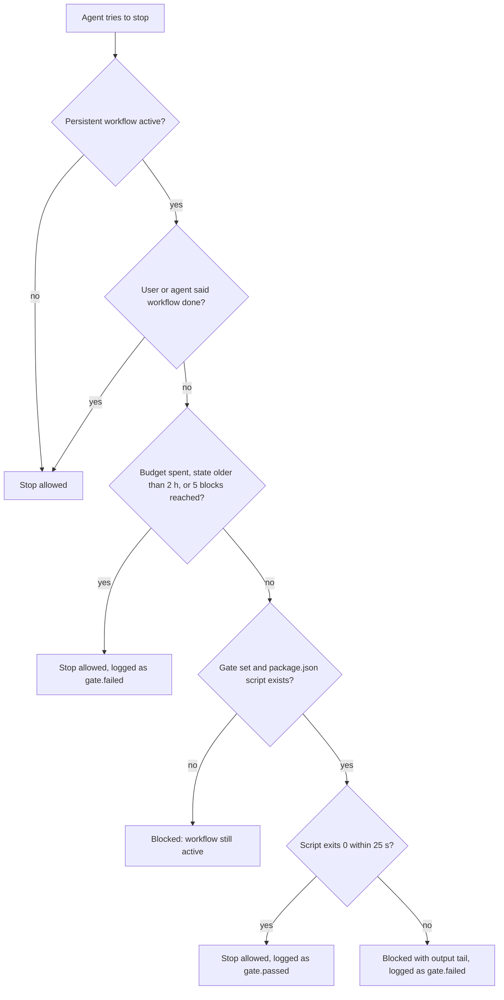

# oh-my-agent: ทีมผู้เชี่ยวชาญสำหรับเอเจนต์เขียนโค้ดที่คุณใช้อยู่แล้ว

[](https://www.npmjs.com/package/oh-my-agent) [](https://www.npmjs.com/package/oh-my-agent) [](https://github.com/first-fluke/oh-my-agent) [](https://github.com/first-fluke/oh-my-agent/blob/main/LICENSE) [](https://github.com/first-fluke/oh-my-agent/commits/main)

[English](../README.md) | [한국어](./README.ko.md) | [中文](./README.zh.md) | [Português](./README.pt.md) | [日本語](./README.ja.md) | [Français](./README.fr.md) | [Español](./README.es.md) | [Nederlands](./README.nl.md) | [Polski](./README.pl.md) | [Русский](./README.ru.md) | [Deutsch](./README.de.md) | [Tiếng Việt](./README.vi.md)

**oh-my-agent (`oma`) เป็น harness ที่ไม่ผูกกับผู้ให้บริการรายใด โดยเพิ่มทีมผู้เชี่ยวชาญให้กับเอเจนต์เขียนโค้ดที่คุณใช้อยู่แล้ว ได้แก่ Claude Code, Codex CLI, Cursor และอีก 11 runtime** ผู้วางแผนแบ่งงานออกเป็นส่วนๆ วิศวกรลงมือสร้างแบบขนาน ผู้รีวิวตรวจผลลัพธ์ และผู้ดีบักแก้ที่สาเหตุต้นตอ นอกจากนี้ยังทำงานวิจัยพร้อมแหล่งอ้างอิง สไลด์ วิดีโอ และภาพได้ด้วย ขั้นตอนส่วนใหญ่ทิ้งไฟล์ที่คุณเปิดดูได้ไว้ และในเวิร์กโฟลว์ที่รันนาน gate สามารถส่งเอเจนต์กลับไปทำงานต่อจนกว่าสคริปต์ `test`, `lint` หรือ `typecheck` ของคุณเองจะผ่าน

[](./assets/architecture/oh-my-agent-architecture.svg)

รันคำสั่งนี้จากรูทของโปรเจกต์:

```bash
curl -fsSL https://raw.githubusercontent.com/first-fluke/oh-my-agent/main/cli/install.sh | bash
```

จากนั้นรัน `oma doctor` แล้วพิมพ์ `/plan add user accounts with a settings page` ในเอเจนต์ของคุณ ส่วน [5 นาทีแรกของคุณ](#your-first-5-minutes) จะพาทำทีละขั้นตอน

## สิ่งที่คุณจะได้รับ

**เวิร์กโฟลว์** คือสิ่งที่คุณพิมพ์ (หรือแค่พูด) เวิร์กโฟลว์จะเรียก **บทบาท** ซึ่งก็คือผู้เชี่ยวชาญเข้ามาทำงาน ส่วน **skill** คือความรู้เฉพาะทาง แต่ละบทบาทมี skill ของตัวเอง และเอเจนต์ของคุณจะโหลด skill ที่เหลือเมื่องานต้องใช้

| | สิ่งที่คุณได้ | ลองใช้ |
|---|---|---|
| **12 บทบาทผู้เชี่ยวชาญ** | PM, สถาปนิก, วิศวกร backend, frontend, mobile, ฐานข้อมูล และ infra, ผู้รีวิว QA, ผู้ดีบัก, ผู้รีแฟกเตอร์, ผู้ดูแลเอกสาร, นักวิจัย ([รู้จักพวกเขา](#meet-the-team)) | `/orchestrate build a TODO app with login` |
| **21 เวิร์กโฟลว์** | คำสั่ง slash ตั้งแต่ `/brainstorm` และ `/plan` ไปจนถึง `/review`, `/debug` และ `/scm` ส่วนใหญ่เริ่มจากคำขอธรรมดาได้ด้วย (คลังคำสำคัญสูงสุด 11 ภาษา) | "review this PR" |
| **33 skill** | ความรู้เฉพาะโดเมนที่โหลดเฉพาะเมื่องานต้องใช้: UI, API, schema, Terraform, CI, ความปลอดภัย, git, observability | โหลดเอง เช่น "add a Terraform S3 bucket" |
| **ไฟล์ที่คุณเปิดดูได้** | แผนงาน เอกสารดีไซน์ API contract, ADR บันทึกบัค ผลลัพธ์รายเอเจนต์ หลักฐานด้านความปลอดภัย เอกสารอธิบาย HTML และสรุปงาน | `ls .agents/results` |
| **การตรวจเวิร์กโฟลว์** | ในเวิร์กโฟลว์ที่รันนาน สคริปต์ `test`, `lint` หรือ `typecheck` ของคุณเองต้องผ่านก่อนเอเจนต์จะหยุดได้ ส่วน `oma ralph verify` ตรวจว่าการรัน `/ralph` ทิ้งไฟล์แผน QA และ refactor ไว้ | `/ultrawork …` แล้วตามด้วย `oma goal set --gate test` |
| **งานวิจัยและคอนเทนต์** | การค้นหาพร้อมแหล่งอ้างอิง วิจัยตลาด งานวิจัยวิชาการ สไลด์ วิดีโอ MP4 ภาพ เสียงบนเครื่อง และการแปลง PDF/HWP เป็น Markdown | `/video`, `/convert` |
| **โฟลเดอร์เดียว 14 runtime** | ไดเรกทอรี `.agents/` ที่พกพาไปได้เพียงชุดเดียว ซึ่งถูกเขียนลงไฟล์คอนฟิกของแต่ละ runtime เอง | `oma link cursor` |

**[ติดตั้ง](#install)** · **[5 นาทีแรก](#your-first-5-minutes)** · **[ทีม](#meet-the-team)** · **[ใช้เวิร์กโฟลว์ไหนดี?](#how-the-team-works-together)** · **[ทุกอย่างในชุด](#everything-in-the-box)** · **[ใช้งานร่วมกับ](#works-with)** · **[การตรวจสอบ](#verification-not-narration)** · **[FAQ](#faq)** · **[เอกสาร](https://first-fluke.github.io/oh-my-agent/)**

<a id="install"></a>
## การติดตั้ง

สคริปต์จะติดตั้ง [bun](https://bun.sh) ให้ถ้ายังไม่มี ติดตั้งคำสั่ง `oma` แบบ global (`bun install --global oh-my-agent` โดยข้ามขั้นนี้ถ้ามี `oma` ใน PATH อยู่แล้ว) จากนั้นเริ่มการตั้งค่าแบบอินเทอร์แอกทีฟ คำสั่ง global นี้สำคัญ เพราะ hook ต่างๆ (การตรวจจับคำสำคัญ, Stop gate) และเวิร์กโฟลว์หลายตัวเรียกใช้ `oma` และ hook จะไม่ทำอะไรเลยแบบเงียบๆ ถ้าหามันไม่เจอ ถ้าคุณไม่ใช้สคริปต์ ให้ติดตั้งเองด้วย `bun install --global oh-my-agent` (ใช้ `npm install --global oh-my-agent` หรือ `brew install oh-my-agent` ก็ได้เช่นกัน)

<details>
<summary>Windows หรือการติดตั้งโดยไม่ใช้สคริปต์</summary>

```powershell
# Windows (PowerShell)
irm https://raw.githubusercontent.com/first-fluke/oh-my-agent/main/cli/install.ps1 | iex
```

```bash
# ทุก OS ที่มี bun: การตั้งค่าแบบเดียวกัน พร้อมคำสั่ง `oma` แบบ global
bun install --global oh-my-agent
oma
```

บน Windows ตัวติดตั้งจะซ่อน Antigravity, Hermes และ Kimi และ hook wrapper เป็นสคริปต์ bash ส่วน browser MCP ค่าเริ่มต้นอย่าง Aside ติดตั้งผ่าน `bash` ดังนั้นถ้าเครื่องคุณไม่มี bash ให้ยกเลิกการเลือกไว้

</details>

การตั้งค่าจะถามภาษาที่ใช้ตอบกลับ, agent runtime ที่จะเชื่อมต่อ, capability provider, browser MCP, preset ของโมเดล และ preset ของ skill **ถ้าไม่แน่ใจ ให้เลือก `All` เป็น preset ของ skill** เพราะเวิร์กโฟลว์จะถูกติดตั้งเสมอ และบางตัว (`/orchestrate`, `/work`, `/ultrawork`, `/ralph`, `/docs`, `/security`) ต้องใช้ skill ที่มีเฉพาะใน `All`

<details>
<summary>สิ่งที่ตัวติดตั้งทำเพิ่มเติมโดยค่าเริ่มต้น</summary>

- ติดตั้ง **bun** (จำเป็น) พยายามติดตั้ง **uv**, **Serena** (`uv tool install`) และ **CUE** (`brew install cue` หรือ `winget`) และทำงานต่อพร้อมคำเตือนถ้าตัวใดติดตั้งไม่สำเร็จ
- เลือก browser MCP **Aside** ไว้ล่วงหน้าในการตั้งค่าแบบโต้ตอบ และจะติดตั้งด้วย `curl -fsSL https://releases.aside.com/install.sh | bash` ก็ต่อเมื่อคุณยังเลือกไว้เท่านั้น ยกเลิกการเลือกได้ในขั้นตอน browser MCP หรือเปลี่ยนภายหลังด้วย `oma update mcp`
- ใช้ **AgentMemory** สำหรับ semantic memory ซึ่งจะรัน `bun install -g @agentmemory/agentmemory` และลงทะเบียนเป็น login service (launchd, systemd user unit หรือ Windows scheduled task) หากต้องการข้าม ให้เลือก provider เป็น `none` หรือตั้ง `OMA_NO_AGENTMEMORY=1`
- ถามก่อนลิงก์ skill เข้าโฟลเดอร์ของ vendor ในโฮมไดเรกทอรี (Antigravity, Hermes, Kimi) ถ้าอยู่ใน `$HOME` โดยไม่มี `--global` จะขอให้ยืนยัน
- เขียนไฟล์บางไฟล์นอกโปรเจกต์โดยไม่ถาม ได้แก่ `~/.claude.json` (ทำเครื่องหมายว่าโปรเจกต์เป็น workspace ของ Claude Code ที่เชื่อถือได้), `~/.serena/` (context ของ OMA, ขนาดคำตอบขั้นต่ำ, การลงทะเบียนโปรเจกต์), `~/.cursor/cli-config.json` (ปิด commit attribution ของ Cursor), `~/.grok/config.toml` (telemetry) และ `~/.gemini/antigravity-cli/` (HUD) โดยแต่ละไฟล์จะเขียนเฉพาะเมื่อคุณเลือก vendor นั้น
- เขียน **การ opt-out telemetry** ลงในการตั้งค่าของ vendor (Claude ใช้ `DISABLE_TELEMETRY=1` ซึ่งจะปิด Claude Code Remote Control ด้วย ส่วน Gemini, Qwen, Codex และ Grok จะปิดสถิติการใช้งาน) ตั้ง `telemetry: true` หากต้องการคงค่าเริ่มต้นของ vendor
- เพิ่มการตั้งค่า Claude Code ที่ยังไม่ได้ตั้งลงใน `.claude/settings.json` รวมถึง `skipDangerousModePermissionPrompt: true`, `effortLevel: high`, `cleanupPeriodDays: 180` และ env flag ที่ปิด auto memory, adaptive thinking, การรายงานข้อผิดพลาด และคำสั่ง git ในตัว ค่าที่คุณตั้งไว้แล้วจะยังคงอยู่
- เพิ่ม **co-author trailer**: commit attribution ของ Claude Code จะกลายเป็น `Co-Authored-By: First Fluke <our.first.fluke@gmail.com>` และ PR จะมีบรรทัด "Generated with oh-my-agent" ตั้ง `scm.co_author.enabled: false` เพื่อปิด
- ติดตั้ง **commit-msg guard** ใน `.githooks/` ซึ่งปฏิเสธที่อยู่ `Co-authored-by` ที่ไม่อยู่ในรายการ และตั้ง `git config --local core.hooksPath .githooks` เมื่อไม่มี hook อื่นทำงานอยู่ ตั้ง `scm.co_author.enforce_hook: false` หากไม่ต้องการใช้
- `oma update` จะอัปเดต `oma` CLI ในเบื้องหลัง (ใช้ `auto_update_cli: false` หรือ `OMA_SKIP_VERSION_CHECK=1` เพื่อหยุด) และรัน `uv tool upgrade serena-agent --prerelease=allow` (`serena.auto_update: false`)
- เมื่อ Serena อยู่ในโหมด `bridge` ซึ่งเป็นค่าเริ่มต้น เซสชัน agent แรกที่เริ่ม Serena server แบบใช้ร่วมกันจะลงทะเบียน **cleanup timer** ที่หยุด Serena server แบบใช้ร่วมกันซึ่งว่างอยู่ทุก 5 นาที (launchd `dev.oma.serena-daemon-gc`, systemd user timer `oma-serena-daemon-gc.timer` หรือ Windows scheduled task `OMA Serena Daemon GC`) ตั้ง `serena.mode: stdio` เพื่อข้าม server แบบใช้ร่วมกันและ timer ของมัน `oma uninstall` จะไม่ลบ timer นี้
- การรันแบบไม่โต้ตอบ (`-y`, `OMA_YES=1`, `CI=true`) จะใช้ preset ของ skill แบบ `All`, `model_preset: auto` และใช้ Python เป็นภาษาฝั่ง backend และจะไม่เลือก browser MCP ใดเลย (และข้ามสคริปต์ติดตั้ง Aside) เว้นแต่ `mcp.devtools_browsers` จะมีรายการอยู่แล้ว

</details>

<details>
<summary>Preset ของ skill</summary>

| Preset | Skill |
|--------|--------|
| **All** | **Skill ทั้ง 33 ตัว** (แนะนำ) |
| Fullstack | architecture, backend, brainstorm, db, debug, design, dev-workflow, frontend, mobile, pm, qa, scm, tf-infra |
| Fullstack Web | Fullstack โดยไม่มี mobile และ tf-infra |
| Fullstack Mobile | Fullstack โดยไม่มี frontend และ tf-infra |
| Frontend | architecture, brainstorm, debug, design, frontend, pm, qa, scm |
| Backend | architecture, backend, brainstorm, db, debug, dev-workflow, pm, qa, scm |
| Mobile | architecture, brainstorm, debug, mobile, pm, qa, scm |
| DevOps | architecture, brainstorm, debug, dev-workflow, observability, pm, qa, scm, tf-infra |
| Research | academic-writing, hwp, market, pdf, scholar, scm, search, translation |
| Content | academic-writing, design, image, scm, translation, voice |
| Custom | เลือก skill ทีละตัว |

ในบรรดา preset ที่มีชื่อ มีเพียง `All` ที่รวม coordination, orchestration, docs, security, refactor, explanation, recap, video, slide และ skill-creation (หรือเลือกเองได้ใน `Custom`) ส่วน Research และ Content ไม่มี skill ที่อยู่เบื้องหลัง `/plan`, `/review`, `/debug`, `/architecture` และ `/brainstorm` ดู [เวิร์กโฟลว์ที่ต้องใช้ skill นอก preset](../web/docs/getting-started/installation.md#workflows-that-need-skills-outside-a-preset)

</details>

<a id="your-first-5-minutes"></a>
## 5 นาทีแรกของคุณ

1. **ติดตั้ง** ด้วยคำสั่งด้านบน
2. **ตรวจสอบการติดตั้ง:**

   ```bash
   oma doctor
   ```

   คุณควรเห็น `CLI Status` (agent CLI ตัวไหนติดตั้งและล็อกอินแล้วบ้าง) และ `Skills Status` (เช่น `Skills (33/33 installed, 33 complete)`) ถ้าหา `oma` ไม่เจอ ให้เปิดเทอร์มินัลใหม่ (ตัวติดตั้งอาจเพิ่งเพิ่ม `~/.bun/bin` ลงใน PATH) หรือรัน `bun install --global oh-my-agent`
3. **เปิดเอเจนต์ในโปรเจกต์แล้วขอแผนงาน:**

   ```text
   /plan add user accounts with a settings page
   ```

   หรือแค่เขียนว่า "plan user accounts with a settings page" ก็ได้ เพราะบน runtime ที่มี prompt hook คำสำคัญนี้จะเริ่มเวิร์กโฟลว์เดียวกัน
4. **ดูว่าได้อะไรออกมา** `/plan` รันในเซสชันปัจจุบัน สำหรับงานที่ครอบคลุมหลายส่วนอย่างงานนี้ มันจะเขียน `.agents/results/plan-<session-id>.json` และ tracker ที่ `docs/plans/work/<NNN>-<name>.md` ส่วนคำขอเล็กๆ ที่อยู่ในส่วนเดียวจะได้คำแนะนำโดยตรงแทนไฟล์แผน

สำหรับงานที่มีหลายส่วน ให้ใช้แผนนี้กับ `/work` หรือ `/orchestrate`

<a id="meet-the-team"></a>
## รู้จักทีม

เอเจนต์ของคุณเองเป็นผู้นำทีม ใน `/work`, `/orchestrate` และ `/ultrawork` มันจะส่งงานแต่ละชิ้นให้ผู้เชี่ยวชาญที่เหมาะสม ซึ่งรันเป็น subagent แยกของตัวเอง ส่วน `/plan`, `/architecture` และ `/docs` รันในเซสชันปัจจุบันของคุณด้วย skill ของบทบาทนั้น และ `/review` กับ `/debug` จะเรียกผู้เชี่ยวชาญของตัวเองเข้ามาเมื่องานมีขอบเขตใหญ่ เมื่อบทบาทใดอยู่บน CLI ของผู้ให้บริการรายอื่น `oma agent spawn` จะรันบทบาทนั้นที่นั่น

| ผู้เชี่ยวชาญของคุณ | skill ที่ใช้ | เรียกใช้ด้วย | สิ่งที่ทิ้งไว้ |
|---|---|---|---|
| **ผู้จัดการผลิตภัณฑ์** (`pm-planner`) | oma-pm | `/plan` หรือ "plan the payment feature" | JSON แผนงานและ tracker ใน `docs/plans/work/` สำหรับงานระดับ Medium และ Complex (คำขอระดับ Simple จะได้คำแนะนำโดยตรง) |
| **สถาปนิก** (`architecture-reviewer`) | oma-architecture | `/architecture` | ADR หรือคำแนะนำใน `.agents/results/architecture/` |
| **วิศวกร backend, frontend, mobile, ฐานข้อมูล และ infra** | oma-backend, oma-frontend + oma-design, oma-mobile, oma-db, oma-tf-infra | `/work`, `/orchestrate` | โค้ด เทสต์ และไฟล์ `result-<agent>` หนึ่งไฟล์ต่องาน |
| **ผู้รีวิว QA** (`qa-reviewer`) | oma-qa | `/review` หรือ "review this PR" | ผลการตรวจที่จัดลำดับจาก CRITICAL ถึง LOW แต่ละข้อมี file:line และโค้ดแก้ไข |
| **ผู้ดีบัก** (`debug-investigator`) | oma-debug | `/debug` หรือ "fix this bug" | การแก้ไขขั้นต่ำ regression test และบันทึกบัคใน `.agents/results/bugs/` เมื่อจำเป็น |

<details>
<summary>อีกสามบทบาท และ skill ที่ไม่มีบทบาทประจำ</summary>

| ผู้เชี่ยวชาญของคุณ | skill ที่ใช้ | เรียกใช้ด้วย | สิ่งที่ทิ้งไว้ |
|---|---|---|---|
| **ผู้รีแฟกเตอร์** (`refactor-engineer`) | oma-refactor | เฟส REFINE ของ `/ultrawork` | คอมมิต `refactor:` ที่คงพฤติกรรมเดิม และรายงาน `result-refactor-<session>.md` |
| **ผู้ดูแลเอกสาร** (`docs-curator`) | oma-docs | `/docs` หรือ "verify docs" | `docs/generated/doc-refs.json` และแพตช์เอกสารที่คุณอนุมัติ |
| **นักวิจัย** (`research-explorer`) | oma-search, oma-market, oma-scholar | คำขอด้านการวิจัย | แหล่งอ้างอิงพร้อมป้ายระดับความน่าเชื่อถือ และสรุปตลาดใน `.agents/results/market/` |

วิศวกร infra (`tf-infra-engineer`) ถูกกำหนดให้ถามก่อน `apply` หรือ `destroy` ใดๆ ที่ทำลายข้อมูลหรือกระทบ production ส่วน skill ที่เหลือ (brainstorm, security, scm, dev-workflow, observability, explanation, recap, translation, coordination, orchestration, skill-creation รวมถึงคอนเทนต์และมีเดีย) ไม่มีบทบาทประจำ เอเจนต์ของคุณจะโหลดเอง และสำหรับ skill ส่วนใหญ่ ตัว skill injector จะแนะนำ skill ที่เหมาะสมจาก prompt ของคุณ

</details>

<a id="how-the-team-works-together"></a>
## ทีมทำงานร่วมกันอย่างไร

```text
 THINK   /brainstorm ......................... docs/plans/designs/<NNN>-<feature>.md
 PLAN    /plan · /architecture ............... plan JSON, API contracts, ADR
 DESIGN  /design ............................. DESIGN.md + tokens
 BUILD   /work · /orchestrate · /ultrawork ... code + result-<agent> files, engineers in parallel
 CHECK   /review · /security · /debug ........ findings, security evidence, regression test
 SHIP    /scm · /docs ........................ Conventional Commits, doc fixes
```

แต่ละขั้นส่งไฟล์ต่อให้ขั้นถัดไป `/brainstorm` บันทึกดีไซน์ที่ `/plan` จะอ่าน และ `/plan` เขียนแผนที่ทุกงานมีเอเจนต์ dependency เกณฑ์การยอมรับ และคำสั่งตรวจสอบ `/orchestrate` รันแผนนั้น (โหลด `plan-*.json` ล่าสุด หรือเขียนขึ้นใหม่) ส่วน `/work` และ `/ultrawork` เริ่มด้วยการให้ PM เขียนแผนของตัวเอง ข้ามขั้นไหนที่ไม่ต้องการก็ได้ และทุกขั้นก็ใช้งานแยกเดี่ยวได้เช่นกัน

**ควรให้เวิร์กโฟลว์ไหนสั่งงานทีม?**

| คุณต้องการ | รัน | จบอย่างไร |
|---|---|---|
| แค่แผนงาน | `/plan` | ไฟล์แผนสำหรับงานหลายส่วน หรือคำแนะนำโดยตรงสำหรับงานเล็ก |
| การสร้างที่ PM เป็นผู้นำ โดยคุณติดตามทีละขั้น | `/work` | PM ก่อน จากนั้นวิศวกรทีละ tier แล้วจึง QA ผลการตรวจระดับ CRITICAL และ HIGH จะเข้าลูปแก้ไข (สูงสุด 5 รอบ) |
| การสร้างแบบขนานที่ปล่อยให้ทำเอง | `/orchestrate` | นับว่าเสร็จเฉพาะงานที่ผ่านการตรวจ แต่ละงานลองได้สูงสุด 3 ครั้ง จากนั้นจะถูกทำเครื่องหมายเป็น partial หรือ failed |
| เวิร์กโฟลว์ 5 เฟส | `/ultrawork` | 5 เฟสที่มี gate (PLAN, IMPL, VERIFY, REFINE, SHIP) ทุกการรีวิวรันในเซสชันผู้รีวิวใหม่ |
| "อย่าหยุดจนกว่าจะเสร็จจริง" | `/ralph` | ทำ `/ultrawork` ซ้ำโดยมีผู้ตัดสินที่ spawn แยกต่างหากและมีคอนเท็กซ์ใหม่ จนกว่าทุกเกณฑ์จะผ่าน และจะหยุดพร้อมรายงานบางส่วนเมื่อเกณฑ์ติดขัดหรือครบ 5 iteration |
| ทีมที่ทำงานตามเวลาที่ตั้งไว้ | `oma schedule create qa-reviewer "review open PRs" --every 2h` | log แบบ Markdown หนึ่งไฟล์ต่อการรันใน `~/.oma/schedule/runs/<id>/` |

คุณไม่จำเป็นต้องใช้คำสั่ง slash บน runtime ที่มี prompt hook คำขอธรรมดา (คลังคำสำคัญสูงสุด 11 ภาษา) เริ่มเวิร์กโฟลว์ส่วนใหญ่ได้ เช่น "review this PR" จะเริ่ม `/review` การอธิบายแอปทั้งตัว ("Build a TODO app with user authentication") จะแนะนำ `/orchestrate` และเอเจนต์ของคุณจะตัดสินใจเองว่าจะรันหรือไม่ คำสำคัญที่อยู่ในบล็อกโค้ดจะถูกละเว้น

`/orchestrate`, `/work`, `/ultrawork` และ `/ralph` เป็นแบบ **persistent** เมื่อคุณเรียกด้วยชื่อ ไม่ว่าจะเป็นคำสั่ง slash หรือข้อความธรรมดา ("ultrawork: add rate limiting") จากนั้นเมื่อเอเจนต์พยายามหยุดก่อนเวลา มันจะถูกส่งกลับไปทำงานต่อ (สูงสุด 5 ครั้งหรือ 2 ชั่วโมง) จนกว่าคุณจะพูดว่า **"workflow done"** ส่วนคำขอที่ตรงกันแบบหลวมๆ จะแค่แนะนำเวิร์กโฟลว์เหล่านี้เท่านั้น

**วัดผลแล้ว แต่มีข้อควรระวัง** ใน[เบนช์มาร์ก](../benchmarks/README.md) (prompt เดียว, Claude Code กับการตั้งค่าส่วนเสริม 5 แบบ รวมถึงแบบไม่มีส่วนเสริม, `claude-opus-4-6`, บิลด์แบบละหนึ่งครั้ง) oma ได้คะแนน 80.6 เทียบกับ 70.7 ของ Claude Code แบบปกติ โดยมีค่าใช้จ่ายสูงกว่า 1.7 เท่า ($4.04 เทียบกับ $2.37) และใช้เวลามากกว่า 1.8 เท่า

<details>
<summary>เวิร์กโฟลว์ทั้ง 21 ตัว</summary>

| คำสั่ง | หน้าที่ |
|---------|--------------|
| `/architecture` | ชั่งน้ำหนัก tradeoff ด้านดีไซน์ และให้คำแนะนำ รีวิว หรือ ADR |
| `/brainstorm` | สำรวจไอเดียและข้อจำกัด แล้วได้ดีไซน์ที่อนุมัติแล้วก่อนเริ่มวางแผน |
| `/convert` | แปลง PDF/HWP เป็น Markdown หรือแปลงไฟล์ภาพ วิดีโอ และเสียงด้วย ffmpeg |
| `/debug` | ทำให้บัคเกิดซ้ำ แก้ที่สาเหตุต้นตอ เขียน regression test และสแกนหารูปแบบที่คล้ายกัน |
| `/deepinit` | สำรวจโค้ดเบสที่มีอยู่แล้วสรุปเป็น AGENTS.md, ARCHITECTURE.md และคลังความรู้ docs/ |
| `/design` | สร้าง design system, DESIGN.md และ tokens พร้อมการตรวจ accessibility |
| `/docs` | หา reference ในเอกสารที่เสีย และเสนอแพตช์สำหรับเอกสารที่ diff ไปแตะ |
| `/explain` | แปลง diff, PR, branch หรือหัวข้อใดๆ เป็นเอกสารอธิบาย HTML แบบอินเทอร์แอกทีฟในไฟล์เดียว |
| `/orchestrate` | รันเอเจนต์แบบขนาน ประสานงานผ่านสถานะในไฟล์ และตรวจสอบผลลัพธ์ (persistent) |
| `/plan` | ย่อยฟีเจอร์เป็นงานที่จัดลำดับความสำคัญแล้วพร้อม API contract |
| `/ralph` | ทำ `/ultrawork` ซ้ำโดยมีผู้ตัดสินที่ spawn แยกต่างหาก สูงสุด 5 iteration (persistent) |
| `/recap` | สรุปประวัติการสนทนากับ AI ของคุณในหนึ่งวันหรือช่วงเวลาหนึ่ง |
| `/review` | รีวิวความปลอดภัย (OWASP Top 10) ประสิทธิภาพ accessibility (WCAG 2.2 AA) และคุณภาพโค้ด |
| `/schedule` | ลงทะเบียนงานเอเจนต์ให้รันซ้ำตามรอบเวลาที่กำหนด |
| `/scm` | จัดการ branch, merge, conflict, worktree และ Conventional Commits |
| `/security` | สแกนซอร์สโค้ด skill ของเอเจนต์ และส่วนประกอบ MCP ตรวจสอบผลที่พบ และตั้งค่า gate ของ CI |
| `/stack-set` | ตรวจหา tech stack ของคุณและสร้าง reference เฉพาะ stack ให้ domain skill ใช้ |
| `/tools` | แสดงรายการ เปิด และปิดเครื่องมือ MCP ด้วยภาษาธรรมดา |
| `/ultrawork` | 5 เฟส (PLAN, IMPL, VERIFY, REFINE, SHIP) โดยแต่ละการรีวิวรันในเซสชันผู้รีวิวใหม่ (persistent) |
| `/video` | เปลี่ยน brief เป็นไฟล์ MP4 ที่เสร็จสมบูรณ์ผ่านไปป์ไลน์ที่ไม่บังคับต้องมีคีย์ |
| `/work` | ประสานงานเอเจนต์หลายตัวในโปรเจกต์หลายโดเมน โดยมี PM วางแผนและ QA รีวิว (persistent) |

`oma verify triggers` ประเมินตัวตรวจจับด้วยชุดข้อมูล prompt ภาษาอังกฤษและภาษาเกาหลี 212 รายการที่ติดป้ายกำกับไว้ และ CI จะล้มเหลวหากอัตรา false-fire เกิน 10% หรืออัตรา missed-fire เกิน 20% ผลวัดล่าสุด: **0% missed-fire, 5.3% false-fire** เอกสารอ้างอิงฉบับเต็ม: [Workflows](https://first-fluke.github.io/oh-my-agent/docs/core-concepts/workflows/)

</details>

<a id="see-it-work"></a>
## ดูการทำงานจริง

ตัวอย่างเซสชัน `/ultrawork` บล็อก `[OMA PERSISTENT MODE: ULTRAWORK]` คือรูปแบบที่ Stop hook พิมพ์ออกมาจริงทุกตัวอักษร ส่วนบรรทัดอื่นเป็นการถอดความ:

```text
you    /ultrawork add rate limiting to POST /login
agent  runs `oma goal set --gate test`
agent  PLAN writes .agents/results/plan-<run-id>.json
agent  IMPL -> VERIFY -> REFINE -> SHIP  (each review runs in a fresh reviewer session)
agent  "Rate limiting added. All tests pass."
oma    [OMA PERSISTENT MODE: ULTRAWORK]
       Stop gate 'test' FAILED (reinforcement 1/5).
       Fix the failures below, then finish the workflow — the stop is allowed only when the gate passes.
       --- gate output (tail) ---
       FAIL  src/auth/login.test.ts > returns 429 after 5 attempts
       To abandon instead: delete .agents/state/ultrawork-state-<host-session>.json or say "workflow done".
agent  fixes the limiter and stops again
oma    `test` exits 0: stop allowed, gate.passed appended to the session log
```

หลังจากนั้น `oma state list` จะหาเซสชันเจอ และ `oma state get <oma-sid>` (ID ที่ `state list` แสดงออกมา) จะแสดง event ของ gate ทั้งหมด ภายใต้ `/ralph` คำสั่ง `oma ralph verify --json` ยังตรวจด้วยว่าแต่ละเฟสทิ้งไฟล์ของตัวเองไว้หรือไม่ (ตัดเอาต์พุตให้สั้นลง):

```json
{ "ok": false,
  "missing": [{ "id": "A3", "description": "a distinct QA agent ran (VERIFY phase)",
                "pattern": ".agents/state/memories/result-qa*.md or .agents/results/result-qa*.md",
                "status": "missing" }] }
```

<a id="everything-in-the-box"></a>
## ทุกอย่างในชุด

<details>
<summary><strong>วางแผนและออกแบบ</strong>: <code>/brainstorm</code>, <code>/plan</code>, <code>/architecture</code>, <code>/design</code></summary>

| คำสั่ง | หน้าที่ | ไฟล์ที่เขียน |
|---|---|---|
| `/brainstorm` | ถามคำถามเพื่อความชัดเจนทีละข้อ และเสนอ 2-3 แนวทางที่ทำงานต่างกัน แล้วส่งต่อให้ `/plan` ไม่เขียนโค้ด | `docs/plans/designs/<NNN>-<feature>.md` |
| `/plan` | ประเมินขนาดงานเป็น Simple, Medium หรือ Complex สำหรับงาน Medium และ Complex จะแบ่งเป็นงานย่อยที่แต่ละงานมีเอเจนต์ dependency เกณฑ์การยอมรับ และคำสั่งตรวจสอบ และกำหนด API contract เมื่องานข้ามขอบเขต | `.agents/results/plan-<sid>.json`, `docs/plans/work/<NNN>-<name>.md` และ contract ใน `.agents/results/api-contracts/` เมื่อจำเป็น |
| `/architecture` | อ่านการตัดสินใจก่อนหน้าก่อน เปรียบเทียบอย่างน้อย 2 ทางเลือก และทำเครื่องหมาย ADR ที่ถูกแทนที่ว่า superseded | ADR หรือคำแนะนำใน `.agents/results/architecture/` |
| `/design` | เสนอ 2-3 แนวทาง จากนั้นเขียน `DESIGN.md` พร้อม tokens และตรวจ responsive layout และ accessibility | `DESIGN.md`, tokens สำหรับ CSS/Tailwind/shadcn |

</details>

<details>
<summary><strong>สร้าง</strong>: domain skill 7 ตัว พร้อม <code>/stack-set</code> เพื่อปรับให้เข้ากับ stack ของคุณ</summary>

| Skill | สร้างอะไร |
|---|---|
| oma-frontend | UI ด้วย React/Next.js หรือ Angular ที่ทำตาม tokens, i18n และกฎ accessibility ของคุณ |
| oma-backend | API, auth และการเข้าถึงข้อมูล แบ่งเลเยอร์เป็น router → service → repository |
| oma-mobile | แอป Flutter, React Native หรือ Swift |
| oma-db | schema, migration, query tuning และแผนการดึงข้อมูลแบบ vector/RAG |
| oma-tf-infra | Terraform สำหรับคลาวด์ใดก็ได้ พร้อมชี้ความเสี่ยงด้าน drift การเปลี่ยนแปลงที่ทำลายข้อมูล และค่าใช้จ่าย |
| oma-dev-workflow | mise tasks, lint/format/typecheck, commitlint, git hooks, CI/CD และ release |
| oma-observability | OpenTelemetry, SLO, alerting และการสืบหาสาเหตุของ incident |

`/stack-set` อ่าน manifest ของคุณและเขียน reference เฉพาะ stack ให้ skill ฝั่ง backend, frontend และ mobile ใน monorepo วิศวกร frontend, backend และ mobile จะถูกชี้ไปยัง workspace ของตัวเอง (pnpm, npm/yarn/bun workspaces, lerna, nx, turbo, `mise.toml`)

</details>

<details>
<summary><strong>รีวิว แก้ไข และส่งมอบ</strong>: <code>/review</code>, <code>/security</code>, <code>/debug</code>, refactor, <code>/scm</code></summary>

| คำสั่งหรือ skill | หน้าที่ | ไฟล์ที่เขียน |
|---|---|---|
| `/review` | ตรวจ dependency ก่อน จากนั้นตรวจ OWASP Top 10 ประสิทธิภาพ WCAG 2.2 AA และคุณภาพโค้ด ผลการตรวจทุกข้อมี file:line และโค้ดแก้ไข | รายงานในแชตพร้อมบันทึก memory ไม่มีไฟล์รายงาน |
| `/security` | สแกนซอร์สโค้ด skill ของเอเจนต์ และเซิร์ฟเวอร์ MCP ของคุณ (Deepsec, Cisco Skill and MCP Scanner) และเมื่อมี test deployment ที่กำหนดขอบเขตไว้ จะรัน pen test ด้วย ARTEX เวิร์กโฟลว์กำหนดให้รายงาน engine ที่รันไม่สำเร็จว่าล้มเหลว ไม่ใช่ว่าสะอาด | `.agents/results/security/<run-id>/` |
| `/debug` | ทำให้ความผิดพลาดเกิดซ้ำ แก้ที่สาเหตุต้นตอด้วยการเปลี่ยนแปลงขั้นต่ำ เพิ่ม regression test และสแกนหารูปแบบเดียวกันในที่อื่น | การแก้ไขและเทสต์ พร้อมบันทึกบัคใน `.agents/results/bugs/` เมื่อจำเป็น |
| oma-refactor | เปลี่ยนโครงสร้างโดยไม่เปลี่ยนพฤติกรรม: เขียน characterization test ก่อน แล้วจึงคอมมิตเฉพาะ refactor | `.agents/results/refactor/` |
| `/scm` | Conventional Commits ที่แยกตามการเปลี่ยนแปลงเชิงตรรกะ รวมถึง branch, merge, rebase และ worktree | คอมมิตและ branch |

</details>

<details>
<summary><strong>เอกสารและความรู้</strong>: <code>/deepinit</code>, <code>/docs</code>, <code>/explain</code>, <code>/recap</code>, translation</summary>

| คำสั่งหรือ skill | หน้าที่ | ไฟล์ที่เขียน |
|---|---|---|
| `/deepinit` | เปลี่ยน repo ที่มีอยู่ให้เป็นคลังความรู้ที่เอเจนต์พร้อมใช้ | `AGENTS.md`, `ARCHITECTURE.md`, `docs/` |
| `/docs` | หา reference ที่เสีย แพตช์เอกสารที่ diff ไปแตะ (เฉพาะแพตช์ที่คุณอนุมัติ) และหาคำแปลที่ล้าสมัย | `docs/generated/doc-refs.json`, เอกสารที่แพตช์แล้ว |
| `/explain` | แปลง PR, branch หรือการเปลี่ยนแปลงที่ stage ไว้เป็น walkthrough แบบ HTML พร้อมแบบทดสอบ 5 ข้อ หรือแปลงหัวข้อเป็นเอกสารอธิบายแบบภาพหน้าเดียว | `.agents/results/explain/<date>-<slug>.html` |
| `/recap` | สรุปการสนทนากับ AI ของคุณข้ามเครื่องมือในหนึ่งวันหรือช่วงเวลาหนึ่ง | `.agents/results/recap/<date>.md` |
| oma-translation | แปลให้อ่านแล้วเป็นธรรมชาติเหมือนเจ้าของภาษา โดย placeholder, โค้ด และ locale key ไม่เปลี่ยน | ข้อความที่แปลแล้ว |

</details>

<details>
<summary><strong>งานวิจัย</strong>: การค้นหา ตลาด งานวิจัยวิชาการ การเขียนเชิงวิชาการ</summary>

| Skill | หน้าที่ | ไฟล์ที่เขียน |
|---|---|---|
| oma-search | ค้นหาเอกสาร เว็บ และโค้ด พร้อมป้ายระดับความน่าเชื่อถือในแต่ละแหล่ง | ผลลัพธ์พร้อมแหล่งอ้างอิง |
| oma-market | หา pain point เทรนด์ และคู่แข่งจากสัญญาณคอมมิวนิตี้ แล้ววิเคราะห์ด้วยกรอบ SWOT, Porter's 5 Forces และ PESTEL | `.agents/results/market/<topic>-<date>.md` |
| oma-scholar | ค้นหางานวิจัยโดยอ่านไฟล์ข้อกล่าวอ้างแบบกะทัดรัด (รูปแบบ Knows ประมาณ 700 token) แทน PDF ฉบับเต็ม (ประมาณ 10K token) | `<paper>.knows.yaml` |
| oma-academic-writing | ร่างและตรวจสอบงานเขียนเชิงวิชาการตาม rubric | ไฟล์ของคุณ |

</details>

<details>
<summary><strong>คอนเทนต์และมีเดีย</strong>: <code>/video</code>, <code>/convert</code>, สไลด์, ภาพ, เสียง</summary>

| คำสั่งหรือ skill | สร้างอะไร | ไฟล์ที่เขียน |
|---|---|---|
| `/video` | วิดีโอสั้น วิดีโออธิบาย หรือเดโมเป็นไฟล์ MP4 ที่เสร็จสมบูรณ์ ผู้ให้บริการที่ต้องใช้คีย์มีทางเลือกสำรองที่ไม่ต้องใช้คีย์ | `.agents/results/videos/<run>/` พร้อม manifest |
| oma-slide | เด็ค HTML ขนาด 1920×1080 ส่งออกเป็น PDF, PNG หรือ PPTX | `.agents/results/slides/<session>/` |
| oma-image | สร้างภาพผ่าน CLI ของผู้ให้บริการที่คุณล็อกอินไว้ แล้วเทียบกันแบบเคียงข้าง | `.agents/results/images/<run>/` |
| oma-voice | แปลงข้อความเป็นเสียงและถอดเสียงบนเครื่องผ่านแอป Voicebox | `.agents/results/voice/<run>/` |
| `/convert` | แปลง PDF หรือ HWP เป็น Markdown และแปลงภาพ วิดีโอ และเสียงผ่าน ffmpeg | วางไว้ข้างไฟล์อินพุต |

ไปป์ไลน์เหล่านี้จะรายงานเมื่อไม่มีแหล่งข้อมูลหรือคีย์ของผู้ให้บริการ แทนที่จะคืนผลลัพธ์ที่บางลงอย่างเงียบๆ

</details>

<details>
<summary><strong>Hook ที่ทำงานเองโดยไม่ต้องสั่ง</strong></summary>

| Hook | หน้าที่ | วิธีปิด / ขีดจำกัด |
|---|---|---|
| เริ่มด้วยคำสำคัญ | เริ่มเวิร์กโฟลว์ที่ตรงกันจากคำขอธรรมดา | ข้ามคำถาม ข้อความที่วางมา และบล็อกโค้ด |
| Skill injector | ชี้ให้เอเจนต์ของคุณใช้ skill ที่เหมาะกับ prompt | หยุดชั่วคราวขณะที่ persistent workflow ทำงานอยู่ |
| Stop gate | ส่ง persistent workflow กลับไปทำงานต่อ เมื่อใช้ `oma goal set --gate test` จะอนุญาตให้หยุดเมื่อสคริปต์นั้นจบด้วย exit code 0 ภายใน 25 วินาที | พูดว่า "workflow done" นอกจากนี้ยังปลดเองหลังบล็อกครบ 5 ครั้งหรือ 2 ชั่วโมง |
| Refactor guard | ตอนหยุด จะชี้ไฟล์ที่แก้ไขซึ่งยาวเกิน 500 บรรทัดให้ `refactor-engineer` | ต้องเปิดเอง: `refactor_guard.enabled` |
| Secret guard | บล็อก `git add` ของ `*.env`, `*.pem`, `id_rsa*`, `*.tfstate` และไฟล์ทำนองเดียวกัน | เติม `OMA_SCM_ALLOW_SECRETS=1` หน้าคำสั่งนั้นเพียงคำสั่งเดียว |
| Code-search guard | บล็อกการค้นหาแบบ recursive ของเครื่องมือเนทีฟในโปรเจกต์ เพื่อให้เอเจนต์ใช้ Serena หรือ Gortex | `providers.code_intelligence_guard: off` |
| Test filter | เก็บเฉพาะความล้มเหลวและสรุปจากเอาต์พุตของเทสต์ เพื่อใช้ token น้อยลง | `OMA_TEST_FILTER=0` |
| Session memory | เมื่อคุณสลับหรือกลับมาทำเซสชันต่อ (หรือหลัง compaction) จะฉีด event ล่าสุดของเซสชันที่ทำงานอยู่กลับเข้าไปพร้อมสิ่งที่ AgentMemory เรียกคืนได้ | ตั้ง memory provider เป็น `none` หรือ `OMA_NO_AGENTMEMORY=1` เพื่อปิดการเรียกคืน ส่วน snapshot ของ event บนเครื่องยังคงอยู่ |

`oma hook probe` ตรวจว่า prompt hook ของ oma รับ hook input ของแต่ละ runtime ได้ (ไม่ได้เปิด runtime ขึ้นมาจริง) ส่วน runtime ไหนเชื่อม hook อะไรบ้าง ดูได้ที่ [ความแตกต่างของโฮสต์](#host-differences)

</details>

<details>
<summary><strong>เอเจนต์แบบขนาน เซสชัน และแดชบอร์ด</strong></summary>

- `oma agent spawn <role> "<task>" <sid>` รันบทบาทบน Antigravity, Claude Code, Codex, Cursor, Grok, Kimi Code, Kiro, OpenCode, pi หรือ Qwen Code พร้อม `--isolation worktree` และ `--fallback-vendors` ส่วน `oma agent parallel` รันหลายบทบาทพร้อมกัน เป้าหมาย dispatch ทั้ง 10 รายการนี้เป็นส่วนหนึ่งของการเชื่อมต่อ 14 รายการในตัวติดตั้ง
- `oma state list --all-projects` และ `oma state get <sid>`: เซสชันและทุก event ที่บันทึกไว้
- `oma dashboard terminal` / `oma dashboard web`: สถานะเอเจนต์แบบเรียลไทม์ (แดชบอร์ดเว็บ listen เฉพาะ `127.0.0.1`) [คู่มือแดชบอร์ด](../web/docs/guide/dashboard-monitoring.md)
- `oma stats get` (ตัวชี้วัดประสิทธิภาพการทำงาน), `oma retro` (retrospective จาก git), `oma recap --window 7d` (สิ่งที่คุณทำข้ามเครื่องมือ AI)
- `oma visualize --affected <paths>`: skill, เวิร์กโฟลว์, เอเจนต์ และการตรวจใดบ้างที่ขึ้นอยู่กับไฟล์ `.agents/` ที่คุณแก้

</details>

<details>
<summary><strong>Code intelligence, memory และ MCP</strong></summary>

| ช่อง | ค่าเริ่มต้น | ทางเลือก |
|---|---|---|
| Docs | Context7 | — |
| ค้นหาเว็บ | การค้นหาเนทีฟของ runtime | Brave Search |
| Code intelligence | Serena หนึ่งเซิร์ฟเวอร์ใช้ร่วมกันต่อโปรเจกต์ | Gortex (ทดลอง) |
| Semantic memory | AgentMemory | Honcho (ทดลอง), none |
| Browser MCP | Aside | Chrome DevTools, Firefox DevTools |

Serena ให้บริการนำทางโค้ดและวินิจฉัยปัญหาด้วย LSP รวมถึง feedback จากการแก้ไขแบบเนทีฟเมื่อรองรับ การเลือก provider แยกจาก runtime ของเอเจนต์ ความสามารถจะแตกต่างกันไปตาม provider และโฮสต์

เอเจนต์ประสานงานกันผ่านไฟล์ธรรมดาใน `.agents/state/` โดยไม่พึ่งบริการภายนอก `/tools` เปิดหรือปิดเครื่องมือ MCP ด้วยภาษาธรรมดา รายละเอียด: [ผู้ให้บริการความสามารถ (Capability Providers)](./capability-providers.md)

</details>

<details>
<summary><strong>ดีขึ้นเรื่อยๆ ตามเวลา</strong></summary>

- `oma skill eval` วัดว่า skill ช่วยยกระดับผลได้แค่ไหนเทียบกับ baseline บนงานที่กันไว้ `oma skill optimize` เสนอการแก้ไขที่ทำให้ค่านั้นสูงขึ้น และ `--apply` จะเก็บการแก้ไขนั้นไว้ ([คู่มือ skill-eval](../web/docs/guide/skill-eval.md))
- `oma harness evolution enable --max-dispatches <n>` ตั้งรอบการทำงานทุกคืนที่เปลี่ยนการรันที่ล้มเหลวให้เป็น regression fixture และนำการปรับปรุง skill ที่ผ่านการประเมินไปใช้เป็น project overlay เพิ่ม `--mode propose` หากต้องการแค่บันทึกไว้
- `oma emit` ส่งออกซอร์ส `.agents/` เป็นแพ็กเกจ Agent Skills, แพ็กเกจ Agent Plugins, Claude Code plugin marketplace หรือ `AGENTS.md`

</details>

<details>
<summary><strong>คอนฟิกและราวกันความปลอดภัย</strong></summary>

- `.agents/oma-config.yaml` ไฟล์เดียวที่ผู้ใช้เป็นเจ้าของจะคงอยู่หลังการอัปเดต (มีเพียง `oma update --force` ที่รีเซ็ตมัน) และวาง overlay ส่วนตัวแบบ `.local.yaml` หรือ `.local.cue` ซ้อนไว้ด้านบนได้ `language` กำหนดภาษาที่ใช้ตอบกลับ
- กฎของโปรเจกต์ 13 ข้อ (backend, commit, database, debug, design และอื่นๆ) โหลดเป็นกฎเนทีฟใน Claude Code และ Cursor และถูกจัดทำดัชนีไว้ในบล็อก `AGENTS.md` ที่ oma จัดการ ซึ่งเขียนไว้สำหรับ Codex, Qwen Code และ Pi
- การอัปเดตจะเก็บข้อมูลสำรองของคอนฟิกและการ migration ไว้ใน `.agents/backup/` ส่วน skill และเวิร์กโฟลว์ที่มาพร้อมแพ็กเกจจะถูกแทนที่ในตำแหน่งเดิม ดังนั้นให้เก็บการแก้ไขในเครื่องไว้นอกไฟล์เหล่านั้น `oma uninstall --dry-run` แสดงสิ่งที่จะถูกลบ ส่วน `first-fluke/oma-update-action@v1` รัน `oma update` ใน CI และเปิด PR

</details>

<details>
<summary><strong>สกิลทั้ง 33 รายการ</strong></summary>

| สกิล | ทำอะไร |
|---|---|
| **oma-academic-writing** | ร่าง แก้ไข และตรวจสอบงานเขียนเชิงวิชาการ |
| **oma-architecture** | ชั่งน้ำหนัก tradeoffs ด้านสถาปัตยกรรมและกำหนดขอบเขตโมดูล พร้อมวิเคราะห์ด้วย ADR/ATAM/CBAM |
| **oma-backend** | สร้าง API ระบบยืนยันตัวตน และการเข้าถึงข้อมูลด้วย Python, Node.js หรือ Rust |
| **oma-brainstorm** | สำรวจไอเดียร่วมกับคุณก่อนตัดสินใจลงมือสร้างจริง |
| **oma-coordination** | แนะนำการประสานงานเอเจนต์ PM, frontend, backend, mobile และ QA แบบแมนวลทีละขั้นตอน |
| **oma-db** | ออกแบบ schema, migration, index และ vector store |
| **oma-debug** | ค้นหาสาเหตุต้นตอ แก้บัก และเขียน regression test |
| **oma-design** | สร้าง design system พร้อม token, accessibility และ responsive layout |
| **oma-dev-workflow** | ทำให้ CI/CD, release และงานใน monorepo เป็นอัตโนมัติ |
| **oma-docs** | ตรวจหาการอ้างอิงที่เสียในเอกสาร ซิงก์เอกสารให้ตรงกับการเปลี่ยนแปลงโค้ด และแจ้ง translation drift |
| **oma-explanation** | แปลง diff, PR, branch หรือหัวข้อเป็นเอกสารอธิบาย HTML ในไฟล์เดียว พร้อมแบบทดสอบสำหรับการเปลี่ยนแปลงโค้ด |
| **oma-frontend** | สร้าง UI ด้วย React/Next.js หรือ Angular |
| **oma-hwp** | แปลงไฟล์ HWP, HWPX และ HWPML ให้เป็น Markdown |
| **oma-image** | สร้างภาพและภาพแปรผันจากภาพอ้างอิง และเปรียบเทียบผู้ให้บริการ AI แบบเคียงข้างกันได้ |
| **oma-market** | วิจัยตลาดจากสัญญาณในคอมมิวนิตี้ และวิเคราะห์ด้วยกรอบ SWOT, 5F และ PESTEL |
| **oma-mobile** | สร้างแอปมือถือด้วย Flutter, React Native หรือ Swift แบบเนทีฟ |
| **oma-observability** | จัดเส้นทางงานด้าน observability ครอบคลุม metrics, logs, traces, SLO และ incident forensics |
| **oma-orchestration** | รันเอเจนต์หลายตัวแบบ parallel ผ่าน CLI |
| **oma-pdf** | แปลงไฟล์ PDF ให้เป็น Markdown |
| **oma-pm** | วางแผนงาน แตกย่อย requirements และกำหนด API contracts |
| **oma-qa** | รีวิวการเปลี่ยนแปลงด้านความถูกต้อง ความปลอดภัยตาม OWASP ประสิทธิภาพ และ accessibility |
| **oma-recap** | สรุปประวัติการสนทนาของคุณเป็นสรุปงานแยกตามธีม |
| **oma-refactor** | รีแฟกเตอร์โค้ดโดยไม่เปลี่ยนพฤติกรรม ด้วยการเลือก hotspot, characterization test และคอมมิตที่มีเฉพาะการ refactor |
| **oma-scholar** | ค้นหาวรรณกรรมเชิงวิชาการ และสร้าง Knows paper sidecar สำหรับข้อกล่าวอ้าง หลักฐาน และ peer review |
| **oma-scm** | จัดการ branch, merge, worktree และ Conventional Commits |
| **oma-search** | ส่งแต่ละคำค้นไปยังแหล่งที่เหมาะที่สุด และให้คะแนนว่าผลลัพธ์น่าเชื่อถือแค่ไหน |
| **oma-security** | สแกนซอร์สโค้ด สกิลของเอเจนต์ และส่วนประกอบ MCP ทดสอบเว็บแอปที่ปรับใช้แล้ว และตรวจสอบผลที่พบ |
| **oma-skill-creation** | เขียนและตรวจสอบ OMA skill ใหม่ |
| **oma-slide** | สร้าง HTML presentation deck และส่งออกเป็น PDF/PNG/PPTX |
| **oma-tf-infra** | จัดเตรียม multi-cloud infrastructure ด้วย Terraform |
| **oma-translation** | แปลให้อ่านแล้วเหมือนเจ้าของภาษาเขียนเอง |
| **oma-video** | สร้างวิดีโอสั้น วิดีโออธิบาย และวิดีโอเดโมผ่านไปป์ไลน์ HyperFrames ที่ใช้ได้แม้ไม่มีคีย์ |
| **oma-voice** | สร้างเสียงพากย์และถอดเสียงบนอุปกรณ์ |

</details>

<a id="works-with"></a>
## ใช้งานร่วมกับ

เป้าหมายของตัวติดตั้ง 14 ตัว: Claude Code, Codex CLI, Cursor, Antigravity, Qwen Code, Grok, Kiro, Kimi, OpenCode, Pi, GitHub Copilot, Hermes, CommandCode และ ZCode runtime ที่คุณข้ามไปสามารถเชื่อมต่อภายหลังได้ด้วย `oma link <vendor>` แต่ละ runtime มี hook ให้ใช้ต่างกัน ดูเมทริกซ์ฉบับเต็มได้ที่ [เอเจนต์ที่รองรับ](./SUPPORTED_AGENTS.md)

- **Orca IDE:** [OMA for Orca](../integrations/orca/README.md) เพิ่มแผงด้านข้าง (sidebar) และแอ็กชันใน command palette (Orca 1.4.197 ขึ้นไป โดยเปิดใช้ปลั๊กอินแบบทดลอง)
- **DeepSeek Harness:** [OMA for DeepSeek Harness](../integrations/dsh/README.md) เชื่อมการตรวจสอบของ OMA ผ่านปลั๊กอิน Cordis ต้องมี `oma` อยู่ใน `PATH`

<details>
<summary>โลโก้ runtime (เป้าหมายของตัวติดตั้ง พร้อม Amp และ DeepSeek Harness)</summary>

เนทีฟ = oma เขียนไฟล์คอนฟิกของ runtime นั้นเอง ส่วนอะแดปเตอร์ = oma เพิ่ม shim ของ hook หรือเอเจนต์ให้ด้วย Amp อ่าน `.agents/skills/` ได้เอง และไม่ใช่เป้าหมายของตัวติดตั้ง

<table>
<colgroup>
<col span="6" style="width:16.67%" />
</colgroup>
<tr>
<td align="center">
<a href="https://claude.com/product/claude-code"></a><br/>
<strong>Claude Code</strong><br/>
<sub>เนทีฟ + อะแดปเตอร์</sub>
</td>
<td align="center">
<a href="https://github.com/openai/codex"></a><br/>
<strong>Codex CLI</strong><br/>
<sub>เนทีฟ + อะแดปเตอร์</sub>
</td>
<td align="center">
<a href="https://antigravity.google"></a><br/>
<strong>Antigravity</strong><br/>
<sub>SSOT เนทีฟ</sub>
</td>
<td align="center">
<a href="https://cursor.com"></a><br/>
<strong>Cursor</strong><br/>
<sub>เนทีฟ + อะแดปเตอร์</sub>
</td>
<td align="center">
<a href="https://github.com/QwenLM/qwen-code"></a><br/>
<strong>Qwen Code</strong><br/>
<sub>dispatch เนทีฟ</sub>
</td>
<td align="center">
<a href="https://github.com/deepseek-ai/deepseek-harness"></a><br/>
<strong>DeepSeek Harness</strong><br/>
<sub>Cordis plugin</sub>
</td>
</tr>
<tr>
<td align="center">
<a href="https://pi.dev/"></a><br/>
<strong>Pi</strong><br/>
<sub>เข้ากันได้แบบเนทีฟ</sub>
</td>
<td align="center">
<a href="https://github.com/anomalyco/opencode"></a><br/>
<strong>OpenCode</strong><br/>
<sub>เข้ากันได้แบบเนทีฟ</sub>
</td>
<td align="center">
<a href="https://ampcode.com"></a><br/>
<strong>Amp</strong><br/>
<sub>อ่าน .agents/skills</sub>
</td>
<td align="center">
<a href="https://github.com/features/copilot"></a><br/>
<strong>GitHub Copilot</strong><br/>
<sub>skills ผ่าน symlink</sub>
</td>
<td align="center">
<a href="https://grok.x.ai"></a><br/>
<strong>Grok Build</strong><br/>
<sub>hooks เนทีฟ</sub>
</td>
<td align="center">
<a href="https://kiro.dev"></a><br/>
<strong>Kiro CLI</strong><br/>
<sub>hooks + agents เนทีฟ</sub>
</td>
</tr>
</table>

<p align="center"><sub><a href="./SUPPORTED_AGENTS.md">& อื่นๆ</a></sub></p>

</details>

<a id="host-differences"></a>
<details>
<summary>ความแตกต่างของโฮสต์: runtime ไหนได้การตรวจจับคำสำคัญและ Stop gate</summary>

| Runtime | การตรวจจับคำสำคัญ | Stop gate |
|---|---|---|
| Claude Code, Codex CLI, Qwen Code, Grok, Kimi | ได้ | ได้ |
| Cursor | ได้ | ได้ (กลับเข้ามาเป็นข้อความ follow-up) |
| Antigravity | ได้ | ได้ (รัน handler ผ่าน bun ไม่ใช่ผ่าน wrapper `oma`) |
| OpenCode, Pi | ได้ | best-effort (Pi ต้องใช้บิลด์ที่มี `agent_settled`) |
| Kiro | ได้ | ไม่ได้: Kiro ไม่สนใจเอาต์พุตของ Stop hook |
| CommandCode | ไม่มี prompt hook | ได้ |
| GitHub Copilot, Hermes, ZCode | ไม่มี hook | ไม่มี hook |

</details>

<a id="per-agent-models"></a>
<details>
<summary>โมเดลต่อเอเจนต์</summary>

`model_preset` ใน `.agents/oma-config.yaml` เลือกว่าแต่ละบทบาทของเอเจนต์จะใช้โมเดลไหน ค่าเริ่มต้นคือ `auto` ซึ่งจะใช้การตั้งค่าเอเจนต์และโมเดลของ runtime ที่กำลังรันอยู่

```yaml
language: en
model_preset: auto   # auto | free | antigravity | claude | codex | cursor | kiro | mixed | qwen | <custom_presets key>

# Optional per-agent overrides; they win over the preset
agents:
  backend: { model: openai/gpt-6.1-terra, effort: high }
```

- `mixed` ใช้ Claude สำหรับ orchestrator, architecture, QA, PM และ docs และใช้ Codex `gpt-6.1-terra` สำหรับบทบาทที่ลงมือ implement จึงต้องมีทั้ง Claude Code และ Codex CLI
- `free` ส่งผ่าน gateway ของ FreeLLMAPI และต้องมี `FREELLM_API_KEY` พร้อมเซิร์ฟเวอร์ที่รันอยู่
- `kiro` ไม่มีในเมนูของตัวติดตั้ง ให้ตั้งค่าในไฟล์คอนฟิก
- `oma doctor --profile` แสดงโมเดลที่ resolve แล้วของแต่ละบทบาท
- คู่มือฉบับเต็ม: [โมเดลต่อเอเจนต์](https://first-fluke.github.io/oh-my-agent/docs/guide/per-agent-models/)

</details>

<a id="verification-not-narration"></a>
## การตรวจสอบ

OMA ตรวจสอบอาร์ติแฟกต์ที่เวิร์กโฟลว์สร้างขึ้น [ดูการทำงานจริง](#see-it-work) แสดงการทำงานของ Stop gate

OMA ยังบันทึก metadata ของการเรียกใช้เครื่องมือและ digest ของ payload สำหรับการรัน harness ของ Claude Code และ Codex ที่มีการติดตาม แยกการใช้ token ที่รายงานออกจากค่าประมาณ และประเมิน regression ของ skill ฟังก์ชัน +1 เหล่านี้ครอบคลุมหลายชั้น ส่วน trace ที่ครอบคลุมจะแตกต่างกันตาม runtime และการรัน

การตรวจส่วนใหญ่ทำงานโดยอัตโนมัติ คำสั่งจบด้วย exit code 0 หรือรหัสอื่น ส่วนไฟล์มีอยู่บนดิสก์หรือไม่ก็ไม่มี prompt judge เป็นข้อยกเว้น การตรวจเชิงกลไกไม่ได้ถาม LLM ว่างาน "ดูถูกต้องแล้วหรือยัง"

| กลไก | ตรวจสอบอะไร | แหล่งที่มา |
|-----------|----------------|--------|
| **Stop-hook gate** | ระหว่าง persistent workflow คำสั่ง `oma goal set --gate test` (หรือ `lint`, `typecheck`) จะอนุญาตให้หยุดก็ต่อเมื่อสคริปต์นั้นใน package.json จบด้วย exit code 0 ภายใน 25 วินาที | [`persistent-mode.ts`](../.agents/hooks/core/persistent-mode.ts) |
| **Artifact gate** | `oma ralph verify --json` ตรวจหาบันทึกของเฟส ไฟล์ JSON ของแผน และไฟล์ผลลัพธ์จาก **QA agent คนละตัว** และ **refactor agent คนละตัว** โดยแต่ละอย่างผูกกับการรันเอเจนต์ที่บันทึกไว้ | [`ralph.md`](../.agents/workflows/ralph.md) |
| **ผู้ตัดสินที่ถูกสั่งผ่าน prompt** | ไม่ใช่เชิงกลไก: prompt ของ `/ralph` สั่งให้ออร์เคสเตรเตอร์ spawn ผู้ตัดสินที่มีคอนเท็กซ์ใหม่ ซึ่งตรวจซ้ำ **ทุก** เกณฑ์ในทุก iteration ไม่มีสิ่งใดตรวจสอบว่าการ spawn นั้นเกิดขึ้นจริง | [`judge-protocol.md`](../.agents/workflows/ralph/resources/judge-protocol.md) |
| **Event log** | ในเซสชัน OMA ทุกครั้งที่ gate ผ่าน gate ไม่ผ่าน และทุกการตัดสินใจ จะเพิ่ม JSON หนึ่งบรรทัดลงใน `events.jsonl` ของเซสชันนั้น | [`state-core.ts`](../.agents/hooks/core/state-core.ts) · [`event-spec.md`](../.agents/skills/_shared/runtime/event-spec.md) |
| **การตรวจรายเอเจนต์** | `oma verify agent <type>` รัน Scope Check, Charter Preflight, Hardcoded Secrets, TODO/FIXME Comments, Declared outputs และ TDD Evidence บวกกับการตรวจเฉพาะประเภท เช่น TypeScript, Any Types, SQL Injection และเทสต์ | `oma verify agent --help` |

> **การบันทึก event ของเซสชัน:** Stop hook จะบันทึก event ของ gate ไว้ภายใต้เซสชัน OMA ที่เปิดขึ้นตอนที่ persistent workflow เริ่มทำงาน การเขียน event เป็นแบบ best-effort หากสร้างเซสชันนั้นไม่สำเร็จ (stderr จะแสดง `[oma] L1 session activation failed`) gate ที่ไม่ผ่านก็ยังบล็อกการหยุดอยู่ดี แต่จะไม่มีการเขียนบรรทัด `gate.failed` ลงไป ก่อนจะพึ่งพาร่องรอยนี้หรือนำไปเดโม ให้ตรวจสอบว่า `oma state list` แสดงเซสชันที่ยังทำงานอยู่ จากนั้น `oma state get <sid>` จะแสดง event ของเซสชันนั้น

<details>
<summary>ข้อจำกัด รายละเอียด และวิธีที่ Stop hook ตัดสินใจ</summary>

**ข้อจำกัด:**

- Stop gate ใช้กับ persistent workflow เท่านั้น (`/orchestrate`, `/work`, `/ultrawork`, `/ralph`) ถ้าไม่มี `oma goal set --gate` มันจะแค่ prompt ให้เอเจนต์ทำต่อ `/ultrawork` บอกให้เอเจนต์ตั้ง gate เมื่อโปรเจกต์มีการตรวจที่ทำได้ไม่แพง แต่ไม่มีอะไรบังคับ ถ้าต้องการความแน่ใจ ให้รัน `oma goal set --gate test` เอง ส่วน persistent workflow ตัวอื่นไม่เคยตั้ง gate เลย
- รับเฉพาะคำสำคัญ `typecheck`, `test` และ `lint` และจะรันสคริปต์ใน package.json ที่มีชื่อเดียวกัน ถ้าไม่มี package.json หรือไม่มีสคริปต์ชื่อนั้น gate จะไม่ถูกรัน โปรเจกต์ที่ไม่ใช่ JS ต้องมี wrapper script ใน package.json
- ระบบจะปลดการบล็อกและบันทึกว่าล้มเหลวหลังย้ำเตือนครบ 5 ครั้ง ผ่านไป 2 ชั่วโมง หรือเมื่อ `--budget-minutes` หมด
- งบประมาณ: `session.quota_cap` จำกัด token, จำนวน spawn และ token ต่อผู้ให้บริการ ออร์เคสเตรเตอร์จะปฏิเสธการ spawn ครั้งถัดไปเมื่อมิติใดมิติหนึ่งเกินเพดาน

**Artifact gate** ถ้าไม่มีอาร์ติแฟกต์ แสดงว่าเฟสนั้นไม่ได้รัน การตรวจ refactor ยังผ่านในสถานะ `skip-recorded` ได้ด้วย เมื่อ log ของเซสชันบันทึกเหตุผลที่ข้าม REFINE ไว้

**ผู้ตัดสินที่ถูกสั่งผ่าน prompt** prompt ของเวิร์กโฟลว์ `/ralph` สั่งให้ออร์เคสเตรเตอร์ spawn ผู้ตัดสินเป็นเอเจนต์แยกที่มีคอนเท็กซ์ใหม่หมด ให้รับรู้เพียงเกณฑ์เท่านั้น (ไม่ให้รู้เลยว่าฝ่ายลงมือทำอ้างว่าแก้อะไรไปบ้าง) และให้ตรวจสอบซ้ำ **ทุก** เกณฑ์ในทุก iteration รวมถึงเกณฑ์ที่ PASS ไปแล้ว เพราะการแก้เกณฑ์หนึ่งอาจทำให้อีกเกณฑ์เกิด regression ไม่มีสิ่งใดตรวจสอบว่าการ spawn นั้นเกิดขึ้นจริงหรือไม่: `oma ralph verify` ใช้ gate กับอาร์ติแฟกต์ของเฟส EXEC ไม่ใช่กับผู้ตัดสิน และ runtime ที่ spawn subagent ไม่ได้จะถูกสั่งให้ตัดสินแบบ inline แล้วบันทึก `ralph.judge-inline-fallback` ส่วน `/ralph` จะหยุดหลังครบ 5 iteration พร้อมรายงานบางส่วน

**Event log** ค้นหาเซสชันด้วย `oma state list` และอ่านด้วย `oma state get <sid>` แต่ละ event ประทับ vendor และ session id ของ runtime ไว้ ตำแหน่งของไฟล์ขึ้นอยู่กับ `OMA_HOME`, `OMA_STATE_HOME`, `OMA_PROFILE` และโฟลเดอร์เซสชันแบบเก่าที่อยู่ภายในโปรเจกต์ ดังนั้นอย่า hardcode ตำแหน่งนี้ไว้

**การตรวจรายเอเจนต์** ประเภท: `backend`, `frontend`, `mobile`, `qa`, `debug`, `pm` คำสั่งจะจบด้วย exit code 1 เมื่อมีการตรวจใดไม่ผ่าน ส่วน TODO/FIXME Comments และ Inline Styles จะแค่เตือน

<!-- Stack manifests in this list are optional outputs of /stack-set, not shipped files. -->
<!-- oma-docs:ignore-start -->
- `backend`: `<Language> Syntax`, `SQL Injection` (รูปแบบ raw SQL) และ `<Language> Tests` จากคำสั่งใน `stack/stack.yaml` ถ้าไม่มีไฟล์นี้ (สร้างได้ด้วย `/stack-set`) การตรวจเหล่านี้จะถูกข้าม
- `frontend`: คำสั่ง syntax และเทสต์ใน `stack/stack.yaml` (ใต้ `oma-frontend` หรือใต้ `angular-developer` เมื่อติดตั้ง skill นั้นไว้) หรือ TypeScript (`tsc --noEmit`) และ Frontend Tests (Vitest) ส่วน Inline Styles และ Any Types จะรันเสมอ
- `mobile`: คำสั่ง syntax และเทสต์ใน `stack/stack.yaml` หรือ Flutter/Dart Analysis และ Flutter Tests
- `debug`: Python Tests (pytest ผ่าน uv) หรือ Frontend Tests (Vitest)
- `pm`: PM Plan (ไฟล์แผนเป็น JSON ที่ถูกต้อง)
- `qa`: ไม่มีการตรวจเชิงกลไก
<!-- oma-docs:ignore-end -->



</details>

<a id="faq"></a>
## คำถามที่พบบ่อย

<details>
<summary><strong>ต้องใช้ทุก skill ไหม?</strong></summary>

ไม่จำเป็น ดู [Preset ของ skill](#install) ส่วน `All` เป็นค่าเริ่มต้นที่ปลอดภัย

</details>

<details>
<summary><strong>จะรู้ได้อย่างไรว่ามันทำงานอยู่?</strong></summary>

`oma doctor` แสดง skill ที่ติดตั้งแล้ว และเตือนเมื่อ hook หา `oma` ไม่เจอ ระหว่าง persistent workflow `oma state list` จะแสดงเซสชันที่ทำงานอยู่ และ `oma state get <sid>` จะแสดง event ของ gate ในเซสชันนั้น

</details>

<details>
<summary><strong>ใช้ token มากขึ้นไหม?</strong></summary>

โดยปกติใช่ skill จะโหลดเฉพาะเมื่องานต้องใช้ แต่เวิร์กโฟลว์แบบหลายเอเจนต์และการรีวิวด้วยคอนเท็กซ์ใหม่ใช้มากกว่า ใน[เบนช์มาร์ก prompt เดียว](../benchmarks/README.md) oma มีค่าใช้จ่ายเป็น 1.7 เท่าของ Claude Code แบบปกติ

</details>

<details>
<summary><strong>Stop hook บล็อกไม่หยุด จะออกได้อย่างไร?</strong></summary>

พูดว่า "workflow done" (หรือ "workflow complete" / "workflow finished" หรือคำที่มีความหมายเดียวกันในภาษาอื่นที่รองรับ) หรือลบ `.agents/state/<workflow>-state-<sid>.json` ถ้าไม่ทำทั้งสองอย่าง มันจะปลดเองหลังบล็อกครบ 5 ครั้งหรือผ่านไป 2 ชั่วโมง

</details>

<details>
<summary><strong>อัปเดตหรือถอนการติดตั้งอย่างไร?</strong></summary>

`oma update` รีเฟรช skill, เวิร์กโฟลว์ และ hook โดยเก็บคอนฟิกของคุณไว้ (`--with-new-skills` เพิ่ม skill ใหม่ในรีลีสนั้น ส่วน `oma update mcp` ให้เลือก browser MCP ใหม่) `oma uninstall --dry-run` แสดงสิ่งที่จะถูกลบ ส่วน `oma uninstall` จะลบสิ่งเหล่านั้นโดยเก็บ `oma-config.yaml`, `mcp.json` และ skill ที่คุณเขียนเองไว้ วิธีแก้ปัญหาอื่นๆ: [Troubleshooting](https://first-fluke.github.io/oh-my-agent/docs/guide/troubleshooting/)

</details>

<details>
<summary><strong>oh-my-agent ปล่อยอะไรไว้ให้โมเดลจัดการ?</strong></summary>

การวางแผนและการเลือกขั้นถัดไปยังเป็นหน้าที่ของโมเดลในเอเจนต์ของคุณ oma ไม่มี workflow graph แบบตายตัว สิ่งที่ oma บังคับใช้นอกโมเดล ได้แก่ guardrail ของเครื่องมือ (secret guard และ search guard), งบประมาณ, ขีดจำกัดของการ retry และการหยุด, event log และเมื่อคุณตั้ง gate ไว้ ก็คือการหยุดที่ต้องรอให้การตรวจของคุณเองผ่านก่อน

</details>

## เรียนรู้เพิ่มเติม

- **[เว็บไซต์เอกสาร](https://first-fluke.github.io/oh-my-agent/)**: คู่มือ บทเรียน และการอ้างอิง CLI เริ่มจาก [Quick Start](https://first-fluke.github.io/oh-my-agent/docs/getting-started/quick-start/) และ [Installation](https://first-fluke.github.io/oh-my-agent/docs/getting-started/installation/)
- **[ทำไมต้อง oh-my-agent](https://first-fluke.github.io/oh-my-agent/docs/getting-started/why-oh-my-agent/)**: ควรเลือกใช้เมื่อไรและต้องแลกกับอะไร
- **[รายงานเบนช์มาร์ก](../benchmarks/README.md)**: เปรียบเทียบกับ superpowers, ECC และ oh-my-claudecode บน prompt เดียว พร้อมวิธีการวัดผล คะแนน ภาพหน้าจอ และข้อควรระวัง
- **[เอเจนต์ที่รองรับ](./SUPPORTED_AGENTS.md)**: เมทริกซ์การรองรับแยกตาม runtime
- **[รายละเอียดสเปก (Docs)](./AGENTS_SPEC.md)**: สเปกทางเทคนิคและสถาปัตยกรรม
- **[ผู้ให้บริการความสามารถ (Capability Providers)](./capability-providers.md)**: การตั้งค่า การกำหนดเส้นทาง และข้อจำกัดของ Gortex และ Honcho ซึ่งยังอยู่ในขั้นทดลอง
- **[ตารางความเข้ากันได้ของสกิล (Skill Compatibility Matrix)](./skills-matrix.md)**: เนื้อหาสกิลแบบเนทีฟ เอกสารอ้างอิง (references) และสัญญาการตอบกลับ (response contracts) ใน Claude และ Codex

> ให้ดาวโปรเจกต์นี้บน GitHub:
>
> ```bash
> gh api --method PUT /user/starred/first-fluke/oh-my-agent
> ```
>
> เทมเพลตเริ่มต้น: [fullstack-starter](https://github.com/first-fluke/fullstack-starter)

## ประวัติการติดดาว (Star History)

[](https://star-history.dera.page/#first-fluke/oh-my-agent&type=date&legend=bottom-right)

## เอกสารอ้างอิง

<details>
<summary>งานวิจัยที่โปรเจกต์นี้ต่อยอด (7 บทความ)</summary>

- Li, X., Liu, Y., Chen, W., You, B., Di, Z., He, Y., Zheng, S., Choe, K. W., Sun, J., Wang, S., Tao, C., Li, B., Zhao, X., Geng, H., Wu, X., Zhou, J., Chen, X., Xing, H., Li, Y., … Song, D. (2026). *SkillsBench: Benchmarking how well agent skills work across diverse tasks* (Version 4) [Preprint]. arXiv. https://doi.org/10.48550/arXiv.2602.12670
- Yu, G., & Wang, X. (2026). *Knows: Agent-native structured research representations* (Version 1) [Preprint]. arXiv. https://doi.org/10.48550/arXiv.2604.17309
- Liang, Q., Wang, H., Liang, Z., & Liu, Y. (2026). *From skill text to skill structure: The scheduling-structural-logical representation for agent skills* (Version 4) [Preprint]. arXiv. https://doi.org/10.48550/arXiv.2604.24026
- Chen, C., Yu, Q., Gu, Y., Huang, Z., Li, H., Liu, H., Liu, S., Liu, J., Peng, D., Wang, J., Yan, Z., Meng, F., Qin, E., Che, C., & Hu, M. (2026). *The scaling laws of skills in LLM agent systems* (Version 1) [Preprint]. arXiv. https://doi.org/10.48550/arXiv.2605.16508
- Tang, L., Rashtchian, C., Ferng, C.-S., Tomkins, A., Juan, D.-C., & Vu, T. (2026). *WikiSkill: Compiling agent experience into persistent knowledge for skill evolution* [Preprint]. arXiv. https://doi.org/10.48550/arXiv.2608.27454
- Huang, Z., Xu, J., Yang, Y., Gong, Z., Yang, Q., Tian, M., Wang, X., Lv, C., Gao, X., Dai, Q., Liu, B., Qiu, K., Yang, X., Chen, D., Zheng, X., & Luo, C. (2026). *From raw experience to skill consumption: A systematic study of model-generated agent skills* [Preprint]. arXiv. https://doi.org/10.48550/arXiv.2605.23899
- Hong, D. B., Imani, A., & Ahmed, I. (2026). *From anatomy to smells: An empirical study of SKILL.md in agent skills* (Version 2) [Preprint]. arXiv. https://doi.org/10.48550/arXiv.2607.01456

</details>

## License

MIT
