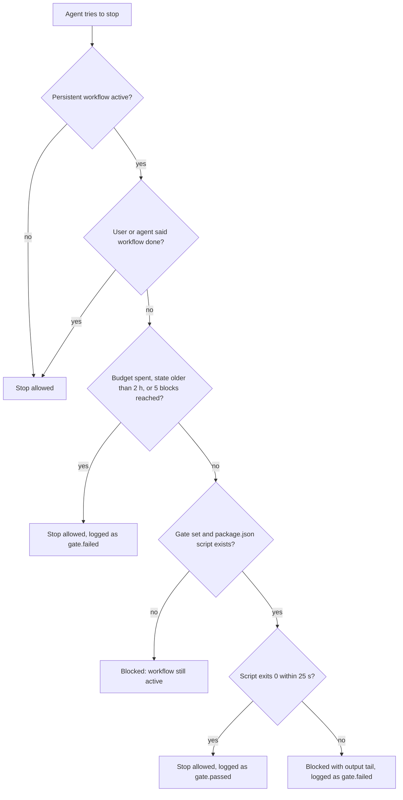

# oh-my-agent: Đội ngũ chuyên gia cho coding agent bạn đang dùng

[](https://www.npmjs.com/package/oh-my-agent) [](https://www.npmjs.com/package/oh-my-agent) [](https://github.com/first-fluke/oh-my-agent) [](https://github.com/first-fluke/oh-my-agent/blob/main/LICENSE) [](https://github.com/first-fluke/oh-my-agent/commits/main)

[English](../README.md) | [한국어](./README.ko.md) | [中文](./README.zh.md) | [Português](./README.pt.md) | [日本語](./README.ja.md) | [Français](./README.fr.md) | [Español](./README.es.md) | [Nederlands](./README.nl.md) | [Polski](./README.pl.md) | [Русский](./README.ru.md) | [Deutsch](./README.de.md) | [ภาษาไทย](./README.th.md)

**oh-my-agent (`oma`) là một harness không phụ thuộc vendor, bổ sung đội ngũ chuyên gia vào coding agent bạn đang dùng: Claude Code, Codex CLI, Cursor và 11 công cụ khác.** Một planner chia nhỏ công việc, các kỹ sư xây dựng song song, một reviewer kiểm tra kết quả, và một debugger sửa tận nguyên nhân gốc. Nó còn làm nghiên cứu có trích dẫn nguồn, slide deck, video và hình ảnh. Hầu hết các bước đều để lại một file bạn có thể mở ra xem, và trong các workflow chạy dài, một gate có thể đưa agent quay lại làm việc cho đến khi script `test`, `lint` hoặc `typecheck` của chính bạn pass.

[](./assets/architecture/oh-my-agent-architecture.svg)

Chạy lệnh này từ thư mục gốc của dự án:

```bash
curl -fsSL https://raw.githubusercontent.com/first-fluke/oh-my-agent/main/cli/install.sh | bash
```

Sau đó chạy `oma doctor` và gõ `/plan add user accounts with a settings page` trong agent của bạn. Phần [5 phút đầu tiên](#your-first-5-minutes) sẽ hướng dẫn từng bước.


[Watch the full video (35s)](./assets/video/oh-my-agent-explainer.mp4)

## Bạn nhận được gì

**Workflow** là thứ bạn gõ (hoặc chỉ cần nói). Chúng gọi các **vai trò**, tức là các chuyên gia. **Skill** là bí quyết chuyên môn: mỗi vai trò mang theo skill riêng, và agent của bạn tải phần còn lại bất cứ khi nào task cần đến.

| | Mang lại gì cho bạn | Thử ngay |
|---|---|---|
| **12 vai trò chuyên gia** | PM, kiến trúc sư, kỹ sư backend, frontend, mobile, database và infra, QA reviewer, debugger, refactorer, docs curator, researcher ([gặp gỡ họ](#meet-the-team)) | `/orchestrate build a TODO app with login` |
| **21 workflow** | Slash command từ `/brainstorm` và `/plan` đến `/review`, `/debug` và `/scm`. Hầu hết cũng có thể khởi động từ một yêu cầu thông thường (bộ từ khóa cho tối đa 11 ngôn ngữ) | "review this PR" |
| **33 skill** | Kiến thức chuyên môn chỉ được tải khi task cần: UI, API, schema, Terraform, CI, bảo mật, git, observability | tự tải, ví dụ "add a Terraform S3 bucket" |
| **File bạn có thể mở** | Kế hoạch, design doc, API contract, ADR, ghi chú bug, kết quả theo từng agent, bằng chứng bảo mật, tài liệu giải thích HTML, bản tóm tắt | `ls .agents/results` |
| **Kiểm tra test và artifact** | Trong một workflow chạy dài, script `test`, `lint` hoặc `typecheck` của chính bạn phải pass thì agent mới được dừng; `oma ralph verify` kiểm tra xem một lần chạy `/ralph` đã để lại file kế hoạch, QA và refactor hay chưa | `/ultrawork …`, rồi `oma goal set --gate test` |
| **Nghiên cứu và nội dung** | Tìm kiếm có trích dẫn, nghiên cứu thị trường, bài báo khoa học, slide deck, video MP4, hình ảnh, giọng nói cục bộ, PDF/HWP sang Markdown | `/video`, `/convert` |
| **Một thư mục, 14 runtime** | Một thư mục `.agents/` di động duy nhất, được ghi vào file cấu hình riêng của từng runtime | `oma link cursor` |

**[Cài đặt](#install)** · **[5 phút đầu tiên](#your-first-5-minutes)** · **[Đội ngũ](#meet-the-team)** · **[Chọn workflow nào?](#how-the-team-works-together)** · **[Mọi thứ trong hộp](#everything-in-the-box)** · **[Hoạt động với](#works-with)** · **[Kiểm chứng](#verification-not-narration)** · **[FAQ](#faq)** · **[Tài liệu](https://first-fluke.github.io/oh-my-agent/)**

<a id="install"></a>
## Cài đặt

Script sẽ cài [bun](https://bun.sh) nếu thiếu, cài lệnh `oma` ở phạm vi global (`bun install --global oh-my-agent`, bỏ qua nếu `oma` đã có trong PATH), rồi khởi động phần thiết lập tương tác. Lệnh global này rất quan trọng: các hook (nhận diện từ khóa, Stop gate) và một số workflow gọi `oma`, và các hook sẽ âm thầm không làm gì nếu không tìm thấy nó. Nếu không dùng script, hãy tự cài bằng `bun install --global oh-my-agent` (`npm install --global oh-my-agent` hoặc `brew install oh-my-agent` cũng được).

<details>
<summary>Windows, hoặc cài không dùng script</summary>

```powershell
# Windows (PowerShell)
irm https://raw.githubusercontent.com/first-fluke/oh-my-agent/main/cli/install.ps1 | iex
```

```bash
# Mọi OS đã cài bun: cùng phần thiết lập, kèm lệnh `oma` global
bun install --global oh-my-agent
oma
```

Trên Windows, installer ẩn Antigravity, Hermes và Kimi, và hook wrapper là một bash script. Browser MCP mặc định là Aside được cài qua `bash`, nên hãy bỏ chọn nó nếu máy bạn không có bash.

</details>

Phần thiết lập sẽ hỏi ngôn ngữ phản hồi, những agent runtime cần kết nối, capability provider, browser MCP, model preset và skill preset. **Nếu chưa chắc, hãy chọn `All` cho skill preset**: workflow luôn được cài, và một số workflow (`/orchestrate`, `/work`, `/ultrawork`, `/ralph`, `/docs`, `/security`) cần những skill chỉ có trong `All`.

<details>
<summary>Những việc installer cũng làm theo mặc định</summary>

- Cài **bun** (bắt buộc). Thử cài **uv**, **Serena** (`uv tool install`) và **CUE** (`brew install cue` hoặc `winget`), và vẫn tiếp tục kèm cảnh báo nếu có cái nào cài thất bại.
- Chọn sẵn browser MCP **Aside** trong phần thiết lập tương tác, và chỉ cài nó bằng `curl -fsSL https://releases.aside.com/install.sh | bash` nếu bạn giữ lựa chọn đó. Bỏ chọn ở bước browser MCP, hoặc đổi sau bằng `oma update mcp`.
- Dùng **AgentMemory** cho semantic memory: chạy `bun install -g @agentmemory/agentmemory` và đăng ký nó làm login service (launchd, systemd user unit hoặc Windows scheduled task). Chọn provider `none` hoặc đặt `OMA_NO_AGENTMEMORY=1` để bỏ qua.
- Hỏi trước khi link skill vào các thư mục vendor trong thư mục home (Antigravity, Hermes, Kimi). Khi ở `$HOME` mà không có `--global`, nó sẽ yêu cầu xác nhận.
- Ghi một số file bên ngoài project mà không hỏi: `~/.claude.json` (đánh dấu project là workspace Claude Code đáng tin cậy), `~/.serena/` (context OMA, ngưỡng kích thước câu trả lời tối thiểu, đăng ký project), `~/.cursor/cli-config.json` (tắt commit attribution của Cursor), `~/.grok/config.toml` (telemetry) và `~/.gemini/antigravity-cli/` (HUD), mỗi file chỉ được ghi cho vendor bạn đã chọn.
- Ghi **opt-out telemetry** vào setting của vendor (Claude `DISABLE_TELEMETRY=1`, cũng tắt luôn Claude Code Remote Control; thống kê sử dụng của Gemini, Qwen, Codex và Grok). Đặt `telemetry: true` để giữ mặc định của vendor.
- Thêm các setting Claude Code chưa được đặt vào `.claude/settings.json`, gồm `skipDangerousModePermissionPrompt: true`, `effortLevel: high`, `cleanupPeriodDays: 180` và các env flag tắt auto memory, adaptive thinking, báo cáo lỗi và chỉ dẫn git tích hợp sẵn. Giá trị bạn đã đặt sẽ được giữ nguyên.
- Thêm **co-author trailer**: commit attribution của Claude Code trở thành `Co-Authored-By: First Fluke <our.first.fluke@gmail.com>` và PR có thêm dòng "Generated with oh-my-agent". Đặt `scm.co_author.enabled: false` để tắt.
- Cài một **commit-msg guard** trong `.githooks/` để từ chối các địa chỉ `Co-authored-by` không có trong danh sách, và đặt `git config --local core.hooksPath .githooks` khi không có hook nào khác đang hoạt động. Đặt `scm.co_author.enforce_hook: false` nếu không muốn dùng.
- `oma update` cập nhật `oma` CLI ở chế độ nền (`auto_update_cli: false` hoặc `OMA_SKIP_VERSION_CHECK=1` để dừng) và chạy `uv tool upgrade serena-agent --prerelease=allow` (`serena.auto_update: false`).
- Khi Serena ở chế độ `bridge` mặc định, phiên agent đầu tiên khởi động một Serena server dùng chung sẽ đăng ký một **cleanup timer** dừng các Serena server dùng chung đang rảnh mỗi 5 phút (launchd `dev.oma.serena-daemon-gc`, systemd user timer `oma-serena-daemon-gc.timer` hoặc Windows scheduled task `OMA Serena Daemon GC`). Đặt `serena.mode: stdio` để bỏ qua server dùng chung và timer của nó. `oma uninstall` không gỡ timer này.
- Các lần chạy không tương tác (`-y`, `OMA_YES=1`, `CI=true`) dùng skill preset `All`, `model_preset: auto` và Python làm ngôn ngữ backend. Chúng không chọn browser MCP nào (và bỏ qua script cài Aside) trừ khi `mcp.devtools_browsers` đã có sẵn một mục.

</details>

<details>
<summary>Skill preset</summary>

| Preset | Skill |
|--------|--------|
| **All** | **Toàn bộ 33 skill** (khuyến nghị) |
| Fullstack | architecture, backend, brainstorm, db, debug, design, dev-workflow, frontend, mobile, pm, qa, scm, tf-infra |
| Fullstack Web | Fullstack, bỏ mobile và tf-infra |
| Fullstack Mobile | Fullstack, bỏ frontend và tf-infra |
| Frontend | architecture, brainstorm, debug, design, frontend, pm, qa, scm |
| Backend | architecture, backend, brainstorm, db, debug, dev-workflow, pm, qa, scm |
| Mobile | architecture, brainstorm, debug, mobile, pm, qa, scm |
| DevOps | architecture, brainstorm, debug, dev-workflow, observability, pm, qa, scm, tf-infra |
| Research | academic-writing, hwp, market, pdf, scholar, scm, search, translation |
| Content | academic-writing, design, image, scm, translation, voice |
| Custom | Tự chọn từng skill |

Trong các preset có tên, chỉ `All` mới bao gồm coordination, orchestration, docs, security, refactor, explanation, recap, video, slide và skill-creation (hoặc chọn chúng trong `Custom`). Research và Content thiếu các skill đứng sau `/plan`, `/review`, `/debug`, `/architecture` và `/brainstorm`. Xem [Workflow cần skill nằm ngoài preset](../web/docs/getting-started/installation.md#workflows-that-need-skills-outside-a-preset).

</details>

<a id="your-first-5-minutes"></a>
## 5 phút đầu tiên

1. **Cài đặt** bằng lệnh ở trên.
2. **Kiểm tra bản cài:**

   ```bash
   oma doctor
   ```

   Bạn sẽ thấy `CLI Status` (những agent CLI nào đã được cài và đăng nhập) và `Skills Status` (ví dụ `Skills (33/33 installed, 33 complete)`). Nếu không tìm thấy `oma`, hãy mở terminal mới (installer có thể vừa thêm `~/.bun/bin` vào PATH) hoặc chạy `bun install --global oh-my-agent`.
3. **Mở agent trong dự án và yêu cầu một kế hoạch:**

   ```text
   /plan add user accounts with a settings page
   ```

   Hoặc chỉ cần viết "plan user accounts with a settings page": trên các runtime có prompt hook, từ khóa sẽ khởi động cùng workflow đó.
4. **Xem kết quả.** `/plan` chạy trong phiên hiện tại. Với công việc trải trên nhiều mảng như ví dụ này, nó ghi ra `.agents/results/plan-<session-id>.json` và một tracker tại `docs/plans/work/<NNN>-<name>.md`. Một yêu cầu nhỏ, chỉ thuộc một mảng sẽ nhận một khuyến nghị trực tiếp thay vì file kế hoạch.

Sau các bước này, bạn có thể đánh giá công cụ có phù hợp hay không. Để tiếp tục, hãy chạy `/work` hoặc `/orchestrate` trên kế hoạch đó.

<a id="meet-the-team"></a>
## Gặp gỡ đội ngũ

Chính agent của bạn dẫn dắt đội ngũ. Trong `/work`, `/orchestrate` và `/ultrawork`, nó giao từng việc cho đúng chuyên gia, và mỗi chuyên gia chạy như một subagent riêng. `/plan`, `/architecture` và `/docs` chạy trong phiên hiện tại với skill của vai trò đó, còn `/review` và `/debug` gọi chuyên gia của mình khi phạm vi lớn. Khi một vai trò được gán cho CLI của vendor khác, `oma agent spawn` sẽ chạy nó ở đó.

| Chuyên gia của bạn | Mang theo | Gọi bằng | Để lại |
|---|---|---|---|
| **Product manager** (`pm-planner`) | oma-pm | `/plan`, hoặc "plan the payment feature" | Một JSON kế hoạch và một tracker trong `docs/plans/work/` cho công việc mức Medium và Complex (yêu cầu mức Simple nhận khuyến nghị trực tiếp) |
| **Kiến trúc sư** (`architecture-reviewer`) | oma-architecture | `/architecture` | Một ADR hoặc khuyến nghị trong `.agents/results/architecture/` |
| **Kỹ sư backend, frontend, mobile, database và infra** | oma-backend, oma-frontend + oma-design, oma-mobile, oma-db, oma-tf-infra | `/work`, `/orchestrate` | Code, test và một file `result-<agent>` cho mỗi task |
| **QA reviewer** (`qa-reviewer`) | oma-qa | `/review`, hoặc "review this PR" | Các phát hiện xếp hạng từ CRITICAL đến LOW, mỗi phát hiện có file:line và code sửa lỗi |
| **Debugger** (`debug-investigator`) | oma-debug | `/debug`, hoặc "fix this bug" | Một bản sửa tối thiểu, một regression test và một ghi chú bug trong `.agents/results/bugs/` khi cần thiết |

<details>
<summary>Ba vai trò còn lại, và các skill không có vai trò</summary>

| Chuyên gia của bạn | Mang theo | Gọi bằng | Để lại |
|---|---|---|---|
| **Refactorer** (`refactor-engineer`) | oma-refactor | phase REFINE của `/ultrawork` | Các commit `refactor:` giữ nguyên hành vi và một báo cáo `result-refactor-<session>.md` |
| **Docs curator** (`docs-curator`) | oma-docs | `/docs`, hoặc "verify docs" | `docs/generated/doc-refs.json` và các bản vá tài liệu bạn duyệt |
| **Researcher** (`research-explorer`) | oma-search, oma-market, oma-scholar | một yêu cầu nghiên cứu | Nguồn có trích dẫn kèm nhãn độ tin cậy; báo cáo thị trường trong `.agents/results/market/` |

Kỹ sư infra (`tf-infra-engineer`) được dặn phải hỏi trước khi chạy bất kỳ `apply` hoặc `destroy` nào mang tính phá hủy hoặc trên production. Các skill còn lại (brainstorm, security, scm, dev-workflow, observability, explanation, recap, translation, coordination, orchestration, skill-creation, nội dung và media) không có vai trò riêng. Agent của bạn tự tải chúng, và với hầu hết trong số đó, skill injector sẽ gợi ý đúng skill dựa trên prompt của bạn.

</details>

<a id="how-the-team-works-together"></a>
## Đội ngũ phối hợp thế nào

```text
 THINK   /brainstorm ......................... docs/plans/designs/<NNN>-<feature>.md
 PLAN    /plan · /architecture ............... plan JSON, API contracts, ADR
 DESIGN  /design ............................. DESIGN.md + tokens
 BUILD   /work · /orchestrate · /ultrawork ... code + result-<agent> files, engineers in parallel
 CHECK   /review · /security · /debug ........ findings, security evidence, regression test
 SHIP    /scm · /docs ........................ Conventional Commits, doc fixes
```

Mỗi bước chuyển một file cho bước tiếp theo. `/brainstorm` lưu một bản thiết kế mà `/plan` đọc, và `/plan` viết một kế hoạch trong đó mỗi task có một agent, các phụ thuộc, tiêu chí chấp nhận và một lệnh kiểm tra. `/orchestrate` chạy kế hoạch đó (nó tải `plan-*.json` mới nhất, hoặc tự viết một cái). `/work` và `/ultrawork` bắt đầu bằng việc để PM viết kế hoạch riêng cho chúng. Hãy bỏ qua bất kỳ giai đoạn nào bạn không cần; mỗi giai đoạn cũng hoạt động độc lập.

**Workflow nào nên điều hành đội ngũ?**

| Bạn muốn | Chạy | Kết thúc ra sao |
|---|---|---|
| Chỉ cần một kế hoạch | `/plan` | Một file kế hoạch cho công việc nhiều mảng, hoặc một khuyến nghị trực tiếp cho việc nhỏ |
| Một lần build do PM dẫn dắt mà bạn theo dõi từng bước | `/work` | PM, rồi các kỹ sư theo từng tầng, rồi QA. Các phát hiện CRITICAL và HIGH đi vào vòng sửa lỗi (tối đa 5 vòng) |
| Một lần build song song không cần bạn can thiệp | `/orchestrate` | Chỉ task nào pass kiểm tra mới được tính là xong; mỗi task có tối đa 3 lần thử, sau đó được đánh dấu là partial hoặc failed |
| Cẩn trọng tối đa | `/ultrawork` | Năm phase có gate (PLAN, IMPL, VERIFY, REFINE, SHIP); mỗi lượt review chạy trong một phiên reviewer mới |
| "Đừng dừng cho đến khi thật sự xong" | `/ralph` | Lặp lại `/ultrawork` với một trọng tài được spawn riêng, có ngữ cảnh mới, cho đến khi mọi tiêu chí đều pass; dừng kèm báo cáo dở dang khi tiêu chí bị chặn hoặc sau 5 iteration |
| Đội ngũ chạy theo lịch | `oma schedule create qa-reviewer "review open PRs" --every 2h` | Một log Markdown cho mỗi lần chạy, trong `~/.oma/schedule/runs/<id>/` |

Bạn không cần slash command. Trên các runtime có prompt hook, yêu cầu thông thường (bộ từ khóa cho tối đa 11 ngôn ngữ) có thể khởi động hầu hết các workflow: "review this PR" khởi động `/review`. Mô tả cả một ứng dụng ("Build a TODO app with user authentication") sẽ gợi ý `/orchestrate`, và agent của bạn quyết định có chạy hay không. Từ khóa bên trong code block sẽ bị bỏ qua.

`/orchestrate`, `/work`, `/ultrawork` và `/ralph` là **persistent** khi bạn gọi chúng bằng tên, dưới dạng slash command hoặc văn bản thường ("ultrawork: add rate limiting"). Khi đó agent sẽ bị đưa quay lại làm việc mỗi khi nó cố dừng sớm (tối đa 5 lần hoặc 2 giờ) cho đến khi bạn nói **"workflow done"**. Một yêu cầu chỉ khớp lỏng lẻo thì chỉ gợi ý chúng.

Trong [benchmark](../benchmarks/README.md) (một prompt, Claude Code với năm cấu hình add-on khác nhau, kể cả bản thuần, `claude-opus-4-6`, mỗi cấu hình build một lần), oma đạt 80.6 so với 70.7 của Claude Code thuần. Chi phí cao gấp 1.7 lần ($4.04 so với $2.37), còn thời gian chạy lâu gấp 1.8 lần.

<details>
<summary>Toàn bộ 21 workflow</summary>

| Lệnh | Chức năng |
|---------|--------------|
| `/architecture` | Cân nhắc trade-off thiết kế và đưa ra khuyến nghị, review hoặc ADR |
| `/brainstorm` | Khám phá ý tưởng và ràng buộc, đưa ra một thiết kế đã được duyệt trước khi lập kế hoạch |
| `/convert` | Chuyển PDF/HWP sang Markdown, hoặc chuyển mã ảnh, video và âm thanh bằng ffmpeg |
| `/debug` | Tái hiện bug, sửa nguyên nhân gốc, viết regression test và quét các pattern tương tự |
| `/deepinit` | Phân tích codebase hiện có và ghi lại thành AGENTS.md, ARCHITECTURE.md và một kho kiến thức docs/ |
| `/design` | Xây dựng hệ thống thiết kế, DESIGN.md và token kèm kiểm tra accessibility |
| `/docs` | Tìm tham chiếu tài liệu bị hỏng và đề xuất bản vá cho những tài liệu mà một diff chạm tới |
| `/explain` | Biến diff, PR, nhánh hoặc một chủ đề thành tài liệu giải thích HTML tương tác độc lập |
| `/orchestrate` | Chạy các agent song song, điều phối chúng qua trạng thái file và kiểm chứng kết quả (persistent) |
| `/plan` | Phân tách tính năng thành các task được ưu tiên, kèm API contract |
| `/ralph` | Lặp lại `/ultrawork` với một trọng tài được spawn riêng, tối đa 5 iteration (persistent) |
| `/recap` | Tóm tắt lịch sử hội thoại AI của bạn trong một ngày hoặc một khoảng thời gian |
| `/review` | Review bảo mật (OWASP Top 10), hiệu suất, accessibility (WCAG 2.2 AA) và chất lượng code |
| `/schedule` | Đăng ký một job agent chạy theo chu kỳ lặp lại |
| `/scm` | Xử lý branch, merge, conflict, worktree và Conventional Commits |
| `/security` | Quét mã nguồn, skill của agent và thành phần MCP, xác minh phát hiện và thiết lập gate CI |
| `/stack-set` | Phát hiện tech stack của bạn và tạo tài liệu tham chiếu riêng cho stack đó để các domain skill dùng |
| `/tools` | Liệt kê, bật và tắt MCP tool bằng ngôn ngữ tự nhiên |
| `/ultrawork` | Năm phase (PLAN, IMPL, VERIFY, REFINE, SHIP), mỗi lượt review chạy trong một phiên reviewer mới (persistent) |
| `/video` | Biến một bản brief thành file MP4 hoàn chỉnh qua pipeline không bắt buộc có key |
| `/work` | Điều phối nhiều agent trong dự án đa domain, có PM lập kế hoạch và QA review (persistent) |

Độ chính xác của việc kích hoạt được đo lường chứ không phải phỏng đoán: `oma verify triggers` chấm điểm bộ phát hiện trên một corpus 212 prompt tiếng Anh và tiếng Hàn đã gán nhãn, và CI sẽ thất bại nếu tỷ lệ kích hoạt nhầm vượt 10% hoặc tỷ lệ bỏ sót vượt 20%. Lần đo gần nhất: **0% missed-fire, 5.3% false-fire**. Tài liệu tham chiếu đầy đủ: [Workflows](https://first-fluke.github.io/oh-my-agent/docs/core-concepts/workflows/).

</details>

<a id="see-it-work"></a>
## Xem thực tế

Một phiên `/ultrawork` minh họa. Khối `[OMA PERSISTENT MODE: ULTRAWORK]` đúng là định dạng mà Stop hook in ra; các dòng còn lại được diễn giải lại:

```text
you    /ultrawork add rate limiting to POST /login
agent  runs `oma goal set --gate test`
agent  PLAN writes .agents/results/plan-<run-id>.json
agent  IMPL -> VERIFY -> REFINE -> SHIP  (each review runs in a fresh reviewer session)
agent  "Rate limiting added. All tests pass."
oma    [OMA PERSISTENT MODE: ULTRAWORK]
       Stop gate 'test' FAILED (reinforcement 1/5).
       Fix the failures below, then finish the workflow — the stop is allowed only when the gate passes.
       --- gate output (tail) ---
       FAIL  src/auth/login.test.ts > returns 429 after 5 attempts
       To abandon instead: delete .agents/state/ultrawork-state-<host-session>.json or say "workflow done".
agent  fixes the limiter and stops again
oma    `test` exits 0: stop allowed, gate.passed appended to the session log
```

Sau đó, `oma state list` tìm ra phiên và `oma state get <oma-sid>` (ID mà `state list` in ra) hiển thị mọi event của gate. Với `/ralph`, `oma ralph verify --json` còn kiểm tra xem các phase đã để lại file của chúng hay chưa (output đã được rút gọn):

```json
{ "ok": false,
  "missing": [{ "id": "A3", "description": "a distinct QA agent ran (VERIFY phase)",
                "pattern": ".agents/state/memories/result-qa*.md or .agents/results/result-qa*.md",
                "status": "missing" }] }
```

<a id="everything-in-the-box"></a>
## Mọi thứ trong hộp

<details>
<summary><strong>Lập kế hoạch và thiết kế</strong>: <code>/brainstorm</code>, <code>/plan</code>, <code>/architecture</code>, <code>/design</code></summary>

| Lệnh | Chức năng | Ghi ra |
|---|---|---|
| `/brainstorm` | Mỗi lần chỉ hỏi một câu để làm rõ, đề xuất 2-3 hướng tiếp cận khác nhau về cách làm, rồi chuyển sang `/plan`. Không viết code | `docs/plans/designs/<NNN>-<feature>.md` |
| `/plan` | Đánh giá quy mô công việc là Simple, Medium hay Complex; với Medium và Complex, chia thành các task, mỗi task có một agent, các phụ thuộc, tiêu chí chấp nhận và một lệnh kiểm tra, đồng thời định nghĩa API contract khi công việc vượt qua một ranh giới | `.agents/results/plan-<sid>.json`, `docs/plans/work/<NNN>-<name>.md`, contract trong `.agents/results/api-contracts/` khi cần |
| `/architecture` | Trước tiên đọc các quyết định đã có, so sánh ít nhất 2 phương án và đánh dấu các ADR bị thay thế là superseded | Một ADR hoặc khuyến nghị trong `.agents/results/architecture/` |
| `/design` | Đề xuất 2-3 hướng, sau đó viết `DESIGN.md` kèm token và kiểm tra responsive layout cùng accessibility | `DESIGN.md`, token CSS/Tailwind/shadcn |

</details>

<details>
<summary><strong>Xây dựng</strong>: 7 domain skill, cùng <code>/stack-set</code> để điều chỉnh chúng theo stack của bạn</summary>

| Skill | Xây dựng |
|---|---|
| oma-frontend | UI React/Next.js hoặc Angular tuân theo token, quy tắc i18n và accessibility của bạn |
| oma-backend | API, xác thực và truy cập dữ liệu, phân lớp router → service → repository |
| oma-mobile | Ứng dụng Flutter, React Native hoặc Swift |
| oma-db | Schema, migration, tối ưu truy vấn, kế hoạch truy xuất vector/RAG |
| oma-tf-infra | Terraform cho mọi cloud, chỉ rõ rủi ro drift, thay đổi phá hủy và chi phí |
| oma-dev-workflow | mise task, lint/format/typecheck, commitlint, git hook, CI/CD và release |
| oma-observability | OpenTelemetry, SLO, cảnh báo và điều tra sự cố |

`/stack-set` đọc các manifest của bạn và viết tài liệu tham chiếu riêng cho stack để các skill backend, frontend và mobile dùng. Trong monorepo, các kỹ sư frontend, backend và mobile được trỏ tới workspace của họ (pnpm, workspace npm/yarn/bun, lerna, nx, turbo, `mise.toml`).

</details>

<details>
<summary><strong>Review, sửa lỗi và phát hành</strong>: <code>/review</code>, <code>/security</code>, <code>/debug</code>, refactor, <code>/scm</code></summary>

| Lệnh hoặc skill | Chức năng | Ghi ra |
|---|---|---|
| `/review` | Kiểm tra dependency, rồi OWASP Top 10, hiệu suất, WCAG 2.2 AA và chất lượng code. Mọi phát hiện đều có file:line và code sửa lỗi | Báo cáo trong chat cùng một bản ghi memory; không có file báo cáo |
| `/security` | Quét mã nguồn, skill của agent và MCP server của bạn (Deepsec, Cisco Skill and MCP Scanner), và khi có một bản triển khai thử nghiệm đã giới hạn phạm vi, chạy pen test ARTEX. Workflow yêu cầu engine nào không chạy được phải được báo là thất bại, không phải là sạch | `.agents/results/security/<run-id>/` |
| `/debug` | Tái hiện lỗi, sửa nguyên nhân gốc bằng thay đổi tối thiểu, thêm regression test và quét cùng pattern ở những chỗ khác | Bản sửa và test; một ghi chú bug trong `.agents/results/bugs/` khi cần thiết |
| oma-refactor | Thay đổi cấu trúc mà không đổi hành vi: characterization test trước, rồi các commit chỉ chứa refactor | `.agents/results/refactor/` |
| `/scm` | Conventional Commits tách theo thay đổi logic; branch, merge, rebase và worktree | Commit và branch |

</details>

<details>
<summary><strong>Tài liệu và tri thức</strong>: <code>/deepinit</code>, <code>/docs</code>, <code>/explain</code>, <code>/recap</code>, dịch thuật</summary>

| Lệnh hoặc skill | Chức năng | Ghi ra |
|---|---|---|
| `/deepinit` | Biến một repo hiện có thành kho kiến thức sẵn sàng cho agent | `AGENTS.md`, `ARCHITECTURE.md`, `docs/` |
| `/docs` | Tìm tham chiếu bị hỏng, vá các tài liệu mà một diff chạm tới (chỉ những bản vá bạn duyệt), và tìm bản dịch đã lỗi thời | `docs/generated/doc-refs.json`, tài liệu đã vá |
| `/explain` | Biến một PR, nhánh hoặc thay đổi đã staged thành tài liệu hướng dẫn HTML kèm quiz 5 câu hỏi, hoặc biến một chủ đề thành tài liệu giải thích trực quan một trang | `.agents/results/explain/<date>-<slug>.html` |
| `/recap` | Tóm tắt các cuộc hội thoại AI của bạn trên nhiều công cụ trong một ngày hoặc một khoảng thời gian | `.agents/results/recap/<date>.md` |
| oma-translation | Bản dịch đọc tự nhiên như người bản ngữ viết; placeholder, code và locale key giữ nguyên | Văn bản đã dịch |

</details>

<details>
<summary><strong>Nghiên cứu</strong>: tìm kiếm, thị trường, bài báo, viết học thuật</summary>

| Skill | Chức năng | Ghi ra |
|---|---|---|
| oma-search | Tìm kiếm tài liệu, web và code, gắn nhãn độ tin cậy cho từng nguồn | Kết quả có trích dẫn |
| oma-market | Pain point, xu hướng và đối thủ từ tín hiệu cộng đồng, trình bày theo khung SWOT, Porter's 5 Forces và PESTEL | `.agents/results/market/<topic>-<date>.md` |
| oma-scholar | Tìm kiếm bài báo bằng cách đọc một file claim cô đọng (định dạng Knows, khoảng 700 token) thay vì toàn bộ PDF (khoảng 10K token) | `<paper>.knows.yaml` |
| oma-academic-writing | Soạn và kiểm tra văn bản học thuật theo rubric | File của bạn |

</details>

<details>
<summary><strong>Nội dung và media</strong>: <code>/video</code>, <code>/convert</code>, slide, hình ảnh, giọng nói</summary>

| Lệnh hoặc skill | Tạo ra gì | Ghi ra |
|---|---|---|
| `/video` | Video ngắn, video giải thích hoặc demo dưới dạng file MP4 hoàn chỉnh; các provider cần key đều có phương án dự phòng không cần key | `.agents/results/videos/<run>/` kèm manifest |
| oma-slide | Deck HTML 1920×1080, xuất sang PDF, PNG hoặc PPTX | `.agents/results/slides/<session>/` |
| oma-image | Tạo ảnh qua các CLI của vendor mà bạn đã đăng nhập, so sánh song song | `.agents/results/images/<run>/` |
| oma-voice | Chuyển văn bản thành giọng nói và gỡ băng cục bộ qua ứng dụng Voicebox | `.agents/results/voice/<run>/` |
| `/convert` | PDF hoặc HWP sang Markdown; chuyển đổi ảnh, video và âm thanh qua ffmpeg | Cạnh file đầu vào |

Các pipeline này báo rõ khi thiếu nguồn hoặc key của vendor thay vì âm thầm trả về kết quả mỏng hơn.

</details>

<details>
<summary><strong>Các hook tự chạy mà không cần yêu cầu</strong></summary>

| Hook | Chức năng | Cách tắt / giới hạn |
|---|---|---|
| Khởi động bằng từ khóa | Khởi động workflow tương ứng từ một yêu cầu thông thường | Bỏ qua câu hỏi, văn bản dán vào và code block |
| Skill injector | Chỉ cho agent đúng skill cho prompt | Tạm dừng khi có persistent workflow đang hoạt động |
| Stop gate | Đưa persistent workflow quay lại làm việc; với `oma goal set --gate test`, việc dừng được cho phép khi script đó thoát với mã 0 trong vòng 25 giây | Nói "workflow done"; nó cũng tự gỡ sau 5 lần chặn hoặc 2 giờ |
| Refactor guard | Khi dừng, đánh dấu các file đã sửa dài quá 500 dòng cho `refactor-engineer` | Phải bật thủ công: `refactor_guard.enabled` |
| Secret guard | Chặn `git add` với `*.env`, `*.pem`, `id_rsa*`, `*.tfstate` và các file tương tự | Thêm tiền tố `OMA_SCM_ALLOW_SECRETS=1` vào riêng lệnh đó |
| Code-search guard | Chặn tìm kiếm đệ quy native trong dự án để agent dùng Serena hoặc Gortex | `providers.code_intelligence_guard: off` |
| Bộ lọc test | Chỉ giữ lại lỗi và phần tóm tắt từ output test, để tốn ít token hơn | `OMA_TEST_FILTER=0` |
| Bộ nhớ phiên | Khi bạn chuyển hoặc tiếp tục một phiên (hoặc sau compaction), nạp lại các event gần đây của phiên đang hoạt động cùng phần recall từ AgentMemory | Memory provider `none` hoặc `OMA_NO_AGENTMEMORY=1` tắt recall; snapshot event cục bộ vẫn giữ nguyên |

`oma hook probe` kiểm tra xem các prompt hook của oma có chấp nhận hook input của từng runtime hay không (nó không khởi chạy runtime). Runtime nào kết nối hook nào có trong [Khác biệt giữa các host](#host-differences).

</details>

<details>
<summary><strong>Agent song song, phiên và dashboard</strong></summary>

- `oma agent spawn <role> "<task>" <sid>` chạy một vai trò trên Antigravity, Claude Code, Codex, Cursor, Grok, Kimi Code, Kiro, OpenCode, pi hoặc Qwen Code, với `--isolation worktree` và `--fallback-vendors`. `oma agent parallel` chạy nhiều vai trò cùng lúc. 10 đích dispatch này là một phần trong 14 tích hợp của installer.
- `oma state list --all-projects` và `oma state get <sid>`: các phiên và mọi event đã ghi.
- `oma dashboard terminal` / `oma dashboard web`: trạng thái agent theo thời gian thực (web dashboard chỉ lắng nghe trên `127.0.0.1`). [Hướng dẫn dashboard](../web/docs/guide/dashboard-monitoring.md).
- `oma stats get` (chỉ số năng suất), `oma retro` (retrospective git), `oma recap --window 7d` (những gì bạn đã làm trên các công cụ AI).
- `oma visualize --affected <paths>`: những skill, workflow, agent và kiểm tra nào phụ thuộc vào các file `.agents/` bạn đã thay đổi.

</details>

<details>
<summary><strong>Code intelligence, bộ nhớ và MCP</strong></summary>

| Slot | Mặc định | Lựa chọn thay thế |
|---|---|---|
| Tài liệu | Context7 | — |
| Tìm kiếm web | Tìm kiếm native của runtime | Brave Search |
| Code intelligence | Serena, một server dùng chung cho mỗi dự án | Gortex (thử nghiệm) |
| Semantic memory | AgentMemory | Honcho (thử nghiệm), none |
| Browser MCP | Aside | Chrome DevTools, Firefox DevTools |

Serena cung cấp khả năng điều hướng mã và chẩn đoán dựa trên LSP, bao gồm phản hồi sau khi chỉnh sửa native nếu được hỗ trợ. Việc chọn provider độc lập với runtime của agent; khả năng thay đổi tùy theo provider và host.

Các agent phối hợp qua các file thường trong `.agents/state/`, không cần dịch vụ bên ngoài. `/tools` bật hoặc tắt MCP tool bằng ngôn ngữ tự nhiên. Chi tiết: [Capability Provider](./capability-providers.md).

</details>

<details>
<summary><strong>Ngày càng tốt hơn theo thời gian</strong></summary>

- `oma skill eval` đo mức cải thiện của một skill so với baseline trên các task giữ riêng. `oma skill optimize` đề xuất các chỉnh sửa làm tăng mức đó, và `--apply` giữ lại chúng ([hướng dẫn skill-eval](../web/docs/guide/skill-eval.md)).
- `oma harness evolution enable --max-dispatches <n>` lên lịch một chu trình hằng đêm, biến các lần chạy thất bại thành regression fixture và áp dụng những cải tiến skill vượt qua đánh giá dưới dạng overlay của dự án. Thêm `--mode propose` để chỉ ghi lại chúng.
- `oma emit` xuất mã nguồn `.agents/` thành một gói Agent Skills, một gói Agent Plugins, một Claude Code plugin marketplace hoặc `AGENTS.md`.

</details>

<details>
<summary><strong>Cấu hình và rào chắn an toàn</strong></summary>

- Một file `.agents/oma-config.yaml` thuộc quyền người dùng được giữ nguyên qua các lần cập nhật (chỉ `oma update --force` mới đặt lại nó); các overlay riêng tư `.local.yaml` hoặc `.local.cue` có thể đặt chồng lên trên. `language` đặt ngôn ngữ phản hồi.
- 13 quy tắc dự án (backend, commit, database, debug, design và nhiều hơn nữa) được tải dưới dạng quy tắc native trong Claude Code và Cursor, và được đánh chỉ mục trong khối `AGENTS.md` được quản lý, ghi cho Codex, Qwen Code và Pi.
- Các bản cập nhật giữ bản sao lưu cấu hình và migration trong `.agents/backup/`; skill và workflow đi kèm được thay thế tại chỗ, nên hãy để các thay đổi cục bộ bên ngoài chúng. `oma uninstall --dry-run` cho thấy những gì sẽ bị gỡ. `first-fluke/oma-update-action@v1` chạy `oma update` trong CI và mở một PR.

</details>

<details>
<summary><strong>Toàn bộ 33 skill</strong></summary>

| Skill | Chức năng |
|---|---|
| **oma-academic-writing** | Soạn, chỉnh sửa và kiểm tra văn bản học thuật |
| **oma-architecture** | Cân nhắc đánh đổi kiến trúc và vạch ranh giới module, kèm phân tích ADR/ATAM/CBAM |
| **oma-backend** | Xây dựng API, xác thực và truy cập dữ liệu bằng Python, Node.js hoặc Rust |
| **oma-brainstorm** | Cùng bạn khám phá ý tưởng trước khi bắt tay vào xây dựng |
| **oma-coordination** | Hướng dẫn phối hợp thủ công từng bước các agent PM, frontend, backend, mobile và QA |
| **oma-db** | Thiết kế schema, migration, index và vector store |
| **oma-debug** | Tìm nguyên nhân gốc rễ, sửa lỗi và viết regression test |
| **oma-design** | Xây dựng hệ thống thiết kế với token, accessibility và responsive layout |
| **oma-dev-workflow** | Tự động hóa CI/CD, release và các tác vụ monorepo |
| **oma-docs** | Kiểm tra tham chiếu hỏng trong tài liệu, đồng bộ tài liệu theo thay đổi code và cảnh báo bản dịch bị lệch |
| **oma-explanation** | Biến diff, PR, nhánh hoặc một chủ đề thành tài liệu giải thích HTML độc lập, kèm quiz cho thay đổi code |
| **oma-frontend** | Xây dựng giao diện với React/Next.js hoặc Angular |
| **oma-hwp** | Chuyển đổi file HWP, HWPX và HWPML sang Markdown |
| **oma-image** | Tạo ảnh và biến thể dựa trên ảnh tham chiếu, đồng thời có thể so sánh song song các nhà cung cấp AI |
| **oma-market** | Nghiên cứu thị trường từ tín hiệu cộng đồng và trình bày theo khung SWOT, 5F và PESTEL |
| **oma-mobile** | Xây dựng ứng dụng di động với Flutter, React Native hoặc Swift native |
| **oma-observability** | Định tuyến công việc observability qua metrics, logs, traces, SLO và điều tra sự cố |
| **oma-orchestration** | Chạy nhiều agent song song từ CLI |
| **oma-pdf** | Chuyển đổi file PDF sang Markdown |
| **oma-pm** | Lập kế hoạch tác vụ, phân tích yêu cầu và định nghĩa API contract |
| **oma-qa** | Rà soát thay đổi về tính đúng đắn, bảo mật OWASP, hiệu suất và accessibility |
| **oma-recap** | Tóm tắt lịch sử hội thoại thành báo cáo công việc theo chủ đề |
| **oma-refactor** | Tái cấu trúc mã mà không đổi hành vi, dùng hotspot, characterization test và commit chỉ chứa refactor |
| **oma-scholar** | Tìm kiếm tài liệu học thuật và tạo sidecar bài báo Knows cho luận điểm, bằng chứng và bình duyệt |
| **oma-scm** | Quản lý nhánh, merge, worktree và Conventional Commits |
| **oma-search** | Định tuyến mỗi truy vấn đến nguồn tốt nhất và chấm điểm mức độ đáng tin của kết quả |
| **oma-security** | Quét mã nguồn, skill của agent và thành phần MCP; kiểm thử ứng dụng web đã triển khai và xác minh phát hiện |
| **oma-skill-creation** | Soạn và kiểm tra skill OMA mới |
| **oma-slide** | Tạo deck trình bày HTML và xuất sang PDF/PNG/PPTX |
| **oma-tf-infra** | Triển khai hạ tầng đa đám mây bằng Terraform |
| **oma-translation** | Dịch sao cho kết quả đọc như do người bản ngữ viết |
| **oma-video** | Tạo video ngắn, video giải thích và video demo qua pipeline HyperFrames dùng được cả khi không có khóa |
| **oma-voice** | Tạo lồng tiếng và chuyển âm thanh thành văn bản ngay trên thiết bị |

</details>

<a id="works-with"></a>
## Hoạt động với

14 đích của installer: Claude Code, Codex CLI, Cursor, Antigravity, Qwen Code, Grok, Kiro, Kimi, OpenCode, Pi, GitHub Copilot, Hermes, CommandCode và ZCode. Runtime nào bạn đã bỏ qua thì có thể kết nối sau bằng `oma link <vendor>`. Mỗi runtime cung cấp các hook khác nhau; ma trận đầy đủ có trong [Agent được hỗ trợ](./SUPPORTED_AGENTS.md).

- **Orca IDE:** [OMA for Orca](../integrations/orca/README.md) bổ sung một sidebar panel và các action trên command palette (Orca 1.4.197+ đã bật plugin thử nghiệm).
- **DeepSeek Harness:** [OMA for DeepSeek Harness](../integrations/dsh/README.md) kết nối các bước kiểm tra OMA qua một plugin Cordis. Cần có `oma` trong `PATH`.

<details>
<summary>Logo runtime (các đích của installer, cộng thêm Amp và DeepSeek Harness)</summary>

nguyên bản = oma ghi vào file cấu hình riêng của runtime; adapter = oma còn thêm các shim cho hook hoặc agent. Amp tự đọc `.agents/skills/` và không phải là đích của installer.

<table>
<colgroup>
<col span="6" style="width:16.67%" />
</colgroup>
<tr>
<td align="center">
<a href="https://claude.com/product/claude-code"></a><br/>
<strong>Claude Code</strong><br/>
<sub>nguyên bản + adapter</sub>
</td>
<td align="center">
<a href="https://github.com/openai/codex"></a><br/>
<strong>Codex CLI</strong><br/>
<sub>nguyên bản + adapter</sub>
</td>
<td align="center">
<a href="https://antigravity.google"></a><br/>
<strong>Antigravity</strong><br/>
<sub>SSOT nguyên bản</sub>
</td>
<td align="center">
<a href="https://cursor.com"></a><br/>
<strong>Cursor</strong><br/>
<sub>nguyên bản + adapter</sub>
</td>
<td align="center">
<a href="https://github.com/QwenLM/qwen-code"></a><br/>
<strong>Qwen Code</strong><br/>
<sub>dispatch nguyên bản</sub>
</td>
<td align="center">
<a href="https://github.com/deepseek-ai/deepseek-harness"></a><br/>
<strong>DeepSeek Harness</strong><br/>
<sub>Cordis plugin</sub>
</td>
</tr>
<tr>
<td align="center">
<a href="https://pi.dev/"></a><br/>
<strong>Pi</strong><br/>
<sub>tương thích nguyên bản</sub>
</td>
<td align="center">
<a href="https://github.com/anomalyco/opencode"></a><br/>
<strong>OpenCode</strong><br/>
<sub>tương thích nguyên bản</sub>
</td>
<td align="center">
<a href="https://ampcode.com"></a><br/>
<strong>Amp</strong><br/>
<sub>đọc .agents/skills</sub>
</td>
<td align="center">
<a href="https://github.com/features/copilot"></a><br/>
<strong>GitHub Copilot</strong><br/>
<sub>skills qua symlink</sub>
</td>
<td align="center">
<a href="https://grok.x.ai"></a><br/>
<strong>Grok Build</strong><br/>
<sub>native hooks</sub>
</td>
<td align="center">
<a href="https://kiro.dev"></a><br/>
<strong>Kiro CLI</strong><br/>
<sub>native hooks + agents</sub>
</td>
</tr>
</table>

<p align="center"><sub><a href="./SUPPORTED_AGENTS.md">& thêm</a></sub></p>

</details>

<a id="host-differences"></a>
<details>
<summary>Khác biệt giữa các host: runtime nào có nhận diện từ khóa và Stop gate</summary>

| Runtime | Nhận diện từ khóa | Stop gate |
|---|---|---|
| Claude Code, Codex CLI, Qwen Code, Grok, Kimi | có | có |
| Cursor | có | có (quay lại dưới dạng tin nhắn follow-up) |
| Antigravity | có | có (chạy handler qua bun, không qua wrapper `oma`) |
| OpenCode, Pi | có | best-effort (Pi cần bản build có `agent_settled`) |
| Kiro | có | không: Kiro bỏ qua output của Stop hook |
| CommandCode | không có prompt hook | có |
| GitHub Copilot, Hermes, ZCode | không có hook | không có hook |

</details>

<a id="per-agent-models"></a>
<details>
<summary>Model theo từng agent</summary>

`model_preset` trong `.agents/oma-config.yaml` chọn model mà mỗi vai trò agent sử dụng. Giá trị mặc định, `auto`, tuân theo thiết lập agent và model riêng của runtime đang chạy.

```yaml
language: en
model_preset: auto   # auto | free | antigravity | claude | codex | cursor | kiro | mixed | qwen | <custom_presets key>

# Optional per-agent overrides; they win over the preset
agents:
  backend: { model: openai/gpt-5.5, effort: high }
```

- `mixed` dùng Claude cho orchestrator, architecture, QA, PM và docs, và Codex `gpt-5.5` cho các vai trò triển khai, nên cần cả Claude Code lẫn Codex CLI.
- `free` định tuyến qua một gateway FreeLLMAPI và cần `FREELLM_API_KEY` cùng một server đang chạy.
- `kiro` không có trong menu của installer; hãy đặt nó trong file cấu hình.
- `oma doctor --profile` in ra model đã resolve cho từng vai trò.
- Hướng dẫn đầy đủ: [Model theo từng agent](https://first-fluke.github.io/oh-my-agent/docs/guide/per-agent-models/)

</details>

<a id="verification-not-narration"></a>
## Kiểm chứng

oh-my-agent kiểm chứng artifact. Phần [Xem thực tế](#see-it-work) cho thấy Stop gate hoạt động ra sao.

OMA cũng ghi lại metadata của lệnh gọi công cụ và digest của payload cho các lần chạy harness Claude Code và Codex được theo dõi, phân biệt lượng token runtime báo cáo với ước tính, và đánh giá hồi quy của skill. Các chức năng +1 này trải rộng trên mọi lớp; phạm vi trace thay đổi theo runtime và lần chạy.

Mọi cơ chế dưới đây, trừ trọng tài theo prompt, đều mang tính máy móc: một lệnh hoặc thoát với mã 0 hoặc không, một file hoặc có trên đĩa hoặc không. Không cơ chế nào trong số đó hỏi một LLM rằng công việc "trông có vẻ đúng" hay chưa.

| Cơ chế | Kiểm tra điều gì | Nguồn |
|-----------|----------------|--------|
| **Stop-hook gate** | Trong một persistent workflow, `oma goal set --gate test` (hoặc `lint`, `typecheck`) chỉ cho phép dừng khi script package.json đó thoát với mã 0 trong vòng 25 giây. | [`persistent-mode.ts`](../.agents/hooks/core/persistent-mode.ts) |
| **Artifact gate** | `oma ralph verify --json` kiểm tra bản ghi các phase, JSON kế hoạch và file kết quả từ **một QA agent riêng biệt** và **một refactor agent riêng biệt**, mỗi thứ gắn với các lần chạy agent đã được ghi lại. | [`ralph.md`](../.agents/workflows/ralph.md) |
| **Trọng tài theo prompt** | Không mang tính máy móc: prompt của `/ralph` yêu cầu orchestrator spawn một trọng tài với ngữ cảnh mới, kiểm tra lại **mọi** tiêu chí ở từng iteration. Không có gì kiểm tra xem việc spawn đó có thực sự diễn ra hay không. | [`judge-protocol.md`](../.agents/workflows/ralph/resources/judge-protocol.md) |
| **Nhật ký sự kiện** | Trong một phiên OMA, mỗi lần gate pass, gate fail và mỗi quyết định đều thêm một dòng JSON vào `events.jsonl` của phiên đó. | [`state-core.ts`](../.agents/hooks/core/state-core.ts) · [`event-spec.md`](../.agents/skills/_shared/runtime/event-spec.md) |
| **Kiểm tra theo từng agent** | `oma verify agent <type>` chạy Scope Check, Charter Preflight, Hardcoded Secrets, TODO/FIXME Comments, Declared outputs và TDD Evidence, cộng thêm các kiểm tra theo loại như TypeScript, Any Types, SQL Injection và test. | `oma verify agent --help` |

> Stop hook ghi event của gate vào phiên OMA được mở khi persistent workflow bắt đầu. Việc ghi event là best-effort. Nếu không tạo được phiên (stderr in ra `[oma] L1 session activation failed`), gate thất bại vẫn chặn việc dừng nhưng không ghi dòng `gate.failed`. Trước khi dựa vào các event này hoặc đem ra demo, hãy dùng `oma state list` để kiểm tra có phiên đang hoạt động. Sau đó, `oma state get <sid>` sẽ hiển thị event của phiên.

<details>
<summary>Giới hạn, chi tiết và cách Stop hook ra quyết định</summary>

**Những giới hạn cần biết:**

- Stop gate chỉ áp dụng cho các persistent workflow (`/orchestrate`, `/work`, `/ultrawork`, `/ralph`). Nếu không có `oma goal set --gate`, nó chỉ nhắc agent tiếp tục. `/ultrawork` dặn agent đặt gate khi dự án có một bước kiểm tra rẻ, nhưng không có gì bắt buộc điều đó. Hãy tự chạy `oma goal set --gate test` nếu bạn muốn chắc chắn; các persistent workflow khác không bao giờ đặt gate.
- Chỉ chấp nhận các từ khóa `typecheck`, `test` và `lint`, và chúng chạy script package.json cùng tên. Không có package.json, hoặc không có script mang tên đó, thì gate không được chạy. Dự án không dùng JS cần một wrapper script trong package.json.
- Việc chặn được gỡ bỏ và ghi nhận là thất bại sau 5 lần nhắc lại, sau 2 giờ, hoặc khi `--budget-minutes` hết hạn, nên một gate đỏ vĩnh viễn không thể giam bạn lại.
- Ngân sách: `session.quota_cap` giới hạn token, số lần spawn và token theo từng vendor; orchestrator từ chối lần spawn kế tiếp khi một chiều vượt hạn mức.

**Artifact gate.** Thiếu artifact nghĩa là phase đó không chạy. Kiểm tra refactor cũng pass dưới dạng `skip-recorded` khi nhật ký phiên ghi lại lý do bỏ qua REFINE.

**Trọng tài theo prompt.** Prompt của workflow `/ralph` yêu cầu orchestrator spawn trọng tài như một agent riêng với ngữ cảnh mới, chỉ được cho biết các tiêu chí (không bao giờ biết bên thực thi tuyên bố đã sửa những gì), và kiểm chứng lại **mọi** tiêu chí ở từng iteration, kể cả những tiêu chí đã PASS, vì chính lúc sửa C2 là lúc C1 âm thầm bị hỏng lại. Không có gì kiểm tra xem việc spawn đó có thực sự diễn ra hay không: `oma ralph verify` gác cổng các artifact EXEC chứ không phải trọng tài, và runtime nào không spawn được subagent thì được yêu cầu tự chấm inline rồi ghi lại `ralph.judge-inline-fallback`. `/ralph` dừng sau 5 iteration kèm một báo cáo dở dang.

**Nhật ký sự kiện.** Tìm phiên bằng `oma state list` và đọc nó bằng `oma state get <sid>`. Mỗi event được đóng dấu vendor và session id của runtime. Vị trí của file phụ thuộc vào `OMA_HOME`, `OMA_STATE_HOME`, `OMA_PROFILE` và các thư mục phiên kiểu cũ nằm trong dự án, nên đừng hardcode vị trí này.

**Kiểm tra theo từng agent.** Các loại: `backend`, `frontend`, `mobile`, `qa`, `debug`, `pm`. Lệnh thoát với mã 1 khi có bất kỳ kiểm tra nào thất bại; TODO/FIXME Comments và Inline Styles chỉ cảnh báo.

<!-- Stack manifests in this list are optional outputs of /stack-set, not shipped files. -->
<!-- oma-docs:ignore-start -->
- `backend`: `<Language> Syntax`, `SQL Injection` (pattern raw SQL) và `<Language> Tests`, lấy từ các lệnh trong `stack/stack.yaml`. Không có file này (tạo bằng `/stack-set`) thì chúng bị bỏ qua.
- `frontend`: các lệnh syntax và test trong `stack/stack.yaml` (trong `oma-frontend`, hoặc trong `angular-developer` khi skill đó đã được cài), hoặc TypeScript (`tsc --noEmit`) và Frontend Tests (Vitest). Inline Styles và Any Types luôn chạy.
- `mobile`: các lệnh syntax và test trong `stack/stack.yaml`, hoặc Flutter/Dart Analysis và Flutter Tests.
- `debug`: Python Tests (pytest qua uv) hoặc Frontend Tests (Vitest).
- `pm`: PM Plan (file kế hoạch là JSON hợp lệ).
- `qa`: không có kiểm tra máy móc.
<!-- oma-docs:ignore-end -->



</details>

<a id="faq"></a>
## Câu hỏi thường gặp

<details>
<summary><strong>Tôi có cần mọi skill không?</strong></summary>

Không. Xem [Skill preset](#install); `All` là lựa chọn mặc định an toàn.

</details>

<details>
<summary><strong>Làm sao biết nó đang hoạt động?</strong></summary>

`oma doctor` hiển thị các skill đã cài và cảnh báo khi hook không tìm thấy `oma`. Trong một persistent workflow, `oma state list` hiển thị phiên đang hoạt động và `oma state get <sid>` hiển thị các event gate của phiên đó.

</details>

<details>
<summary><strong>Nó có tốn nhiều token hơn không?</strong></summary>

Thường là có. Skill chỉ được tải khi task cần đến, nhưng workflow đa agent và các lượt review trong ngữ cảnh mới tiêu tốn nhiều hơn. Trong [benchmark một prompt](../benchmarks/README.md), oma tốn gấp 1.7 lần Claude Code thuần.

</details>

<details>
<summary><strong>Stop hook cứ chặn mãi. Làm sao thoát ra?</strong></summary>

Hãy nói "workflow done" (hoặc "workflow complete" / "workflow finished", hay câu tương đương ở các ngôn ngữ được hỗ trợ khác), hoặc xóa `.agents/state/<workflow>-state-<sid>.json`. Nếu bạn không làm cách nào trong hai cách đó, nó sẽ tự gỡ sau 5 lần chặn hoặc 2 giờ.

</details>

<details>
<summary><strong>Làm sao để cập nhật hoặc gỡ cài đặt?</strong></summary>

`oma update` làm mới skill, workflow và hook mà vẫn giữ cấu hình của bạn (`--with-new-skills` thêm các skill mới trong bản phát hành; `oma update mcp` cho chọn lại browser MCP). `oma uninstall --dry-run` cho thấy những gì sẽ bị gỡ; `oma uninstall` gỡ chúng và giữ lại `oma-config.yaml`, `mcp.json` cùng các skill do bạn tự viết. Các cách khắc phục khác: [Troubleshooting](https://first-fluke.github.io/oh-my-agent/docs/guide/troubleshooting/).

</details>

<details>
<summary><strong>oh-my-agent để lại những gì cho model?</strong></summary>

Việc lập kế hoạch và chọn bước tiếp theo vẫn thuộc về model của agent bạn; oma không có đồ thị workflow cố định. Những gì oma thực thi bên ngoài model: guardrail của tool (secret guard và search guard), ngân sách, giới hạn retry và dừng, nhật ký sự kiện, và khi bạn đặt gate, việc dừng sẽ phải chờ đến khi các bước kiểm tra của chính bạn pass.

</details>

## Tìm hiểu thêm

- **[Trang tài liệu](https://first-fluke.github.io/oh-my-agent/)**: hướng dẫn, tutorial và CLI reference. Bắt đầu với [Bắt đầu nhanh](https://first-fluke.github.io/oh-my-agent/docs/getting-started/quick-start/) và [Cài đặt](https://first-fluke.github.io/oh-my-agent/docs/getting-started/installation/).
- **[Tại sao chọn oh-my-agent](https://first-fluke.github.io/oh-my-agent/docs/getting-started/why-oh-my-agent/)**: khi nào nên chọn nó và những đánh đổi
- **[Báo cáo benchmark](../benchmarks/README.md)**: so sánh với superpowers, ECC và oh-my-claudecode trên một prompt, kèm phương pháp, điểm số, ảnh chụp màn hình và các lưu ý
- **[Agent được hỗ trợ](./SUPPORTED_AGENTS.md)**: ma trận hỗ trợ theo runtime
- **[Tài liệu chi tiết](./AGENTS_SPEC.md)**: đặc tả kỹ thuật và kiến trúc
- **[Capability Provider](./capability-providers.md)**: cấu hình, định tuyến và giới hạn của Gortex và Honcho (thử nghiệm)
- **[Ma trận tương thích skill](./skills-matrix.md)**: nội dung skill gốc, tài liệu tham chiếu và response contract trong Claude và Codex

> Gắn sao cho dự án trên GitHub.
>
> ```bash
> gh api --method PUT /user/starred/first-fluke/oh-my-agent
> ```
>
> Template starter: [fullstack-starter](https://github.com/first-fluke/fullstack-starter)

## Star History

[](https://star-history.dera.page/#first-fluke/oh-my-agent&type=date&legend=bottom-right)

## Tài liệu tham khảo

<details>
<summary>Các nghiên cứu làm nền tảng (7 bài báo)</summary>

- Li, X., Liu, Y., Chen, W., You, B., Di, Z., He, Y., Zheng, S., Choe, K. W., Sun, J., Wang, S., Tao, C., Li, B., Zhao, X., Geng, H., Wu, X., Zhou, J., Chen, X., Xing, H., Li, Y., … Song, D. (2026). *SkillsBench: Benchmarking how well agent skills work across diverse tasks* (Version 4) [Preprint]. arXiv. https://doi.org/10.48550/arXiv.2602.12670
- Yu, G., & Wang, X. (2026). *Knows: Agent-native structured research representations* (Version 1) [Preprint]. arXiv. https://doi.org/10.48550/arXiv.2604.17309
- Liang, Q., Wang, H., Liang, Z., & Liu, Y. (2026). *From skill text to skill structure: The scheduling-structural-logical representation for agent skills* (Version 4) [Preprint]. arXiv. https://doi.org/10.48550/arXiv.2604.24026
- Chen, C., Yu, Q., Gu, Y., Huang, Z., Li, H., Liu, H., Liu, S., Liu, J., Peng, D., Wang, J., Yan, Z., Meng, F., Qin, E., Che, C., & Hu, M. (2026). *The scaling laws of skills in LLM agent systems* (Version 1) [Preprint]. arXiv. https://doi.org/10.48550/arXiv.2605.16508
- Tang, L., Rashtchian, C., Ferng, C.-S., Tomkins, A., Juan, D.-C., & Vu, T. (2026). *WikiSkill: Compiling agent experience into persistent knowledge for skill evolution* [Preprint]. arXiv. https://doi.org/10.48550/arXiv.2608.27454
- Huang, Z., Xu, J., Yang, Y., Gong, Z., Yang, Q., Tian, M., Wang, X., Lv, C., Gao, X., Dai, Q., Liu, B., Qiu, K., Yang, X., Chen, D., Zheng, X., & Luo, C. (2026). *From raw experience to skill consumption: A systematic study of model-generated agent skills* [Preprint]. arXiv. https://doi.org/10.48550/arXiv.2605.23899
- Hong, D. B., Imani, A., & Ahmed, I. (2026). *From anatomy to smells: An empirical study of SKILL.md in agent skills* (Version 2) [Preprint]. arXiv. https://doi.org/10.48550/arXiv.2607.01456

</details>

## Giấy phép

MIT
