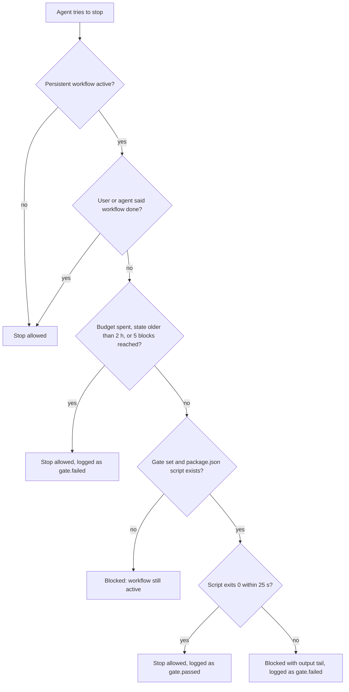

# oh-my-agent：为你已在用的编码 agent 配上一支专家团队

[](https://www.npmjs.com/package/oh-my-agent) [](https://www.npmjs.com/package/oh-my-agent) [](https://github.com/first-fluke/oh-my-agent) [](https://github.com/first-fluke/oh-my-agent/blob/main/LICENSE) [](https://github.com/first-fluke/oh-my-agent/commits/main)

[English](../README.md) | [한국어](./README.ko.md) | [Português](./README.pt.md) | [日本語](./README.ja.md) | [Français](./README.fr.md) | [Español](./README.es.md) | [Nederlands](./README.nl.md) | [Polski](./README.pl.md) | [Русский](./README.ru.md) | [Deutsch](./README.de.md) | [Tiếng Việt](./README.vi.md) | [ภาษาไทย](./README.th.md)

**oh-my-agent（`oma`）为你已在用的编码 agent 加上一支专家团队，支持 Claude Code、Codex CLI、Cursor 以及另外 11 个运行时。** 规划者拆解工作，工程师并行构建，审查者检查结果，调试者修复根因。它还能做带引用的研究、幻灯片、视频和图像。大多数步骤都会留下一个你能打开的文件；在长时间运行的工作流中，门禁可以把 agent 送回去继续工作，直到你自己的 `test`、`lint` 或 `typecheck` 脚本通过。

在项目根目录运行：

```bash
curl -fsSL https://raw.githubusercontent.com/first-fluke/oh-my-agent/main/cli/install.sh | bash
```

然后运行 `oma doctor`，再在 agent 中输入 `/plan add user accounts with a settings page`。[最初 5 分钟](#your-first-5-minutes)会带你走一遍。


[观看完整视频（35 秒）](./assets/video/oh-my-agent-explainer.mp4)

## 你会得到什么

**工作流**是你输入（或直接说出）的东西。工作流会召集**角色**，也就是各位专家。**技能**是专业知识：每个角色都带着自己的技能，其余技能则在任务需要时由你的 agent 加载。

| | 能给你什么 | 试一试 |
|---|---|---|
| **12 个专家角色** | PM、架构师、后端、前端、移动端、数据库和基础设施工程师、QA 审查者、调试者、重构者、文档管理员、研究员（[认识他们](#meet-the-team)） | `/orchestrate build a TODO app with login` |
| **21 个工作流** | 斜杠命令，从 `/brainstorm`、`/plan` 到 `/review`、`/debug` 和 `/scm`。大多数也能从一句普通请求启动（关键词库最多覆盖 11 种语言） | “review this PR” |
| **33 个技能** | 只在任务需要时加载的领域知识：UI、API、schema、Terraform、CI、安全、git、可观测性 | 自动加载，例如“add a Terraform S3 bucket” |
| **能打开的文件** | 计划、设计文档、API 契约、ADR、bug 笔记、各 agent 的结果、安全证据、HTML 讲解文档、回顾总结 | `ls .agents/results` |
| **不听 agent 一面之词的检查** | 在长时间运行的工作流中，你自己的 `test`、`lint` 或 `typecheck` 脚本必须通过，agent 才能停下；`oma ralph verify` 会检查一次 `/ralph` 运行是否留下了计划、QA 和重构文件 | `/ultrawork …`，然后 `oma goal set --gate test` |
| **研究与内容** | 带引用的搜索、市场研究、论文、幻灯片、MP4 视频、图像、本地语音、PDF/HWP 转 Markdown | `/video`、`/convert` |
| **一个目录，14 个运行时** | 一个可移植的 `.agents/` 目录，写入每个运行时自己的配置文件 | `oma link cursor` |

**[安装](#install)** · **[最初 5 分钟](#your-first-5-minutes)** · **[团队](#meet-the-team)** · **[选哪个工作流？](#how-the-team-works-together)** · **[全部功能](#everything-in-the-box)** · **[兼容的运行时](#works-with)** · **[验证](#verification-not-narration)** · **[常见问题](#faq)** · **[文档](https://first-fluke.github.io/oh-my-agent/)**

<a id="install"></a>
## 安装

脚本会在缺少 [bun](https://bun.sh) 时安装它，再全局安装 `oma` 命令（`bun install --global oh-my-agent`，如果 `oma` 已在 PATH 中则跳过），然后启动交互式设置。这个全局命令很重要：hook（关键词检测、Stop 门禁）和好几个工作流都会调用 `oma`，找不到它时 hook 会静默地什么也不做。如果不用脚本，请自行通过 `bun install --global oh-my-agent` 安装（`npm install --global oh-my-agent` 或 `brew install oh-my-agent` 也可以）。

<details>
<summary>Windows，或不使用安装脚本</summary>

```powershell
# Windows (PowerShell)
irm https://raw.githubusercontent.com/first-fluke/oh-my-agent/main/cli/install.ps1 | iex
```

```bash
# 任意装有 bun 的 OS：同样的设置，外加全局 `oma` 命令
bun install --global oh-my-agent
oma
```

在 Windows 上，安装器会隐藏 Antigravity、Hermes 和 Kimi，而且 hook 包装器是一个 bash 脚本。默认的 Aside 浏览器 MCP 通过 `bash` 安装，如果没有 bash，请取消勾选它。

</details>

设置过程会询问响应语言、要接入哪些 agent 运行时、能力提供方、浏览器 MCP、模型预设和技能预设。**拿不准的话，技能预设就选 `All`**：工作流总是会安装，而其中好几个（`/orchestrate`、`/work`、`/ultrawork`、`/ralph`、`/docs`、`/security`）需要只有 `All` 才包含的技能。

<details>
<summary>安装器默认还会做的事</summary>

- 安装 **bun**（必需）。尝试安装 **uv**、**Serena** 和 **CUE**，其中任何一个失败都会给出警告并继续。
- 预先选中 **Aside** 浏览器 MCP，并通过 `curl -fsSL https://releases.aside.com/install.sh | bash` 安装。可以在浏览器 MCP 步骤中取消勾选，或之后用 `oma update mcp` 更换。
- 使用 **AgentMemory** 作为语义记忆，它会运行 `bun install -g @agentmemory/agentmemory` 并启动一个守护进程。选择提供方 `none` 或设置 `OMA_NO_AGENTMEMORY=1` 即可跳过。
- 写入你的主目录（Antigravity、Hermes、Kimi）之前会先询问。在 `$HOME` 中不带 `--global` 运行时会请求确认。
- 非交互式运行（`-y`、`OMA_YES=1`、`CI=true`）使用 `All` 技能预设、`model_preset: auto`，并以 Python 作为后端语言。

</details>

<details>
<summary>技能预设</summary>

| 预设 | 技能 |
|--------|--------|
| **All** | **全部 33 个技能**（推荐） |
| Fullstack | architecture, backend, brainstorm, db, debug, design, dev-workflow, frontend, mobile, pm, qa, scm, tf-infra |
| Fullstack Web | Fullstack 去掉 mobile 和 tf-infra |
| Fullstack Mobile | Fullstack 去掉 frontend 和 tf-infra |
| Frontend | architecture, brainstorm, debug, design, frontend, pm, qa, scm |
| Backend | architecture, backend, brainstorm, db, debug, dev-workflow, pm, qa, scm |
| Mobile | architecture, brainstorm, debug, mobile, pm, qa, scm |
| DevOps | architecture, brainstorm, debug, dev-workflow, observability, pm, qa, scm, tf-infra |
| Research | academic-writing, hwp, market, pdf, scholar, scm, search, translation |
| Content | academic-writing, design, image, scm, translation, voice |
| Custom | 逐个挑选技能 |

在这些具名预设中，只有 `All` 包含 coordination、orchestration、docs、security、refactor、explanation、recap、video、slide 和 skill-creation（也可以在 `Custom` 中单独挑选）。Research 和 Content 缺少 `/plan`、`/review`、`/debug`、`/architecture` 和 `/brainstorm` 所依赖的技能。参见[需要预设之外技能的工作流](../web/docs/getting-started/installation.md#workflows-that-need-skills-outside-a-preset)。

</details>

<a id="your-first-5-minutes"></a>
## 最初 5 分钟

1. 用上面的命令**安装**。
2. **检查安装：**

   ```bash
   oma doctor
   ```

   你应该会看到 `CLI Status`（哪些 agent CLI 已安装并登录）和 `Skills Status`（例如 `Skills (33/33 installed, 33 complete)`）。如果找不到 `oma`，请打开一个新终端（安装器可能刚把 `~/.bun/bin` 加入 PATH），或运行 `bun install --global oh-my-agent`。
3. **在项目中打开 agent，让它做个计划：**

   ```text
   /plan add user accounts with a settings page
   ```

   也可以直接写“plan user accounts with a settings page”：在支持 prompt hook 的运行时上，关键词会启动同一个工作流。
4. **看看得到了什么。** `/plan` 在当前会话中运行。对于像这样横跨多个领域的工作，它会写入 `.agents/results/plan-<session-id>.json`，并在 `docs/plans/work/<NNN>-<name>.md` 生成一份跟踪文件。小型、单一领域的请求则会直接得到一条建议，而不是计划文件。

到这里就可以停下了。你会知道它适不适合你。想要更多时，再对这份计划运行 `/work` 或 `/orchestrate`。

<a id="meet-the-team"></a>
## 认识团队

团队由你自己的 agent 带领。在 `/work`、`/orchestrate` 和 `/ultrawork` 中，它会把每项工作交给合适的专家，专家作为独立的 subagent 运行。`/plan`、`/architecture` 和 `/docs` 在你当前的会话中带着对应角色的技能运行；`/review` 和 `/debug` 遇到大范围任务时会请来各自的专家。当某个角色配置在其他厂商的 CLI 上时，`oma agent spawn` 会在那里运行它。

| 你的专家 | 携带的技能 | 调用方式 | 留下的产出 |
|---|---|---|---|
| **产品经理**（`pm-planner`） | oma-pm | `/plan`，或“plan the payment feature” | 对于 Medium 和 Complex 级别的工作，留下一份计划 JSON，并在 `docs/plans/work/` 中留下一份跟踪文件（Simple 请求会直接得到建议） |
| **架构师**（`architecture-reviewer`） | oma-architecture | `/architecture` | `.agents/results/architecture/` 中的一份 ADR 或建议 |
| **后端、前端、移动端、数据库和基础设施工程师** | oma-backend, oma-frontend + oma-design, oma-mobile, oma-db, oma-tf-infra | `/work`、`/orchestrate` | 代码、测试，以及每个任务一份 `result-<agent>` 文件 |
| **QA 审查者**（`qa-reviewer`） | oma-qa | `/review`，或“review this PR” | 按 CRITICAL 到 LOW 排序的发现，每条都带 file:line 和修复代码 |
| **调试者**（`debug-investigator`） | oma-debug | `/debug`，或“fix this bug” | 最小修复、一个回归测试，必要时在 `.agents/results/bugs/` 中留下一份 bug 笔记 |

<details>
<summary>另外三个角色，以及没有对应角色的技能</summary>

| 你的专家 | 携带的技能 | 调用方式 | 留下的产出 |
|---|---|---|---|
| **重构者**（`refactor-engineer`） | oma-refactor | `/ultrawork` 的 REFINE 阶段 | 保持行为不变的 `refactor:` 提交，以及一份 `result-refactor-<session>.md` 报告 |
| **文档管理员**（`docs-curator`） | oma-docs | `/docs`，或“verify docs” | `docs/generated/doc-refs.json`，以及你批准的文档补丁 |
| **研究员**（`research-explorer`） | oma-search, oma-market, oma-scholar | 一个研究请求 | 带可信度标签的引用来源；`.agents/results/market/` 中的市场简报 |

基础设施工程师（`tf-infra-engineer`）被要求在任何破坏性或生产环境的 `apply` 或 `destroy` 之前先征求你的同意。其余技能（brainstorm、security、scm、dev-workflow、observability、explanation、recap、translation、coordination、orchestration、skill-creation，以及内容与媒体类技能）没有专属角色。你的 agent 会自行加载它们，其中大多数还会由技能注入器根据你的 prompt 推荐合适的那个。

</details>

<a id="how-the-team-works-together"></a>
## 团队如何协作

```text
 THINK   /brainstorm ......................... docs/plans/designs/<NNN>-<feature>.md
 PLAN    /plan · /architecture ............... plan JSON, API contracts, ADR
 DESIGN  /design ............................. DESIGN.md + tokens
 BUILD   /work · /orchestrate · /ultrawork ... code + result-<agent> files, engineers in parallel
 CHECK   /review · /security · /debug ........ findings, security evidence, regression test
 SHIP    /scm · /docs ........................ Conventional Commits, doc fixes
```

每一步都把一个文件交给下一步。`/brainstorm` 保存一份设计供 `/plan` 读取，`/plan` 写出一份计划，其中每个任务都有负责的 agent、依赖、验收标准和检查命令。`/orchestrate` 执行这份计划（它会加载最近的 `plan-*.json`，没有就先写一份）。`/work` 和 `/ultrawork` 一开始会让 PM 写出它们自己的计划。不需要的阶段可以跳过；每个阶段也都能单独使用。

**该由哪个工作流来调度团队？**

| 你想要 | 运行 | 结果如何 |
|---|---|---|
| 只要一份计划 | `/plan` | 跨领域工作得到一份计划文件，小型工作得到一条直接建议 |
| 由 PM 主导、你一步步跟进的构建 | `/work` | 先 PM，再按层级依次交给工程师，最后 QA。CRITICAL 和 HIGH 级发现会进入修复循环（最多 5 轮） |
| 放手不管的并行构建 | `/orchestrate` | 只有检查通过的任务才算完成；每个任务最多尝试 3 次，之后标记为 partial 或 failed |
| 最大程度的谨慎 | `/ultrawork` | 五个带门禁的阶段（PLAN、IMPL、VERIFY、REFINE、SHIP）；每次审查都在全新的审查者会话中进行 |
| “真正做完之前别停” | `/ralph` | 搭配单独 spawn、拥有全新上下文的 judge 反复运行 `/ultrawork`，直到每条标准都通过；当标准受阻或满 5 轮后停止，并给出部分完成报告 |
| 定时运行的团队 | `oma schedule create qa-reviewer "review open PRs" --every 2h` | 每次运行在 `~/.oma/schedule/runs/<id>/` 中留下一份 Markdown 日志 |

斜杠命令不是必需的。在支持 prompt hook 的运行时上，普通请求（关键词库最多覆盖 11 种语言）可以启动大多数工作流：“review this PR”会启动 `/review`。描述一整个应用（“Build a TODO app with user authentication”）会建议使用 `/orchestrate`，由你的 agent 决定是否运行。代码块中的关键词会被忽略。

`/orchestrate`、`/work`、`/ultrawork` 和 `/ralph` 在你按名称调用时（斜杠命令或纯文本，如“ultrawork: add rate limiting”）是**持久型**的。此后 agent 每次想提前停下，都会被送回去继续工作（最多 5 次或 2 小时），直到你说 **“workflow done”**。如果请求只是大致匹配，则只会建议使用它们。

**实测数据，附带说明。** 在[基准测试](../benchmarks/README.md)中（一个 prompt；Claude Code 搭配五种不同的附加配置，含纯 Claude Code；`claude-opus-4-6`；每种各构建一次），oma 得分 80.6，纯 Claude Code 为 70.7；成本是后者的 1.7 倍（$4.04 对 $2.37），耗时是后者的 1.8 倍。

<details>
<summary>全部 21 个工作流</summary>

| 命令 | 作用 |
|---------|--------------|
| `/architecture` | 权衡设计取舍，给出建议、评审或 ADR |
| `/brainstorm` | 探索想法与约束，在规划前产出一份经过确认的设计 |
| `/convert` | 把 PDF/HWP 转成 Markdown，或用 ffmpeg 转码图像、视频和音频 |
| `/debug` | 复现 bug、修复根因、编写回归测试，并扫描类似模式 |
| `/deepinit` | 把现有代码库梳理成 AGENTS.md、ARCHITECTURE.md 和 docs/ 知识库 |
| `/design` | 构建设计系统、DESIGN.md 和设计 token，并做无障碍检查 |
| `/docs` | 找出失效的文档引用，并为 diff 涉及的文档提出补丁 |
| `/explain` | 把 diff、PR、分支或主题做成自包含的交互式 HTML 讲解文档 |
| `/orchestrate` | 并行运行多个 agent，通过文件状态协调它们，并验证结果（持久型） |
| `/plan` | 把功能拆成按优先级排序、带 API 契约的任务 |
| `/ralph` | 搭配单独 spawn 的 judge 反复运行 `/ultrawork`，最多 5 轮（持久型） |
| `/recap` | 总结你某一天或某段时间的 AI 对话历史 |
| `/review` | 审查安全（OWASP Top 10）、性能、无障碍（WCAG 2.2 AA）和代码质量 |
| `/schedule` | 注册一个按固定周期运行的 agent 任务 |
| `/scm` | 处理分支、合并、冲突、worktree 和 Conventional Commits |
| `/security` | 扫描源码、agent 技能和 MCP 组件，验证发现，并设置 CI 门禁 |
| `/stack-set` | 检测你的技术栈，为领域技能生成针对该技术栈的参考资料 |
| `/tools` | 用自然语言列出、启用和禁用 MCP 工具 |
| `/ultrawork` | 五个阶段（PLAN、IMPL、VERIFY、REFINE、SHIP），每次审查都在全新的审查者会话中进行（持久型） |
| `/video` | 通过密钥可选的流水线，把一份 brief 做成完整的 MP4 |
| `/work` | 借助 PM 规划和 QA 审查，协调多个 agent 完成跨领域项目（持久型） |

触发准确率是实测的，不是假设的：`oma verify triggers` 会用一份带标注、包含 212 条提示的英文和韩文语料给检测器打分，误检超过 10% 或漏检超过 20% 时 CI 就会失败。最近一次实测：**漏检 0%，误检 5.3%**。完整参考：[工作流](https://first-fluke.github.io/oh-my-agent/docs/core-concepts/workflows/)。

</details>

<a id="see-it-work"></a>
## 实际运行效果

下面是一个示意性的 `/ultrawork` 会话。`[OMA PERSISTENT MODE: ULTRAWORK]` 块是 Stop hook 实际打印的格式，其余行是转述：

```text
you    /ultrawork add rate limiting to POST /login
agent  runs `oma goal set --gate test`
agent  PLAN writes .agents/results/plan-<run-id>.json
agent  IMPL -> VERIFY -> REFINE -> SHIP  (each review runs in a fresh reviewer session)
agent  "Rate limiting added. All tests pass."
oma    [OMA PERSISTENT MODE: ULTRAWORK]
       Stop gate 'test' FAILED (reinforcement 1/5).
       Fix the failures below, then finish the workflow — the stop is allowed only when the gate passes.
       --- gate output (tail) ---
       FAIL  src/auth/login.test.ts > returns 429 after 5 attempts
       To abandon instead: delete .agents/state/ultrawork-state-<host-session>.json or say "workflow done".
agent  fixes the limiter and stops again
oma    `test` exits 0: stop allowed, gate.passed appended to the session log
```

之后，`oma state list` 能找到这个会话，`oma state get <oma-sid>`（使用 `state list` 输出的 ID）会显示每一条门禁事件。在 `/ralph` 下，`oma ralph verify --json` 还会检查各个阶段是否留下了应有的文件（输出已截断）：

```json
{ "ok": false,
  "missing": [{ "id": "A3", "description": "a distinct QA agent ran (VERIFY phase)",
                "pattern": ".agents/state/memories/result-qa*.md or .agents/results/result-qa*.md",
                "status": "missing" }] }
```

<a id="everything-in-the-box"></a>
## 全部功能一览

<details>
<summary><strong>规划与设计</strong>：<code>/brainstorm</code>、<code>/plan</code>、<code>/architecture</code>、<code>/design</code></summary>

| 命令 | 作用 | 写入 |
|---|---|---|
| `/brainstorm` | 每次只问一个澄清问题，提出 2-3 种做法各不相同的方案，然后交给 `/plan`。不写代码 | `docs/plans/designs/<NNN>-<feature>.md` |
| `/plan` | 把工作规模评估为 Simple、Medium 或 Complex；对于 Medium 和 Complex 的工作，拆成任务，每个任务都有 agent、依赖、验收标准和检查命令，并在工作跨越边界时定义 API 契约 | `.agents/results/plan-<sid>.json`、`docs/plans/work/<NNN>-<name>.md`，需要时在 `.agents/results/api-contracts/` 中写入契约 |
| `/architecture` | 先阅读以往的决策，至少比较 2 个选项，并把被取代的 ADR 标记为 superseded | `.agents/results/architecture/` 中的一份 ADR 或建议 |
| `/design` | 提出 2-3 个方向，然后写出带 token 的 `DESIGN.md`，并审查响应式布局和无障碍 | `DESIGN.md`、CSS/Tailwind/shadcn token |

</details>

<details>
<summary><strong>构建</strong>：7 个领域技能，外加用 <code>/stack-set</code> 让它们适配你的技术栈</summary>

| 技能 | 构建内容 |
|---|---|
| oma-frontend | 遵循你的 token、i18n 和无障碍规则的 React/Next.js 或 Angular UI |
| oma-backend | API、认证和数据访问，按 router → service → repository 分层 |
| oma-mobile | Flutter、React Native 或 Swift 应用 |
| oma-db | schema、迁移、查询调优、vector/RAG 检索方案 |
| oma-tf-infra | 适用于任何云的 Terraform，并指出漂移、破坏性变更和成本风险 |
| oma-dev-workflow | mise 任务、lint/format/typecheck、commitlint、git hook、CI/CD 和发布 |
| oma-observability | OpenTelemetry、SLO、告警和事故取证 |

`/stack-set` 读取你的 manifest 文件，为 backend、frontend 和 mobile 技能写入针对该技术栈的参考资料。在 monorepo 中，前端、后端和移动端工程师会被指向各自的 workspace（pnpm、npm/yarn/bun workspaces、lerna、nx、turbo、`mise.toml`）。

</details>

<details>
<summary><strong>审查、修复与交付</strong>：<code>/review</code>、<code>/security</code>、<code>/debug</code>、refactor、<code>/scm</code></summary>

| 命令或技能 | 作用 | 写入 |
|---|---|---|
| `/review` | 先做依赖审计，然后检查 OWASP Top 10、性能、WCAG 2.2 AA 和代码质量。每条发现都带 file:line 和修复代码 | 报告输出在聊天中，外加一条 memory 记录；没有报告文件 |
| `/security` | 扫描你的源码、agent 技能和 MCP 服务器（Deepsec、Cisco Skill and MCP Scanner），并在提供限定范围的测试部署时运行 ARTEX 渗透测试。工作流要求把未能运行的引擎报告为失败，而不是“干净” | `.agents/results/security/<run-id>/` |
| `/debug` | 复现故障，用最小改动修复根因，添加回归测试，并在其他地方扫描同样的模式 | 修复和测试；必要时在 `.agents/results/bugs/` 中留下一份 bug 笔记 |
| oma-refactor | 改变结构而不改变行为：先写表征测试（characterization test），再做只含重构的提交 | `.agents/results/refactor/` |
| `/scm` | 按逻辑变更拆分的 Conventional Commits；分支、合并、rebase 和 worktree | 提交和分支 |

</details>

<details>
<summary><strong>文档与知识</strong>：<code>/deepinit</code>、<code>/docs</code>、<code>/explain</code>、<code>/recap</code>、translation</summary>

| 命令或技能 | 作用 | 写入 |
|---|---|---|
| `/deepinit` | 把现有仓库变成 agent 可直接使用的知识库 | `AGENTS.md`、`ARCHITECTURE.md`、`docs/` |
| `/docs` | 找出失效引用，修补 diff 涉及的文档（只应用你批准的补丁），并找出过时的翻译 | `docs/generated/doc-refs.json`、修补后的文档 |
| `/explain` | 把 PR、分支或暂存的改动做成带 5 道题测验的 HTML 讲解文档，或把一个主题做成单页可视化讲解 | `.agents/results/explain/<date>-<slug>.html` |
| `/recap` | 总结你在各个工具中某一天或某段时间的 AI 对话 | `.agents/results/recap/<date>.md` |
| oma-translation | 读起来地道的翻译；占位符、代码和 locale key 保持不变 | 译文 |

</details>

<details>
<summary><strong>研究</strong>：搜索、市场、论文、学术写作</summary>

| 技能 | 作用 | 写入 |
|---|---|---|
| oma-search | 文档、网页和代码搜索，每个来源都带可信度标签 | 带引用的结果 |
| oma-market | 从社区信号中挖掘痛点、趋势和竞争对手，并用 SWOT、波特五力和 PESTEL 框架梳理 | `.agents/results/market/<topic>-<date>.md` |
| oma-scholar | 检索论文时读取精简的论断文件（Knows 格式，约 700 token），而不是完整 PDF（约 10K token） | `<paper>.knows.yaml` |
| oma-academic-writing | 对照评分标准起草和审校学术文章 | 你的文件 |

</details>

<details>
<summary><strong>内容与媒体</strong>：<code>/video</code>、<code>/convert</code>、幻灯片、图像、语音</summary>

| 命令或技能 | 产出 | 写入 |
|---|---|---|
| `/video` | 把短视频、讲解视频或演示做成完整的 MP4；需要密钥的提供方都有免密钥的后备方案 | `.agents/results/videos/<run>/`，附带 manifest |
| oma-slide | 1920×1080 的 HTML 演示文稿，可导出为 PDF、PNG 或 PPTX | `.agents/results/slides/<session>/` |
| oma-image | 通过你已登录的厂商 CLI 生成图像，并排比较 | `.agents/results/images/<run>/` |
| oma-voice | 通过 Voicebox 应用在本地进行文本转语音和转写 | `.agents/results/voice/<run>/` |
| `/convert` | PDF 或 HWP 转 Markdown；通过 ffmpeg 转换图像、视频和音频 | 与输入文件放在一起 |

这些流水线在缺少来源或厂商密钥时会如实报告，而不是悄悄返回一份缩水的结果。

</details>

<details>
<summary><strong>无需吩咐就会运行的 hook</strong></summary>

| Hook | 作用 | 关闭方式 / 限制 |
|---|---|---|
| 关键词启动 | 从普通请求启动匹配的工作流 | 会跳过提问、粘贴的文本和代码块 |
| 技能注入器 | 根据 prompt 为 agent 指出合适的技能 | 持久型工作流运行期间暂停 |
| Stop 门禁 | 把持久型工作流送回去继续工作；设置了 `oma goal set --gate test` 时，只有该脚本在 25 秒内以 0 退出才允许停止 | 说“workflow done”；阻止 5 次或 2 小时后也会自动解除 |
| 重构守卫 | 停止时标出超过 500 行的已编辑文件，交给 `refactor-engineer` | 需手动开启：`refactor_guard.enabled` |
| 密钥守卫 | 阻止对 `*.env`、`*.pem`、`id_rsa*`、`*.tfstate` 等文件执行 `git add` | 在那一条命令前加上 `OMA_SCM_ALLOW_SECRETS=1` |
| 代码搜索守卫 | 阻止在项目中使用原生递归搜索，让 agent 改用 Serena 或 Gortex | `providers.code_intelligence_guard: off` |
| 测试过滤器 | 只保留测试输出中的失败和摘要，从而少花 token | `OMA_TEST_FILTER=0` |
| 会话记忆 | 当你切换或恢复会话（或在压缩之后）时，重新注入当前会话的近期事件以及 AgentMemory 召回的内容 | 记忆提供方设为 `none` 或设置 `OMA_NO_AGENTMEMORY=1` 会关闭召回；本地事件快照仍会保留 |

`oma hook probe` 检查 oma 的 prompt hook 能否接受各运行时的 hook 输入（它不会启动运行时）。每个运行时接入了哪些 hook，见[运行时差异](#host-differences)。

</details>

<details>
<summary><strong>并行 agent、会话与仪表盘</strong></summary>

- `oma agent spawn <role> "<task>" <sid>` 在 Antigravity、Claude、Codex、Cursor、OpenCode、Qwen、Grok 或 Pi 上运行某个角色，支持 `--isolation worktree` 和 `--fallback-vendors`。`oma agent parallel` 可同时运行多个。
- `oma state list --all-projects` 和 `oma state get <sid>`：会话以及记录下的每一条事件。
- `oma dashboard terminal` / `oma dashboard web`：实时 agent 状态（Web 仪表盘只监听 `127.0.0.1`）。[仪表盘指南](../web/docs/guide/dashboard-monitoring.md)。
- `oma stats get`（生产力指标）、`oma retro`（git 回顾）、`oma recap --window 7d`（你在各个 AI 工具中做了什么）。
- `oma visualize --affected <paths>`：哪些技能、工作流、agent 和检查依赖你改动的 `.agents/` 文件。

</details>

<details>
<summary><strong>代码智能、记忆与 MCP</strong></summary>

| 槽位 | 默认 | 备选 |
|---|---|---|
| 文档 | Context7 | — |
| 代码智能 | Serena，每个项目共用一个服务器 | Gortex（实验性） |
| 语义记忆 | AgentMemory | Honcho（实验性）、none |
| 浏览器 MCP | Aside | Chrome DevTools、Firefox DevTools |

agent 之间通过 `.agents/state/` 中的普通文件协调，不依赖任何外部服务。`/tools` 用自然语言开启或关闭 MCP 工具。详情：[能力提供方](./capability-providers.md)。

</details>

<details>
<summary><strong>越用越好</strong></summary>

- `oma skill eval` 在留出任务上测量技能相对 baseline 的提升幅度。`oma skill optimize` 会提出能进一步提高这一幅度的修改，加上 `--apply` 则保留这些修改（[skill-eval 指南](../web/docs/guide/skill-eval.md)）。
- `oma harness evolution enable --max-dispatches <n>` 会安排一个每晚运行的周期：把失败的运行转成回归 fixture，并把通过评测的技能改进作为项目 overlay 应用。加上 `--mode propose` 则只记录这些改进。
- `oma emit` 把 `.agents/` 源导出为 Agent Skills 包、Agent Plugins 包、Claude Code 插件市场或 `AGENTS.md`。

</details>

<details>
<summary><strong>配置与安全护栏</strong></summary>

- 由用户自己掌管的那份 `.agents/oma-config.yaml` 在更新后会保留（只有 `oma update --force` 会重置它）；还可以在它之上叠加私有的 `.local.yaml` 或 `.local.cue` overlay。`language` 设置响应语言。
- 13 条项目规则（backend、commit、database、debug、design 等）在 Claude Code 和 Cursor 中作为原生规则加载，并在为 Codex、Qwen Code 和 Pi 写入的托管 `AGENTS.md` 区块中建立索引。
- 更新时会在 `.agents/backup/` 中保留配置和迁移备份；随附的技能和工作流会被原地替换，所以请把本地修改放在它们之外。`oma uninstall --dry-run` 会列出将被删除的内容。`first-fluke/oma-update-action@v1` 会在 CI 中运行 `oma update` 并开一个 PR。

</details>

<details>
<summary><strong>全部 33 个技能</strong></summary>

| 技能 | 作用 |
|---|---|
| **oma-academic-writing** | 将学术文章写到发表级别，涵盖起草、修订与审稿 |
| **oma-architecture** | 权衡架构方案、划定模块边界，提供 ADR/ATAM/CBAM 分析 |
| **oma-backend** | 用 Python、Node.js 或 Rust 构建并加固你的 API |
| **oma-brainstorm** | 在动手之前，先和你一起把想法探索清楚 |
| **oma-coordination** | 指导你逐步手动协调 PM、前端、后端、移动端与 QA 代理 |
| **oma-db** | 设计 schema、迁移、索引与 vector store |
| **oma-debug** | 找到根因、修复 bug，并补上回归测试 |
| **oma-design** | 构建含 token、无障碍支持与响应式布局的设计系统 |
| **oma-dev-workflow** | 自动化 CI/CD、发布流程与 monorepo 任务 |
| **oma-docs** | 检查文档中的失效引用，并标出被代码变更波及的内容 |
| **oma-explanation** | 将 diff/PR/分支转换为带测验的自包含交互式 HTML 讲解文档 |
| **oma-frontend** | 用 React/Next.js、TypeScript、Tailwind CSS v4 与 shadcn/ui 构建 UI |
| **oma-hwp** | 将 HWP、HWPX 和 HWPML 文件转换为 Markdown |
| **oma-image** | 同时调用多家 AI 供应商生成图像 |
| **oma-market** | 从社区信号中挖掘市场洞察，并套用 SWOT、Porter's 5F 和 PESTEL 框架呈现结论 |
| **oma-mobile** | 用 Flutter 构建跨平台移动应用 |
| **oma-observability** | 统一路由可观测性工作，覆盖指标、日志、追踪、SLO 与事故取证 |
| **oma-orchestration** | 通过 CLI 并行调度多个 agent |
| **oma-pdf** | 将 PDF 文件转换为 Markdown |
| **oma-pm** | 规划任务、拆解需求、定义 API 契约 |
| **oma-qa** | 审查代码的 OWASP 安全性、性能与无障碍合规 |
| **oma-recap** | 将会话历史整理成有主题分类的工作摘要 |
| **oma-refactor** | 借助热点定位、特性化测试安全网和只含重构的提交，在不改变行为的前提下重构代码 |
| **oma-scholar** | 检索学术文献，协助开展同行评审 |
| **oma-scm** | 管理分支、合并、worktree 与 Conventional Commits |
| **oma-search** | 将每条查询路由至最优来源，并标注结果的可信度评分 |
| **oma-security** | 扫描源代码、agent 技能和 MCP 组件，测试已部署的 Web 应用并验证发现 |
| **oma-skill-creation** | 以 SSL-lite 格式编写和审计 OMA skill |
| **oma-slide** | 生成特色鲜明、动画丰富的 HTML 演示文稿卡片，并导出至 PDF/PNG/PPTX |
| **oma-tf-infra** | 使用 Terraform 完成多云基础设施的自动化编排 |
| **oma-translation** | 将内容翻译成目标语言，读来如同母语写就 |
| **oma-video** | 通过可免密钥的 HyperFrames 流水线生成短视频、讲解视频和演示视频 |
| **oma-voice** | 在本地完成语音合成与转写，无需任何云服务 |

</details>

<a id="works-with"></a>
## 兼容的运行时

共 14 个安装目标：Claude Code、Codex CLI、Cursor、Antigravity、Qwen Code、Grok、Kiro、Kimi、OpenCode、Pi、GitHub Copilot、Hermes、CommandCode 和 ZCode。安装时跳过的运行时可以之后用 `oma link <vendor>` 接入。各运行时提供的 hook 不尽相同，完整矩阵见[支持的 Agent](./SUPPORTED_AGENTS.md)。

- **Orca IDE：** [OMA for Orca](../integrations/orca/README.md) 会添加一个侧边栏面板和命令面板操作（需要 Orca 1.4.197+ 并启用实验性插件）。
- **DeepSeek Harness：** [OMA for DeepSeek Harness](../integrations/dsh/README.md) 通过 Cordis 插件接入 OMA 检查。需要 `oma` 在你的 `PATH` 中。

<details>
<summary>运行时标志（安装目标，外加 Amp 和 DeepSeek Harness）</summary>

原生 = oma 写入运行时自己的配置文件；适配器 = oma 还会额外添加 hook 或 agent shim。Amp 会自行读取 `.agents/skills/`，不是安装目标。

<table>
<colgroup>
<col span="6" style="width:16.67%" />
</colgroup>
<tr>
<td align="center">
<a href="https://claude.com/product/claude-code"></a><br/>
<strong>Claude Code</strong><br/>
<sub>原生 + 适配器</sub>
</td>
<td align="center">
<a href="https://github.com/openai/codex"></a><br/>
<strong>Codex CLI</strong><br/>
<sub>原生 + 适配器</sub>
</td>
<td align="center">
<a href="https://antigravity.google"></a><br/>
<strong>Antigravity</strong><br/>
<sub>原生 SSOT</sub>
</td>
<td align="center">
<a href="https://cursor.com"></a><br/>
<strong>Cursor</strong><br/>
<sub>原生 + 适配器</sub>
</td>
<td align="center">
<a href="https://github.com/QwenLM/qwen-code"></a><br/>
<strong>Qwen Code</strong><br/>
<sub>原生派发</sub>
</td>
<td align="center">
<a href="https://github.com/deepseek-ai/deepseek-harness"></a><br/>
<strong>DeepSeek Harness</strong><br/>
<sub>Cordis plugin</sub>
</td>
</tr>
<tr>
<td align="center">
<a href="https://pi.dev/"></a><br/>
<strong>Pi</strong><br/>
<sub>原生兼容</sub>
</td>
<td align="center">
<a href="https://github.com/anomalyco/opencode"></a><br/>
<strong>OpenCode</strong><br/>
<sub>原生兼容</sub>
</td>
<td align="center">
<a href="https://ampcode.com"></a><br/>
<strong>Amp</strong><br/>
<sub>读取 .agents/skills</sub>
</td>
<td align="center">
<a href="https://github.com/features/copilot"></a><br/>
<strong>GitHub Copilot</strong><br/>
<sub>符号链接技能</sub>
</td>
<td align="center">
<a href="https://grok.x.ai"></a><br/>
<strong>Grok Build</strong><br/>
<sub>原生 hook</sub>
</td>
<td align="center">
<a href="https://kiro.dev"></a><br/>
<strong>Kiro CLI</strong><br/>
<sub>原生 hook + agent</sub>
</td>
</tr>
</table>

<p align="center"><sub><a href="./SUPPORTED_AGENTS.md">& 更多</a></sub></p>

</details>

<a id="host-differences"></a>
<details>
<summary>运行时差异：哪些运行时支持关键词检测和 Stop 门禁</summary>

| 运行时 | 关键词检测 | Stop 门禁 |
|---|---|---|
| Claude Code、Codex CLI、Qwen Code、Grok、Kimi | 支持 | 支持 |
| Cursor | 支持 | 支持（以后续消息的形式重新进入） |
| Antigravity | 支持 | 支持（通过 bun 运行处理器，而不是经由 `oma` 包装器） |
| OpenCode、Pi | 支持 | 尽力而为（Pi 需要带 `agent_settled` 的版本） |
| Kiro | 支持 | 不支持：Kiro 会忽略 Stop hook 的输出 |
| CommandCode | 无 prompt hook | 支持 |
| GitHub Copilot、Hermes、ZCode | 无 hook | 无 hook |

</details>

<a id="per-agent-models"></a>
<details>
<summary>按 agent 配置模型</summary>

`.agents/oma-config.yaml` 中的 `model_preset` 决定每个 agent 角色使用哪个模型。默认值 `auto` 会沿用当前运行时自身的 agent 和模型设置。

```yaml
language: en
model_preset: auto   # auto | free | antigravity | claude | codex | cursor | kiro | mixed | qwen | <custom_presets key>

# Optional per-agent overrides; they win over the preset
agents:
  backend: { model: openai/gpt-5.5, effort: high }
```

- `mixed` 让编排器、architecture、QA、PM 和 docs 使用 Claude，实现类角色使用 Codex `gpt-5.5`，因此需要同时具备 Claude Code 和 Codex CLI。
- `free` 通过 FreeLLMAPI 网关路由，需要 `FREELLM_API_KEY` 以及一个正在运行的服务器。
- `kiro` 不在安装器菜单中，需要在配置文件里设置。
- `oma doctor --profile` 会输出每个角色解析后的模型。
- 完整指南：[按 agent 配置模型](https://first-fluke.github.io/oh-my-agent/docs/guide/per-agent-models/)

</details>

<a id="verification-not-narration"></a>
## 只看验证，不听自述

agent 会自述成功，oh-my-agent 则核查产出物。[实际运行效果](#see-it-work)展示了 Stop 门禁的实际运作；下面列出 oma 运行的每一项检查，以及每一项能证明什么。

下面这些机制里，除了 prompt 驱动的 judge，其余都是机械的：命令要么以 0 退出，要么没有；文件要么在磁盘上，要么不在。它们没有一个会去问 LLM 这活儿“看起来对不对”。

| 机制 | 检查内容 | 来源 |
|-----------|----------------|--------|
| **Stop hook 门禁** | 在持久型工作流中，`oma goal set --gate test`（或 `lint`、`typecheck`）只有在对应的 package.json 脚本于 25 秒内以 0 退出时才允许停止。 | [`persistent-mode.ts`](../.agents/hooks/core/persistent-mode.ts) |
| **产出物门禁** | `oma ralph verify --json` 会检查 phase 记录、plan JSON，以及来自**独立 QA agent** 和**独立 refactor agent** 的 result 文件，每一项都绑定到已记录的 agent 运行。 | [`ralph.md`](../.agents/workflows/ralph.md) |
| **prompt 驱动的 judge** | 不是机械的：`/ralph` 的 prompt 要求编排器 spawn 一个拥有全新上下文的 judge，每一轮都重新检查**每一条**标准。没有任何东西会检查这次 spawn 是否真的发生。 | [`judge-protocol.md`](../.agents/workflows/ralph/resources/judge-protocol.md) |
| **事件日志** | 在 OMA 会话中，门禁通过、门禁失败和决策各会向该会话的 `events.jsonl` 追加一行 JSON。 | [`state-core.ts`](../.agents/hooks/core/state-core.ts) · [`event-spec.md`](../.agents/skills/_shared/runtime/event-spec.md) |
| **按 agent 检查** | `oma verify agent <type>` 会运行 Scope Check、Charter Preflight、Hardcoded Secrets、TODO/FIXME Comments、Declared outputs 和 TDD Evidence，外加按类型的检查，例如 TypeScript、Any Types、SQL Injection 和测试。 | `oma verify agent --help` |

> **没有会话，就没有留痕。** Stop hook 会把门禁事件记在持久型工作流启动时开启的那个 OMA 会话下。事件写入是尽力而为的。如果这个会话没能创建（stderr 中会出现 `[oma] L1 session activation failed`），失败的门禁仍然会阻止停止，但不会写下任何 `gate.failed` 行。在依赖这份留痕或拿它做演示之前，先确认 `oma state list` 显示有一个活跃会话；之后 `oma state get <sid>` 会显示它的事件。

<details>
<summary>限制、细节，以及 Stop hook 如何做决定</summary>

**需要了解的限制：**

- Stop 门禁只作用于持久型工作流（`/orchestrate`、`/work`、`/ultrawork`、`/ralph`）。没有 `oma goal set --gate` 时，它只会再次提示 agent 继续。当项目有低成本的检查时，`/ultrawork` 会让 agent 设置门禁，但没有任何机制强制执行。想要确保的话，请自己运行 `oma goal set --gate test`；其他持久型工作流从不设置门禁。
- 只接受 `typecheck`、`test` 和 `lint` 这三个关键词，它们会运行 package.json 中同名的脚本。没有 package.json，或没有同名脚本，门禁就不会运行。非 JS 项目需要一个 package.json 包装脚本。
- 阻止 5 次（reinforcement）后、超过 2 小时后，或 `--budget-minutes` 用完时，阻止会被解除并记录为失败，因此一个始终飘红的门禁不会把你困住。
- 预算：`session.quota_cap` 限制 token 数、spawn 次数和单厂商 token；任何一个维度超标时，编排器都会拒绝下一次 spawn。

**产出物门禁。** 产出物缺失就说明这个阶段没跑过，自述里怎么写都不算数。当会话日志记录了 REFINE 跳过原因时，refactor 检查也会以 `skip-recorded` 通过。

**prompt 驱动的 judge。** `/ralph` 工作流 prompt 要求编排器把 judge 作为一个拥有全新上下文的独立 agent 来 spawn，只告知它标准本身（绝不告知实现方声称自己修好了什么），并在每一轮重新校验**每一条**标准，已经 PASS 的也不例外，因为 C1 悄悄回退往往正是修 C2 时发生的。没有任何东西会检查这次 spawn 是否真的发生：`oma ralph verify` 把关的是 EXEC 产出物，而不是 judge；无法 spawn subagent 的运行时会被要求以内联方式判定，并记录 `ralph.judge-inline-fallback`。`/ralph` 在 5 轮后停止，并给出部分完成报告。

**事件日志。** 用 `oma state list` 找到会话，再用 `oma state get <sid>` 读取。每个事件都带有厂商和运行时会话 id。这个文件的位置取决于 `OMA_HOME`、`OMA_STATE_HOME`、`OMA_PROFILE` 以及旧版的项目本地会话目录，所以不要把路径写死。

**按 agent 检查。** 类型：`backend`、`frontend`、`mobile`、`qa`、`debug`、`pm`。任意检查失败时命令以 1 退出；TODO/FIXME Comments 和 Inline Styles 只会给出警告。

- `backend`：`<Language> Syntax`、`SQL Injection`（原始 SQL 模式）和 `<Language> Tests`，来自 `stack/stack.yaml` 中的命令。没有这个文件（可用 `/stack-set` 生成）时会跳过这些检查。
- `frontend`：TypeScript（`tsc --noEmit`）、Inline Styles、Any Types、Frontend Tests（Vitest）。
- `mobile`：`stack/stack.yaml` 中的语法和测试命令，或 Flutter/Dart Analysis 与 Flutter Tests。
- `debug`：Python Tests（通过 uv 运行 pytest）或 Frontend Tests（Vitest）。
- `pm`：PM Plan（计划文件是合法的 JSON）。
- `qa`：没有机械检查。



</details>

<a id="faq"></a>
## 常见问题

<details>
<summary><strong>我需要所有技能吗？</strong></summary>

不需要。参见[技能预设](#install)；`All` 是稳妥的默认选择。

</details>

<details>
<summary><strong>怎么知道它在正常工作？</strong></summary>

`oma doctor` 会显示已安装的技能，并在 hook 找不到 `oma` 时发出警告。在持久型工作流运行期间，`oma state list` 会显示活跃会话，`oma state get <sid>` 会显示它的门禁事件。

</details>

<details>
<summary><strong>会多花 token 吗？</strong></summary>

通常会。技能只在任务需要时加载，但多 agent 工作流和全新上下文审查会花得更多。在[单 prompt 基准测试](../benchmarks/README.md)中，oma 的成本是纯 Claude Code 的 1.7 倍。

</details>

<details>
<summary><strong>Stop hook 一直在阻止停止，怎么退出？</strong></summary>

说“workflow done”（或“workflow complete” / “workflow finished”，或其他受支持语言中的对应说法），或者删除 `.agents/state/<workflow>-state-<sid>.json`。两者都不做的话，它会在阻止 5 次或 2 小时后自行解除。

</details>

<details>
<summary><strong>如何更新或卸载？</strong></summary>

`oma update` 会刷新技能、工作流和 hook，并保留你的配置（`--with-new-skills` 会加入该版本新增的技能；`oma update mcp` 可重新选择浏览器 MCP）。`oma uninstall --dry-run` 会列出将被删除的内容；`oma uninstall` 执行删除，并保留 `oma-config.yaml`、`mcp.json` 和你自己编写的技能。更多解决办法：[故障排查](https://first-fluke.github.io/oh-my-agent/docs/guide/troubleshooting/)。

</details>

<details>
<summary><strong>oh-my-agent 把哪些事交给模型？</strong></summary>

规划和下一步的选择仍由你的 agent 所用的模型负责；oma 没有固定的工作流图。oma 在模型之外强制执行的有：工具护栏（密钥守卫和搜索守卫）、预算、重试与停止上限、事件日志，以及在你设置了门禁时，一个要等你自己的检查通过才放行的停止。

</details>

## 了解更多

- **[文档站点](https://first-fluke.github.io/oh-my-agent/)**：指南、教程和 CLI 参考。建议从[快速开始](https://first-fluke.github.io/oh-my-agent/docs/getting-started/quick-start/)和[安装](https://first-fluke.github.io/oh-my-agent/docs/getting-started/installation/)看起。
- **[为什么选 oh-my-agent](https://first-fluke.github.io/oh-my-agent/docs/getting-started/why-oh-my-agent/)**：什么时候该选它，以及其中的取舍
- **[基准测试报告](../benchmarks/README.md)**：在同一个 prompt 上与 superpowers、ECC 和 oh-my-claudecode 的对比，含方法、分数、截图与注意事项
- **[支持的 Agent](./SUPPORTED_AGENTS.md)**：各运行时的支持矩阵
- **[详细文档](./AGENTS_SPEC.md)**：技术规格和架构
- **[能力提供方](./capability-providers.md)**：实验性 Gortex 与 Honcho 的配置、路由和限制
- **[Skill 兼容性矩阵](./skills-matrix.md)**：Claude 和 Codex 中原生 skill 的内容、引用和响应契约

> **喜欢这个项目？** 给个 star 吧！
>
> ```bash
> gh api --method PUT /user/starred/first-fluke/oh-my-agent
> ```
>
> 试试我们优化过的入门模板：[fullstack-starter](https://github.com/first-fluke/fullstack-starter)

## Star History

[](https://star-history.dera.page/#first-fluke/oh-my-agent&type=date&legend=bottom-right)

## 参考文献

<details>
<summary>本项目借鉴的研究（7 篇论文）</summary>

- Li, X., Liu, Y., Chen, W., You, B., Di, Z., He, Y., Zheng, S., Choe, K. W., Sun, J., Wang, S., Tao, C., Li, B., Zhao, X., Geng, H., Wu, X., Zhou, J., Chen, X., Xing, H., Li, Y., … Song, D. (2026). *SkillsBench: Benchmarking how well agent skills work across diverse tasks* (Version 4) [Preprint]. arXiv. https://doi.org/10.48550/arXiv.2602.12670
- Yu, G., & Wang, X. (2026). *Knows: Agent-native structured research representations* (Version 1) [Preprint]. arXiv. https://doi.org/10.48550/arXiv.2604.17309
- Liang, Q., Wang, H., Liang, Z., & Liu, Y. (2026). *From skill text to skill structure: The scheduling-structural-logical representation for agent skills* (Version 4) [Preprint]. arXiv. https://doi.org/10.48550/arXiv.2604.24026
- Chen, C., Yu, Q., Gu, Y., Huang, Z., Li, H., Liu, H., Liu, S., Liu, J., Peng, D., Wang, J., Yan, Z., Meng, F., Qin, E., Che, C., & Hu, M. (2026). *The scaling laws of skills in LLM agent systems* (Version 1) [Preprint]. arXiv. https://doi.org/10.48550/arXiv.2605.16508
- Tang, L., Rashtchian, C., Ferng, C.-S., Tomkins, A., Juan, D.-C., & Vu, T. (2026). *WikiSkill: Compiling agent experience into persistent knowledge for skill evolution* [Preprint]. arXiv. https://doi.org/10.48550/arXiv.2608.27454
- Huang, Z., Xu, J., Yang, Y., Gong, Z., Yang, Q., Tian, M., Wang, X., Lv, C., Gao, X., Dai, Q., Liu, B., Qiu, K., Yang, X., Chen, D., Zheng, X., & Luo, C. (2026). *From raw experience to skill consumption: A systematic study of model-generated agent skills* [Preprint]. arXiv. https://doi.org/10.48550/arXiv.2605.23899
- Hong, D. B., Imani, A., & Ahmed, I. (2026). *From anatomy to smells: An empirical study of SKILL.md in agent skills* (Version 2) [Preprint]. arXiv. https://doi.org/10.48550/arXiv.2607.01456

</details>

## 许可证

MIT
