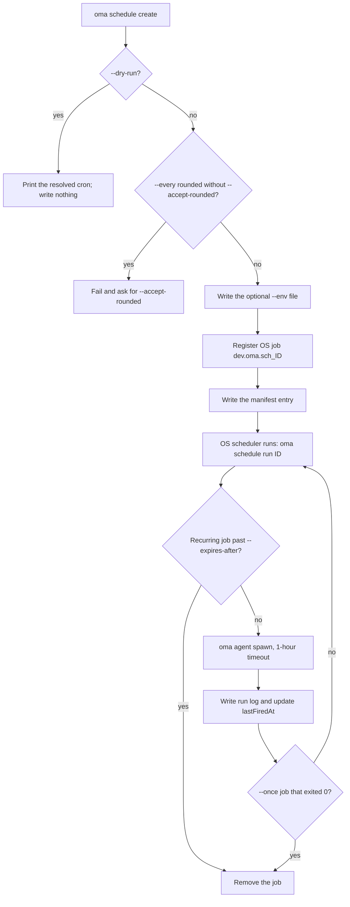
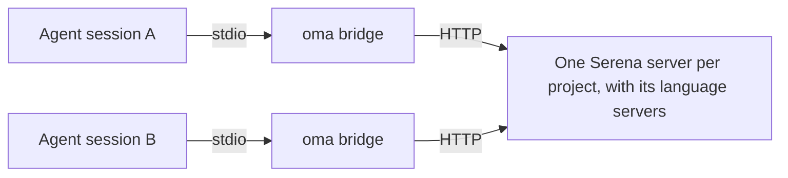
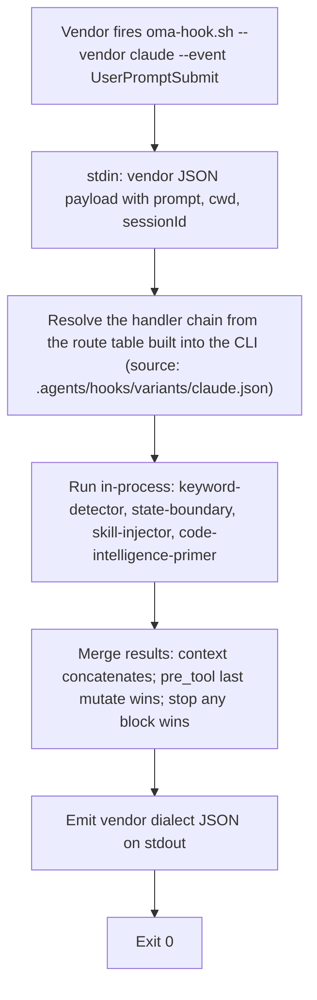

# CLI Commands

After installing globally (`bun install --global oh-my-agent`), use `oma` or `oh-my-agent`. For one-time use without installing, run `npx oh-my-agent`.

The environment variable `OH_MY_AG_OUTPUT_FORMAT` can be set to `json` to make JSON the default output on commands that use the shared `--json` / `--output` options. An explicit `--output text` still wins.

If a command fails with `Unknown command`, `Unexpected argument`, or `Removed option`, see [Removed spellings](#aliases) on this page; for installation, hook, and runtime problems, see [Troubleshooting](../guide/troubleshooting.md).

## Start with a task

Choose the smallest command that answers the question you have. Each command below prints a path or report that you can inspect before moving to the next step.

| Task | Start here | Expected result |
|:-----|:-----------|:----------------|
| Install or repair a project | `oma install` then `oma doctor` | Installed resources and a health report; use `oma doctor --profile` when model resolution is the question. |
| Find a command or option from an agent | `oma describe` or `oma describe "image generate"` | JSON describing arguments, options, and nested commands. |
| Generate an image | `oma image generate "<prompt>" --output json` | Image paths and a manifest under `.agents/results/images/`. |
| Plan or render video | `oma video generate "<brief>" --dry-run` | A run directory with planning artifacts; compose and render only after the composition is authored. |
| Make an interactive code explainer | `/explain` | A validated self-contained HTML artifact under `.agents/results/explain/`. |
| Resolve a diagram engine | `oma diagram resolve --output json` | The selected Mermaid or archify engine and its reason. |
| Research community signals | `oma market detect-trap "<topic>"` | A preflight result; continue with `oma market resolve --output json` and the upstream run only when it passes. |
| Convert or inspect a paper | `oma scholar search "<query>"` | Search results from Knows, OpenAlex, or Semantic Scholar; fetch a sidecar with `oma scholar get`. |
| Build a slide deck | `oma slide create --output-dir <dir>` | A working directory that can be authored, validated, bundled, and exported. |
| Review documentation drift | `oma docs verify --json` | A structured broken-reference report and regenerated reference index. |
| Schedule a recurring agent | `oma schedule create backend "<task>" --every 2h --dry-run` | The resolved cron expression; nothing is registered until you rerun without `--dry-run`. |
| Check skill or harness quality | `oma skill lint` or `oma skill audit` | Offline reports; see [Choosing a skill or harness command](#choosing-a-skill-or-harness-command) before any command that calls models. |

The canonical names below come from `oma describe`. Only these space-separated paths are accepted: older spellings such as `slide new`, `slide viewer`, `image list-vendors`, `video list-providers`, colon forms such as `agent:parallel`, and the short names `viz`, `s`, and `img` fail with `Unknown command` or `Unexpected argument`. See [Aliases and removed spellings](#aliases).

## Current command surface

Use each family’s `--help` or `oma describe <path>` for the exact argument grammar; [CLI Options](./options.md) lists the registry flags for every command path.

| Family | Registered paths |
|:-------|:-----------------|
| `install` | `install` |
| `describe` | `describe` |
| `uninstall` | `uninstall` |
| `update` | `update`, `update mcp` |
| `link` | `link` |
| `intel` | `intel`, `intel suggest` |
| `market` | `market`, `market detect-trap`, `market resolve`, `market update`, `market run` |
| `doctor` | `doctor` |
| `profile` | `profile`, `profile list`, `profile show`, `profile create`, `profile use`, `profile run` |
| `home` | `home`, `home migrate` |
| `retro` | `retro` |
| `recap` | `recap` |
| `docs` | `docs`, `docs verify`, `docs sync`, `docs i18n`, `docs lint` |
| `emit` | `emit` |
| `cleanup` | `cleanup` |
| `bridge` | `bridge` |
| `verify` | `verify`, `verify agent`, `verify triggers` |
| `vault` | `vault`, `vault store`, `vault get`, `vault list`, `vault delete` |
| `star` | `star` |
| `visualize` | `visualize` |
| `search` | `search`, `search providers`, `search web`, `search fetch`, `search meta`, `search media`, `search archive`, `search trust`, `search code`, `search doctor`, `search api`, `search api fetch`, `search api search`, `search rss`, `search rss fetch`, `search rss google` |
| `harness` | `harness`, `harness eval`, `harness incident`, `harness incident scan`, `harness incident capture`, `harness incident show`, `harness incident export`, `harness incident promote`, `harness incident reproduce`, `harness feedback`, `harness evolution`, `harness evolution enable`, `harness evolution status`, `harness evolution disable`, `harness evolution run` |
| `slide` | `slide`, `slide validate`, `slide bundle`, `slide edit`, `slide doctor`, `slide create`, `slide preview`, `slide export`, `slide export pdf`, `slide export png`, `slide export pptx`, `slide import`, `slide import pptx`, `slide asset`, `slide asset fetch-video`, `slide style`, `slide style list`, `slide style preview`, `slide style get` |
| `scholar` | `scholar`, `scholar search`, `scholar resolve`, `scholar get`, `scholar lint` |
| `image` | `image`, `image generate`, `image doctor`, `image vendor`, `image vendor list` |
| `video` | `video`, `video generate`, `video doctor`, `video compose`, `video render`, `video provider`, `video provider list` |
| `serena` | `serena`, `serena check`, `serena setup`, `serena reap`, `serena daemon`, `serena daemon gc`, `serena reaper`, `serena reaper enable`, `serena reaper disable` |
| `explain` | `explain`, `explain render`, `explain lint`, `explain patch`, `explain components`, `explain validate` |
| `diagram` | `diagram`, `diagram resolve`, `diagram update`, `diagram archify` |
| `help` | `help` |
| `version` | `version` |
| `dashboard` | `dashboard`, `dashboard terminal`, `dashboard web` |
| `auth` | `auth`, `auth status` |
| `hook` | `hook`, `hook run`, `hook probe` |
| `state` | `state`, `state emit`, `state migrate`, `state get`, `state list`, `state repair`, `state verify`, `state decisions`, `state decisions list`, `state inject-log`, `state inject-log list`, `state inject-log get`, `state summary`, `state trajectory`, `state heal-check`, `state activate`, `state archive`, `state purge` |
| `ralph` | `ralph`, `ralph verify` |
| `goal` | `goal`, `goal set` |
| `stats` | `stats`, `stats get`, `stats reset` |
| `agent` | `agent`, `agent context`, `agent resume`, `agent begin`, `agent verify`, `agent finish`, `agent spawn`, `agent status`, `agent parallel`, `agent review` |
| `model` | `model`, `model check`, `model probe`, `model propose` |
| `memory` | `memory`, `memory keys`, `memory init`, `memory setup`, `memory daemon`, `memory daemon status`, `memory daemon start`, `memory daemon stop`, `memory daemon restart`, `memory service`, `memory service install`, `memory service uninstall`, `memory status`, `memory retry`, `memory retry drain`, `memory import`, `memory maintain`, `memory maintain backup`, `memory maintain prune`, `memory maintain vacuum`, `memory gc`, `memory upgrade` |
| `skill` | `skill`, `skill audit`, `skill lint`, `skill eval`, `skill optimize`, `skill meta-optimize`, `skill procedure`, `skill evolution-stats`, `skill promotions`, `skill rollback`, `skill matrix` |
| `schedule` | `schedule`, `schedule create`, `schedule list`, `schedule delete`, `schedule run`, `schedule sync` |

Other OMA processes call a few internal entry points (`agent parallel-supervisor`, `hook script`, `schedule inspect`, `schedule builtin-evolution-add`). They still run, but help and `oma describe` hide them; you do not need them by hand.

When a command delegates its remaining arguments to another tool, the registry intentionally leaves its options open. This applies to `market run` and `diagram archify`; read the resolved upstream help before running a mutating or networked operation.

---

## Setup & installation

### install

`oma` with no arguments launches the interactive installer. `oma install` is the explicit form and accepts provider-selection options.

```bash
oma
oma install
oma install --web-search native --code-intelligence gortex --semantic-memory agentmemory
```

| Option | Accepted values |
|:-------|:----------------|
| `--web-search <provider>` | `native`, `brave` |
| `--code-intelligence <provider>` | `serena`, `gortex` |
| `--semantic-memory <provider>` | `agentmemory`, `honcho`, `none` |
| `--honcho-url <url>` | Honcho API origin (new connection default: `http://127.0.0.1:8000`) |
| `--honcho-workspace <id>` | Honcho workspace ID (new connection default: `oma`) |

`--web-search`, `--code-intelligence`, and `--semantic-memory` retain the saved provider choice when omitted. `--honcho-url` and `--honcho-workspace` configure a new Honcho connection when that provider is selected. The root `-y, --yes` flag skips prompts and uses defaults; `--global` targets `$OMA_HOME/.agents/` (default `~/.oma/.agents/`). Project installation stays at `<cwd>/.agents/` even when `OMA_HOME` is set.

**What it does:**
1. Checks for legacy `.agent/` directory and migrates to `.agents/` if found.
2. In interactive mode, detects other agent tools and asks whether to uninstall them (default: keep). `--yes`, `OMA_YES`, and CI installations keep them; `oma update` does not offer removal.
3. Prompts for project type (All, Fullstack, Frontend, Backend, Mobile, DevOps, Custom).
4. If backend is selected, prompts for language variant (Python, Node.js, Rust, Other).
5. Asks about GitHub Copilot symlinks.
6. Downloads the latest tarball from the registry.
7. Installs shared resources, workflows, configs, and selected skills.
8. Installs vendor adaptations for selected vendors (project-local settings; no silent HOME-level vendor writes).
9. Creates CLI symlinks.
10. Offers recommended **global** git config (opt-in confirm):
    - `rerere.enabled=true` — multi-agent merge conflict reuse
    - `init.defaultBranch=main` — consistent default branch for new repos
    - Skipped entirely under `--yes` / CI (prints manual fix hints instead)
11. Offers to configure MCP where applicable.
12. Prompts for GitHub star if `gh` is authenticated.

**Example:**
```bash
cd /path/to/my-project
oma
# Follow the interactive prompts
```

### doctor

Health check for CLI installations, MCP configs, and skill status.

```text
oma doctor [--json] [--output <format>] [--profile] [--heal-check <agent-type>]
```

**Options:**

| Flag | Description |
|:-----|:-----------|
| `--json` | Output as JSON. The command exits `1` when the report's `issues` count is above zero. |
| `--output <format>` | Output format (`text` or `json`) |
| `--profile` | Show profile health matrix. Displays the resolved model slug, CLI, and auth status per agent from the active `model_preset` and `agents:` overrides. See [Per-Agent Models](../guide/per-agent-models.md). |
| `--heal-check <agent-type>` | Include the self-healing gate check for that agent in the report. |

**What it checks:**
- CLI installations: `claude`, `codex`, `qwen`, `agy`, `grok`, `kiro-cli`, `kimi`, and `pi` (version and path).
- Authentication status for each CLI.
- MCP configuration for Claude Code (`~/.claude.json`) and Codex (`~/.codex/config.toml`).
- Installed skills: which skills are present and their status.
- Memory store directory: `.agents/state/memories/` existence and file count (older projects fall back to the legacy `.serena/memories/` path).
- Dual install markers (project vs global) and related warnings.
- Recommended **global** git config (`gitRecommended` in JSON):
  - `rerere.enabled=true`
  - `init.defaultBranch=main`
  - Each mismatch counts toward the issue total (`issues` in JSON)
- Project vendor context file (`AGENTS.md` OMA block when Codex, Qwen, or Claude Code ≥ 2.1.277 is installed).
- AgentMemory, state/hooks health, Serena reaper diagnostics, and related issue counters.

**Auto-repair:** If missing skills are detected, `doctor` offers to install them interactively. If recommended git config is missing or wrong, it offers the same opt-in global fixes used by install/update.

**Examples:**
```bash
# Interactive text output
oma doctor

# JSON output for CI pipelines
oma doctor --json

# Pipe to jq for specific checks
oma doctor --json | jq '.clis[] | select(.installed == false)'

# Inspect the profile resolution matrix
oma doctor --profile
```

### update

Update skills to the latest version from the registry.

```text
oma update [-f, --force] [--with-new-skills] [--ci] [-y, --yes] [--all] [--vendor <vendors>]
```

**Options:**

| Flag | Description |
|:-----|:-----------|
| `-f, --force` | Overwrite user-customized config files (`oma-config.yaml`, `mcp.json`, `stack/` directories) |
| `--with-new-skills` | Install skills that are new in this release; without it, refresh only skills already installed. |
| `--ci` | Run in non-interactive CI mode (skip prompts, plain text output) |
| `-y, --yes` | Skip prompts. Vendor scope is unchanged: only existing vendor directories are updated unless `--all` or `--vendor` is provided. |
| `--all` | Create/update all supported project-scoped vendors. |
| `--vendor <vendors>` | Create/update specific vendors. Accepts a comma-separated list such as `claude,qwen`. |

**What it does:**
1. Fetches `prompt-manifest.json` from the registry to check the latest version.
2. Compares with the local version in `.agents/skills/_version.json`.
3. If already up to date, exits.
4. Downloads and extracts the latest tarball.
5. Preserves user-customized files (unless `--force`).
6. Copies new files over `.agents/`.
7. Restores preserved files.
8. Updates vendor adaptations and refreshes symlinks. By default this only touches vendor directories that already exist in the project.
9. Offers recommended **global** git config (same opt-in as install: `rerere.enabled`, `init.defaultBranch`). Skipped under `--yes` / `--ci`.

**Examples:**
```bash
# Standard update (preserves config)
oma update

# Force update (resets all config to defaults)
oma update --force

# CI mode (no prompts, no spinners)
oma update --ci

# CI mode with force
oma update --ci --force

# Update existing vendors without prompts
oma update --yes

# Create/update every supported project-scoped vendor
oma update --all

# Create/update only Claude and Qwen integrations
oma update --vendor claude,qwen

# Also refresh browser MCP selections
oma update mcp --ci
```

`oma update mcp` has its own `--yes`, `--ci`, `--all`, and `--vendor <vendors>` options. It selects supported browser MCP servers (Aside, Chrome DevTools, or Firefox DevTools) for the chosen project-scoped vendors.

### uninstall

Preview or remove files owned by OMA from the selected install root:

```bash
oma uninstall --dry-run
oma uninstall --yes
```

`--dry-run` lists removals without changing files. `--yes` skips the confirmation prompt. The command preserves `oma-config.yaml`, `mcp.json`, and user-authored skills according to the registered command description. If the preview includes a file you still need, stop and keep the dry-run output for review.

### link

Regenerate vendor-native files from the `.agents/` source of truth without reinstalling.

```text
oma link [vendors...] [--dry-run] [--global]
```

`--dry-run` previews what would be written without changing files.

**Examples:**

```bash
# Preview the files link would write
oma link --dry-run

# Regenerate all configured vendors
oma link

# Regenerate only Claude and Codex files
oma link claude codex

# Regenerate the global install (~/.oma/.agents/) from any directory
oma link opencode --global
```

Without `--global`, link targets `<cwd>/.agents/`; with it, `~/.oma/.agents/` (or `$OMA_HOME/.agents/`). `OMA_HOME` does not change the project target. See [Global install](../guide/global-install.md).

**What it does:**
1. Rebuilds vendor-native agent files from `.agents/agents/`
2. Refreshes hooks and local settings for the selected vendors
3. Regenerates the `AGENTS.md` integration block for every configured vendor, Claude Code included. `CLAUDE.md` and `GEMINI.md` are never created or given an OMA block. Claude Code ≥ 2.1.277 reads `AGENTS.md` natively but ignores it whenever a `CLAUDE.md` exists, so when a user-owned `CLAUDE.md` is present link appends a single `@AGENTS.md` import line; `oma update` also strips the legacy `CLAUDE.md` OMA block once that version is detected
4. Refreshes Cursor MCP linkage and CLI skill symlinks when relevant

Use this after editing `.agents/agents/`, `.agents/workflows/`, `.agents/rules/`, or hook definitions.

**Model behavior:**
- Same-vendor native dispatch uses the model defined in the generated vendor agent file.
- External fallback dispatch uses each vendor's `default_model` from `.agents/skills/oma-orchestration/config/cli-config.yaml`.

**Dispatch behavior:**
- If the target vendor matches the current runtime and that runtime supports native role agents, OMA uses native dispatch.
- Otherwise OMA falls back to `oma agent spawn`.

### Reconfigure an existing install {#setup-workflow}

There is no `/setup` workflow. To change an installed project, rerun `oma install`, use `oma update mcp` for browser MCP servers only, or run `/tools` inside an agent session to enable or disable MCP tools. Check per-agent model resolution with `oma doctor --profile`; per-agent model pins live under `agents:` in `.agents/oma-config.yaml` ([Per-Agent Models](../guide/per-agent-models.md)).

---

## Monitoring & metrics

### dashboard terminal {#dashboard}

Start the terminal dashboard for real-time agent monitoring.

```text
oma dashboard terminal [--project-root <path>]
```

Watches `<project>/.agents/state/memories/`, where the project is `--project-root` (default: the current directory). There is no automatic fallback to the legacy `.serena/memories/` path. Renders a box-drawing UI with session status, agent table, and activity feed. Updates on every file change. Press `Ctrl+C` to exit.

The memories directory can be overridden with the `MEMORIES_DIR` environment variable.

**Example:**
```bash
# Standard usage
oma dashboard terminal

# Custom memories directory
MEMORIES_DIR=/path/to/.agents/state/memories oma dashboard terminal
```

### dashboard web

Start the web dashboard.

```text
oma dashboard web [--project-root <path>]
```

Starts an HTTP server on `http://127.0.0.1:9847` with a WebSocket connection for live updates. Open the printed URL in a browser to see the dashboard.

**Environment variables:**

| Variable | Default | Description |
|:---------|:--------|:-----------|
| `DASHBOARD_PORT` | `9847` | Port for the HTTP/WebSocket server |
| `MEMORIES_DIR` | `<project-root>/.agents/state/memories` | Path to the memories directory; takes precedence over `--project-root` |

**Example:**
```bash
# Standard usage
oma dashboard web

# Custom port
DASHBOARD_PORT=8080 oma dashboard web
```

### stats

View productivity metrics.

```text
oma stats get [--json] [--output <format>]
oma stats reset [--json] [--output <format>]
```

**Options:**

| Flag | Description |
|:-----|:-----------|
| `--json` | Output as JSON |
| `--output <format>` | Output format (`text` or `json`) |

**Metrics tracked:**
- Session count
- Skills used (with frequency)
- Tasks completed
- Total session time
- Files changed, lines added, lines removed
- Last updated timestamp

**Cost telemetry** (aggregated across every `session-cost-*.md` file under `.agents/state/memories/`):
- Recorded tokens, with actual native usage distinguished from prompt-length estimates
- Total spawns
- Reserved spawns and runs with partial native usage coverage
- Estimated USD using a per-vendor rate table; this estimate is separate from actual token counts
- Per-vendor breakdown (tokens · spawns · USD)

The USD estimate is not a billing-accurate amount. Configure `session.quota_cap` in `.agents/oma-config.yaml` to block the next spawn when recorded token usage or spawn counts reach a limit. Missing native usage retains an explicit estimate, and running children are not interrupted. See [Session quota caps](../guide/configuration-reference.md#session-quota-caps).

Metrics are stored in `.agents/state/metrics.json`; a legacy `.serena/metrics.json` is read when present. Data is collected from git stats and memory files.

**Examples:**
```bash
# View current metrics
oma stats get

# JSON output
oma stats get --json

# Reset all metrics
oma stats reset
```

### recap

Recap AI tool conversation history across Claude, Codex, Gemini, Antigravity, Qwen, Cursor, and Grok sessions.

```text
oma recap [--window <period>] [--date <date>] [--tool <tools>] [--top <n>] [--sort <metric>] [--mermaid] [--graph] [--json] [--output <format>]
```

**Options:**

| Flag | Description | Default |
|:-----|:-----------|:--------|
| `--window <period>` | Time window: `1d`, `3d`, `7d`, `2w`, `30d` | `1d` |
| `--date <date>` | Specific date (`YYYY-MM-DD`); takes precedence over `--window` | |
| `--tool <tools>` | Comma-separated filter: `grok,claude,codex,gemini,qwen,cursor,antigravity` | all |
| `--top <n>` | Show top N projects/topics | |
| `--sort <metric>` | Sort by `count` or `duration` | `count` |
| `--mermaid` | Output as Mermaid Gantt chart | |
| `--graph` | Open interactive graph in the browser | |
| `--json` / `--output <format>` | Machine-readable output | `text` |

**Examples:**

```bash
oma recap                                     # Today (1d)
oma recap --window 7d                         # Last week
oma recap --date 2026-04-20 --tool grok,claude
oma recap --window 7d --mermaid > week.mmd
oma recap --window 30d --graph                # Interactive browser graph
```

### retro

Engineering retrospective with metrics and trends.

```text
oma retro [window] [--json] [--output <format>] [--interactive] [--compare]
```

**Arguments:**

| Argument | Description | Default |
|:---------|:-----------|:--------|
| `window` | Time window `<n>h`, `<n>d`, or `<n>w` (for example `24h`, `7d`, `2w`). Months are not accepted; use `30d`. | Last 7 days |

**Options:**

| Flag | Description |
|:-----|:-----------|
| `--json` | Output as JSON |
| `--output <format>` | Output format (`text` or `json`) |
| `--interactive` | Interactive mode with manual entry |
| `--compare` | Compare current window vs prior same-length window |

**What it shows:**
- Tweetable summary (one-line metrics)
- Summary table (commits, files changed, lines added/removed, contributors)
- Trends vs last retro (if previous snapshot exists)
- Contributor leaderboard
- Commit time distribution (hourly histogram)
- Work sessions
- Commit types breakdown (feat, fix, chore, etc.)
- Hotspots (most-changed files)

**Examples:**
```bash
# Last 7 days (default)
oma retro

# Last 30 days
oma retro 30d

# Last 2 weeks
oma retro 2w

# Compare with previous period
oma retro 7d --compare

# Interactive mode
oma retro --interactive

# JSON for automation
oma retro 7d --json
```

---

## Global home, sessions, and local profiles

### home migrate

Copy OMA-owned global definitions and runtime metadata into the unified home:

```bash
oma home migrate --dry-run --json
oma home migrate --json
oma schedule sync
```

`OMA_HOME` selects the global storage root, defaulting to `~/.oma`. Definitions
use its `.agents/`; schedules use `schedule/`; Serena and the vault key-name index
use `state/`. Profile storage uses `u/` unless `OMA_STATE_HOME` explicitly selects
a different profile root.

The migration preserves original content, skips identical copies, merges vault
key names, and reports destination conflicts or data in use. Verified OMA-owned
skill directories can be archived under `$OMA_HOME/backup/legacy-global-skills/`
before their old discovery paths become managed links to the migrated copies.
User skills and foreign links stay in place. It does not move vendor
authentication, OS Keychain secrets, or external memory data. Global
install/update run this migration automatically. OS job registration is separate:
run `oma schedule sync` after migration when schedules exist.

### state list

List the current project's OMA workflow sessions. Explicit global discovery
lists sessions across projects within the selected local profile:

```bash
oma state list
oma state list --all-projects --json
oma state list --all-projects --project /path/to/project
oma state list --all-projects --search migration
```

`--all-projects` is read-only. It cannot be combined with session activation or
maintenance. Normal session reads and writes retain their project scope.
Other repositories' legacy sessions must first migrate to home storage before
they appear in the aggregate listing.

### profile

Manage the local storage profiles under `~/.oma/u/<slot>/`. Slots are
non-negative decimal integers; they are separate from model presets and
provider login accounts.

```bash
oma profile list --json
oma profile create 1
oma profile show
eval "$(oma profile use 1 --shell zsh)"
oma profile show
oma profile run 1 -- oma state list --all-projects --json
```

`profile use` prints shell activation; evaluating it sets `OMA_PROFILE` in the
current shell. It does not modify the parent shell when run on its own, change
already-running applications, or save a separate CLI-only default. CLI commands
and vendor hooks started from the activated shell inherit the same profile.
The default is profile `0`; storage follows `OMA_HOME` (default `~/.oma`). An explicit `OMA_STATE_HOME` overrides only profile storage.
`profile run <slot> -- <command> [args...]` selects the profile for only that
command and its children. The separator keeps child options such as `--help`
and `--json` attached to the child command.

---

## Agent management

### agent spawn

Spawn a subagent process.

```text
oma agent spawn <agent-id> <prompt> <session-id> [--vendor <vendor>] [-w <workspace>] [--isolation <mode>]
```

**Arguments:**

| Argument | Required | Description |
|:---------|:---------|:-----------|
| `agent-id` | Yes | Agent type. One of: `orchestrator`, `architecture`, `qa`, `pm`, `backend`, `frontend`, `mobile`, `db`, `debug`, `refactor`, `docs`, `tf-infra`, `explore` |
| `prompt` | Yes | Task description. Can be inline text or a path to a file. |
| `session-id` | Yes | Session identifier (format: `session-YYYYMMDD-HHMMSS`) |

**Options:**

| Flag | Description |
|:-----|:-----------|
| `--vendor <vendor>` | CLI vendor override: `antigravity`, `claude`, `codex`, `cursor`, `opencode`, `qwen`, `grok`, `pi` |
| `-w, --workspace <path>` | Working directory for the agent. Auto-detected from monorepo config if omitted. |
| `--resumed-from <run-id>` | Link a retry to its preceding run ID. |
| `--task-id <id>` | Task ID from the session plan. Defaults to the agent ID. |
| `--isolation <mode>` | Per-spawn isolation mode. Currently supports `worktree`: creates a fresh git worktree at `${tmpdir}/oma-worktrees/{sessionId}/{agentId}` on branch `oma/{sessionId}/{agentId}` and runs the agent there. The worktree is retained after exit; merge or discard commands are printed for manual review (no auto-merge). |
| `--read-only` | Restrict the spawned agent to non-destructive tools (suppresses auto-approve flags). Used internally by `oma skill eval --live` for both eval arms. |
| `--fallback-vendors <vendors>` | Opt in to an ordered, comma-separated chain of up to three configured CLI vendors. Continuation requires a recognized quota/rate-limit/transient failure and a fresh safe-handoff checkpoint. |

**Vendor resolution order:** `--vendor` flag > `agents:` override in `oma-config.yaml` > active `model_preset` agent defaults.

**Prompt resolution:** If the prompt argument is a path to an existing file, the file contents are used as the prompt. Otherwise, the argument is used as inline text. Vendor-specific execution protocols are appended automatically.

**Exit codes:**

| Code | Meaning |
|:-----|:--------|
| `0` | The run record finished as `completed`. |
| `3` | The vendor process exited 0, but the run did not finish as a verified `completed` run (for example `partial`, `blocked`, or `failed`), and a `blocker.raised` event with code `spawn.incomplete-result` is recorded. Also returned when a `--fallback-vendors` successor cannot start. Do not treat the spawn as completed. |
| `130` | Interrupted (Ctrl+C or SIGTERM). |
| other | The vendor process itself failed; its exit code is passed through. |

See [Agent results and resume](../guide/agent-results-and-resume.md) for the run record and claim that decide `completed`.

**Examples:**
```bash
# Inline prompt, auto-detect workspace
oma agent spawn backend "Implement /api/users CRUD endpoint" session-20260324-143000

# Prompt from file, explicit workspace
oma agent spawn frontend ./prompts/dashboard.md session-20260324-143000 -w ./apps/web

# Override vendor to Claude
oma agent spawn backend "Implement auth" session-20260324-143000 --vendor claude -w ./api

# Allow a prepared task handoff to another configured vendor
oma agent spawn backend "Implement auth" session-20260324-143000 --vendor claude --fallback-vendors codex,qwen -w ./api

# Mobile agent with auto-detected workspace
oma agent spawn mobile "Add biometric login" session-20260324-143000

# Run inside an isolated git worktree (useful for hypothesis spawns or
# when parallel agents would touch shared files)
oma agent spawn backend "Try a Drizzle-based rewrite" session-20260324-143000 --isolation worktree
```

**Vendor failover:** fallback candidates must have a vendor entry in the
installed CLI configuration. Each attempt uses its target vendor's model
configuration and passes through the existing session quota checks. The `pi`
multi-provider proxy is excluded from this initial vendor fallback feature.
No additional provider credentials or paid API route are created.

When failover is enabled, the task receives instructions to prepare a
run-specific safe-handoff record under `.agents/results/`. A successor reads
that record and checks the workspace before continuing the remaining work.
Quota exhaustion without a usable checkpoint stops with a needs-review
record. Cancellation, ordinary task failures, and completed runs do not start
another attempt. `--read-only` does not waive the checkpoint requirement.

Session events record the transition reason and source/target vendors; each
attempt has its own run identity and the successor links to its predecessor.
This applies to subprocesses launched by `oma agent spawn`; it does not
automatically switch an existing interactive conversation in a vendor app.
Omitting `--fallback-vendors` preserves the usual single-vendor execution.

### agent status

Check the status of one or more subagents.

```text
oma agent status <session-id> [agent-ids...] [--project-root <path>]
```

**Arguments:**

| Argument | Required | Description |
|:---------|:---------|:-----------|
| `session-id` | Yes | The session ID to check |
| `agent-ids` | No | Space-separated list of agent IDs. If omitted, no output. |

**Options:**

| Flag | Description | Default |
|:-----|:-----------|:--------|
| `--project-root <path>` | Project whose run records, memories, and PID files are checked | Current directory |

**Status values:**
- `running`, `completed`, `partial`, `blocked`, `failed`: the status of the latest run record for that agent in the session. A `running` record whose runner process is gone is reported as `failed`.
- `stale`: the run is recorded as `completed`, but its evidence no longer validates.
- `legacy-<status>`, `unverified`, `legacy-completed`: read from an older `result-<agent>.md` file or a temporary status file when no run record exists.
- `running` / `crashed` from a PID file: the process is alive, or it is gone.
- `crashed`: no run record, result file, status file, or PID file was found.

**Output format:** One line per agent: `{agent-id}:{status}`

**Examples:**
```bash
# Check specific agents
oma agent status session-20260324-143000 backend frontend

# Output:
# backend:running
# frontend:completed

# Check another project
oma agent status session-20260324-143000 qa --project-root /path/to/project
```

### agent parallel

Run multiple subagents in parallel.

```text
oma agent parallel [tasks...] [--session-id <id>] [--vendor <vendor>] [-i, --inline] [--no-wait]
```

**Arguments:**

| Argument | Required | Description |
|:---------|:---------|:-----------|
| `tasks` | Yes | Either a YAML tasks file path, or (with `--inline`) inline task specs |

**Options:**

| Flag | Description |
|:-----|:-----------|
| `--session-id <id>` | Bind results to an existing session; YAML `id` values become the task IDs |
| `--vendor <vendor>` | CLI vendor override for all agents |
| `-i, --inline` | Inline mode: specify tasks as `agent:task[:workspace]` arguments |
| `--no-wait` | Background mode (start agents and return immediately) |

**YAML tasks file format:**
```yaml
tasks:
  - id: user-api        # optional task ID
    agent: backend
    task: "Implement user API"
    workspace: ./api    # optional, auto-detected if omitted
  - agent: frontend
    task: "Build user dashboard"
    workspace: ./web
```

`id`, `agent`, `task`, and `workspace` belong to the same list item, so indent them under the `-`.

**Inline task format:** `agent:task` or `agent:task:workspace` (workspace must be `.` or start with `./` or `/`).

**Results directory:** `<project-root>/.agents/results/parallel-<timestamp>-<id>/` contains log files for each agent.

**Examples:**
```bash
# From YAML file
oma agent parallel tasks.yaml

# Inline mode
oma agent parallel --inline "backend:Implement auth API:./api" "frontend:Build login:./web"

# Background mode (no wait)
oma agent parallel tasks.yaml --no-wait

# Override vendor for all agents
oma agent parallel tasks.yaml --vendor claude
```

### agent review

Run a code review using an external AI CLI (codex, claude, qwen, or grok).

```text
oma agent review [--vendor <vendor>] [-p <prompt>] [-w <path>] [--no-uncommitted]
```

**Options:**

| Flag | Description |
|:-----|:-----------|
| `--vendor <vendor>` | CLI vendor to use: `codex`, `claude`, `qwen`, or `grok`. Defaults to `codex` when the resolved config vendor is unsupported. |
| `-p, --prompt <prompt>` | Custom review prompt. If omitted, a default code review prompt is used. |
| `-w, --workspace <path>` | Path to review. Defaults to the current working directory. |
| `--no-uncommitted` | Skip uncommitted changes review. When set, only committed changes in the session are reviewed. |

**What it does:**
- Detects the current session ID automatically from the environment or recent git activity.
- For `codex`: uses the native `codex review` subcommand.
- For `claude`, `qwen`: constructs a prompt-based review request and invokes the CLI with the review prompt.
- By default, reviews uncommitted changes in the working directory.
- With `--no-uncommitted`, restricts review to changes committed within the current session.

**Examples:**
```bash
# Review uncommitted changes with default vendor
oma agent review

# Review with codex (uses native codex review command)
oma agent review --vendor codex

# Review with claude using a custom prompt
oma agent review --vendor claude -p "Focus on security vulnerabilities and input validation"

# Review a specific path
oma agent review -w ./apps/api

# Review only committed changes (skip working tree)
oma agent review --no-uncommitted

# Review committed changes in a specific workspace with qwen
oma agent review --vendor qwen -w ./apps/web --no-uncommitted
```

### goal set

Attach a goal contract to an active persistent workflow (orchestrate, ultrawork, work, ralph). The contract is enforced mechanically by the persistent-mode Stop hook — completion stops being a model judgment call.

```text
oma goal set [--workflow <name>] [--session-id <id>] [--gate <keyword>] [--budget-minutes <n>] [--description <text>]
```

Pass at least one of `--gate`, `--budget-minutes`, or `--description`; otherwise the command fails with `Nothing to set`. See [Persistent workflow](../getting-started/glossary.md#persistent-workflow) and [Stop gate](../getting-started/glossary.md#stop-gate) in the glossary.

**Options:**

| Flag | Description |
|:-----|:-----------|
| `--gate <keyword>` | Deterministic stop gate: `typecheck`, `test`, or `lint`. Maps to the package.json script of the same name, run as an argv array with no shell. While set, the Stop hook allows the workflow to end **only when this script passes**; on failure it blocks with the output tail so the agent knows what to fix. Free-form commands are rejected — the gate value lives in an agent-writable state file, so executing arbitrary strings from it would bypass the permission layer. |
| `--budget-minutes <n>` | Wall-clock budget measured from workflow activation. When exceeded, the Stop hook deactivates the workflow and allows an honest partial stop (machine verdict, recorded as `gate.failed` with `gate: "budget"` on the session event trail). |
| `--description <text>` | Human description of the objective. Informational only. |
| `--workflow <name>` | Target workflow when several persistent workflows are active. |
| `--session-id <id>` | Vendor session ID suffix of the state file; needed only when several persistent workflows are active. |

**Behavior notes:**
- Gate pass → workflow deactivates, `gate.passed` is emitted, the stop is allowed.
- Each gate run has a 25-second budget (`OMA_GATE_TIMEOUT_MS` can only lower it). Gate failure and timeout both count toward the reinforcement limit (5), so a permanently red gate cannot block stops forever; the 2-hour staleness expiry remains as the final backstop. Prefer `--gate test` only when the `test` script finishes well within that budget.
- Without a goal contract, persistent mode behaves exactly as before (reinforcement prompts only) — the contract is fully opt-in.

**Examples:**
```bash
# After starting /ultrawork: require typecheck to pass before the session may end
oma goal set --gate typecheck

# Bound an autonomous run: stop honestly after 2 hours even if incomplete
oma goal set --workflow ultrawork --gate typecheck --budget-minutes 120
```

---

## Scheduled agents

### Schedule lifecycle

A scheduled job moves through the commands below. The OS scheduler, not a running `oma` process, fires each run.



| Stage | Triggered by | What happens | Recorded in |
|:------|:-------------|:-------------|:------------|
| Preview | `schedule create ... --dry-run` | Resolves the cron expression and prints any `--every` rounding note | stdout only |
| Register | `schedule create` | Writes the `--env` file when requested, registers the OS job, then writes the manifest entry | OS scheduler; `~/.oma/schedule/schedules.json`; `~/.oma/schedule/env/<id>` |
| Fire | OS scheduler | Runs `oma schedule run <id>`; a recurring job past its `--expires-after` age is removed instead of run | — |
| Run | `schedule run` | Runs `oma agent spawn` for the job with a 1-hour timeout | `~/.oma/schedule/runs/<id>/` |
| Record | `schedule run` | Updates `lastFiredAt`; removes a `--once` job only after a run that exits 0 | manifest |
| Inspect and repair | `schedule list`, `schedule sync` | Compares the manifest with the OS scheduler and repairs drift | — |
| Remove | `schedule delete <id>` | Removes the job from the manifest and the OS scheduler | — |

`~/.oma` is the default `OMA_HOME`. For symptoms such as a job that never fires, see [Troubleshooting](../guide/troubleshooting.md).

### schedule create

Register a scheduled agent job. Exactly one of `--cron` or `--every` is required.

```text
oma schedule create <agent-id> <prompt> (--cron <expr> | --every <phrase>) [--vendor <vendor>] [-w <path>] [--once] [--expires-after <duration>] [--env <KEY1,KEY2>] [--dry-run] [--accept-rounded]
```

**Arguments:**

| Argument | Required | Description |
|:---------|:---------|:-----------|
| `agent-id` | Yes | Agent ID passed to `oma agent spawn` at fire time, for example `backend`, `frontend`, `qa`, or an agent-file alias such as `qa-reviewer`. It is not validated until the job fires. |
| `prompt` | Yes | Task description passed to the agent at fire time |

**Options:**

| Flag | Description |
|:-----|:-----------|
| `--cron "<expr>"` | 5-field cron expression (e.g. `"0 9 * * *"`). Mutually exclusive with `--every`. |
| `--every "<phrase>"` | Natural-language interval: `5m`, `2h`, `1d`, `every 20m`, `every 5 minutes`. A value that is not a clean cron step (for example `7m`) is rounded, and the job is **not** registered unless you add `--accept-rounded`. Mutually exclusive with `--cron`. |
| `--vendor <vendor>` | CLI vendor override passed to `oma agent spawn`: `antigravity`, `claude`, `codex`, `cursor`, `opencode`, `qwen`, `grok`, `pi`. Defaults to auto-detect. |
| `-w, --workspace <path>` | Working directory for the agent. Defaults to current directory at registration time. |
| `--once` | One-shot mode: fires once, then self-removes after a successful run. |
| `--expires-after <duration>` | Remove a recurring job at its first fire after this age. Give whole days with the `d` unit, for example `30d`; `0` means never. A bare number such as `30`, and values such as `12h` or `2w`, are rejected. |
| `--env <KEY1,KEY2>` | Capture named env vars into `~/.oma/schedule/env/<id>` (0600) for injection at run time. Only listed keys are captured; never a full env dump. |
| `--dry-run` | Print the resolved cron and any rounding note without creating an OS job, manifest entry, or env file. |
| `--accept-rounded` | Register an interval that `--every` rounded, after reviewing the preview. |

**What it does:**
1. Parses and validates the cron expression (or converts the `--every` phrase to cron). With `--dry-run`, it stops here.
2. With `--env`, writes the listed variables to `~/.oma/schedule/env/<id>`.
3. Registers the job with the OS scheduler: launchd on macOS; on Linux a systemd `--user` timer, or the user crontab when systemd is unavailable; Task Scheduler (`schtasks`) on Windows; crontab on other POSIX systems. The OS job calls `oma schedule run <id>` at the configured interval.
4. Writes the job to `~/.oma/schedule/schedules.json` (global manifest, permissions 0600).

**Examples:**
```bash
# Exact cron: weekdays at 9 AM
oma schedule create qa-reviewer "Run QA review on latest changes" --cron "0 9 * * 1-5"

# Natural language: every 2 hours
oma schedule create backend "Check for slow queries" --every "2h"

# One-shot, pinned vendor and workspace
oma schedule create pm "Generate sprint plan" --cron "0 9 * * 1" --once --vendor claude -w /path/to/project

# Capture specific env vars for the job
oma schedule create backend "Sync external data" --cron "0 * * * *" --env SYNC_API_KEY,SYNC_TARGET_URL

# Expire a recurring job after 30 days
oma schedule create backend "Check for slow queries" --every "2h" --expires-after 30d

# Preview a rounded interval, then register it
oma schedule create backend "Check logs" --every 7m --dry-run
oma schedule create backend "Check logs" --every 7m --accept-rounded
```

The preview for `--every 7m` prints:

```text
Preview: requested interval resolves to */6 * * * *
Note: Requested every 7m -- 7 is not a divisor of 60; rounded to every 6m (*/6 * * * *).
Preview only: no OS job, manifest entry, or env file was written.
```

See the [Scheduled Agents guide](../guide/scheduled-agents.md) for a full walkthrough.

### schedule list

List all scheduled jobs across all projects, grouped by project, with OS drift state.

```text
oma schedule list [--json] [--output <format>]
```

**Options:**

| Flag | Description |
|:-----|:-----------|
| `--json` | Output as JSON |
| `--output <format>` | Output format (`text` or `json`) |

**Drift states:**

| State | Meaning | Repair |
|:------|:--------|:-------|
| `synced` | The manifest entry and the OS job agree | — |
| `stale` | The OS registration invokes a command the current CLI no longer accepts | `oma schedule sync` (`oma update` also does this) |
| `missing-in-os` | A manifest entry has no OS job | `oma schedule sync` |
| `orphan-in-os` | The OS has a job that is not in the manifest | `oma schedule sync --prune` |

**Examples:**
```bash
oma schedule list
oma schedule list --json | jq '.jobs[] | select(.drift != "synced")'
```

### schedule delete

Remove a scheduled job from both the manifest and the OS scheduler.

```text
oma schedule delete <id>
```

**Arguments:**

| Argument | Required | Description |
|:---------|:---------|:-----------|
| `id` | Yes | Job ID from `schedule list` (format: `sch_` followed by 12 characters from `a-z` and `2-7`) |

**Example:**
```bash
oma schedule delete sch_k7d2mq4xa3pz
```

### schedule run

Execute a scheduled job by ID. This is the entry point called by the OS scheduler at fire time. Not normally invoked by hand, but can be used to debug a job.

```text
oma schedule run <id>
```

**What it does:**
1. Looks up `<id>` in the manifest (exits non-zero if not found).
2. Removes a recurring job whose `--expires-after` age has passed, instead of running it.
3. Loads captured env vars from `~/.oma/schedule/env/<id>` and injects them.
4. Calls `oma agent spawn <agentId> <prompt> schedule-<id>-<epoch-ms> [--vendor <vendor>] --workspace <workspace>` with a 1-hour timeout. `--vendor` is passed only when the job has one.
5. Writes the result to `~/.oma/schedule/runs/<id>/<timestamp>.md`.
6. Updates `lastFiredAt` in the manifest. A `--once` job is removed only after a run that exits 0; a failed one-shot fires again at its next matching time.
7. Loud-fails on auth expiry: exits non-zero and prints `re-auth required: <vendor>` to stderr. Other failures also exit non-zero. Never silently succeeds.

**Example:**
```bash
# Invoke manually to debug a job
oma schedule run sch_k7d2mq4xa3pz
```

### schedule sync

Re-synchronize the manifest to the OS scheduler. Repairs drift after system migrations or OS scheduler resets.

```text
oma schedule sync [--prune]
```

**Options:**

| Flag | Description |
|:-----|:-----------|
| `--prune` | Also remove OS jobs not present in the manifest (orphan-in-os). Without `--prune`, orphans are reported but not removed. |

**Examples:**
```bash
# Repair missing-in-os jobs
oma schedule sync

# Repair missing-in-os AND remove orphans
oma schedule sync --prune
```

---

## Memory management

### memory init

Initialize the coordination memory store schema.

```text
oma memory init [--json] [--output <format>] [--force]
```

**Options:**

| Flag | Description |
|:-----|:-----------|
| `--json` | Output as JSON |
| `--output <format>` | Output format (`text` or `json`) |
| `--force` | Overwrite empty or existing schema files |

**What it does:** Creates the `.agents/state/memories/` directory structure with initial schema files that agents and workflows use for reading and writing coordination state.

**Examples:**
```bash
# Initialize memory
oma memory init

# Force overwrite existing schema
oma memory init --force
```

---

## Integration & utilities

### auth status

Check authentication status of all supported CLIs.

```text
oma auth status [--json] [--output <format>]
```

**Options:**

| Flag | Description |
|:-----|:-----------|
| `--json` | Output as JSON |
| `--output <format>` | Output format (`text` or `json`) |

**Checks:** GitHub CLI (`gh`), Claude CLI, Codex CLI, Command Code, Cursor CLI, Qwen CLI, Antigravity CLI (`agy`), Grok, Kimi Code CLI, Kiro CLI, pi, and OpenCode CLI. `--json` prints one boolean per key, for example `{ "github": true, "claude": true, "codex": false, ... }`.

**Examples:**
```bash
oma auth status
oma auth status --json
```

### bridge

Proxy MCP stdio onto a shared per-project Serena server.

```text
oma bridge [url] [--context <name>]
```

**Arguments:**

| Argument | Required | Description |
|:---------|:---------|:-----------|
| `url` | No | Connect to a caller-managed endpoint instead of resolving a shared daemon. `OMA_BRIDGE_URL` has the same effect. |

**Options:**

| Flag | Description |
|:-----|:-----------|
| `--context <name>` | Serena context for the daemon (default `ide`); daemons are keyed by it |

**What it does:** This is what every vendor's serena MCP entry runs by default —
you do not invoke it by hand. Serena's stdio transport gives each agent session
its own Python process plus a full language-server stack, so the cost scales
with the number of open sessions. The bridge collapses that to one server per
project: it resolves the project root from the working directory, starts a
`--project`-pinned Serena HTTP server if none is running, and proxies the
session onto it.

Pinning `--project` matters — a server started without it exposes the
`activate_project` tool, letting any session swap the project out from under
every other one.

**Architecture:**



**Lifecycle:** the first session starts the server, later ones reuse it, and
each proxy registers itself as a client. When the last session detaches the
server is kept warm for 10 minutes — a restart re-attaches — and is otherwise
shut down by the next bridge to start. There is no automatic stdio fallback: if
the shared server cannot start, the MCP connection fails with
`Shared Serena is unavailable for <root>`. Run `oma doctor`, then retry the MCP
connection.

Opt out with `serena.mode: stdio` in `.agents/oma-config.yaml`.

**Example:**
```bash
# Connect to a server you manage yourself
oma bridge http://localhost:12341/mcp
```

### verify

Verify subagent output against expected criteria.

```text
oma verify agent <agent-type> [-w <workspace>] [--session-id <id>] [--task-id <id>] [--run-id <id>] [--json] [--output <format>]
oma verify triggers [--corpus <path>] [--max-false-fire <pct>] [--max-missed-fire <pct>] [--json] [--output <format>]
```

**`verify agent` arguments:**

| Argument | Required | Description |
|:---------|:---------|:-----------|
| `agent-type` | Yes | One of: `backend`, `frontend`, `mobile`, `qa`, `debug`, `pm` |

**Options:**

| Flag | Description | Default |
|:-----|:-----------|:--------|
| `-w, --workspace <path>` | Workspace path to verify | Current directory |
| `--session-id <id>` | Select the session plan and reports | |
| `--task-id <id>` | Select one task's scope and report; requires a session or run ID | |
| `--run-id <id>` | Select the exact run report; infer session/task from its local receipt | |
| `--json` | Output as JSON | |
| `--output <format>` | Output format (`text` or `json`) | |

**What it does:** Runs the configured checks for the specified agent type, including tests, static inspections, and scope compliance. Workspace code checks still inspect the workspace when a task or run is selected.

When several session plans or run receipts match, verification fails and asks for an explicit identity instead of selecting a file by name. A new run without a report cannot reuse an earlier run's report. `--run-id` checks the receipt's agent and workspace before using its session/task. Without a local receipt, supply all three IDs. Legacy unscoped TDD reports are accepted only with the legacy `.agents/plan.json` plan.

`verify triggers` measures keyword-detector accuracy against a labeled prompt corpus. The percentage thresholds are gates. The registered path is `verify agent`; the old top-level spelling `oma verify <agent-type>` is rejected with `Unexpected argument`.

**Common checks (all agent types):**
- **Scope Check**: Reads `.agents/results/plan-{sessionId}.json` task scopes. Compares `git diff` changed files against defined scope patterns. Fails if files are modified outside the agent's assigned scope.
- **Charter Preflight**: Verifies the selected result report contains a properly filled `CHARTER_CHECK:` block with no unfilled placeholders.
- **TDD Evidence**: Requires each applicable task's selected report to contain its exact task ID and its own nonempty `red:` and `green:` entries. Reports from another session or retry cannot replace the selected report.
- **Hardcoded Secrets**: Scans `.py`, `.ts`, `.tsx`, `.js`, `.dart` files for patterns like `password = "..."`, `api_key = "..."` (excludes test/example files).
- **TODO/FIXME Comments**: Counts `TODO`, `FIXME`, `HACK`, `XXX` comments (warns if any found).

**Agent-specific checks:**

<!-- Stack manifests in this table are optional outputs of /stack-set, not shipped files. -->
<!-- oma-docs:ignore-start -->
| Agent Type | Additional Checks |
|:-----------|:-----------------|
| `backend` | Syntax check, SQL injection detection (raw SQL patterns), and tests, all from the `verify` commands in `.agents/skills/oma-backend/stack/stack.yaml` (written by `/stack-set`). Skipped when that file is missing |
| `frontend` | Syntax check and tests from the `verify` commands in `.agents/skills/oma-frontend/stack/stack.yaml` (or `.agents/skills/angular-developer/stack/stack.yaml` when that skill is installed); without it, TypeScript compilation (`tsc --noEmit`) and frontend tests (`vitest`). Always: inline style detection (`style={{`, warns only), `any` type usage (fails if > 3) |
| `mobile` | Syntax check and tests from the `verify` commands in `.agents/skills/oma-mobile/stack/stack.yaml`; without it, Flutter/Dart analysis (`flutter analyze` or `dart analyze`) and Flutter tests (`flutter test`) |
| `qa` | No mechanical checks; records a single `QA Report` check as `PASS` |
| `debug` | Runs Python tests or frontend tests based on detected project type |
| `pm` | Validates `.agents/results/plan-{sessionId}.json` exists and is valid JSON |
<!-- oma-docs:ignore-end -->

**Output format:**
Each check reports `PASS`, `FAIL`, `WARN`, or `SKIP` with a detail message. Overall result is `ok: true` only if zero checks fail.

**Examples:**
```bash
# Verify backend output in default workspace
oma verify agent backend

# Verify frontend in specific workspace
oma verify agent frontend -w ./apps/web

# JSON output for CI
oma verify agent backend --json

# Verify one run's scope and evidence
oma verify agent backend --run-id run-123 --json
```

### hook run {#hook}

Dispatch a vendor hook event through oma's single hook entry point. This is the canonical ABI invoked by every vendor's generated `oma-hook.sh` wrapper. It can also be used directly to debug or test handler chains in isolation.

```text
oma hook run --vendor <v> --event <nativeEvent> [--matcher <tool>]
```

**Options:**

| Flag | Required | Description |
|:-----|:---------|:-----------|
| `--vendor <v>` | Yes | Vendor identity. One of: `antigravity`, `claude`, `codex`, `commandcode`, `cursor`, `grok`, `kimi`, `kiro`, or `qwen`. (The `pi` vendor is **not** valid here — it uses the in-process `installPiExtension` bridge instead of `oma hook run`.) |
| `--event <e>` | Yes | Native hook event name as registered in the vendor settings (e.g. `UserPromptSubmit`, `PreToolUse`, `Stop`) |
| `--matcher <m>` | No | Optional tool name / matcher forwarded from the hook registration (e.g. `Bash`) |

**Stdin / stdout contract:**
- **stdin**: vendor-native JSON payload (the same object the vendor passes to hook processes).
- **stdout**: vendor-dialect JSON (or plain text for kiro prompts) when a handler fires; empty when no handler produces output.
- **exit code**: always `0` (fail-open — errors are written to stderr and the agent is never blocked).

**Runtime data flow:**



**Debugging handler chains in isolation:**

```bash
# Test what keyword-detector injects for a given prompt (Claude)
echo '{"prompt":"orchestrate the auth feature","cwd":"/path/to/project"}' \
  | oma hook run --vendor claude --event UserPromptSubmit

# Test a Bash pre_tool block (Claude): scm-guard denies staging a likely-secret file
echo '{"tool_name":"Bash","tool_input":{"command":"git add .env"},"cwd":"/path/to/project"}' \
  | oma hook run --vendor claude --event PreToolUse --matcher Bash

# Test persistent-mode Stop enforcement (Codex)
echo '{"cwd":"/path/to/project"}' \
  | oma hook run --vendor codex --event Stop

# Test Antigravity prompt-time injection (agy fires PreInvocation)
echo '{"prompt":"brainstorm","cwd":"/path/to/project"}' \
  | oma hook run --vendor antigravity --event PreInvocation
```

Empty stdout means the chain produced a no-op for that event. An event name that the vendor's route table does not register (for example `BeforeTool` for `antigravity`) runs an empty chain and prints nothing. A JSON object on stdout is the vendor dialect the agent session would receive.

**Scope notes:**
- `statusLine`/hud entries are not routed through `oma hook run` (hot-path display stays on a direct `bun` path).
- The pi vendor uses its in-process `installPiExtension` bridge, not `oma hook run`.
- Duplicate deliveries from a project + global double install are dropped inside `oma hook run` (identical payload launched by a different `oma-hook.sh` wrapper); distinct events, including parallel tool calls, always run.

See `cli/commands/hook/command.ts` for the router implementation and `cli/commands/hook/probe/` for the per-vendor compatibility matrix.

**Examples:**
```bash
# Inspect Claude keyword-detection output for a real prompt
echo '{"prompt":"plan the new checkout feature","cwd":"'$(pwd)'"}' \
  | oma hook run --vendor claude --event UserPromptSubmit

# Verify a Qwen Stop event fires the persistent-mode block
echo '{"cwd":"'$(pwd)'"}' | oma hook run --vendor qwen --event Stop

# Check Antigravity hook output format
echo '{"prompt":"brainstorm","cwd":"'$(pwd)'"}' \
  | oma hook run --vendor antigravity --event PreInvocation
```

`oma hook script --vendor <v> --script <name>` runs one installed hook handler through the CLI memory adapter.

---

### hook probe

Probe per-vendor hook compatibility and print a coverage matrix.

```text
oma hook probe [--vendor <list>] [--output <fmt>] [--hooks-dir <dir>]
```

**Options:**

| Flag | Description | Default |
|:-----|:-----------|:--------|
| `--vendor <list>` | Comma-separated vendors to probe | `claude,codex,cursor,grok,kimi,kiro,qwen,antigravity` |
| `--output <fmt>` | Output format: `text`, `md`, or `json` | `text` |
| `--hooks-dir <dir>` | Override the `.agents/hooks/core` directory | Auto-detected |

**What it checks:** For each vendor, probes whether the core hook scripts (`keyword-detector`, `persistent-mode`, etc.) are present and whether the variant JSON maps events correctly to handler chains. Exit code `1` if any vendor reports `failed` status.

**Examples:**
```bash
# Text matrix for all vendors
oma hook probe

# Markdown matrix (useful in CI PR comments)
oma hook probe --output md

# JSON for programmatic consumption
oma hook probe --output json | jq '.results[] | select(.status == "failed")'

# Probe a subset of vendors
oma hook probe --vendor claude,codex,antigravity
```

---

### vault

Manage API keys and other secrets in the OS keychain (macOS Keychain, Linux Secret Service, or Windows Credential Manager), backed by `@napi-rs/keyring`. Values never appear in shell history or environment files; only key names are tracked in `~/.oma/state/vault-index.json` so `oma vault list` can enumerate without exposing secret values.

```text
oma vault store <name> [--value <value>]
oma vault get <name>
oma vault list [--json]
oma vault delete <name>
```

**Sub-commands:**

| Sub-command | Description |
|:------------|:-----------|
| `store <name>` | Prompts for a secret value (hidden input) and writes it under `name` in the OS keychain. `--value <value>` accepts the value inline for non-interactive use (visible in shell history; prefer the prompt). |
| `get <name>` | Prints the stored value to stdout with no decoration so it can be used inside shells: `export ANTHROPIC_API_KEY=$(oma vault get anthropic)`. Exits with code `2` when the key does not exist. |
| `list` | Lists stored key names with their `createdAt` timestamps. Values are never displayed. |
| `delete <name>` | Removes the secret from the keychain and the index. The old `vault rm` spelling is rejected. |

**Key name rules:** 1-64 characters from `[A-Za-z0-9._-]`. Examples: `anthropic`, `openai-prod`, `github_pat`, `sentry.dsn`.

**Native dependency:** The `@napi-rs/keyring` native module is loaded lazily; if it fails to load (for example, headless Linux without `libsecret` or `gnome-keyring`), the command surfaces an explicit error with an install hint instead of falling back silently.

**Examples:**
```bash
# Store with a hidden interactive prompt
oma vault store anthropic

# Non-interactive (note: value is visible in shell history)
oma vault store openai --value sk-test-...

# Use in a shell pipeline
export ANTHROPIC_API_KEY=$(oma vault get anthropic)
oma agent spawn backend "Refactor /api/auth" session-20260517-150000

# List entries (names only)
oma vault list

# Remove
oma vault delete anthropic
```

### cleanup

Clean up orphaned subagent processes and temp files.

```text
oma cleanup [--dry-run] [-y, --yes] [--json] [--output <format>]
```

**Options:**

| Flag | Description |
|:-----|:-----------|
| `--dry-run` | Show what would be cleaned without making changes |
| `-y, --yes` | Skip confirmation prompts and clean everything |
| `--json` | Output as JSON |
| `--output <format>` | Output format (`text` or `json`) |

**What it cleans:**
- Orphaned `subagent-*.pid` files in the OS temp directory (`os.tmpdir()`: usually `/tmp` on Linux, `$TMPDIR` on macOS, `%TEMP%` on Windows).
- Orphaned `subagent-*.log` files in the same directory.
- **Orphaned Serena language servers** — when an MCP client (e.g. Claude) exits, its `serena start-mcp-server` reparents to init and its LSP children (`tsserver`, `pyright`, …, hundreds of MB) keep running with no client. These are reaped here. The *idle-but-still-attached* case is handled separately by [`serena reap`](#serena).
- Gemini Antigravity directories (brain, implicit, knowledge) under `.gemini/antigravity/`.

**Examples:**
```bash
# Preview what would be cleaned
oma cleanup --dry-run

# Clean with confirmation prompts
oma cleanup

# Clean everything without prompts
oma cleanup --yes

# JSON output for automation
oma cleanup --json
```

### serena

Reclaim memory from Serena's per-project language servers. Serena spawns an LSP
stack (`tsserver`, `pyright`, …, ~300 MB) per open project and keeps it warm for
the whole session — with several projects open this adds up. The reaper kills
idle LSP children; Serena self-heals and respawns them on the next tool call (no
restart needed).

```text
oma serena reap [--dry-run] [--quiet]
oma serena reaper enable [--dry-run]
oma serena reaper disable [--dry-run]
oma serena daemon gc [--quiet]
oma serena check [--project <path>] [--dart-sdk <path>] [--timeout <duration>] [--staged]
oma serena setup
```

**Subcommands:**

| Command | Description |
|:--------|:-----------|
| `serena reap` | Reap idle LSPs once now. Interactive runs always execute; `--quiet` (the scheduled path) honors the `enabled` opt-in. |
| `serena reap --dry-run` | Preview reap targets and projected freed memory — never kills. |
| `serena reaper enable` | Install a background task that runs `serena reap --quiet` every 5 minutes (launchd / systemd timer / Windows Task Scheduler). |
| `serena reaper disable` | Remove the background task. |
| `serena daemon gc` | Stop shared Serena daemons that have had no clients for the idle grace period. `--quiet` suppresses output for the periodic cleanup task. |
| `serena check` | Analyze a Dart package through the managed shared Serena LSP. `--project` defaults to `apps/mobile`; `--timeout` (default `60s`) applies to startup and to analysis; `--staged` rejects inputs that differ from the Git index. |
| `serena setup` | Repair the managed adapter and install the `oma-dart-check` compatibility launcher. |

**Policy:** `lru` (default) keeps the `keepWarm` most-recently-active projects
warm and reaps the rest; `idle` reaps any project idle past `idleMinutes`. A
`graceSeconds` window protects in-flight tool calls.

**Configuration** (`.agents/oma-config.yaml`, opt-in — disabled by default):

```yaml
serena_reaper:
  enabled: false     # gates the scheduled (--quiet) path; interactive reap always runs
  policy: lru        # lru | idle
  keepWarm: 2        # LRU: keep this many most-recently-active projects warm
  idleMinutes: 10    # idle threshold / LRU secondary floor
  graceSeconds: 90   # in-flight protection; SIGTERM→SIGKILL window
```

Diagnostics (per-project KEEP/REAP state and the activity signal source) are
shown by [`oma doctor`](#doctor). Orphaned (dead-client) Serena LSPs are reaped
by [`oma cleanup`](#cleanup) regardless of this setting.

**Examples:**
```bash
# See what would be reclaimed across all open projects
oma serena reap --dry-run

# Reap idle LSPs once, right now
oma serena reap

# Turn on automatic 5-minute background reaping
#   (set serena_reaper.enabled: true in oma-config.yaml first)
oma serena reaper enable

# Turn it back off
oma serena reaper disable
```

### visualize

Visualize project structure as a dependency graph.

```text
oma visualize [--focus <node-or-path>] [--affected <paths...>] [--json] [--output <format>]
```

**Options:**

| Flag | Description |
|:-----|:-----------|
| `--focus <node-or-path>` | Select only the references the node or path requires (transitively) |
| `--affected <paths...>` | Find definitions, workflows, and checks affected by changes to these paths |
| `--json` | Output as JSON |
| `--output <format>` | Output format (`text` or `json`) |

**What it does:** Analyzes the project structure and generates a dependency graph showing relationships between skills, agents, workflows, and shared resources.

**Examples:**
```bash
oma visualize
oma visualize --json
```

### search

Mechanical search primitives covering fetch, metadata, RSS, media, code, and trust scoring. Most subcommands output JSON to stdout (pretty-printed with `--pretty`); `rss google` prints a URL.

```text
oma search <subcommand> ...
```

**Subcommands:**

| Subcommand | Purpose |
|:-----------|:--------|
| `fetch <url>` | Fetch URL via auto-escalating strategy pipeline (api → probe → impersonate → browser → archive) |
| `api fetch <url>` | Fetch via the matched platform API handler (the first strategy `fetch` tries) |
| `api search <query>` | Fan-out keyword search across platforms that support it (`--platforms <list>`) |
| `meta <url>` | Extract OGP / JSON-LD / Schema.org metadata |
| `rss fetch <url>` | Discover and parse RSS / Atom feed |
| `rss google <query>` | Build a Google News RSS URL for a query (`--locale`, default `en-US`) |
| `web <query>` | Search with the selected web provider (`--provider`, `--limit`, `--timeout`) |
| `providers` | List registered providers without making a network request |
| `media <url>` | Extract media metadata via `yt-dlp` (1858 sites) |
| `archive <url>` | Fetch via AMP / archive.today / Wayback fallback |
| `trust <domain>` | Resolve trust level / score for a domain |
| `code <query>` | Search code via `gh` (GitHub) or `glab` (GitLab) |
| `doctor` | Check dependencies (Chrome, `python3` + `curl_cffi`, `yt-dlp`, `gh`) |

**Common options on URL/query subcommands:**

| Flag | Description | Default |
|:-----|:-----------|:--------|
| `--timeout <duration>` | Per-strategy timeout, for example `15s` (not accepted by `trust` or `code`) | `15s` (`30s` for `media`) |
| `--locale <value>` | `Accept-Language` header | `en-US,en;q=0.9` |
| `--pretty` | Pretty-print JSON output | `false` |

**`fetch` extras:**

| Flag | Description |
|:-----|:-----------|
| `--only <strategies>` | Comma-separated strategies to run (`api,probe,impersonate,browser,archive`) |
| `--skip <strategies>` | Comma-separated strategies to skip |
| `--include-archive` | Append archive strategy as a last fallback |

**`media` extras:**

| Flag | Description |
|:-----|:-----------|
| `--subs` | Write subtitles |
| `--sub-lang <list>` | Subtitle languages, comma-separated (default: `en`) |
| `--format <spec>` | yt-dlp format spec |

**`code` extras:**

| Flag | Description | Default |
|:-----|:-----------|:--------|
| `--host <github\|gitlab>` | Host | `github` |
| `--language <lang>` | Language filter | |
| `--repo <owner/repo>` | Scope to a repo | |
| `--limit <n>` | Max results | `20` |

**Exit codes:** `0` ok, `1` error, `2` blocked, `3` not-found, `4` invalid-input, `5` auth-required, `6` timeout.

**Examples:**

```bash
# Auto-escalating fetch
oma search fetch https://example.com/article --pretty

# Force a single strategy
oma search fetch https://example.com --only browser

# Cross-platform keyword search via API handlers
oma search api search "RAG patterns" --platforms hackernews,reddit

# Find a repo's trust score
oma search trust github.com

# Code search (defaults to GitHub)
oma search code "useEffect cleanup" --language ts --limit 10

# Verify your local dependencies
oma search doctor
```

The registry also exposes these explicit discovery helpers:

```bash
# Inspect which providers are registered without making a network request
oma search providers --json

# Use the selected web provider with bounded output
oma search web "latest browser automation" --limit 10 --timeout 30s --pretty

# Fetch metadata and feeds directly
oma search meta https://example.com/article --pretty
oma search media https://example.com/video --subs --sub-lang en --pretty
oma search archive https://example.com/article --pretty

# Platform API and RSS routes
oma search api fetch https://example.com/article --pretty
oma search api search "RAG patterns" --platforms hackernews,reddit --pretty
oma search rss fetch https://example.com/feed.xml --pretty
oma search rss google "browser automation"
```

`search` emits JSON even without `--json` (except `rss google`, which prints a URL). `--pretty` changes presentation only; it does not change the result schema. `search web` accepts `--provider`, `--limit`, `--timeout`, `--json`, and `--pretty`. If a strategy is blocked or a dependency is missing, use the exit code table above and rerun `oma search doctor` before changing strategies.

### image

Multi-vendor AI image generation with authentication-aware parallel dispatch.

```text
oma image <subcommand> ...
```

**Subcommands:**

| Subcommand | Purpose |
|:-----------|:--------|
| `generate <prompt...>` | Generate images via `pollinations` (flux/zimage, free), `codex` (gpt-image-2 via ChatGPT OAuth), or `antigravity` (nano-banana via Gemini Code Assist subscription, keyless) |
| `doctor` | Check authentication and install status per vendor |
| `vendor list` | List registered vendors and supported models |

**`image generate` options:**

| Flag | Description | Default |
|:-----|:-----------|:--------|
| `--vendor <name>` | `auto` \| `pollinations` \| `codex` \| `antigravity` \| `all` | `auto` |
| `--size <size>` | Any `WxH` with edges divisible by 16, 16–3840, and aspect ratio 1:3–3:1; `auto` is also accepted. | `1024x1024` |
| `--quality <level>` | `low` \| `medium` \| `high` \| `auto` | `auto` |
| `-n, --count <n>` | Number of images (1..5) | `1` |
| `--output-dir <path>` | Output directory | `.agents/results/images/{timestamp}-{shortid}/` (`-compare` suffix when several vendors run) |
| `--allow-external-output` | Allow output paths outside `$PWD` | `false` |
| `--model <name>` | Vendor-specific model override; ignored by `antigravity`, whose model is opaque. | vendor default |
| `--timeout <duration>` | Per-image timeout | `180s` |
| `-r, --reference <path>` | Reference image(s); repeatable or comma-separated. Supported on `codex` and `antigravity`; rejected on `pollinations`. Each ≤5MB PNG/JPEG/GIF/WebP (magic-byte validated), max 10. | |
| `-y, --yes` | Skip cost confirmation | `false` |
| `--no-prompt-in-manifest` | Store SHA256 of prompt instead of raw text | `false` |
| `--dry-run` | Print plan and cost estimate; do not execute | `false` |
| `--output <format>` | CLI output format: `text` \| `json` | `text` |

Each run writes a `manifest.json` next to the generated images recording vendor, model, prompt (or hash), size, quality, and cost.

**Examples:**

```bash
# Needs at least one authenticated vendor: POLLINATIONS_API_KEY (free key),
# a Codex login, or a signed-in agy. Check first with: oma image doctor
oma image generate "minimalist sunrise over mountains"

# Specific vendor + size + count, skip cost prompt
oma image generate "logo concept" --vendor codex --size 1024x1024 -n 3 -y

# All vendors in parallel for comparison
oma image generate "cat astronaut" --vendor all

# Cost estimate without spending
oma image generate "test prompt" --dry-run

# Use a reference image to guide style / subject (codex or antigravity)
oma image generate "same otter in dramatic lighting" --vendor codex -r ~/Downloads/otter.jpeg

# Multiple references (repeatable or comma-separated)
oma image generate "blend these styles" --vendor antigravity -r a.png -r b.png
oma image generate "blend these styles" --vendor antigravity -r a.png,b.png

# Per-vendor doctor check
oma image doctor --output json
```

### video

Plan, author, and render short-form, explainer, and demo videos. `generate` creates the brief, script, render specification, and run manifest; a composition and a working compositor are required before a real MP4 can be rendered.

```text
oma video generate "three ways to reduce build times" --mode shorts --dry-run --output json
oma video generate "product walkthrough" --mode demo --capture ./capture.mp4 --output json
oma video doctor --output json
oma video provider list --output json
oma video compose <runDir> --output json
oma video render <runDir> --output json
```

`generate` accepts `--mode shorts|explainer|demo`, `--aspect`, `--locale`, `--captions`, `--visual`, `--voice`, `--music`, `--duration`, `--compositor hyperframes|mpt`, `--capture`, `--source file|web`, `--url`, `--device`, `--ready-selector`, `--show-cursor`, `--polish`, `--capture-timeout`, and `--capture-stop duration:<seconds>|selector:<css>`. Use `--source web --url <url>` for a browser capture; `--source file` is the default. `--output-dir` selects the run root, `--allow-external-output` permits a path outside `$PWD`, `--max-usd` sets a cost ceiling, `-y, --yes` skips the cost confirmation, `--seed` stabilizes planning inputs, `--timeout` limits each visual and music provider call, `--script` injects an agent-authored `script.json`, and `--no-brief-in-manifest` stores a brief hash instead of its text. `--dry-run` stops after planning. `--output text|json` controls the CLI envelope.

`doctor` checks the cached HyperFrames/MPT toolchain and accepts `--install`, `--upgrade`, `--install-mpt`, and `--install-strudel`. `provider list` reports provider availability and key status. `compose` scaffolds or refreshes the run composition and reports the authoring contract; `render` lints, renders, and probes the output. Missing compositor, composition, or toolchain dependencies are errors. The test-only `OMA_VIDEO_MOCK=1` path is the sole placeholder mode; a normal run never substitutes a text or tiny-file MP4.

Successful JSON output contains `runDir`, `manifestPath`, `scriptPath`, and `renderSpecPath`; the manifest records selected providers, inputs, and generated assets. After `compose`, author the generated composition according to its `AUTHORING.md`, then rerun `render`. If a provider key is unavailable, run `oma video doctor`; if capture fails, check the URL, selector, device, and timeout; if rendering fails, fix the composition diagnostics before retrying.

### star

Star oh-my-agent on GitHub.

```text
oma star
```

No options. Requires `gh` CLI to be installed and authenticated. Stars the `first-fluke/oh-my-agent` repository.

**Example:**
```bash
oma star
```

### describe

Describe CLI commands as JSON for runtime introspection.

```text
oma describe [command-path]
```

**Arguments:**

| Argument | Required | Description |
|:---------|:---------|:-----------|
| `command-path` | No | The command to describe. If omitted, describes the root program. |

**What it does:** Outputs a JSON object with the command's name, description, arguments, options, and subcommands. Used by AI agents to understand available CLI capabilities. Paths use spaces, for example `skill eval`; colon and other removed spellings return `Unknown command`.

**Examples:**
```bash
# Describe all commands
oma describe

# Describe a specific command
oma describe "agent spawn"

# Describe a subcommand
oma describe "agent parallel"
```

---

## Research and artifact commands

These families are useful when the output is a research artifact, a presentation, or a report. They are intentionally short here; the linked guides explain the workflow and recovery choices.

### intel suggest

Suggest product work from market and repository signals:

```bash
oma intel suggest --topic "developer onboarding" --target ./my-product --dry-run
oma intel suggest --config .agents/intel.yaml --json
```

`--config` supplies the full configuration. For one-off runs, `--topic`, `--target`, `--repos`, `--since`, and `--last-commits` select inputs. `--output-dir` controls local reports, and `--fixture` supplies a local JSON fixture for deterministic review. `--create-issue` files the accepted candidates in GitHub and requires a configured target plus confirmation; pair it with `--base-repo <owner/name>` to select the repository and `--yes` only in an already-approved automation context. `--dry-run` and `--json` are safe inspection paths.

### market

The market family delegates to the resolved upstream `last30days` engine. Start with the gate and resolver:

```bash
TOPIC="browser automation pain points"
oma market detect-trap "$TOPIC"
oma market resolve --output json
oma market run "$TOPIC" --days 30 --emit=compact
```

`market detect-trap` returns exit 2 with a reframe for keyword-trap or overly broad topics; `--force` bypasses that gate only when the user explicitly wants to continue. `market resolve` accepts `--refresh` and `--offline`, and `market update` refreshes the managed engine cache. `market run` passes its remaining arguments to the resolved Python engine and adds `--save-dir` from `market.save_dir` when a topic is supplied. Read [Market Research](../guide/market-research.md) before selecting upstream flags; its `--help` output belongs to the managed engine and changes with the release.

### docs

Use the docs family to inspect documentation drift. The commands are report-oriented; `sync` lists candidates for the host agent and does not edit files itself.

```bash
oma docs verify --json
oma docs verify --no-urls --report-file .agents/results/docs-drift.md
oma docs sync HEAD~3..HEAD --json
oma docs i18n --json --min-severity HIGH
oma docs lint --json --locales ko,ja
```

`verify` checks local references and regenerates `docs/generated/doc-refs.json`; `--urls-sync` waits for the optional `lychee` URL pass. `sync` defaults to staged changes, then `HEAD~1..HEAD`, and emits `{doc, changedFiles, matchedRefs}` candidates. `i18n` reports structural English/translation drift, while `lint` reports translated-document style issues. None of these subcommands auto-edits the docs.

### slide

`oma slide` operates on a working directory of 1920×1080 HTML slide fragments. A smallest working path is:

```bash
oma slide create --output-dir .agents/results/slides/demo
# author slide-01.html and meta.json in that directory
oma slide validate --workspace .agents/results/slides/demo --output json
oma slide preview --workspace .agents/results/slides/demo
oma slide bundle --workspace .agents/results/slides/demo
```

The quality gate reports overflow, overlap, and font-size findings. Use `--slide <file>` for a single-slide check and `--report-file <path>` with JSON output. Export only after validation:

```text
oma slide export pdf --workspace <dir> --output-file <file> --mode capture
oma slide export png --workspace <dir> --output-dir <dir> --resolution 1080p
oma slide export pptx --workspace <dir> --output-file <file>
```

PPTX export is experimental and raster-backed. `slide import pptx <file>`, `slide asset fetch-video <url>`, and `slide style list|preview|get <slug>` cover input assets and style discovery. Use [oma-slide](../guide/content-and-research.md#slides-and-presentations) for authoring decisions and the fixed-stage constraints.

### scholar

Search papers and work metadata, then validate sidecars before sharing:

```bash
oma scholar search "vision language action" --limit 10
oma scholar resolve "Attention Is All You Need"
oma scholar get --section statements "knows:generated/reconvla/1.0.0"
oma scholar get "10.48550/arXiv.1706.03762"
oma scholar lint paper.knows.yaml
```

`search` can limit OpenAlex results with `--year-min` and force fallback providers with `--always-fallback`. `get --section` accepts `statements`, `evidence`, `relations`, `artifacts`, or `citation`. `lint --lenient` demotes dangling cross-record references to warnings; `--fail-on-warning` makes warnings fail for CI. The CLI searches Knows first, then OpenAlex and Semantic Scholar fallbacks; it does not submit sidecars upstream.

### explain

`/explain` is the authoring workflow. The CLI renders the draft that the workflow writes and validates the result:

```bash
oma explain render draft.md --archify
oma explain render draft.md --template doc --theme card
oma explain lint draft.md
oma explain components flow
oma explain patch .agents/results/explain/2026-09-09-change.html --panel C panel.md
oma explain validate .agents/results/explain/2026-09-09-change.html
oma explain validate --input-dir .agents/results/explain --output json --report-file .agents/results/explain/report.json
```

`render` turns a Markdown draft (a file, or stdin with `-`) into one self-contained HTML page at `.agents/results/explain/{YYYY-MM-DD}-{slug}.html`; `--output-file` picks another path. The draft holds content only: one panel per `## ` heading, plus component blocks (`flow`, `sequence`, `tree`, `timeline`, `limits`, `annot`, `kv`, `callout`, `quiz`). The renderer computes the diagram layout, packs the panels into rows, and applies the theme (`--theme blueprint|card`, `--mode auto|light|dark`). `--style off|warn|strict` sets the prose check, and `strict` fails the render on any warning. `--archify` derives an interactive archify diagram from a `flow` or `sequence` block and links it; when that step fails, the page is still written. `components [name]` prints the syntax of a component. `patch` replaces one panel from the draft embedded in the page. `render --template sheet|doc` chooses between a grid of panels and one column with a contents list. `lint` checks the prose of a draft without rendering it.

Pass a file or `--input-dir`, not both. Validation covers the self-contained HTML contract and reports machine-readable failures; it does not judge the accuracy of the explanation. See [Code Explainer](../guide/code-explainer.md).

### diagram

Resolve the engine before a workflow emits a structural diagram:

```text
oma diagram resolve --output json
oma diagram resolve --engine mermaid --offline
oma diagram update
oma diagram archify validate architecture <stem>.archify.json --quality showcase --json
oma diagram archify deliver architecture <stem>.archify.json <stem>.archify.html --quality showcase --json
```

`diagram resolve` accepts `--engine auto|archify|mermaid`, `--refresh`, and `--offline`. `diagram update` refreshes the managed archify copy. `diagram archify` forwards the remaining arguments to the resolved upstream executable and propagates its exit code. Mermaid remains the Markdown source of truth; the HTML is a derived artifact. See [Diagram Engine](../guide/diagram-engine.md).

## State, model, and memory inspection

The following families expose durable workflow state and model/provider diagnostics. Prefer `--dry-run` on cleanup-style actions and `--json` when another program will consume the result.

### state

```text
oma state list --json
oma state list --all-projects --project /path/to/project --search migration
oma state get <session-id> --json
oma state trajectory <session-id>
oma state trajectory <session-id> --open
oma state decisions list work --json
oma state verify --workflow work --checkpoint remediation-choice --instance <finding-id> --json
oma state archive --older-than 90d --dry-run --json
oma state purge --older-than 90d --dry-run --json
```

`state verify` requires `--workflow`, `--checkpoint`, and `--instance`; list a workflow's checkpoints with `state decisions list <workflow>`. `state summary [session-id]` exports a session summary to the coordination store, and `state heal-check --agent <type>` reports whether self-healing is allowed for an agent.

`state emit` records one [L1](../getting-started/glossary.md#l1-and-l2-memory) event with explicit category and session metadata. `state migrate` moves legacy sessions to the selected profile. `state repair` repairs malformed state files. `state decisions list` and `state inject-log list|get` inspect required decisions and injection audit entries. `state trajectory` joins a session's L1 events with the transcripts of the vendor sessions it ran on, giving one turn-by-turn ledger of prompts, model responses, tool calls, durations, and token usage; `--open` shows it in the web dashboard at `/trajectory`. Transcripts are read from each vendor's own session store: Claude Code, Codex, Antigravity, Grok, Qwen Code, Kiro, pi, Command Code, Kimi, DeepSeek Harness, and Cursor. `CLAUDE_CONFIG_DIR`, `CODEX_HOME`, `KIMI_SHARE_DIR`, and `DSH_HOME` are honored. Kiro timestamps only prompts, and Cursor records neither timestamps nor tool results, so a Cursor transcript is shown whole instead of being cut to the session. A vendor without a readable transcript appears with its L1 events only. `state activate`, `state archive`, and `state purge` are explicit actions; the old boolean action flags are rejected. Archive or purge only after reviewing a dry-run, because these commands change local state.

### model

```bash
oma model check --json
oma model check --owner openai --fail-on-drift
oma model probe openai/gpt-5 --timeout 30s --json
oma model propose --owner anthropic --json
```

`model check` compares the registry with live vendor lists and can probe new candidates. `model probe` tests one slug against its vendor CLI. `model propose` emits an `oma-config` `models:` patch; use `--write` only when you intend to change configuration. Vendor availability and quota can make probes fail even when a registry entry is valid.

### agent evidence commands

Native agent runs use an evidence-backed sequence:

```bash
SESSION_ID="session-$(date +%Y%m%d-%H%M%S)"
oma agent context docs --difficulty Medium
oma agent begin docs docs "$SESSION_ID" --workspace .
# Use the runId and claimPath printed by begin.
oma agent verify "<run-id>" --required
# Or record one check and its real exit code
oma agent verify "<run-id>" -- bun run test
oma agent finish "<run-id>" "<claim-path>"
# Inspect, then resume a session
oma agent resume "$SESSION_ID" --dry-run
```

`agent context` loads graph-selected context; `begin` starts a run and prints a generated run ID plus claim path; `verify` receives that run ID and executes the pinned checks (`--required`), narrows them with `--affected`, or runs the command after `--` and records its exit code; `finish` receives the run ID and the claim file path. `agent resume <session-id> --dry-run` reports ready and reusable tasks, and `agent resume <session-id> --max-attempts <n>` (default `3`) retries only tasks allowed by the plan. `agent verify` and `agent resume` accept `--project-root <path>` to target another project. See [Agent results and resume](../guide/agent-results-and-resume.md) for the plan and claim shape. These commands are for the OMA execution contract; ordinary user work can use `agent spawn`, `agent parallel`, or `agent review` instead.

### memory

```bash
oma memory status --json
oma memory keys --kind connection --dry-run --json
oma memory init --json
oma memory setup --port 3111 --dry-run --json
oma memory import --source claude --since 7d --dry-run --json
oma memory gc --scope sessions --keep 20 --dry-run --json
```

`memory gc --scope` accepts `all` (default), `sessions`, or `serena`. `--max-age <duration>` needs a unit, for example `50d`; `0` disables age-based pruning.

`memory keys` configures Honcho connection or embedding credentials; `--dry-run` previews destinations without reading or writing keys. `memory setup` prepares an AgentMemory endpoint and can optionally `--install` or `--start` it. `memory daemon` and `memory service` manage local process or OS-service integration. `memory maintain backup|prune|vacuum`, `memory retry drain`, `memory upgrade`, and `memory gc` are maintenance actions; inspect their JSON or dry-run output before applying them.

## Skill management

### Choosing a skill or harness command

Start with the offline commands. Commands marked **live** call models through your configured vendor CLIs, which costs quota or money; most of them print a cost preview and ask for confirmation unless you pass `--yes`.

| Goal | Command | Model calls | Writes | Prerequisite |
|:-----|:--------|:------------|:-------|:-------------|
| Check description overlap between skills | `oma skill audit` | None | Nothing | Installed skills |
| Lint SKILL.md authoring | `oma skill lint [--skill <id>]` | None | Nothing | Installed skills |
| Replay recorded utility verdicts | `oma skill eval --skill <id>` (mock, the default) | None | Nothing | Task fixtures in `.agents/eval/<id>/` with recorded `_rollouts/`; at least 5 scoreable tasks for a decision |
| Measure skill utility | `oma skill eval --skill <id> --live [--record]` | **Live**: a baseline and a treatment arm per task (repeated with `--trials`), plus judge calls | `_rollouts/` only with `--record` | Task fixtures |
| Propose SKILL.md edits | `oma skill optimize --skill <id> --live` | **Live**, every epoch | Evolution evidence; SKILL.md is unchanged | At least 5 task fixtures |
| Apply an improving edit | `oma skill optimize --skill <id> --live --apply` | **Live**, every epoch | SKILL.md (original backed up first); `oma-*` skills also need `--yes` | Validation and final-test lift both strictly improve |
| Undo the latest applied edit | `oma skill rollback --skill <id>` | None | SKILL.md | A recorded promotion |
| Review evolution history | `oma skill promotions --skill <id>`, `oma skill evolution-stats --skill <id>` | None | Nothing | Recorded optimization runs |
| Tune the optimizer itself | `oma skill meta-optimize --skill <ids...> --live` | **Live**, many inner runs (`--live` is required) | Procedure file only with `--apply` | Held-out skills with fixtures |
| Check native skill discovery | `oma skill matrix [--live]` | **Live** only with `--live` (runs the `claude` and `codex` CLIs); otherwise prints the plan | A JSON report only with `--report <path>` | The vendor CLIs installed |
| Replay a harness comparison | `oma harness eval --suite <yaml> --candidate <dir>` (mock, the default) | None | Nothing | A recorded run that matches the suite, baseline, and candidate |
| Compare a harness overlay | `oma harness eval --suite <yaml> --candidate <dir> --live [--record]` | **Live**: a baseline and a candidate arm per task | A recording only with `--record` | Suite and fixtures inside the project |
| Turn a failed run into a fixture | `oma harness incident scan`, then `capture --spec <file>`, then `promote <id>` | `promote` only: a routing call when `--skill` is omitted; with `--draft`, an opt-agent rubric draft and a judge check | Incident record; regression fixture | A failed, blocked, or partial agent run |
| Optimize the skills behind incidents | `oma harness feedback [--live \| --apply]` | **Live** only with `--live` or `--apply` | Fixtures; accepted SKILL.md edits only with `--apply` | Captured incidents, or `--scan-runs` |
| Run feedback on a schedule | `oma harness evolution enable --max-dispatches <n>` | **Live**, up to the budget per scheduled run | A scheduled job (see [Scheduled agents](#scheduled-agents)); default `--mode apply`, or `--mode propose` | An OS scheduler |

`skill optimize` without `--live` exits `1`: the CLI has no recorded proposal source for mock optimization. To replay evaluations offline, use `oma skill eval`. For "no coverage" or "insufficient" results, see [Troubleshooting](../guide/troubleshooting.md).

### skill audit {#skills-audit}

Check installed skills for overlapping descriptions, black-hole generalism, and library-size routing decay.

```text
oma skill audit [--json] [--output <format>]
```

**Options:**

| Flag | Description |
|:-----|:-----------|
| `--json` | Output as JSON for CI/CD |
| `--output <format>` | Output format (`text` or `json`) |

**What it checks:**
- **Pairwise description similarity**: TF-IDF cosine similarity between every pair of installed skills. Warns at ≥ 60%, fails at ≥ 75%.
- **Black-hole detection**: flags any skill whose mean similarity to all others is a positive outlier (≥ mean + 1.5 × stddev), indicating an over-generic description that could hijack routing.
- **Library-size decay**: warns when more than 60 skills are installed (routing accuracy decays logarithmically as the library grows).
- **Focus check**: warns when a skill sprawls into a bundle — more than 20 reference docs (`.md` files besides `SKILL.md`, vendored trees excluded) or a `SKILL.md` body over 25,000 chars. Focused skills outperform bundles (SkillsBench, arXiv:2602.12670); the fix is splitting, not deleting.

**Exit codes:** `0` all findings in warn band or none; `1` at least one fail-band pair.

**Examples:**
```bash
oma skill audit
oma skill audit --json | jq '.findings'
```

### skill lint {#skills-lint}

Detect per-skill authoring smells: quality defects inside a single `SKILL.md`, as opposed to `skill audit` which checks relations *between* skills. Based on the skill-smell taxonomy of arXiv:2607.01456 (over 99% of in-the-wild SKILL.md files carry at least one smell).

```text
oma skill lint [--skill <id>] [--json] [--output <format>]
```

**Options:**

| Flag | Description |
|:-----|:-----------|
| `--skill <id>` | Lint a single skill |
| `--json` | Output as JSON for CI/CD |
| `--output <format>` | Output format (`text` or `json`) |

**Generic smells (every skill):**

| Smell | Severity | Meaning |
|:------|:---------|:--------|
| `missing-name` | fail | frontmatter `name` absent or empty |
| `missing-description` | fail | frontmatter `description` absent or empty — routing depends on it |
| `weak-description` | warn | description under 40 chars — too thin to route on |
| `body-too-long` | warn | SKILL.md body over 500 lines — move detail into `resources/` behind progressive disclosure |
| `template-placeholder` | warn | leftover `{Placeholder}` text outside code spans |
| `broken-reference` | fail | references a `resources/`, `config/`, `scripts/`, or `assets/` file that does not exist |
| `verbose-description` | warn | description over 350 characters — keep routing triggers and exclusions in it and move operation details to references |
| `malformed-frontmatter` | fail | SKILL.md does not start with a valid YAML frontmatter mapping |
| `invalid-directory`, `missing-skill-file`, `unreadable-skill-file` | fail | the skill selected with `--skill` is not a directory, has no SKILL.md, or cannot be read |

**SSL-lite smells** (SSL-lite validation is required when a skill's declared name or exposed directory/alias starts with `oma-`, even without `## Scheduling`; an unprefixed alias cannot bypass a declared `oma-` name. Ordinary unprefixed skills opt in by including `## Scheduling`):

| Smell | Severity | Meaning |
|:------|:---------|:--------|
| `ssl-structure` | fail | top-level sections deviate from `Scheduling / Structural Flow / Logical Operations / References` |
| `canonical-path` | fail | not exactly one `### Canonical command path` or `### Canonical workflow path` |
| `missing-boundaries` | warn | no `### When NOT to use` — boundary-less skills hijack routing |
| `empty-failure-recovery` | warn | `### Failure and recovery` missing or empty (accepts bullets or table rows) — encode failure mechanisms per SkillLens |

**Exit codes:** `0` no fail-severity smells; `1` at least one fail smell.

**Examples:**
```bash
oma skill lint
oma skill lint --skill oma-scholar
oma skill lint --json | jq '.smells'
```

### skill eval {#skills-eval}

Measure per-skill utility: does loading a skill actually improve held-out task outcomes? This is the *utility* counterpart to `skill audit` (which measures description-boundary overlap). Where `audit` asks "are two skills redundant?", `eval` asks "does this skill help?"

```text
oma skill eval [--skill <id>] [--mock | --live] [--record] [--yes]
               [--task-dir <path>] [--max-tasks <n>] [--trials <n>]
               [--neg-transfer] [--routing] [--require-coverage]
               [--json] [--output <format>]
```

**Options:**

| Flag | Description |
|:-----|:-----------|
| `--skill <id>` | Skill ID to evaluate (simple name, no path separators). Defaults to `_all`. |
| `--mock` | Replay recorded rollouts from `_rollouts/` (default; deterministic, no LLM dispatch). Safe for CI. |
| `--live` | Live agent dispatch — runs two arms (baseline and treatment) per task through internal dispatch. Prints a cost preview and asks for confirmation unless `--yes`. |
| `--record` | Write captured live rollouts (including judge verdicts) to `_rollouts/` for future `--mock` replay. Only meaningful with `--live`. |
| `--yes` | Skip the cost-preview confirmation prompt. Only meaningful with `--live`. |
| `--task-dir <path>` | Override the task fixture directory (must be inside the workspace root). Default: `.agents/eval/<skill>/`. |
| `--max-tasks <n>` | Cap number of tasks evaluated (applied in deterministic sort order). |
| `--trials <n>` | Repeat every arm n times in alternating order (1–10; only with `--live`). |
| `--neg-transfer` | Also sample same-domain neighbor tasks to detect negative transfer (off by default). |
| `--routing` | Measure activation: which installed skill the model would load for each task (`--live` measures; mock replays the recording). |
| `--require-coverage` | Exit non-zero when fewer than 5 tasks are found (prevents silent green in CI). |
| `--json` | Output as JSON for CI/CD |
| `--output <format>` | Output format (`text` or `json`) |

**How it works:**

For each task fixture in `.agents/eval/<skill>/`:
1. **Baseline arm** — the task prompt is dispatched without the skill loaded.
2. **Treatment arm** — `SKILL.md` is prepended to the prompt, then dispatched.
3. Each arm is scored by its checker (judge by default; assert or regex for deterministic opt-ins).
4. `utilityLift = weighted_mean(treatment scores) − weighted_mean(baseline scores)`.

**Decisions:**

| Decision | Condition |
|:---------|:---------|
| `pass` | `utilityLift ≥ 5%` |
| `warn` | `0% < utilityLift < 5%` |
| `fail` | `utilityLift ≤ 0%` (exit code 1) |
| `insufficient` | Fewer than 5 scoreable tasks (exit code 1 only with `--require-coverage`) |

**Recommended mode:** Use `--live` with judge checkers to measure actual skill utility. Use `--mock` to replay recorded judge verdicts offline or to run deterministic `assert`/`regex` contract checks.

**Mode selection:** flags alone choose the mode. A run is live only when `--live` is passed; mock replay is the default. No environment variable overrides this, so keep `--live` out of CI commands.

**Exit codes:** `0` pass or warn; `1` fail or insufficient-with-`--require-coverage`.

**Examples:**
```bash
# Replay recorded rollouts (CI-safe)
oma skill eval --skill oma-scholar

# Live run with cost preview
oma skill eval --skill oma-scholar --live

# Live run, record results for future mock replay, skip prompt
oma skill eval --skill oma-scholar --live --record --yes

# JSON output for CI
oma skill eval --skill oma-scholar --json

# Fail CI when no tasks exist
oma skill eval --skill oma-scholar --require-coverage

# Limit to 10 tasks
oma skill eval --skill oma-scholar --max-tasks 10
```

See the [Skill Utility Eval guide](../guide/skill-eval.md) for the `.agents/eval/` fixture format and checker types.

---

### skill optimize {#skills-opt}

Optimize a skill's `SKILL.md` with WikiSkill-style persistent evolution. A Maintainer consolidates observable rollout evidence into scoped knowledge, a Proposer emits bounded add/delete/replace edits, and rejected outcomes persist across runs. Candidates must strictly improve the held-out validation split; `--apply` additionally requires strict improvement on a runner-owned final-test split. Research basis: WikiSkill (arXiv:2608.27454).

```text
oma skill optimize [--skill <id>] --live [--dry-run | --apply]
                   [--max-epochs <n>] [--edits-per-epoch <k>] [--lr <chars>]
                   [--memory <mode>] [--yes] [--json] [--output <format>]
```

**Options:**

| Flag | Default | Description |
|:-----|:--------|:-----------|
| `--skill <id>` | `_all` | Skill ID to optimize (simple name, no path separators). |
| `--dry-run` | **yes (default)** | Propose edits and print the diff without changing `SKILL.md`; generated evolution evidence is still recorded. |
| `--apply` | — | Apply accepted edits; backs up the original before an atomic write and writes only a validated improvement. |
| `--mock` | — | Not runnable from the CLI: optimization has no recorded proposal source and exits `1`. To replay evaluations, use `oma skill eval --mock`. |
| `--live` | required | Live LLM optimizer dispatch — incurs real model calls per epoch. Prints a cost preview and prompts for confirmation unless `--yes`. |
| `--max-epochs <n>` | `8` | Maximum optimization epochs. |
| `--edits-per-epoch <k>` | `4` | Candidate edits proposed per epoch. |
| `--lr <chars>` | `600` | Textual learning-rate budget: maximum net character change per edit. |
| `--memory <mode>` | `recall` | `recall` reuses persistent evolution knowledge; `none` starts from an empty memory for a same-budget comparison. |
| `--yes` | — | Skip cost-preview confirmation (only with `--live`). |
| `--json` | — | Output as JSON for CI/CD. |
| `--output <format>` | `text` | Output format (`text` or `json`). |

**Hard dependency:** Requires at least 5 task fixtures in `.agents/eval/<skill>/`. Errors with a clear message when fewer are found. See the [Skill Utility Eval guide](../guide/skill-eval.md) for authoring them.

**Train/validation/test split:** Fixtures are partitioned deterministically 60/20/20. The Maintainer and Proposer see only TRAIN evidence, candidate selection uses held-out VALIDATION tasks, and the runner-owned TEST split stays hidden until evolution finishes. `--apply` writes only when both validation and final-test lift strictly improve.

**SSOT caveat:** Skills whose ID starts with `oma-` are overwritten by `oma update`. For those skills, `--apply` is discouraged — use the default `--dry-run` and upstream the proposed diff. For `oma-*` skills, `--apply` writes only when `--yes` is also passed; otherwise it prints a warning and writes nothing. User-authored skills apply freely.

**Exit codes:** `0` optimization completed; `1` insufficient fixtures, a run without `--live`, or an invalid argument.

**Examples:**
```bash
# Propose edits with a cost preview (SKILL.md unchanged)
oma skill optimize --skill oma-scholar --live

# Skip confirmation and apply only if validation and final-test lift improve
# (--yes is also required to apply to an oma-* skill)
oma skill optimize --skill oma-scholar --live --apply --yes

# JSON output
oma skill optimize --skill oma-scholar --live --json

# Tune epochs and edits budget
oma skill optimize --skill oma-scholar --live --max-epochs 4 --edits-per-epoch 2 --lr 300

# Offline alternative: replay recorded evaluations
oma skill eval --skill oma-scholar --json
```

See the [Skill Optimization guide](../guide/skill-opt.md) for the full end-to-end walkthrough and SSOT / overfitting guard details.

---

### harness eval

Compare a candidate `.agents/` overlay with the current OMA harness on paired, isolated repository tasks. The target agent and vendor route stay fixed; deterministic checks score the files and output produced by each arm.

```text
oma harness eval --suite <path> --candidate <path> [--partition <name>]
                 [--mock | --live | --action <mode>] [--transcript <path>]
                 [--record] [--record-file <path>] [--yes]
                 [--timeout <duration>] [--require-coverage]
                 [--json] [--output <format>]
```

| Flag | Description |
|:-----|:------------|
| `--suite <path>` | Required suite YAML. The suite and fixture workspaces must be inside the project root. |
| `--candidate <path>` | Required candidate root containing a scoped `.agents/` overlay. |
| `--partition <name>` | `validation` (default) or `final-test`. |
| `--mock` | Inspect the recorded verdicts that match the suite, baseline, and candidate (default; no agent replay). |
| `--action <mode>` | `inspect`, `rescore`, `fixture-replay`, or `rerun`. |
| `--transcript <path>` | Tool fixture transcript for `fixture-replay`. |
| `--live` | Run baseline and candidate arms through the suite's target agent. |
| `--record` | Persist a live run for later mock replay. Requires `--live`. |
| `--record-file <path>` | Override the recording path; it must remain inside the project root. |
| `--yes` | Skip the live-run cost confirmation. |
| `--timeout <duration>` | Per-arm timeout with a unit, identical for baseline and candidate. Default: `15m`. The old `--timeout-minutes` spelling is rejected. |
| `--require-coverage` | Exit non-zero when fewer than five paired tasks are scoreable. |
| `--json` | Output the full evaluation as JSON. |
| `--output <format>` | Output format (`text` or `json`). |

**Decision gate:** pass requires at least 5 scored paired tasks, lift of at least 5 percentage points, and zero regressions. With at least 5 pairs, any regression or negative lift fails, and a lift below 5 points without regressions is `warn`. A dispatch error always fails. Below-minimum coverage is `insufficient` and exits non-zero only with `--require-coverage`.

**Isolation:** candidate files can replace only `.agents/agents`, `.agents/rules`, `.agents/skills`, and `.agents/workflows` content in the temporary candidate arm. Hooks, config, state, eval fixtures, symlinks, vendor variants, protected agent execution frontmatter changes, and fixture-owned vendor harness files are rejected. An arm fails if it mutates protected definitions during execution. HOME-based vendor discovery is refused for live evaluation. The primary agent route is fixed; nested subagent model pinning is not yet enforced.

```bash
# Generate a live measurement and recording
oma harness eval --suite harness-eval/suite.yaml --candidate candidate --live --record

# Replay the same measurement in CI
oma harness eval --suite harness-eval/suite.yaml --candidate candidate --mock --require-coverage --json
```

See the [Harness Evaluation guide](../guide/harness-eval.md) for the suite schema, supported checks, isolation model, and current limitations.

### harness incident promote

Turn a captured incident into a regression fixture for the skill the failing agent exercised.

```text
oma harness incident promote <id> [--skill <id>] [--draft] [--force] [--json]
```

Without `--skill`, a live routing call picks the skill, and the agent definition's skill is the fallback. `--draft` asks the opt-agent to draft a judge rubric when the checks are not output assertions. `--force` admits a fixture that cannot be validated against the observed output.

The other incident commands:

| Command | Purpose | Key options |
|:--------|:--------|:------------|
| `oma harness incident scan` | List failed, blocked, or partial agent runs that no captured incident references yet | `--limit <n>`, `--skeleton <run-id>` (print a specification skeleton) |
| `oma harness incident capture --spec <path>` | Capture an incident from a specification JSON | `--run <id>` imports observable metadata from an agent run |
| `oma harness incident show <id>` | Show incident provenance | `--json` |
| `oma harness incident export <id>` | Export the incident fixture | `--json` |
| `oma harness incident reproduce <id> --candidate <path>` | Evaluate a candidate `.agents/` overlay on the incident; without `--action`, starts a new live run | `--action inspect\|rescore\|fixture-replay\|rerun`, `--record`, `--record-file`, `--transcript`, `--yes`, `--timeout <duration>` (`15m`) |

### harness feedback

Promote every unpromoted incident and, with `--live` or `--apply`, optimize each affected skill against its enlarged suite.

```text
oma harness feedback [--scan-runs] [--live] [--apply] [--max-epochs <n>] [--incident <ids...>] [--json]
```

`--apply` implies `--live` and writes only accepted edits that pass every gate. `--max-epochs` defaults to `1`. `--scan-runs` first captures uncaptured failed runs as incidents from their task contracts.

See the [Incident Regression Cases guide](../guide/harness-incidents.md).

### harness evolution

Schedule budgeted feedback cycles for the current project.

```text
oma harness evolution enable --max-dispatches <n> [--cron <expr>] [--mode apply|propose]
oma harness evolution status
oma harness evolution run
oma harness evolution disable
```

`enable` registers a scheduled job (default cron `0 3 * * *`, default mode `apply`) with a finite model dispatch budget per run; `disable` removes it. `run` starts one cycle now, and `status` shows the configuration and its scheduled job. See the [Harness Evolution guide](../guide/harness-evolution.md).

---

### help

Show help information.

```text
oma help
```

Displays the full help text with all available commands.

### version

Show the version number.

```text
oma version
```

Outputs the current CLI version and exits.

---

## Troubleshooting

| Symptom | Cause | Fix |
|:--------|:------|:----|
| `Unknown command: ... Use oma --help.` | A short alias (`viz`, `s`, `img`), a colon spelling (`agent:parallel`, `memory:init`), or a plural `skills audit` / `lint` / `eval` / `opt` | Use the canonical path from [Aliases and removed spellings](#aliases) |
| `Unexpected argument for oma <path>. Use oma <replacement>.` | A renamed subcommand, such as `vault rm`, `search api <url>`, or `verify backend` | `vault delete`, `search api fetch <url>`, `verify agent backend` |
| `Removed option -r. Use --project-root.` (also `--root`, `--session`, `--timeout-minutes`, `--max-age-days`) | The option was renamed | Use the spelling the message prints: `--project-root`, `--session-id`, `--timeout`, `--expires-after` or `--max-age` |
| `Invalid duration: 30. Include a unit, e.g. 30s or 2m.` | A duration option such as `--expires-after` or `--max-age` got a bare number | Add a unit, for example `30d` |
| `Interval was rounded. Review with --dry-run, then re-run with --accept-rounded to register it.` | The `--every` value is not a clean cron step | Preview with `--dry-run`, then add `--accept-rounded` or use `--cron` |
| `Nothing to set: pass at least one of --gate, --budget-minutes, --description` | `oma goal set` was run without a contract | Add `--gate`, `--budget-minutes`, or `--description` |

For installation, vendor, hook, dashboard, and schedule problems, see the [Troubleshooting guide](../guide/troubleshooting.md).

---

## Environment variables

| Variable | Description | Used By |
|:---------|:-----------|:--------|
| `OH_MY_AG_OUTPUT_FORMAT` | Set to `json` to make JSON the default output; an explicit `--output text` wins | Commands that use the shared `--json` / `--output` options |
| `DASHBOARD_PORT` | Port for the web dashboard | `dashboard web` |
| `MEMORIES_DIR` | Override the memories directory path | `dashboard terminal`, `dashboard web` |
| `OMA_BRIDGE_URL` | Connect `oma bridge` to a caller-managed Serena endpoint, like the `url` argument | `bridge` |
| `OMA_GATE_TIMEOUT_MS` | Lower the 25-second stop-gate budget set by `oma goal set --gate` | persistent-mode Stop hook |
| `OMA_HOOK_DEDUP` | Set to `0` to disable duplicate-delivery suppression in `oma hook run`. | `hook run` |
| `OMA_HOOK_DEDUP_DIR` | Override the private claim directory used to suppress duplicate hook deliveries (default: `$XDG_RUNTIME_DIR/oma-hook-dedup`, else `<tmpdir>/oma-hook-dedup-<uid>`). | `hook run` |

`oma skill eval` has no environment override for its mode; only `--live` makes a run live.

---

## Aliases and removed spellings {#aliases}

`oma` is the only alias: it is the short binary name for `oh-my-agent`, and both are installed with the package.

Older spellings are rejected with `Unknown command`, `Unexpected argument`, or `Removed option`. Use the canonical form:

| Old spelling | Use |
|:-------------|:----|
| `viz`, `s`, `img`, `vid`, `sl` | `visualize`, `search`, `image`, `video`, `slide` |
| Colon forms such as `agent:parallel`, `memory:init`, `schedule:add` | `agent parallel`, `memory init`, `schedule create` |
| `skills audit`, `skills lint`, `skills eval`, `skills opt`, `skills matrix` | `skill audit`, `skill lint`, `skill eval`, `skill optimize`, `skill matrix` |
| `verify <agent-type>` | `verify agent <agent-type>` |
| `vault rm` | `vault delete` |
| `search api <url>`, `search api:search`, `search rss <url>`, `search rss:google` | `search api fetch <url>`, `search api search`, `search rss fetch <url>`, `search rss google` |
| `slide new`, `slide viewer`, `image list-vendors`, `video list-providers` | `slide create`, `slide preview`, `image vendor list`, `video provider list` |
| `-r`, `--root` | `--project-root` |
| `--session` | `--session-id` |
| `--timeout-minutes <n>` | `--timeout <duration>` |
| `--max-age-days <n>` | `--expires-after <duration>` (`schedule create`) or `--max-age <duration>` (`memory gc`) |

Only `schedule:run` and `serena daemon:gc` still resolve, so OS scheduler entries registered by older versions keep working.
