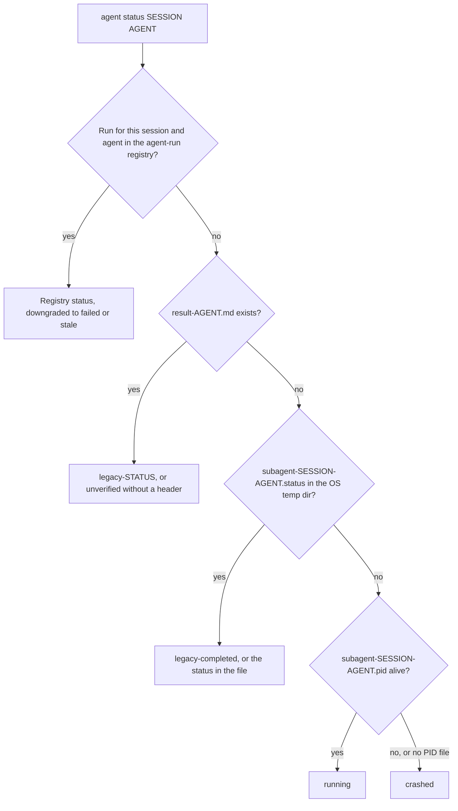

# CLI Options

## Quick reference

| I want to... | Use |
|:-------------|:----|
| Run without prompts | `-y` / `--yes` (also honored: `OMA_YES=1`, `CI=true`); `oma update --ci` for plain, non-interactive output |
| Get JSON | `--json`, `--output json`, or `OH_MY_AG_OUTPUT_FORMAT=json`. See [Output options](#output-options) for exceptions |
| Target the global install | `-g` / `--global`, or `OMA_INSTALL_GLOBAL=1`; `OMA_HOME` moves the global storage root |
| Preview before changing anything | `--dry-run` where a command lists it. See [Which commands support JSON](#commands-supporting-json-output) |
| See a command's flags | `oma <command> --help`, `oma describe "<command>"`, or the [registry](#complete-public-option-registry) at the end of this page |
| Fix a script that broke after an upgrade | [Renamed commands and options](#renamed-commands-and-options) |
| Branch on failures in a script | [Exit codes](#exit-codes) |

---

## Global options

These options are available on the root `oma` / `oh-my-agent` command:

| Flag | Description |
|:-----|:-----------|
| `-g, --global` | Operate on the OMA global install (`~/.oma/.agents/`, or `$OMA_HOME/.agents/`) instead of `<cwd>/.agents/` |
| `-y, --yes` | Skip prompts where the selected command supports confirmation; command-specific safety checks still apply. Also honors `OMA_YES=1` and `CI=true` |
| `-V, --version` | Output the version number and exit |
| `-h, --help` | Display help for the command |

All subcommands also support `-h, --help` to show their specific help text.

`--global` sets the install root for the whole process, so `install`, `update`, `link`, and `uninstall` resolve to the global install regardless of the current directory:

| Mode | How to select it | `.agents/` location |
|:-----|:-----------------|:--------------------|
| Project (default) | nothing | `<cwd>/.agents/` |
| Global | `--global` or `OMA_INSTALL_GLOBAL=1` | `$OMA_HOME/.agents/` (default `~/.oma/.agents/`) |

`OMA_HOME=<abs-path>` changes the global storage root; it must be an absolute path. Project installs still use cwd. Run `oma home --json` to show resolved locations, and `oma home migrate --dry-run` to preview a legacy data migration. See [Global install](../guide/global-install.md).

---

## Renamed commands and options

Command paths use spaces, not colons, and several commands and options were renamed. The old spellings are rejected, not aliased:

- An old command fails with `Unknown command: ... Use oma --help.` or `Unexpected argument for oma <group>. Use oma <replacement>.`
- The bare group names `dashboard`, `state`, and `stats` now print the group's help instead of running.
- An old option fails with `Removed option <old>. Use <new>.`; the removed `state` and `stats` action flags fail with `Removed option <old>. Use an explicit action; see oma --help.`

Only `schedule:run` and `serena daemon:gc` still resolve, so OS scheduler entries written by older versions keep working.

| Old command | Use now |
|:------------|:--------|
| any `a:b` colon path (`agent:spawn`, `state:emit`, ...) | the space-separated path (`agent spawn`, `state emit`) |
| `dashboard`, `dashboard:web` | `dashboard terminal`, `dashboard web` |
| `hook --vendor ...` | `hook run --vendor ...` |
| `intel run` | `intel suggest` |
| `state`, `state:get <id>` | `state list`, `state get <id>` |
| `state --activate` / `--archive` / `--purge` | `state activate` / `state archive` / `state purge` |
| `state:required-decisions` | `state decisions list` |
| `state:inject-log ... --entry <file>` | `state inject-log list`, `state inject-log get <session-id> <file>` |
| `stats`, `stats --reset` | `stats get`, `stats reset` |
| `memory:retry-drain` | `memory retry drain` |
| `vault rm` | `vault delete` |
| `search api <url>`, `search rss <url>` | `search api fetch <url>`, `search rss fetch <url>` |
| `search api:search`, `search rss:google` | `search api search`, `search rss google` |
| `skills audit` / `lint` / `eval` / `promotions` / `rollback` / `procedure` / `meta-optimize` / `evolution-stats` / `matrix` | `skill ...` (singular) |
| `skills opt` | `skill optimize` |
| `slide new`, `slide viewer` | `slide create`, `slide preview` |
| `slide pdf` / `png` / `pptx` | `slide export pdf` / `png` / `pptx` |
| `slide import-pptx`, `slide fetch-video`, `slide styles ...` | `slide import pptx`, `slide asset fetch-video`, `slide style ...` |
| `image list-vendors`, `video list-providers` | `image vendor list`, `video provider list` |
| `schedule:add`, `schedule:remove` | `schedule create`, `schedule delete` |
| `verify <agent-type>` | `verify agent <agent-type>` |

| Old option | Use now |
|:-----------|:--------|
| `-m, --model <vendor>` | `--vendor <vendor>` |
| `-r, --root <path>` | `--project-root <path>` |
| `--sid`, `--session` | `--session-id <id>` |
| `--format <fmt>` | `--output <format>` (`search media --format` is unchanged) |
| `--out <dir>`, `--out-dir` | `--output-dir <path>` |
| `--out <file>`, `--out-file` | `--output-file <path>`; `--report-file <path>` on `slide validate` and `explain validate` |
| `--dir` | `--workspace <path>` on `slide` commands, `--output-dir <path>` on `slide create`, `--input-dir <path>` on `explain validate` |
| `--max` | `--limit <n>` on `scholar search` |
| `--allow-external-out` | `--allow-external-output` |
| `--timeout <seconds>`, `--timeout <ms>`, `--timeout-minutes` | `--timeout <duration>` (`30s`, `2m`). A unit is required where the old value was milliseconds or minutes |
| `--max-age-days` | `--max-age <duration>`; `--expires-after <duration>` on `schedule create` |

---

## Output options

Many commands support machine-readable output for CI/CD pipelines and automation. There are three ways to request JSON output.

### 1. --json flag

```bash
oma stats get --json
oma doctor --json
oma cleanup --json
```

The `--json` flag is available only on the paths that list it. Do not infer support from a command family: for example, `image`, `video`, and `slide` leaves expose `--output` where the registry lists it, while `search` always prints JSON.

### 2. --output flag

```bash
oma stats get --output json
oma doctor --output text
```

On most commands `--output` accepts `text` or `json`. It provides the same functionality as `--json` but also lets you explicitly request text output, which is useful when the environment variable is set to `json`.

**Validation:** If an invalid format is provided, the CLI throws: `Invalid output format: {value}. Expected one of text, json`.

### 3. OH_MY_AG_OUTPUT_FORMAT environment variable

```bash
export OH_MY_AG_OUTPUT_FORMAT=json
oma stats get # outputs JSON
oma doctor # outputs JSON
oma retro # outputs JSON
```

Set this environment variable to `json` to make JSON the default on commands that support it. Only `json` is recognized; any other value is ignored and output stays text.

### How the format is chosen

A flag on the command line beats the environment variable. Passing both `--json` and a non-JSON `--output` is an error, not a precedence rule.

| You pass | Variable unset | `OH_MY_AG_OUTPUT_FORMAT=json` |
|:---------|:---------------|:------------------------------|
| nothing | text | JSON |
| `--json` or `--output json` | JSON | JSON |
| `--output text` | text | text |
| `--json --output text` | error: `--json conflicts with --output. Choose one output format.` | same error |

Some commands use their own format values:

| Commands | Format control |
|:---------|:---------------|
| `search ...` | Always JSON; `--pretty` only indents. `search providers` and `search web` also accept `--json` |
| `describe` | Always JSON |
| `image ...`, `video ...` | `--output text\|json` (default `text`) |
| `slide validate` | `--output json\|concise` (default `concise`) |
| `explain validate` | `--output concise\|json` (default `concise`) or `--json` |
| `hook probe` | `--output text\|md\|json` |

### Which commands support JSON {#commands-supporting-json-output}

Every command that accepts `--json` or `--output` reports `supportsJsonOutput: true` in `oma describe`, and the [registry](#complete-public-option-registry) at the end of this page lists the flags per path. Commands that always print JSON without a flag (`describe` and most `search` subcommands) are not marked. To list the paths from the CLI:

```bash
oma describe | jq -r '.. | objects | select(.supportsJsonOutput? == true) | .path'
```

Use `select(.supportsDryRun? == true)` the same way to find commands with `--dry-run`.

---

## Per-command options

### install

```text
oma install [--web-search <provider>] [--code-intelligence <provider>] [--semantic-memory <provider>] [--honcho-url <url>] [--honcho-workspace <id>]
```

The interactive installer writes the selected provider settings to `.agents/oma-config.yaml`. When `.agents/oma-config.cue` exists, it outranks that file, so choices the CUE config does not already hold are written to the gitignored local overlay `.agents/oma-config.local.yaml` instead; the browser DevTools selection and the `oma memory keys` vault reference follow the same rule, and the CLI vendor selection and `oma model propose --write` do so when there is no `oma-config.yaml`. The provider flags select the web-search, code-intelligence, and semantic-memory integrations; `--honcho-url` and `--honcho-workspace` configure the Honcho memory service when that provider is selected. The root `-y, --yes` flag applies when an install flow asks for confirmation.

### doctor

```text
oma doctor [--json] [--output <format>] [--profile] [--heal-check <agentType>]
```

| Flag | Description | Default |
|:-----|:-----------|:--------|
| `--json` | Emit JSON instead of formatted text. | `false` |
| `--output <format>` | Explicit output format (`text` or `json`). See [Output options](#output-options). | `text` |
| `--profile` | Show the profile health matrix (resolved model slug, CLI, and auth status per agent from the active `model_preset` and `agents:` overrides). See [Per-Agent Models](../guide/per-agent-models.md). | `false` |
| `--heal-check <agentType>` | Include the self-healing gate check for an agent. | |

With `--json`, the report has top-level `ok` and `issues` fields, and `doctor` exits `1` when `issues` is greater than zero.

### update

```text
oma update [-f | --force] [--with-new-skills] [--ci] [-y | --yes] [--all] [--vendor <vendors>]
oma update mcp [-y | --yes] [--ci] [--all] [--vendor <vendors>]
```

| Flag | Short | Description | Default |
|:-----|:------|:-----------|:--------|
| `--force` | `-f` | Overwrite user-customized config files during update. Affects: `oma-config.yaml`, `mcp.json`, `stack/` directories. Without this flag, these files are backed up before the update and restored afterward. | `false` |
| `--with-new-skills` | | Install skills added to the registry since the current installation. | `false` |
| `--ci` | | Run in non-interactive CI mode. Skips all confirmation prompts, uses plain console output instead of spinners and animations. Required for CI/CD pipelines where stdin is not available. | `false` |
| `--yes` | `-y` | Skip prompts. Does not create missing vendor directories unless paired with `--all` or `--vendor`. | `false` |
| `--all` | | Create/update all supported project-scoped vendors. | `false` |
| `--vendor <vendors>` | | Create/update a comma-separated vendor list, for example `claude,qwen`. | Existing vendor directories only |

`oma update mcp` uses the same `--yes`, `--ci`, `--all`, and `--vendor` controls while choosing browser MCP servers. It does not use `--force` or `--with-new-skills`.

**Behavior with --force:**
- `oma-config.yaml` is replaced with the registry default.
- `mcp.json` is replaced with the registry default.
- Backend `stack/` directory (language-specific resources) is replaced.
- All other files are always updated regardless of this flag.

**Behavior with --ci:**
- No `console.clear()` on start.
- `@clack/prompts` is replaced with plain `console.log`.
- Competitor detection prompts are skipped.
- Errors throw instead of calling `process.exit(1)`.

**Vendor scope:**
- `oma update` updates only vendor directories that already exist.
- `oma update --yes` uses the same vendor scope, without prompts.
- `oma update --all` creates/updates all supported project-scoped vendors.
- `oma update --vendor claude,qwen` creates/updates only the listed vendors.

### stats

```text
oma stats get [--json | --output <format>]
oma stats reset [--json | --output <format>]
```

| Flag | Description | Default |
|:-----|:-----------|:--------|
| `--json` | Emit JSON. `stats get` prints the metrics object; `stats reset` prints `{"reset":true}`. | `false` |
| `--output <format>` | Emit `text` or `json`. | `text` |

`oma stats reset` is the reset command; `oma stats get --reset` fails with `Removed option --reset`.

:::note
`stats get` is not read-only. Each call counts as a session and adds the diff of the last 10 commits to the cumulative file and line counters in `.agents/state/metrics.json`, so do not poll it.
:::

### retro

```text
oma retro [window] [--json] [--output <format>] [--interactive] [--compare]
```

| Flag | Description | Default |
|:-----|:-----------|:--------|
| `--interactive` | Legacy guided entry: asks what you accomplished, key learnings, and next steps. Ignores the window, `--compare`, and `--json`. | `false` |
| `--compare` | Compare the current time window against the previous window of the same length. Shows delta metrics (e.g., commits +12, lines added -340). | `false` |

**Window argument format:** a number followed by `h`, `d`, or `w`.
- `24h`: 24 hours
- `7d`: 7 days
- `2w`: 2 weeks
- Omit for default (7 days)

Months are not supported: `oma retro 1m` fails with `Invalid window: 1m. Use: 24h, 7d, 14d, 30d, 2w`.

### cleanup

```text
oma cleanup [--dry-run] [-y | --yes] [--json] [--output <format>]
```

| Flag | Short | Description | Default |
|:-----|:------|:-----------|:--------|
| `--dry-run` | | Preview mode. Lists all items that would be cleaned but makes no changes. Exit code 0 regardless of findings. | `false` |
| `--yes` | `-y` | Skip all confirmation prompts. Cleans everything without asking. Useful in scripts and CI. | `false` |

**What gets cleaned:**
1. Orphaned PID files: `/tmp/subagent-*.pid` where the referenced process is no longer running.
2. Orphaned log files: `/tmp/subagent-*.log` matching dead PIDs.
3. Gemini Antigravity directories: `.gemini/antigravity/brain/`, `.gemini/antigravity/implicit/`, `.gemini/antigravity/knowledge/`. These accumulate state over time and can grow large.

### agent spawn

```text
oma agent spawn <agent-id> <prompt> <session-id> [options]
```

| Flag | Short | Description | Default |
|:-----|:------|:-----------|:--------|
| `--resumed-from` | — | Link a retry to its preceding run ID. | |
| `--fallback-vendors` | — | Ordered, comma-separated explicit fallback vendor chain. | |
| `--task-id` | — | Task ID from the session plan. | Agent ID |
| `--vendor` | — | CLI vendor override. `--help` lists `antigravity`, `claude`, `codex`, `cursor`, `opencode`, `qwen`, `grok`, and `pi`. | Resolved from config |
| `--workspace` | `-w` | Working directory for the agent. If omitted or set to `.`, the CLI auto-detects the workspace from monorepo configuration files (pnpm-workspace.yaml, package.json, lerna.json, nx.json, turbo.json, mise.toml). | Auto-detected or `.` |
| `--isolation` | — | Isolation mode: `worktree` creates a git worktree per spawn; the default is `none`. | `none` |
| `--read-only` | — | Restrict the spawned agent to non-destructive tools and suppress auto-approve flags. | `false` |

**Validation:**
- `agent-id` and `session-id` must not contain `..`, `?`, `#`, `%`, or control characters. `agent spawn` has no fixed list of agent IDs; model and vendor routing recognize `orchestrator`, `architecture`, `qa`, `pm`, `backend`, `frontend`, `mobile`, `db`, `debug`, `refactor`, `docs`, `tf-infra`, and `explore`, plus aliases such as `backend-engineer`, `qa-reviewer`, and `research-explorer`.
- `--vendor` must be an oma vendor ID: `antigravity`, `claude`, `codex`, `commandcode`, `copilot`, `cursor`, `grok`, `hermes`, `kimi`, `kiro`, `opencode`, `pi`, `qwen`, or `zcode`. The table below covers the eight vendors that `--help` names.

**Vendor-specific behavior:**

| Vendor | Command | Auto-approve Flag | Prompt Flag |
|:-------|:--------|:-----------------|:-----------|
| antigravity | `agy` | `--dangerously-skip-permissions` | `-p` |
| claude | `claude` | (none) | `-p` |
| codex | `codex` | `--sandbox workspace-write` | (none; prompt is positional) |
| cursor | `cursor-agent` | vendor-specific | `-p` |
| opencode | `opencode` | vendor-specific | `-p` |
| qwen | `qwen` | `--yolo` | `-p` |
| grok | `grok` | vendor-specific | `-p` |
| pi | `pi` | suppressed in `--read-only` mode | prompt is positional |

These defaults can be overridden in `.agents/skills/oma-orchestration/config/cli-config.yaml`.

Codex keeps its workspace-write sandbox. oma enables network access and adds the project root, the OMA state home (`~/.oma`), and existing package-manager caches as writable directories. `oma update` replaces `cli-config.yaml`, so set a lasting mode with `OMA_CODEX_SANDBOX`: `read-only`, `workspace-write` (default), or `danger-full-access` (no sandbox and no approvals).

### agent status

```text
oma agent status <session-id> [agent-ids...] [--project-root <path>]
```

| Flag | Description | Default |
|:-----|:-----------|:--------|
| `--project-root <path>` | Project whose agent-run registry and `.agents/state/memories/result-{agent}.md` files are read. `-r` and `--root` were removed and fail with `Removed option -r. Use --project-root.` | Current working directory |

The command prints one `{agent-id}:{status}` line per requested agent. For each agent it uses the first source that exists:



| Status | Meaning |
|:-------|:--------|
| `running`, `completed`, `partial`, `blocked`, `failed` | Status recorded in the agent-run registry |
| `failed` | Also reported when a registered run is `running` but its runner process is gone |
| `stale` | Registered run is `completed`, but its result evidence no longer validates |
| `legacy-<status>` | No registered run; `result-{agent}.md` has a `## Status: <status>` header |
| `unverified` | No registered run; `result-{agent}.md` has no status header |
| `legacy-completed` | No run or result file; the session's `.status` file says `completed` (any other value is printed as is) |
| `crashed` | Nothing found, or the legacy PID file points to a dead process |

See [Agent results and resume](../guide/agent-results-and-resume.md) for how runs are recorded.

### agent parallel

```text
oma agent parallel [tasks...] [--session-id <id>] [--vendor <vendor>] [-i | --inline] [--no-wait]
```

| Flag | Short | Description | Default |
|:-----|:------|:-----------|:--------|
| `--session-id <id>` | — | Session ID for every spawned run. Pass the same ID to `oma agent status`. | Run directory name, `parallel-<timestamp>-<suffix>` |
| `--vendor` | — | CLI vendor override applied to all spawned agents. | Resolved per-agent from config |
| `--inline` | `-i` | Interpret task arguments as `agent:task[:workspace]` strings instead of a file path. | `false` |
| `--no-wait` | | Background mode. Starts all agents and returns immediately without waiting for completion. PID list and logs are saved to `.agents/results/parallel-<timestamp>-<suffix>/`. | `false` (waits for completion) |

**Inline task format:** `agent:task` or `agent:task:workspace`
- Workspace is detected by checking if the last colon-separated segment starts with `./`, `/`, or equals `.`.
- Example: `backend:Implement auth API:./api` -- agent=backend, task="Implement auth API", workspace=./api.
- Example: `frontend:Build login page` -- agent=frontend, task="Build login page", workspace=auto-detected.

**YAML tasks file format:**

```yaml
tasks:
  - id: api            # optional; default <agent>-<index>
    agent: backend
    task: "Implement user API"
    workspace: ./api   # optional; auto-detected when omitted
  - agent: frontend
    task: "Build user dashboard"
```

### recap

```text
oma recap [--window <period>] [--date <date>] [--tool <tools>] [--top <n>] [--sort <metric>] [--mermaid] [--graph] [--json] [--output <format>]
```

| Flag | Description | Default |
|:-----|:-----------|:--------|
| `--window <period>` | Time window as `<n>h`, `<n>d`, or `<n>w` (for example `1d`, `3d`, `7d`, `2w`, `30d`). Values above 30 days are capped to 30 days with a warning. Ignored when `--date` is set. | `1d` |
| `--date <date>` | Specific date (`YYYY-MM-DD`). Takes precedence over `--window`. | |
| `--tool <tools>` | Filter sessions by tool. Comma-separated: `antigravity`, `claude`, `codex`, `cursor`, `gemini`, `grok`, `qwen`. | all tools |
| `--top <n>` | Show only top N projects/topics in the summary. | unlimited |
| `--sort <metric>` | Sort sessions by `count` or `duration`. | `count` |
| `--mermaid` | Output a Mermaid Gantt chart instead of the default summary. `--json` takes precedence. | `false` |
| `--graph` | Open the interactive graph in the web dashboard (`/recap`). Takes precedence over `--mermaid` and `--json`. | `false` |

### search

```text
oma search <subcommand> [...]
```

Every `search` subcommand writes JSON to stdout without any flag; `providers` and `web` also accept `--json`. None accept `--output`. `--pretty` only changes indentation.

| Subcommand | Notable options |
|:-----------|:---------------|
| `providers` | `--json`, `--pretty` |
| `web <query>` | `--provider <id>`, `--limit <n>` (default `10`), `--timeout <duration>` (default `15s`), `--json`, `--pretty` |
| `fetch <url>` | `--only`, `--skip`, `--include-archive`, `--timeout <duration>` (default `15s`), `--locale`, `--pretty` |
| `meta <url>` / `archive <url>` / `api fetch <url>` / `rss fetch <url>` | `--timeout <duration>` (default `15s`), `--locale` (default `en-US,en;q=0.9`), `--pretty` |
| `api search <query>` | `--platforms <list>`, `--timeout <duration>`, `--locale`, `--pretty` |
| `rss google <query>` | `--locale` (default `en-US`) |
| `media <url>` | `--subs`, `--sub-lang <list>` (default `en`), `--format <spec>`, `--timeout <duration>` (default `30s`), `--pretty` |
| `code <query>` | `--host <github\|gitlab>` (default `github`), `--language`, `--repo`, `--limit` (default `20`), `--pretty` |
| `trust <domain>` | `--pretty` |
| `doctor` | none (runs binary checks for Chrome / `python3 curl_cffi` / `yt-dlp` / `gh`) |

`search` uses the shared exit-code scale; see [Exit codes](#exit-codes).

### image

```text
oma image <subcommand> [...]
```

Output format is controlled per subcommand via `--output <text|json>`.

`image generate` accepts:

| Flag | Short | Description | Default |
|:-----|:------|:-----------|:--------|
| `--vendor <name>` | | `auto` \| `pollinations` \| `codex` \| `antigravity` \| `all`. `auto` resolves from the active `image:` configuration and available auth. | `auto` |
| `--size <size>` | | `WxH` with both edges divisible by 16, 16–3840, aspect ratio 1:3–3:1, or `auto`. | vendor default |
| `--quality <level>` | | `low` \| `medium` \| `high` \| `auto`. | vendor default |
| `--count <n>` | `-n` | Number of images, 1..5. | `1` |
| `--output-dir <dir>` | | Output directory. Must be inside `$PWD` unless `--allow-external-output` is set. | `.agents/results/images/{timestamp}/` |
| `--allow-external-output` | | Allow `--output-dir` paths outside `$PWD`. | `false` |
| `--model <name>` | | Vendor-specific model override. The antigravity model is selected by `agy`. | vendor default |
| `--timeout <duration>` | | Per-image timeout using a duration value. | vendor default |
| `--reference <path>` | `-r` | Reference image for style/subject transfer. Repeatable (`-r a.png -r b.png`) or comma-separated. Validated for size (≤5MB), format (PNG/JPEG/GIF/WebP via magic bytes), and count (≤10). Supported on `codex` and `antigravity`; rejected with exit 4 on `pollinations`. | |
| `--yes` | `-y` | Skip the cost confirmation prompt. | `false` |
| `--no-prompt-in-manifest` | | Store SHA256 of the prompt instead of the raw text in `manifest.json`. | `false` |
| `--dry-run` | | Print plan and cost estimate; do not execute. | `false` |
| `--output <format>` | | `text` \| `json`. | `text` |

`image doctor` and `image vendor list` accept `--output <text|json>`. Use `image vendor list` to discover vendors; the old `image list-vendors` spelling fails.

### video

```text
oma video generate <brief...> [options]
oma video doctor [--output <format>] [--install|--upgrade|--install-mpt|--install-strudel]
oma video compose <run-dir> [--output <format>] [--refresh] [--offline]
oma video render <run-dir> [--output <format>]
oma video provider list [--output <format>]
```

`video generate` accepts the planning and capture controls `--mode`, `--aspect`, `--locale`, `--captions`, `--visual`, `--voice`, `--music`, `--duration`, `--compositor`, `--capture`, `--source`, `--url`, `--device`, `--ready-selector`, `--show-cursor`, `--polish`, `--capture-timeout`, and `--capture-stop`. It also accepts `--output-dir`, `--allow-external-output`, `--max-usd`, `--seed`, `--timeout`, `--script`, `--dry-run`, `--yes`, `--output`, and `--no-brief-in-manifest`. Browser capture uses `--source web --url <url>`; `file` is the default source. A normal render requires an authored composition and a working compositor; placeholders are limited to the `OMA_VIDEO_MOCK=1` test path.

`video doctor` reports or provisions the HyperFrames/MPT/Strudel toolchain. `compose` prepares the run's composition contract, and `render` lints, renders, and probes the output. `provider list` reports provider and key status. Read [Video Generation](../guide/video-generation.md) for the run manifest and recovery sequence.

### memory init

```text
oma memory init [--json] [--output <format>] [--force]
```

| Flag | Description | Default |
|:-----|:-----------|:--------|
| `--force` | Overwrite empty or existing schema files in `.agents/state/memories/`. Without this flag, existing files are not touched. | `false` |

### verify

```text
oma verify agent <agent-type> [-w <workspace>] [--session-id <id>] [--task-id <id>] [--run-id <id>] [--json] [--output <format>]
oma verify triggers [--corpus <path>] [--max-false-fire <pct>] [--max-missed-fire <pct>] [--json] [--output <format>]
```

| Flag | Short | Description | Default |
|:-----|:------|:-----------|:--------|
| `--workspace` | `-w` | Path to the workspace directory to verify. | Current working directory |
| `--session-id <id>` | | Select the session plan and reports. Required when multiple plans exist unless a run receipt identifies the session. | |
| `--task-id <id>` | | Select one task's scope and report. Requires `--session-id` or `--run-id`. | |
| `--run-id <id>` | | Select the exact run report. Infer session/task from the local receipt; if absent, supply both IDs explicitly. | |

**Agent types:** `backend`, `frontend`, `mobile`, `qa`, `debug`, `pm`.

`verify triggers` measures keyword-detector accuracy against a labeled corpus. The percentage thresholds are gates; use JSON output when a CI job needs to inspect individual findings. The old `oma verify <agent-type>` spelling fails; use `verify agent <agent-type>`.

---

## Exit codes

**Shared scale (`image`, `video`, `search`):**

| Code | Meaning |
|:-----|:--------|
| `0` | success |
| `1` | generic error |
| `2` | blocked, or a provider safety refusal |
| `3` | not found |
| `4` | invalid input |
| `5` | authentication required, or the provider binary is not installed |
| `6` | timeout |

**Command-specific:**

| Command | Codes |
|:--------|:------|
| `doctor --json` | `0` no issues, `1` one or more issues |
| `verify agent` | `0` all checks pass, `1` a check failed or the agent type is invalid, `2` workspace not found |
| `verify triggers` | `0` within thresholds, `1` a threshold exceeded |
| `docs verify` | `1` broken references found |
| `vault get` | `1` invalid key name, `2` no such entry |

---

## Practical examples

### CI pipeline: update and verify

```bash
# Update in CI mode, then fail the job when doctor reports any issue
oma update --ci
oma doctor --json | jq -e '.ok' > /dev/null
```

### Batch agent execution with status monitoring

```bash
# Choose the session ID first and pass it to both commands
SESSION_ID="session-$(date +%Y%m%d-%H%M%S)"
oma agent parallel tasks.yaml --session-id "$SESSION_ID" --no-wait

# Check status every 5 seconds
watch -n 5 "oma agent status $SESSION_ID backend frontend mobile"
# Without `watch` (stock macOS), loop instead:
# while sleep 5; do oma agent status "$SESSION_ID" backend frontend mobile; done
```

### Cleanup in CI after tests

```bash
# Clean up all orphaned processes without prompts
oma cleanup --yes --json
```

### Workspace-aware verification

```bash
# Verify each domain in its workspace
oma verify agent backend -w ./apps/api
oma verify agent frontend -w ./apps/web
oma verify agent mobile -w ./apps/mobile
```

### Retro with comparison for sprint reviews

```bash
# Two-week sprint retro with comparison to previous sprint
oma retro 2w --compare
```

### Full health check script

```bash
#!/usr/bin/env bash
set -euo pipefail

echo "=== oh-my-agent Health Check ==="

report="$(mktemp)"
# doctor exits 1 when it finds issues; keep the report and continue
oma doctor --json > "$report" || true

# Check CLI installations
jq -r '.clis[] | "\(.name): \(if .installed then "OK (\(.version // "unknown"))" else "MISSING" end)"' "$report"
jq -r '"Issues: \(.issues)"' "$report"

# Check auth status (an object of booleans keyed by github and each vendor ID)
oma auth status --json | jq -r 'to_entries[] | "\(.key): \(if .value then "authenticated" else "not authenticated" end)"'

echo "=== Done ==="
```

### Describe for agent introspection

```bash
# An AI agent can discover available commands
oma describe | jq '.command.subcommands[] | {name, description}'

# Get details about a specific command
oma describe "agent spawn" | jq '.command.options[] | {flags, description}'
```

---

## Complete public option registry

Each row is a command path that runs on its own; groups that only print help are omitted, and shared root flags are described in [Global options](#global-options). Defaults appear next to their option. Run `oma describe "<path>"` for the full JSON of one path.

:::note
This table is generated from `oma describe`. Do not edit it by hand: run `node cli/scripts/generate-cli-reference.mjs` to regenerate it, or add `--check` to fail when it is stale.
:::

<!-- oma:generated cli-registry:start -->

| Command | Arguments | Options | Description |
|:--|:--|:--|:--|
| `agent begin` | `<agent-id> <task-id> <session-id>` | `--timeout-seconds <seconds>`, `--deadline <timestamp>`, `--project-root <path>`, `-w, --workspace <path>` | Start an evidence-backed native agent run |
| `agent context` | `<agent-id>` | `--project-root <path>`, `--difficulty <level>` (default: `Medium`) | Load graph-selected context for a native dispatch prompt |
| `agent finish` | `<run-id> <result-file>` | `--project-root <path>` | Validate a native agent result against its verification receipts |
| `agent parallel` | `[tasks...]` | `--timeout-seconds <seconds>`, `--deadline <timestamp>`, `--session-id <id>`, `--vendor <vendor>`, `-i, --inline`, `--no-wait` | Run multiple sub-agents in parallel |
| `agent resume` | `<session-id>` | `--timeout-seconds <seconds>`, `--deadline <timestamp>`, `--project-root <path>`, `--dry-run`, `--max-attempts <count>` (default: `3`) | Resume safe incomplete tasks, reusing current acceptance evidence |
| `agent review` | — | `--session-id <id>`, `--timeout-seconds <seconds>`, `--deadline <timestamp>`, `--vendor <vendor>`, `-p, --prompt <prompt>`, `-w, --workspace <path>`, `--no-uncommitted` | Run code review using external CLI (codex/claude/qwen/grok) |
| `agent spawn` | `<agent-id> <prompt> <session-id>` | `--resumed-from <run-id>`, `--timeout-seconds <seconds>`, `--deadline <timestamp>`, `--fallback-vendors <vendors>`, `--task-id <id>`, `--vendor <vendor>`, `-w, --workspace <path>`, `--isolation <mode>`, `--read-only` | Spawn a subagent (prompt can be inline text or a file path) |
| `agent status` | `<session-id> [agent-ids...]` | `--project-root <path>` (default: current directory) | Check status of subagents |
| `agent verify` | `<run-id> [command...]` | `--timeout-seconds <seconds>`, `--deadline <timestamp>`, `--project-root <path>`, `--required`, `--affected <paths...>` | Execute verification argv after -- and record its real exit code |
| `auth status` | — | `--json`, `--output <format>` | Check authentication status of all supported CLIs |
| `bridge` | `[url]` | `--context <name>` (default: `ide`), `--oma-home <path>`, `--oma-state-home <path>` | Proxy MCP stdio to a shared per-project Serena server (started on demand) |
| `cleanup` | — | `--dry-run`, `-y, --yes`, `--json`, `--output <format>` | Clean up orphaned subagent processes and temp files |
| `dashboard terminal` | — | `--project-root <path>` | Start terminal dashboard (real-time agent monitoring) |
| `dashboard web` | — | `--project-root <path>` | Start web dashboard on http://127.0.0.1:9847 |
| `describe` | `[command-path]` | — | Describe CLI commands as JSON for runtime introspection |
| `diagram archify` | `[args...]` | — | Run the installed archify CLI (doctor \| guide \| validate \| deliver \| visual-check …) with update checks disabled |
| `diagram resolve` | — | `--engine <engine>`, `--refresh`, `--offline`, `--json`, `--output <format>` | Report which diagram engine workflows should use, and where archify lives |
| `diagram update` | — | `--json`, `--output <format>` | Download the latest archify release into oma's managed cache (~/.cache/oma-diagram/archify) |
| `docs i18n` | — | `--json`, `--min-severity <level>` (default: `MEDIUM`) | Detect drift between English source docs (web/docs) and i18n translations (web/i18n/{lang}/...). Emits structural signals (line count, heading count, last-commit timestamp) per pair so the host LLM can decide which translations need a diff-sync patch. The CLI never edits translations. |
| `docs lint` | — | `--json`, `--locales <list>` | Lint translated docs for content-level anti-patterns (em-dashes in CJK targets, etc.). Complements `oma docs i18n` (structural drift) with style/anti-pattern checks per oma-translation SKILL.md § Stage 4. The CLI never auto-fixes — it only reports issues for the host LLM to restructure. |
| `docs migrate` | — | `--dry-run`, `--json` | Consolidate engineering decisions and result reports into their canonical directories |
| `docs sync` | `[diff-range]` | `--json` | Given a git diff, list docs that reference changed files. The host LLM (skill runtime) is expected to read this list plus the diff and propose patches per the SKILL.md contract — the CLI never auto-edits docs. Default diff-range: --cached (staged changes), fallback to HEAD~1..HEAD. |
| `docs verify` | `[path]` | `--json`, `--report-file <path>`, `--no-urls`, `--urls-sync` | Extract file, link, and script references from docs and report broken targets. Regenerates docs/generated/doc-refs.json as a side effect. Exit code: 0 = clean, 1 = broken refs found. URL link checking is delegated to `lychee` (install: brew install lychee). |
| `doctor` | — | `--profile`, `--heal-check <agentType>`, `--json`, `--output <format>` | Check CLI installations, MCP configs, and skill status |
| `emit` | — | `--target <target>` (default: `all`), `--output-dir <path>` (default: `.`), `--json`, `--output <format>` | Emit standards-conformant artifacts from the .agents/ SSOT (Agent Skills spec, Agent Plugins package, Claude Code plugin marketplace, AGENTS.md, cli/AGENTS.md) |
| `explain components` | `[name]` | `--json`, `--output <format>` | List the components a draft can use, or print one component's syntax |
| `explain lint` | `[file]` | `--style <level>`, `--lang <code>`, `--json`, `--output <format>` | Check the prose of a draft (file or stdin) without rendering |
| `explain patch` | `<html> [file]` | `--panel <id>`, `--open`, `--json`, `--output <format>` | Replace one panel of a rendered page from its embedded draft (new panel from file or stdin) |
| `explain render` | `[file]` | `--output-file <path>`, `--template <name>`, `--theme <name>`, `--mode <mode>`, `--style <level>`, `--lang <code>`, `--archify`, `--no-archify`, `--open`, `--json`, `--output <format>` | Render a Markdown draft (file or stdin) into one self-contained HTML explanation |
| `explain validate` | `[file]` | `--input-dir <path>`, `--output <format>` (default: `concise`), `--report-file <path>`, `--json` | Validate self-contained explain HTML report artifacts |
| `goal set` | — | `--workflow <name>`, `--session-id <id>`, `--gate <keyword>`, `--budget-minutes <n>`, `--description <text>`, `--json`, `--output <format>` | Attach a goal contract (deterministic stop gate / wall-clock budget) to an active persistent workflow |
| `goal status` | — | `--workflow <name>`, `--session-id <id>`, `--check-fresh`, `--json`, `--output <format>` | Show the latest gate pass for an OMA session |
| `harness eval` | — | `--suite <path>`, `--candidate <path>`, `--partition <name>` (default: `validation`), `--mock`, `--action <mode>`, `--transcript <path>`, `--live`, `--record`, `--record-file <path>`, `--yes`, `--timeout <duration>` (default: `15m`), `--require-coverage`, `--json`, `--output <format>` | Compare a candidate .agents overlay with the current baseline |
| `harness evolution disable` | — | `--json`, `--output <format>` | Disable harness evolution and remove its scheduled job |
| `harness evolution enable` | — | `--max-dispatches <n>`, `--cron <expr>` (default: `0 3 * * *`), `--mode <mode>` (default: `apply`), `--json`, `--output <format>` | Enable scheduled harness evolution with a dispatch budget |
| `harness evolution run` | — | `--scheduled`, `--json`, `--output <format>` | Run one harness evolution tick now |
| `harness evolution status` | — | `--json`, `--output <format>` | Show the evolution config, schedule, pending retries, and overlay conflicts |
| `harness feedback` | — | `--live`, `--apply`, `--max-epochs <n>` (default: `1`), `--incident <ids...>`, `--scan-runs`, `--json`, `--output <format>` | Promote captured incidents to skill fixtures and optimize the affected skills |
| `harness incident capture` | — | `--spec <path>`, `--run <id>`, `--json`, `--output <format>` | Record a failure from an incident spec as a captured incident |
| `harness incident export` | `<id>` | `--json`, `--output <format>` | Export a captured incident as a one-task eval suite |
| `harness incident promote` | `<id>` | `--skill <id>`, `--draft`, `--force`, `--json`, `--output <format>` | Turn a captured incident into a regression fixture for a skill |
| `harness incident reproduce` | `<id>` | `--candidate <path>`, `--action <mode>`, `--record-file <path>`, `--transcript <path>`, `--record`, `--yes`, `--timeout <duration>` (default: `15m`), `--json`, `--output <format>` | Inspect, rescore, replay, or rerun a captured incident against a candidate |
| `harness incident scan` | — | `--limit <n>`, `--skeleton <run-id>`, `--json`, `--output <format>` | List failed, blocked, or partial agent runs that no captured incident references yet |
| `harness incident show` | `<id>` | `--json`, `--output <format>` | Show a captured incident and its provenance |
| `help` | — | — | Show help information |
| `home` | — | `--json`, `--output <format>` | Inspect and migrate OMA global storage |
| `home migrate` | — | `--dry-run`, `--json`, `--output <format>` | Copy legacy OMA global files; preserve originals |
| `hook probe` | — | `--vendor <list>`, `--output <format>` (default: `text`), `--hooks-dir <dir>` | Probe per-vendor L1 hook compatibility and print a matrix |
| `hook run` | — | `--vendor <v>`, `--event <e>`, `--matcher <m>` | Dispatch a vendor hook event through the centralised oma hook router |
| `image doctor` | — | `--output <format>` (default: `text`) | Check authentication and install status per vendor |
| `image generate` | `<prompt...>` | `--vendor <name>` (default: `auto`), `--size <size>`, `--quality <level>`, `-n, --count <n>`, `--output-dir <path>`, `--allow-external-output`, `--model <name>`, `--timeout <duration>`, `-r, --reference <path>`, `-y, --yes`, `--no-prompt-in-manifest`, `--dry-run`, `--output <format>` (default: `text`) | Generate images via pollinations (flux/zimage, free), codex (gpt-image-2, ChatGPT OAuth), or antigravity (gemini nano-banana via `agy` CLI, free with Gemini Code Assist sign-in) |
| `image vendor list` | — | `--output <format>` (default: `text`) | List registered vendors and supported models |
| `install` | — | `--web-search <provider>`, `--code-intelligence <provider>`, `--semantic-memory <provider>`, `--honcho-url <url>`, `--honcho-workspace <id>` | Install oh-my-agent skills and configurations |
| `intel suggest` | — | `--config <path>`, `--topic <topic>`, `--target <target>`, `--repos <repos>`, `--since <window>`, `--last-commits <n>`, `--output-dir <path>`, `--dry-run`, `--fixture <path>`, `--create-issue`, `--base-repo <owner/name>`, `--yes`, `--json`, `--output <format>` | Suggest high-value product work from market/code intelligence |
| `link` | `[vendors...]` | `--dry-run` | Regenerate vendor files (.claude/, .cursor/, etc.) from .agents/ SSOT |
| `market detect-trap` | `<topic>` | `--force` | Preflight check that refuses keyword-trap queries |
| `market resolve` | — | `--refresh`, `--offline`, `--json`, `--output <format>` | Report the last30days engine oma will run (managed latest, pin, or local copy) and the Python it uses |
| `market run` | `[args...]` | — | Run the last30days engine (scripts/last30days.py) with the given arguments; --save-dir defaults to market.save_dir |
| `market update` | — | `--json`, `--output <format>` | Download the latest last30days release into oma's managed cache (~/.cache/oma-market/last30days) |
| `memory daemon restart` | — | `--port <port>` (default: `3111`), `--dry-run`, `--json`, `--output <format>` | Restart the OMA-owned AgentMemory daemon |
| `memory daemon start` | — | `--port <port>` (default: `3111`), `--dry-run`, `--json`, `--output <format>` | Start AgentMemory in the background |
| `memory daemon status` | — | `--json`, `--output <format>` | Show daemon status |
| `memory daemon stop` | — | `--dry-run`, `--json`, `--output <format>` | Stop the OMA-owned AgentMemory daemon |
| `memory gc` | — | `--scope <scope>` (default: `all`), `--keep <count>`, `--max-age <duration>`, `--dry-run`, `--json`, `--output <format>` | Garbage-collect project-local memory: prune old L1 sessions and ephemeral Serena files |
| `memory import` | — | `--source <source>` (default: `all`), `--since <since>` (default: `30d`), `--dry-run`, `--force-partial`, `--json`, `--output <format>` | Import vendor conversation history into AgentMemory |
| `memory init` | — | `--force`, `--json`, `--output <format>` | Initialize the coordination store in .agents/state/memories |
| `memory keys` | — | `--kind <kind>` (default: `connection`), `--profile <name>` (default: `oma`), `--key-env <name>` (default: `LLM_OPENAI_API_KEY`), `--from-env <name>`, `--dry-run`, `--json`, `--output <format>` | Configure Honcho connection or local embedding credentials |
| `memory maintain` | `<action>` | `--keep <count>` (default: `5`), `--dry-run`, `--json`, `--output <format>` | Maintain AgentMemory local storage: backup, prune, vacuum |
| `memory maintain backup` | — | `--keep <count>` (default: `5`), `--dry-run`, `--json`, `--output <format>` | Back up AgentMemory local storage |
| `memory maintain prune` | — | `--keep <count>` (default: `5`), `--dry-run`, `--json`, `--output <format>` | Delete AgentMemory backups beyond --keep |
| `memory maintain vacuum` | — | `--keep <count>` (default: `5`), `--dry-run`, `--json`, `--output <format>` | Run SQLite VACUUM on AgentMemory storage |
| `memory retry drain` | — | `--dry-run`, `--json`, `--output <format>` | Drain queued semantic-memory deliveries |
| `memory service install` | — | `--port <port>` (default: `3111`), `--dry-run`, `--json`, `--output <format>` | Install AgentMemory launchd/systemd service integration |
| `memory service uninstall` | — | `--dry-run`, `--json`, `--output <format>` | Uninstall AgentMemory launchd/systemd service integration |
| `memory setup` | — | `--endpoint <url>`, `--port <port>`, `--install`, `--start`, `--dry-run`, `--json`, `--output <format>` | Prepare AgentMemory endpoint configuration |
| `memory status` | — | `--json`, `--output <format>` | Show selected semantic-memory provider health |
| `memory upgrade` | — | `--port <port>`, `--dry-run`, `--json`, `--output <format>` | Stop, backup, upgrade, restart, and health-check AgentMemory |
| `model check` | — | `--json`, `--fail-on-drift`, `--owner <name>`, `--probe` | Check model registry against live vendor model lists |
| `model probe` | `<slug>` | `--json`, `--timeout <duration>` | Probe a model slug against its vendor CLI to verify it is accepted |
| `model propose` | — | `--json`, `--owner <name>`, `--write`, `--timeout <duration>` | Run model:check --probe internally and generate an oma-config `models:` patch for accepted candidates |
| `profile create` | `<slot>` | `--json`, `--output <format>` | Create a local profile |
| `profile list` | — | `--json`, `--output <format>` | List local profiles |
| `profile run` | `<slot> <command> [args...]` | — | Run one command with OMA_PROFILE set for the child process |
| `profile show` | `[slot]` | `--json`, `--output <format>` | Show a local profile |
| `profile use` | `<slot>` | `--shell <shell>`, `--json`, `--output <format>` | Print shell code to activate an existing profile |
| `ralph verify` | — | `--session-id <id>`, `--newer-than <iso>`, `--no-emit`, `--json`, `--output <format>` | Verify ralph EXEC artifacts (anti-circumvention gate, ralph.md Step 1.3) |
| `recap` | — | `--window <period>` (default: `1d`), `--date <date>`, `--tool <tools>`, `--top <n>`, `--sort <metric>` (default: `count`), `--mermaid`, `--graph`, `--json`, `--output <format>` | Recap AI tool conversation history |
| `retro` | `[window]` | `--interactive`, `--compare`, `--json`, `--output <format>` | Engineering retrospective with metrics & trends |
| `schedule create` | `<agent-id> <prompt>` | `--cron <expr>`, `--every <phrase>`, `--vendor <vendor>`, `-w, --workspace <path>`, `--once`, `--expires-after <duration>`, `--env <keys>`, `--dry-run`, `--accept-rounded` | Register a scheduled agent job |
| `schedule delete` | `<id>` | — | Remove a scheduled job from manifest and OS scheduler |
| `schedule list` | — | `--json`, `--output <format>` | List scheduled jobs with OS drift state (synced/stale/missing-in-os/orphan-in-os), grouped by project |
| `schedule run` | `<id>` | `--oma-home <path>`, `--oma-state-home <path>`, `--registration <identity>` | Execute a scheduled job by id (invoked by OS scheduler; not normally called directly) |
| `schedule sync` | — | `--prune` | Re-sync manifest → OS scheduler (registers missing jobs, rewrites stale commands). Use --prune to remove orphan OS jobs. |
| `scholar get` | `<id>` | `--section <name>` | Fetch a sidecar (knows record_id) or work metadata (W-id, DOI, arXiv:&lt;id&gt;, CorpusId:&lt;n&gt;, S2 paperId) |
| `scholar lint` | `<file>` | `--lenient`, `--fail-on-warning` | Validate a .knows.yaml or .knows.json sidecar (v0.9.0) |
| `scholar resolve` | `<query...>` | — | Find best paper match across knows.academy, OpenAlex, Semantic Scholar |
| `scholar search` | `<query...>` | `--limit <n>` (default: `10`), `--year-min <year>`, `--always-fallback` | Search papers (knows.academy → OpenAlex → Semantic Scholar) |
| `search api fetch` | `<url>` | `--timeout <duration>` (default: `15s`), `--locale <value>` (default: `en-US,en;q=0.9`), `--pretty` | Fetch a URL through its matched platform API |
| `search api search` | `<query>` | `--platforms <list>`, `--timeout <duration>` (default: `15s`), `--locale <value>` (default: `en-US,en;q=0.9`), `--pretty` | Fan-out keyword search across platforms that support it |
| `search archive` | `<url>` | `--timeout <duration>` (default: `15s`), `--locale <value>` (default: `en-US,en;q=0.9`), `--pretty` | Fetch via AMP / archive.today / Wayback |
| `search code` | `<query>` | `--host <github\|gitlab>` (default: `github`), `--language <lang>`, `--repo <owner/repo>`, `--limit <n>` (default: `20`), `--pretty` | Search code via gh / glab |
| `search doctor` | — | — | Check dependencies (Chrome, python3 curl_cffi, yt-dlp, gh) |
| `search fetch` | `<url>` | `--only <strategies>`, `--skip <strategies>`, `--include-archive`, `--timeout <duration>` (default: `15s`), `--locale <value>` (default: `en-US,en;q=0.9`), `--pretty` | Fetch URL via auto-escalating strategy pipeline |
| `search media` | `<url>` | `--subs`, `--sub-lang <list>` (default: `en`), `--format <spec>`, `--timeout <duration>` (default: `30s`), `--pretty` | Extract media metadata via yt-dlp (1858 sites) |
| `search meta` | `<url>` | `--timeout <duration>` (default: `15s`), `--locale <value>` (default: `en-US,en;q=0.9`), `--pretty` | Extract OGP / JSON-LD / Schema.org from URL |
| `search providers` | — | `--json`, `--pretty` | List registered search providers and inspect selection without network calls |
| `search rss fetch` | `<url>` | `--timeout <duration>` (default: `15s`), `--locale <value>` (default: `en-US,en;q=0.9`), `--pretty` | Discover and parse RSS/Atom feed for a URL |
| `search rss google` | `<query>` | `--locale <value>` (default: `en-US`) | Build Google News RSS URL for a query |
| `search trust` | `<domain>` | `--pretty` | Resolve trust level / score for a domain |
| `search web` | `<query>` | `--provider <id>`, `--limit <n>` (default: `10`), `--timeout <duration>` (default: `15s`), `--json`, `--pretty` | Search with the selected web provider (Brave and Exa have CLI adapters) |
| `serena check` | — | `--project <path>` (default: `apps/mobile`), `--dart-sdk <path>`, `--timeout <duration>` (default: `60s`), `--staged` | Analyze a Dart package using the managed shared Serena LSP |
| `serena daemon gc` | — | `--quiet` | Stop shared Serena daemons with no clients after the idle grace period |
| `serena reap` | — | `--dry-run`, `--quiet` | Kill idle Serena LSP children to reclaim memory (Serena self-heals on next tool call) |
| `serena reaper disable` | — | `--dry-run` | Uninstall the periodic Serena Reaper scheduled task |
| `serena reaper enable` | — | `--dry-run` | Install the periodic Serena Reaper scheduled task (runs every 5 minutes) |
| `serena setup` | — | — | Repair the managed adapter and install the oma-dart-check compatibility launcher |
| `skill audit` | — | `--json`, `--output <format>` | Check frontmatter description similarity between installed skills |
| `skill eval` | — | `--skill <id>`, `--mock`, `--live`, `--record`, `--yes`, `--task-dir <path>`, `--max-tasks <n>`, `--trials <n>`, `--require-coverage`, `--neg-transfer`, `--routing`, `--json`, `--output <format>` | Measure per-skill utility lift (treatment vs baseline on held-out tasks) |
| `skill evolution-stats` | — | `--skill <id>`, `--json`, `--output <format>` | Aggregate recorded optimization runs: proposals, acceptance, verified improvements, rollbacks, by memory mode and procedure |
| `skill lint` | — | `--skill <id>`, `--json`, `--output <format>` | Detect per-skill authoring smells (frontmatter, structure, broken refs) |
| `skill matrix` | — | `--suite <path>`, `--project-root <path>`, `--skills <names>`, `--delivery <mode>` (default: `native`), `--vendors <ids>` (default: `claude,codex`), `--cases <ids>`, `--live`, `--yes`, `--timeout-seconds <n>` (default: `120`), `--claude-model <model>`, `--codex-model <model>`, `--report <path>`, `--json`, `--output <format>` | Test native skill discovery, references and output contracts across CLI vendors |
| `skill meta-optimize` | — | `--target <part>` (default: `optimizer`), `--skill <ids...>`, `--anchor <ids...>`, `--repeats <n>` (default: `3`), `--candidates <n>` (default: `2`), `--max-epochs <n>` (default: `1`), `--edits-per-epoch <k>` (default: `4`), `--live`, `--apply`, `--memory <mode>` (default: `none`), `--yes`, `--json`, `--output <format>` | Propose and score changes to the evolution procedure itself on held-out skills; promote only with a paired bootstrap interval above zero |
| `skill optimize` | — | `--skill <id>`, `--dry-run`, `--apply`, `--mock`, `--live`, `--max-epochs <n>` (default: `8`), `--edits-per-epoch <k>` (default: `4`), `--lr <chars>` (default: `600`), `--yes`, `--memory <mode>` (default: `recall`), `--json`, `--output <format>` | Optimize a skill's SKILL.md to maximize measured held-out utility lift |
| `skill procedure` | — | `--export`, `--json`, `--output <format>` | Show the evolution procedure (optimizer/maintainer prompts, constitution) and its hashes; --export writes editable defaults |
| `skill promotions` | — | `--skill <id>`, `--all`, `--json`, `--output <format>` | List recorded SKILL.md promotions and rollbacks for a skill, or every skill and the procedure with --all |
| `skill rollback` | — | `--skill <id>`, `--json`, `--output <format>` | Restore the SKILL.md body replaced by the most recent recorded promotion |
| `slide asset fetch-video` | `<url>` | `--workspace <path>`, `--output-name <name>` | Download video via yt-dlp into ./assets/ and print local ref |
| `slide bundle` | — | `--workspace <path>`, `--output-file <path>`, `--inline-fonts` | Merge per-slide files into a single self-contained .html deliverable |
| `slide create` | — | `--output-dir <path>` (default: `my-deck`), `--force` | Scaffold a new slide working directory with starter HTML, assets/, and meta.json |
| `slide doctor` | — | — | Probe required deps (chrome, puppeteer-core) and optional deps (yt-dlp, pptxgenjs) |
| `slide edit` | — | `--workspace <path>`, `--port <n>` (default: `0`) | Open browser bbox editor (node:http server at 127.0.0.1, dispatches to oma agent runner) |
| `slide export pdf` | — | `--workspace <path>`, `--output-file <path>`, `--mode <mode>` (default: `capture`) | Export slides to PDF via puppeteer-core |
| `slide export png` | — | `--workspace <path>`, `--output-dir <path>`, `--resolution <res>` (default: `1080p`) | Export each slide as a PNG image via puppeteer-core |
| `slide export pptx` | — | `--workspace <path>`, `--output-file <path>` | [EXPERIMENTAL] Export to PPTX via pptxgenjs (raster-backed, gradients rasterized) |
| `slide import pptx` | `<file>` | `--workspace <path>` | Import a .pptx file into slide fragments via officeparser (bunx, best-effort) |
| `slide preview` | — | `--workspace <path>` | Build viewer.html (deck-stage web component + speaker-notes panel, toggle with `n`) |
| `slide style get` | `<slug>` | `--refresh` | Fetch a bold template design.md (always-latest main; cached for offline fallback) |
| `slide style list` | — | — | List available style presets (vendored + bold-template index) |
| `slide style preview` | `<slug>` | — | Preview a style preset in the terminal |
| `slide validate` | — | `--workspace <path>`, `--output <format>` (default: `concise`), `--slide <file>`, `--report-file <path>` | Geometric quality gate — renders slides via puppeteer-core and checks overflow/overlap/font-size |
| `star` | — | — | Star oh-my-agent on GitHub |
| `state activate` | `<session-id>` | `--category <category>` (default: `main`), `--archived`, `--all-projects`, `--project <project>`, `--search <text>`, `--older-than <duration>` (default: `90d`), `--dry-run`, `--json`, `--output <format>` | Set the active session for a category |
| `state archive` | — | `--category <category>` (default: `main`), `--archived`, `--all-projects`, `--project <project>`, `--search <text>`, `--older-than <duration>` (default: `90d`), `--dry-run`, `--json`, `--output <format>` | Move inactive terminal sessions to the state archive |
| `state decisions list` | `[workflow]` | `--agent <id>`, `--json`, `--output <format>` | List workflow checkpoints or available agent decision subjects |
| `state emit` | `<kind> [payload]` | `--session-id <id>`, `--category <category>` (default: `main`), `--vendor <vendor>`, `--vendor-sid <vendorSid>`, `--parent-event-id <eventId>`, `--causality-key <key>`, `--ts <iso>`, `--no-mirror`, `--json`, `--output <format>` | Append an OMA L1 workflow event |
| `state get` | `<sid>` | `--json`, `--output <format>` | Inspect one OMA L1 session by ID |
| `state heal-check` | — | `--agent <agentType>`, `--json`, `--output <format>` | Check whether self-healing is allowed for an agent |
| `state inject-log get` | `<session-id> <file>` | `--json`, `--output <format>` | Print one inject audit log entry for a session |
| `state inject-log list` | `<sid>` | `--entry <file>`, `--json`, `--output <format>` | List or view per-boundary inject audit logs |
| `state list` | — | `--category <category>` (default: `main`), `--archived`, `--all-projects`, `--project <project>`, `--search <text>`, `--older-than <duration>` (default: `90d`), `--dry-run`, `--json`, `--output <format>` | Inspect OMA L1 workflow state |
| `state migrate` | — | `--runtime`, `--include-active`, `--dry-run`, `--json`, `--output <format>` | Migrate project state to the home profile |
| `state purge` | — | `--category <category>` (default: `main`), `--archived`, `--all-projects`, `--project <project>`, `--search <text>`, `--older-than <duration>` (default: `90d`), `--dry-run`, `--json`, `--output <format>` | Delete inactive sessions older than --older-than |
| `state repair` | — | `--dry-run`, `--json`, `--output <format>` | Repair OMA L1 workflow state files |
| `state summary` | `[sid]` | `--category <category>` (default: `main`), `--json`, `--output <format>` | Export a session summary to the coordination store |
| `state trajectory` | `[sid]` | `--category <category>` (default: `main`), `--open`, `--width <columns>`, `--sequence`, `--ascii`, `--json`, `--output <format>` | Show a session trajectory: L1 events joined with vendor transcripts |
| `state verify` | — | `--workflow <workflow>`, `--checkpoint <checkpoint>`, `--instance <id>`, `--session-id <id>`, `--category <category>` (default: `main`), `--no-emit-missing`, `--json`, `--output <format>` | Verify required L1 events for a workflow checkpoint |
| `stats get` | — | `--json`, `--output <format>` | View productivity metrics |
| `stats reset` | — | `--json`, `--output <format>` | Reset productivity metrics data |
| `uninstall` | — | `--dry-run`, `-y, --yes` | Remove oh-my-agent's owned files (preserves oma-config.yaml, mcp.json, and user-authored skills) |
| `update` | — | `-f, --force`, `--with-new-skills`, `--ci`, `-y, --yes`, `--all`, `--vendor <vendors>` | Update skills to latest version from registry |
| `update mcp` | — | `-y, --yes`, `--ci`, `--all`, `--vendor <vendors>` | Choose browser MCP servers (Aside, Chrome DevTools, Firefox DevTools) |
| `vault delete` | `<name>` | — | Remove a secret from the keychain and the index |
| `vault get` | `<name>` | — | Print stored value to stdout (for: export KEY=$(oma vault get &lt;name&gt;)) |
| `vault list` | — | `--json` | List stored secret names (values never displayed) |
| `vault store` | `<name>` | `--value <value>` | Store a secret under &lt;name&gt; (interactive password prompt) |
| `verify agent` | `<agent-type>` | `-w, --workspace <path>` (default: current directory), `--session-id <id>`, `--task-id <id>`, `--run-id <id>`, `--json`, `--output <format>` | Run the check battery on one agent's output (backend, frontend, mobile, qa, debug, pm) |
| `verify triggers` | — | `--corpus <path>`, `--max-false-fire <pct>`, `--max-missed-fire <pct>`, `--json`, `--output <format>` | Measure keyword-detector trigger accuracy against a labeled prompt corpus |
| `version` | — | — | Show version number |
| `video compose` | `<runDir>` | `--output <format>` (default: `text`), `--refresh`, `--offline` | Scaffold the run's Hyperframes project on the latest toolchain + heygen-com/hyperframes; prints the authoring contract |
| `video doctor` | — | `--output <format>` (default: `text`), `--install`, `--upgrade`, `--install-mpt`, `--install-strudel` | Check video provider and compositor readiness |
| `video generate` | `<brief...>` | `--mode <mode>`, `--aspect <aspect>`, `--locale <lang>`, `--captions <style>`, `--visual <mode>`, `--voice <profile>`, `--music <mode>`, `--duration <sec>`, `--compositor <name>`, `--capture <path>`, `--source <kind>` (default: `file`), `--url <url>`, `--device <name>`, `--ready-selector <css>`, `--show-cursor`, `--polish`, `--capture-timeout <sec>`, `--capture-stop <mode>`, `--output-dir <path>`, `--allow-external-output`, `--max-usd <n>`, `--seed <n>`, `--timeout <duration>`, `-y, --yes`, `--dry-run`, `--script <path>`, `--output <format>` (default: `text`), `--no-brief-in-manifest` | Generate a video run directory from a brief |
| `video provider list` | — | `--output <format>` (default: `text`) | List video providers and availability |
| `video render` | `<runDir>` | `--output <format>` (default: `text`) | Re-render a run directory from render-spec.json |
| `visualize` | — | `--focus <node-or-path>`, `--affected <paths...>`, `--json`, `--output <format>` | Visualize project structure as a dependency graph |

<!-- oma:generated cli-registry:end -->

---

## See also

- [CLI Commands](./commands.md): behavior and examples per command.
- Vendor rule files (`.cursor/rules`, ...) are regenerated by [`oma link <vendor>`](./commands.md#link), not by a separate `export` command.
- [Configuration reference](../guide/configuration-reference.md): the config keys these flags override.
- [Automated updates](../guide/automated-updates.md): running `oma update` from the GitHub Action.
- [Dashboard monitoring](../guide/dashboard-monitoring.md): `agent status` and the dashboards.
- [Global install](../guide/global-install.md): project and global install roots.
- [Troubleshooting](../guide/troubleshooting.md)
