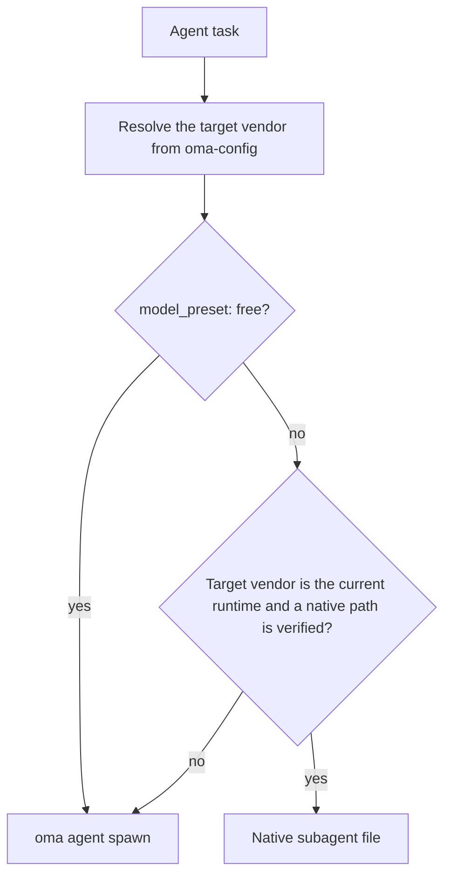
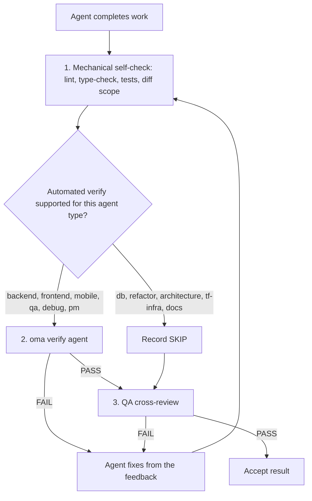

# Agents

OMA separates [skills](../getting-started/glossary.md#skill), dispatch roles, and [agent definitions](../getting-started/glossary.md#agent-definition). A skill routes and loads domain guidance; a canonical role is the runtime identity used for dispatch; a checked-in definition gives a subagent a vendor-native persona. These layers overlap by design, so use the task boundary and acceptance criteria to decide whether one skill is enough.

---

## Skill catalog

This table is the authoritative list of installed skills. It is generated from each `.agents/skills/<name>/SKILL.md` frontmatter by `cli/scripts/generate-skill-catalog.mjs`; run the script with `--check` to detect drift. Each skill's `## References` section in its SKILL.md lists its resource files and when to read them.

<!-- oma:generated skill-catalog:start -->
<!-- Generated from SKILL.md frontmatter under .agents/skills by cli/scripts/generate-skill-catalog.mjs. Do not edit this block by hand. -->

| Skill | Use it for |
|---|---|
| [`oma-academic-writing`](https://github.com/first-fluke/oh-my-agent/blob/main/.agents/skills/oma-academic-writing/SKILL.md) | Draft and revise academic prose against a rubric, evidence, and citation requirements. Use for essays, reports, literature reviews, or academic style audits. |
| [`oma-architecture`](https://github.com/first-fluke/oh-my-agent/blob/main/.agents/skills/oma-architecture/SKILL.md) | Evaluate system boundaries and architectural tradeoffs. Use for architecture decisions, design reviews, and ADRs. |
| [`oma-backend`](https://github.com/first-fluke/oh-my-agent/blob/main/.agents/skills/oma-backend/SKILL.md) | Implement server APIs, authentication, and application data access. Schema modeling and query tuning use oma-db. |
| [`oma-brainstorm`](https://github.com/first-fluke/oh-my-agent/blob/main/.agents/skills/oma-brainstorm/SKILL.md) | Explore goals, constraints, and alternative approaches before choosing a design. Use when the user requests ideation or design exploration. |
| [`oma-coordination`](https://github.com/first-fluke/oh-my-agent/blob/main/.agents/skills/oma-coordination/SKILL.md) | Shared coordination rules for multi-agent work: plan reuse, contract alignment, workspace ownership, and QA handoff. Loaded by the /work, /orchestrate, and /ultrawork workflows; also use for manual step-by-step coordination. |
| [`oma-db`](https://github.com/first-fluke/oh-my-agent/blob/main/.agents/skills/oma-db/SKILL.md) | Design schemas and migrations, tune queries, or plan vector retrieval and database operations. Application API implementation uses oma-backend. |
| [`oma-debug`](https://github.com/first-fluke/oh-my-agent/blob/main/.agents/skills/oma-debug/SKILL.md) | Diagnose a reproducible failure, fix its cause, and verify the regression. Use for crashes, incorrect behavior, and failing tests. |
| [`oma-design`](https://github.com/first-fluke/oh-my-agent/blob/main/.agents/skills/oma-design/SKILL.md) | Define or review a visual system, DESIGN.md, or redesign direction. Use for typography, layout, color, motion, and interaction design decisions. |
| [`oma-dev-workflow`](https://github.com/first-fluke/oh-my-agent/blob/main/.agents/skills/oma-dev-workflow/SKILL.md) | Configure development tasks, git hooks, CI/CD, or release automation. Use when creating or fixing a repository development workflow. |
| [`oma-docs`](https://github.com/first-fluke/oh-my-agent/blob/main/.agents/skills/oma-docs/SKILL.md) | Check documentation references, sync docs to code changes, and detect translation drift. Use for documentation maintenance in a repository. |
| [`oma-explanation`](https://github.com/first-fluke/oh-my-agent/blob/main/.agents/skills/oma-explanation/SKILL.md) | Create an offline HTML explanation of a code change (diff, PR, branch) or of a topic, system, or question. Use when a visual walkthrough document is requested. |
| [`oma-frontend`](https://github.com/first-fluke/oh-my-agent/blob/main/.agents/skills/oma-frontend/SKILL.md) | Implement or modify web UI in React, Next.js, or Angular. Use for components, pages, styles, forms, and frontend state or data flows. |
| [`oma-hwp`](https://github.com/first-fluke/oh-my-agent/blob/main/.agents/skills/oma-hwp/SKILL.md) | Convert Hangul HWP, HWPX, or HWPML documents to Markdown with kordoc. Use for text, table, and image extraction from these formats. |
| [`oma-image`](https://github.com/first-fluke/oh-my-agent/blob/main/.agents/skills/oma-image/SKILL.md) | Generate raster images or reference-guided variations through the OMA image CLI. Use for image assets or explicit vendor comparisons; pixel editing uses an editor. |
| [`oma-market`](https://github.com/first-fluke/oh-my-agent/blob/main/.agents/skills/oma-market/SKILL.md) | Research customer pain points, trends, and competitors through the OMA market engine. Use for market discovery or voice-of-customer analysis. |
| [`oma-mobile`](https://github.com/first-fluke/oh-my-agent/blob/main/.agents/skills/oma-mobile/SKILL.md) | Implement Flutter, React Native, native Swift, or native Kotlin Android apps. Use for mobile screens, widgets, platform integrations, and application data flows. |
| [`oma-observability`](https://github.com/first-fluke/oh-my-agent/blob/main/.agents/skills/oma-observability/SKILL.md) | Design or troubleshoot telemetry, SLOs, and incident diagnostics. Route to the relevant signal, system boundary, or vendor guide. |
| [`oma-orchestration`](https://github.com/first-fluke/oh-my-agent/blob/main/.agents/skills/oma-orchestration/SKILL.md) | Dispatch and supervise parallel specialist agents with durable task state. Use when automated multi-agent execution is requested. |
| [`oma-pdf`](https://github.com/first-fluke/oh-my-agent/blob/main/.agents/skills/oma-pdf/SKILL.md) | Extract PDF text, headings, tables, and images into Markdown using opendataloader-pdf. Use for PDF parsing, not PDF layout creation. |
| [`oma-pm`](https://github.com/first-fluke/oh-my-agent/blob/main/.agents/skills/oma-pm/SKILL.md) | Turn product requirements into scoped tasks with dependencies and acceptance criteria. Use for implementation planning and prioritization. |
| [`oma-qa`](https://github.com/first-fluke/oh-my-agent/blob/main/.agents/skills/oma-qa/SKILL.md) | Review changes for correctness, security, accessibility, and performance. Use for scoped quality reviews or verification plans; bug fixes use oma-debug. |
| [`oma-recap`](https://github.com/first-fluke/oh-my-agent/blob/main/.agents/skills/oma-recap/SKILL.md) | Summarize AI conversation histories for a specified date or period. Use for daily work recaps and cross-tool activity summaries. |
| [`oma-refactor`](https://github.com/first-fluke/oh-my-agent/blob/main/.agents/skills/oma-refactor/SKILL.md) | Restructure existing code while preserving observable behavior. Use for targeted technical debt or hotspot work with characterization tests. |
| [`oma-scholar`](https://github.com/first-fluke/oh-my-agent/blob/main/.agents/skills/oma-scholar/SKILL.md) | Search academic literature and generate, validate, or compare Knows paper sidecars. Use for claim/evidence analysis and literature synthesis. |
| [`oma-scm`](https://github.com/first-fluke/oh-my-agent/blob/main/.agents/skills/oma-scm/SKILL.md) | Manage Git branches, merges, conflicts, commits, and release baselines. Use for repository history and change-management operations. |
| [`oma-search`](https://github.com/first-fluke/oh-my-agent/blob/main/.agents/skills/oma-search/SKILL.md) | Find external documentation, web sources, or remote code with citations. Local code navigation uses the configured code tools. |
| [`oma-security`](https://github.com/first-fluke/oh-my-agent/blob/main/.agents/skills/oma-security/SKILL.md) | Scan application source, agent skills, and MCP components, validate findings, and configure scan gates. Penetration tests of a scoped web test deployment run only on a user-supplied, reviewed runtime platform. Use oma-qa for broad quality reviews and domain skills for remediation. |
| [`oma-skill-creation`](https://github.com/first-fluke/oh-my-agent/blob/main/.agents/skills/oma-skill-creation/SKILL.md) | Create or revise OMA skills and their references. Use for skill routing, execution contracts, conditional loading, and authoring validation. |
| [`oma-slide`](https://github.com/first-fluke/oh-my-agent/blob/main/.agents/skills/oma-slide/SKILL.md) | Create, import, revise, or export presentation decks through the OMA slide CLI or the ppt-master route. Use for HTML slides, editable PPTX, and PDF, PNG, or PPTX deck delivery. |
| [`oma-tf-infra`](https://github.com/first-fluke/oh-my-agent/blob/main/.agents/skills/oma-tf-infra/SKILL.md) | Create or review Terraform infrastructure and plans. Use for cloud resources, IAM, networking, state management, and infrastructure changes. |
| [`oma-translation`](https://github.com/first-fluke/oh-my-agent/blob/main/.agents/skills/oma-translation/SKILL.md) | Translate or revise localized UI strings and prose while preserving meaning, terminology, placeholders, and structure. |
| [`oma-video`](https://github.com/first-fluke/oh-my-agent/blob/main/.agents/skills/oma-video/SKILL.md) | Create videos through the OMA video CLI, or analyze and edit existing clips with media tools. Use for frame extraction, visual analysis, silence cuts, dubbing assembly, sound effects, scripts, and composition; audio-only work uses oma-voice. |
| [`oma-voice`](https://github.com/first-fluke/oh-my-agent/blob/main/.agents/skills/oma-voice/SKILL.md) | Generate or transcribe speech with Voicebox or VoiceStudio, or process existing audio locally. Use for narration, transcripts, timed speech, and loudness conversion; video editing uses oma-video. |
<!-- oma:generated skill-catalog:end -->

---

## Dispatch roles

The runtime dispatches by canonical role. Each role except `orchestrator` has one checked-in definition under `.agents/agents/`, whose `skills:` frontmatter names the skills it loads. The first listed skill owns the task.

| Role | Definition file | Also accepted | Skills |
|------|-----------------|---------------|--------|
| `orchestrator` | none (runtime coordination role) | | |
| `pm` | `pm-planner.md` | `pm-planner` | oma-pm |
| `architecture` | `architecture-reviewer.md` | `architecture-reviewer` | oma-architecture |
| `qa` | `qa-reviewer.md` | `qa-reviewer` | oma-qa |
| `backend` | `backend-engineer.md` | `backend-engineer` | oma-backend |
| `frontend` | `frontend-engineer.md` | `frontend-engineer` | oma-frontend, oma-design |
| `mobile` | `mobile-engineer.md` | `mobile-engineer` | oma-mobile |
| `db` | `db-engineer.md` | `db-engineer` | oma-db |
| `debug` | `debug-investigator.md` | `debug-investigator` | oma-debug |
| `refactor` | `refactor-engineer.md` | `refactor-engineer` | oma-refactor |
| `docs` | `docs-curator.md` | `docs-curator` | oma-docs |
| `tf-infra` | `tf-infra-engineer.md` | `tf-infra-engineer` | oma-tf-infra |
| `explore` | `research-explorer.md` | `research-explorer`, `explorer` | oma-search, oma-market, oma-scholar |

A trailing `-agent` suffix is also accepted (`qa-agent` resolves to `qa`).

### Native agent files

The agent definitions under `.agents/agents/` are the source of truth. OMA projects them into vendor-native files for runtimes that support custom subagents:

| Runtime | Native agent files |
|---------|--------------------|
| Claude Code | `.claude/agents/<name>.md` |
| Codex CLI | `.codex/agents/<name>.toml` |
| Cursor | `.cursor/agents/` |
| OpenCode | `.opencode/agents/` |
| Kiro | `.kiro/agents/` |
| Grok | `.grok/agents/` |
| CommandCode | `.commandcode/agents/` |
| Qwen Code | `.qwen/agents/` |

pi has no agent-file system, so `oma agent spawn` inlines the definition's persona into the prompt. The generated files are refreshed by `oma link`, `oma install`, and `oma update`.

### How a role is dispatched

When a workflow maps an agent to the same vendor as the current runtime, it uses that runtime's native agent file first. Cross-vendor tasks fall back to `oma agent spawn`.



> **Per-agent model dispatch:** each role's vendor, model, and effort come from `.agents/oma-config.yaml` (or `.agents/oma-config.cue`, with an optional `.local` overlay). With `model_preset: auto`, the default for new installs, roles without an `agents:` override follow the current runtime's native agent and model settings; `model_preset: free` always dispatches through `oma agent spawn`. See [Per-Agent Models](../guide/per-agent-models.md) for configuration details and [`oma doctor --profile`](../cli-interfaces/commands.md#doctor) to inspect the live matrix.

---

## Skill categories {#agent-categories}

| Category | Skills | Responsibility |
|----------|--------|---------------|
| **Ideation** | oma-brainstorm | Exploring ideas, proposing approaches, producing design documents |
| **Architecture** | oma-architecture | System/module/service boundaries, ADR/ATAM/CBAM-style analysis, tradeoff records |
| **Planning** | oma-pm | Requirements decomposition, task breakdown, API contracts, priority assignment |
| **Implementation** | oma-frontend, oma-backend, oma-mobile, oma-db | Writing code in their respective domains |
| **Design** | oma-design | Design systems, DESIGN.md, tokens, typography, color, motion, accessibility |
| **Infrastructure** | oma-tf-infra | Multi-cloud Terraform provisioning, IAM, cost optimization, policy-as-code |
| **DevOps** | oma-dev-workflow | mise task runner, CI/CD, migrations, release coordination, monorepo automation |
| **Observability** | oma-observability | Observability pipelines, traceability routing, MELT+P signals (metrics/logs/traces/profiles/cost/audit/privacy), SLO management, incident forensics, transport tuning |
| **Quality** | oma-qa | Security audit (OWASP), performance, accessibility (WCAG), code quality review |
| **Debugging** | oma-debug | Bug reproduction, root cause analysis, minimal fixes, regression tests |
| **Localization** | oma-translation | Context-aware translation preserving tone, register, and domain terms |
| **Coordination** | oma-orchestration, oma-coordination | Automated multi-agent orchestration; shared coordination rules and manual step-by-step coordination |
| **Git** | oma-scm | Conventional Commits generation, feature-based commit splitting |
| **Search & Retrieval** | oma-search | Search router for external sources with citations (Context7 docs, web providers, `gh`/`glab` remote code, known-URL fetch) |
| **Retrospective** | oma-recap | Cross-tool conversation history analysis and themed work summaries |
| **Document Processing** | oma-hwp, oma-pdf | HWP/HWPX/HWPML and PDF to Markdown conversion for LLM/RAG ingestion |
| **Documentation** | oma-docs | Documentation maintenance: broken references, docs affected by a diff, translation drift, and translated-doc linting |
| **Explanation** | oma-explanation | Offline HTML explanations of a code change (diff, PR, branch, commit range) or of a topic, system, or question |
| **Academic Writing** | oma-academic-writing, oma-scholar | Publication-grade academic prose drafting/audit and Knows-sidecar scholarly research, search, and peer review |
| **Security** | oma-security | Scanning application source, agent skill packages, and MCP components (Deepsec, Cisco scanners), with independent finding validation and CI gates; penetration tests of a scoped web test deployment only on a user-supplied, reviewed ARTEX platform |
| **Refactoring** | oma-refactor | Behavior-preserving incremental restructuring with hotspot targeting, characterization-test safety nets, refactor-only commits |
| **Market Research** | oma-market | Community-signal pain/trend/competitor/discovery research with intent-auto SWOT/Porter's 5F/PESTEL frameworks |
| **Skill Authoring** | oma-skill-creation | Creating and validating OMA skills in the SSL-lite format |
| **Media Generation** | oma-image, oma-slide, oma-video, oma-voice | AI image generation, HTML and editable PPTX presentation decks, short-form/explainer/demo video, and local TTS/STT |

---

## Detailed agent reference

These summaries explain each skill's domain and key rules. The skill's own SKILL.md is the source of truth: its `## References` section lists the resource files and the condition for reading each one, so this page does not copy those lists.

### oma-brainstorm

**Domain:** Design-first ideation before planning or implementation.

**When to use:** Exploring a new feature idea, understanding user intent, comparing approaches. Use before `/plan` for complex or ambiguous requests.

**When NOT to use:** Clear requirements (go to oma-pm), implementation (go to domain agents), code review (go to oma-qa).

**Core rules:**
- No implementation or planning before design approval
- One clarifying question at a time (not batches)
- Compare two or three viable approaches when alternatives help the decision; if constraints leave fewer, explain why instead of inventing options
- Present the design section by section, resolving only open material choices
- YAGNI: design only what is needed

**Workflow:** The `/brainstorm` workflow runs 7 steps: Context, Questions, Approaches (optionally seeded with TRIZ-lite), Design, Blind Review, Documentation (saves to `docs/decisions/`), Transition to `/plan`.

---

### oma-architecture

**Domain:** Software/system architecture, including module and service boundaries, tradeoff analysis, stakeholder synthesis, and decision records.

**When to use:** Choosing or reviewing system architecture, defining module/service/ownership boundaries, comparing architectural options with explicit tradeoffs, investigating architectural pain (change amplification, hidden dependencies, awkward APIs), prioritizing architecture investments or refactors, writing architecture recommendations or ADRs.

**When NOT to use:** Visual/design systems (use oma-design), feature planning and task decomposition (use oma-pm), Terraform implementation (use oma-tf-infra), bug diagnosis (use oma-debug), security/performance/accessibility review (use oma-qa).

**Methodologies:** Diagnostic routing, design-twice comparison, ATAM-style risk analysis, CBAM-style prioritization, ADR-style decision records.

**Core rules:**
- Diagnose the architecture problem before selecting a method
- Use the lightest sufficient methodology for the current decision
- Distinguish architectural design from UI/visual design and from Terraform delivery
- Consult stakeholder agents only when the decision is cross-cutting enough to justify the cost
- Recommendation quality matters more than consensus theater: consult broadly, decide explicitly
- Every recommendation must state assumptions, tradeoffs, risks, and validation steps
- Be cost-aware by default: implementation cost, operational cost, team complexity, future change cost

---

### oma-pm

**Domain:** Product management, including requirements analysis, task decomposition, and API contracts.

**When to use:** Breaking down complex features, determining feasibility, prioritizing work, defining API contracts.

**Core rules:**
- API-first design: define contracts before implementation tasks
- Every task has: agent, title, acceptance criteria, priority, dependencies
- Minimize dependencies for maximum parallel execution
- Security and testing are part of every task (not separate phases)
- Tasks must be completable by a single agent
- Output the JSON plan as the orchestrator handoff; the orchestrator creates and owns the task board

**Output:** `.agents/results/plan-{sessionId}.json` with numeric priority tiers (`1` = independent, lower tiers run first), plus the run-scoped report `result-{agentId}-{taskId}-{runId}-{sessionId}.md` in the configured memory store.

---

### oma-frontend

**Domain:** Web UI in React/Next.js or Angular with TypeScript. React projects use FSD-lite; Angular projects follow `resources/angular-rules.md`.

**When to use:** Building user interfaces, components, client-side logic, styling, form validation, API integration.

**Tech stack:**
- React + Next.js (Server Components default, Client Components for interactivity)
- TypeScript (strict)
- TailwindCSS v4 + shadcn/ui (read-only primitives, extend via cva/wrappers)
- FSD-lite: root `src/` + feature `src/features/*/` (no cross-feature imports)

**Libraries (React/Next.js projects):**
| Purpose | Library |
|---------|---------|
| Dates | luxon |
| Styling | TailwindCSS v4 + shadcn/ui |
| Hooks | ahooks or @mantine/hooks |
| Utils | es-toolkit |
| Types | type-fest |
| URL State | nuqs |
| Server State | TanStack Query (orval-generated hooks when an OpenAPI spec exists) |
| Client State | Jotai or Zustand, chosen by intent with no default (minimize use) |
| Forms | @tanstack/react-form + Zod |
| Auth | better-auth |
| Animation | motion (`motion/react`) for new projects |

**Core rules:**
- shadcn/ui first, extend via cva, never modify `components/ui/*` directly
- Design tokens 1:1 mapping (never hardcode colors)
- Request proxy: preserve an existing Next.js 16+ `proxy.ts` convention; check the installed version and routing before proposing a `middleware.ts` rename
- No prop drilling beyond 3 levels; use the project's client-state library (Jotai atoms or a Zustand store)
- Absolute imports with `@/` mandatory
- FCP target < 1s
- Responsive breakpoints: 320px, 768px, 1024px, 1440px

**Quality gate checklist:**
- Accessibility: ARIA labels, semantic headings, keyboard navigation
- Mobile: verified on mobile viewports
- Performance: no CLS, fast load
- Resilience: Error Boundaries and Loading Skeletons
- Tests: logic covered by Vitest
- Quality: typecheck and lint pass

---

### oma-backend

**Domain:** APIs, server-side logic, authentication, database operations.

**When to use:** REST/GraphQL APIs, the data access code and migrations an API change needs, auth, server business logic, background jobs.

**When NOT to use:** Schema modeling, index design, and query tuning (use oma-db), frontend UI (use oma-frontend), mobile code (use oma-mobile).

**Architecture:** Router (HTTP) -> Service (Business Logic) -> Repository (Data Access) -> Models.

**Stack detection:** Reads project manifests (pyproject.toml, package.json, Cargo.toml, go.mod, etc.) and existing code first to determine language and framework. The stack reference is supplementary: `stack/` when present, otherwise the matching `variants/<language>/`. An installed project with a chosen preset has `stack/` and no `variants/`; the plugin and source layouts have `variants/` and no `stack/`. If neither applies, the agent asks the user or suggests `/stack-set`.

**Shipped presets:** Python (Litestar with SQLAlchemy 2 (async) through Advanced Alchemy, msgspec models, built-in JWT auth), Node.js (NestJS + Prisma, tested with Vitest), and Rust (Axum + SQLx). A project installed with the earlier FastAPI preset keeps FastAPI. These defaults apply only when the target project has no established choice; a scoped edit does not authorize a stack migration.

**Core rules:**
- Clean architecture: no business logic in route handlers
- All inputs validated with the project's validation library
- Parameterized queries only (never string interpolation in SQL)
- JWT + Argon2id for auth (bcrypt acceptable for legacy compatibility); rate limit auth endpoints
- Async where supported; type annotations on all signatures
- Custom exceptions via centralized error module
- Explicit ORM loading strategy, transaction boundaries, safe lifecycle
- Verification commands are selected from the project (preferring the `verify:` block of `stack/stack.yaml`) and run only when the user or the active workflow requires them; unrun checks are reported

<!-- oma-docs:ignore-start -->
The stack reference holds `stack.yaml` (the structured declaration and the `verify:` contract that `oma verify agent backend` runs), `tech-stack.md`, `snippets.md`, and `api-template.*`. `/stack-set` generates a project-specific `stack/` from the detected codebase.
<!-- oma-docs:ignore-end -->

---

### oma-mobile

**Domain:** Cross-platform and native mobile apps (Flutter, React Native, Swift native iOS, and Kotlin native Android).

**When to use:** Native mobile apps (iOS + Android), mobile-specific UI patterns, platform features (camera, GPS, push notifications), offline-first architecture; Swift native iOS apps using SwiftUI and `swift-openapi-generator`.

**Architecture:** Clean Architecture: domain -> data -> presentation. For Swift iOS: `App/Core/Features/Shared` project layout. For Kotlin Android: `app/{ui,data,di}` + `api-client`. Business logic never lives in widgets, views, or composables.

**Tech stacks:**
- Flutter/Dart: Riverpod/Bloc (state management), Dio with interceptors (API), GoRouter (navigation), Material Design 3 (Android) + iOS HIG.
- React Native: Zustand + TanStack Query (state), axios behind TanStack Query hooks (API).
- Swift native iOS (iOS 17+): SwiftUI + `@Observable` (Observation framework), Apple `swift-openapi-generator` for API clients, `App/Core/Features/Shared` layout.
- Kotlin native Android (API 26+): Jetpack Compose + Material 3, `@HiltViewModel` + `StateFlow`, OpenAPI Generator (`kotlin` / `jvm-ktor`) clients over Ktor with an injected OkHttp engine, `app/{ui,data,di}` + `api-client` layout.

**Core rules:**
- State management is the variant's solution (Flutter: Riverpod/Bloc; React Native: Zustand + TanStack Query; Swift: `@MainActor @Observable`; Kotlin: `@HiltViewModel` + `StateFlow`); no raw setState or ad-hoc state for complex logic
- Release resources with the platform's lifecycle: Flutter controllers in `dispose()`, React Native effect cleanups, Swift structured `.task {}`, Kotlin `viewModelScope`
- Use the platform transport with auth/retry/logging interception; handle offline gracefully
- 60fps target; cover every platform the app ships to
- Secrets live in secure storage only (flutter_secure_storage, Keychain, react-native-keychain, Android Keystore-backed storage)
- E2E for critical user flows: Maestro (Flutter, React Native, Kotlin) or XCUITest (Swift native)
- Tests and E2E checks run only when the user or the active workflow requires them; builds run only on an explicit request
- Swift: use `@Observable` over `ObservableObject` on iOS 17+; generate API clients from OpenAPI specs via `swift-openapi-generator`
- Kotlin: call the generated `*Api` for spec-covered endpoints; Ktor is an engine-agnostic layer, so the OkHttp engine is injected where the client is built and `MockEngine` replaces it in tests

**Platform variants:** `variants/` ships `flutter/`, `react-native/`, `swift-ios/`, and `kotlin-android/`, each with `stack.yaml`, `tech-stack.md`, and `snippets.md` (data layer, state, screen, and test patterns, including the API service or repository snippet), plus the shared `stack.schema.json`. The agent uses `stack/` when it exists and otherwise reads the matching `variants/<platform>/` directly; `/stack-set` writes `stack/` from the detected project, seeded from the variant. A skill installed without a variant keeps its `variants/` directory.

---

### oma-db

**Domain:** Database architecture across SQL, NoSQL, and vector databases.

**When to use:** Schema design, ERD, normalization, indexing, transactions, capacity planning, backup strategy, migration design, vector DB/RAG architecture, anti-pattern review, compliance-aware design (ISO 27001/27002/22301).

**Default workflow:** Explore (identify entities, access patterns, volume) -> Design (schema, constraints, transactions) -> Optimize (indexes, partitioning, archival, anti-patterns).

**Core rules:**
- Choose model first, engine second
- 3NF default for relational; document BASE tradeoffs for distributed
- Document all three schema layers: external, conceptual, internal
- Integrity is first-class: entity, domain, referential, business-rule
- Concurrency is never implicit: define transaction boundaries and isolation levels
- Vector DBs are retrieval infrastructure, not source-of-truth
- Never treat vector search as a drop-in replacement for lexical search

**Required deliverables:** External schema summary, conceptual schema, internal schema, data standards table, glossary, capacity estimation, backup/recovery strategy. For vector/RAG: embedding version policy, chunking policy, hybrid retrieval strategy.

---

### oma-design

**Domain:** Visual systems, `DESIGN.md`, and redesign direction: typography, layout, color, motion, and interaction design decisions.

**When to use:** Defining or revising a visual system or a substantial design direction, reviewing an existing UI or refining a chosen direction, extracting design decisions from existing UI, screenshots, or supplied references.

**When NOT to use:** Implementing application UI or exporting framework-specific tokens (use oma-frontend or oma-mobile), planning product scope (use oma-pm), generating an image (use oma-image), general correctness or security review (use oma-qa or oma-security).

**Supplier selection:** The skill resolves the project's design intent and loads one external design skill per operation through `resources/external-design-skills.md`:

| Operation | Supplier |
|-----------|----------|
| Visual direction for dashboards, admin panels, SaaS product UI, or internal tools | Interface Design |
| Post-implementation hierarchy, density, consistency, or craft review of a product interface | Interface Design `design-review` |
| Other existing-UI critique, accessibility or technical audit, polish, or system extraction | Impeccable |
| Other new web art direction or an authorized visual overhaul | Taste |
| Documentation-only or token-contract task with no new visual judgment | Stays local |

**Workflow:** Inspect the UI, design artifacts, and brief and establish scope, platform, incumbent stack, languages, brand preservation, and verification -> select and load the supplier -> apply the result to the requested decision or artifact -> check the affected result with `resources/checklist.md` and hand implementation to the frontend or mobile specialist.

**Core rules:**
- Reuse `.design-context.md` and `DESIGN.md` when present; update `DESIGN.md` only when the visual system changes, and create `.design-context.md` only when a substantive discovery pass informs the decision
- A scoped correction reuses the affected UI and tokens; it does not need a discovery document
- For an existing site or app, follow `resources/redesign-protocol.md` and classify Preserve vs Overhaul before proposing
- Keep existing brand, content, URLs, navigation, form contracts, analytics, and legal text within the authorized scope
- Keep incumbent fonts when suitable; for ko/ja/zh, verify glyph coverage, fallback, line breaking, and readable metrics
- WCAG AA is the default accessibility target, or the project's stricter one; responsive, reduced-motion, and platform requirements carry into the selected supplier
- Use actual project assets and claims; label concepts and placeholders
- Keep the existing implementation stack; the implementation specialist owns CSS, Tailwind, component-library syntax, and dependencies
- Review-only operations stay read-only
- Ask only about the material unresolved choice; an explicitly requested supplier that is unavailable is reported, not replaced

**Output:** The requested design decision, findings, or implementation handoff with observed evidence, the selected supplier and operation, and capability or verification limits. `DESIGN.md` and `.design-context.md` are written only when the conditions above apply. Stitch and getdesign are optional inputs.

---

### oma-tf-infra

**Domain:** Infrastructure-as-code with Terraform, multi-cloud.

**When to use:** Provisioning on AWS/GCP/Azure/Oracle Cloud, Terraform configuration, CI/CD authentication (OIDC), CDN/load balancers/storage/networking, state management, ISO compliance infrastructure.

**Cloud detection:** Reads Terraform providers and resource prefixes (`google_*` = GCP, `aws_*` = AWS, `azurerm_*` = Azure, `oci_*` = Oracle Cloud). Includes a full multi-cloud resource mapping table.

**Core rules:**
- Provider-agnostic: detect cloud from project context
- Remote state with versioning and locking
- OIDC-first for CI/CD auth
- Plan before apply always
- Least privilege IAM
- Tag everything (Environment, Project, Owner, CostCenter)
- No secrets in code
- Version pin all providers and modules
- No auto-approve in production

---

### oma-dev-workflow

**Domain:** Monorepo task automation and CI/CD.

**When to use:** Running dev servers, executing lint/format/typecheck across apps, database migrations, API generation, i18n builds, production builds, CI/CD optimization, pre-commit validation, and configuring language-specific lint, format, and typecheck tools, Dockerfile linting, and commitlint.

**Core rules:**
- Use `mise run` tasks instead of direct package manager commands; discover them with `mise tasks --all` and read an unfamiliar task's definition before running it
- Run lint and test on the changed scope; CI should skip unchanged apps
- Validate commit messages with commitlint through a locally provisioned `commit-msg` hook; never fetch packages from a Git hook
- Keep check tasks non-mutating: expose `lint`, `format:check`, and `typecheck`, and keep the mutating `format` separate
- A skipped validation run is not a pass; a checker that cannot run is reported as incomplete, not replaced with a placeholder or a build
- Prefer hermetic tests; tests that need Docker or external services belong in a separate opt-in integration task outside the default hooks and required CI gates
- Never hardcode secrets in `mise.toml`; never run destructive tasks without confirmation

**Resources:** `mise-basics.md`, `tooling-profiles.md`, `validation-pipeline.md`, `example-task-wiring.md` (migrations, optional local Docker infra, API client generation, i18n builds), `release-coordination.md`, and `troubleshooting.md`, each loaded on its stated trigger.

---

### oma-observability

**Domain:** Intent-based observability and traceability router across layers, boundaries, and signals.

**When to use:**
- Pipeline setup: OTel SDK + Collector + vendor backend
- Traceability across service and domain boundaries: W3C propagators, baggage, multi-tenant, multi-cloud
- Transport tuning: UDP/MTU thresholds, OTLP gRPC vs HTTP, Collector DaemonSet vs sidecar topology, sampling recipes
- Incident forensics: 6-dimension localization (code / service / layer / host / region / infra)
- Vendor category selection: OSS full-stack vs commercial SaaS vs high-cardinality specialist vs profiling specialist
- Observability-as-code: Grafana Jsonnet dashboards, PrometheusRule CRD, OpenSLO YAML, SLO burn-rate alerts
- Meta-observability: pipeline self-health, clock skew, cardinality guardrails, retention matrix
- MELT+P signal coverage: metrics, logs, traces, profiles, cost, audit, privacy
- Log-pipeline migrations evaluated against current upstream support and project requirements

**When NOT to use:** LLM ops / gen_ai observability (use Langfuse, Arize Phoenix, LangSmith, Braintrust), data pipeline lineage (OpenLineage + Marquez, dbt test, Airflow lineage), IoT / datacenter physical-layer telemetry (Nlyte, Sunbird, Device42), chaos engineering orchestration (Chaos Mesh, Litmus, Gremlin, ChaosToolkit), GPU / TPU infrastructure (NVIDIA DCGM Exporter), software supply chain (sigstore, in-toto, SLSA), incident response workflow / paging (PagerDuty, Jira Service Management, Grafana Cloud IRM), full TLS packet inspection, security scanning or penetration testing (use oma-security; this skill covers security telemetry only), single-vendor setup already covered by that vendor's own skill.

**Core rules:**
- Classify intent before routing: setup | migrate | investigate | alert | trace | tune | route
- Load resources on their triggers: the execution protocol, the one guide the intent route selects, then a layer, boundary, signal, or transport guide only when its trigger is present. No reference is a mandatory preload
- Use `resources/vendor-categories.md` only when category selection or vendor delegation is needed; delegate to vendor-owned skills instead of duplicating vendor documentation
- Load the one transport guide that matches the observed problem: UDP/MTU, OTLP protocol, Collector topology, or sampling
- Before declaring a setup complete, verify pipeline health, clock synchronization, cardinality limits, and retention against the project's requirements, and record checks that could not run
- Verify current upstream support, attribute stability, and migration guidance from official documentation and CNCF status when they affect the recommendation. Resource files carry no per-file spec version pins; `resources/standards.md` holds the single statement on spec and semconv currency
- W3C Trace Context as default propagator, with cloud translations from `resources/boundaries/cross-application.md` where required
- Apply PII redaction and sampling-aware baggage controls at collection; check retention, erasure, and audit requirements for the target system
- Deliver working configuration or explicitly labeled proposals; scaffolds and unverified checks do not count as completed setup

The coverage matrix has four layers (L3, L4, mesh, L7), four boundaries (multi-tenant, cross-application, SLO, release), and seven signals (metrics, logs, traces, profiles, cost, audit, privacy).

---

### oma-qa

**Domain:** Quality assurance covering security, performance, accessibility, and code quality.

**When to use:** Final review before deployment, security audits, performance analysis, accessibility compliance, test coverage analysis.

**When NOT to use:** Scanner-driven scans, penetration tests, finding validation, or security CI gates (use oma-security), initial implementation and new features (use the domain agents).

**Review priority order:** Security > Performance > Accessibility > Code Quality.

**Severity levels:**
- **CRITICAL**: Security breach, data loss risk
- **HIGH**: Blocks launch
- **MEDIUM**: Fix this sprint
- **LOW**: Backlog

**Core rules:**
- Every finding must include file:line, description, and fix
- Select the automated checks that match the detected stack and review scope (for example a dependency audit, static security analysis, or a runtime performance audit); review statically where a tool or target is unavailable
- Run project lint, test, and coverage commands when the review request or the active workflow requires that evidence; otherwise report them as not run
- Every defect finding must be reproducible; hypotheses and unavailable checks are recorded as verification gaps, and no PASS is issued while required checks remain unverified
- Security findings here are code-review findings; scanner candidates, exploit proof, and `confirmed` / `needs_validation` dispositions belong to oma-security
- Provide remediation code, not just descriptions

---

### oma-debug

**Domain:** Bug diagnosis and fixing.

**When to use:** User-reported bugs, crashes, performance issues, intermittent failures, race conditions, regression bugs.

**Methodology:** Reproduce first, then diagnose. Never guess at fixes.

**Core rules:**
- Identify root cause, not just symptoms
- Minimal fix: change only what is necessary
- Every fix gets a regression test; re-run it with the original failing check (red before the fix, green after)
- Run broader suites only when the user or the active workflow requires it; otherwise report them as not run
- Search for similar patterns elsewhere
- Document the bug under `.agents/results/bugs/`: the condensed report in `resources/debugging-checklist.md`, or the full `resources/bug-report-template.md` for Complex or CRITICAL/HIGH bugs

**Code intelligence tools used (Gortex or Serena):**
- `find_symbol("functionName")` or Gortex symbol navigation: locate the function
- `find_referencing_symbols("Component")` or Gortex impact analysis: find all usages
- `search_for_pattern("error pattern")` or Gortex search: find similar issues

---

### oma-translation

**Domain:** Context-aware multilingual translation.

**When to use:** Translating UI strings, documentation, marketing copy, reviewing existing translations, creating glossaries.

**Translation method:** Four steps: read meaning and protected syntax, choose register, reconstruct in the target language, and preserve author style where it belongs. Verification is proportionate to content risk: protected syntax and structure are always checked; substantive content and review mode also use the rubric (naturalness, accuracy, register, terminology, technical integrity).

**Core rules:**
- Scan existing locale files first to match conventions
- Translate meaning, not words
- Preserve emotional connotations
- Never produce word-for-word translations
- Never mix registers within a piece
- Preserve domain-specific terminology as-is

---

### oma-orchestration

**Domain:** Automated multi-agent coordination via CLI spawning.

**When to use:** Complex features requiring multiple agents in parallel, automated execution, full-stack implementation.

**Configuration defaults:**

| Setting | Default | Description |
|---------|---------|-------------|
| MAX_PARALLEL | 3 | Maximum concurrent subagents |
| MAX_RECOVERY_ATTEMPTS | 3 | Total retries and exploration hypotheses per task, including the original attempt |
| POLL_INTERVAL | bounded backoff | Fallback only when completion notifications are unavailable (Claude Code native subagents return synchronously) |

These are workflow defaults; model, vendor, parallelism, and budget settings resolve from project configuration.

**Workflow phases:** Plan → References (select per-task references) → Setup (session and task-board artifacts) → Execute (dispatch ready tasks within MAX_PARALLEL) → Monitor → Verify (review loop) → Collect (claims and run-scoped reports).

**Task references:** Each task is matched against the installed skills' intent signatures, and the coordinator selects the references it needs. One confidently matched skill is sufficient; the set expands only when classification is uncertain or a dependency requires another domain. The selection and its reason are recorded in the task board as coordinator notes; the launcher does not enforce them.

**Agent-to-agent review loop:** see [Orchestration flow](#orchestration-flow) for the diagram and loop limits.

**Session evidence:** Records material corrections and adjudicated review findings when useful, with cause, impact, and verification. No penalty score or score-triggered pause applies.

---

### oma-scm

**Domain:** Software configuration management (SCM) and Git, covering branching, merges, worktrees, baselines, audit readiness, and Conventional Commits.

**When to use:** After code changes (`/scm`), merge conflicts, branch strategy, releases/tags, or any repo CM question.

**Commit types:** feat, fix, docs, style, refactor, perf, test, chore, build, ci, revert.

**Workflow (commits):** Analyze changes → Split by feature when needed → type → scope → description (imperative, under 72 chars, lowercase, no trailing period) → commit with explicit paths.

**Rules:**
- Do not use `git add -A` or `git add .` without explicit authorization
- Never commit secrets files
- Always specify files when staging
- Write the message to a file and commit with `git commit -F <message-file>`
- Do not rewrite shared history without explicit authorization; use `--force-with-lease`, never plain `--force`
- Co-author trailers are included only when the effective `scm.co_author` configuration enables them and supplies the name and email.

---

### oma-coordination

**Domain:** Shared coordination rules for multi-agent work: plan reuse, contract alignment, workspace ownership, and QA handoff.

**When to use:** Any workflow that dispatches more than one specialist agent. `/work`, `/orchestrate`, and `/ultrawork` load this skill and apply its guardrails. Also use it for manual, step-by-step coordination where you drive each dispatch, and when agents share an API or data contract.

**When NOT to use:** Single-domain tasks (use the domain agent directly). Automated dispatch, monitoring, and verification belong to oma-orchestration; this skill supplies only the rules it applies.

**Core rules:**
- Reuse a valid plan; call oma-pm only when decomposition or contracts must change
- Spawn independent tasks of the same priority tier in parallel, each in its own workspace or with `--isolation worktree`
- Update contracts for changed API boundaries before dependent frontend or mobile work
- QA review is always the final step
- Route blocking QA defects and required verification gaps back to the responsible agent, then rerun the affected checks

**Workflow:** Plan (reuse or PM) → Spawn by priority tier → Monitor → QA review → Fix issues → Ship.

**Difference from oma-orchestration:** Coordination supplies the rules and guides a manual run where the user controls the pace; the orchestrator owns automated execution (dispatch resolution, the parallelism limit, the recovery budget, and the review loop).

---

### oma-search

**Domain:** Search router for external sources. It selects the channel a request needs and returns sources with supporting evidence and retrieval limits.

**Routes:**

| Route | Execution | Scope |
|-------|-----------|-------|
| `docs` | Context7 library resolution and queries; official-site discovery when needed | Official documentation within the requested version constraints |
| `web` | The configured `providers.web`: runtime tools for `native`, a CLI adapter for `brave` or `exa` | Discovering URLs relevant to a query |
| `code` | `oma search code` through the selected code host (`gh` or `glab`) | Remote implementation matches within host and repository constraints |
| `fetch` | An available URL reader or `oma search fetch <url>` | Reading a URL already supplied or discovered |

**When to use:** Library documentation, web research, remote code search, known-URL reading, and requests whose external source channel needs selection. Other skills use it to obtain external sources.

**When NOT to use:** Local-only codebase exploration (use the configured code intelligence directly), Git history or blame analysis (use oma-scm), architecture analysis (use oma-architecture).

**Core rules:**
- Explicit `--docs`, `--code`, or `--web` selects the route; otherwise the skill selects one primary route and uses `resources/intent-rules.md` only when the selection is unclear
- Another route is added only when the remaining evidence gap needs it; the skill does not fan out by default
- `--strict` requires suitable primary or official sources with inspected supporting content; `--wide` includes broader results with their limitations; `--gitlab` selects GitLab as the code host
- Results carry the source URL or file reference, route, actual provider, source type, content-read status, supporting evidence, and material limitations
- Search snippets and excerpts are limited evidence; unread sources are identified
- No manufactured trust scores: a provider name or domain label does not verify an individual claim. `oma search trust <domain>` is an optional domain diagnostic, and `resources/source-provenance.md` applies when provenance needs interpretation
- An unavailable, unauthenticated, or rate-limited web provider is reported; an explicit provider choice is not silently replaced with native search
- A search with no candidate URLs is refined within the original constraints or reported as no result; URL retrieval does not replace missing search results
- When no source meets `--strict`, the gap is reported; a broader result set does not satisfy the strict request
- Nothing is installed automatically: no provider, browser, or dependency

---

### oma-recap

**Domain:** Conversation history analysis across multiple AI tools (Claude, Codex, Gemini, Antigravity, Qwen, Cursor, Grok) with themed daily/period work summaries.

**When to use:** Summarizing a day or period of work activity, understanding the flow of work across multiple AI tools, analyzing tool-switching patterns between sessions, preparing daily standups / weekly retros / work logs.

**When NOT to use:** Git commit-based code change retrospective (use `oma retro`), real-time agent monitoring (use `oma dashboard terminal`), productivity metrics (use `oma stats get`).

**Process:**
1. Resolve date or time window from natural-language input (today, yesterday, last Monday, explicit date)
2. Fetch conversation data with `oma recap --date YYYY-MM-DD --json` for a calendar day or `oma recap --window 7d --json` for a rolling window (`1d`, `3d`, `7d`, `2w`, `30d`); narrow it with `--tool`
3. Group by content (projects and themes), not by tool; a window of 3 days or more groups by project instead of by day
4. Extract themes (features worked on, bugs fixed, tools explored)
5. Render themed daily/period summary

---

### oma-hwp

**Domain:** HWP / HWPX / HWPML (Korean word processor) to Markdown conversion using `kordoc`.

**When to use:** Converting Korean HWP documents (`.hwp`, `.hwpx`, `.hwpml`) to Markdown, preparing Korean government/enterprise documents for LLM context or RAG, extracting structured content (tables, headings, lists, images, footnotes, hyperlinks) from HWP.

**When NOT to use:** PDF files (use oma-pdf), XLSX/DOCX (out of scope), generating/editing HWP (out of scope), already-text files (use Read tool directly).

**Core rules:**
- Use `bunx kordoc@latest` to run (no installation required); always pass `@latest` or a pinned version
- Default output format is Markdown
- If no output directory is specified, output to the same directory as the input
- kordoc handles structure preservation (headings, tables, nested tables, footnotes, hyperlinks, images)
- Security defenses (ZIP bomb, XXE, SSRF, XSS) are provided by kordoc; do not add custom ones
- For encrypted or DRM-locked HWP, report the limitation to the user clearly
- Post-process with `resources/flatten-tables.ts` to convert HTML `<table>` blocks to GFM pipe tables and strip Hancom font Private Use Area characters

---

### oma-pdf

**Domain:** PDF to Markdown conversion using `opendataloader-pdf`.

**When to use:** Converting PDF documents to Markdown for LLM context or RAG, extracting structured content (tables, headings, lists) from PDFs, preparing PDF data for AI consumption.

**When NOT to use:** Generating/creating PDFs (use appropriate document tools), editing existing PDFs (out of scope), simple reading of already-text files (use Read tool directly).

**Core rules:**
- Use `uvx opendataloader-pdf` to run (no installation required)
- Default output format is Markdown
- If no output directory is specified, output to the same directory as the input PDF
- Preserve document structure (headings, tables, lists, images)
- For scanned PDFs, use hybrid mode with OCR
- Always run `uvx mdformat` on the output to normalize Markdown formatting
- Validate the output Markdown is readable and well-structured
- Report any conversion issues (missing tables, garbled text) to the user

---

### oma-academic-writing

**Domain:** Publication-grade academic English prose: drafting, revising, and auditing essays, reports, analysis sections, executive summaries, conclusions, and literature reviews.

**When to use:** Drafting or revising academic reports/essays/analysis sections, writing executive summaries or conclusions or literature reviews, rewriting AI-sounding prose into natural academic English, polishing a draft to top-band rubric quality (HD, A, top-band), reviewing prose for sentence variety / verb quality / hedging / anti-AI compliance.

**When NOT to use:** Translation (use oma-translation), source discovery / citation gathering / literature search (use oma-scholar), code documentation / README / API reference text (use the relevant domain skill), informal or marketing copy, non-English academic writing (draft in English, then hand off to oma-translation).

**Modes:** `draft` (heading + prose + Writing Notes + Claim-Evidence Map), `revise` (original + revised + change list), `review` (PASS/FAIL compliance report across sentence structure, verb quality, anti-AI, specificity, hedging, paragraph clarity, rhythm, claim-evidence alignment).

**Core rules:**
- Quote supplied rubric constraints before judging compliance; without a rubric, explain findings against the requested scope instead of inventing criteria
- Every sentence verifiable; never fabricate data, statistics, or citations
- Choose verbs for their exact meaning and support (`resources/academic-verb-guide.md`); keep a common verb when it is accurate and natural
- Review repeated structure and sentence length in context (`resources/sentence-structure-reference.md`); change rhythm where it improves clarity, without sentence-type quotas
- Match hedge strength to evidence strength per `resources/hedging-guide.md`, including its limits on intensifiers and first-person opinion markers
- Every claim maps to evidence in the Claim-Evidence Map; weaken or remove unsupported claims

**Workflow:** 6 steps — READ rubric/draft and quote constraints, PLAN paragraphs as Topic-Support-Conclude, DRAFT per the sentence, verb, and hedging guidance, AUDIT against the anti-AI checklist, REVERSE-OUTLINE + build Claim-Evidence Map, POLISH (cohesion, specificity, word-count, rhythm, paragraph-length variation).

---

### oma-security

**Domain:** Security scanning and validation for application source, agent skill packages, and MCP components. Penetration tests of a scoped web test deployment run only on a user-supplied, reviewed runtime platform.

**When to use:** Scanning a repository or a source diff; inspecting a skill package or an MCP server or configuration; running a bounded runtime penetration test against a concrete, authorized test deployment on a runtime platform that you supply and have reviewed; validating scanner candidates; configuring an engine-specific CI gate; troubleshooting a scanner's credentials, coverage, matchers, quota, or resumable state.

**When NOT to use:** Broad correctness, performance, accessibility, or quality review (use oma-qa), tool comparisons or research without execution (use oma-search), security architecture decisions (use oma-architecture), remediation in product code (use oma-debug or the owning backend/frontend/mobile/infrastructure skill).

**Default engine by target:**

| Target | Default engine |
|--------|----------------|
| Application source or source diff | Deepsec (Cisco AI Deep SAST when explicitly selected) |
| Agent skill directory or package | Cisco Skill Scanner |
| MCP source, configuration, or server | Cisco MCP Scanner |
| Web test deployment (`web_runtime`, `pentest`) | None by default. ARTEX only on explicit request, on a user-supplied, reviewed platform |
| Bounded local reproduction | Cloudflare validation method (no external network) |

**Core rules:**
- A general repository scan selects source only; skill, MCP, and runtime scans are not added by implication
- Runtime testing has no bundled or default engine. A runtime or source-plus-runtime request does not select ARTEX by implication, and the skill does not install, build, or deploy an ARTEX platform. Without an explicit ARTEX request, a concrete web test deployment, and a reviewed platform, the runtime stage is recorded as `skipped` and the other selected operations continue
- A failed or empty result never selects another engine, model, or paid analyzer automatically
- Preserve and resume existing `.deepsec/` state; never reinitialize to erase a failed or noisy run
- An installed key or tool does not authorize paid calls or a wider scope; reuse existing authorization under the shared execution policy
- Each unique candidate goes to a fresh verifier that did not discover it; `confirmed` requires independent observed proof
- No result establishes that a target is secure; a gate cannot pass while required checks remain incomplete

**Output:** one `.agents/results/security/<run-id>/` per invocation with `run.json`, `findings.json`, and `report.md` (plus `runtime.json` for web runtime and `gate.json` for CI).

---

### oma-docs

**Domain:** Documentation maintenance in four modes: `verify` (broken references; regenerates `docs/generated/doc-refs.json`), `sync` (docs that reference files changed in a diff), `i18n` (translation drift), and `lint` (style issues in translated docs).

**When to use:** After a refactor, rename, or file deletion to find stale references in docs; before a release to confirm CLI commands, file paths, and config keys still exist; after a significant git diff to find which docs reference changed files; routine translation-drift checks.

**When NOT to use:** General source research (use oma-search), application implementation (use the owning specialist), translating known text (use oma-translation).

**Core rules:**
- Review-only requests produce proposals; an existing scoped edit request authorizes applying those corrections without another per-file approval
- The CLI emits structured data; the host LLM does the synthesis and patch drafting. Do not invent CLI findings or call a vendor LLM API from the docs CLI
- Secret-bearing files (`.env*`, private keys, credentials) never appear in diff reports or patches
- Honor ignore blocks, `oma-docs: skip`, and configured exclusions
- URL checking is delegated to `lychee` (optional); the workflow hook runs only when `docs.auto_verify` is enabled and is warn-only

**Workflow:** `oma docs verify --json`, `oma docs sync <range> --json`, `oma docs i18n --json`, or `oma docs lint --json` → inspect the structured results → verify each correction against current code → apply authorized corrections → re-run the affected checks. `verify` exits 0 when clean and 1 when it finds broken references.

---

### oma-explanation

**Domain:** Offline, self-contained HTML explanations in two modes: change mode (a diff, PR, branch, or commit range, with background, intuition, a code walkthrough, and a five-question quiz) and topic mode (a concept, system, or question as a one-page visual sheet).

**When to use:** Explaining a diff, pull request, branch, or commit range, or a topic, system, or question, as one offline-capable HTML page.

**Workflow:** The model writes a Markdown draft; `oma explain render` turns it into one HTML file at `.agents/results/explain/{YYYY-MM-DD}-{slug}.html`, and `oma explain validate` checks it (fix and re-validate at most 3 times). The page is opened with `oma explain render --open`; a failed open is not a failure. Activation is by `/explain`, naming the skill, or delegation only; the skill is excluded from keyword hints.

**When NOT to use:** A plain documentation page, a live feature implementation, or a slide deck (use `oma-slide` for presentations).

---

### oma-image

**Domain:** Multi-vendor AI image generation with authentication-aware parallel dispatch (Codex `gpt-image-2`, Antigravity Gemini-family “nano-banana” models via `agy` with the exact model selected internally, Pollinations flux/zimage).

**When to use:** Generating images, visual assets, illustrations, product photos, concept art, or mockups; comparing output across multiple image models for the same prompt; producing images from prompts inside editor workflows.

**When NOT to use:** Editing an existing image or photo manipulation, generating videos or audio (use oma-video / oma-voice), inline vector/SVG composition from structured data, simple asset resizing or format conversion.

**Core rules:**
- Resolve the brief: use supplied details and reasonable creative defaults, and ask only when a missing choice materially changes the result. An expanded prompt needs no separate approval when generation is already authorized
- Authentication-aware dispatch: run only authenticated vendors; with `--vendor all`, every requested vendor must be available
- Cost guardrail: confirm before runs whose estimated cost is ≥ $0.20 (`--yes`/`OMA_IMAGE_YES=1` bypass); default `pollinations` and `antigravity` are free
- Path safety: output outside `$PWD` requires `--allow-external-output`; max `n` = 5
- Recorded outputs: every run writes `manifest.json` next to the images with prompt, vendor/model, inputs, and artifact metadata. It records reproducibility data; it does not promise pixel-identical images.
- Auto-forward attached reference images via `--reference <path>` (codex/antigravity)
- Project settings live under `image:` in `.agents/oma-config.yaml`; shipped defaults live in the CLI

**Workflow:** PREPARE (resolve the brief, choose vendor) → ACQUIRE (validate auth, references, output path) → ACT (`oma image generate`) → VERIFY (manifest, files, exit code) → FINALIZE (output paths + warnings).

---

### oma-market

**Domain:** Community-signal market research: pain-point extraction, trend detection, competitor positioning, and discovery. Research runs on the upstream [`last30days`](https://github.com/mvanhorn/last30days-skill) engine (Reddit, X, YouTube, TikTok, Instagram, HN, Polymarket, GitHub, arXiv, Techmeme, Digg, LinkedIn, StockTwits, Bluesky, web and more), which is installed as a skill through the skills CLI.

**When to use:** Extracting real user pain points from community posts, detecting trends in a category over a 7/30/90/180-day window, competitor sentiment analysis and SWOT / Porter's 5F positioning, open-ended discovery (`--discover`), person / company / ticker research, hiring signals, follow-up drills.

**When NOT to use:** General web research without market framing (use oma-search directly), academic literature (use oma-scholar), live dashboards or scheduled monitoring (wrap this skill with `oma schedule <action>`).

**Core rules:**
- detect-trap first: never run the engine without preflight (`--force` only on explicit user reconfirmation)
- One engine, installed as a skill: `oma market resolve` reads the skills-CLI install (or a pin); `oma market update` installs it when missing and updates it otherwise, after the user agrees
- Follow the resolved engine's `SKILL.md` verbatim; the only substitution is `oma market run <args>` in place of the raw `python3 scripts/last30days.py` call
- Never WebSearch-only: no engine, no Python 3.12+, or a non-zero exit → stop and report
- Keyed sources are enabled only through the upstream setup wizard with user consent; skipped sources stay visible in the footer
- Frameworks cite only engine clusters. The engine's badge is the first line; the candidate brief is written first, then upstream LAWs 1–8 and the `resources/output-laws.md` self-check must pass on the written file before it is delivered
- Single brief per run at `.agents/results/market/{topic-slug}-{YYYYMMDD}.md`; framework auto-toggles by intent (pain/trend → SWOT, competitor → SWOT + Porter's 5F, discovery → SWOT + PESTEL)

**Workflow:** detect-trap → `oma market resolve` → read upstream SKILL.md → upstream pre-research steps (setup wizard, handle/subreddit resolution, query plan) → `oma market run … --emit=compact` → synthesize per upstream OUTPUT CONTRACT → add the framework sections between the engine body and the engine footer → write → self-check the written file, fix, and re-check.

---

### oma-refactor

**Domain:** Behavior-preserving refactoring: safe incremental restructuring with code-smell / SATD / hotspot targeting, characterization-test safety nets, and refactor-only commits.

**When to use:** Executing a refactoring on specific files/modules (extract, move, rename, decompose, idiom alignment), preparatory refactoring before a feature, legacy/brownfield rescue (seam discovery + characterization tests), refactoring target selection by hotspot (churn × complexity), auditing whether code is safe to refactor now.

**When NOT to use:** Fixing a reported bug or failing behavior (use oma-debug; refactoring must not change behavior), security/performance/accessibility audit (use oma-qa), system design / module boundaries / ADRs (use oma-architecture), DB schema design or migration mechanics (use oma-db), commit splitting / staging (use oma-scm), performance optimization as a goal.

**Core rules:**
- Behavior-preserving: the consumer contract (Hyrum-aware) is inviolable; tuning is a side effect, never a goal
- Verifiable: never restructure without a net; if the safety net is missing/weak, write characterization (golden-master) tests FIRST as separate commits
- Incremental: one named transformation per commit; on repeated failure use Mikado (record prerequisite, revert fully, recurse)
- Separated (two hats): never mix behavior changes into refactor commits (`refactor:`-typed only)
- Economic: readability is the dominant objective; don't refactor code slated for deletion or cold low-churn code
- Convention deviation requires the oma-architecture ADR route, not a local edit; all metrics are proxies (Goodhart)

**Workflow:** PREPARE (classify green/brownfield, any existing project size gate, hotspot rank) → ACQUIRE (read code via symbol tools, collect metrics + git signals) → REASON (plan atomic transformation sequence / expand-contract) → ACT (one engine-first transformation) → VERIFY (re-run tests unchanged → commit, or Mikado revert; when test execution is ruled out, stop before the next transformation and report the applied one as unverified) → FINALIZE (metric delta + readability verdict).

---

### oma-scholar

**Domain:** Scholarly research companion using the Knows `.knows.yaml` sidecar spec: generating, validating, reviewing, querying, and comparing structured paper sidecars, plus fetching from knows.academy.

**When to use:** Token-efficient paper reading via sidecars (~700 tokens claims-only vs ~10K full PDF), generating `.knows.yaml` from drafts/LaTeX/notes, validating sidecar structure before sharing, producing peer reviews as sidecars, querying or summarizing existing sidecars, structurally comparing two papers, searching/fetching from knows.academy.

**When NOT to use:** General web search or non-academic content (use oma-search), translating papers (use oma-translation), PDF parsing only without a sidecar (use oma-pdf), full peer-review workflow with editor system.

**Modes:** Generate, Validate, Review, Analyze, Compare, Remote (search/fetch).

**Core rules:**
- Target spec is v0.9.0 / `paper@1` profile; the host LLM generates sidecars (never shell out to an external LLM SDK)
- Anti-fabrication: if DOI/venue/year is not visible in source, omit the key entirely; never write `doi: TODO` or guess
- Field shapes follow `resources/sidecar-spec.md` exactly: field names, the single `provenance.actor` object, closed enums, unquoted numbers, and prefixed kebab-case IDs
- Local generation rules and lint track production compatibility, not the complete canonical v0.9 schema; `resources/canonical-delta.md` covers the difference when importing or linting a third-party record
- Claims with evidence use `supported_by`; definitions and open questions can stay source-anchored. `oma scholar lint` warns below 1.5 relations per statement, but the ratio is a diagnostic, not a quota
- Validate before sharing (`oma scholar lint`); use `--lenient` for third-party sidecars
- knows.academy → OpenAlex fallback for older/non-2026 papers; the public proxy API needs no auth

**Workflow:** PREPARE (mode + source) → ACQUIRE (metadata, sections, or local text) → REASON (extract claims/evidence/relations) → ACT (generate/lint/review/analyze/compare/fetch) → VERIFY (schema, enums, IDs, relations) → FINALIZE (sidecar/report/summary with caveats).

---

### oma-skill-creation

**Domain:** Authoring and validating OMA skills in the SSL-lite Markdown format (Scheduling / Structural Flow / Logical Operations / References).

**When to use:** Creating a new skill under `.agents/skills/{name}/SKILL.md`, updating an existing skill to the SSL-lite format, adding a canonical command/workflow path to an execution-heavy skill, auditing whether a skill has enough routing/execution/validation/recovery detail, deciding whether examples belong inline or in `resources/`.

**When NOT to use:** Installing third-party skills into `$CODEX_HOME/skills` (external), creating a Codex plugin bundle (external), writing a general project plan unrelated to skill authoring (use oma-pm), editing product/infrastructure/frontend/backend/mobile code directly (use the matching specialist skill).

**Core rules:**
- Keep the four top-level sections exactly: Scheduling, Structural Flow, Logical Operations, References
- Keep YAML frontmatter with clear `name` and `description`; run `oma skill audit` after editing the description (warn ≥ 60%, fail ≥ 75% TF-IDF cosine collision)
- Include concrete `When NOT to use` boundaries with cross-routes to adjacent skills
- Add exactly one inline canonical path (`Canonical command path` for fragile/repeatable commands, `Canonical workflow path` for judgment/research flow)
- Put long variant-specific detail in `resources/`, not the main body; do not create README/changelog/install docs inside a skill

**Workflow:** PREPARE (purpose, triggers, boundaries, I/O, dependencies) → ACQUIRE (read 1-3 analogous skills + conventions) → REASON (inline vs `resources/`) → ACT (draft from the SSL-lite template) → VERIFY (structural/routing/execution/formatting checks) → FINALIZE (changed files + validation report).

---

### oma-slide

**Domain:** Animation-rich HTML presentation deck generation at a fixed 1920×1080 stage, with deterministic validate/bundle/export to PDF/PNG/PPTX via the `oma slide` CLI, plus a `native-pptx` route that produces editable PowerPoint files through the upstream [ppt-master](https://github.com/hugohe3/ppt-master) skill.

**When to use:** Creating a new presentation from a topic or outline, enhancing or reformatting an existing deck, generating per-slide HTML with animations and design-doctrine aesthetics, exporting a deck to PDF/PNG/PPTX, applying a named style preset, exporting to or importing from Canva. Use the `native-pptx` route for an editable PPTX, filling or editing an existing PPTX while keeping its design, turning a document into a PPTX deck, reusable templates, or narrated PPTX/MP4.

**When NOT to use:** Plain document creation with no slides, image generation alone (use oma-image directly), brand/design-system definition (use oma-design), deterministic CLI ops (validate/bundle/export) without generation (call the `oma slide` CLI directly).

**Core rules:**
- Skill authors the HTML; the CLI does everything else (scaffold, validate, bundle, export)
- Local assets only: no remote URLs in ``/`<video src>`, only `./assets/<file>`
- CJK → Pretendard font required on any Korean/Japanese/Chinese slide
- `prefers-reduced-motion` wrapper, visible focus states, and the canonical slide structure on every slide: `oma slide validate` measures each `.slide` inside `.deck-stage` as the 1920×1080 frame, with no per-slide or per-element opt-out
- Max 3 auto-fix iterations on validation, then surface the diff to the user
- Defers image generation to oma-image; Canva MCP is optional and auto-provisioned only with explicit user consent
- `native-pptx`: loads ppt-master from the runtime skill catalog or `bunx skills use hugohe3/ppt-master@ppt-master`, never modifies it, installs its Python packages only with consent, and follows its own gates

**CLI:** `oma slide create` (workspace scaffold), `oma slide style get` (fetch a style file), `oma slide asset fetch-video` (video download), `oma slide import pptx`, `oma slide validate`, `oma slide bundle`, `oma slide export pdf|png|pptx`, `oma slide edit`, and `oma slide doctor`.

**Workflow:** 7 phases — DETECT (route + mode), DISCOVER (reuse the supplied purpose, audience, slide count, and assets; one bundled question only for missing choices that materially affect the deck), STYLE (the supplied style, existing deck conventions, or a suitable preset; 3 live previews only when style exploration is requested or the direction is a material open choice), GENERATE (`slide-NN.html` at 1920×1080), VALIDATE (`oma slide validate`, ≤3 auto-fix loops), REVIEW (viewer + optional bbox editor), DELIVER (`bundle` + optional PDF/PNG/PPTX export).

---

### oma-video

**Domain:** Video creation through the `oma video` CLI, plus analysis and editing of existing clips with local media tools.

**When to use:** Generating short-form videos and explainers, making demos from a human-recorded `--capture` file, re-rendering an existing run, extracting frames, analyzing visible objects, removing pauses, and assembling dubbed clips.

**When NOT to use:** A single still image (oma-image), a slide deck (oma-slide), audio-only processing or speech generation/transcription (oma-voice), spoken translation (oma-translation), or live streaming.

**Core rules:**
- Route existing-clip work to the media-processing reference before creation-mode/provider selection; these operations use installed tools, not a new CLI generation mode
- Provider configuration is key-optional for supported asset fallbacks. Stock and AIGC providers (Pexels, Pixelle) are reached only with `--visual stock` or `--visual aigc` and their env key; otherwise visuals are key-free `oma-image` stills. A compositor failure is never replaced with a fallback video
- An `oma-slide` frame is used only for a scene whose `visual.ref` is an existing deck directory; the provider does not generate a deck, and a slide scene without one renders a placeholder
- Creation uses the cost guardrail at ≥ `$0.20` (`--yes`/`OMA_VIDEO_YES=1` for already authorized paid work) and limits of 180s duration / 40 scenes; these settings live under `video:` in `.agents/oma-config.yaml`
- Render inputs are recorded in `render-spec.json`, assets, seed, and embedded Pretendard; `OMA_VIDEO_MOCK=1` is a test harness for golden fixtures, not a user deliverable
- Demo capture is performed by a human; `--source web --url` supplies context and does not start recording or automate login. Mask URL tokens in logs/manifest
- A demo needs `--polish` to route the capture through the `Demo` composition, where personal information is masked. Without `--polish` the output MP4 is the raw, unmasked capture, deliverable only after the personal-information check found nothing to mask
- Path safety (`--allow-external-output` for output outside `$PWD`)

**Workflow:** PREPARE (mode/aspect/locale; state the inferred defaults and ask only when the answer changes the result) → ACQUIRE (probe provider availability, validate capture path, check cost) → ACT (script → voice ∥ visuals ∥ captions → render-spec → render) → VERIFY (schema, manifest hashes, exit code, mp4) → FINALIZE (run-dir + mp4 path + coverage warnings).

Existing clips use source stream/PTS inspection, explicit frame-selection or cut criteria, and a common audio/video edit timeline. Speech and amplitude detectors can disagree; resolve the disputed intervals from the requested content rather than increasing cuts. Dubbing can copy the original encoded picture while replacing its audio.

---

### oma-voice

**Domain:** Local speech generation/transcription through Voicebox, plus existing-audio conversion, duration fitting, and loudness processing with FFmpeg.

**When to use:** Generating short notification audio for agent task completion or blockers, producing voiceover/narration/audio assets (mp3 or wav), transcribing local audio files (mp3, wav, m4a, webm, flac) to Markdown, comparing voice profiles by re-running the same text against different profile ids.

Also use for fitting existing speech to a requested window, resampling, channel conversion, and requested loudness profiles. Video placement remains with oma-video.

**When NOT to use:** Cloud TTS or high-fidelity multilingual cloud voices, real-time terminal microphone dictation (use Voicebox's hotkey dictation), voice cloning sample upload / profile creation (done in the Voicebox desktop app UI), video/music/sound design.

**Core rules:**
- Voicebox is required for generation/transcription; existing-audio processing bypasses its health, profile, and model checks
- A profile is required only for TTS; transcription and local file processing do not require one
- Length limits: TTS caps at 5000 chars per call, STT at 30 minutes; v1 does not auto-chunk
- Auto-invocation transparency: notifications fire only when the task exceeds `auto_notify_after_sec` (default 60s); always announce intent in one line
- An explicitly requested output path authorizes that destination; clarify ambiguous replacement of unrelated files. An interrupted call writes no partial output
- Persisted audio/transcripts include a manifest; processing records real source/operation data without invented generation ids

**Workflow:** PREPARE (validate text/audio/language/path/profile) → ACQUIRE (clarify once if a signal is missing) → ACT (MCP `voicebox_speak` or `voicebox_transcribe`) → VERIFY (audio/transcript presence + manifest fields) → FINALIZE (write `manifest.json`, report path).

Existing-file requests dispatch to local processing before this Voicebox sequence. Preserve the raw audio, derive tempo and loudness targets from the requested delivery, and keep technical measurements separate from unassessed speech naturalness.

---

## Authorization and clarification {#charter-preflight-charter_check}

Agents do not print a fixed preflight block. Every definition in `.agents/agents/` defers to `.agents/skills/_shared/core/execution-policy.md`, which `oma agent spawn` injects into each subagent prompt together with `.agents/skills/_shared/runtime/result-contract.md`.

| Situation | What the agent does |
|-----------|---------------------|
| Goal and authorization are clear; routine details remain | Uses repository conventions, states consequential assumptions, and proceeds |
| A preference could improve the result | Asks one concise optional question and continues independent work |
| Missing information materially changes correctness or scope | Asks the specific question and pauses only the dependent work |
| An action needs authorization not already given | Prepares the reviewable result, explains the action, then asks |

A spawned subagent cannot ask the user directly. It reports the exact missing fact and any independent work completed in a structured `blocked` or `partial` result, and the coordinator answers from existing context or asks the user. See `.agents/skills/_shared/core/clarification-protocol.md`.

---

## Skill loading {#two-layer-skill-loading}

An agent reads its owning SKILL.md in full and reads `resources/` files one at a time, only when the task meets each file's stated trigger: checklist sections for unresolved verification, an error playbook only after an observed failure, `common-checklist.md` only for a broad cross-domain review. Difficulty sets a soft size budget; it never adds skills or full checklists. See [Skills](./skills.md) for the loading model and [Resource loading by task](./skills.md#resource-loading-by-task).

---

## Scoped execution

Agents operate under strict domain boundaries:

- A frontend agent will not modify backend code
- A backend agent will not touch UI components
- A DB agent will not implement API endpoints
- Agents document out-of-scope dependencies for other agents

When a task is discovered that belongs to a different domain during execution, the agent documents it in its result file as an escalation item, rather than attempting to handle it.

---

## Workspace strategy

For multi-agent projects, separate workspaces prevent file conflicts:

```text
./apps/api → backend agent workspace
./apps/web → frontend agent workspace
./apps/mobile → mobile agent workspace
```

Workspaces are specified with the `-w` flag when spawning agents:

```bash
oma agent spawn backend "Implement auth API" session-01 -w ./apps/api
oma agent spawn frontend "Build login form" session-01 -w ./apps/web
```

`-w` is optional; the workspace is auto-detected when omitted. Use `--task-id` so each run matches its plan task, `--isolation worktree` to give each spawn its own git worktree, and `--read-only` to restrict a review pass to non-destructive tools:

```bash
oma agent spawn backend prompts/auth-api.md session-01 --task-id task-2 --isolation worktree
oma agent spawn qa prompts/review.md session-01 --task-id task-5 --read-only
```

---

## Orchestration flow

When running a multi-agent workflow (`/orchestrate` or `/work`):

1. **PM agent** decomposes the request into tasks with numeric priority tiers (`1` = no dependencies; lower tiers run first), dependencies, and acceptance criteria. A valid existing plan is reused
2. **Session initialized**: session ID generated, per-task references selected, and `orchestrator-session-{sessionId}.md` and `task-board-{sessionId}.md` created in the configured memory store
3. **Tier 1 tasks** start in parallel (up to MAX_PARALLEL concurrent agents)
4. **Progress monitored**: the orchestrator prefers host completion notifications; for `oma agent spawn` runs without them, one coordinator polls changed run-scoped `progress-{agentId}-{taskId}-{runId}-{sessionId}.md` files with bounded backoff. Claude Code native subagents return synchronously
5. **Later tiers** start when their dependencies complete
6. **Review loop** runs for each completed agent (see below)
7. **Results collected** from run-scoped result files and structured claims
8. **Final report** with session summary, files changed, remaining issues

### Agent-to-agent review loop

Source: `.agents/skills/oma-orchestration/SKILL.md` (PHASE 4.5).



The self-check is mechanical only. Design quality and acceptance criteria are judged in the QA cross-review, because agents tend to overrate their own output.

| Counter | Max | On exceeded |
|---------|-----|-------------|
| Self-check and fix cycles | 3 | Escalate to cross-review regardless |
| Cross-review rejections | 2 | Report to the user with the review history |
| Total loop iterations | 5 | Stop recovery; preserve failed checks and return `partial` or `failed` |

---

## Agent definitions

`.agents/agents/` contains 12 checked-in, source-of-truth subagent definitions, one per role in the [Dispatch roles](#dispatch-roles) table. Each file sets the agent's identity and `skills:`, an execution-protocol section that points to the shared execution policy and result contract, and domain rules; some add an architecture or process summary. They are used when spawning subagents through the Task/Agent tool (Claude Code) or the CLI, and OMA projects them into the [native agent files](#native-agent-files) for each runtime.

---

## Runtime state (project memory store)

During orchestration sessions, agents coordinate through shared memory files in `.agents/state/memories/` (older projects fall back to the legacy `.serena/memories/` path). Change the path or tool names with `memoryConfig` in `.agents/mcp.json`, not the repo-root `.mcp.json`, which is the Claude Code MCP server list:

| File | Owner | Purpose | Others |
|------|-------|---------|--------|
| `orchestrator-session-{sessionId}.md` | Orchestrator | Session ID, status, start time, phase tracking | Read-only |
| `task-board-{sessionId}.md` | Orchestrator | Task assignments, priorities, status updates | Read-only |
| `progress-{agentId}-{taskId}-{runId}-{sessionId}.md` | That run | Turn-by-turn progress: actions taken, files read/modified, current status | Orchestrator reads |
| `result-{agentId}-{taskId}-{runId}-{sessionId}.md` | That run | Final output: status (completed/failed), summary, files changed, acceptance criteria checklist | Orchestrator reads |
| `session-metrics-{sessionId}.md` | Orchestrator | Optional session evidence: material corrections, rework, adjudicated review findings | QA reads |
| `lessons-{sessionId}.md` | Orchestrator | Evidence-backed lessons for the session | All read |
| `experiment-ledger-{sessionId}.md` | Orchestrator/QA | Evidence for actual experiments | All read |

Memory tools are configurable. By default agents read and write these coordination files directly with their native file tools (`Read`, `Write`, `Edit`), but custom tools and a custom base path can be configured in `.agents/mcp.json`:

```json
{
  "memoryConfig": {
    "provider": "file",
    "basePath": ".agents/state/memories",
    "tools": {
      "read": "Read",
      "write": "Write",
      "edit": "Edit"
    }
  }
}
```

Dashboards (`oma dashboard terminal` and `oma dashboard web`) watch these memory files for real-time monitoring.

---

## Related

- [Skills](./skills.md): how a skill is selected and how its resources load
- [Workflows](./workflows.md): slash workflows that read skills
- [Parallel execution](./parallel-execution.md)
- [Agent results and resume](../guide/agent-results-and-resume.md): the `oma agent begin` → `oma agent verify` → `oma agent finish` lifecycle
- [Per-agent models](../guide/per-agent-models.md)
- [Dashboard monitoring](../guide/dashboard-monitoring.md)
