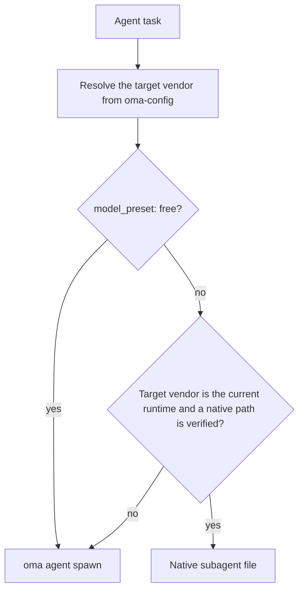
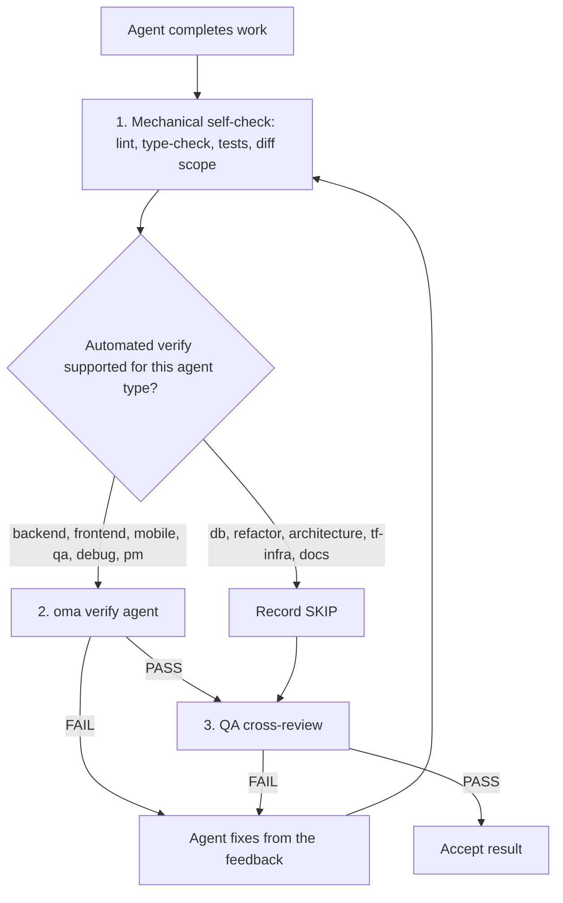

# Agents

OMA separates [skills](../getting-started/glossary.md#skill), dispatch roles, and [agent definitions](../getting-started/glossary.md#agent-definition). A skill routes and loads domain guidance; a canonical role is the runtime identity used for dispatch; a checked-in definition gives a subagent a vendor-native persona. These layers overlap by design, so use the task boundary and acceptance criteria to decide whether one skill is enough.

---

## Skill catalog

This table is the authoritative list of installed skills. It is generated from each `.agents/skills/<name>/SKILL.md` frontmatter by `cli/scripts/generate-skill-catalog.mjs`; run the script with `--check` to detect drift. Each skill's `## References` section in its SKILL.md lists its resource files and when to read them.

<!-- oma:generated skill-catalog:start -->
<!-- Generated from .agents/skills/*/SKILL.md frontmatter by cli/scripts/generate-skill-catalog.mjs. Do not edit this block by hand. -->

| Skill | Use it for |
|---|---|
| [`oma-academic-writing`](https://github.com/first-fluke/oh-my-agent/blob/main/.agents/skills/oma-academic-writing/SKILL.md) | Draft and revise academic prose against a rubric, evidence, and citation requirements. Use for essays, reports, literature reviews, or academic style audits. |
| [`oma-architecture`](https://github.com/first-fluke/oh-my-agent/blob/main/.agents/skills/oma-architecture/SKILL.md) | Evaluate system boundaries and architectural tradeoffs. Use for architecture decisions, design reviews, and ADRs. |
| [`oma-backend`](https://github.com/first-fluke/oh-my-agent/blob/main/.agents/skills/oma-backend/SKILL.md) | Implement server APIs, authentication, and application data access. Schema modeling and query tuning use oma-db. |
| [`oma-brainstorm`](https://github.com/first-fluke/oh-my-agent/blob/main/.agents/skills/oma-brainstorm/SKILL.md) | Explore goals, constraints, and alternative approaches before choosing a design. Use when the user requests ideation or design exploration. |
| [`oma-coordination`](https://github.com/first-fluke/oh-my-agent/blob/main/.agents/skills/oma-coordination/SKILL.md) | Coordinate assigned specialist tasks and handoffs manually. Use when supervising a multi-agent project step by step. |
| [`oma-db`](https://github.com/first-fluke/oh-my-agent/blob/main/.agents/skills/oma-db/SKILL.md) | Design schemas and migrations, tune queries, or plan vector retrieval and database operations. Application API implementation uses oma-backend. |
| [`oma-debug`](https://github.com/first-fluke/oh-my-agent/blob/main/.agents/skills/oma-debug/SKILL.md) | Diagnose a reproducible failure, fix its cause, and verify the regression. Use for crashes, incorrect behavior, and failing tests. |
| [`oma-design`](https://github.com/first-fluke/oh-my-agent/blob/main/.agents/skills/oma-design/SKILL.md) | Define or review a visual system, DESIGN.md, or redesign direction. Use for typography, layout, color, motion, and interaction design decisions. |
| [`oma-dev-workflow`](https://github.com/first-fluke/oh-my-agent/blob/main/.agents/skills/oma-dev-workflow/SKILL.md) | Configure development tasks, git hooks, CI/CD, or release automation. Use when creating or fixing a repository development workflow. |
| [`oma-docs`](https://github.com/first-fluke/oh-my-agent/blob/main/.agents/skills/oma-docs/SKILL.md) | Check documentation references, sync docs to code changes, and detect translation drift. Use for documentation maintenance in a repository. |
| [`oma-explanation`](https://github.com/first-fluke/oh-my-agent/blob/main/.agents/skills/oma-explanation/SKILL.md) | Create an offline HTML explanation of a code change (diff, PR, branch) or of a topic, system, or question. Use when a visual walkthrough document is requested. |
| [`oma-frontend`](https://github.com/first-fluke/oh-my-agent/blob/main/.agents/skills/oma-frontend/SKILL.md) | Implement or modify web UI in React, Next.js, or Angular. Use for components, pages, styles, forms, and frontend state or data flows. |
| [`oma-hwp`](https://github.com/first-fluke/oh-my-agent/blob/main/.agents/skills/oma-hwp/SKILL.md) | Convert Hangul HWP, HWPX, or HWPML documents to Markdown with kordoc. Use for text, table, and image extraction from these formats. |
| [`oma-image`](https://github.com/first-fluke/oh-my-agent/blob/main/.agents/skills/oma-image/SKILL.md) | Generate raster images or reference-guided variations through the OMA image CLI. Use for image assets or explicit vendor comparisons; pixel editing uses an editor. |
| [`oma-market`](https://github.com/first-fluke/oh-my-agent/blob/main/.agents/skills/oma-market/SKILL.md) | Research customer pain points, trends, and competitors through the OMA market engine. Use for market discovery or voice-of-customer analysis. |
| [`oma-mobile`](https://github.com/first-fluke/oh-my-agent/blob/main/.agents/skills/oma-mobile/SKILL.md) | Implement Flutter, React Native, or native Swift apps. Use for mobile screens, widgets, platform integrations, and application data flows. |
| [`oma-observability`](https://github.com/first-fluke/oh-my-agent/blob/main/.agents/skills/oma-observability/SKILL.md) | Design or troubleshoot telemetry, SLOs, and incident diagnostics. Route to the relevant signal, system boundary, or vendor guide. |
| [`oma-orchestration`](https://github.com/first-fluke/oh-my-agent/blob/main/.agents/skills/oma-orchestration/SKILL.md) | Dispatch and supervise parallel specialist agents with durable task state. Use when automated multi-agent execution is requested. |
| [`oma-pdf`](https://github.com/first-fluke/oh-my-agent/blob/main/.agents/skills/oma-pdf/SKILL.md) | Extract PDF text, headings, tables, and images into Markdown using opendataloader-pdf. Use for PDF parsing, not PDF layout creation. |
| [`oma-pm`](https://github.com/first-fluke/oh-my-agent/blob/main/.agents/skills/oma-pm/SKILL.md) | Turn product requirements into scoped tasks with dependencies and acceptance criteria. Use for implementation planning and prioritization. |
| [`oma-qa`](https://github.com/first-fluke/oh-my-agent/blob/main/.agents/skills/oma-qa/SKILL.md) | Review changes for correctness, security, accessibility, and performance. Use for scoped quality reviews or verification plans; bug fixes use oma-debug. |
| [`oma-recap`](https://github.com/first-fluke/oh-my-agent/blob/main/.agents/skills/oma-recap/SKILL.md) | Summarize AI conversation histories for a specified date or period. Use for daily work recaps and cross-tool activity summaries. |
| [`oma-refactor`](https://github.com/first-fluke/oh-my-agent/blob/main/.agents/skills/oma-refactor/SKILL.md) | Restructure existing code while preserving observable behavior. Use for targeted technical debt or hotspot work with characterization tests. |
| [`oma-scholar`](https://github.com/first-fluke/oh-my-agent/blob/main/.agents/skills/oma-scholar/SKILL.md) | Search academic literature and generate, validate, or compare Knows paper sidecars. Use for claim/evidence analysis and literature synthesis. |
| [`oma-scm`](https://github.com/first-fluke/oh-my-agent/blob/main/.agents/skills/oma-scm/SKILL.md) | Manage Git branches, merges, conflicts, commits, and release baselines. Use for repository history and change-management operations. |
| [`oma-search`](https://github.com/first-fluke/oh-my-agent/blob/main/.agents/skills/oma-search/SKILL.md) | Find external documentation, web sources, or remote code with citations. Local code navigation uses the configured code tools. |
| [`oma-security`](https://github.com/first-fluke/oh-my-agent/blob/main/.agents/skills/oma-security/SKILL.md) | Scan application source, agent skills, and MCP components; run penetration tests against scoped web test deployments, validate findings, and configure scan gates. Use oma-qa for broad quality reviews and domain skills for remediation. |
| [`oma-skill-creation`](https://github.com/first-fluke/oh-my-agent/blob/main/.agents/skills/oma-skill-creation/SKILL.md) | Create or revise OMA skills and their references. Use for skill routing, execution contracts, conditional loading, and authoring validation. |
| [`oma-slide`](https://github.com/first-fluke/oh-my-agent/blob/main/.agents/skills/oma-slide/SKILL.md) | Create, import, revise, or export presentation decks through the OMA slide CLI. Use for HTML slides and PDF, PNG, or PPTX deck delivery. |
| [`oma-tf-infra`](https://github.com/first-fluke/oh-my-agent/blob/main/.agents/skills/oma-tf-infra/SKILL.md) | Create or review Terraform infrastructure and plans. Use for cloud resources, IAM, networking, state management, and infrastructure changes. |
| [`oma-translation`](https://github.com/first-fluke/oh-my-agent/blob/main/.agents/skills/oma-translation/SKILL.md) | Translate or revise localized UI strings and prose while preserving meaning, terminology, placeholders, and structure. |
| [`oma-video`](https://github.com/first-fluke/oh-my-agent/blob/main/.agents/skills/oma-video/SKILL.md) | Create short, explainer, or recorded-demo videos through the OMA video CLI. Use for scripts, narration, assets, composition, and video delivery. |
| [`oma-voice`](https://github.com/first-fluke/oh-my-agent/blob/main/.agents/skills/oma-voice/SKILL.md) | Generate speech or transcribe audio locally with Voicebox. Use for narration, voice assets, dictation, and meeting transcription. |
<!-- oma:generated skill-catalog:end -->

---

## Dispatch roles

The runtime dispatches by canonical role. Each role except `orchestrator` has one checked-in definition under `.agents/agents/`, whose `skills:` frontmatter names the skills it loads. The first listed skill owns the task.

| Role | Definition file | Also accepted | Skills |
|------|-----------------|---------------|--------|
| `orchestrator` | none (runtime coordination role) | | |
| `pm` | `pm-planner.md` | `pm-planner` | oma-pm |
| `architecture` | `architecture-reviewer.md` | `architecture-reviewer` | oma-architecture |
| `qa` | `qa-reviewer.md` | `qa-reviewer` | oma-qa |
| `backend` | `backend-engineer.md` | `backend-engineer` | oma-backend |
| `frontend` | `frontend-engineer.md` | `frontend-engineer` | oma-frontend, oma-design |
| `mobile` | `mobile-engineer.md` | `mobile-engineer` | oma-mobile |
| `db` | `db-engineer.md` | `db-engineer` | oma-db |
| `debug` | `debug-investigator.md` | `debug-investigator` | oma-debug |
| `refactor` | `refactor-engineer.md` | `refactor-engineer` | oma-refactor |
| `docs` | `docs-curator.md` | `docs-curator` | oma-docs |
| `tf-infra` | `tf-infra-engineer.md` | `tf-infra-engineer` | oma-tf-infra |
| `explore` | `research-explorer.md` | `research-explorer`, `explorer` | oma-search, oma-market, oma-scholar |

A trailing `-agent` suffix is also accepted (`qa-agent` resolves to `qa`).

### Native agent files

The agent definitions under `.agents/agents/` are the source of truth. OMA projects them into vendor-native files for runtimes that support custom subagents:

| Runtime | Native agent files |
|---------|--------------------|
| Claude Code | `.claude/agents/<name>.md` |
| Codex CLI | `.codex/agents/<name>.toml` |
| Cursor | `.cursor/agents/` |
| OpenCode | `.opencode/agents/` |
| Kiro | `.kiro/agents/` |
| Grok | `.grok/agents/` |
| CommandCode | `.commandcode/agents/` |
| Qwen Code | `.qwen/agents/` |

pi has no agent-file system, so `oma agent spawn` inlines the definition's persona into the prompt. The generated files are refreshed by `oma link`, `oma install`, and `oma update`.

### How a role is dispatched

When a workflow maps an agent to the same vendor as the current runtime, it uses that runtime's native agent file first. Cross-vendor tasks fall back to `oma agent spawn`.



> **Per-agent model dispatch:** each role's vendor, model, and effort come from `.agents/oma-config.yaml` (or `.agents/oma-config.cue`, with an optional `.local` overlay). With `model_preset: auto`, the default for new installs, roles without an `agents:` override follow the current runtime's native agent and model settings; `model_preset: free` always dispatches through `oma agent spawn`. See [Per-Agent Models](../guide/per-agent-models.md) for configuration details and [`oma doctor --profile`](../cli-interfaces/commands.md#doctor) to inspect the live matrix.

---

## Skill categories {#agent-categories}

| Category | Skills | Responsibility |
|----------|--------|---------------|
| **Ideation** | oma-brainstorm | Exploring ideas, proposing approaches, producing design documents |
| **Architecture** | oma-architecture | System/module/service boundaries, ADR/ATAM/CBAM-style analysis, tradeoff records |
| **Planning** | oma-pm | Requirements decomposition, task breakdown, API contracts, priority assignment |
| **Implementation** | oma-frontend, oma-backend, oma-mobile, oma-db | Writing code in their respective domains |
| **Design** | oma-design | Design systems, DESIGN.md, tokens, typography, color, motion, accessibility |
| **Infrastructure** | oma-tf-infra | Multi-cloud Terraform provisioning, IAM, cost optimization, policy-as-code |
| **DevOps** | oma-dev-workflow | mise task runner, CI/CD, migrations, release coordination, monorepo automation |
| **Observability** | oma-observability | Observability pipelines, traceability routing, MELT+P signals (metrics/logs/traces/profiles/cost/audit/privacy), SLO management, incident forensics, transport tuning |
| **Quality** | oma-qa | Security audit (OWASP), performance, accessibility (WCAG), code quality review |
| **Debugging** | oma-debug | Bug reproduction, root cause analysis, minimal fixes, regression tests |
| **Localization** | oma-translation | Context-aware translation preserving tone, register, and domain terms |
| **Coordination** | oma-orchestration, oma-coordination | Automated and manual multi-agent orchestration |
| **Git** | oma-scm | Conventional Commits generation, feature-based commit splitting |
| **Search & Retrieval** | oma-search | Intent-based search router with trust scoring (Context7 docs, web, `gh`/`glab` code, local code intelligence) |
| **Retrospective** | oma-recap | Cross-tool conversation history analysis and themed work summaries |
| **Document Processing** | oma-hwp, oma-pdf | HWP/HWPX/HWPML and PDF to Markdown conversion for LLM/RAG ingestion |
| **Documentation** | oma-docs | Documentation maintenance: broken references, docs affected by a diff, translation drift, and translated-doc linting |
| **Explanation** | oma-explanation | Offline HTML explanations of a code change (diff, PR, branch, commit range) or of a topic, system, or question |
| **Academic Writing** | oma-academic-writing, oma-scholar | Publication-grade academic prose drafting/audit and Knows-sidecar scholarly research, search, and peer review |
| **Security** | oma-security | Scanning application source, agent skill packages, MCP components, and authorized web test deployments (Deepsec, Cisco scanners, ARTEX), with independent finding validation and CI gates |
| **Refactoring** | oma-refactor | Behavior-preserving incremental restructuring with hotspot targeting, characterization-test safety nets, refactor-only commits |
| **Market Research** | oma-market | Community-signal pain/trend/competitor/discovery research with intent-auto SWOT/Porter's 5F/PESTEL frameworks |
| **Skill Authoring** | oma-skill-creation | Creating and validating OMA skills in the SSL-lite format |
| **Media Generation** | oma-image, oma-slide, oma-video, oma-voice | AI image generation, HTML presentation decks, short-form/explainer/demo video, and local TTS/STT |

---

## Detailed agent reference

These summaries explain each skill's domain and key rules. The skill's own SKILL.md is the source of truth: its `## References` section lists the resource files and the condition for reading each one, so this page does not copy those lists.

### oma-brainstorm

**Domain:** Design-first ideation before planning or implementation.

**When to use:** Exploring a new feature idea, understanding user intent, comparing approaches. Use before `/plan` for complex or ambiguous requests.

**When NOT to use:** Clear requirements (go to oma-pm), implementation (go to domain agents), code review (go to oma-qa).

**Core rules:**
- No implementation or planning before design approval
- One clarifying question at a time (not batches)
- Compare two or three viable approaches when alternatives help the decision; if constraints leave fewer, explain why instead of inventing options
- Present the design section by section, resolving only open material choices
- YAGNI: design only what is needed

**Workflow:** 7 phases: Context, Questions, Approaches (optionally seeded with TRIZ-lite), Design, Blind Review, Documentation (saves to `docs/plans/designs/`), Transition to `/plan`.

---

### oma-architecture

**Domain:** Software/system architecture, including module and service boundaries, tradeoff analysis, stakeholder synthesis, and decision records.

**When to use:** Choosing or reviewing system architecture, defining module/service/ownership boundaries, comparing architectural options with explicit tradeoffs, investigating architectural pain (change amplification, hidden dependencies, awkward APIs), prioritizing architecture investments or refactors, writing architecture recommendations or ADRs.

**When NOT to use:** Visual/design systems (use oma-design), feature planning and task decomposition (use oma-pm), Terraform implementation (use oma-tf-infra), bug diagnosis (use oma-debug), security/performance/accessibility review (use oma-qa).

**Methodologies:** Diagnostic routing, design-twice comparison, ATAM-style risk analysis, CBAM-style prioritization, ADR-style decision records.

**Core rules:**
- Diagnose the architecture problem before selecting a method
- Use the lightest sufficient methodology for the current decision
- Distinguish architectural design from UI/visual design and from Terraform delivery
- Consult stakeholder agents only when the decision is cross-cutting enough to justify the cost
- Recommendation quality matters more than consensus theater: consult broadly, decide explicitly
- Every recommendation must state assumptions, tradeoffs, risks, and validation steps
- Be cost-aware by default: implementation cost, operational cost, team complexity, future change cost

---

### oma-pm

**Domain:** Product management, including requirements analysis, task decomposition, and API contracts.

**When to use:** Breaking down complex features, determining feasibility, prioritizing work, defining API contracts.

**Core rules:**
- API-first design: define contracts before implementation tasks
- Every task has: agent, title, acceptance criteria, priority, dependencies
- Minimize dependencies for maximum parallel execution
- Security and testing are part of every task (not separate phases)
- Tasks must be completable by a single agent
- Output the JSON plan plus a session-scoped task board for orchestrator compatibility

**Output:** `.agents/results/plan-{sessionId}.json` with numeric priority tiers (`1` = independent, lower tiers run first), plus the run-scoped report `result-{agentId}-{taskId}-{runId}-{sessionId}.md` in the configured memory store.

---

### oma-frontend

**Domain:** Web UI in React/Next.js or Angular with TypeScript. React projects use FSD-lite; Angular projects follow `resources/angular-rules.md`.

**When to use:** Building user interfaces, components, client-side logic, styling, form validation, API integration.

**Tech stack:**
- React + Next.js (Server Components default, Client Components for interactivity)
- TypeScript (strict)
- TailwindCSS v4 + shadcn/ui (read-only primitives, extend via cva/wrappers)
- FSD-lite: root `src/` + feature `src/features/*/` (no cross-feature imports)

**Libraries (React/Next.js projects):**
| Purpose | Library |
|---------|---------|
| Dates | luxon |
| Styling | TailwindCSS v4 + shadcn/ui |
| Hooks | ahooks or @mantine/hooks |
| Utils | es-toolkit |
| Types | type-fest |
| URL State | nuqs |
| Server State | TanStack Query (orval-generated hooks when an OpenAPI spec exists) |
| Client State | Jotai or Zustand, chosen by intent with no default (minimize use) |
| Forms | @tanstack/react-form + Zod |
| Auth | better-auth |
| Animation | motion (`motion/react`) for new projects |

**Core rules:**
- shadcn/ui first, extend via cva, never modify `components/ui/*` directly
- Design tokens 1:1 mapping (never hardcode colors)
- Request proxy: preserve an existing Next.js 16+ `proxy.ts` convention; check the installed version and routing before proposing a `middleware.ts` rename
- No prop drilling beyond 3 levels; use the project's client-state library (Jotai atoms or a Zustand store)
- Absolute imports with `@/` mandatory
- FCP target < 1s
- Responsive breakpoints: 320px, 768px, 1024px, 1440px

**Quality gate checklist:**
- Accessibility: ARIA labels, semantic headings, keyboard navigation
- Mobile: verified on mobile viewports
- Performance: no CLS, fast load
- Resilience: Error Boundaries and Loading Skeletons
- Tests: logic covered by Vitest
- Quality: typecheck and lint pass

---

### oma-backend

**Domain:** APIs, server-side logic, authentication, database operations.

**When to use:** REST/GraphQL APIs, database migrations, auth, server business logic, background jobs.

**Architecture:** Router (HTTP) -> Service (Business Logic) -> Repository (Data Access) -> Models.

**Stack detection:** Reads project manifests (pyproject.toml, package.json, Cargo.toml, go.mod, etc.) to determine language and framework. If project-specific conventions are missing, ask the user to run `/stack-set`; that command materializes the resolved `stack/` references from the shipped schema and templates.

**Core rules:**
- Clean architecture: no business logic in route handlers
- All inputs validated with the project's validation library
- Parameterized queries only (never string interpolation in SQL)
- JWT + Argon2id for auth (bcrypt acceptable for legacy compatibility); rate limit auth endpoints
- Async where supported; type annotations on all signatures
- Custom exceptions via centralized error module
- Explicit ORM loading strategy, transaction boundaries, safe lifecycle

<!-- oma-docs:ignore-start -->
Project-specific `stack/stack.yaml`, `stack/tech-stack.md`, snippets, and API templates are generated by `/stack-set` when needed; they are absent until the stack is materialized.
<!-- oma-docs:ignore-end -->

---

### oma-mobile

**Domain:** Cross-platform and native mobile apps (Flutter, React Native, and Swift native iOS).

**When to use:** Native mobile apps (iOS + Android), mobile-specific UI patterns, platform features (camera, GPS, push notifications), offline-first architecture; Swift native iOS apps using SwiftUI and `swift-openapi-generator`.

**Architecture:** Clean Architecture: domain -> data -> presentation. For Swift iOS: `App/Core/Features/Shared` project layout.

**Tech stacks:**
- Flutter/Dart: Riverpod/Bloc (state management), Dio with interceptors (API), GoRouter (navigation), Material Design 3 (Android) + iOS HIG.
- Swift native iOS (iOS 17+): SwiftUI + `@Observable` (Observation framework), Apple `swift-openapi-generator` for API clients, `App/Core/Features/Shared` layout.

**Core rules:**
- Riverpod/Bloc for state management (no raw setState for complex logic)
- All controllers disposed in `dispose()` method
- Dio with interceptors for API calls; handle offline gracefully
- 60fps target; test on both platforms
- Swift: use `@Observable` over `ObservableObject` on iOS 17+; generate API clients from OpenAPI specs via `swift-openapi-generator`

**Platform seeds:** `variants/` ships `flutter/`, `react-native/`, and `swift-ios/`, each with `stack.yaml`, `tech-stack.md`, `snippets.md`, and an API template, plus the shared `stack.schema.json`. They are starter material for `/stack-set`, not required reading for edits to existing code.

---

### oma-db

**Domain:** Database architecture across SQL, NoSQL, and vector databases.

**When to use:** Schema design, ERD, normalization, indexing, transactions, capacity planning, backup strategy, migration design, vector DB/RAG architecture, anti-pattern review, compliance-aware design (ISO 27001/27002/22301).

**Default workflow:** Explore (identify entities, access patterns, volume) -> Design (schema, constraints, transactions) -> Optimize (indexes, partitioning, archival, anti-patterns).

**Core rules:**
- Choose model first, engine second
- 3NF default for relational; document BASE tradeoffs for distributed
- Document all three schema layers: external, conceptual, internal
- Integrity is first-class: entity, domain, referential, business-rule
- Concurrency is never implicit: define transaction boundaries and isolation levels
- Vector DBs are retrieval infrastructure, not source-of-truth
- Never treat vector search as a drop-in replacement for lexical search

**Required deliverables:** External schema summary, conceptual schema, internal schema, data standards table, glossary, capacity estimation, backup/recovery strategy. For vector/RAG: embedding version policy, chunking policy, hybrid retrieval strategy.

---

### oma-design

**Domain:** Design systems, UI/UX, DESIGN.md management.

**When to use:** Creating or revising design systems and DESIGN.md, redesigning an existing site or app (preserve or overhaul), landing pages, design tokens, color palettes, typography, responsive layouts, accessibility review.

**Workflow:** 7 phases: Setup (context gathering) -> Extract (optional, from reference URLs) -> Enhance (vague prompt augmentation) -> Propose (2-3 design directions) -> Generate (DESIGN.md + tokens) -> Audit (responsive, WCAG, Nielsen, AI slop check) -> Handoff.

**Anti-pattern enforcement ("no AI slop"):**
- Typography: system font stack default; no default Google Fonts without justification
- Color: no purple-to-blue gradients, no gradient orbs/blobs, no pure white on pure black
- Layout: no nested cards, no desktop-only layouts, no cookie-cutter 3-metric stat layouts
- Motion: no bounce easing everywhere, no animations > 800ms, must respect prefers-reduced-motion
- Components: no glassmorphism everywhere, all interactive elements need keyboard/touch alternatives

**Core rules:**
- Reuse `.design-context.md` and `DESIGN.md` when present; create `.design-context.md` only when a substantive discovery pass informs the decision
- For an existing site or app, follow `resources/redesign-protocol.md` and classify Preserve vs Overhaul before proposing
- System font stack default (CJK-ready fonts for ko/ja/zh)
- WCAG AA minimum for all designs
- Responsive-first (mobile as default)
- Present 2-3 directions, get confirmation

---

### oma-tf-infra

**Domain:** Infrastructure-as-code with Terraform, multi-cloud.

**When to use:** Provisioning on AWS/GCP/Azure/Oracle Cloud, Terraform configuration, CI/CD authentication (OIDC), CDN/load balancers/storage/networking, state management, ISO compliance infrastructure.

**Cloud detection:** Reads Terraform providers and resource prefixes (`google_*` = GCP, `aws_*` = AWS, `azurerm_*` = Azure, `oci_*` = Oracle Cloud). Includes a full multi-cloud resource mapping table.

**Core rules:**
- Provider-agnostic: detect cloud from project context
- Remote state with versioning and locking
- OIDC-first for CI/CD auth
- Plan before apply always
- Least privilege IAM
- Tag everything (Environment, Project, Owner, CostCenter)
- No secrets in code
- Version pin all providers and modules
- No auto-approve in production

---

### oma-dev-workflow

**Domain:** Monorepo task automation and CI/CD.

**When to use:** Running dev servers, executing lint/format/typecheck across apps, database migrations, API generation, i18n builds, production builds, CI/CD optimization, pre-commit validation.

**Core rules:**
- Always use `mise run` tasks instead of direct package manager commands
- Run lint/test only on changed apps
- Validate commit messages with commitlint
- CI should skip unchanged apps
- Never use direct package manager commands when mise tasks exist

---

### oma-observability

**Domain:** Intent-based observability and traceability router across layers, boundaries, and signals.

**When to use:**
- Pipeline setup: OTel SDK + Collector + vendor backend
- Traceability across service and domain boundaries: W3C propagators, baggage, multi-tenant, multi-cloud
- Transport tuning: UDP/MTU thresholds, OTLP gRPC vs HTTP, Collector DaemonSet vs sidecar topology, sampling recipes
- Incident forensics: 6-dimension localization (code / service / layer / host / region / infra)
- Vendor category selection: OSS full-stack vs commercial SaaS vs high-cardinality specialist vs profiling specialist
- Observability-as-code: Grafana Jsonnet dashboards, PrometheusRule CRD, OpenSLO YAML, SLO burn-rate alerts
- Meta-observability: pipeline self-health, clock skew, cardinality guardrails, retention matrix
- MELT+P signal coverage: metrics, logs, traces, profiles, cost, audit, privacy
- Log-pipeline migrations evaluated against current upstream support and project requirements

**When NOT to use:** LLM ops / gen_ai observability (use Langfuse, Arize Phoenix, LangSmith, Braintrust), data pipeline lineage (OpenLineage + Marquez, dbt test, Airflow lineage), IoT / datacenter physical-layer telemetry (Nlyte, Sunbird, Device42), chaos engineering orchestration (Chaos Mesh, Litmus, Gremlin, ChaosToolkit), GPU / TPU infrastructure (NVIDIA DCGM Exporter), software supply chain (sigstore, in-toto, SLSA), incident response workflow / paging (PagerDuty, OpsGenie, Grafana OnCall), single-vendor setup already covered by that vendor's own skill.

**Core rules:**
- Classify intent before routing: setup | migrate | investigate | alert | trace | tune | route
- Category-first, not vendor-registry: delegate to vendor-owned skills via `resources/vendor-categories.md`; do not duplicate vendor documentation
- Transport tuning is the moat: UDP/MTU thresholds, OTLP protocol selection, Collector topology, and sampling recipes are depth that other skills do not cover
- Meta-observability is non-negotiable: validate pipeline self-health, clock sync (< 100 ms drift), cardinality, and retention before declaring setup complete
- CNCF-first preference: Prometheus, Jaeger, Thanos, Fluent Bit, OpenTelemetry, Cortex, OpenCost, OpenFeature, Flagger, Falco
- Fluentd remains CNCF Graduated; the CNCF 2025-10 Fluentd to Fluent Bit guide is a migration guide, not a deprecation. Choose Fluentd, Fluent Bit, or the OTel Collector from workload, plugin, and operational requirements
- W3C Trace Context as default propagator; translate per cloud (AWS X-Ray `X-Amzn-Trace-Id`, GCP Cloud Trace, Datadog, Cloudflare, Linkerd)
- Privacy before features: PII redaction, sampling-aware baggage rules, SOC2/ISO immutable audit + GDPR/PIPA erasure applied at collection, not only at storage

---

### oma-qa

**Domain:** Quality assurance covering security, performance, accessibility, and code quality.

**When to use:** Final review before deployment, security audits, performance analysis, accessibility compliance, test coverage analysis.

**Review priority order:** Security > Performance > Accessibility > Code Quality.

**Severity levels:**
- **CRITICAL**: Security breach, data loss risk
- **HIGH**: Blocks launch
- **MEDIUM**: Fix this sprint
- **LOW**: Backlog

**Core rules:**
- Every finding must include file:line, description, and fix
- Run automated tools first (npm audit, bandit, lighthouse)
- No false positives; every finding must be reproducible
- Provide remediation code, not just descriptions

---

### oma-debug

**Domain:** Bug diagnosis and fixing.

**When to use:** User-reported bugs, crashes, performance issues, intermittent failures, race conditions, regression bugs.

**Methodology:** Reproduce first, then diagnose. Never guess at fixes.

**Core rules:**
- Identify root cause, not just symptoms
- Minimal fix: change only what is necessary
- Every fix gets a regression test
- Search for similar patterns elsewhere
- Document in `.agents/results/`

**Code intelligence tools used (Gortex or Serena):**
- `find_symbol("functionName")` or Gortex symbol navigation: locate the function
- `find_referencing_symbols("Component")` or Gortex impact analysis: find all usages
- `search_for_pattern("error pattern")` or Gortex search: find similar issues

---

### oma-translation

**Domain:** Context-aware multilingual translation.

**When to use:** Translating UI strings, documentation, marketing copy, reviewing existing translations, creating glossaries.

**Six-scene flow:** Prepare, Acquire, Reason, Act, Verify, and Finalize. The translation method has four steps: read meaning and protected syntax, choose register, reconstruct in the target language, and preserve author style where it belongs.

**Core rules:**
- Scan existing locale files first to match conventions
- Translate meaning, not words
- Preserve emotional connotations
- Never produce word-for-word translations
- Never mix registers within a piece
- Preserve domain-specific terminology as-is

---

### oma-orchestration

**Domain:** Automated multi-agent coordination via CLI spawning.

**When to use:** Complex features requiring multiple agents in parallel, automated execution, full-stack implementation.

**Configuration defaults:**

| Setting | Default | Description |
|---------|---------|-------------|
| MAX_PARALLEL | 3 | Maximum concurrent subagents |
| MAX_RECOVERY_ATTEMPTS | 3 | Total retries and exploration hypotheses per task, including the original attempt |
| POLL_INTERVAL | 30s | Status check interval for `oma agent spawn` runs (Claude Code native subagents return synchronously) |

**Workflow phases:** Plan → References (select per-task references) → Setup (session and task-board artifacts) → Execute (dispatch ready tasks within MAX_PARALLEL) → Monitor → Verify (review loop) → Collect (claims and run-scoped reports).

**Agent-to-agent review loop:** see [Orchestration flow](#orchestration-flow) for the diagram and loop limits.

**Session evidence:** Records material corrections and adjudicated review findings when useful, with cause, impact, and verification. No penalty score or score-triggered pause applies.

---

### oma-scm

**Domain:** Software configuration management (SCM) and Git, covering branching, merges, worktrees, baselines, audit readiness, and Conventional Commits.

**When to use:** After code changes (`/scm`), merge conflicts, branch strategy, releases/tags, or any repo CM question.

**Commit types:** feat, fix, docs, style, refactor, perf, test, chore, build, ci, revert.

**Workflow (commits):** Analyze changes → Split by feature when needed → type → scope → description (imperative, under 72 chars, lowercase, no trailing period) → commit with explicit paths.

**Rules:**
- Do not use `git add -A` or `git add .` without explicit authorization
- Never commit secrets files
- Always specify files when staging
- Write the message to a file and commit with `git commit -F <message-file>`
- Do not rewrite shared history without explicit authorization; use `--force-with-lease`, never plain `--force`
- Co-author trailers are included only when the effective `scm.co_author` configuration enables them and supplies the name and email.

---

### oma-coordination

**Domain:** Manual step-by-step multi-agent coordination guide.

**When to use:** Multi-domain work where you want to supervise spawning, monitoring, contract alignment, and QA step by step instead of fully automated orchestration.

**When NOT to use:** Fully automated parallel execution (use oma-orchestration), single-domain tasks (use the domain agent directly).

**Core rules:**
- Reuse a valid plan; call oma-pm only when decomposition or contracts must change
- Spawn independent tasks of the same priority tier in parallel, each in its own workspace or with `--isolation worktree`
- Update contracts for changed API boundaries before dependent frontend or mobile work
- QA review is always the final step
- Route blocking QA defects and required verification gaps back to the responsible agent, then rerun the affected checks

**Workflow:** Plan (reuse or PM) → Spawn by priority tier → Monitor → QA review → Fix issues → Ship.

**Difference from oma-orchestration:** Coordination is manual and guided (user controls pace), orchestrator is automated (agents spawn and run with minimal user intervention).

---

### oma-search

**Domain:** Intent-based search router with domain trust scoring. Routes queries to Context7 (docs), native web search, `gh`/`glab` (code), local code intelligence (Gortex or Serena).

**When to use:** Finding official library/framework documentation, web research for tutorials/examples/comparisons/solutions, GitHub/GitLab code search for implementation patterns, any query where the search channel is unclear (auto-routing), other skills that need search infrastructure (shared invocation).

**When NOT to use:** Local-only codebase exploration (use code intelligence MCP directly), Git history or blame analysis (use oma-scm), full architecture research (use oma-architecture, which may invoke this skill internally).

**Core rules:**
- Explicit `--docs`, `--code`, or `--web` selects the route; otherwise classify intent with `resources/intent-rules.md`
- One query, one best route; avoid redundant multi-route unless intent is ambiguous
- Trust score every result; all non-local results get domain trust labels from the registry
- Other flags: `--strict` filters results by trust after scoring, `--wide` retains labeled lower-trust results, and `--gitlab` selects GitLab as the code host
- Fail forward: if the primary route fails, fall back gracefully (docs→web, web→`oma search fetch` strategies)
- No additional MCP required: Context7 for docs, runtime-native for web, CLI for code, configured provider (Gortex or Serena) for local
- Vendor-agnostic web search: use whatever the current runtime provides (WebSearch, Google, Bing)
- Domain-level trust only; no sub-path or page-level scoring

---

### oma-recap

**Domain:** Conversation history analysis across multiple AI tools (Claude, Codex, Gemini, Antigravity, Qwen, Cursor, Grok) with themed daily/period work summaries.

**When to use:** Summarizing a day or period of work activity, understanding the flow of work across multiple AI tools, analyzing tool-switching patterns between sessions, preparing daily standups / weekly retros / work logs.

**When NOT to use:** Git commit-based code change retrospective (use `oma retro`), real-time agent monitoring (use `oma dashboard terminal`), productivity metrics (use `oma stats get`).

**Process:**
1. Resolve date or time window from natural-language input (today, yesterday, last Monday, explicit date)
2. Fetch conversation data with `oma recap --date YYYY-MM-DD --json` for a calendar day or `oma recap --window 7d --json` for a rolling window (`1d`, `3d`, `7d`, `2w`, `30d`); narrow it with `--tool`
3. Group by content (projects and themes), not by tool; a window of 3 days or more groups by project instead of by day
4. Extract themes (features worked on, bugs fixed, tools explored)
5. Render themed daily/period summary

---

### oma-hwp

**Domain:** HWP / HWPX / HWPML (Korean word processor) to Markdown conversion using `kordoc`.

**When to use:** Converting Korean HWP documents (`.hwp`, `.hwpx`, `.hwpml`) to Markdown, preparing Korean government/enterprise documents for LLM context or RAG, extracting structured content (tables, headings, lists, images, footnotes, hyperlinks) from HWP.

**When NOT to use:** PDF files (use oma-pdf), XLSX/DOCX (out of scope), generating/editing HWP (out of scope), already-text files (use Read tool directly).

**Core rules:**
- Use `bunx kordoc@latest` to run (no installation required); always pass `@latest` or a pinned version
- Default output format is Markdown
- If no output directory is specified, output to the same directory as the input
- kordoc handles structure preservation (headings, tables, nested tables, footnotes, hyperlinks, images)
- Security defenses (ZIP bomb, XXE, SSRF, XSS) are provided by kordoc; do not add custom ones
- For encrypted or DRM-locked HWP, report the limitation to the user clearly
- Post-process with `resources/flatten-tables.ts` to convert HTML `<table>` blocks to GFM pipe tables and strip Hancom font Private Use Area characters

---

### oma-pdf

**Domain:** PDF to Markdown conversion using `opendataloader-pdf`.

**When to use:** Converting PDF documents to Markdown for LLM context or RAG, extracting structured content (tables, headings, lists) from PDFs, preparing PDF data for AI consumption.

**When NOT to use:** Generating/creating PDFs (use appropriate document tools), editing existing PDFs (out of scope), simple reading of already-text files (use Read tool directly).

**Core rules:**
- Use `uvx opendataloader-pdf` to run (no installation required)
- Default output format is Markdown
- If no output directory is specified, output to the same directory as the input PDF
- Preserve document structure (headings, tables, lists, images)
- For scanned PDFs, use hybrid mode with OCR
- Always run `uvx mdformat` on the output to normalize Markdown formatting
- Validate the output Markdown is readable and well-structured
- Report any conversion issues (missing tables, garbled text) to the user

---

### oma-academic-writing

**Domain:** Publication-grade academic English prose: drafting, revising, and auditing essays, reports, analysis sections, executive summaries, conclusions, and literature reviews.

**When to use:** Drafting or revising academic reports/essays/analysis sections, writing executive summaries or conclusions or literature reviews, rewriting AI-sounding prose into natural academic English, polishing a draft to top-band rubric quality (HD, A, top-band), reviewing prose for sentence variety / verb quality / hedging / anti-AI compliance.

**When NOT to use:** Translation (use oma-translation), source discovery / citation gathering / literature search (use oma-scholar), rubric parsing and task decomposition (use oma-pm), code documentation / README / API reference text (use the relevant domain skill), informal or marketing copy, non-English academic writing (draft in English, then hand off to oma-translation).

**Modes:** `draft` (heading + prose + Writing Notes + Claim-Evidence Map), `revise` (original + revised + change list), `review` (PASS/FAIL compliance report across sentence structure, verb quality, anti-AI, specificity, hedging, paragraph clarity, rhythm, claim-evidence alignment).

**Core rules:**
- Quote-before-judgment: cite the literal rubric/constraint text before applying any rule
- Every sentence verifiable; never fabricate data, statistics, or citations
- Banned generic verbs (`show`, `have`, `make`, `do`, `get`, `use`, …) must not be main verbs
- Vary sentence type, length, and openers; never 3+ same-type sentences in a row
- Match hedge strength to evidence strength; no first-person `I think`/`I believe`
- Every claim maps to evidence in the Claim-Evidence Map; weaken or remove unsupported claims

**Workflow:** 6 steps — READ rubric/draft and quote constraints, PLAN paragraphs as Topic-Support-Conclude, DRAFT under all four protocols, AUDIT against the anti-AI checklist, REVERSE-OUTLINE + build Claim-Evidence Map, POLISH (read-aloud, cohesion, specificity, word-count, rhythm).

---

### oma-security

**Domain:** Security scanning and validation for application source, agent skill packages, MCP components, and authorized web test deployments.

**When to use:** Scanning a repository or a source diff; inspecting a skill package or an MCP server or configuration; running a bounded penetration test against a concrete, authorized test deployment; validating scanner candidates; configuring an engine-specific CI gate; troubleshooting a scanner's credentials, coverage, matchers, quota, or resumable state.

**When NOT to use:** Broad correctness, performance, accessibility, or quality review (use oma-qa), tool comparisons or research without execution (use oma-search), security architecture decisions (use oma-architecture), remediation in product code (use oma-debug or the owning backend/frontend/mobile/infrastructure skill).

**Default engine by target:**

| Target | Default engine |
|--------|----------------|
| Application source or source diff | Deepsec (Cisco AI Deep SAST when explicitly selected) |
| Agent skill directory or package | Cisco Skill Scanner |
| MCP source, configuration, or server | Cisco MCP Scanner |
| Web test deployment | ARTEX |
| Bounded local reproduction | Cloudflare validation method (no external network) |

**Core rules:**
- A general repository scan selects source only; skill, MCP, and runtime scans are not added by implication
- A failed or empty result never selects another engine, model, or paid analyzer automatically
- Preserve and resume existing `.deepsec/` state; never reinitialize to erase a failed or noisy run
- An installed key or tool does not authorize paid calls or a wider scope; reuse existing authorization under the shared execution policy
- Each unique candidate goes to a fresh verifier that did not discover it; `confirmed` requires independent observed proof
- No result establishes that a target is secure; a gate cannot pass while required checks remain incomplete

**Output:** one `.agents/results/security/<run-id>/` per invocation with `run.json`, `findings.json`, and `report.md` (plus `runtime.json` for web runtime and `gate.json` for CI).

---

### oma-docs

**Domain:** Documentation maintenance in four modes: `verify` (broken references; regenerates `docs/generated/doc-refs.json`), `sync` (docs that reference files changed in a diff), `i18n` (translation drift), and `lint` (style issues in translated docs).

**When to use:** After a refactor, rename, or file deletion to find stale references in docs; before a release to confirm CLI commands, file paths, and config keys still exist; after a significant git diff to find which docs reference changed files; routine translation-drift checks.

**When NOT to use:** General source research (use oma-search), application implementation (use the owning specialist), translating known text (use oma-translation).

**Core rules:**
- Review-only requests produce proposals; an existing scoped edit request authorizes applying those corrections without another per-file approval
- The CLI emits structured data; the host LLM does the synthesis and patch drafting. Do not invent CLI findings or call a vendor LLM API from the docs CLI
- Secret-bearing files (`.env*`, private keys, credentials) never appear in diff reports or patches
- Honor ignore blocks, `oma-docs: skip`, and configured exclusions
- URL checking is delegated to `lychee` (optional); the workflow hook runs only when `docs.auto_verify` is enabled and is warn-only

**Workflow:** `oma docs verify --json`, `oma docs sync <range> --json`, `oma docs i18n --json`, or `oma docs lint --json` → inspect the structured results → verify each correction against current code → apply authorized corrections → re-run the affected checks. `verify` exits 0 when clean and 1 when it finds broken references.

---

### oma-explanation

**Domain:** Offline, self-contained HTML explanations in two modes: change mode (a diff, PR, branch, or commit range, with background, intuition, a code walkthrough, and a five-question quiz) and topic mode (a concept, system, or question as a one-page visual sheet).

**When to use:** Explaining a diff, pull request, branch, or commit range, or a topic, system, or question, as one offline-capable HTML page.

**Workflow:** The model writes a Markdown draft; `oma explain render` turns it into one HTML file at `.agents/results/explain/{YYYY-MM-DD}-{slug}.html`, and `oma explain validate` checks it. Activation is by `/explain`, naming the skill, or delegation only; the skill is excluded from keyword hints.

**When NOT to use:** A plain documentation page, a live feature implementation, or a slide deck (use `oma-slide` for presentations).

---

### oma-image

**Domain:** Multi-vendor AI image generation with authentication-aware parallel dispatch (Codex `gpt-image-2`, Antigravity Gemini-family “nano-banana” models via `agy` with the exact model selected internally, Pollinations flux/zimage).

**When to use:** Generating images, visual assets, illustrations, product photos, concept art, or mockups; comparing output across multiple image models for the same prompt; producing images from prompts inside editor workflows.

**When NOT to use:** Editing an existing image or photo manipulation, generating videos or audio (use oma-video / oma-voice), inline vector/SVG composition from structured data, simple asset resizing or format conversion.

**Core rules:**
- Clarify before invoking: if subject/style/composition/usage is ambiguous, ask first or amplify the prompt and show the user the expanded version
- Authentication-aware dispatch: run only authenticated vendors; with `--vendor all`, every requested vendor must be available
- Cost guardrail: confirm before runs whose estimated cost is ≥ $0.20 (`--yes`/`OMA_IMAGE_YES=1` bypass); default `pollinations` and `antigravity` are free
- Path safety: output outside `$PWD` requires `--allow-external-output`; max `n` = 5
- Recorded outputs: every run writes `manifest.json` next to the images with prompt, vendor/model, inputs, and artifact metadata. It records reproducibility data; it does not promise pixel-identical images.
- Auto-forward attached reference images via `--reference <path>` (codex/antigravity)

**Workflow:** PREPARE (clarify/amplify prompt, choose vendor) → ACQUIRE (validate auth, references, output path) → ACT (`oma image generate`) → VERIFY (manifest, files, exit code) → FINALIZE (output paths + warnings).

---

### oma-market

**Domain:** Community-signal market research: pain-point extraction, trend detection, competitor positioning, and discovery. Research runs on the upstream [`last30days`](https://github.com/mvanhorn/last30days-skill) engine (Reddit, X, YouTube, TikTok, Instagram, HN, Polymarket, GitHub, arXiv, Techmeme, Digg, LinkedIn, StockTwits, Bluesky, web and more), which oma keeps at the latest release automatically.

**When to use:** Extracting real user pain points from community posts, detecting trends in a category over a 7/30/90/180-day window, competitor sentiment analysis and SWOT / Porter's 5F positioning, open-ended discovery (`--discover`), person / company / ticker research, hiring signals, follow-up drills.

**When NOT to use:** General web research without market framing (use oma-search directly), academic literature (use oma-scholar), live dashboards or scheduled monitoring (wrap this skill with `oma schedule <action>`).

**Core rules:**
- detect-trap first: never run the engine without preflight (`--force` only on explicit user reconfirmation)
- One engine, always latest: `oma market resolve` refreshes the managed copy (`~/.cache/oma-market/last30days/<tag>/`) before use; a stale user-installed copy is only a fallback when nothing is cached offline
- Follow the resolved engine's `SKILL.md` verbatim; the only substitution is `oma market run <args>` in place of the raw `python3 scripts/last30days.py` call
- Never WebSearch-only: no engine, no Python 3.12+, or a non-zero exit → stop and report
- Keyed sources are enabled only through the upstream setup wizard with user consent; skipped sources stay visible in the footer
- Frameworks cite only engine clusters; badge first line and upstream LAWs enforced before the file is written
- Single brief per run at `.agents/results/market/{topic-slug}-{YYYYMMDD}.md`; framework auto-toggles by intent (pain/trend → SWOT, competitor → SWOT + Porter's 5F, discovery → SWOT + PESTEL)

**Workflow:** detect-trap → `oma market resolve` → read upstream SKILL.md → upstream pre-research steps (setup wizard, handle/subreddit resolution, query plan) → `oma market run … --emit=compact` → synthesize per upstream OUTPUT CONTRACT → append frameworks → self-check → write.

---

### oma-refactor

**Domain:** Behavior-preserving refactoring: safe incremental restructuring with code-smell / SATD / hotspot targeting, characterization-test safety nets, and refactor-only commits.

**When to use:** Executing a refactoring on specific files/modules (extract, move, rename, decompose, idiom alignment), preparatory refactoring before a feature, legacy/brownfield rescue (seam discovery + characterization tests), refactoring target selection by hotspot (churn × complexity), auditing whether code is safe to refactor now.

**When NOT to use:** Fixing a reported bug or failing behavior (use oma-debug; refactoring must not change behavior), security/performance/accessibility audit (use oma-qa), system design / module boundaries / ADRs (use oma-architecture), DB schema design or migration mechanics (use oma-db), commit splitting / staging (use oma-scm), performance optimization as a goal.

**Core rules:**
- Behavior-preserving: the consumer contract (Hyrum-aware) is inviolable; tuning is a side effect, never a goal
- Verifiable: never restructure without a net; if the safety net is missing/weak, write characterization (golden-master) tests FIRST as separate commits
- Incremental: one named transformation per commit; on repeated failure use Mikado (record prerequisite, revert fully, recurse)
- Separated (two hats): never mix behavior changes into refactor commits (`refactor:`-typed only)
- Economic: readability is the dominant objective; don't refactor code slated for deletion or cold low-churn code
- Convention deviation requires the oma-architecture ADR route, not a local edit; all metrics are proxies (Goodhart)

**Workflow:** PREPARE (classify green/brownfield, size gates, hotspot rank) → ACQUIRE (read code via symbol tools, collect metrics + git signals) → REASON (plan atomic transformation sequence / expand-contract) → ACT (one engine-first transformation) → VERIFY (re-run tests unchanged → commit, or Mikado revert) → FINALIZE (metric delta + readability verdict).

---

### oma-scholar

**Domain:** Scholarly research companion using the Knows `.knows.yaml` sidecar spec: generating, validating, reviewing, querying, and comparing structured paper sidecars, plus fetching from knows.academy.

**When to use:** Token-efficient paper reading via sidecars (~700 tokens claims-only vs ~10K full PDF), generating `.knows.yaml` from drafts/LaTeX/notes, validating sidecar structure before sharing, producing peer reviews as sidecars, querying or summarizing existing sidecars, structurally comparing two papers, searching/fetching from knows.academy.

**When NOT to use:** General web search or non-academic content (use oma-search), translating papers (use oma-translation), PDF parsing only without a sidecar (use oma-pdf), full peer-review workflow with editor system.

**Modes:** Generate, Validate, Review, Analyze, Compare, Remote (search/fetch).

**Core rules:**
- Target spec is v0.9.0 / `paper@1` profile; the host LLM generates sidecars (never shell out to an external LLM SDK)
- Anti-fabrication: if DOI/venue/year is not visible in source, omit the key entirely; never write `doi: TODO` or guess
- Exact field names, single `provenance.actor` object, closed enums, unquoted numbers
- Claims with evidence use `supported_by`; definitions and open questions can stay source-anchored. `oma scholar lint` warns below 1.5 relations per statement, but the ratio is a diagnostic, not a quota
- Validate before sharing (`oma scholar lint`); use `--lenient` for third-party sidecars
- knows.academy → OpenAlex fallback for older/non-2026 papers; the public proxy API needs no auth

**Workflow:** PREPARE (mode + source) → ACQUIRE (metadata, sections, or local text) → REASON (extract claims/evidence/relations) → ACT (generate/lint/review/analyze/compare/fetch) → VERIFY (schema, enums, IDs, relations) → FINALIZE (sidecar/report/summary with caveats).

---

### oma-skill-creation

**Domain:** Authoring and validating OMA skills in the SSL-lite Markdown format (Scheduling / Structural Flow / Logical Operations / References).

**When to use:** Creating a new skill under `.agents/skills/{name}/SKILL.md`, updating an existing skill to the SSL-lite format, adding a canonical command/workflow path to an execution-heavy skill, auditing whether a skill has enough routing/execution/validation/recovery detail, deciding whether examples belong inline or in `resources/`.

**When NOT to use:** Installing third-party skills into `$CODEX_HOME/skills` (external), creating a Codex plugin bundle (external), writing a general project plan unrelated to skill authoring (use oma-pm), editing product/infrastructure/frontend/backend/mobile code directly (use the matching specialist skill).

**Core rules:**
- Keep the four top-level sections exactly: Scheduling, Structural Flow, Logical Operations, References
- Keep YAML frontmatter with clear `name` and `description`; run `oma skill audit` after editing the description (warn ≥ 60%, fail ≥ 75% TF-IDF cosine collision)
- Include concrete `When NOT to use` boundaries with cross-routes to adjacent skills
- Add exactly one inline canonical path (`Canonical command path` for fragile/repeatable commands, `Canonical workflow path` for judgment/research flow)
- Put long variant-specific detail in `resources/`, not the main body; do not create README/changelog/install docs inside a skill

**Workflow:** PREPARE (purpose, triggers, boundaries, I/O, dependencies) → ACQUIRE (read 1-3 analogous skills + conventions) → REASON (inline vs `resources/`) → ACT (draft from the SSL-lite template) → VERIFY (structural/routing/execution/formatting checks) → FINALIZE (changed files + validation report).

---

### oma-slide

**Domain:** Animation-rich HTML presentation deck generation at a fixed 1920×1080 stage, with deterministic validate/bundle/export to PDF/PNG/PPTX via the `oma slide` CLI.

**When to use:** Creating a new presentation from a topic or outline, enhancing or reformatting an existing deck, generating per-slide HTML with animations and design-doctrine aesthetics, exporting a deck to PDF/PNG/PPTX, applying a named style preset, exporting to or importing from Canva.

**When NOT to use:** Plain document creation with no slides, image generation alone (use oma-image directly), brand/design-system definition (use oma-design), deterministic CLI ops (validate/bundle/export) without generation (call the `oma slide` CLI directly).

**Core rules:**
- Skill authors the HTML; the CLI does everything else (scaffold, validate, bundle, export)
- Local assets only: no remote URLs in ``/`<video src>`, only `./assets/<file>`
- CJK → Pretendard font required on any Korean/Japanese/Chinese slide
- `prefers-reduced-motion` wrapper, visible focus states, and `data-om-validate` required on every slide
- Max 3 auto-fix iterations on validation, then surface the diff to the user
- Defers image generation to oma-image; Canva MCP is optional and auto-provisioned only with explicit user consent

**Workflow:** 7 phases — DETECT (mode), DISCOVER (clarify + evaluate assets), STYLE (3 live previews → user picks), GENERATE (`slide-NN.html` at 1920×1080), VALIDATE (`oma slide validate`, ≤3 auto-fix loops), REVIEW (viewer + optional bbox editor), DELIVER (`bundle` + optional PDF/PNG/PPTX export).

---

### oma-video

**Domain:** Short-form, explainer, and human-recorded demo video generation through the `oma video` CLI, composing script → narration → visuals → captions → HyperFrames render.

**When to use:** Generating short-form video (shorts/reels, 9:16) from a topic, explainers (16:9/9:16) from a README/code/data, demos/walkthroughs from a screen capture (`--source file`) or supervised headed web-app capture of any URL (`--source web`), re-rendering an existing run deterministically.

**When NOT to use:** Generating a single still image (use oma-image), generating a slide deck (use oma-slide; video calls it internally for explainer frames), generating speech audio only (use oma-voice), non-linear editing of an existing finished mp4, live streaming (supervised web capture is in scope).

**Core rules:**
- Clarify or infer the mode before invoking; show the user the inferred plan rather than silently rendering from a vague brief
- Provider configuration is key-optional for supported asset fallbacks; paid providers (Pexels, Pixelle) auto-enable only when their env key is present, while a compositor failure is never replaced with a fallback video
- Cost guardrail at ≥ `$0.20` (`--yes`/`OMA_VIDEO_YES=1` bypass); limits of 180s duration / 40 scenes
- Render inputs are recorded in `render-spec.json`, assets, seed, and embedded Pretendard; `OMA_VIDEO_MOCK=1` is a test harness for golden fixtures, not a user deliverable
- Demo is human-in-the-loop: web capture only opens a headed browser and records while a human drives the flow — NO credential automation; `--url` and tokens masked in logs/manifest
- Path safety (`--allow-external-output` for output outside `$PWD`)

**Workflow:** PREPARE (mode/aspect/locale, clarify/amplify brief) → ACQUIRE (probe provider availability, validate capture path, check cost) → ACT (script → voice ∥ visuals ∥ captions → render-spec → render) → VERIFY (schema, manifest hashes, exit code, mp4) → FINALIZE (run-dir + mp4 path + coverage warnings).

---

### oma-voice

**Domain:** Local-first text-to-speech and speech-to-text via the Voicebox MCP server — fully on-device, no cloud, no API keys, no per-call cost.

**When to use:** Generating short notification audio for agent task completion or blockers, producing voiceover/narration/audio assets (mp3 or wav), transcribing local audio files (mp3, wav, m4a, webm, flac) to Markdown, comparing voice profiles by re-running the same text against different profile ids.

**When NOT to use:** Cloud TTS or high-fidelity multilingual cloud voices, real-time terminal microphone dictation (use Voicebox's hotkey dictation), voice cloning sample upload / profile creation (done in the Voicebox desktop app UI), video/music/sound design.

**Core rules:**
- Voicebox required: on handshake / `GET /health` failure, exit with a one-shot install/launch hint; do not retry or auto-relaunch
- Profile required: if `voicebox_list_profiles` is empty, point the user at the app UI, then exit
- Length limits: TTS caps at 5000 chars per call (warn at 2000), STT at 30 minutes; v1 does not auto-chunk
- Auto-invocation transparency: notifications fire only when the task exceeds `auto_notify_after_sec` (default 60s); always announce intent in one line
- Path safety (warn + confirm for output outside `$PWD`); SIGINT writes no partial output
- Manifest required on every generation; no cost guard (Voicebox is free)

**Workflow:** PREPARE (validate text/audio/language/path/profile) → ACQUIRE (clarify once if a signal is missing) → ACT (MCP `voicebox_speak` or `voicebox_transcribe`) → VERIFY (audio/transcript presence + manifest fields) → FINALIZE (write `manifest.json`, report path).

---

## Authorization and clarification {#charter-preflight-charter_check}

Agents do not print a fixed preflight block. Every definition in `.agents/agents/` defers to `.agents/skills/_shared/core/execution-policy.md`, which `oma agent spawn` injects into each subagent prompt together with `.agents/skills/_shared/runtime/result-contract.md`.

| Situation | What the agent does |
|-----------|---------------------|
| Goal and authorization are clear; routine details remain | Uses repository conventions, states consequential assumptions, and proceeds |
| A preference could improve the result | Asks one concise optional question and continues independent work |
| Missing information materially changes correctness or scope | Asks the specific question and pauses only the dependent work |
| An action needs authorization not already given | Prepares the reviewable result, explains the action, then asks |

A spawned subagent cannot ask the user directly. It reports the exact missing fact and any independent work completed in a structured `blocked` or `partial` result, and the coordinator answers from existing context or asks the user. See `.agents/skills/_shared/core/clarification-protocol.md`.

---

## Skill loading {#two-layer-skill-loading}

An agent reads its owning SKILL.md in full and reads `resources/` files one at a time, only when the task meets each file's stated trigger: checklist sections for unresolved verification, an error playbook only after an observed failure, `common-checklist.md` only for a broad cross-domain review. Difficulty sets a soft size budget; it never adds skills or full checklists. See [Skills](./skills.md) for the loading model and [Resource loading by task](./skills.md#resource-loading-by-task).

---

## Scoped execution

Agents operate under strict domain boundaries:

- A frontend agent will not modify backend code
- A backend agent will not touch UI components
- A DB agent will not implement API endpoints
- Agents document out-of-scope dependencies for other agents

When a task is discovered that belongs to a different domain during execution, the agent documents it in its result file as an escalation item, rather than attempting to handle it.

---

## Workspace strategy

For multi-agent projects, separate workspaces prevent file conflicts:

```text
./apps/api → backend agent workspace
./apps/web → frontend agent workspace
./apps/mobile → mobile agent workspace
```

Workspaces are specified with the `-w` flag when spawning agents:

```bash
oma agent spawn backend "Implement auth API" session-01 -w ./apps/api
oma agent spawn frontend "Build login form" session-01 -w ./apps/web
```

`-w` is optional; the workspace is auto-detected when omitted. Use `--task-id` so each run matches its plan task, `--isolation worktree` to give each spawn its own git worktree, and `--read-only` to restrict a review pass to non-destructive tools:

```bash
oma agent spawn backend prompts/auth-api.md session-01 --task-id task-2 --isolation worktree
oma agent spawn qa prompts/review.md session-01 --task-id task-5 --read-only
```

---

## Orchestration flow

When running a multi-agent workflow (`/orchestrate` or `/work`):

1. **PM agent** decomposes the request into tasks with numeric priority tiers (`1` = no dependencies; lower tiers run first), dependencies, and acceptance criteria. A valid existing plan is reused
2. **Session initialized**: session ID generated, `orchestrator-session-{sessionId}.md` and `task-board-{sessionId}.md` created in the configured memory store
3. **Tier 1 tasks** start in parallel (up to MAX_PARALLEL concurrent agents)
4. **Progress monitored**: for `oma agent spawn` runs, the orchestrator polls run-scoped `progress-{agentId}-{taskId}-{runId}-{sessionId}.md` files every POLL_INTERVAL; Claude Code native subagents return synchronously
5. **Later tiers** start when their dependencies complete
6. **Review loop** runs for each completed agent (see below)
7. **Results collected** from run-scoped result files and structured claims
8. **Final report** with session summary, files changed, remaining issues

### Agent-to-agent review loop

Source: `.agents/skills/oma-orchestration/SKILL.md` (PHASE 4.5).



The self-check is mechanical only. Design quality and acceptance criteria are judged in the QA cross-review, because agents tend to overrate their own output.

| Counter | Max | On exceeded |
|---------|-----|-------------|
| Self-check and fix cycles | 3 | Escalate to cross-review regardless |
| Cross-review rejections | 2 | Report to the user with the review history |
| Total loop iterations | 5 | Stop recovery; preserve failed checks and return `partial` or `failed` |

---

## Agent definitions

`.agents/agents/` contains 12 checked-in, source-of-truth subagent definitions, one per role in the [Dispatch roles](#dispatch-roles) table. Each file sets the agent's identity and `skills:`, an execution-protocol section that points to the shared execution policy and result contract, and domain rules; some add an architecture or process summary. They are used when spawning subagents through the Task/Agent tool (Claude Code) or the CLI, and OMA projects them into the [native agent files](#native-agent-files) for each runtime.

---

## Runtime state (project memory store)

During orchestration sessions, agents coordinate through shared memory files in `.agents/state/memories/` (older projects fall back to the legacy `.serena/memories/` path). Change the path or tool names with `memoryConfig` in `.agents/mcp.json`, not the repo-root `.mcp.json`, which is the Claude Code MCP server list:

| File | Owner | Purpose | Others |
|------|-------|---------|--------|
| `orchestrator-session-{sessionId}.md` | Orchestrator | Session ID, status, start time, phase tracking | Read-only |
| `task-board-{sessionId}.md` | Orchestrator | Task assignments, priorities, status updates | Read-only |
| `progress-{agentId}-{taskId}-{runId}-{sessionId}.md` | That run | Turn-by-turn progress: actions taken, files read/modified, current status | Orchestrator reads |
| `result-{agentId}-{taskId}-{runId}-{sessionId}.md` | That run | Final output: status (completed/failed), summary, files changed, acceptance criteria checklist | Orchestrator reads |
| `session-metrics-{sessionId}.md` | Orchestrator | Optional session evidence: material corrections, rework, adjudicated review findings | QA reads |
| `lessons-{sessionId}.md` | Orchestrator | Evidence-backed lessons for the session | All read |
| `experiment-ledger-{sessionId}.md` | Orchestrator/QA | Evidence for actual experiments | All read |

Memory tools are configurable. By default agents read and write these coordination files directly with their native file tools (`Read`, `Write`, `Edit`), but custom tools and a custom base path can be configured in `.agents/mcp.json`:

```json
{
  "memoryConfig": {
    "provider": "file",
    "basePath": ".agents/state/memories",
    "tools": {
      "read": "Read",
      "write": "Write",
      "edit": "Edit"
    }
  }
}
```

Dashboards (`oma dashboard terminal` and `oma dashboard web`) watch these memory files for real-time monitoring.

---

## Related

- [Skills](./skills.md): how a skill is selected and how its resources load
- [Workflows](./workflows.md): slash workflows that read skills
- [Parallel execution](./parallel-execution.md)
- [Agent results and resume](../guide/agent-results-and-resume.md): the `oma agent begin` → `oma agent verify` → `oma agent finish` lifecycle
- [Per-agent models](../guide/per-agent-models.md)
- [Dashboard monitoring](../guide/dashboard-monitoring.md)
