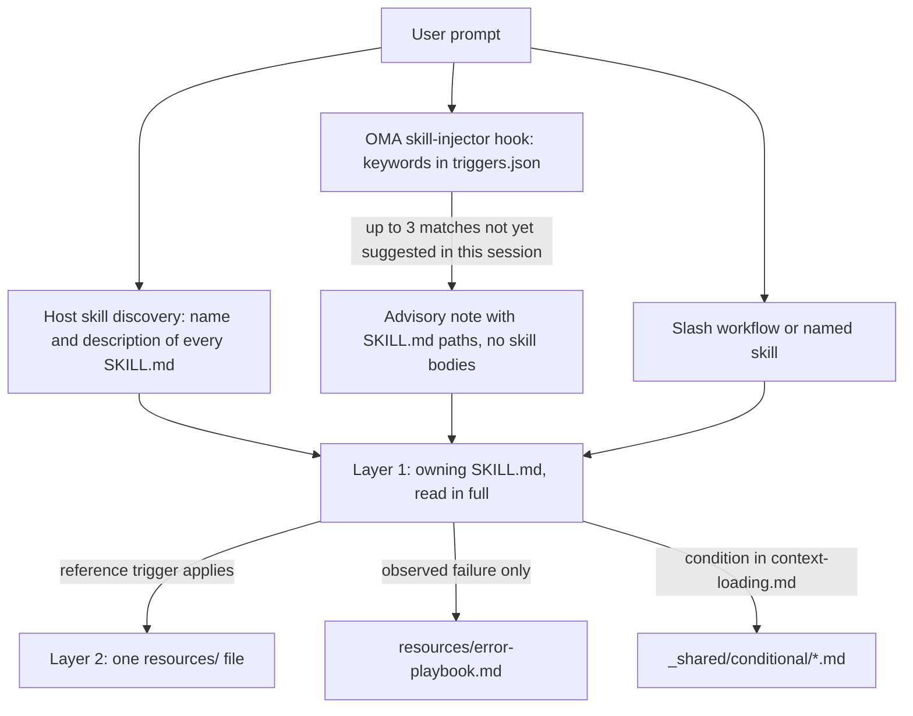
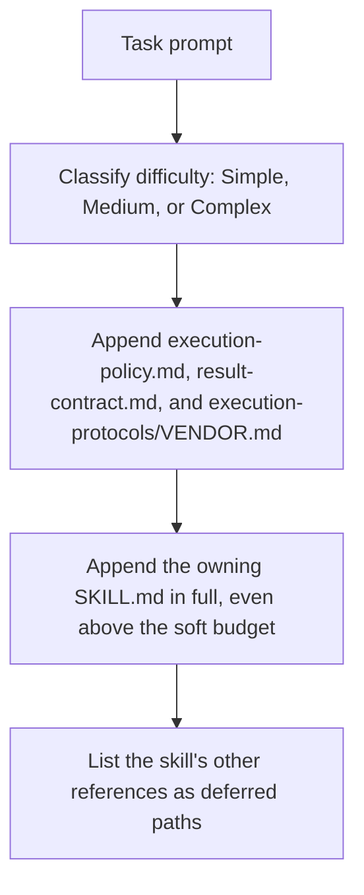

# Skills

[Skills](../getting-started/glossary.md#skill) are structured knowledge packages that give a dispatch role its domain guidance. They contain execution protocols, tech stack references, code templates, error playbooks, quality checklists, and examples where the skill supplies them, organized in a two-layer architecture designed for token efficiency. For the list of installed skills, see the [skill catalog](./agents.md#skill-catalog).

---

## The two-layer design

A skill reaches the context in stages. Selection puts only a path or a description in front of the model; the owning SKILL.md is read in full once the skill is chosen; supporting files are read one at a time when their trigger applies.



Sources: `.agents/hooks/core/skill-injector.ts`, `.agents/skills/_shared/core/skill-routing.md`, and `.agents/skills/_shared/core/context-loading.md`.

### Layer 1: SKILL.md (read when the skill is selected)

Every skill has a `SKILL.md` file at its root. The injector hook passes a **path reference**, not the body, so an unselected skill costs nothing beyond its `description`. Every `SKILL.md` has YAML frontmatter and the same four top-level sections; `oma skill lint` reports a skill that drops one or whose body exceeds 500 lines.

| Part | Contents |
|------|----------|
| Frontmatter | `name` and a routing `description` (what the skill does and when to use it) |
| `## Scheduling` | Goal, intent signature, when to use, when NOT to use, expected inputs and outputs, dependencies |
| `## Structural Flow` | Transitions, failure and recovery, exit states |
| `## Logical Operations` | Canonical command or workflow path, resource scope, guardrails |
| `## References` | Layer 2 files, each with the condition that justifies reading it |

Current `oma-frontend` frontmatter:

```yaml
---
name: oma-frontend
description: "Implement or modify web UI in React, Next.js, or Angular. Use for components, pages, styles, forms, and frontend state or data flows."
---
```

Host runtimes show the model each skill's `description`, so it is written as a routing sentence. OMA's keyword hook does not read it; its keywords live in `.agents/hooks/core/triggers.json`.

### Layer 2: resources/ (loaded on-demand)

The `resources/` directory contains deep execution knowledge. These files are loaded only when:
1. The host or workflow has selected the skill (for example, through a native skill match or an explicit command)
2. The current task meets the reference's loading condition

This on-demand loading is governed by the context-loading guide (`.agents/skills/_shared/core/context-loading.md`), which distinguishes entry instructions from task-selected references.

### What `oma agent spawn` injects

CLI dispatch assembles the subagent prompt itself, so the subagent starts with the contracts and the owning skill already in context:



Source: `cli/commands/agent/spawn-status.ts`, `cli/platform/agent-config/loaders.ts`, and `cli/platform/context-loader.ts`. Native subagents get the same task context from `oma agent context <agent-id>` and read the policy and result contract themselves if the runtime has not supplied them.

---

## File structure example

```text
.agents/skills/oma-frontend/
├── SKILL.md                          ← Layer 1: read when selected
└── resources/
    ├── execution-protocol.md         ← Layer 2: step-by-step workflow
    ├── tech-stack.md                 ← Layer 2: detailed technology specs
    ├── tailwind-rules.md             ← Layer 2: Tailwind conventions
    ├── angular-rules.md              ← Layer 2: Angular-specific conventions
    ├── snippets.md                   ← Layer 2: copy-paste code patterns
    ├── error-playbook.md             ← Layer 2: error recovery procedures
    └── checklist.md                  ← Layer 2: quality verification checklist

.agents/skills/oma-backend/
├── SKILL.md
├── resources/
│   ├── execution-protocol.md
│   ├── orm-reference.md              ← Domain-specific (ORM queries, N+1, transactions)
│   ├── checklist.md
│   └── error-playbook.md
└── variants/                          ← Starter seeds for /stack-set
    ├── stack.schema.json
    ├── node/
    ├── python/
    └── rust/

.agents/skills/oma-mobile/
├── SKILL.md
├── resources/
│   ├── execution-protocol.md
│   ├── tech-stack.md
│   ├── screen-template.dart
│   ├── screen-template.swift         ← Swift native iOS screen template
│   ├── screen-template.tsx            ← React Native screen template
│   ├── checklist.md
│   └── error-playbook.md
└── variants/                          ← Platform seeds for /stack-set
    ├── README.md
    ├── stack.schema.json
    ├── flutter/                       ← stack.yaml, tech-stack.md, snippets.md, api-template.dart
    ├── react-native/                  ← stack.yaml, tech-stack.md, snippets.md, api-template.ts
    └── swift-ios/                     ← stack.yaml, tech-stack.md, snippets.md, api-template.swift

.agents/skills/oma-design/
├── SKILL.md
├── resources/
│   ├── execution-protocol.md
│   ├── anti-patterns.md
│   ├── asset-strategy.md
│   ├── checklist.md
│   ├── design-md-spec.md
│   ├── design-tokens.md
│   ├── getdesign-fetcher.md
│   ├── prompt-enhancement.md
│   ├── redesign-protocol.md
│   ├── stitch-integration.md
│   └── error-playbook.md
└── reference/                         ← Deep reference material
    ├── typography.md
    ├── color-and-contrast.md
    ├── spatial-design.md
    ├── motion-design.md
    ├── responsive-design.md
    ├── component-patterns.md
    ├── accessibility.md
    ├── visual-hierarchy.md
    └── shader-and-3d.md
```

---

## Per-skill resource types

| Resource Type | Filename Pattern | Purpose | When Loaded |
|--------------|-----------------|---------|-------------|
| **Execution Protocol** | `execution-protocol.md` | Step-by-step workflow: Analyze -> Plan -> Implement -> Verify | Selected operation needs its command or contract details |
| **Tech Stack** | `tech-stack.md` | Detailed technology specs, versions, configuration | Selected framework or stack decision |
| **Error Playbook** | `error-playbook.md` | Symptom-to-recovery steps; missing information or authority pauses only the dependent action | Only after an observed failure |
| **Checklist** | `checklist.md` | Domain-specific quality verification | Relevant sections, for unresolved verification |
| **Snippets** | `snippets.md` | Copy-paste ready code patterns | Unfamiliar implementation or output shape |
| **Examples** | `examples.md` | Worked input/output examples (oma-pm, oma-db, oma-tf-infra, oma-observability, oma-search) | Unfamiliar implementation or output shape |
| **Variants** | `variants/` directory | Language/framework starter seeds. Backend ships `node`, `python`, and `rust`; mobile ships `flutter`, `react-native`, and `swift-ios`. `/stack-set` uses them to generate the project's `stack/`. | When a matching stack is being set up |
| **Templates** | `screen-template.{dart,swift,tsx}` (oma-mobile), `variants/*/api-template.*` | Boilerplate for a new screen or API module | Creating that file |
| **Domain Reference** | `orm-reference.md`, `anti-patterns.md`, etc. | Deep domain knowledge for specific subtasks | Task-type specific |

---

## Shared resources (_shared/)

All agents share common foundations from `.agents/skills/_shared/`. These are organized into three categories:

### Core resources (`.agents/skills/_shared/core/`)

| Resource | Purpose | When Loaded |
|----------|---------|-------------|
| **`execution-policy.md`** | Authorization, clarification, verification, and completion rules for every skill and workflow. | Injected into every `oma agent spawn` prompt; native agents read it if not supplied |
| **`skill-routing.md`** | Routes by task outcome, ownership, and actual dependencies; no compulsory agent chain or turn quota. | Referenced by orchestrator and coordination skills |
| **`context-loading.md`** | Owning entry, conditional references, and runtime loading boundaries. | When composing context |
| **`prompt-structure.md`** | Guides unfamiliar task handoffs with goal, context, real constraints, and acceptance evidence; no mandatory template for direct tasks. | When composing an unfamiliar handoff; not a mandatory preload |
| **`clarification-protocol.md`** | Resolves routine details from context and asks only for material missing information or authorization. | When requirements are ambiguous |
| **`code-intelligence.md`** | Use the configured code-intelligence capability for code search, navigation, and impact analysis. | Code search or navigation |
| **`test-approach.md`** | Per-task `test_approach` from the PM plan and the `TDD_EVIDENCE` block for `tdd` tasks. | Tasks whose plan sets `test_approach` |
| **`context-budget.md`** | File-size estimates, actual prompt measurement, scoped reads, and checkpoints. | Long tasks or context overhead diagnosis |
| **`difficulty-guide.md`** | Chooses planning depth and deliverables from dependencies and verification needs. | When decomposition needs a difficulty estimate |
| **`quality-principles.md`** | Scope, maintainability, evidence, and proportionate verification guidance. | At workflow start for quality-focused workflows (ultrawork) |
| **`vendor-detection.md`** | Resolves each agent's target vendor from configuration and chooses native dispatch or `oma agent spawn`. | When dispatch details are unresolved |
| **`session-metrics.md`** | Optional session evidence without conversational or evaluator penalty scores. | Requested retrospective or material correction |
| **`common-checklist.md`** | Applicable cross-domain checks; no global line-count limits or blanket catch requirement. | Cross-domain review when relevant |
| **`lessons-learned.md`** | Capture and apply evidence-backed lessons with version/trigger conditions; no automatic RCA threshold. | Referenced after errors and at session end |
| **`anti-ai-prose.md`** | Shared prose diagnostics. | Academic prose audits and translation style reviews |
| **`stack-verify.schema.json`** | Shared `verify:` definitions reused by the backend and mobile stack schemas. | Stack schema validation |
| **`api-contracts/`** | Optional contract template. Reuse project schemas; generated contracts live outside the skill source. | When cross-boundary work is planned |

### Runtime resources (`.agents/skills/_shared/runtime/`)

| Resource | Purpose |
|----------|---------|
| **`result-contract.md`** | Run identity, claim path, and completion contract for agent results. Injected into every `oma agent spawn` prompt; native agents follow it with `oma agent begin`, `oma agent verify`, and `oma agent finish`. |
| **`memory-protocol.md`** | Memory file format and operations for CLI subagents. Defines On Start, During Execution, and On Completion protocols using configurable memory tools (read/write/edit). Includes experiment tracking extension. |
| **`event-spec.md`** | Durable workflow event contract, appended to `events.jsonl` under the OMA home profile and inspected with `oma state get` or `oma state list`. |
| **`execution-protocols/claude.md`** | Claude Code-specific execution patterns. Injected by `oma agent spawn` when vendor is claude. |
| **`execution-protocols/antigravity.md`** | Antigravity CLI (`agy`) execution patterns. |
| **`execution-protocols/codex.md`** | Codex CLI-specific execution patterns. |
| **`execution-protocols/commandcode.md`** | CommandCode execution patterns. |
| **`execution-protocols/grok.md`** | Grok execution patterns. |
| **`execution-protocols/kimi.md`** | Kimi Code execution patterns. |
| **`execution-protocols/kiro.md`** | Kiro execution patterns. |
| **`execution-protocols/opencode.md`** | OpenCode extension execution patterns. |
| **`execution-protocols/pi.md`** | pi extension execution patterns. |
| **`execution-protocols/qwen.md`** | Qwen CLI-specific execution patterns. |

Vendor-specific execution protocols are injected automatically for CLI-spawned agents by `oma agent spawn`. Native subagents use the selected vendor's integration rules.

### Conditional resources (`.agents/skills/_shared/conditional/`)

These are loaded only when specific conditions are met during execution:

| Resource | Trigger Condition | Loaded By |
|----------|-------------------|-----------|
| **`quality-score.md`** | A defined baseline or experiment comparison is needed | Orchestrator (passes to QA agent prompt) |
| **`experiment-ledger.md`** | An actual hypothesis is compared with a baseline or another approach | Coordinator (maintains the shared ledger; parallel agents write task/run-scoped results for it to merge) |
| **`exploration-loop.md`** | Repeated recovery fails and alternatives merit testing within budget | Orchestrator (inline, before spawning hypothesis agents) |
| **`diagram-engine.md`** | A workflow is about to emit a structural diagram (architecture, sequence, data-flow, lifecycle) | The workflow emitting the diagram |

These resources are deferred until their individual triggers apply. Difficulty alone does not inject them.

---

## How a skill gets selected {#how-skills-route-via-skill-routingmd}

Three paths bring a skill into context. None of them starts a workflow or authorizes delegation on its own.

1. **Host-native discovery.** Runtimes with skill support list every skill's `name` and `description`; the model reads the SKILL.md whose description matches the requested outcome.
2. **OMA keyword hint.** Where OMA installs its prompt hook, `skill-injector` matches the prompt against multilingual keywords in `.agents/hooks/core/triggers.json` and adds an advisory `[OMA SKILLS DETECTED: ...]` note listing up to three SKILL.md paths. For "Build a login form with Tailwind CSS", only the `tailwind` keyword matches, so the note suggests `oma-frontend`.
3. **Explicit invocation.** A slash workflow such as `/plan`, `/review`, or `/debug`, or naming the skill in the prompt.

### Ownership by outcome

One owning skill handles a scoped task; add a handoff only when another skill supplies a distinct capability. This table mirrors `.agents/skills/_shared/core/skill-routing.md`. For other domains, select from the installed skill descriptions in the [skill catalog](./agents.md#skill-catalog).

| Requested outcome | Owning skill |
|-------------------|--------------|
| Application API, server auth, service/data access logic | oma-backend |
| Schema, migration design, indexing, query tuning, database operations | oma-db |
| Web components, pages, forms, client state | oma-frontend |
| Mobile screens, widgets, platform integration | oma-mobile |
| System boundaries, architecture tradeoffs, ADR | oma-architecture |
| Diagnose and fix incorrect behavior | oma-debug |
| Review correctness, security, accessibility, performance | oma-qa |
| Visual system, DESIGN.md, redesign direction | oma-design |
| Requested ideation or alternative exploration | oma-brainstorm |
| Requirements, dependencies, acceptance criteria | oma-pm |
| Requested parallel specialist execution | oma-orchestration |
| Requested manual multi-agent coordination | oma-coordination |
| Git branches, commits, merges, repository history | oma-scm |

### Dependencies between skills

There is no fixed execution chain. Order work by real dependencies:

- Resolve an unsettled architecture or product decision before work that depends on it. Existing decisions do not need to pass through architecture, brainstorming, or PM again.
- Backend and client work may proceed independently when their shared API contract is usable. If it is missing, settle that boundary with the relevant owners first.
- Review can start on a completed, reviewable portion while independent implementation continues. Do not review an unstable artifact as final evidence.
- A bug found during implementation can be fixed by its owner. Add debug assistance when diagnosis warrants it; there is no required implementation-to-debug chain.
- For a cross-domain defect, identify the failing contract and responsible owner from evidence. An API mismatch does not automatically mean the backend must change.

### When a skill hint does not appear

All of these behaviors come from `.agents/hooks/core/skill-injector.ts`.

| Symptom | Cause | What to do |
|---------|-------|------------|
| No `[OMA SKILLS DETECTED]` note at all | The prompt starts with `/`, a [persistent workflow](../getting-started/glossary.md#persistent-workflow) is active for the session, or the message is a relayed agent message | Expected: the workflow owns context. Name the skill if you need it |
| An expected skill is missing from the note | Only the top 3 matches are listed (10 points per matched keyword) | Use a more specific term or name the skill |
| A skill suggested earlier is not suggested again | A SKILL.md path is suggested once per session; the record in `.agents/state/skill-sessions.json` expires after an hour without new suggestions | The earlier suggestion still applies |
| A keyword is ignored | Text inside code fences, backticks, or double quotes is removed before matching | Mention the term in plain text |
| oma-academic-writing, oma-docs, oma-explanation, oma-scholar, or oma-skill-creation is never suggested | These skills have no keywords in `triggers.json` | Use `/docs` or `/explain`, or name the skill; host discovery still sees their descriptions |
| The hint names an unrelated skill | Matching is keyword-based and advisory | State the outcome you want; the note tells the model to apply judgement |

---

## Token savings math

Measure context cost before claiming savings. Two different things use the words simple, medium, and complex:

- **Script scenarios** (`routed`, `simple`, `medium`, `complex`, `all`) are cumulative file-size comparisons printed by `scripts/measure-skill-context.ts`. They are not loading policies, and `all` is only an upper bound.
- **Loader difficulty** (Simple, Medium, Complex) selects the soft budget for the context that CLI dispatch injects. See [Resource loading by task](#resource-loading-by-task).

```bash
bun scripts/measure-skill-context.ts
bun scripts/measure-skill-context.ts --skills oma-pm,oma-backend,oma-frontend --json
oma agent context backend --difficulty Medium
```

The script reports UTF-8 bytes / 4 estimates. `routed` is the entry alone; `simple`, `medium`, and `complex` add hypothetical protocol, example, and stack files for comparison. Their names are retained for script compatibility, not as preload instructions. A fresh checkout may use one platform seed as a size proxy; it does not load every platform.

The context command prints the actual task-context injection: a `## Task context (graph-selected, approximately N tokens)` header, the owning SKILL.md, and the list of deferred references. It does not include the rest of the conversation or every host/runtime instruction, and a spawned prompt is larger because `oma agent spawn` also adds the execution policy, result contract, and vendor protocol. Use an assembled prompt or usage telemetry to measure total input tokens, latency, and cost on a named model. Do not infer those from repository size or generated mirror counts.

## Resource loading by task

Every difficulty level starts with the owning skill. The graph is a reference index; adjacency does not authorize loading another specialist, an error playbook, or a conditional experiment workflow.

The loader uses soft budgets of 1,500 / 4,000 / 8,000 estimated tokens for Simple / Medium / Complex. An entry that exceeds the budget is retained and the overrun is reported. Supporting references remain deferred unless explicitly selected after their task trigger is resolved. A required entry is never replaced with smaller unrelated documents.

Verification follows the task's risk and project requirements. A difficulty label does not require a full test suite, a fixed preflight response, or a second approval of already authorized work.

## Context-loading task maps (per agent)

These are examples of references to consult when the task needs them. Use the owning skill's current index and select only applicable sections:

### Backend agent

<!-- oma-docs:ignore-start -->

| Task Type | Required Resources |
|-----------|-------------------|
| CRUD API creation | the project's `stack/snippets.md` and `stack/api-template.*` (generated by `/stack-set`) when present; otherwise existing project code |
| Authentication | `stack/snippets.md` + `stack/tech-stack.md` when present |
| DB migration | `stack/snippets.md` when present; schema design goes to oma-db |
| Performance optimization | `orm-reference.md` and any matching examples supplied by the skill |
| Existing code modification | project code-intelligence provider and relevant execution resources |

<!-- oma-docs:ignore-end -->

`variants/node`, `variants/python`, and `variants/rust` are starter seeds for `/stack-set`; agents do not read them for edits to existing code.

### Frontend agent

| Task Type | Required Resources |
|-----------|-------------------|
| Component creation | snippets.md + the project’s existing component patterns |
| Form implementation | snippets.md (form + Zod) |
| API integration | snippets.md (TanStack Query) |
| Styling | tailwind-rules.md |
| Page layout | snippets.md (grid) |

### Design agent

| Task Type | Required Resources |
|-----------|-------------------|
| Design system creation | reference/typography.md + reference/color-and-contrast.md + reference/spatial-design.md + design-md-spec.md |
| Landing page design | reference/component-patterns.md + reference/motion-design.md + prompt-enhancement.md |
| Design audit | checklist.md + anti-patterns.md |
| Design token export | design-tokens.md |
| 3D / shader effects | reference/shader-and-3d.md + reference/motion-design.md |
| Accessibility review | reference/accessibility.md + checklist.md |

### QA agent

| Task Type | Required Resources |
|-----------|-------------------|
| Security review | checklist.md (Security section) |
| Performance review | checklist.md (Performance section) |
| Accessibility review | checklist.md (Accessibility section) |
| Full audit | checklist.md (all sections), plus iso-quality.md when a standards-based review is requested |
| Defined metric comparison | quality-score.md (conditional) |

---

## Orchestrator prompt composition

When the orchestrator writes a subagent prompt (`oma-orchestration/resources/subagent-prompt-template.md`), it supplies only task data: agent role, task ID, workspace, allowed paths, task description, acceptance criteria, task references with their load conditions, and material constraints.

- For CLI dispatch, `oma agent spawn` already injects `execution-policy.md`, `result-contract.md`, the vendor execution protocol, and the owning SKILL.md, so the prompt does not repeat them.
- For native dispatch, pass the paths of those files and of the owning skill if the runtime has not supplied them.
- Add an error-playbook section only after an observed failure, and `runtime/memory-protocol.md` only when the agent coordinates or resumes durable task state.

This targeted composition avoids loading unnecessary resources, maximizing the subagent's available context for actual work.

---

## Session evidence and retrospective review

Session records capture material corrections, scope changes, rework, and adjudicated review findings with evidence. Necessary clarification carries no penalty. The former CD and EA weighted scores and threshold-triggered RCA rules have been removed; they were prompt instructions, not CLI-computed metrics.

Use existing task results where possible. A separate `session-metrics-{sessionId}.md` is optional under the configured coordination store. A repeated failure or requested retrospective may justify a lesson, but an ordinary failing check or a disputed finding does not automatically establish one. Keep historical logs; do not rewrite them into the new format.

`oma stats` reports productivity and recorded usage/cost summaries. `oma retro` groups actual gate, blocker, and missing-decision events into suggestions. Neither computes CD/EA scores from these Markdown artifacts.

## Task decomposition and context recovery

Plan around dependencies and independently verifiable behavior. Fixed sprint counts, file counts, and turn estimates do not determine review depth or completion. Keep tests and error handling with the behavior they verify.

For an observed stall or loss of useful context, save completed work, remaining criteria, relevant paths, and verification evidence before resuming or re-dispatching. Preserve existing work and avoid duplicating a live attempt. A turn/progress ratio alone does not require a reset.

## Conditional measurement and exploration

A defined baseline or experiment comparison activates measurement guidance; simply having tests or lint does not. Record comparable metrics with units, method, revision, and evidence. Required correctness and security checks remain independent. OMA has no default composite formula, letter-grade gate, or score-triggered rollback.

An actual experiment records its hypothesis, baseline and candidate evidence, required checks, decision, and owned files. Repeated failures may justify testing another mechanism within the existing recovery budget. Isolate experiment changes, preserve unrelated edits, and verify the integrated candidate before resuming the gate.

---

## Related

- [Agents](./agents.md): skill catalog, dispatch roles, definitions, and native agent files
- [Workflows](./workflows.md): slash workflows that read skills
- [Project structure](./project-structure.md): where `.agents/skills/` lives after install
- [Agent results and resume](../guide/agent-results-and-resume.md): the native `oma agent begin` → `oma agent finish` lifecycle
- [Skill evaluation](../guide/skill-eval.md) and [Skill optimization](../guide/skill-opt.md)
- Authoring: use the `oma-skill-creation` skill, then run `oma skill lint` and `oma skill audit`
