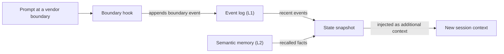

# Glossary

Each entry gives a short definition and links to the page that covers the term in depth. Where a word means different things in different parts of OMA, the entry says so.

## Building blocks

### Skill

A skill is a domain knowledge package in `.agents/skills/oma-<name>/`. Its `SKILL.md` enters the context when the skill is routed, and the files in `resources/` load only when the task needs them. A skill guides how an agent works in one domain; it does not define a multi-step process. See [Skills](../core-concepts/skills.md).

### Workflow

A workflow is a multi-step process defined in `.agents/workflows/<name>.md`. You start one with its slash command, such as `/plan` or `/orchestrate`; where the keyword-detection hook is enabled, a matching trigger phrase can also inject it. Workflows coordinate one or more skills and agents. See [Workflows](../core-concepts/workflows.md) and [Choosing a skill or workflow](../core-concepts/workflows.md#choosing-a-skill-or-workflow).

### Agent definition

An agent definition is a checked-in subagent file in `.agents/agents/`, such as `backend-engineer.md` or `qa-reviewer.md`. It sets the agent's identity, the skills it loads (`skills:` frontmatter), an execution-protocol section, and domain rules. OMA projects these files into vendor-native formats such as `.claude/agents/*.md` and `.codex/agents/*.toml`. The docs also use "agent" for a dispatch role (`backend`, `qa`, `explore`) and for a skill such as `oma-backend`. See [Agent definitions](../core-concepts/agents.md#agent-definitions).

## Presets

### Skill preset

A skill preset is the bundle of skills that the installer adds to a project, such as `all`, `fullstack`, `backend`, or `research`. The shared `_shared/` resources are installed with every preset. A skill preset does not affect which model runs an agent. See [Presets](./installation.md#presets).

### Model preset

The model preset is the `model_preset` value in `.agents/oma-config.yaml` (or `.cue`). It decides which vendor and model each agent uses. `auto`, the default for new installs, follows the current runtime's own agent and model settings; fixed presets such as `claude`, `codex`, or `mixed` pin them. `agents.<id>` overrides take priority over the preset, except under `free`, where `free.model` replaces per-agent model pins. See [Built-in presets](../guide/per-agent-models.md#built-in-presets).

## Workflow execution

### Persistent workflow

A persistent workflow keeps running across turns until its work is done or you deactivate it. The persistent workflows are `/orchestrate`, `/work`, `/ultrawork`, and `/ralph`, and only an explicit invocation activates persistent mode. While one is active, a hook re-injects `[OMA PERSISTENT MODE: ...]` on each prompt, and the Stop hook blocks the session from ending until a reinforcement limit or staleness timeout is reached. Say `workflow done` to deactivate it. See [Persistent mode mechanics](../core-concepts/workflows.md#persistent-mode-mechanics).

### Stop gate

A stop gate is an optional completion check that you attach to an active persistent workflow with `oma goal set --gate typecheck|test|lint`. The Stop hook then allows the workflow to end only when the `package.json` script of that name passes. Gate failures count toward the reinforcement limit, so a failing gate cannot block stops forever. See [`goal set`](../cli-interfaces/commands.md#goal-set).

## Sessions and state

"Session" has two meanings in OMA: the session OMA tracks itself, and the conversation session of the AI CLI or IDE you are using. Keep them apart when you read state files or command options.

### OMA session

An OMA session is work that OMA tracks under its own session ID, independent of any vendor conversation. Orchestration uses the ID to name the plan, the task board, progress and result files, and agent run records; the orchestrator generates it as `session-YYYYMMDD-HHMMSS`. Workflow state uses an OMA session ID (`sid`) to key the [event log](#event-log), which `oma state list` and `oma state get <sid>` inspect. See [Session ID strategy](../guide/multi-agent-project.md#session-id-strategy).

### Vendor session ID

A vendor session ID is the conversation ID that the AI CLI or IDE assigns, such as a Claude Code or Codex session ID. OMA records it as `vendorSid` on events, and persistent-mode state files are keyed by it (`.agents/state/<workflow>-state-<vendor-session-id>.json`). When an OMA session is active and a prompt arrives from a different vendor session, a different vendor, or a session that was just compacted, a hook records a `boundary` event and injects a state snapshot so work continues in the new context. See [`state`](../cli-interfaces/commands.md#state).

If semantic memory is unavailable, the snapshot uses the local events only.

### Event log

The event log is the append-only record of an OMA session, stored as `events.jsonl` under `${OMA_STATE_HOME:-~/.oma}/u/<profile>/sessions/<sid>/`. Each line is one event, such as `session.created`, `workflow.phase`, `gate.passed`, `decision.made`, or `session.ended`. Workflows append required decisions with `oma state emit` and check them with `oma state verify`; read the log with `oma state get` or `oma state trajectory` rather than opening the file. See [`state`](../cli-interfaces/commands.md#state).

## Review and evidence

### Judge

"Judge" has two meanings. In `/ralph`, the judge is the phase after each ultrawork iteration that checks every completion criterion against the actual project state and records PASS, FAIL, REGRESSED, or BLOCKED. A separately spawned agent with fresh context runs it, so the orchestrator does not grade its own work. In skill evaluation and optimization, `judge` is the default checker type: a model grades an arm's output against a rubric and returns PASS or FAIL. See [/ralph](../core-concepts/workflows.md#ralph) and [the judge checker](../guide/skill-eval.md#judge-default).

### Cross-context review (CCR)

Cross-context review is the rule that each review step in `/ultrawork` runs in a fresh, context-isolated reviewer subagent. The reviewer receives only the artifacts under review, referenced by path (diff, changed files, plan, prior results, test output), plus that one review's guide; it never sees the main session's history or the implementer's reasoning. Each reviewer writes a structured verdict that the phase coordinator collects. See [/ultrawork](../core-concepts/workflows.md#ultrawork).

### Charter

The charter is the `CHARTER_CHECK` preflight block that implementation agents used to write before any code. Current agent definitions require no fixed preflight output. Agents follow the shared execution policy instead: they state material assumptions, ask only when missing information changes correctness or scope, and pause only the work that depends on the answer. A spawned subagent cannot ask you directly, so it reports the missing fact in a `blocked` or `partial` result. See [Authorization and clarification](../core-concepts/agents.md#charter-preflight-charter_check).

### Run record and claim

A run record is the machine-readable receipt for one agent attempt, stored in the profile's per-project state directory, `~/.oma/u/<profile>/projects/<project-hash>/agent-runs/` (older versions used `.agents/state/agent-runs/`); `oma agent begin` creates it and snapshots the task contract. The claim is the agent's own report at the matching `.claim.json` path, with a status of `completed`, `partial`, `blocked`, or `failed`, plus changed files, unresolved work, and artifacts. `oma agent finish` checks the claim against the current contract, verification receipts, and artifact hashes, so a claim with stale evidence does not stay completed. See [Agent results and resume](../guide/agent-results-and-resume.md).

## Memory and providers

### L1 and L2 memory

L1 is the [event log](#event-log): local, append-only workflow state that `oma state verify` and the boundary snapshot read. L2 is semantic memory, recalled facts served by the selected `providers.semantic_memory` provider: `agentmemory` (the default), `honcho`, or `none`. Required decisions live in L1, so they survive session boundaries without L2. "L1" and "L2" also mean other things: Layer 1 and Layer 2 of a skill are its `SKILL.md` and its on-demand `resources/` directory, and `oma docs verify` reports "L2 references", which are the file, URL, CLI, script, environment, and config references it extracts from documentation. See [`memory`](../cli-interfaces/commands.md#memory) and [Honcho semantic memory](../guide/configuration-reference.md#honcho-semantic-memory).

### Capability provider

A capability provider is the external tool or service OMA uses for one capability, selected under `providers` in `.agents/oma-config.yaml`. The capabilities are documentation (`docs`, default `context7`), web search (`web`, default `native`), code intelligence (`code_intelligence`, default `serena`), and semantic memory (`semantic_memory`, default `agentmemory`). Run `oma link` after changing a provider. See [Top-level keys](../guide/configuration-reference.md#top-level-keys) and [Important Defaults](./important-defaults.md).

## Plans and source files

### Plan

A plan is the machine-readable task breakdown at `.agents/results/plan-<sessionId>.json`, written by `/plan` and consumed by `/orchestrate` and `/work`; `/orchestrate` creates one when no usable plan exists. Each task names its agent, workspace, dependencies, acceptance criteria, and required checks, and run records snapshot this contract. It is unrelated to the per-agent model resolution that `oma doctor --profile` shows, which some pages call an inherited plan. See [/plan](../core-concepts/workflows.md#plan) and [Start a native run](../guide/agent-results-and-resume.md#start-a-native-run).

### SSOT

The single source of truth (SSOT) is the `.agents/` directory: `<project>/.agents/` for a project install, or `~/.oma/.agents/` for a global install. Skills, workflows, agent definitions, rules, and configuration live there, and `oma install`, `oma update`, and `oma link` generate the vendor-native files (`.claude/`, `.codex/`, and others) from it. Edit `.agents/` and run `oma link` instead of editing the generated files. Some pages use SSOT for a narrower source, such as the scheduled-agents manifest. See [.agents/: the Source of Truth](../core-concepts/project-structure.md#agents-the-source-of-truth).
