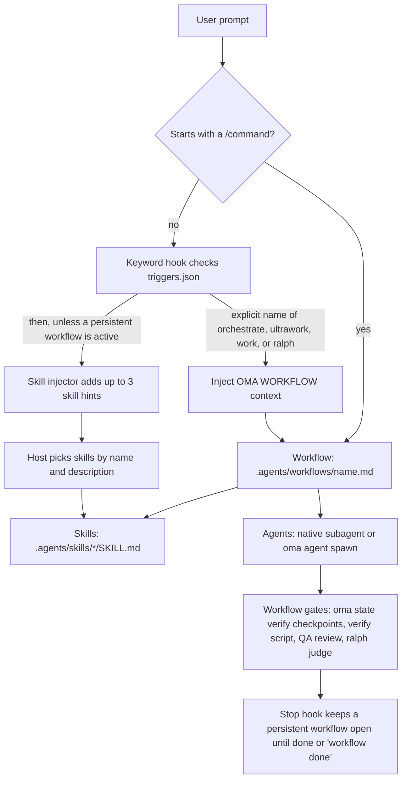

# Introduction

oh-my-agent is a multi-agent orchestration framework for AI-powered IDEs and CLI tools. Instead of relying on a single AI assistant for everything, oh-my-agent routes work across 33 skill packages and 13 canonical dispatch roles. Twelve checked-in subagent definition files provide the reusable implementation, review, planning, debugging, documentation, research, and infrastructure personas. `research-explorer.md` maps to the canonical `explore` role; `orchestrator` is a runtime coordination role without a separate definition file.

OMA provides mechanical checks when you invoke them or select a workflow that includes them. `oma verify agent <agent-type>` runs the checks for the selected agent type; `/ralph` adds artifact-backed verification and a [judge](./glossary.md#judge) loop; enabled vendor Stop hooks (the [stop gate](./glossary.md#stop-gate)) can keep a workflow open while its configured checks run. Skill loading alone does not establish acceptance, and a plain prompt does not automatically run every workflow gate. Use the workflow's acceptance criteria and the resulting files to decide what is complete.

The entire system lives in a portable `.agents/` directory inside your project. Switch between Claude Code, Codex CLI, Antigravity CLI or IDE, Cursor, OpenCode, and other supported tools, and your agent configuration travels with your code.

Start with [Choose a setup](./choose-setup.md): load one skill for a task in your current agent, select a runtime skill preset for hooks and workflows, or install the Claude Code plugin. Temporary skill loading provides instructions and support files; CLI, project-rule, and external-service dependencies remain explicit. Runtime installation creates the [SSOT](./glossary.md#ssot) and vendor integrations.

Use [Quick Start](./quick-start.md) for a first task and its observed checks. `oma doctor` checks a runtime installation; [Important Defaults](./important-defaults.md) explains its providers and configuration. Move to `/work` or `/orchestrate` when coordination is needed and their referenced skills are installed.

---

## The multi-agent paradigm

Traditional AI coding assistants often handle frontend, backend, database, security, and infrastructure from one prompt context. That can lead to:

- **Context dilution**: loading knowledge for every domain wastes the context window
- **Unclear ownership**: a cross-domain task has no explicit boundary for each part
- **Manual coordination**: complex features spanning multiple domains need handoffs chosen by the host or user

OMA assigns domains to skills and routes task work to agents:

1. **Each skill has a primary domain.** The frontend skill knows React/Next.js, shadcn/ui, TailwindCSS v4, FSD-lite architecture. The backend skill knows the Repository-Service-Router pattern, parameterized queries, and JWT authentication. Domains can overlap at boundaries, so use the task's acceptance criteria to decide when a second skill or a coordinating workflow is needed.

2. **Agents can run in parallel.** While a backend agent builds an API, a frontend agent can work in its own workspace. The orchestrator coordinates through durable, run-scoped files and receipts.

3. **Quality guidance is built in.** Skills carry domain checklists, error playbooks, and [charter](./glossary.md#charter) rules. Charter preflight narrows scope before code is written; QA review runs when the selected workflow includes it or when you request it.

---

## The current catalog: 33 skills, 12 definitions, 20 workflows

The catalog separates three things that are easy to confuse:

- **[Skills](./glossary.md#skill)** are the 33 domain knowledge packages under `.agents/skills/*/SKILL.md`. They route from natural-language intent and load their resources progressively.
- **[Agent definitions](./glossary.md#agent-definition)** are the 12 files under `.agents/agents/`. They provide vendor-native subagent personas and reference one or more skills.
- **[Workflows](./glossary.md#workflow)** are the 20 process definitions under `.agents/workflows/`. Four are [persistent](./glossary.md#persistent-workflow) (`orchestrate`, `work`, `ultrawork`, and `ralph`); the rest run to a report and do not keep persistent mode active.

The sections below preserve the detailed skill catalog. When a name or description changes, the live `SKILL.md` frontmatter is authoritative.

The 12 checked-in definition files cover the 13 runtime roles through aliases: `research-explorer.md` maps to `explore`, while `orchestrator` is runtime-only. The other definition files map to the named roles listed in [Agents](../core-concepts/agents.md).

### Ideation, architecture, and planning

| Agent | Role | Key Capabilities |
|-------|------|-----------------|
| **oma-brainstorm** | Design-first ideation | Explores user intent, proposes 2-3 approaches with trade-off analysis, produces design documents before any code is written. The `/brainstorm` workflow runs 7 steps: Context, Questions, Approaches, Design, Blind Review, Documentation (`docs/decisions/`), Transition to `/plan`. |
| **oma-architecture** | System architecture specialist | Module/service/ownership boundaries, tradeoff analysis, stakeholder synthesis. Methodologies: diagnostic routing, design-twice comparison, ATAM-style risk analysis, CBAM-style prioritization, ADR-style decision records. Cost-aware by default. |
| **oma-pm** | Product manager | Decomposes requirements into prioritized tasks with dependencies. Defines API contracts. Outputs `.agents/results/plan-{sessionId}.json` as the orchestrator handoff; the orchestrator creates and owns the task board. Supports ISO 21500 concepts, ISO 31000 risk framing, ISO 38500 governance. |

### Implementation

| Agent | Role | Tech Stack & Resources |
|-------|------|----------------------|
| **oma-frontend** | UI/UX specialist | React, Next.js, TypeScript, TailwindCSS v4, shadcn/ui, FSD-lite architecture. Libraries: luxon (dates), ahooks or @mantine/hooks (hooks), es-toolkit (utils), Jotai/Zustand (client state), TanStack Query via orval-generated hooks (server state), @tanstack/react-form + Zod (forms), better-auth (auth), nuqs (URL state). Resources: `execution-protocol.md`, `tech-stack.md`, `tailwind-rules.md`, `snippets.md`, `angular-rules.md`, `error-playbook.md`, `checklist.md`. |
| **oma-backend** | API & server specialist | Clean architecture (Router-Service-Repository-Models). Stack-agnostic; detects Python/Node.js/Rust/Go/Java/Elixir/Ruby/.NET from project manifests. JWT + Argon2id for auth. Shipped presets: Python (Litestar with SQLAlchemy 2 (async) through Advanced Alchemy, msgspec models, built-in JWT auth), Node.js (NestJS + Prisma, tested with Vitest), and Rust (Axum + SQLx); a project installed with the earlier FastAPI preset keeps FastAPI. Resources: `execution-protocol.md`, `orm-reference.md`, `checklist.md`, `error-playbook.md`, plus the stack reference (`stack/` when present, otherwise the matching `variants/<language>/`). Supports `/stack-set` for generating language-specific `stack/` references. |
| **oma-mobile** | Cross-platform mobile | Flutter, Dart, Riverpod/Bloc for state management, Dio with interceptors for API calls, GoRouter for navigation. Clean architecture: domain-data-presentation. Material Design 3 (Android) + iOS HIG. 60fps target. Also supports React Native, Swift native iOS (SwiftUI + `@Observable` on iOS 17+, Apple `swift-openapi-generator` for API clients, `App/Core/Features/Shared` project layout), and Kotlin native Android (Jetpack Compose, Hilt, generated `*Api` clients over Ktor). Resources: `execution-protocol.md`, `tech-stack.md`, `checklist.md`, `error-playbook.md`; each platform's `stack.yaml`, `tech-stack.md`, and `snippets.md` (screen, state, data-layer, and API patterns) live in `variants/<platform>/`. The skill reads `stack/` when `/stack-set` has generated it and the matching variant otherwise. |
| **oma-db** | Database architecture | SQL, NoSQL, and vector database modeling. Schema design (3NF default), normalization, indexing, transactions, capacity planning, backup strategy. Supports ISO 27001/27002/22301-aware design. Resources: `execution-protocol.md`, `document-templates.md`, `anti-patterns.md`, `vector-db.md`, `migration-playbook.md`, `query-tuning.md`, `iso-controls.md`, `checklist.md`, `error-playbook.md`, `examples.md`. |

### Design

| Agent | Role | Key Capabilities |
|-------|------|-----------------|
| **oma-design** | Visual system and design direction | Defines or reviews a visual system, `DESIGN.md`, or a redesign direction: typography, layout, color, motion, and interaction decisions. Resolves the project's design intent and loads one external design skill per operation (Interface Design for product interfaces, Impeccable for critique, audit, and polish, Taste for other web art direction); documentation-only and token-contract tasks stay local. Keeps the existing brand, stack, and CJK font coverage, with WCAG AA as the default accessibility target. Asks only about a material unresolved choice and presents alternative directions only when one is open. Writes no implementation code; hands off to `oma-frontend` or `oma-mobile`. Optional Stitch and getdesign inputs. Resources: `execution-protocol.md`, `external-design-skills.md`, `product-interface-review.md`, `redesign-protocol.md`, `design-md-spec.md`, `design-tokens.md`, `data-grid.md`, `asset-strategy.md`, `getdesign-fetcher.md`, `stitch-integration.md`, `checklist.md`, `error-playbook.md`. |

### Infrastructure, DevOps, and observability

| Agent | Role | Key Capabilities |
|-------|------|-----------------|
| **oma-tf-infra** | Infrastructure-as-code | Multi-cloud Terraform (AWS, GCP, Azure, Oracle Cloud). OIDC-first auth, least privilege IAM, policy-as-code (OPA/Sentinel), cost optimization. Supports ISO/IEC 42001 AI controls, ISO 22301 continuity, ISO/IEC/IEEE 42010 architecture documentation. Resources: `multi-cloud-examples.md`, `cost-optimization.md`, `policy-testing-examples.md`, `iso-42001-infra.md`, `checklist.md`. |
| **oma-dev-workflow** | Monorepo task automation | mise task runner, CI/CD pipelines, database migrations, release coordination, git hooks, pre-commit validation. Also configures language-specific lint, format, and typecheck tools and commitlint. Resources: `mise-basics.md`, `tooling-profiles.md`, `validation-pipeline.md`, `example-task-wiring.md` (migrations, API client generation, i18n builds), `release-coordination.md`, `troubleshooting.md`. |
| **oma-observability** | Intent-based observability router | MELT+P signal coverage (metrics/logs/traces/profiles/cost/audit/privacy), transport tuning (UDP/MTU, OTLP gRPC vs HTTP, Collector topology, sampling), W3C Trace Context propagation, SLO management and burn-rate alerts, incident forensics (6-dimension localization), meta-observability (self-health, clock sync, cardinality, retention). Resources load on their triggers; Fluentd, Fluent Bit, or the OTel Collector is selected from workload, plugin, and operational requirements. |

### Quality and debugging

| Agent | Role | Key Capabilities |
|-------|------|-----------------|
| **oma-qa** | Quality assurance | Security audit (OWASP Top 10), performance analysis, accessibility (WCAG 2.2 AA), code quality review. Severity: CRITICAL/HIGH/MEDIUM/LOW with file:line and remediation code. Supports ISO/IEC 25010 quality characteristics and ISO/IEC 29119 test alignment. Scanner-driven scans and penetration tests belong to `oma-security`. Resources: `execution-protocol.md`, `iso-quality.md`, `checklist.md`, `error-playbook.md`. |
| **oma-debug** | Bug diagnosis and fixing | Reproduce-first methodology. Root cause analysis, minimal fixes, mandatory regression tests, similar pattern scanning. Uses code-intelligence MCP tools (Gortex or Serena) for symbol tracing. Resources: `execution-protocol.md`, `checklist.md`, `debugging-checklist.md` (condensed bug report, tools reference, handoff routing), `bug-report-template.md` (Complex or CRITICAL/HIGH bugs), `error-playbook.md`. |
| **oma-refactor** | Behavior-preserving refactoring | Safe incremental restructuring gated by characterization-test safety nets. Hotspot targeting (complexity × churn), code-smell/SATD selection, Mikado-method revert on failure, expand-contract for stateful change, refactor-only commits (no behavior change mixed in). Engine-first transforms (IDE rename, jscodeshift/ast-grep), metrics via `uvx lizard` / `uvx radon`. Readability is the success criterion; metrics are proxies. |

### Localization, coordination, and git

| Agent | Role | Key Capabilities |
|-------|------|-----------------|
| **oma-translation** | Context-aware translation | The translation method has four steps: read meaning and protected syntax, choose register, reconstruct in the target language, and preserve author style where it belongs. Per-target language profiles (`resources/lang/{code}.md`) carry register and typography rules. Resources: `translation-rubric.md`, `anti-ai-patterns.md`, `style-skills.md`, `lang/{ko,ja,zh,en}.md`. |
| **oma-orchestration** | Automated multi-agent coordinator | Spawns CLI subagents in parallel, coordinates through durable session, task-board, progress, and result files, and monitors verification loops. Defaults: MAX_PARALLEL 3 and MAX_RECOVERY_ATTEMPTS 3 (retries and exploration hypotheses per task, including the original attempt); progress polling uses bounded backoff and only when completion notifications are unavailable. Selects per-task skill references and records them as coordinator notes. Includes agent-to-agent review loop and optional session evidence. Resources: `subagent-prompt-template.md`, `memory-schema.md`. |
| **oma-scm** | Software configuration management (SCM) + Git | Handles branching strategies, merge/rebase/conflict workflows, worktrees, baselines, and release-state tracking. Also guides Conventional Commit messages with safe staging; co-author trailers come from effective `scm.co_author` configuration when enabled. |
| **oma-coordination** | Shared coordination rules | Coordination rules for multi-agent work: plan reuse, contract alignment, workspace ownership, and QA handoff. Loaded by the `/work`, `/orchestrate`, and `/ultrawork` workflows, and also usable for manual step-by-step coordination with `oma agent spawn`: reuse or create the plan, spawn same-priority tasks in separate workspaces, monitor run-scoped progress/result files, align API/data contracts before frontend/mobile work, and end with QA review. `oma-orchestration` owns automated execution. |

### Search, retrospective, and document processing

| Agent | Role | Key Capabilities |
|-------|------|-----------------|
| **oma-search** | Search router for external sources | Selects one primary route per request: `docs` (Context7, official-site discovery when needed), `web` (the configured `native`, `brave`, or `exa` provider), `code` (`oma search code` over `gh`/`glab`), or `fetch` (a known URL). Returns sources with the route, actual provider, content-read status, supporting evidence, and limitations; it does not assign numeric trust scores. Another route is added only when an evidence gap needs it, and a failed explicit provider is reported, not silently replaced. Flags: `--docs`, `--code`, `--web`, `--strict`, `--wide`, `--gitlab`. Local code navigation uses the configured code tools. |
| **oma-recap** | Cross-tool work retrospective | Analyzes conversation histories from Grok, Claude, Codex, Gemini, Qwen, Cursor, and Antigravity. Resolves natural-language date/window input, groups by work content (by project for windows of 3 days or more), extracts themes, renders daily/period summaries, and records when the CLI caps a requested window at 30 days. |
| **oma-hwp** | HWP/HWPX/HWPML → Markdown | Korean word-processor document conversion via `bunx kordoc@latest`. Preserves headings, tables (incl. nested), footnotes, hyperlinks, images. Strips Hancom Private Use Area characters via `flatten-tables.ts` post-processor. |
| **oma-pdf** | PDF → Markdown | PDF document conversion via `uvx opendataloader-pdf`. Preserves headings, tables, lists, images; OCR hybrid mode for scanned PDFs; output normalized with `uvx mdformat`. |

### Academic and research writing

| Agent | Role | Key Capabilities |
|-------|------|-----------------|
| **oma-academic-writing** | Publication-grade English prose | Drafts, revises, and audits essays, reports, abstracts, executive summaries, conclusions, and literature reviews. Applies sentence-structure guidance (rhythm, openers, paragraph cohesion), verb guidance (`academic-verb-guide.md`: exact meaning and evidence strength), hedging matched to evidence, and the anti-AI prose audit. Quotes supplied rubric constraints before judging, and uses a Claim-Evidence Map and reverse outlining. Modes: `draft` / `revise` / `review`. |
| **oma-scholar** | Research paper sidecar companion | Searches, generates, validates, reviews, and compares scholarly papers via the Knows `.knows.yaml` sidecar spec (v0.9.0 / `paper@1`). Token-efficient claim/evidence/relation access (~700 tokens for claims-only vs ~10K full PDF). `oma scholar search/resolve/get/lint` over knows.academy with an OpenAlex and Semantic Scholar fallback for papers knows.academy does not have. Anti-fabrication: omits unknown fields rather than guessing. |

### Security

| Agent | Role | Key Capabilities |
|-------|------|-----------------|
| **oma-security** | Security scanning and validation | Scans application source, agent skills, and MCP components, validates findings, and configures scan gates. Default engines by target: Deepsec for application source or diffs, Cisco Skill Scanner for agent skill packages, and Cisco MCP Scanner for MCP components. Runtime penetration testing has no default engine: a penetration test of a scoped web test deployment runs only on an explicit ARTEX request, on a user-supplied, reviewed ARTEX platform. Use `oma-qa` for broad quality reviews and domain skills for remediation. |

### Documentation and meta-tooling

| Agent | Role | Key Capabilities |
|-------|------|-----------------|
| **oma-docs** | Documentation drift detector | `verify` mode deterministically checks `docs/**/*.md` for broken refs (file paths, CLI commands, config keys, env vars, scripts) and exits 0/1; `sync` mode correlates a git diff to candidate docs and drafts host-LLM patch proposals confirmed per-doc (never auto-applies). URL checking delegated to `lychee`; CLI emits structured JSON, host LLM does all synthesis (no vendor SDK calls). Never modifies `.agents/`. |
| **oma-skill-creation** | SSL-lite skill authoring specialist | Creates, updates, and audits OMA skills in the SSL-lite format with the four mandatory sections (Scheduling / Structural Flow / Logical Operations / References). Classifies skill type, inserts exactly one inline canonical path, enforces `When NOT to use` cross-routes, and runs `oma skill audit` to catch description collisions (warn ≥ 60%, fail ≥ 75% TF-IDF cosine). Pushes long variant detail into `resources/`. |
| **oma-explanation** | Change and topic explainer | Turns a diff, PR, branch, or commit range into a self-contained offline HTML explainer with Background, Intuition, Code, and Quiz sections, or explains a topic as a one-page visual sheet. The model writes a draft, `oma explain render` writes the page under `.agents/results/explain/`, `oma explain validate` checks it, and `oma explain render --open` opens it. |

### Market research

| Agent | Role | Key Capabilities |
|-------|------|-----------------|
| **oma-market** | Community signal intelligence | Runs the upstream `last30days` engine (Reddit with real upvotes and comments, X, YouTube transcripts, TikTok, HN, Polymarket, GitHub, arXiv, Techmeme, Bluesky, web and more) through `oma market run`; the engine is a skills-CLI install (`oma market update`), and oma gates every run with `detect-trap`, classifies intent (pain / trend / competitor / discovery), and appends SWOT / Porter's 5F / PESTEL sections. Emits one LAW-compliant brief at `.agents/results/market/{slug}-{YYYYMMDD}.md`. |

### Media and content generation

| Agent | Role | Key Capabilities |
|-------|------|-----------------|
| **oma-image** | Multi-vendor image router | Authentication-aware parallel dispatch to Codex (`gpt-image-2` via ChatGPT OAuth, CLI-first), Antigravity Gemini-family “nano-banana” models via the `agy` CLI + Gemini Code Assist (the exact model is selected internally), and Pollinations (free `flux`/`zimage`). Resolves the brief from supplied details and reasonable defaults and asks only about a material missing choice, up to 10 reference images, cost guardrail (confirm at ≥ $0.20), `manifest.json` for reproducibility. Settings live under `image:` in `.agents/oma-config.yaml`. CLI: `oma image generate`, `oma image doctor`, and `oma image vendor list`. |
| **oma-slide** | Animation-rich HTML deck generator | Generates distinctive, anti-"AI slop" presentation decks authored at a fixed 1920×1080 stage, then deterministically validates geometry, bundles to single-file HTML, and exports to PDF/PNG/PPTX via the `oma slide` CLI. Style presets + bold templates, CJK→Pretendard rule, `prefers-reduced-motion` + visible focus required, max-3 auto-fix validate loop. Delegates imagery to `oma-image`; optional Canva MCP export/import. CLI: `oma slide create`, `oma slide style get`, `oma slide asset fetch-video`, `oma slide validate`, `oma slide bundle`, `oma slide export pdf|png|pptx`. |
| **oma-video** | Short-form, explainer & demo router | Creates shorts/reels (9:16), explainers (16:9), and human-recorded demos (16:9) through the `oma video` CLI. The deterministic asset bus (`script.json` → `timing.json` → `render-spec.json`) feeds a managed HyperFrames compositor; asset providers may use local fallbacks, while missing composition/toolchain or render errors fail the run. Stock and AIGC visuals are reached with `--visual stock|aigc`; a slide visual needs `visual.ref` pointing at an existing deck. A demo needs `--polish` to produce a masked, deliverable video; without it the output is the raw capture. Human capture never automates credentials. Settings live under `video:` in `.agents/oma-config.yaml`. |
| **oma-voice** | Local-first TTS and STT | Drives the Voicebox MCP server for on-device notifications, asset TTS, and transcription without cloud calls or per-call cost. TTS defaults to WAV and can be locally transcoded to MP3; transcription accepts audio paths or base64. TTS calls cap at 5000 characters and STT inputs at 30 minutes; persisted asset/transcription runs write a manifest. |

---

## Progressive disclosure model

oh-my-agent uses a two-layer skill architecture to prevent context window exhaustion:

**Layer 1: SKILL.md (loaded when the skill is routed)**
Contains the agent's identity, routing conditions, core rules, and "when to use / when NOT to use" guidance. This is all that is loaded when the agent is not actively working.

**Layer 2: resources/ (loaded on-demand)**
Contains execution protocols, tech stack references, code snippets, error playbooks, checklists, and examples. These are loaded only when the agent is invoked for a task, and even then, only the resources relevant to the specific task type are loaded (based on the difficulty assessment and task-resource mapping in `context-loading.md`).

How much context this saves depends on the skills and the task, so measure it instead of assuming a figure. See [token savings math](../core-concepts/skills.md#token-savings-math) for the script and what its estimates cover.

---

## .agents/: the single Source of Truth (SSOT)

Everything oh-my-agent needs lives in the `.agents/` directory:

```text
.agents/
├── oma-config.yaml   # Shared preferences and provider/model settings
├── oma-config.cue    # Optional schema-backed configuration
├── mcp.json          # MCP server configuration
├── skills/           # 33 skill directories + _shared resources
│   ├── _shared/      # Core resources used by all agents
│   └── oma-{skill}/  # Per-skill SKILL.md + resources/variants
├── workflows/        # 20 workflow definitions
├── agents/           # 12 subagent definitions
├── hooks/            # Hook sources, including core/triggers.json
├── rules/            # Project rules projected into vendor files
├── results/          # Plans (plan-{sessionId}.json) and agent results
└── state/            # Active workflow state files
```

The `.claude/` directory exists only as an IDE integration layer. It contains symlinks pointing back to `.agents/`, plus hooks for keyword detection and the HUD statusline. The `.agents/state/memories/` directory holds runtime coordination state during orchestration sessions (older projects fall back to the legacy `.serena/memories/` path).

This architecture means your agent configuration is:
- **Portable**: switch IDEs without reconfiguring
- **Version-controlled**: commit `.agents/` alongside your code
- **Shareable**: team members get the same agent setup

---

## Supported IDEs and CLI tools

oh-my-agent works with the selected AI-powered IDEs and CLIs through their native skill/prompt loading or generated integration files:

| Tool | Integration Method | Parallel Agents |
|------|-------------------|----------------|
| **Claude Code** | Native skills + Agent tool | Agent tool for true parallelism |
| **Antigravity CLI/IDE** | Skills and MCP settings projected for `agy` | `oma agent spawn` |
| **Codex CLI** | Skills auto-loaded | Model-mediated parallel requests |
| **Cursor** | Skills via `.cursor/` integration | `@agent-name` + `oma agent spawn` |
| **OpenCode** | Skills + in-process plugin bridge + generated subagents (`.opencode/agents/`) | `oma agent spawn --vendor opencode` |
| **Kimi Code CLI** | Hooks + skills in `~/.kimi-code/` (consent-gated HOME write; also reads SSOT `.agents/skills/` natively); project-scoped Serena MCP | `oma agent spawn --vendor kimi` |

Agent spawning adapts to each selected vendor through vendor detection and the active configuration. Same-vendor runtimes may use native subagents; cross-vendor work falls back to `oma agent spawn`. See [Parallel Execution](../core-concepts/parallel-execution.md) for the dispatch rules.

---

## How a request flows

The keyword hook, skill injector, and Stop hook run only on hosts whose hook integration is enabled. The keyword hook and the skill injector run in sequence on the same prompt, and their injected context is combined.



Sources: `.agents/hooks/core/keyword-detector.ts` (slash-command skip, explicit mode-name matching), `.agents/hooks/core/skill-injector.ts`, `.agents/hooks/core/persistent-mode.ts`, and the workflow files under `.agents/workflows/`. Not every workflow has every gate: `/orchestrate` runs the verify script, `/review` runs QA review, and `/ralph` adds the [judge](./glossary.md#judge).

---

## Skill routing system

The host chooses a skill from the installed skills' names and descriptions. OMA's routing map (`.agents/skills/_shared/core/skill-routing.md`) defines which skill owns which outcome; route by the requested outcome and its dependencies, not by a keyword alone. Choosing a skill does not start a workflow or authorize delegation.

| Requested outcome | Owning skill |
|---|---|
| Application API, server auth, service/data access logic | oma-backend |
| Schema, migration design, indexing, query tuning, database operations | oma-db |
| Web components, pages, forms, client state | oma-frontend |
| Mobile screens, widgets, platform integration | oma-mobile |
| System boundaries, architecture tradeoffs, ADR | oma-architecture |
| Diagnose and fix incorrect behavior | oma-debug |
| Review correctness, security, accessibility, performance | oma-qa |
| Visual system, DESIGN.md, redesign direction | oma-design |
| Requested ideation or alternative exploration | oma-brainstorm |
| Requirements, dependencies, acceptance criteria | oma-pm |
| Requested parallel specialist execution | oma-orchestration |
| Requested manual multi-agent coordination | oma-coordination |
| Git branches, commits, merges, repository history | oma-scm |

For other domains, the host selects from the installed skill descriptions. Multi-domain work has no fixed chain: an unsettled architecture or product decision is resolved first, and backend and client work can proceed in parallel once their shared API contract is usable.

---

## HUD statusline

When running in Claude Code, oh-my-agent displays a persistent status indicator `[OMA]` in the status bar showing:
- Model name (e.g., Opus, Sonnet)
- Context usage with color coding (green < 70%, yellow 70-85%, red > 85%)
- Active workflow state (if a persistent workflow is running)

The HUD is powered by `.claude/hooks/hud.ts` using Claude Code's `statusLine` hook feature.

---

## Automatic detection

A slash command starts a workflow. For a plain request, oh-my-agent's hook system scans the input against the keyword tables in `.agents/hooks/core/triggers.json` (inlined into the `oma` binary and shared by every vendor), which cover 11 languages (English, Korean, Japanese, Chinese, Spanish, French, German, Portuguese, Russian, Dutch, Polish).

- **Skill hints** (e.g., "run a security audit") → the skill injector names up to three matching skills; the note is advisory and starts no workflow
- **Persistent workflows** (`orchestrate`, `work`, `ultrawork`, `ralph`) → start from plain text only when the prompt uses the workflow's explicit name (for example `ultrawork: add rate limiting`)
- **Every other workflow** → starts from its `/command` only
- **Informational input** (e.g., "what is orchestrate?") → filtered out, no workflow triggered
- **Explicit `/command`** → hook skips detection to avoid duplication
- **Active persistent workflows** reinject context on every message until you say "workflow done"

Every hook event is delivered through the `oma hook run` canonical ABI: the vendor fires `oma-hook.sh --vendor <v> --event <nativeEvent>`, which routes to the in-process handler chain and emits the vendor-specific dialect on stdout (always exit 0, fail-open).

---

## Cross-vendor support

oh-my-agent is not limited to Claude Code. Hook-capable vendors share the same `oma hook run` ABI, while extension vendors use their in-process bridge:

| Vendor | Hook delivery | StatusLine |
|--------|--------------|------------|
| **Claude Code** | `oma-hook.sh --vendor claude --event UserPromptSubmit` / `PreToolUse` / `Stop` | `bun .claude/hooks/hud.ts` (direct, unchanged) |
| **Codex CLI** | `oma-hook.sh --vendor codex --event UserPromptSubmit` / `PreToolUse` / `Stop` | — |
| **Qwen Code** | `oma-hook.sh --vendor qwen --event UserPromptSubmit` / `PreToolUse` / `Stop` | `bun` path via `ui.statusLine` |
| **Cursor** | `oma-hook.sh --vendor cursor --event beforeSubmitPrompt` / `preToolUse` / `stop` | — |
| **Grok** | `oma-hook.sh --vendor grok --event UserPromptSubmit` / `PreToolUse` / `Stop` | — |
| **Kiro** | `oma-hook.sh --vendor kiro --event userPromptSubmit` / `preToolUse` / `stop` | — |
| **Kimi Code** | `oma-hook.sh --vendor kimi --event UserPromptSubmit` / `PreToolUse` / `Stop` (global-only TOML `[[hooks]]` in `~/.kimi-code/config.toml`) | — |
| **Antigravity** | `.agents/hooks.json` → `bun .agents/hooks/core/*.ts` (`PreInvocation` / `PostToolUse` / `Stop`) | `statusLine` → `~/.gemini/antigravity-cli/settings.json` |
| **CommandCode** | `oma-hook.sh --vendor commandcode --event SessionStart` / `PostToolUse` / `Stop` | — |
| **OpenCode** | In-process bridge (`installOpencodePlugin`) — not routed through `oma hook run` | — |
| **pi** | In-process bridge (`installPiExtension`) — not routed through `oma hook run` | — |

The `.agents/` directory remains the source of truth. Installation links or projects its skills, workflows, hooks, and agent definitions into the vendors you selected; capabilities differ by vendor. Native same-vendor subagents and CLI-spawned cross-vendor agents both read from that source.

---

## What is next

- **[Installation](./installation.md)**: Three install methods, presets, CLI setup, and verification
- **[Agents](/docs/core-concepts/agents)**: Deep dive into the 33 skills, 13 dispatch roles, and the authorization and clarification policy
- **[Skills](/docs/core-concepts/skills)**: The two-layer architecture explained
- **[Workflows](/docs/core-concepts/workflows)**: All 20 workflows with triggers and phases
- **[Usage Guide](/docs/guide/usage)**: Real examples from single tasks to full orchestration
