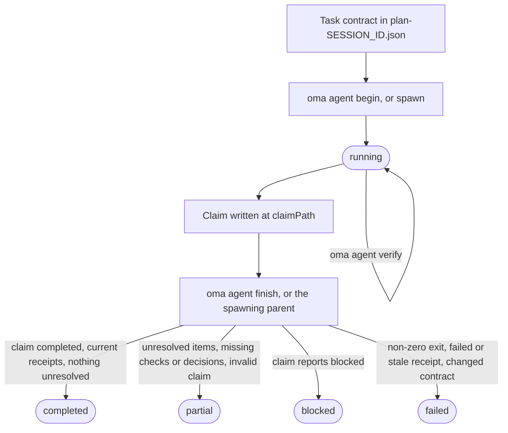
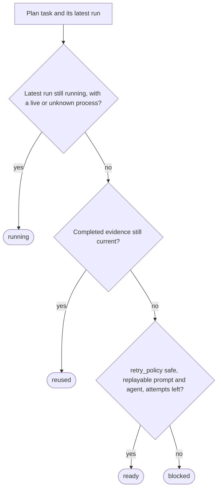

# Agent results and resume

OMA treats an agent result as a small evidence record, not just the process exit code. A run records the task and session IDs, the workspace fingerprint, verification receipts, changed files, unresolved work, and artifact hashes. This lets a coordinator reuse a completed task only while its acceptance contract and inputs still match.

Use the lifecycle directly when you are running a native agent. Workflows and `oma agent spawn` create the same records for you and leave the managed run’s finalization to the parent coordinator. For the terms used here, see [Run record and claim](../getting-started/glossary.md#run-record-and-claim) and [Plan](../getting-started/glossary.md#plan) in the glossary.

## Lifecycle at a glance

| Step | Command | Records | Keep |
| --- | --- | --- | --- |
| 1. Contract | Edit `.agents/results/plan-SESSION_ID.json` | Task `acceptance_criteria` and `required_checks` | Session ID, task ID |
| 2. Begin | `oma agent begin AGENT TASK SESSION_ID --workspace .` | Run record with status `running` | `runId`, `claimPath` |
| 3. Context (optional) | `oma agent context AGENT --difficulty Medium` | Nothing | Prompt context |
| 4. Verify | `oma agent verify RUN_ID --required` | One receipt per check | Exit code |
| 5. Claim | Write JSON at `claimPath` | Claim file | Nothing |
| 6. Finish | `oma agent finish RUN_ID CLAIM_PATH` | Final status | `status` |
| 7. Recover | `oma agent resume SESSION_ID --dry-run`, then without `--dry-run` | Recovery checkpoint and session lease | Per-task status |

`oma agent spawn` and `oma agent parallel` perform steps 2 and 6 for you: the parent process begins the run and finalizes it when the child exits.



A claim can also report `partial` or `failed` directly. Finish never upgrades a claim: it downgrades a `completed` claim whose evidence does not hold, and a non-zero exit code makes any run `failed`.

## Start a native run

Define the task and its `acceptance_criteria` and `required_checks` in a plan at `.agents/results/plan-SESSION_ID.json` first. For a small generic project check, the plan can contain one task like this:

```json
{
  "tasks": [
    {
      "id": "docs",
      "agent": "docs",
      "task": "Review README.md and report any documentation issues",
      "workspace": ".",
      "acceptance_criteria": [
        { "id": "diff-clean", "description": "The current Git diff has no whitespace errors" }
      ],
      "required_checks": [
        { "id": "whitespace", "criteria": ["diff-clean"], "command": ["git", "diff", "--check"], "cwd": "." }
      ],
      "retry_policy": "manual"
    }
  ]
}
```

This check proves only Git diff whitespace cleanliness; replace the task, criterion, and check with the project’s real acceptance contract. From the project root, begin the run:

```bash
oma agent begin docs docs SESSION_ID --workspace .
```

Replace `SESSION_ID` with the session ID used in the plan. The command prints JSON containing a generated UUID `runId` and a `claimPath`, for example:

```json
{
  "runId": "<generated-run-id>",
  "taskId": "docs",
  "sessionId": "<your-session-id>",
  "status": "running",
  "claimPath": ".agents/state/agent-runs/<generated-run-id>.claim.json"
}
```

The angle-bracket values are placeholders; use the actual values printed by your run. A successful begin creates the run record under `.agents/state/agent-runs/` and snapshots the task contract. The claim path is always the run record path with `.claim.json` in place of `.json`.

## Load context and run the task

Load graph-selected references before editing:

```bash
oma agent context docs --difficulty Medium
```

The difficulty must be `Simple`, `Medium`, or `Complex`. The command prints the context assembled for the selected agent. If no graph-backed context exists, fix the task definition or continue with the project’s documented native search path; do not fabricate a context receipt.

Run the task in the workspace recorded by `begin`. Keep the session plan fixed while the run is active. If the task changes its acceptance criteria or required checks, start a new run after updating the plan.

## Record verification

Run every check pinned to the acceptance contract:

```bash
oma agent verify RUN_ID --required
```

Replace `RUN_ID` with the UUID returned by `begin`. The command executes the declared argv and records the real exit code and before/after workspace fingerprints. A single exact command can be recorded when the task contract includes that check:

```bash
oma agent verify RUN_ID -- git diff --check
```

Use the exact-command form only for a check that belongs to the task's
contract; otherwise keep the plan's `required_checks` and use `--required` so
the receipt proves the declared acceptance criteria.

Use `--affected PATH...` only when the graph has a complete test selection for those paths. Checks run serially per run. A non-zero exit code or a workspace change during a check invalidates that receipt.

## Write and finish the claim

For tasks that choose an API contract, authentication policy, data model,
migration strategy, state owner, infrastructure access scope, or another
decision that later work depends on, declare `required_decisions` in the task
before dispatch:

```json
"required_decisions": [
  {
    "subject": "db.migration-strategy",
    "description": "Choose the compatibility window and rollback strategy for the account migration."
  }
]
```

Omit this field for tasks that follow an existing decision. Requirements are
pinned with the task contract and cannot be removed or changed after dispatch.
List suggested subjects for an agent with
`oma state decisions list --agent db-engineer --json`. These subjects are
choices to use when relevant; the catalog does not make every choice mandatory.

Write the claim file at the exact path printed by `begin`:

```json
{
  "status": "completed",
  "changedFiles": [],
  "unresolved": [],
  "artifacts": []
}
```

`status` is one of `completed`, `partial`, `blocked`, or `failed`. Paths are relative to the project root and every artifact must be a regular file inside the workspace. Use `verificationSkipped` only for a specific review that has no executable check; it does not turn a failed check into a pass.

Include substantive decisions in the claim's optional `decisions` array:

```json
"decisions": [
  {
    "subject": "db.migration-strategy",
    "decision": "Use an expand-and-contract migration; retain the old column for one release.",
    "rationale": "Both deployed app versions must work during the rollout; rollback switches reads to the retained column.",
    "alternatives": ["Replace the column during a maintenance window"],
    "evidence": ["docs/account-migration.md"]
  }
]
```

The parent stores each decision as a `decision.made` event in the run's session
and attaches its actual agent, task, and run IDs. A missing required decision
keeps the result partial, including when executable checks pass. Decisions from
another task or attempt cannot satisfy the requirement. The receipt pins the
decision event IDs and content hashes; reuse checks that those events still
exist, are valid, and have unchanged contents.
Optional decisions are recorded too. Read-only agents return the same array in
their `OMA_RESULT_JSON` claim so the parent can persist it.

Finalize a native run after writing the claim:

```bash
oma agent finish RUN_ID CLAIM_PATH
```

Substitute both values from the `begin` JSON. `CLAIM_PATH` is the generated `.claim.json` path; do not invent a new filename.

The finish command validates the claim, current contract, current receipts, and artifact hashes. A completed claim with stale evidence becomes failed or partial. The command refuses to finalize a managed run whose parent process owns the lifecycle.

## Spawned and native behavior

`oma agent spawn` and `oma agent parallel` create a run, inject the run identity and result instructions into the child prompt, and let the parent capture the child exit code. A child should write its claim and report its artifacts; the parent finalizes the managed receipt. A read-only child returns one `OMA_RESULT_JSON: {...}` line; the parent persists it, and its `verificationSkipped` explanation remains distinct from executable verification.

The human-readable result files in `.agents/results/` and memory notes in `.agents/state/memories/` help people follow progress. The machine-readable receipt in `.agents/state/agent-runs/` is the evidence used for reuse and resume.

## Inspect recovery before retrying

First ask what OMA would do:

```bash
oma agent resume SESSION_ID --dry-run
```

The report classifies each task as `reused`, `ready`, `running`, or `blocked`, and includes the reason:



A dependency that is not `reused` turns a dependent `reused` task back into `ready` (or `blocked` when it cannot be replayed), and a `ready` task whose dependency is `blocked` or `running` becomes `blocked`. A valid completed receipt is reused only when its contract, inputs, artifact hashes, and dependency evidence remain current. A live managed process, or a native run without liveness evidence, is not duplicated.

When the report is safe to execute, resume ready tasks in dependency order:

```bash
oma agent resume SESSION_ID
```

Automatic replay requires `retry_policy: "safe"` plus a replayable prompt and agent in the plan or saved dispatch. The default is `manual`. `--max-attempts` defaults to `3`, including the original attempt:

```bash
oma agent resume SESSION_ID --max-attempts 2
```

OMA writes the recovery checkpoint under `.agents/state/agent-resume/` and uses a session lease so two coordinators cannot retry the same session. It pins the plan while recovery runs. If the plan changes, a dependency changes, or a later retry changes an earlier input, the affected tasks become blocked and need a fresh verification run.

Resume starts a new attempt; it does not restore the interrupted model conversation. Before resuming an interrupted native run, mark the old run `partial` or `failed` with its actual result and unresolved work. Then inspect the dry-run report and retry only tasks that have a safe replay path.

## Recovery examples

| Situation | Action | Expected result |
| --- | --- | --- |
| A required check failed | Fix the task, run `oma agent verify RUN_ID --required` again, then finish with a new claim. | The latest receipt replaces the failed outcome when the workspace fingerprint is current. |
| The process died before a claim | Mark the run partial or failed, then run `oma agent resume SESSION_ID --dry-run`. | The old attempt is retained; a safe task is `ready`, while a manual task is `blocked`. |
| A dependency changed | Re-run the dependency and inspect the report again. | Dependent reuse is invalidated even when its own files are unchanged. |
| The plan or inputs changed | Start a new run after the plan is stable. | The new run snapshots the new contract; old evidence is not reused. |
| A task needs a decision | Record it as `blocked` with an explanation. | Resume leaves it blocked until the decision and prompt are available. |

## Next steps

- Error messages from `begin`, `verify`, `finish`, and `resume`: [Troubleshooting](./troubleshooting.md#find-your-error)
- Parse errors, missing vendor tools, dashboard state, schedules, and stale evaluation data: [Troubleshooting](./troubleshooting.md)
- Watch managed runs while they work: [Dashboard Monitoring](./dashboard-monitoring.md)
- Define plans with task contracts: [Multi-Agent Projects](./multi-agent-project.md)
