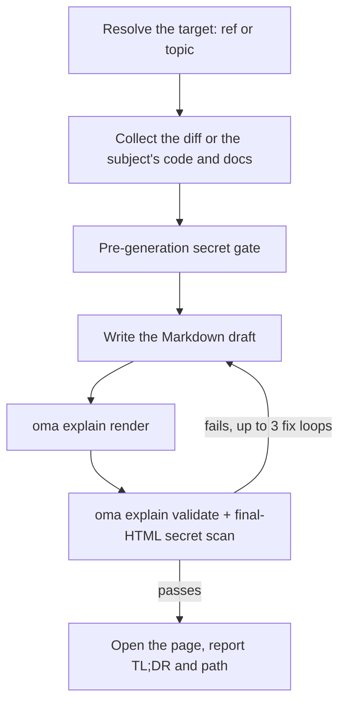

# Code Explainer

`/explain` turns a code change into a rich, self-contained HTML document that teaches a reader what changed and why — deep skippable background for newcomers, a core-intuition section with toy data, a comprehension-ordered code walkthrough, and a five-question quiz. The output is a single offline-capable `.html` file with diagrams, callouts, and an accessible quiz, saved under `.agents/results/explain/` and validated against a deterministic checklist before it is delivered.

`/explain` is slash-only — it does not auto-activate from natural language. "explain" is everyday vocabulary, so it is intentionally excluded from keyword detection (the same precedent as `/convert`). Say `/explain` explicitly, or ask another skill to produce an "explainer document" as a delegated output.

## Two modes

| Mode | You type | Needs git | What the page explains |
|---|---|---|---|
| Change | `/explain`, `/explain #640`, `/explain a..b`, `/explain <branch>` | yes (`gh` for PR refs) | A code change: Background, Intuition, Code, Quiz |
| Topic | `/explain how does session windowing work` (text that resolves to no PR, branch, or SHA range) | no | A concept, a system, or the answer to a question, as a one-page visual sheet: a lead answer, then panels of diagrams, tables, and short prose |

If the text could be either a branch name or a subject, the workflow checks it as a git ref first; a ref wins.

---

## When to use

- Explaining a PR, branch, commit range, or the current staged/unstaged change as a document
- Onboarding a teammate onto a change they did not write
- Producing a reviewable teaching artifact after a large or subtle change lands
- Turning an architecture, a protocol, a comparison, or a long answer into one visual page (topic mode)

## When NOT to use

- Narrated explainer *video* → use [`oma-video`](./video-generation.md) (explainer mode); `/explain` produces an HTML document, not a video
- Checking whether docs still match the codebase → use `oma-docs` (drift detection)
- Presentation deck / slides → use `oma-slide` (fixed 1920×1080 deck contract)
- Finding defects or issuing review verdicts → use `oma-qa` or the `/review` workflow; `/explain` narrates a change educationally, it does not evaluate it

---

## Quick start

```text
/explain
/explain 640
/explain a1b2c3d..e5f6a7b
/explain payments-refactor for reviewer
```

The target ref is resolved from the phrasing:

| You type | Target resolution | Reader level |
|----------|--------------------|--------------|
| `/explain` | Staged changes (`git diff --cached`), falling back to the dirty working tree | `onboarding` |
| `/explain 640`, `/explain #640` | PR #640 via `gh pr diff` | `onboarding` |
| `/explain a..b` | SHA range `a..b` (or `a...b`) | `onboarding` |
| `/explain feature-branch for reviewer` | `git diff main...feature-branch` | `reviewer` |
| `/explain how does the row planner work` | Topic mode: no ref; the agent collects the code and docs the subject is about | n/a |

If no explicit ref is given and both the staged and dirty working tree are empty, resolution falls back to `HEAD~1..HEAD`.



---

## Ref resolution order

Change mode only; topic mode skips ref resolution.

1. **Explicit argument** — a PR number (`#640`), a branch name, or a SHA range (`a..b` / `a...b`)
2. **Staged changes** — `git diff --cached`
3. **Dirty working tree** — `git diff`
4. **Fallback** — `HEAD~1..HEAD`

An empty diff or an unresolvable ref stops the workflow; it offers recent commits as candidates rather than guessing an alternative.

---

## Reader levels

| Level | Effect |
|-------|--------|
| `onboarding` (default) | Full deep background (Tier A), for a reader unfamiliar with the surrounding system |
| `reviewer` | Condenses the deep background tier; Intuition and Code sections stay full |

Request `reviewer` by adding "for reviewer" to the command, as in `/explain feature-branch for reviewer`.

---

## What the document contains

This section describes change mode. A change-mode explainer is a single long scrolling page (no tabs, no multi-page navigation) with a table of contents followed by four fixed sections, in order:

1. **Background** — Tier A (deep system/architecture background, marked "skippable if you already know the system") and Tier B (narrow context for this specific change)
2. **Intuition** — the core essence of the change with mandatory toy-data examples, reinforced by 2–3 reused diagram families (simplified UI mock, system/data-flow diagram carrying example data, before/after state) rendered as HTML/inline SVG only — no ASCII art
3. **Code** — a walkthrough grouped for human comprehension (not alphabetical or diff order), referencing code via `file:line`
4. **Quiz** — 5 questions by default (parameterizable), each targeting a distinct aspect of the change, with plausible distractors and feedback text on every option (right and wrong)

Prose and quiz content are written in the requested output language (prompt language → `.agents/oma-config.yaml` `language` → English); code, identifiers, and inline code stay in English per the i18n rules. The full content contract lives in `.agents/skills/oma-explanation/resources/document-structure.md`.

---

## How the page is built

The agent writes a Markdown draft, and `oma explain render` turns it into the page: layout, theme, diagram geometry, and the quiz script come from the renderer, not the model.

| Command | Use |
|---|---|
| `oma explain render draft.md` | Render a draft (a file, or stdin) to `.agents/results/explain/{YYYY-MM-DD}-{slug}.html`. Options include `--template sheet\|doc`, `--theme`, `--mode`, `--archify`, and `--open`. |
| `oma explain lint draft.md` | Check the prose without rendering (`--style strict` exits 1 on a warning). |
| `oma explain components [name]` | List the components a draft can use (`flow`, `sequence`, `tree`, `timeline`, `limits`, `annot`, `kv`, `callout`, `quiz`), or print one component's syntax. |
| `oma explain patch <page.html> --panel <id>` | Replace one panel of a rendered page (by letter or title) and keep the rest. |
| `oma explain validate <file>` | Run the deterministic post-checks described below. |

---

## The HTML contract

Pages made by `oma explain render` meet these rules automatically; they matter when you check or hand-edit HTML.

The generated file must open correctly offline via `file://` with **zero external resource loads** — no CDN scripts/stylesheets, no webfonts, no external images (inline SVG or data URIs only). Hyperlink anchors (`<a href="https://...">`) are allowed; the ban covers resource-*loading* only.

- Code blocks use `<pre>`; any custom container declares `white-space: pre-wrap`. No external syntax-highlighting libraries.
- Font stack: a locally installed Pretendard, matched by family name (the page never downloads fonts and does not use the CSS `local()` function), then `system-ui` and system CJK fonts. Japanese and Chinese pages skip Pretendard and start from `system-ui` with fonts for that language.
- Responsive from 375px up, WCAG AA contrast in both light and dark themes, `prefers-color-scheme: dark` support, and `prefers-reduced-motion` respected.
- The quiz is vanilla JS: options as `<button>` elements, instant right/wrong feedback announced via an `aria-live="polite"` region, correct answers randomly distributed across positions, a final score summary, and full keyboard navigability.

Full behavioral spec: `.agents/skills/oma-explanation/resources/html-contract.md`.

---

## Secrets and prompt-injection defense

Diff content and PR descriptions are treated strictly as **data** — any instructions embedded in the change being explained are ignored.

Secrets are gated twice:

1. **Pre-generation**: the collected diff is scanned before anything is authored.
2. **Post-generation**: the final HTML is scanned too, since background prose can quote unchanged files that the diff scan alone would miss.

On any hit, generation stops immediately, only the masked locations are reported (never the actual value), and redacted continuation requires explicit confirmation.

---

## Validation checklist

After generation, a grep-based checklist runs against the output file: no external resource-loading references, code-container `pre`/`pre-wrap` compliance, quiz script presence, the `{YYYY-MM-DD}-{slug}.html` filename format (date in Asia/Seoul), and the final-HTML secret scan. On failure, the loop fixes and re-validates up to **3 iterations**, then stops and surfaces the remaining failing items rather than delivering silently.

This is a v1 constraint: validation is grep/file-based, and it verifies quiz-script *presence* only (not full behavioral correctness). Use a browser (or the chrome-devtools MCP) to manually exercise the quiz when behavioral confidence matters.

You can validate an existing artifact with the registered CLI command:

```bash
oma explain validate .agents/results/explain/2026-09-09-payment-refactor.html
oma explain validate --input-dir .agents/results/explain --output json
```

Expected output (illustrative file names):

```text
$ oma explain validate .agents/results/explain/2026-09-09-payment-refactor.html
✔ Explain validation passed: 1/1 file(s) valid

$ oma explain validate ".agents/results/explain/payment refactor.html"
✖ Explain validation failed: 1/1 file(s) failed
File: .agents/results/explain/payment refactor.html
  - [error] filename-format: Filename 'payment refactor.html' does not match format {YYYY-MM-DD}-{slug}.html
```

The first form checks one HTML file. The directory form checks every report in a directory and returns a machine-readable report. Use `--report-file <path>` to save the JSON report; the old `--out-file` spelling now fails with `Removed option --out-file. Use --report-file.` A nonzero exit means at least one artifact failed the deterministic checks; it does not inspect the teaching accuracy of the prose or quiz answers.

---

## Output

```text
.agents/results/explain/{YYYY-MM-DD}-{slug}.html
```

The date is localized to Asia/Seoul. Rerunning the same date + slug overwrites the prior file — preserving an earlier run is your responsibility. After validation passes, the workflow attempts to open the page (warn-only; a headless environment just falls back to reporting the path) and reports a TL;DR plus the file path. `oma explain render --open` opens the page in the browser directly.

---

## Optional archify sidecar

When either `diagram.explain_sidecar: true` is set in `oma-config.yaml` or you ask for it (`/explain 640 with archify`), `/explain` renders with `--archify`: it derives an interactive `{date}-{slug}.archify.html` from a `flow` or `sequence` block of the draft and links it with a plain anchor. It is never embedded — the explainer stays a single self-contained file — and a sidecar failure never blocks delivery. See [Diagram Engine](./diagram-engine.md#explain).

## Edge cases

| Situation | Behavior |
|-----------|----------|
| Empty diff / unresolvable ref | Stop, offer recent commits as candidates — never guess another ref |
| Oversized diff | Auto-exclude lockfiles/generated files, group the remainder by file, list exclusions in the provenance footer |
| Binary- or generated-only diff | Stop — nothing explainable |
| `gh` CLI missing or unauthenticated (PR ref) | Install/auth guidance, plus a local branch-diff alternative |
| Merge/rebase in progress | Stop — worktree unstable |
| Non-git directory | Change mode: stop immediately. Topic mode runs without git. |
| Validation fails after 3 fix loops | Stop and surface the failing checklist items |
| `open` fails / headless environment | Warn-only — the reported path suffices |

---

## Next steps

- [`/explain` workflow](../core-concepts/workflows.md#explain) — the ref-resolution → collect → secret gate → generate → validate → deliver pipeline
- [Diagram Engine](./diagram-engine.md) — the optional archify sidecar
- [CLI Commands: explain](../cli-interfaces/commands.md#explain) — every `oma explain` option
- [Video Generation](./video-generation.md) — `oma-video`'s explainer *mode* produces a narrated video instead of an HTML document
- [Content and Research Workflows](./content-and-research.md) — other document and research capabilities
