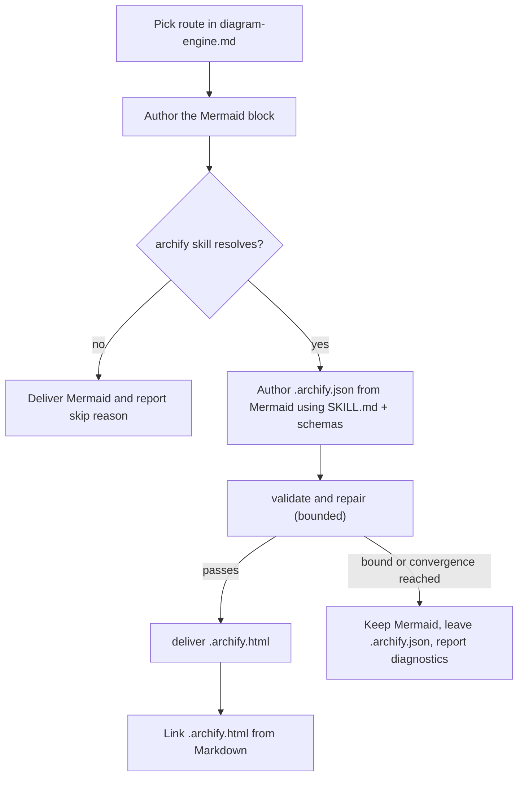

# Diagram Engine

`/architecture` (ADRs, recommendations, reviews) and `/explain` (opt-in archify sidecar) can emit interactive visual diagrams. The `/architecture` artifact always includes a **Mermaid** block in Markdown as the durable, git-diffable text SSOT, and `/explain` draws inline SVG diagrams by default.

When an interactive HTML diagram is needed, oh-my-agent routes to two upstream agent skills using the same pure skill-routing pattern as `oma-slide` (`ppt-master`) and `oma-explanation` (`Understand-Anything`) — **no `oma diagram` CLI wrapper and no `diagram:` config key**:

- **Structural route — [archify](https://github.com/tt-a1i/archify)** (MIT, Node ≥ 18, zero runtime deps): turns a typed JSON IR into an interactive, validated HTML diagram (dark/light themes, pan-zoom, search, relationship tracing, PNG/SVG/WebM export).
- **Stack route — [stack-diagram](https://github.com/Caru-ini/stack-diagram)** (MIT, Python 3.9+, network access for logos): turns a vendor-product stack or infrastructure topology into an HTML poster with official vendor logos.

Mermaid never goes away: it stays the text SSOT inside Markdown artifacts, and both upstream HTML outputs are derived sibling files — linked, never embedded.

---

<a id="always-the-latest-archify--nothing-to-install"></a>
## Resolve upstream skills

Both skills resolve the same way:

1. Check the runtime skill catalog for an installed copy (`archify` from `https://github.com/tt-a1i/archify` — or `ARCHIFY_HOME` when explicitly set — and `stack-diagram` from `https://github.com/Caru-ini/stack-diagram`).
2. If absent, load the skill for the session through the [skills CLI](https://github.com/vercel-labs/skills) without a persistent installation or another agent:

```bash
bunx skills use tt-a1i/archify@archify
bunx skills use caru-ini/stack-diagram@stack-diagram
```

Omit `--agent`. The agent reads `$SKILL_DIR/SKILL.md` from the returned supporting-files directory and runs upstream scripts directly from `$SKILL_DIR`.

---

## Route selection

The shared protocol lives in `.agents/skills/_shared/conditional/diagram-engine.md`:

| Signal (first match wins) | Route |
|---|---|
| Prompt names `archify` | structural (`archify`) |
| Prompt asks for Mermaid only | structural (Mermaid only) |
| Prompt names `stack-diagram` or asks for vendor logos | stack |
| Most nodes are vendor products or services (AWS, Vercel, Postgres, Hono, …) and the user wants a stack / infra / deployment topology | stack |
| Boundaries, call order, data flow, lifecycle, or any ADR structure | structural (`archify` when resolvable, else Mermaid) |

---

## Structural route (`archify` ↔ Mermaid)

`/architecture` follows this sequence when a decision changes structure:

1. Author the Mermaid block first (always).
2. Resolve `archify` from the runtime skill catalog, `ARCHIFY_HOME`, or `bunx skills use tt-a1i/archify@archify`. If unavailable or Node.js ≥ 18 is missing, deliver Mermaid only and report the reason.
3. Read `$SKILL_DIR/SKILL.md`, the matching schema, and one example, then author `<artifact-stem>.archify.json` semantically from the Mermaid topology.
4. Run `validate` → repair → `deliver` directly against `$SKILL_DIR/bin/archify.mjs` with `ARCHIFY_UPDATE_CHECK_DISABLED=1` (keeps the skill's update ping offline):

```bash
ARCHIFY_UPDATE_CHECK_DISABLED=1 node "$SKILL_DIR/bin/archify.mjs" validate architecture adr-auth.archify.json --quality showcase --json
ARCHIFY_UPDATE_CHECK_DISABLED=1 node "$SKILL_DIR/bin/archify.mjs" deliver  architecture adr-auth.archify.json adr-auth.archify.html --quality showcase --json
ARCHIFY_UPDATE_CHECK_DISABLED=1 node "$SKILL_DIR/bin/archify.mjs" visual-check adr-auth.archify.html --json   # optional; exit 2 = no Chrome
```

5. Bounded repair: stop when the spec passes, when archify's convergence rule fires, after 3 repair attempts / 10 minutes (`/architecture`) or 2 attempts / 5 minutes (`/explain`), or when the same diagnostic repeats. Semantic labels are never deleted just to pass.
6. Link the HTML next to the Markdown artifact — never embed it.



### `/architecture`

Only for structural decisions (boundaries, dependencies, data flow). Output next to the Markdown artifact under `docs/decisions/` or `.agents/results/architecture/`:

```text
adr-notification-service.md            # Mermaid block + "Interactive:" link
adr-notification-service.archify.json  # frozen spec (kept even on failure)
adr-notification-service.archify.html  # delivered viewer
```

### `/explain`

Opt-in when you ask for it in the prompt (`/explain 640 with archify`). The explainer's own contract (single self-contained file, CSS-variable theming) does not allow embedding a second full HTML document, so the agent resolves the upstream `archify` skill per `diagram-engine.md`, builds `{date}-{slug}.archify.html` (+ `.archify.json`) from the explainer's primary `flow` or `sequence` diagram (bounded to 2 attempts / 5 minutes), and links it with a plain relative anchor. A missing skill or failed sidecar never blocks the explainer.

---

## Stack posters (`stack-diagram`)

When the diagram is a tech-stack or infrastructure topology whose nodes are vendor products (AWS, Vercel, Postgres, …) and you ask for logos, `/architecture` takes the **stack route**.

- Resolution: the runtime skill catalog first, else `bunx skills use caru-ini/stack-diagram@stack-diagram`. If it cannot resolve, the workflow falls back to the structural route above and says so.
- Output: `<artifact-stem>.stack.html` next to the Markdown artifact, linked under the Diagram section as `Stack: …`. The Mermaid block stays the SSOT.
- HTML only. Upstream's PNG export and screenshot check need Playwright + Chromium; oma never installs or runs them.
- The upstream gallery upload (`share.py`) is skipped unless you explicitly ask to publish.
- Bounds: 2 build attempts, 5 minutes in total; a clean `build.py` run is the acceptance.

Say "archify" in the prompt to force the structural route, or "stack-diagram" / "with logos" to force the stack route.

---

## Failure modes

| Situation | Result |
|---|---|
| Upstream skill cannot resolve (offline, `bunx` missing, Node/Python missing) | Mermaid (or primary `/explain` HTML) is delivered and the skip/failure reason is reported |
| `archify` `validate` never converges | Mermaid remains the delivered diagram; the last `.archify.json` is left for a human; diagnostics are reported verbatim |
| Chrome missing for `visual-check` | Reported as `skipped`, never as a pass |
| `stack-diagram` `build.py` fails after 2 attempts or 5 minutes | Mermaid remains the delivered diagram; the HTML source is left beside it and the last error is reported |

---

## Next steps

- [Code Explainer](./code-explainer.md) — `/explain`, its opt-in archify sidecar, and the `Understand-Anything` route
- [`/architecture` workflow](../core-concepts/workflows.md#architecture) — ADRs and reviews that carry the Mermaid block
- archify upstream: [tt-a1i/archify](https://github.com/tt-a1i/archify)
- stack-diagram upstream: [Caru-ini/stack-diagram](https://github.com/Caru-ini/stack-diagram)
