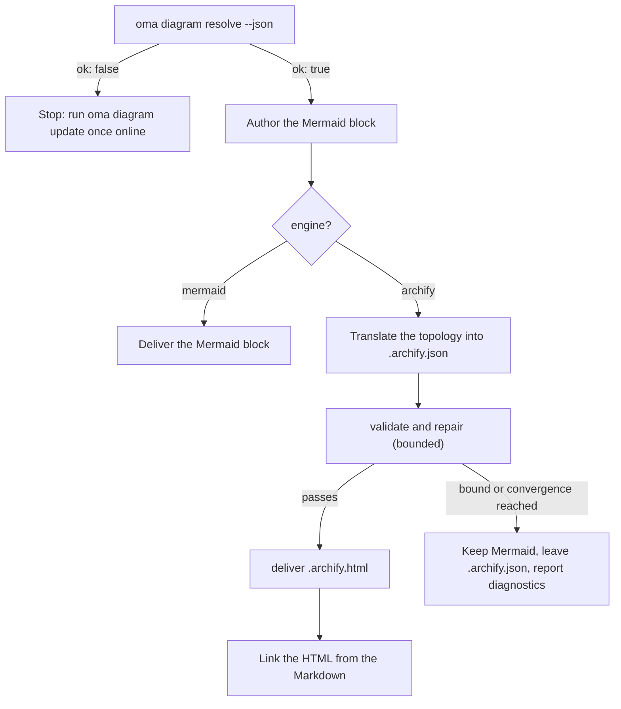

# Diagram Engine

`/architecture` (ADRs, recommendations, reviews) and `/explain` (code-change explainers) produce structural diagrams. The `/architecture` artifact always includes a **Mermaid** block in Markdown, and the `/explain` workflow draws inline SVG diagrams. When [archify](https://github.com/tt-a1i/archify) resolves, the architecture workflow also emits an **interactive, validated HTML diagram** next to the artifact. It uses a typed JSON spec and supports dark/light themes, pan-zoom, search, relationship tracing, and PNG/SVG/WebM export.

Mermaid never goes away: it is the text SSOT that lives in the Markdown and in git diffs. archify is a derived artifact.

---

<a id="always-the-latest-archify--nothing-to-install"></a>
## Install archify

archify is an MIT-licensed agent skill (Node ≥ 18, zero runtime dependencies). oh-my-agent uses the copy installed through the [skills CLI](https://github.com/vercel-labs/skills) and keeps no copy of its own:

- `oma diagram update` installs archify when it is missing (`bunx skills add tt-a1i/archify --skill archify -g -y`) and otherwise updates it (`bunx skills update archify -g -y`).
- `oma diagram resolve` only reads installed skill directories and never touches the network. Without an install, `auto` falls back to Mermaid and names the install command.
- `oma update` does not install archify.

```bash
# Illustrative output; the version, install path, and quality can vary.
oma diagram update
oma diagram resolve
# engine:   archify  (requested: auto)
# reason:   archify 2.15.0 via home:~/.agents/skills
# root:     /Users/you/.agents/skills/archify
# bin:      /Users/you/.agents/skills/archify/bin/archify.mjs
# version:  2.15.0
# quality:  showcase
# sidecar:  off (explain)
```

Resolution order (first hit wins, identical on every vendor runtime):

1. `diagram.archify.path` in `oma-config.yaml` — explicit pin
2. `ARCHIFY_HOME` environment variable — explicit pin
3. Installed skill dirs: project `.agents` / `.claude` / `.codex` / `.cursor` / `.qwen` / `.kiro` / `.gemini` / `.copilot` `/skills/archify`, then the same under `~`, then `~/.config/agents/skills/archify` and `~/.raven/workspace/skills/archify`

<!-- oma-docs:ignore-start -->
A hit requires the installed or pinned archify directory to contain `bin/archify.mjs`.
<!-- oma-docs:ignore-end -->

Earlier releases kept their own copy under `~/.cache/oma-diagram/`. It is no longer read; you can delete it.

---

## Configuration

Sparse section in `.agents/oma-config.yaml` (absent keys use the defaults shown):

```yaml
diagram:
  engine: auto                # auto | archify | mermaid
  explain_sidecar: false      # /explain also writes an archify sidecar
  archify:
    path: null                # explicit install dir (pin)
    quality: showcase         # showcase | standard  → --quality
    open: false               # pass --open to deliver
```

`archify.managed`, `archify.channel`, and `archify.check_interval_min` are deprecated: they still validate but are ignored, and `resolve` prints a warning while they are set.

### Which engine runs

One decision covers the config value, whether archify resolves, and what the workflow delivers. "Resolves" means any step of the [resolution order](#always-the-latest-archify--nothing-to-install) finds an install: a pin or an installed skill dir.

| `diagram.engine` | archify resolves? | `oma diagram resolve --json` | `/architecture` result |
|---|---|---|---|
| `auto` (default) | yes | `engine: archify`, `ok: true` | Mermaid block + linked `.archify.html` |
| `auto` | no (archify not installed) | `engine: mermaid`, `ok: true` | Mermaid only; the report names `oma diagram update` |
| `archify` | yes | `engine: archify`, `ok: true` | Mermaid block + linked `.archify.html` |
| `archify` | no | `engine: mermaid`, `ok: false`, exit 1 | Workflow stops with the `oma diagram update` hint instead of silently downgrading |
| `mermaid` | not checked | `engine: mermaid`, `ok: true` | Mermaid only; archify is never called |

`oma diagram resolve --engine <auto|archify|mermaid>` overrides the config for one call, and a prompt can do the same for one run (`/explain 640 with archify`).

---

## CLI

```bash
oma diagram resolve [--engine auto|archify|mermaid] [--json]
oma diagram update  [--json]
oma diagram archify <archify args…>
```

`oma diagram update` forces a refresh and exits 1 when no archify install can be resolved.

`oma diagram archify` runs the resolved archify executable with `ARCHIFY_UPDATE_CHECK_DISABLED=1` (no network) and propagates the exit code, so `validate` / `deliver` / `visual-check` behave exactly as archify documents them:

```bash
oma diagram archify guide "show the auth request lifecycle" --json
oma diagram archify validate architecture adr-auth.archify.json --quality showcase --json
oma diagram archify deliver  architecture adr-auth.archify.json adr-auth.archify.html --quality showcase --json
oma diagram archify visual-check adr-auth.archify.html --json   # exit 2 = no Chrome (skipped), or archify itself could not be resolved
```

`--json` on `resolve` returns `{ ok, requested, engine, quality, open, explainSidecar, archify?: { root, bin, version, source }, reason, probed, warnings }` — `source` is `config:…`, `env:…`, or a skill-dir label such as `home:~/.agents/skills`; `warnings` lists ignored deprecated keys. `--refresh` and `--offline` are accepted as deprecated no-ops.

---

## How the workflows use it

The shared protocol lives in `.agents/skills/_shared/conditional/diagram-engine.md`. `/architecture` follows this sequence:

1. `oma diagram resolve --json`
2. Author the Mermaid block first (always).
3. If `engine: archify`: translate the Mermaid topology into archify's JSON IR (`architecture` / `sequence` / `dataflow` / `lifecycle` / `workflow`), reading only the matching schema and one example from the install.
4. `validate` → repair → `deliver`, bounded: stop when the spec passes, when archify's convergence rule fires, after 3 repair attempts, after 10 minutes in total, or when the same diagnostic repeats. Semantic labels are never deleted just to pass.
5. Link the HTML — never embed it.



### `/architecture`

Only for structural decisions (boundaries, dependencies, data flow). Output next to the Markdown artifact under `.agents/results/architecture/`:

```text
adr-notification-service.md            # Mermaid block + "Interactive:" link
adr-notification-service.archify.json  # frozen spec (kept even on failure)
adr-notification-service.archify.html  # delivered viewer
```

### `/explain`

Opt-in, because the explainer's own contract (single self-contained file, CSS-variable theming) does not allow embedding a second full HTML document. Enable with `diagram.explain_sidecar: true`, pass `oma explain render --archify`, or ask in the prompt ("with archify"). There is no Mermaid block and no hand-written JSON: the renderer derives the archify spec from a `flow` or `sequence` block of the draft (the panel marked `{archify}`), runs `deliver` (falling back once from `showcase` to `standard` quality), and links `{date}-{slug}.archify.html` with a plain `<a href>`. The command reports `linked`, `skipped` (with the reason), or `failed` (first diagnostic). The workflow does not loop on a failed sidecar, and a sidecar failure never blocks the explainer.

---

## Failure modes

Unresolvable archify is covered by the [engine decision table](#which-engine-runs). The remaining cases:

| Situation | Result |
|---|---|
| `oma diagram update` fails (offline, `bunx` missing) | The skills CLI error is shown; an existing install keeps working |
| `validate` never converges | Mermaid remains the delivered diagram; the last `.archify.json` is left for a human; diagnostics are reported verbatim |
| Chrome missing for `visual-check` | Reported as `skipped`, never as a pass |
| `oma diagram archify …` exits 2 | Either Chrome is missing (`visual-check`) or archify could not be resolved; check `oma diagram resolve --json` first |

---

## Next steps

- [Code Explainer](./code-explainer.md) — the `/explain` workflow and its optional archify sidecar
- [`/architecture` workflow](../core-concepts/workflows.md#architecture) — ADRs and reviews that carry the Mermaid block
- [oma-config.yaml semantics](./oma-config-semantics.md) — how the `diagram:` section is merged
- [CLI Commands: diagram](../cli-interfaces/commands.md#diagram) — full option list
- [Market Research](./market-research.md) — the same skills-CLI install pattern for the last30days engine
- archify upstream: [tt-a1i/archify](https://github.com/tt-a1i/archify)
