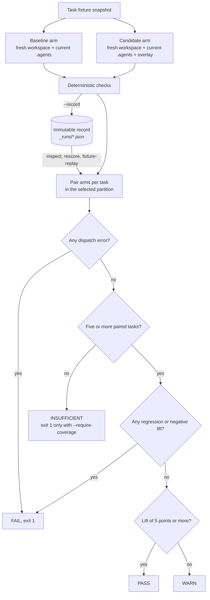

# Harness Evaluation

:::tip How these fit together
[Skill evaluation](./skill-eval.md) measures whether one `SKILL.md` helps, and [skill optimization](./skill-opt.md) edits that body under held-out gates. Harness evaluation (this page) compares a whole `.agents/` overlay on repository tasks. [Incident regression cases](./harness-incidents.md) turn observed failures into evaluation cases and skill fixtures. [Project harness evolution](./harness-evolution.md) runs incident capture and skill optimization as a budgeted cycle, and [scheduled agents](./scheduled-agents.md) is the OS scheduler that fires it.
:::

`oma harness eval` measures whether a candidate OMA harness improves a fixed target agent without changing that agent's model. It adapts the test-time evaluation pattern from [AI4AI at Test-Time: Strong-to-Weak Capability Transfer via Harnesses](https://arxiv.org/abs/2608.12307): keep the target model fixed, change the harness, and compare outcomes on the same tasks.

This command evaluates a larger unit than `oma skill eval`:

| Command | Treatment | Score target |
|:--------|:----------|:-------------|
| `oma skill eval` | One `SKILL.md` body | Agent output |
| `oma harness eval` | A scoped `.agents/` overlay | Files and output produced in a repository workspace |

Use skill eval to answer “does this skill help?” Use harness eval to answer “does this combination of skills, workflows, rules, and agent instructions make the fixed agent complete repository tasks more reliably?”

**Before the first run:**

- Record the first run with `--live --record`. `inspect` (the default action), `rescore`, `fixture-replay`, and `rerun` all read that record.
- A verdict needs at least five scored tasks in the selected partition. `pass` needs at least 5 points of lift and no regressions.
- `inspect`, `rescore`, and `fixture-replay` make no model calls. `--live` and `--action rerun` make two per selected task.
- `promotionReady` is always `false`. A pass is evidence for a human decision, not an automatic promotion.
- Live runs need a vendor with project-local skill discovery (see [Run and record](#run-and-record)).

## Evaluation model

A live run evaluates each task as a paired experiment:

1. OMA captures the initial task fixture. A complete snapshot seeds both arms so they start from the same files, even if the source fixture changes during execution.
2. OMA copies the current `agents`, `config`, `rules`, `skills`, and `workflows` definitions into that workspace and projects them into the selected vendor format.
3. OMA repeats the setup in a second fresh workspace and applies the candidate overlay there.
4. The same primary agent, vendor route, prompt, write permissions, and timeout are used for both arms.
5. Deterministic checks inspect the resulting workspace and optional agent output. Trusted command checks run afterward in a fresh copy of the task artifacts.

The real project is never used as the arm's working directory. OMA captures raw output and final task artifacts before checks and temporary workspace cleanup. The selected vendor's own process sandbox remains the authority for access outside the working directory.

The diagram shows how paired arms reach a decision. Offline actions re-enter at the pairing step from a stored record.



## Candidate layout

The candidate path is a directory containing a partial `.agents/` tree:

```text
candidate/
└── .agents/
    ├── agents/
    │   └── docs-curator.md
    ├── rules/
    │   └── documentation.md
    ├── skills/
    │   └── project-docs/
    │       └── SKILL.md
    └── workflows/
        └── docs-check.md
```

Only files below `.agents/agents`, `.agents/rules`, `.agents/skills`, and `.agents/workflows` are accepted. Hooks, evaluator fixtures, state, results, configuration files, symlinks, and vendor agent variants are rejected. Protected agent frontmatter fields such as `model`, `tools`, `effort`, and execution limits must match the baseline. An arm also fails if the running agent mutates protected `.agents/` definitions before scoring.

## Suite format

A suite is one YAML file plus one fixture directory per task:

```text
harness-eval/
├── suite.yaml
└── fixtures/
    ├── stale-api-doc/
    │   ├── docs/api.md
    │   └── src/session.ts
    └── missing-guide/
        ├── docs/
        └── src/feature.ts
```

```yaml
schema_version: 2
id: docs-harness
agent: docs-curator
tasks:
  - id: stale-api-doc
    partition: validation
    prompt: Update the API documentation to match the implementation.
    workspace: fixtures/stale-api-doc
    weight: 1
    checks:
      - type: file_contains
        path: docs/api.md
        value: openSession
      - type: file_not_contains
        path: docs/api.md
        value: createSession
  - id: missing-guide
    partition: final-test
    prompt: Write the missing guide for the feature in this fixture.
    workspace: fixtures/missing-guide
    checks:
      - type: file_exists
        path: docs/feature.md
```

Version 2 requires both `validation` and `final-test` tasks. Each task must declare its partition. Validation is the default; use `--partition final-test` for a separate final run after candidate selection. Each run scores only the selected partition, so a decisive validation run needs at least five `validation` tasks and a final-test run needs at least five `final-test` tasks. The example above is kept short for readability and always reports `INSUFFICIENT`. The two partitions cannot share or nest fixture directories. Keep recording files outside fixture directories, candidate overlays, and evaluator inputs; these locations are rejected to prevent later runs from seeing final checks. Version 1 suites still run as `exploratory`; they cannot be selected as final-test.

Task IDs must be unique. Fixture paths and check paths must remain inside the project and task workspace. Suites and fixtures must also stay outside the baseline definitions copied into every arm. Fixtures cannot contain symlinks or agent-harness control surfaces such as `.agents`, `.codex`, `.claude`, vendor skill directories, or root agent-instruction files. This prevents task data from shadowing either arm's controlled harness.

Generated dependency directories such as `node_modules` and `.venv` are not copied from the baseline harness. Commit deterministic helper source and dependency manifests in the skill; provision runtime dependencies in the task fixture when a check requires them.

### Check types

| Type | Fields | Pass condition |
|:-----|:-------|:---------------|
| `file_exists` | `path` | The path exists after the arm completes. |
| `file_not_exists` | `path` | The path does not exist. |
| `file_contains` | `path`, `value` | The file exists and contains the value. |
| `file_not_contains` | `path`, `value` | The file exists and does not contain the value. |
| `output_contains` | `value` | Captured agent output contains the value. |
| `output_not_contains` | `value` | Captured agent output does not contain the value. |
| `output_judge` | `rubric` | Graded contract carried on incidents; the mechanical evaluator reports it as not evaluated (see [Incident Regression Cases](./harness-incidents.md)). |
| `file_json_equals` | `path`, `value`, optional `pointer` | Parsed file JSON equals `value`, optionally at a JSON Pointer. |
| `output_json_equals` | `value`, optional `pointer` | Captured output is valid JSON and equals `value`, optionally at a JSON Pointer. |
| `command` | `argv`, `checker`, `timeout_ms`, `expected_exit_code` | The trusted subprocess completes within its timeout and returns the specified exit code. |

JSON assertions compare parsed values, including types; success prose cannot satisfy a JSON state assertion. `pointer` uses JSON Pointer syntax such as `/result/count` and defaults to the entire value.

Command checks are authored by the trusted suite owner:

```yaml
- type: command
  argv: [/absolute/path/to/node, "{checker}", state.json]
  checker: checkers/verify-state.mjs
  timeout_ms: 5000
  expected_exit_code: 0
```

`checker` resolves relative to the suite file. It must be a standalone regular source file stored outside every fixture, the candidate overlay, and baseline `.agents` definitions. `argv[0]` must be an absolute executable outside the project; `{checker}` must be a complete argument. OMA passes arguments directly without shell interpolation. Timeouts must be positive integers no greater than 300,000 milliseconds. Exit codes are integers from 0 through 255.

Before dispatch, OMA snapshots checker source bytes and hashes the evaluator definitions and executable. After dispatch, it copies task artifacts to a separate temporary workspace, writes the snapshotted checker outside those artifacts, and invokes it there. Every command gets a fresh copy; one checker cannot alter the next check's input. Generated harness projections are excluded, and artifact symlinks are rejected. Checker source changes during an arm fail that arm; modified source is never substituted for the snapshot. The checker should use fixed assertions against artifacts or application behavior, and should not delegate its verdict to tests or package scripts the candidate can edit.

Checks and checker paths are not added to the agent prompt or fixture. The selected task's input is necessarily visible during its run. This protects evaluator integrity and separates partitions; it does not prevent a same-user process from reading other host files.

## Run and record

Live mode issues two dispatches per selected task, prints a dispatch preview, and requires confirmation:

```bash
oma harness eval \
  --suite harness-eval/suite.yaml \
  --candidate candidate \
  --live --record \
  --record-file harness-eval/_runs/trial-1.json
```

Use `--yes` for non-interactive execution and `--timeout <duration>` to set the same per-arm wall-clock limit (default `15m`; a unit is required, for example `--timeout 45m`). `oma harness incident reproduce` accepts the same flag. Live execution requires a vendor that discovers harness files relative to the project workspace. OMA refuses HOME-based discovery because the baseline could see globally installed candidate content.

The vendor comes from the suite's `agent`, resolved through the project model configuration:

| Vendor | Live `harness eval`, `--action rerun`, `incident reproduce` |
|---|---|
| `claude`, `codex`, `commandcode`, `copilot`, `cursor`, `kiro`, `opencode`, `qwen` | Allowed: project-local skill directory |
| `antigravity`, `hermes`, `kimi` | Refused: HOME-based skill discovery |
| Any vendor without a known project skill directory | Refused |

Offline actions (`inspect`, `rescore`, `fixture-replay`) do not dispatch, so this check does not apply to them.

`--record` writes an immutable version 2 JSON record. The default location is `_runs/` next to the suite, with baseline/candidate hashes in the filename. Use a new `--record-file` for another live run; an existing destination is rejected before dispatch. Records preserve:

- suite identity, partition, prompt and fixture provenance, baseline/candidate hashes, and evaluator/checker/executable hashes;
- original output and its hash, including available diagnostic stdout from failed dispatches;
- initial and final artifact manifests with file bytes, per-file hashes, file/directory modes, and a manifest digest;
- checker references, arm outcomes, incident identity when supplied, and the source record hash for a rerun.

Task snapshots are bounded to 5 MiB per file, 32 MiB total, and 2,000 entries. Symlinks, special files, secret-bearing paths, unreadable files, and oversized data are recorded as omissions. Copied harness controls are excluded from final task artifacts. Incomplete snapshots remain explicit evidence limitations; they cannot supply a pinned rerun or satisfy file rescoring. Raw output can still support output-only checks when the original dispatch succeeded.

Records have their own integrity hash. A changed record or artifact hash is rejected. These hashes identify evidence; they do not attest process confinement or make a result promotion-ready.

### Execution conditions

Every live or rerun evaluation resolves an execution manifest before the first dispatch and stores it in the record as `manifest`. It names the conditions a verdict describes so a stored score is never mistaken for evidence about a different model, CLI, or OMA build:

| Field | Meaning |
|---|---|
| `vendor`, `dispatchMode`, `runtimeVendor`, `command` | Resolved dispatch route and CLI executable name. |
| `model`, `modelSource` | The model OMA resolved from the agent plan or vendor default. `vendor-session` means the vendor's own session configuration selects the model and OMA did not pin it. |
| `effort`, `thinking` | Reasoning settings taken from the agent plan when present. |
| `cliVersion`, `cliVersionStatus` | First line of `<command> --version` (`probed`), or `unavailable` when the probe failed. |
| `omaVersion`, `platform`, `arch`, `node` | Host and OMA build. |
| `environmentPolicy` | Names of the environment variables the arms received, the forced entries, and how many were dropped. Values are never recorded. |
| `memory`, `confinement` | `memory: disabled` for every arm; `confinement` states what the dispatch does and does not restrict (temporary workspace, unrestricted network, inherited credentials, vendor-default tools). |
| `manifestHash` | Identity of the conditions above. |

The manifest is a description, not an attestation: it records what OMA resolved, and the confinement fields say explicitly that network and credential isolation are not enforced. `promotionReady` stays `false`.

### Environment policy

Both arms receive the same allowlisted environment. Base variables (`PATH`, `HOME`, locale, temp, proxy, and certificate settings), every `OMA_*` variable, and the credential and runtime-detection prefixes of the target vendor pass through; entries a dispatch builder adds for the invocation are kept. Everything else is dropped so a candidate cannot reach a deploy token or another provider's key by accident. `OMA_NO_AGENTMEMORY=1` is forced so vendor memory cannot carry context between the baseline and candidate arms.

Set `OMA_HARNESS_ENV_PASSTHROUGH=NAME1,NAME2` to pass additional variables a task genuinely needs. The names appear in the manifest under `environmentPolicy.extra`. For a vendor without a known prefix set, the manifest reports `vendorKnown: false` and only base, `OMA_*`, and passthrough entries reach the process.

## Reuse a recording

The command separates four actions:

| Action | Work performed | Agent/model calls |
|:-------|:---------------|:------------------|
| `inspect` | Aggregate stored arm verdicts after provenance validation. No checks run. | None |
| `rescore` | Apply current output/file checks to original raw output and artifact bytes. | None |
| `fixture-replay` | Match a supplied tool-request transcript, replay its fixture responses and file changes, then apply supported checks. | None |
| `rerun` | Run the configured agent in fresh workspaces seeded from recorded initial snapshots. | Two per selected task |

`--action inspect` is the default. `--mock` is an alias for inspection and cannot be combined with another action. Neither inspection nor fixture replay reruns an agent.

### Inspect stored verdicts

```bash
oma harness eval \
  --suite harness-eval/suite.yaml \
  --candidate candidate \
  --action inspect \
  --record-file harness-eval/_runs/trial-1.json
```

Inspection requires the original suite, partition, evaluator, baseline, and candidate hashes to match. It displays the recorded scores without invoking checkers or reevaluating output. Version 1 records remain available for inspection when their required provenance matches. Older records missing partition/evaluator provenance cannot pass current CLI validation. Legacy verdicts cannot be relabeled as new raw evidence: collect a new live record for rescoring, fixture replay, or a pinned rerun.

### Rescore original evidence

```bash
oma harness eval \
  --suite harness-eval/suite.yaml \
  --candidate candidate \
  --action rescore \
  --record-file harness-eval/_runs/trial-1.json
```

Rescoring uses current checks and ignores the original `passed` values and check verdicts. The suite identity, task ID/prompt/incident identity, baseline, candidate, and selected partition must still match. Checker definitions may change; the new result describes how the original bytes perform against those checks. Changes to today's fixture files do not replace the recorded final artifacts.

Command checks are insufficient for offline rescoring because the record does not pin the external runtime and environment. Checks targeting excluded or incomplete artifacts are also insufficient. A failed original dispatch leaves diagnostic output, which cannot become a valid measurement through rescoring. Use a live rerun when current acceptance criteria require command execution.

### Replay tool fixtures

A transcript file contains one object, or an array of objects with unique task IDs. Supply one transcript per selected task:

```json
{
  "schemaVersion": 1,
  "taskId": "stale-api-doc",
  "requests": [
    { "tool": "documentation", "request": { "path": "docs/api.md" } }
  ],
  "steps": [
    {
      "tool": "documentation",
      "request": { "path": "docs/api.md" },
      "response": { "body": "Use openSession." },
      "writes": [
        { "path": "docs/api.md", "content": "Use openSession.\n" }
      ],
      "removes": []
    }
  ],
  "output": "Fixture completed.",
  "dependencies": [
    { "name": "documentation", "repeatability": "fixture" }
  ]
}
```

```bash
oma harness eval \
  --suite harness-eval/suite.yaml \
  --candidate candidate \
  --action fixture-replay \
  --record-file harness-eval/_runs/trial-1.json \
  --transcript harness-eval/tool-fixtures.json
```

Requests must match the step sequence exactly by tool name and request value. `writes` and `removes` are optional relative task-file changes; they cannot escape the workspace or modify harness controls. Tool names are data, and no transcript command is executed. `output` is fixture data, required when an output check needs it.

Each declared dependency has a `name`, `repeatability` (`fixture`, `live`, or `unavailable`), and optional `reason` and `fixture` reference. A fixture dependency requires a matching step with that tool name. Live or unavailable dependencies make replay insufficient. The optional `fixture` field is descriptive; replay consumes the supplied steps rather than loading that path. Transcript replay validates declared dependencies and does not establish that every historical dependency was captured.

Both recorded arms must have the same complete initial snapshot. OMA applies the same transcript to each arm and runs current output/file checks. Command checks require a live rerun. These results show that the supplied fixture sequence can be replayed; they cannot establish candidate behavioral improvement or model reproducibility.

### Rerun the agent from pinned initial files

```bash
oma harness eval \
  --suite harness-eval/suite.yaml \
  --candidate candidate \
  --action rerun \
  --record-file harness-eval/_runs/trial-1.json
```

A rerun requires a matching suite/task identity and identical complete initial snapshots for both original arms. It starts actual agent calls using the current baseline, candidate, configured vendor/model route, and current checks. It does not use the original final artifacts as the starting state. A later edit to the source fixture therefore cannot silently change the recorded initial state.

Reruns have the same dispatch preview, confirmation, and timeout behavior as live runs. They can use a changed candidate; select the original source explicitly with `--record-file`. Add `--record` to save a new sibling file ending in `-rerun-<timestamp>.json`, linked to the source record hash. The original record is preserved.

Pinned files do not reproduce external service state, clock behavior, or model sampling. A rerun is fresh behavioral evidence under the stated conditions, not a claim that the original agent trajectory was deterministically reproduced.

### Recorded conditions on replay

`inspect`, `rescore`, and `fixture-replay` report the manifest stored in the record with `conditions: "recorded"`, or `conditions: "unavailable"` for a record that predates manifests. OMA also resolves the current conditions and lists every difference in vendor, dispatch mode, model, effort, thinking, CLI version, OMA version, or host as a replay limitation and promotion blocker:

```text
replay limitation: Recorded conditions differ from current: model: recorded "gpt-5.4", current "gpt-5.5"
```

The CLI version is probed on replay only when the record itself carries a probed version; an unprobed pair is reported as not comparable rather than as equal. Recorded verdicts stay viewable under their original conditions. They are not evidence for the candidate under the current conditions until a live or rerun evaluation produces a record whose manifest matches.

### Usage

Each arm stores `usage` when the vendor reported it: input and output tokens, cost in USD, wall time, and the model that produced most output. The evaluation sums them as `usage` with `status` `actual`, `partial` (some arms reported nothing), or `unknown`. Vendor result envelopes are unwrapped before checks run and before the output is recorded, so `output_contains` and `output_json_equals` see the agent's answer rather than the JSON bookkeeping around it; the usage inside the envelope is what feeds this field.

### Report labels

Reports include `executionMode`, `evidenceStatus` (`complete`, `insufficient`, or `legacy`), `replayLimitations`, and a `sourceRecordHash` when available. Live and rerun reports add `manifest`, `conditions: "current"`, and `traceSession`. Evidence completeness describes what the current action can inspect or evaluate. Inherited incident limitations remain visible even when the current file capture is complete. `promotionReady` remains `false` in every mode.

## Trace events

Each live or rerun evaluation writes linked events to the local session `oma-harness-<suite-id>`:

| Event | Payload |
|---|---|
| `harness.eval.started` | Action, suite/baseline/candidate/evaluator hashes, partition, manifest hash, resolved vendor, model, CLI version, and task count. |
| `harness.arm.completed` | One per arm: task, arm, pass state, duration, output hash, dispatch error, exit code, timeout flag, and the arm trace. `parentEventId` points at the started event. |
| `harness.eval.completed` | Decision, lift, evidence status, and the record path and hash when `--record` was used. |

All events of one evaluation share a `causalityKey`. When an event cannot be written, the report lists `Trace event <kind> was not recorded` as a replay limitation instead of silently omitting it.

Each arm run also stores `diagnostics` and `trace` in the record:

- `diagnostics`: exit code, signal, timeout flag, and the last 8 KiB of stderr with `stderrStatus` (`captured`, `truncated`, or `unavailable`).
- `trace`: what the harness could observe. `output` is `complete`, `partial` (a failed process still produced stdout), or `unavailable`; `artifacts` says whether the final snapshot is complete; `changedPaths` lists files the arm added, modified, or removed relative to the pinned initial workspace (capped at 200 with `changedPathsTruncated`).
- `trace.toolCalls`: `captured`, `partial`, `missing`, or `unsupported`. Claude and Codex runs can load a fresh native transcript bound to the arm's session and temporary workspace. Missing logs remain `missing`; other vendors remain `unsupported`.
- `trace.toolEvidence`: when available, root-session tool call IDs, names, timing, error flags, and SHA-256 hashes and byte counts of normalized request/response text. Raw tool arguments and results are not copied into the evaluation record. Capture is limited to 200 calls and a 16 MiB native transcript; normalized details are limited to 20,000 characters. Interrupted, unmatched, or truncated observations are marked partial, and truncated details are identified beside their hashes.

Tool hashes help correlate failures with local native logs. They cannot replay tool responses or external state, and do not capture the final provider API request. Native subagent transcripts are outside this capture scope. Existing records without tool observations remain readable, and fixture replay keeps its separate evidence requirements.

A failed arm therefore keeps its partial output, stderr tail, exit status, and file changes, so the last error can be traced back to what the arm changed. Missing observation is recorded as a state; it never reads as a clean run.

## Metrics and decision gate

Each task passes only when every check passes. Scores are weighted means across paired tasks:

```text
lift = candidateScore - baselineScore
```

OMA also reports:

- corrected tasks: baseline failed and candidate passed;
- regressed tasks: baseline passed and candidate failed;
- coverage: at least five paired, scoreable tasks in the selected partition are required.

The score decision is `pass` when lift is at least 5 percentage points and there are no regressions. Any regression or negative lift fails the candidate. A non-negative lift below 5 points warns, and fewer than five paired tasks produces an `insufficient` decision. Add `--require-coverage` to make insufficient coverage exit non-zero in CI. A score is not evidence when an arm is missing, a record hash is stale, or a deterministic check is incomplete. Live dispatch and evaluator-integrity errors force a failing decision; they cannot count as successful lift. Rescoring and fixture replay omit arms with insufficient evidence from scoreable pairs and report an `insufficient` decision instead of treating missing evidence as a candidate regression.

A passing score does not establish promotion eligibility. Reports include the partition, evaluator hash, `promotionReady: false`, and explicit blockers. Legacy and validation runs lack final-test evidence. Current dispatch routes do not attest filesystem access confinement, so even a final-test run cannot claim protected final evaluation or authorize promotion. This field stays false until an execution provider can establish that boundary.

## Troubleshooting

| Message or symptom | Cause | Fix |
|---|---|---|
| `No matching harness recording found: <path>. Run --live --record first.` | The default action is `inspect`, which reads a stored record. | Run `--live --record` once, or pass an existing record with `--record-file`. |
| `Harness recording is stale; suite, partition, evaluator, baseline, or candidate inputs changed` | `inspect` requires every recorded hash to match. | Record a new run with a new `--record-file`. Use `--action rescore` when you want current checks applied to the stored bytes. |
| `Recorded evidence belongs to a different baseline, candidate, or partition` | `rescore` or `fixture-replay` was pointed at a record from other inputs. | Select the matching `--record-file` and `--partition`, or record again. |
| `Harness recording is immutable; choose a new --record-file before dispatch` | `--record` would overwrite an existing file. | Pass a new `--record-file` path. |
| `--record requires --live or --action rerun` | `--record` was combined with an offline action. | Drop `--record`, or use `--live`. |
| `--action fixture-replay requires --transcript` | No transcript was supplied. | Add `--transcript <path>`. |
| `Removed option --timeout-minutes. Use --timeout.` | Old flag spelling. | Use `--timeout 30m` (a unit is required). |
| `Vendor <vendor> cannot provide project-local isolated harness discovery` | The suite agent resolves to a HOME-discovery vendor or one without a project skill directory. | Route the suite agent to a vendor in the table under [Run and record](#run-and-record). |
| `Candidate overlay must be stored separately from the baseline .agents tree` | `--candidate .` or a path inside `.agents/`. | Keep overlays elsewhere, for example `candidates/fix/.agents/`. |
| `Candidate file is not allowed: <path>` | The overlay contains files outside `agents/`, `rules/`, `skills/`, or `workflows/`. | Remove those files from the overlay. |
| `Candidate agent field <field> cannot change model or execution controls: <path>` | Protected frontmatter differs from the baseline. | Restore `model`, `tools`, `effort`, and the other protected fields. |
| `Suite requires at least one final-test task` | A `schema_version: 2` suite needs both partitions. | Add a task with `partition: final-test`. |
| `decision: INSUFFICIENT` | Fewer than five scored tasks in the selected partition, or missing arms. | Add tasks until the partition has five, and read the `replay limitation:` lines. |
| `decision: FAIL` | A dispatch error (followed by `<task>/<arm>: ...` lines), a regression (task IDs under `regressed:`), or negative lift. | For a dispatch error, read the `exit=... timedOut=... stderr=...` line under each failed arm. For a regression, compare the two arms of the listed tasks. |

## Current boundary

Candidate overlays are produced externally; this command does not implement a builder or an automated `harness opt` loop. Artifact capture, offline rescoring, tool fixture replay, pinned-file reruns, partition selection, snapshotted evaluators, execution manifests, an environment allowlist, and linked trace events are available, but OS-level secrecy for held-out data, network or credential confinement, repeated stochastic trials, and forced model pinning for nested subagent calls are not established. Token and cost usage is recorded per arm and summed when the vendor reports it (see [Usage](#usage)). The environment allowlist limits which variables a vendor process inherits; it does not stop a vendor CLI from reading its own credential store or reaching the network. Until nested-call pinning exists, suites intended to measure one fixed model should avoid candidate workflows that spawn other configured agent roles.
