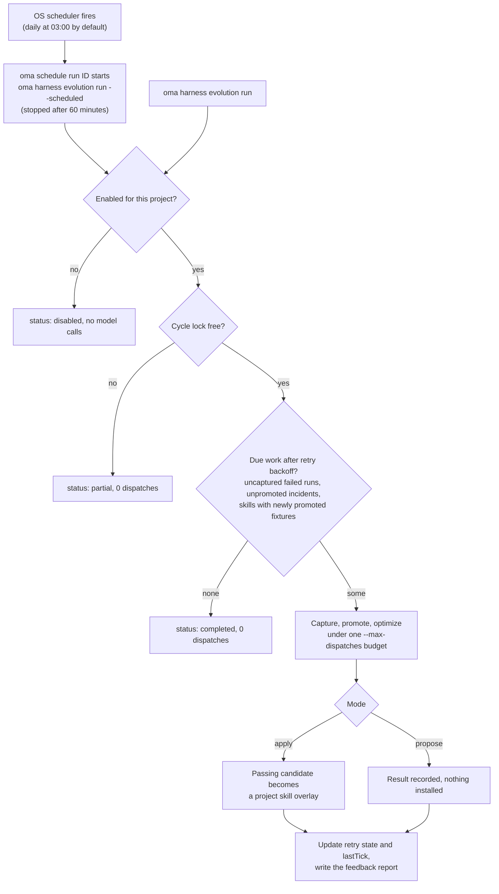

# Project Harness Evolution

OMA can collect evidence from tracked agent runs and process failures in a scheduled feedback cycle. Automatic skill changes are **off until you enable them for a project**. Every cycle has a finite model-call budget, and an applied change must pass the existing skill evaluation gates.

The automated path improves skill documents. Changes to the optimizer or maintainer procedure remain a separate, manually invoked [meta-optimization](./skill-opt.md#meta-optimization-the-procedure-as-the-candidate).

## Enable a project

Run from the project root:

```bash
# Example allowance: at most 300 model dispatches per scheduled cycle
oma harness evolution enable --max-dispatches 300

# Evaluate proposals without applying them
oma harness evolution enable --max-dispatches 300 --mode propose

# Choose a schedule in the operating system's local time
oma harness evolution enable --max-dispatches 300 --cron "0 3 * * *"

oma harness evolution status --json
```

`enable` prints the saved settings and the scheduler job ID:

```json
{
  "enabled": true,
  "scheduleId": "sch_abcdefgh2345",
  "mode": "apply",
  "maxDispatches": 300
}
```

`status --json` returns `config`, `schedule` (the scheduler entry, or `exists: false`), `pending` (the number of unfinished retries), `conflicts` (per-skill overlay conflicts), and `state` (retries and `lastTick`).

The default schedule is daily at 03:00 local time, and the default mode is `apply`. `--max-dispatches` is required when enabling and must be a positive integer. The example value is a call allowance, not a price estimate or a promise that a cycle will finish. Larger fixture suites and repeated grading consume more calls.

<!-- oma-docs:ignore-start -->
Settings are saved in `.agents/evolution/harness-evolution.json`. Generated evidence, retry state, and the cycle lock live under `.agents/state/harness-evolution/`.
<!-- oma-docs:ignore-end -->

Enabling registers a built-in job with OMA's existing [OS scheduler](./scheduled-agents.md); it appears in `oma schedule list` with agent `__builtin__`. At fire time, `oma schedule run <id>` starts `oma harness evolution run --scheduled` in this project and stops it after 60 minutes, so size `--max-dispatches` for a cycle that fits in an hour. Re-enabling updates the project's job instead of creating another one. Stop the schedule with `oma harness evolution disable` rather than `oma schedule delete`, so the saved settings stay consistent.

```bash
# Run one cycle now under the saved mode and budget
oma harness evolution run --json

# Stop future cycles; retain evidence and applied improvements
oma harness evolution disable
```

`run --json` returns `status` (`completed`, `partial`, or `disabled`), `dispatchesUsed`, and `maxDispatches`. When another cycle holds the lock, `run` returns `partial` with 0 dispatches. A cycle that stops with an error, such as an exhausted allowance, exits with that error and records `partial` or `failed` in `state.lastTick`.

A disabled project does not run model work through the evolution command, including a late scheduled invocation. Disabling does not roll back changes already applied.

## What happens automatically

The diagram shows one cycle, whether the scheduler fires it or you run it by hand.



1. **Record completion evidence.** OMA-tracked runs leave local references to their outcome and verification evidence. This completion step makes no extra model calls. Repeated completion of the same run does not create duplicate evidence.
2. **Collect failures on schedule.** The cycle scans eligible failed runs, derives expectations from their recorded task contracts, and checks that a proposed regression fixture actually rejects the preserved failing output.
3. **Optimize affected skills.** Incidents are grouped by skill. Each skill is optimized under the existing training, validation, final-test, isolation, and negative-transfer checks.
4. **Apply or report.** In `apply` mode, a passing candidate becomes a project skill overlay. In `propose` mode, the cycle records the result without installing it.
5. **Report changes.** Use status and the existing promotion history to inspect results. Applied changes also feed the next-session evolution notice.

OMA does not automatically observe every native conversation or every user correction. The input is the run evidence OMA actually tracks. A run without a preserved output or acceptance contract may require a manually authored [incident specification](./harness-incidents.md#capture-an-incident).

## Budget and retries

The cycle shares one call allowance across capture, rubric drafting, routing, grading, skill optimization, neighboring tasks, and final evaluation. A model call charges the allowance before dispatch. Calls retried by the execution layer also count. A skill's stricter constitution limit still applies.

When the allowance is exhausted, evaluation remains incomplete and the affected candidate cannot be applied. The report records the usage and pending work. One project cycle runs at a time.

Creating a fixture does not mark the incident's optimization as complete. Interrupted or failed optimization remains pending and can resume after backoff without duplicating the fixture. The backoff doubles per failed attempt: 2, 4, 8, … minutes, up to 1024 minutes (about 17 hours). A fully evaluated result with no acceptable change is recorded as processed, so the same evidence does not trigger unlimited repeated optimization. New evidence can trigger another attempt.

Switching from proposal mode to apply mode makes unapplied proposals eligible for processing. Applying still requires current evaluation and unchanged source content; an old proposal is not an unconditional write instruction.

## Persistent skill overlays

Automatic changes are stored separately from the managed skill definitions in the project's user-owned evolution area, `.agents/evolution/skills/<skill>/` (with an `overlay.json` record). Evaluation and project-local vendor skill links use the effective body selected from the managed base and its eligible overlay. Home-scoped vendor installations are not retargeted to a project overlay. An unmanaged copy in a project vendor directory must be resolved before automatic application. Skill resources remain available at their relative paths.

An overlay records the base it was evaluated against. After `oma update`:

- An unchanged base continues to use its overlay.
- A changed base leaves the overlay preserved but marks it as a conflict and uses the updated base. The old evaluation cannot establish that the overlay is safe on the new base.

An edit made while optimization is running prevents the candidate from overwriting that changed content. Status reports conflicts for review.

## Inspect and undo

```bash
oma harness evolution status --json
oma skill promotions --all
oma skill rollback --skill oma-docs
```

Promotion records retain the candidate and parent hashes, evaluation evidence, and a reviewable patch. Rolling back the first overlay restores use of the managed base; rolling back a later overlay restores the previous overlay. Unknown edits are preserved: rollback refuses to discard content that no longer matches the recorded candidate.

Manual `oma skill optimize --apply` still writes the managed `SKILL.md`, but it refuses while a project overlay is active for that skill (`[oma skill opt] an active project overlay owns this skill; ...`). Roll the overlay back first with `oma skill rollback --skill <id>`, or let the evolution cycle apply the change. Scheduled evolution explicitly selects the overlay application path.

## Scope of the evidence

A passing software test confirms the wiring and evaluation rules. It does not establish that repeated automatic changes improve a project's real work over time. Inspect actual promotions, costs, regressions, and rollback history before increasing the allowance or expanding automation. L5 procedure promotion is not invoked by this scheduled feedback loop.

## See also

- [Incident Regression Cases](./harness-incidents.md) — capture, promote, and reproduce the incidents this cycle processes.
- [Skill Optimization](./skill-opt.md) — the gates every applied change passes.
- [Scheduled Agents](./scheduled-agents.md) — the OS scheduler that fires the cycle.
