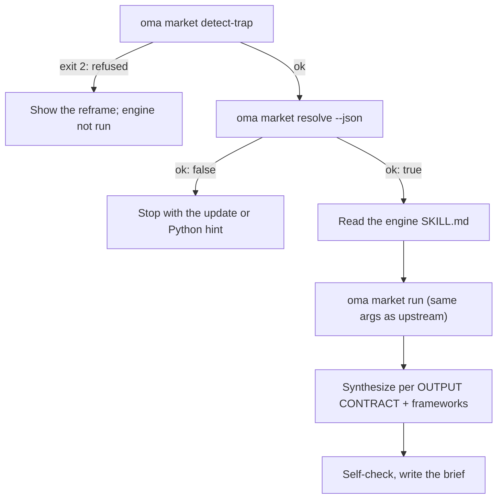

# Market Research

`oma-market` answers "what are people actually saying about X in the last N days" — pain points, trends, competitor sentiment, discovery — from community sources with real engagement numbers: Reddit (upvotes and top comments), X, YouTube transcripts, TikTok, Instagram, Hacker News, Polymarket, GitHub, arXiv, Techmeme, Digg, LinkedIn, StockTwits, Bluesky, the web, and more.

The research itself runs on the upstream [**last30days**](https://github.com/mvanhorn/last30days-skill) engine (MIT, Python 3.12+). oh-my-agent does not fork it: the engine is installed as an agent skill through the [skills CLI](https://github.com/vercel-labs/skills), and oh-my-agent gates every run and adds a strategic-framework layer on top. Release cadence, star count, and provider coverage belong to the upstream project and can change.

---

## Quick start

Ask your agent in plain language. Phrases such as "market research", "pain points", "competitor analysis", "voice of customer", or "trend detection" activate the `oma-market` skill:

```text
Find the top pain points developers report about VS Code remote containers in the last 30 days.
Compare Cursor vs Windsurf community sentiment over the last 90 days, frameworks swot,5f.
```

| Steer with | Effect |
|---|---|
| "A vs B", or `--vs B` | Competitor intent: upstream comparison flow + SWOT + Porter's 5F |
| `--days 7`, `30`, `90`, or `180` | Research window |
| `--intent pain`, `trend`, `competitor`, or `discovery` | Overrides the automatic intent classification |
| `--frameworks none`, or a list such as `swot,5f,pestel` | Turns framework sections off, or picks them |

The result is one brief at `.agents/results/market/{topic-slug}-{YYYYMMDD}.md`. Its first line is the engine badge (`🌐 last30days v<version> · synced <date>`), followed by ranked evidence clusters with links, the framework sections, and the engine footer that lists skipped sources.

| Runs without keys | Needs the upstream setup wizard (keys or cookies) |
|---|---|
| Reddit, Hacker News, GitHub, Polymarket, arXiv, Techmeme, Digg, web | X, YouTube transcripts, TikTok, Instagram, and other keyed sources; skipped sources are listed in the footer |

---

## Install the engine (Python 3.12+ required) {#always-the-latest-engine--nothing-to-install}

```bash
oma market update   # installs last30days when missing, otherwise updates it
# runs: bunx skills add mvanhorn/last30days-skill --skill last30days -g -y
#   or: bunx skills update last30days -g -y
```

```bash
# Illustrative output; the version, install path, and Python version vary.
oma market resolve
# engine:   last30days
# reason:   last30days 3.21.1 via home:~/.agents/skills
# root:     ~/.agents/skills/last30days
# skill:    ~/.agents/skills/last30days/SKILL.md
# version:  3.21.1
# python:   python3.14 (3.14.7, PATH)
# save_dir: <workspace>/.agents/results/market/raw
```

- `resolve` only reads installed skill directories and never touches the network. When nothing is installed it is not ok and names the install command; the skill asks before running `oma market update`.
- `oma update` does not install the engine. Update it with `oma market update` (or `bunx skills update last30days -g -y`).
- Python: `LAST30DAYS_PYTHON` → `market.python` → `python3.14`, `python3.13`, `python3.12`, `python3`, `python` on PATH (must be ≥ 3.12) → `uv python find '>=3.12'`. If none is found, `resolve` is not ok and prints the install hint; the skill stops rather than degrade to web-search-only research.
- Engine configuration and API keys live in `~/.config/last30days/` (written by the upstream setup wizard with your consent), so they survive engine updates.

Resolution order (first hit wins): `market.path` → `LAST30DAYS_HOME` → installed skill dirs (`.agents|.claude|.codex|.cursor|.qwen|.kiro|.gemini|.copilot/skills/last30days` in the project, then under `~`, then `~/.config/agents/skills/last30days` and the Claude Code plugin cache). A Claude Code plugin install is updated through `/plugin`, not `oma market update`.

```bash
oma market run -- --help     # the engine's own flags (without `--`, oma prints its own help)
```

Earlier releases kept their own copy under `~/.cache/oma-market/`. It is no longer read; you can delete it.

---

## Configuration

```yaml
market:
  path: null                      # explicit engine dir (pin)
  python: null                    # interpreter override
  save_dir: .agents/results/market/raw
```

`managed`, `channel`, and `check_interval_min` are deprecated: they still validate but are ignored, and `resolve` prints a warning while they are set.

---

## How a run works



1. `oma market detect-trap "<topic>"` — refuses keyword-trap and demographic-shopping topics (exit 2) with a reframe suggestion. An empty topic or one over 200 characters exits 4.
2. `oma market resolve --json` — engine + Python; stops on `ok: false`.
3. The agent reads the resolved engine's `SKILL.md` top to bottom and follows it: first-run setup wizard, pre-research resolution of handles / subreddits / hashtags (when WebSearch is available), query planning, the precondition gate.
4. `oma market run "<topic>" <flags> --emit=compact` — identical arguments to the upstream `python3 scripts/last30days.py` call; `--save-dir` is added from `market.save_dir`.
5. Synthesis follows the upstream OUTPUT CONTRACT (badge first line, ranked evidence clusters, LAWs 1–8), then oma appends framework sections that cite only engine clusters:

| Intent | Engine shaping | Frameworks |
|---|---|---|
| pain | complaint-shaped topic, `--days 30`, `--deep` when thin | SWOT |
| trend | `--days 7/30/90/180`, `--discover "<domain>"` for "what's hot" | SWOT |
| competitor | `"A vs B"` → upstream comparison flow | SWOT + Porter's 5F |
| discovery | `--discover`, then `--drill` follow-ups | SWOT + PESTEL |

6. Self-check, then write `.agents/results/market/{topic-slug}-{YYYYMMDD}.md`.

---

## Failure modes

| Situation | Result |
|---|---|
| Topic refused by detect-trap | Reframe shown; engine not run. `--force` only after explicit user reconfirmation |
| Engine not installed | `ok: false` → `oma market update` (installs it with the skills CLI) |
| No Python 3.12+ | `ok: false` with install hint (brew / apt / `uv python install 3.12`), or set `LAST30DAYS_PYTHON` / `market.python`; no web-search-only substitute |
| `oma market update` fails | The skills CLI error is shown; an existing install keeps working |
| Sources without keys | Skipped inside the engine and listed in the footer; enable via the upstream setup wizard |

---

## Next steps

- [Content and Research Workflows](./content-and-research.md) — pick the right capability for other research and document tasks
- [Diagram Engine](./diagram-engine.md) — the same skills-CLI install pattern for archify
- [oma-config.yaml semantics](./oma-config-semantics.md) — how the `market:` section is merged
- [CLI Commands: market](../cli-interfaces/commands.md#market) — full option list
- Upstream: [mvanhorn/last30days-skill](https://github.com/mvanhorn/last30days-skill)
