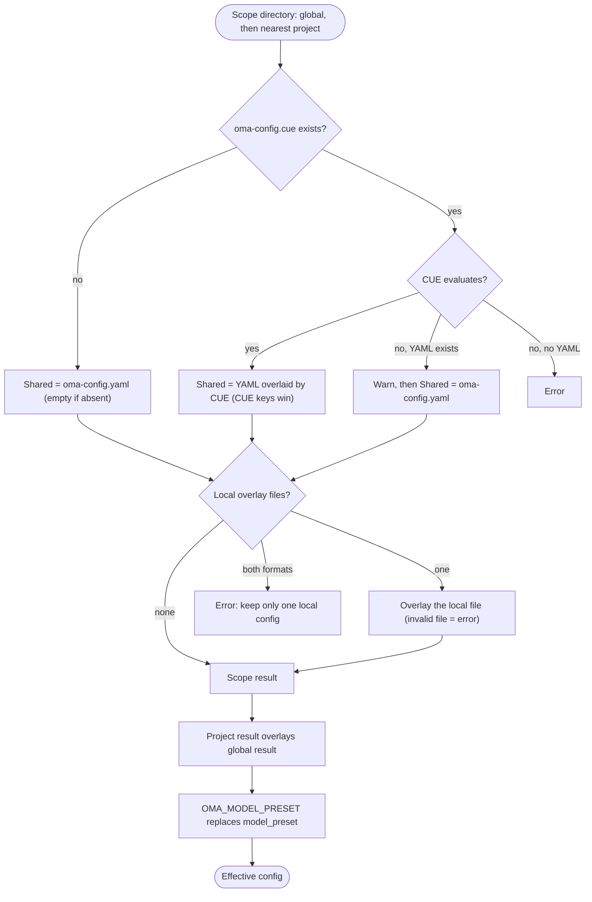

## Overview

OMA reads global defaults from `$OMA_HOME/.agents/` (default `~/.oma/.agents/`),
then overlays the nearest project `.agents/` found above the working directory.
Each scope can have these layers:

- **Shared**: `.agents/oma-config.yaml` and `.agents/oma-config.cue`. When both exist and the CUE file evaluates, every key the CUE file sets overrides the same key in the YAML file; keys only in the YAML file stay as defaults. When the CUE file cannot be evaluated, OMA warns and uses the YAML file alone.
- **Local**: `.agents/oma-config.local.cue` or `.agents/oma-config.local.yaml` (one file, overlaid on the shared result; keep this file private).

Project shared and local settings override global settings. Different ancestor
project roots are never merged; an empty nearest `.agents/` is still a project
boundary. Global defaults do not change project identity. See
[Configuration reference](/docs/guide/configuration-reference) for supported keys and defaults.

## Resolution flow

OMA runs the same steps for the global scope and for the nearest project scope, then merges the two results:



When no project `.agents/` is found, or the walk reaches the global `.agents/` directory itself, only the global result is used.

## Precedence table

Later rows win. Plain maps merge recursively; arrays, scalars, and `null` replace the earlier value.

| Order | Layer | Rule |
|:-----:|-------|------|
| 1 | Global `oma-config.yaml` | Defaults beneath the global CUE file when both exist. |
| 2 | Global `oma-config.cue` | Overrides global YAML key by key. If evaluation fails (for example, the `cue` CLI is missing) and YAML exists, OMA prints `[config] CUE evaluation failed at ... Falling back to oma-config.yaml` and uses the YAML alone. |
| 3 | Global `oma-config.local.cue` or `oma-config.local.yaml` | One file only. A malformed local file is an error. |
| 4 | Project `oma-config.yaml` | Nearest project `.agents/` at or above the working directory. |
| 5 | Project `oma-config.cue` | Overrides row 4 key by key, with the same fallback as row 2. |
| 6 | Project `oma-config.local.cue` or `oma-config.local.yaml` | One file only. A malformed local file is an error. |
| 7 | `OMA_MODEL_PRESET` | A non-empty value replaces `model_preset` for that process. An empty value is an error. |

:::tip[Which file do I edit?]
If `.agents/oma-config.cue` exists, a key set there overrides the same key in `oma-config.yaml`. Change that key in the CUE file, or put a machine-specific value in a local overlay. `oma doctor --profile` lists the files it loaded under **Configuration sources**.
:::

For a project-local override, put only the changed leaves in the local file. For example, a local model choice can be kept out of the shared file:

```yaml
# .agents/oma-config.local.yaml
model_preset: claude
agents:
  backend:
    model: anthropic/claude-sonnet-5-5
```

Run the command from the project so the nearest `.agents/` directory is selected. A malformed local file fails loudly; fix or remove it before retrying.

## Check your configuration

```bash
oma doctor --profile                           # loaded files, resolved preset, per-role model and CLI
cue export --out json .agents/oma-config.cue   # what the CUE layer evaluates to (requires the cue CLI)
```

| Symptom or message | Cause | Fix |
|--------------------|-------|-----|
| A YAML change has no effect | `oma-config.cue` sets the same key | Change the key in the CUE file, or override it in a local file |
| `[config] CUE evaluation failed at ... Falling back to oma-config.yaml` | The `cue` CLI is missing, or the CUE file does not evaluate | Install `cue`, or fix the error that `cue export` reports |
| `Both local CUE and YAML configs exist in ...; keep only one local config.` | Two local overlay files | Delete one of them |
| `OMA_MODEL_PRESET must be non-empty` | The variable is exported but empty | `unset OMA_MODEL_PRESET` |
| `Unknown model_preset "..."` | Typo, or a missing `custom_presets` entry | Use a preset named in the error message |
| `Legacy preset name "..." is no longer valid` | A pre-rename key such as `claude-only` | Rename it as the message says, or run `oma update` |
| `[model-registry] User inline model "..." failed validation` | An incomplete or invalid `models:` entry | See [Inlining model slugs](/docs/guide/per-agent-models#inlining-model-slugs) |

## Default values

| Key | Default | When applied |
|-----|---------|--------------|
| `auto_update_cli` | `true` | Both files absent or key missing |
| `serena.mode` | `bridge` | Both files absent or key missing |
| `serena.auto_update` | `true` | Both files absent or key missing |
| `telemetry` | `false` | Both files absent or key missing |
| `language` | `en` | Both files absent or key missing |
| `model_preset` | Required | The shipped project template uses `auto`; the schema requires a non-empty value. |
| `translation_voice` | `balanced` | Both files absent or key missing |
| `timezone` | System timezone | Both files absent or key missing |

## Read order rationale

Edit `~/.oma/.agents/oma-config.yaml` (with `OMA_HOME` set: `<OMA_HOME>/.agents/oma-config.yaml`)
for user-wide defaults. Project shared/local files override those defaults
without inheriting unrelated ancestor projects. A project selection of `none`
for semantic memory overrides global AgentMemory selection.

## Notes

- `language` in `oma-config.yaml` controls agent response language. It is **not** used to determine install/update warning messages — those use the system locale (`$LANG`) because `oma-config.yaml` is not yet loaded at install time.
- `auto_update_cli` uses project overrides before global defaults and defaults to enabled when neither scope sets it.
- `telemetry` (default `false`) maps to each vendor's own opt-out, written by `oma install` / `oma update` / `oma link`: Claude `DISABLE_TELEMETRY` + `CLAUDE_CODE_DISABLE_FEEDBACK_SURVEY`, Gemini/Qwen `privacy.usageStatisticsEnabled`, Codex `analytics.enabled` + `feedback.enabled`, Grok `[features] telemetry`, and Antigravity (agy) `enableTelemetry` in `~/.gemini/antigravity-cli/settings.json`. Setting `telemetry: true` opts back in by removing oma's opt-out for that vendor.
- `diagram` (engine `auto` / `archify` / `mermaid`, `explain_sidecar`, `archify.path|quality|open`) is a sparse skill-override section like `video` / `image`; `archify.managed|channel|check_interval_min` are deprecated and ignored. See [Diagram Engine](/docs/guide/diagram-engine).
- `video.hyperframes.check_interval_min` throttles the latest-version checks for the per-run HyperFrames toolchain (`oma video compose`, `oma update`); the heygen-com/hyperframes skills are skills-CLI installs. The shipped CUE schema does not define `video.hyperframes` yet, so `cue export` rejects it inside the schema block (`field not allowed`); set it in `oma-config.yaml` or a local YAML overlay.
- `market` (`path|python|save_dir`) configures the installed `last30days` engine behind `oma market`; `managed|channel|check_interval_min` are deprecated and ignored. See [Market Research](/docs/guide/market-research).
- The typed runtime schema covers `providers`, `free`, `agents`, `models`, `custom_presets`, `vendors`, `session`, `docs`, and the sparse skill sections. Shipped templates also contain consumer-owned blocks such as `scm`, `memory`, `serena_reaper`, and `mcp`; their consumers own their nested keys. Do not infer a key from this list—use the [Configuration reference](/docs/guide/configuration-reference) and the feature guide for that block.
- Editing `oma-config.yaml` directly is safe. `oma install` and `oma update` use regex-level field replacement and preserve user-edited keys that they do not manage (e.g., custom `agents:` overrides, `session.quota_cap`).
- `oma update` additionally appends top-level keys that the shipped template defines but your file lacks (with template defaults), under an `# Added by oma update` marker. Keys you already have are never modified — existing content stays byte-identical. Keys you deliberately deleted will reappear with the template default; set the value explicitly instead of deleting the key to opt out.
