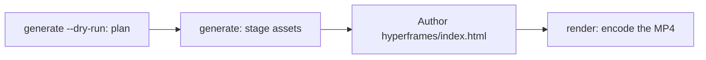

# Video Generation

`oma-video` is the video router for oh-my-agent. From a one-line brief it composes a script, narration, visuals, and captions, then records the plan in a run directory. Provider stages are key-optional and can use local or deterministic fallbacks; a real MP4 still requires a working compositor and valid composition.

The skill activates on "shorts", "reels", "screencast", or phrases such as "make a video", "explainer video", "demo video", "walkthrough video", or "video from README", or when another skill needs a video as a side effect.

> **TL;DR** `oma video generate` plans a run and stages assets. With the default HyperFrames compositor it does not encode an MP4: author `<runDir>/hyperframes/index.html` (the `/video` workflow does this for you), then run `oma video render <runDir>`. On the first run, start with `oma video doctor --install`.

---

## When to use

- Turning a brief, README, code, or data into a short clip.
- Producing a narrated explainer or a demo/walkthrough recording.
- Any reproducible "brief → `.mp4`" pipeline you want to re-run deterministically.

## When NOT to use

- Single still images → use [`oma-image`](/docs/guide/image-generation).
- Live screen broadcasting / streaming → out of scope (oma never records the screen; you supply the recording).
- Standalone narration audio → use `oma-voice`.

---

## Modes at a glance

| Mode | Aspect | What it composes |
|------|--------|------------------|
| `shorts` | 9:16 | Short-form vertical clip (script → narration → visuals → captions). |
| `explainer` | 16:9 | Horizontal explainer from a README, code, or data brief. |
| `demo` | derived | A walkthrough built from your own screen recording, supplied with `--capture <file>`. `--source web --url <url>` only stores the masked URL as context; oma never opens a browser, records the screen, or automates login. |

The mode picks sensible defaults; pass the relevant flags when you need different values.

---

## Quick start

In an agent, `/video three quick tips for better focus` runs every step below for you. By hand, the pipeline has four steps:



```bash
oma video doctor --install   # first run only: HyperFrames toolchain, Chrome Headless Shell, Pretendard

# 1. Plan from an agent-authored script (schema: .agents/skills/oma-video/resources/script-schema.md)
oma video generate "three quick tips for better focus" --mode shorts --script ./script.json --dry-run --output json

# 2. Stage assets (narration needs --voice <profile>; the default is a silent video)
oma video generate "three quick tips for better focus" --mode shorts --script ./script.json --output json

# 3. Author <runDir>/hyperframes/index.html per its AUTHORING.md, then encode
oma video compose <runDir>
oma video render <runDir> --output json

# Demo from your own recording; without --polish the recording itself becomes the output
oma video generate "product walkthrough" --mode demo --capture ./capture.mp4
```

<!-- oma-docs:ignore-start -->

| Step | Command | Result |
|---|---|---|
| Plan | `generate --dry-run` | `script.json`, `render-spec.json`, `manifest.json`; no rendering |
| Stage assets | `generate` | visuals, captions, optional audio and music, a `hyperframes/` scaffold, and the warning `composition pending` |
| Author | edit `hyperframes/index.html` | the composition |
| Render | `render <runDir>` | `{mode}-{slug}.mp4` and an updated manifest |

<!-- oma-docs:ignore-end -->

Without `--script`, the CLI builds a deterministic three-scene skeleton from the brief text. `--locale` sets the language tag for narration and captions but does not translate them; write the brief or `script.json` in the target language.

Each run prints its run directory. A fixed `--seed` stabilizes the deterministic planning inputs; live provider output and capture footage can still vary. Re-render an existing run directory when you need to reuse its saved render spec and assets.

Other tools that shell out to `oma video generate --output json` parse a JSON envelope from stdout: `{exitCode, runDir, manifestPath, scriptPath, renderSpecPath, warnings, error}`. There is no `outputs` key — read output/asset paths from the manifest at `manifestPath`.

---

<a id="always-latest-hyperframes--you-author-the-composition"></a>
## Managed HyperFrames toolchain and composition authoring

oh-my-agent ships **no HyperFrames composition code**. Each run gets its own project at `<runDir>/hyperframes/`, scaffolded by `oma video compose` on the latest npm HyperFrames (toolchain cache `~/.cache/oma-video/hyperframes/<version>/`, shared via a `node_modules` symlink) and the [heygen-com/hyperframes](https://github.com/heygen-com/hyperframes) `hyperframes` and `hyperframes-cli` skills installed through the [skills CLI](https://github.com/vercel-labs/skills). The agent authors the generated composition source following the scaffold's `AUTHORING.md`, the skills, and the mode spec in `.agents/skills/oma-video/resources/hyperframes-authoring/`.

```bash
oma video generate "…"                     # → render-spec.json + <runDir>/hyperframes/ (composition pending)
oma video compose <runDir> --output json   # refresh scaffold / print the contract (idempotent)
#   author hyperframes/index.html as instructed by AUTHORING.md
oma video render <runDir> --output json    # lint → render with the cached HyperFrames CLI → ffprobe; exit 1 on any failure
```

- Toolchain latest-version checks (npm) are throttled by `video.hyperframes.check_interval_min` (default 60; `0` = every compose). `oma update` respects the interval; `oma video doctor --upgrade` forces a check; offline runs use the cached toolchain and report `stale`.
- Skills: `oma video doctor --install` installs missing ones (`bunx skills add heygen-com/hyperframes --skill hyperframes --skill hyperframes-cli -g -y`); `--upgrade` also updates installed ones; `oma update` only updates skills that are already installed. Without them, `AUTHORING.md` links the upstream docs instead. The old `~/.cache/oma-video/hyperframes-skills/` copy is no longer read and can be deleted.
- Reproducibility lives in the run dir: `render-spec.json`, the authored composition source, and the toolchain version recorded in the generated HyperFrames package metadata. Re-rendering the same run reuses that render contract; a new run checks the latest HyperFrames.
- A lint or render failure is **not** hidden behind a placeholder (that exists only for `OMA_VIDEO_MOCK=1`): `oma video render` exits 1 with the diagnostics and the agent fixes the composition using the latest skills. Breakage on a new HyperFrames release is a composition bug, never a reason to pin.

```yaml
video:
  hyperframes:
    check_interval_min: 60    # toolchain only; 0 = check on every compose
```

---

## CLI reference

```bash
oma video generate <brief...> [options]
oma video doctor [--install|--upgrade|--install-mpt|--install-strudel]  # toolchain readiness / provisioning
oma video compose <runDir>       # prepare HTML project and authoring contract
oma video render <runDir>        # re-render from render-spec.json (deterministic)
oma video provider list         # provider availability + key/fallback status
```

### Key flags

| Flag | Purpose |
|------|---------|
| `--mode <m>` | `shorts` \| `explainer` \| `demo`. |
| `--aspect <a>` | `9:16` \| `16:9` \| `1:1` \| `auto`. |
| `--locale <lang>` | Narration/caption language tag. |
| `--captions <s>` | `tiktok` \| `lower-third` \| `none` (key-free alignment). |
| `--visual <m>` | `auto` \| `generate` \| `stock` \| `aigc` \| `slide`. |
| `--voice <profile>` | Narration voice, or `none` (the default; omit it and the video renders silent with estimated caption timing). |
| `--music <mode>` | `upbeat`, `calm`, `cinematic`, `lofi`, `piano`, or `none`. |
| `--compositor <c>` | `hyperframes` (default) \| `mpt`. |
| `--capture <path>` | Your recording for demo mode: `.mp4`, `.mov`, `.webm`, or `.mkv`, stored inside the project. |
| `--source <k>` | Demo capture source: `file` or `web` (default: `file`). |
| `--url <url>` | Context URL for `--source web`, stored masked in `manifest.json`. Required with `--source web`; it never starts a capture and does not replace `--capture`. |
| `--polish` | Overlay the HyperFrames composition on captured footage. |
| `--device`, `--ready-selector`, `--show-cursor`, `--capture-timeout`, `--capture-stop` | Accepted but not used: oma does not drive a browser or record the screen. |
| `--output-dir <path>` | Output base directory. Paths outside `$PWD` require `--allow-external-output`. |
| `--allow-external-output` | Permit output paths outside `$PWD`. |
| `--max-usd <n>` | Cost ceiling (default `0.2`). When the running estimate reaches it, the run stops with exit 1; rerun with `-y` or a higher value. |
| `--duration <sec>` | Target length in seconds (1–180), or `auto`. |
| `--seed <n>` | Deterministic seed. |
| `--dry-run` | Emit script / render-spec / manifest, skip rendering. |
| `--script <path>` | Agent-authored `script.json` to inject (overrides the skeleton; controls narration, on-screen text, and per-scene visual prompts). |
| `-y, --yes` | Allow providers whose estimate reaches `--max-usd` (same as `OMA_VIDEO_YES=1`). |
| `--timeout <sec>` | Time limit in whole seconds for each visual and music provider call (default `600`). Unit suffixes are not parsed: `2m` means 2 seconds. |
| `--output <f>` | CLI output: `text` (default) or `json`. |
| `--no-brief-in-manifest` | Store a SHA-256 of the brief instead of the raw brief. |

---

## Key-optional providers

Provider stages resolve to a **real branch** and, where the stage supports it, a **deterministic fallback**. Missing keys can therefore leave a planned run with estimated timing or local assets. The compositor is a required final stage and has no normal placeholder fallback:

| Capability | Real branch (what enables it) | Fallback |
|------------|-------------|----------|
| script | agent-authored `script.json` passed with `--script <path>` (the `/video` workflow writes it) | deterministic three-scene skeleton from the brief text |
| voice | `oma-voice` (Voicebox or VoiceStudio, local; chosen by `voice.backend`) with `--voice <profile>` | silent video with estimated timing (`--voice none`, the default) |
| visual | `oma-image`, `oma-slide`, Pexels stock clips when `PEXELS_API_KEY` is set | placeholder asset |
| visual: `aigc` | not wired yet; `RUNNINGHUB_API_KEY` enables the provider, which still writes placeholders | placeholder asset |
| caption | `.srt` and `.vtt` aligned to `timing.json`, in the script's language | same; translation to `--locale` is not wired yet |
| music | Strudel bed after `oma video doctor --install-strudel` | no music track |
| capture | a recording you supply with `--capture <file>` | none: without `--capture`, demo mode prints recording instructions and exits 3 |
| compositor | HyperFrames (managed) or MoneyPrinterTurbo | no compositor fallback; the run fails with diagnostics |

No credential automation: you perform any on-screen login while recording; URLs and query tokens are masked in logs and the manifest.

Captions render as **static windowed cues** — the single caption line active at the current frame, CSS-wrapped, with no per-word animation.

---

## Toolchain and `doctor`

The heavy toolchain (the managed HyperFrames project's `node_modules`, the embedded Pretendard font, the MoneyPrinterTurbo checkout, the Strudel music project, Chrome Headless Shell) is **provisioned on demand**, never shipped in the package. Plain `doctor` only reports status; it does not install anything:

```bash
oma video doctor
```

It reports `node`, `chromium`, `ffmpeg`, `ffprobe`, `hyperframes-toolchain`, `hyperframes-skills`, `pretendard-font`, `mpt-project`, `strudel`, `voicebox`, `voicestudio`, `oma-image`, `pixelle`, and `cap`, and prints the install hint for anything missing. Run `oma video doctor --output json` for the authoritative list. The baseline requires Node.js 22+, the HyperFrames toolchain and its Chrome browser, FFmpeg/FFprobe, and `oma-image`. A real MP4 also requires authored HTML.

Use the install flags to provision the toolchain:

```bash
oma video doctor --install             # warm the latest HyperFrames toolchain + Chrome Headless Shell + Pretendard + heygen-com/hyperframes
oma video doctor --upgrade             # force a latest-version check now
oma video doctor --install-mpt         # MoneyPrinterTurbo checkout (clone + venv + deps) for --compositor mpt
oma video doctor --install-strudel     # Strudel music renderer for --music (installs AGPL-3.0-or-later packages locally)
```

`--install` also fetches the embedded Pretendard font (pinned release) into the shared toolchain cache — this is part of the determinism boundary. On a network failure it warns and the render falls back to system fonts; browser and OS differences can still affect the encoded output.

---

## Output layout

```text
.agents/results/videos/{timestamp}-{shortid}-{mode}/
├── script.json          # scenes + narration
├── render-spec.json     # the deterministic render contract
├── timing.json          # per-segment timing (voicebox-stt, voicestudio-stt, or estimated)
├── captions.srt / .vtt
├── audio/narration-01.wav     # one track; absent when the video is silent
├── music/                     # pattern.strudel, bgm.wav, bgm.mp3 (with --music and Strudel installed)
├── visuals/scene-*.{png,svg,…}
├── hyperframes/         # index.html, AUTHORING.md, local assets and toolchain link
├── {mode}-{slug}.mp4    # the rendered output (slug derived from the script title)
└── manifest.json        # providers, assets, cost, warnings
```

The `render-spec.json` + assets are the determinism boundary.

---

## Troubleshooting

<!-- oma-docs:ignore-start -->

| Symptom | Cause / fix |
|---------|-------------|
| No MP4 is produced | A compositor, composition, or toolchain check failed. Run `oma video doctor`, then `oma video compose <runDir>` and fix the reported composition before rerunning `oma video render <runDir>`. |
| Narration is silent (`source: estimated`) | `--voice` defaults to `none`, or no speech backend is reachable. Pass `--voice <profile>` with a profile from the selected backend (Voicebox app, or a VoiceStudio profile ID with `voice.backend: voicestudio` or `auto`) and start that app, or accept estimated timing. |
| Demo run exits 3 with recording instructions | No `--capture` file was given (also with `--source web`); oma does not record the screen. Record the flow with Cap, QuickTime, or OBS, save it inside the project, and rerun with `--capture ./walkthrough.mp4`. |
| `--capture` rejected (exit 4) | The file does not exist, is outside the project directory, or is not `.mp4` / `.mov` / `.webm` / `.mkv`. Copy the recording into the project, for example `./captures/demo.mp4`. |
| Run stops at the cost ceiling (exit 1) | The running estimate reached `--max-usd`. Rerun with `-y` or a higher `--max-usd`. |
| `--out path "…" is outside $PWD. Use --allow-external-out to override.` (exit 1) | `--output-dir` points outside the project. Rerun with `--allow-external-output` (the message still shows the old flag name), or pick a directory inside the project. |
| `oma video doctor` lists `oma-image` as missing | If the detail reads `Removed option --format. Use --output.`, the readiness probe itself failed and says nothing about your vendors; check them directly with `oma image doctor`. Otherwise no image vendor is ready, so visuals fall back to placeholders: run `oma image doctor` and set up one vendor. |
| Render is slow on the first run | The HyperFrames browser / MPT checkout is being provisioned once; subsequent runs reuse the cache. |

<!-- oma-docs:ignore-end -->

---

## Next steps

- [`/video` workflow](../core-concepts/workflows.md#video) — the brief → script → assets → render-spec → HyperFrames pipeline.
- [Image Generation](./image-generation.md) — the still-image router reused as a video visual provider.
- [Content and Research Workflows](./content-and-research.md) — voice, slides, and other content capabilities.
- [CLI Commands: video](../cli-interfaces/commands.md#video) — full `oma video` option list.
