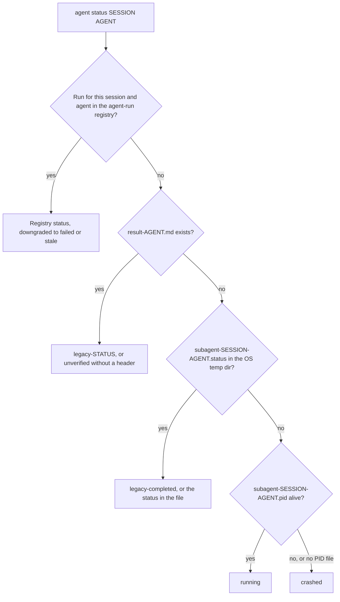

# CLI-Optionen

## Kurzreferenz {#quick-reference}

| Ich möchte ... | Verwende |
|:-------------|:----|
| Ohne Nachfragen ausführen | `-y` / `--yes` (ebenfalls berücksichtigt: `OMA_YES=1`, `CI=true`); `oma update --ci` für schlichte, nicht-interaktive Ausgabe |
| JSON erhalten | `--json`, `--output json` oder `OH_MY_AG_OUTPUT_FORMAT=json`. Ausnahmen siehe [Ausgabeoptionen](#output-options) |
| Die globale Installation ansprechen | `-g` / `--global` oder `OMA_INSTALL_GLOBAL=1`; `OMA_HOME` verschiebt das globale Speicherstammverzeichnis |
| Vor einer Änderung eine Vorschau sehen | `--dry-run`, wo ein Befehl es aufführt. Siehe [Welche Befehle JSON unterstützen](#commands-supporting-json-output) |
| Die Flags eines Befehls sehen | `oma <command> --help`, `oma describe "<command>"` oder die [Registry](#complete-public-option-registry) am Ende dieser Seite |
| Ein Skript reparieren, das nach einem Upgrade nicht mehr funktioniert | [Umbenannte Befehle und Optionen](#renamed-commands-and-options) |
| In einem Skript auf Fehler verzweigen | [Exit-Codes](#exit-codes) |

---

## Globale Optionen {#global-options}

Diese Optionen stehen beim Root-Befehl `oma` / `oh-my-agent` zur Verfügung:

| Flag | Beschreibung |
|:-----|:-----------|
| `-g, --global` | Arbeitet mit der globalen OMA-Installation (`~/.oma/.agents/` oder `$OMA_HOME/.agents/`) statt mit `<cwd>/.agents/` |
| `-y, --yes` | Überspringt Nachfragen, sofern der gewählte Befehl eine Bestätigung unterstützt; befehlsspezifische Sicherheitsprüfungen bleiben aktiv. Berücksichtigt außerdem `OMA_YES=1` und `CI=true` |
| `-V, --version` | Gibt die Versionsnummer aus und beendet sich |
| `-h, --help` | Zeigt die Hilfe für den Befehl an |

Alle Unterbefehle unterstützen ebenfalls `-h, --help`, um ihren spezifischen Hilfetext anzuzeigen.

`--global` setzt das Installationsstammverzeichnis für den gesamten Prozess. Daher verwenden `install`, `update`, `link` und `uninstall` unabhängig vom aktuellen Verzeichnis die globale Installation:

| Modus | Auswahl | Ort von `.agents/` |
|:-----|:-----------------|:--------------------|
| Projekt (Standard) | nichts | `<cwd>/.agents/` |
| Global | `--global` oder `OMA_INSTALL_GLOBAL=1` | `$OMA_HOME/.agents/` (Standard `~/.oma/.agents/`) |

`OMA_HOME=<abs-path>` ändert das globale Speicherstammverzeichnis; der Wert muss ein absoluter Pfad sein. Projektinstallationen verwenden weiterhin das aktuelle Arbeitsverzeichnis. Führe `oma home --json` aus, um die aufgelösten Orte anzuzeigen, und `oma home migrate --dry-run`, um eine Migration von Altdaten in der Vorschau zu sehen. Siehe [Globale Installation](../guide/global-install.md).

---

## Umbenannte Befehle und Optionen {#renamed-commands-and-options}

Befehlspfade verwenden Leerzeichen statt Doppelpunkten, und mehrere Befehle und Optionen wurden umbenannt. Die alten Schreibweisen werden abgelehnt, nicht als Alias weitergeleitet:

- Ein alter Befehl schlägt mit `Unknown command: ... Use oma --help.` oder `Unexpected argument for oma <group>. Use oma <replacement>.` fehl.
- Die bloßen Gruppennamen `dashboard`, `state` und `stats` geben jetzt die Hilfe der Gruppe aus, statt etwas auszuführen.
- Eine alte Option schlägt mit `Removed option <old>. Use <new>.` fehl; die entfernten Aktions-Flags von `state` und `stats` schlagen mit `Removed option <old>. Use an explicit action; see oma --help.` fehl.

Nur `schedule:run` und `serena daemon:gc` werden noch aufgelöst, damit Einträge im OS-Scheduler, die ältere Versionen geschrieben haben, weiter funktionieren.

| Alter Befehl | Jetzt verwenden |
|:------------|:--------|
| jeder `a:b`-Pfad mit Doppelpunkt (`agent:spawn`, `state:emit`, ...) | der durch Leerzeichen getrennte Pfad (`agent spawn`, `state emit`) |
| `dashboard`, `dashboard:web` | `dashboard terminal`, `dashboard web` |
| `hook --vendor ...` | `hook run --vendor ...` |
| `intel run` | `intel suggest` |
| `state`, `state:get <id>` | `state list`, `state get <id>` |
| `state --activate` / `--archive` / `--purge` | `state activate` / `state archive` / `state purge` |
| `state:required-decisions` | `state decisions list` |
| `state:inject-log ... --entry <file>` | `state inject-log list`, `state inject-log get <session-id> <file>` |
| `stats`, `stats --reset` | `stats get`, `stats reset` |
| `memory:retry-drain` | `memory retry drain` |
| `vault rm` | `vault delete` |
| `search api <url>`, `search rss <url>` | `search api fetch <url>`, `search rss fetch <url>` |
| `search api:search`, `search rss:google` | `search api search`, `search rss google` |
| `skills audit` / `lint` / `eval` / `promotions` / `rollback` / `procedure` / `meta-optimize` / `evolution-stats` / `matrix` | `skill ...` (Singular) |
| `skills opt` | `skill optimize` |
| `slide new`, `slide viewer` | `slide create`, `slide preview` |
| `slide pdf` / `png` / `pptx` | `slide export pdf` / `png` / `pptx` |
| `slide import-pptx`, `slide fetch-video`, `slide styles ...` | `slide import pptx`, `slide asset fetch-video`, `slide style ...` |
| `image list-vendors`, `video list-providers` | `image vendor list`, `video provider list` |
| `schedule:add`, `schedule:remove` | `schedule create`, `schedule delete` |
| `verify <agent-type>` | `verify agent <agent-type>` |

| Alte Option | Jetzt verwenden |
|:-----------|:--------|
| `-m, --model <vendor>` | `--vendor <vendor>` |
| `-r, --root <path>` | `--project-root <path>` |
| `--sid`, `--session` | `--session-id <id>` |
| `--format <fmt>` | `--output <format>` (`search media --format` bleibt unverändert) |
| `--out <dir>`, `--out-dir` | `--output-dir <path>` |
| `--out <file>`, `--out-file` | `--output-file <path>`; `--report-file <path>` bei `slide validate` und `explain validate` |
| `--dir` | `--workspace <path>` bei `slide`-Befehlen, `--output-dir <path>` bei `slide create`, `--input-dir <path>` bei `explain validate` |
| `--max` | `--limit <n>` bei `scholar search` |
| `--allow-external-out` | `--allow-external-output` |
| `--timeout <seconds>`, `--timeout <ms>`, `--timeout-minutes` | `--timeout <duration>` (`30s`, `2m`). Eine Einheit ist dort Pflicht, wo der alte Wert in Millisekunden oder Minuten angegeben wurde |
| `--max-age-days` | `--max-age <duration>`; `--expires-after <duration>` bei `schedule create` |

---

## Ausgabeoptionen {#output-options}

Viele Befehle unterstützen maschinenlesbare Ausgabe für CI/CD-Pipelines und Automatisierung. Es gibt drei Wege, JSON-Ausgabe anzufordern.

### 1. --json-Flag {#1---json-flag}

```bash
oma stats get --json
oma doctor --json
oma cleanup --json
```

Das `--json`-Flag ist nur für die Pfade verfügbar, die es aufführen. Leite die Unterstützung nicht aus einer Befehlsfamilie ab: Die Blätter von `image`, `video` und `slide` stellen beispielsweise dort `--output` bereit, wo die Registry es aufführt, während `search` immer JSON ausgibt.

### 2. --output-Flag {#2---output-flag}

```bash
oma stats get --output json
oma doctor --output text
```

Bei den meisten Befehlen akzeptiert `--output` die Werte `text` oder `json`. Es bietet dieselbe Funktion wie `--json`, erlaubt aber auch, ausdrücklich Textausgabe anzufordern. Das ist nützlich, wenn die Umgebungsvariable auf `json` gesetzt ist.

**Validierung:** Bei einem ungültigen Format wirft die CLI den Fehler `Invalid output format: {value}. Expected one of text, json`.

### 3. Umgebungsvariable OH_MY_AG_OUTPUT_FORMAT {#3-oh_my_ag_output_format-environment-variable}

```bash
export OH_MY_AG_OUTPUT_FORMAT=json
oma stats get # outputs JSON
oma doctor # outputs JSON
oma retro # outputs JSON
```

Setze diese Umgebungsvariable auf `json`, um JSON bei den Befehlen, die es unterstützen, zum Standard zu machen. Nur `json` wird erkannt; jeder andere Wert wird ignoriert, und die Ausgabe bleibt Text.

### Wie das Format gewählt wird {#how-the-format-is-chosen}

Ein Flag auf der Befehlszeile hat Vorrang vor der Umgebungsvariable. Die gleichzeitige Angabe von `--json` und einem Nicht-JSON-`--output` ist ein Fehler, keine Vorrangregel.

| Du übergibst | Variable nicht gesetzt | `OH_MY_AG_OUTPUT_FORMAT=json` |
|:---------|:---------------|:------------------------------|
| nichts | Text | JSON |
| `--json` oder `--output json` | JSON | JSON |
| `--output text` | Text | Text |
| `--json --output text` | Fehler: `--json conflicts with --output. Choose one output format.` | derselbe Fehler |

Einige Befehle verwenden eigene Formatwerte:

| Befehle | Formatsteuerung |
|:---------|:---------------|
| `search ...` | Immer JSON; `--pretty` rückt nur ein. `search providers` und `search web` akzeptieren zusätzlich `--json` |
| `describe` | Immer JSON |
| `image ...`, `video ...` | `--output text\|json` (Standard `text`) |
| `slide validate` | `--output json\|concise` (Standard `concise`) |
| `explain validate` | `--output concise\|json` (Standard `concise`) oder `--json` |
| `hook probe` | `--output text\|md\|json` |

### Welche Befehle JSON unterstützen {#commands-supporting-json-output}

Jeder Befehl, der `--json` oder `--output` akzeptiert, meldet in `oma describe` den Wert `supportsJsonOutput: true`, und die [Registry](#complete-public-option-registry) am Ende dieser Seite listet die Flags pro Pfad auf. Befehle, die ohne Flag immer JSON ausgeben (`describe` und die meisten `search`-Unterbefehle), sind nicht markiert. So listest du die Pfade über die CLI auf:

```bash
oma describe | jq -r '.. | objects | select(.supportsJsonOutput? == true) | .path'
```

Verwende `select(.supportsDryRun? == true)` auf dieselbe Weise, um Befehle mit `--dry-run` zu finden.

---

## Optionen pro Befehl {#per-command-options}

### install

```text
oma install [--web-search <provider>] [--code-intelligence <provider>] [--semantic-memory <provider>] [--honcho-url <url>] [--honcho-workspace <id>]
```

Der interaktive Installer schreibt die ausgewählten Provider-Einstellungen nach `.agents/oma-config.yaml`. Wenn `.agents/oma-config.cue` existiert, hat sie Vorrang vor dieser Datei; Auswahlen, die die CUE-Konfiguration noch nicht enthält, landen daher im per gitignore ausgeschlossenen lokalen Overlay `.agents/oma-config.local.yaml`. Für die Browser-DevTools-Auswahl und die Vault-Referenz von `oma memory keys` gilt dieselbe Regel, für die CLI-Vendor-Auswahl und `oma model propose --write`, wenn keine `oma-config.yaml` existiert. Die Provider-Flags wählen die Integrationen für Websuche, Codeintelligenz und semantischen Speicher; `--honcho-url` und `--honcho-workspace` konfigurieren den Honcho-Speicherdienst, wenn dieser Provider ausgewählt ist. Das Root-Flag `-y, --yes` gilt, wenn ein Installationsablauf eine Bestätigung anfordert.

### doctor

```text
oma doctor [--json] [--output <format>] [--profile] [--heal-check <agentType>]
```

| Flag | Beschreibung | Standard |
|:-----|:-----------|:--------|
| `--json` | Gibt JSON statt formatiertem Text aus. | `false` |
| `--output <format>` | Explizites Ausgabeformat (`text` oder `json`). Siehe [Ausgabeoptionen](#output-options). | `text` |
| `--profile` | Zeigt die Profil-Gesundheitsmatrix (aufgelöster Modell-Slug, CLI und Authentifizierungsstatus pro Agent aus dem aktiven `model_preset` und den `agents:`-Überschreibungen). Siehe [Agentenmodelle](../guide/per-agent-models.md). | `false` |
| `--heal-check <agentType>` | Bezieht die Self-Healing-Gate-Prüfung für einen Agenten ein. | |

Mit `--json` enthält der Bericht die Top-Level-Felder `ok` und `issues`, und `doctor` beendet sich mit `1`, wenn `issues` größer als null ist.

### update

```text
oma update [-f | --force] [--with-new-skills] [--ci] [-y | --yes] [--all] [--vendor <vendors>]
oma update mcp [-y | --yes] [--ci] [--all] [--vendor <vendors>]
```

| Flag | Kurz | Beschreibung | Standard |
|:-----|:------|:-----------|:--------|
| `--force` | `-f` | Überschreibt benutzerdefinierte Konfigurationsdateien während des Updates. Betrifft: `oma-config.yaml`, `mcp.json` und `stack/`-Verzeichnisse. Ohne dieses Flag werden die Dateien vor dem Update gesichert und danach wiederhergestellt. | `false` |
| `--with-new-skills` | | Installiert Skills, die seit der aktuellen Installation zur Registry hinzugekommen sind. | `false` |
| `--ci` | | Führt den nicht-interaktiven CI-Modus aus. Überspringt alle Bestätigungsdialoge und verwendet einfache Konsolenausgabe statt Spinner und Animationen. Für CI/CD-Pipelines ohne verfügbares stdin erforderlich. | `false` |
| `--yes` | `-y` | Überspringt Nachfragen. Erstellt keine fehlenden Vendor-Verzeichnisse, sofern nicht zusätzlich `--all` oder `--vendor` angegeben ist. | `false` |
| `--all` | | Erstellt oder aktualisiert alle unterstützten projektbezogenen Vendoren. | `false` |
| `--vendor <vendors>` | | Erstellt oder aktualisiert eine durch Kommas getrennte Vendor-Liste, zum Beispiel `claude,qwen`. | Nur vorhandene Vendor-Verzeichnisse |

`oma update mcp` verwendet beim Auswählen von Browser-MCP-Servern dieselben Steuerungen `--yes`, `--ci`, `--all` und `--vendor`. Es verwendet weder `--force` noch `--with-new-skills`.

**Verhalten mit --force:**
- `oma-config.yaml` wird durch den Registry-Standard ersetzt.
- `mcp.json` wird durch den Registry-Standard ersetzt.
- Das Backend-`stack/`-Verzeichnis (sprachspezifische Ressourcen) wird ersetzt.
- Alle anderen Dateien werden unabhängig von diesem Flag immer aktualisiert.

**Verhalten mit --ci:**
- Beim Start kein `console.clear()`.
- `@clack/prompts` wird durch einfaches `console.log` ersetzt.
- Die Erkennung konkurrierender Tools wird übersprungen.
- Fehler werden geworfen, statt `process.exit(1)` aufzurufen.

**Vendor-Geltungsbereich:**
- `oma update` aktualisiert nur bereits vorhandene Vendor-Verzeichnisse.
- `oma update --yes` verwendet denselben Vendor-Geltungsbereich ohne Nachfragen.
- `oma update --all` erstellt oder aktualisiert alle unterstützten projektbezogenen Vendoren.
- `oma update --vendor claude,qwen` erstellt oder aktualisiert nur die angegebenen Vendoren.

### stats

```text
oma stats get [--json | --output <format>]
oma stats reset [--json | --output <format>]
```

| Flag | Beschreibung | Standard |
|:-----|:-----------|:--------|
| `--json` | Gibt JSON aus. `stats get` gibt das Metrikobjekt aus; `stats reset` gibt `{"reset":true}` aus. | `false` |
| `--output <format>` | Gibt `text` oder `json` aus. | `text` |

`oma stats reset` ist der Befehl zum Zurücksetzen; `oma stats get --reset` schlägt mit `Removed option --reset` fehl.

:::note
`stats get` ist nicht schreibgeschützt. Jeder Aufruf zählt als Sitzung und addiert den Diff der letzten 10 Commits zu den kumulativen Datei- und Zeilenzählern in `.agents/state/metrics.json`. Frage den Befehl daher nicht in einer Schleife ab.
:::

### retro

```text
oma retro [window] [--json] [--output <format>] [--interactive] [--compare]
```

| Flag | Beschreibung | Standard |
|:-----|:-----------|:--------|
| `--interactive` | Alter geführter Eintrag: fragt nach Erreichtem, wichtigen Erkenntnissen und nächsten Schritten. Ignoriert das Zeitfenster, `--compare` und `--json`. | `false` |
| `--compare` | Vergleicht das aktuelle Zeitfenster mit dem vorherigen Zeitfenster gleicher Länge. Zeigt Delta-Metriken an (z. B. Commits +12, hinzugefügte Zeilen -340). | `false` |

**Format des Zeitfensterarguments:** eine Zahl, gefolgt von `h`, `d` oder `w`.
- `24h`: 24 Stunden
- `7d`: 7 Tage
- `2w`: 2 Wochen
- Für den Standardwert (7 Tage) weglassen

Monate werden nicht unterstützt: `oma retro 1m` schlägt mit `Invalid window: 1m. Use: 24h, 7d, 14d, 30d, 2w` fehl.

### cleanup

```text
oma cleanup [--dry-run] [-y | --yes] [--json] [--output <format>]
```

| Flag | Kurz | Beschreibung | Standard |
|:-----|:------|:-----------|:--------|
| `--dry-run` | | Vorschaumodus. Listet alle zu bereinigenden Elemente auf, nimmt aber keine Änderungen vor. Der Exit-Code ist unabhängig von den Funden 0. | `false` |
| `--yes` | `-y` | Überspringt alle Bestätigungsdialoge. Bereinigt alles ohne Nachfrage. Nützlich in Skripten und CI. | `false` |

**Bereinigt werden:**
1. Verwaiste PID-Dateien: `/tmp/subagent-*.pid`, wenn der referenzierte Prozess nicht mehr läuft.
2. Verwaiste Logdateien: `/tmp/subagent-*.log`, die zu beendeten PIDs gehören.
3. Gemini-Antigravity-Verzeichnisse: `.gemini/antigravity/brain/`, `.gemini/antigravity/implicit/`, `.gemini/antigravity/knowledge/`. Dort sammelt sich mit der Zeit Zustand an, der viel Speicher belegen kann.

### agent spawn

```text
oma agent spawn <agent-id> <prompt> <session-id> [options]
```

| Flag | Kurz | Beschreibung | Standard |
|:-----|:------|:-----------|:--------|
| `--resumed-from` | — | Verknüpft einen Wiederholungsversuch mit der vorherigen Lauf-ID. | |
| `--fallback-vendors` | — | Explizite, geordnete und durch Kommas getrennte Fallback-Vendor-Kette. | |
| `--task-id` | — | Aufgaben-ID aus dem Sitzungsplan. | Agent-ID |
| `--vendor` | — | CLI-Vendor-Überschreibung. `--help` nennt `antigravity`, `claude`, `codex`, `cursor`, `opencode`, `qwen`, `grok` und `pi`. | Aus Konfiguration aufgelöst |
| `--workspace` | `-w` | Arbeitsverzeichnis des Agenten. Wenn es weggelassen oder auf `.` gesetzt wird, erkennt die CLI den Workspace anhand von Monorepo-Konfigurationsdateien (pnpm-workspace.yaml, package.json, lerna.json, nx.json, turbo.json, mise.toml) automatisch. | Automatisch erkannt oder `.` |
| `--isolation` | — | Isolationsmodus: `worktree` erstellt pro Start ein Git-Worktree; der Standard ist `none`. | `none` |
| `--read-only` | — | Beschränkt den gestarteten Agenten auf nicht-destruktive Tools und unterdrückt Auto-Approve-Flags. | `false` |

**Validierung:**
- `agent-id` und `session-id` dürfen `..`, `?`, `#`, `%` oder Steuerzeichen nicht enthalten. `agent spawn` hat keine feste Liste von Agent-IDs; das Modell- und Vendor-Routing erkennt `orchestrator`, `architecture`, `qa`, `pm`, `backend`, `frontend`, `mobile`, `db`, `debug`, `refactor`, `docs`, `tf-infra` und `explore` sowie Aliase wie `backend-engineer`, `qa-reviewer` und `research-explorer`.
- `--vendor` muss eine oma-Vendor-ID sein: `antigravity`, `claude`, `codex`, `commandcode`, `copilot`, `cursor`, `grok`, `hermes`, `kimi`, `kiro`, `opencode`, `pi`, `qwen` oder `zcode`. Die folgende Tabelle deckt die acht Vendoren ab, die `--help` nennt.

**Vendor-spezifisches Verhalten:**

| Vendor | Befehl | Auto-Approve-Flag | Prompt-Flag |
|:-------|:--------|:-----------------|:-----------|
| antigravity | `agy` | `--dangerously-skip-permissions` | `-p` |
| claude | `claude` | (keines) | `-p` |
| codex | `codex` | `--sandbox workspace-write` | (keines; Prompt ist positionell) |
| cursor | `cursor-agent` | vendor-spezifisch | `-p` |
| opencode | `opencode` | vendor-spezifisch | `-p` |
| qwen | `qwen` | `--yolo` | `-p` |
| grok | `grok` | vendor-spezifisch | `-p` |
| pi | `pi` | im `--read-only`-Modus unterdrückt | Prompt ist positionell |

Diese Standards können in `.agents/skills/oma-orchestration/config/cli-config.yaml` überschrieben werden.

Codex behält seine Workspace-Write-Sandbox. oma aktiviert den Netzwerkzugriff und fügt den Projektstamm, das OMA-Statusverzeichnis (`~/.oma`) sowie vorhandene Paketmanager-Caches als beschreibbare Verzeichnisse hinzu. `oma update` ersetzt `cli-config.yaml`; lege daher einen dauerhaften Modus mit `OMA_CODEX_SANDBOX` fest: `read-only`, `workspace-write` (Standard) oder `danger-full-access` (keine Sandbox und keine Genehmigungen).

### agent status

```text
oma agent status <session-id> [agent-ids...] [--project-root <path>]
```

| Flag | Beschreibung | Standard |
|:-----|:-----------|:--------|
| `--project-root <path>` | Projekt, dessen Agent-Run-Registry und `.agents/state/memories/result-{agent}.md`-Dateien gelesen werden. `-r` und `--root` wurden entfernt und schlagen mit `Removed option -r. Use --project-root.` fehl. | Aktuelles Arbeitsverzeichnis |

Der Befehl gibt pro angefragtem Agenten eine Zeile `{agent-id}:{status}` aus. Für jeden Agenten verwendet er die erste vorhandene Quelle:



| Status | Bedeutung |
|:-------|:--------|
| `running`, `completed`, `partial`, `blocked`, `failed` | In der Agent-Run-Registry erfasster Status |
| `failed` | Wird auch gemeldet, wenn ein registrierter Lauf `running` ist, sein Runner-Prozess aber nicht mehr existiert |
| `stale` | Der registrierte Lauf ist `completed`, aber seine Ergebnisnachweise lassen sich nicht mehr validieren |
| `legacy-<status>` | Kein registrierter Lauf; `result-{agent}.md` hat einen Header `## Status: <status>` |
| `unverified` | Kein registrierter Lauf; `result-{agent}.md` hat keinen Status-Header |
| `legacy-completed` | Weder Lauf noch Ergebnisdatei; die `.status`-Datei der Sitzung lautet `completed` (jeder andere Wert wird unverändert ausgegeben) |
| `crashed` | Nichts gefunden, oder die alte PID-Datei verweist auf einen beendeten Prozess |

Wie Läufe erfasst werden, beschreibt [Agentenergebnisse und Fortsetzen](../guide/agent-results-and-resume.md).

### agent parallel

```text
oma agent parallel [tasks...] [--session-id <id>] [--vendor <vendor>] [-i | --inline] [--no-wait]
```

| Flag | Kurz | Beschreibung | Standard |
|:-----|:------|:-----------|:--------|
| `--session-id <id>` | — | Sitzungs-ID für jeden gestarteten Lauf. Übergib dieselbe ID an `oma agent status`. | Name des Laufverzeichnisses, `parallel-<timestamp>-<suffix>` |
| `--vendor` | — | CLI-Vendor-Überschreibung für alle gestarteten Agenten. | Pro Agent aus der Konfiguration aufgelöst |
| `--inline` | `-i` | Interpretiert Aufgabenargumente als Zeichenketten im Format `agent:task[:workspace]` statt als Dateipfad. | `false` |
| `--no-wait` | | Hintergrundmodus. Startet alle Agenten und kehrt sofort zurück, ohne auf den Abschluss zu warten. PID-Liste und Logs werden unter `.agents/results/parallel-<timestamp>-<suffix>/` gespeichert. | `false` (wartet auf Abschluss) |

**Format für Inline-Aufgaben:** `agent:task` oder `agent:task:workspace`
- Der Workspace wird erkannt, indem geprüft wird, ob das letzte durch Doppelpunkt getrennte Segment mit `./` oder `/` beginnt oder `.` entspricht.
- Beispiel: `backend:Implement auth API:./api` -- agent=backend, task="Implement auth API", workspace=./api.
- Beispiel: `frontend:Build login page` -- agent=frontend, task="Build login page", workspace=automatisch erkannt.

**Format der YAML-Aufgabendatei:**

```yaml
tasks:
  - id: api            # optional; default <agent>-<index>
    agent: backend
    task: "Implement user API"
    workspace: ./api   # optional; auto-detected when omitted
  - agent: frontend
    task: "Build user dashboard"
```

### recap

```text
oma recap [--window <period>] [--date <date>] [--tool <tools>] [--top <n>] [--sort <metric>] [--mermaid] [--graph] [--json] [--output <format>]
```

| Flag | Beschreibung | Standard |
|:-----|:-----------|:--------|
| `--window <period>` | Zeitfenster als `<n>h`, `<n>d` oder `<n>w` (zum Beispiel `1d`, `3d`, `7d`, `2w`, `30d`). Werte über 30 Tage werden mit einer Warnung auf 30 Tage begrenzt. Wird ignoriert, wenn `--date` gesetzt ist. | `1d` |
| `--date <date>` | Bestimmtes Datum (`YYYY-MM-DD`). Hat Vorrang vor `--window`. | |
| `--tool <tools>` | Filtert Sitzungen nach Tool. Durch Kommas getrennt: `antigravity`, `claude`, `codex`, `cursor`, `gemini`, `grok`, `qwen`. | alle Tools |
| `--top <n>` | Zeigt nur die N wichtigsten Projekte oder Themen in der Zusammenfassung. | unbegrenzt |
| `--sort <metric>` | Sortiert Sitzungen nach `count` oder `duration`. | `count` |
| `--mermaid` | Gibt statt der Standardzusammenfassung ein Mermaid-Gantt-Diagramm aus. `--json` hat Vorrang. | `false` |
| `--graph` | Öffnet den interaktiven Graphen im Web-Dashboard (`/recap`). Hat Vorrang vor `--mermaid` und `--json`. | `false` |

### search

```text
oma search <subcommand> [...]
```

Jeder `search`-Unterbefehl schreibt ohne Flag JSON nach stdout; `providers` und `web` akzeptieren zusätzlich `--json`. Keiner akzeptiert `--output`. `--pretty` ändert nur die Einrückung.

| Unterbefehl | Wichtige Optionen |
|:-----------|:---------------|
| `providers` | `--json`, `--pretty` |
| `web <query>` | `--provider <id>`, `--limit <n>` (Standard `10`), `--timeout <duration>` (Standard `15s`), `--json`, `--pretty` |
| `fetch <url>` | `--only`, `--skip`, `--include-archive`, `--timeout <duration>` (Standard `15s`), `--locale`, `--pretty` |
| `meta <url>` / `archive <url>` / `api fetch <url>` / `rss fetch <url>` | `--timeout <duration>` (Standard `15s`), `--locale` (Standard `en-US,en;q=0.9`), `--pretty` |
| `api search <query>` | `--platforms <list>`, `--timeout <duration>`, `--locale`, `--pretty` |
| `rss google <query>` | `--locale` (Standard `en-US`) |
| `media <url>` | `--subs`, `--sub-lang <list>` (Standard `en`), `--format <spec>`, `--timeout <duration>` (Standard `30s`), `--pretty` |
| `code <query>` | `--host <github\|gitlab>` (Standard `github`), `--language`, `--repo`, `--limit` (Standard `20`), `--pretty` |
| `trust <domain>` | `--pretty` |
| `doctor` | keine (prüft Binärdateien für Chrome / `python3 curl_cffi` / `yt-dlp` / `gh`) |

`search` verwendet die gemeinsame Exit-Code-Skala; siehe [Exit-Codes](#exit-codes).

### image

```text
oma image <subcommand> [...]
```

Das Ausgabeformat wird pro Unterbefehl über `--output <text|json>` gesteuert.

`image generate` akzeptiert:

| Flag | Kurz | Beschreibung | Standard |
|:-----|:------|:-----------|:--------|
| `--vendor <name>` | | `auto` \| `pollinations` \| `codex` \| `antigravity` \| `all`. `auto` wird aus der aktiven `image:`-Konfiguration und der verfügbaren Authentifizierung aufgelöst. | `auto` |
| `--size <size>` | | `WxH`, wobei beide Kanten durch 16 teilbar und 16–3840 lang sein müssen, mit einem Seitenverhältnis von 1:3–3:1, oder `auto`. | Vendor-Standard |
| `--quality <level>` | | `low` \| `medium` \| `high` \| `auto`. | Vendor-Standard |
| `--count <n>` | `-n` | Anzahl der Bilder, 1..5. | `1` |
| `--output-dir <dir>` | | Ausgabeverzeichnis. Muss innerhalb von `$PWD` liegen, sofern nicht `--allow-external-output` gesetzt ist. | `.agents/results/images/{timestamp}/` |
| `--allow-external-output` | | Erlaubt Pfade von `--output-dir` außerhalb von `$PWD`. | `false` |
| `--model <name>` | | Vendor-spezifische Modellüberschreibung. Das Antigravity-Modell wird von `agy` ausgewählt. | Vendor-Standard |
| `--timeout <duration>` | | Zeitüberschreitung pro Bild als Duration-Wert. | Vendor-Standard |
| `--reference <path>` | `-r` | Referenzbild zur Übernahme von Stil oder Motiv. Wiederholbar (`-r a.png -r b.png`) oder durch Kommas getrennt. Validierung: Größe (≤5MB), Format (PNG/JPEG/GIF/WebP anhand der Magic Bytes) und Anzahl (≤10). Unterstützt von `codex` und `antigravity`; mit Exit 4 bei `pollinations` abgelehnt. | |
| `--yes` | `-y` | Überspringt die Kostenbestätigung. | `false` |
| `--no-prompt-in-manifest` | | Speichert den SHA256-Hash des Prompts statt des Klartexts in `manifest.json`. | `false` |
| `--dry-run` | | Gibt Plan und Kostenschätzung aus, führt aber nichts aus. | `false` |
| `--output <format>` | | `text` \| `json`. | `text` |

`image doctor` und `image vendor list` akzeptieren `--output <text|json>`. Verwende `image vendor list`, um Vendoren zu ermitteln; die alte Schreibweise `image list-vendors` schlägt fehl.

### video

```text
oma video generate <brief...> [options]
oma video doctor [--output <format>] [--install|--upgrade|--install-mpt|--install-strudel]
oma video compose <run-dir> [--output <format>] [--refresh] [--offline]
oma video render <run-dir> [--output <format>]
oma video provider list [--output <format>]
```

`video generate` akzeptiert die Steuerungen für Planung und Aufnahme `--mode`, `--aspect`, `--locale`, `--captions`, `--visual`, `--voice`, `--music`, `--duration`, `--compositor`, `--capture`, `--source`, `--url`, `--device`, `--ready-selector`, `--show-cursor`, `--polish`, `--capture-timeout` und `--capture-stop`. Außerdem werden `--output-dir`, `--allow-external-output`, `--max-usd`, `--seed`, `--timeout`, `--script`, `--dry-run`, `--yes`, `--output` und `--no-brief-in-manifest` akzeptiert. Browseraufnahmen verwenden `--source web --url <url>`; `file` ist die Standardsource. Für einen normalen Renderlauf braucht es eine verfasste Composition und einen funktionierenden Compositor; Platzhalter sind auf den Testpfad `OMA_VIDEO_MOCK=1` beschränkt.

`video doctor` meldet oder provisioniert die HyperFrames/MPT/Strudel-Toolchain. `compose` bereitet den Composition-Vertrag des Laufs vor, `render` führt Lint-Prüfungen aus, rendert und prüft die Ausgabe. `provider list` meldet Provider- und Schlüsselstatus. Siehe [Videogenerierung](../guide/video-generation.md) für Laufmanifest und Wiederherstellungsablauf.

### memory init

```text
oma memory init [--json] [--output <format>] [--force]
```

| Flag | Beschreibung | Standard |
|:-----|:-----------|:--------|
| `--force` | Überschreibt leere oder vorhandene Schemadateien in `.agents/state/memories/`. Ohne dieses Flag werden vorhandene Dateien nicht verändert. | `false` |

### verify

```text
oma verify agent <agent-type> [-w <workspace>] [--session-id <id>] [--task-id <id>] [--run-id <id>] [--json] [--output <format>]
oma verify triggers [--corpus <path>] [--max-false-fire <pct>] [--max-missed-fire <pct>] [--json] [--output <format>]
```

| Flag | Kurz | Beschreibung | Standard |
|:-----|:------|:-----------|:--------|
| `--workspace` | `-w` | Pfad zum zu verifizierenden Workspace-Verzeichnis. | Aktuelles Arbeitsverzeichnis |
| `--session-id <id>` | | Wählt den Sitzungsplan und die Berichte aus. Erforderlich, wenn mehrere Pläne existieren, es sei denn, ein Laufbeleg identifiziert die Sitzung. | |
| `--task-id <id>` | | Wählt Umfang und Bericht einer einzelnen Aufgabe aus. Erfordert `--session-id` oder `--run-id`. | |
| `--run-id <id>` | | Wählt den genauen Laufbericht aus. Sitzung und Aufgabe werden aus dem lokalen Beleg abgeleitet; fehlt dieser, gib beide IDs explizit an. | |

**Agententypen:** `backend`, `frontend`, `mobile`, `qa`, `debug`, `pm`.

`verify triggers` misst die Genauigkeit des Keyword-Detektors anhand eines beschrifteten Korpus. Die prozentualen Schwellenwerte sind Gates; verwende JSON-Ausgabe, wenn ein CI-Job einzelne Befunde prüfen muss. Die alte Schreibweise `oma verify <agent-type>` schlägt fehl; verwende `verify agent <agent-type>`.

---

## Exit-Codes {#exit-codes}

**Gemeinsame Skala (`image`, `video`, `search`):**

| Code | Bedeutung |
|:-----|:--------|
| `0` | Erfolg |
| `1` | allgemeiner Fehler |
| `2` | blockiert oder eine Sicherheitsablehnung des Providers |
| `3` | nicht gefunden |
| `4` | ungültige Eingabe |
| `5` | Authentifizierung erforderlich, oder die Provider-Binärdatei ist nicht installiert |
| `6` | Zeitüberschreitung |

**Befehlsspezifisch:**

| Befehl | Codes |
|:--------|:------|
| `doctor --json` | `0` keine Probleme, `1` ein oder mehrere Probleme |
| `verify agent` | `0` alle Prüfungen bestanden, `1` eine Prüfung ist fehlgeschlagen oder der Agententyp ist ungültig, `2` Workspace nicht gefunden |
| `verify triggers` | `0` innerhalb der Schwellenwerte, `1` ein Schwellenwert überschritten |
| `docs verify` | `1` defekte Referenzen gefunden |
| `vault get` | `1` ungültiger Schlüsselname, `2` kein solcher Eintrag |

---

## Praxisbeispiele {#practical-examples}

### CI-Pipeline: Update und Verifikation {#ci-pipeline-update-and-verify}

```bash
# Update in CI mode, then fail the job when doctor reports any issue
oma update --ci
oma doctor --json | jq -e '.ok' > /dev/null
```

### Stapelweise Agentenausführung mit Statusüberwachung {#batch-agent-execution-with-status-monitoring}

```bash
# Choose the session ID first and pass it to both commands
SESSION_ID="session-$(date +%Y%m%d-%H%M%S)"
oma agent parallel tasks.yaml --session-id "$SESSION_ID" --no-wait

# Check status every 5 seconds
watch -n 5 "oma agent status $SESSION_ID backend frontend mobile"
# Without `watch` (stock macOS), loop instead:
# while sleep 5; do oma agent status "$SESSION_ID" backend frontend mobile; done
```

### Bereinigung in CI nach Tests {#cleanup-in-ci-after-tests}

```bash
# Clean up all orphaned processes without prompts
oma cleanup --yes --json
```

### Workspacebezogene Verifikation {#workspace-aware-verification}

```bash
# Verify each domain in its workspace
oma verify agent backend -w ./apps/api
oma verify agent frontend -w ./apps/web
oma verify agent mobile -w ./apps/mobile
```

### Retrospektive mit Vergleich für Sprint-Reviews {#retro-with-comparison-for-sprint-reviews}

```bash
# Two-week sprint retro with comparison to previous sprint
oma retro 2w --compare
```

### Vollständiges Gesundheitscheckskript {#full-health-check-script}

```bash
#!/usr/bin/env bash
set -euo pipefail

echo "=== oh-my-agent Health Check ==="

report="$(mktemp)"
# doctor exits 1 when it finds issues; keep the report and continue
oma doctor --json > "$report" || true

# Check CLI installations
jq -r '.clis[] | "\(.name): \(if .installed then "OK (\(.version // "unknown"))" else "MISSING" end)"' "$report"
jq -r '"Issues: \(.issues)"' "$report"

# Check auth status (an object of booleans keyed by github and each vendor ID)
oma auth status --json | jq -r 'to_entries[] | "\(.key): \(if .value then "authenticated" else "not authenticated" end)"'

echo "=== Done ==="
```

### Describe zur Agentenintrospektion {#describe-for-agent-introspection}

```bash
# An AI agent can discover available commands
oma describe | jq '.command.subcommands[] | {name, description}'

# Get details about a specific command
oma describe "agent spawn" | jq '.command.options[] | {flags, description}'
```

---

## Vollständige öffentliche Optionsregistry {#complete-public-option-registry}

Jede Zeile ist ein Befehlspfad, der eigenständig ausgeführt wird; Gruppen, die nur Hilfe ausgeben, sind weggelassen, und gemeinsame Root-Flags sind unter [Globale Optionen](#global-options) beschrieben. Standardwerte stehen neben der jeweiligen Option. Führe `oma describe "<path>"` aus, um das vollständige JSON eines Pfads zu erhalten.

:::note
Diese Tabelle wird aus `oma describe` erzeugt. Bearbeite sie nicht von Hand: Führe `node cli/scripts/generate-cli-reference.mjs` aus, um sie neu zu erzeugen, oder ergänze `--check`, damit der Lauf fehlschlägt, wenn sie veraltet ist.
:::

<!-- oma:generated cli-registry:start -->

| Command | Arguments | Options | Description |
|:--|:--|:--|:--|
| `agent begin` | `<agent-id> <task-id> <session-id>` | `--project-root <path>`, `-w, --workspace <path>` | Start an evidence-backed native agent run |
| `agent context` | `<agent-id>` | `--project-root <path>`, `--difficulty <level>` (default: `Medium`) | Load graph-selected context for a native dispatch prompt |
| `agent finish` | `<run-id> <result-file>` | `--project-root <path>` | Validate a native agent result against its verification receipts |
| `agent parallel` | `[tasks...]` | `--session-id <id>`, `--vendor <vendor>`, `-i, --inline`, `--no-wait` | Run multiple sub-agents in parallel |
| `agent resume` | `<session-id>` | `--project-root <path>`, `--dry-run`, `--max-attempts <count>` (default: `3`) | Resume safe incomplete tasks, reusing current acceptance evidence |
| `agent review` | — | `--vendor <vendor>`, `-p, --prompt <prompt>`, `-w, --workspace <path>`, `--no-uncommitted` | Run code review using external CLI (codex/claude/qwen/grok) |
| `agent spawn` | `<agent-id> <prompt> <session-id>` | `--resumed-from <run-id>`, `--fallback-vendors <vendors>`, `--task-id <id>`, `--vendor <vendor>`, `-w, --workspace <path>`, `--isolation <mode>`, `--read-only` | Spawn a subagent (prompt can be inline text or a file path) |
| `agent status` | `<session-id> [agent-ids...]` | `--project-root <path>` (default: current directory) | Check status of subagents |
| `agent verify` | `<run-id> [command...]` | `--project-root <path>`, `--required`, `--affected <paths...>` | Execute verification argv after -- and record its real exit code |
| `auth status` | — | `--json`, `--output <format>` | Check authentication status of all supported CLIs |
| `bridge` | `[url]` | `--context <name>` (default: `ide`), `--oma-home <path>`, `--oma-state-home <path>` | Proxy MCP stdio to a shared per-project Serena server (started on demand) |
| `cleanup` | — | `--dry-run`, `-y, --yes`, `--json`, `--output <format>` | Clean up orphaned subagent processes and temp files |
| `dashboard terminal` | — | `--project-root <path>` | Start terminal dashboard (real-time agent monitoring) |
| `dashboard web` | — | `--project-root <path>` | Start web dashboard on http://127.0.0.1:9847 |
| `describe` | `[command-path]` | — | Describe CLI commands as JSON for runtime introspection |
| `diagram archify` | `[args...]` | — | Run the installed archify CLI (doctor \| guide \| validate \| deliver \| visual-check …) with update checks disabled |
| `diagram resolve` | — | `--engine <engine>`, `--refresh`, `--offline`, `--json`, `--output <format>` | Report which diagram engine workflows should use, and where archify lives |
| `diagram update` | — | `--json`, `--output <format>` | Download the latest archify release into oma's managed cache (~/.cache/oma-diagram/archify) |
| `docs i18n` | — | `--json`, `--min-severity <level>` (default: `MEDIUM`) | Detect drift between English source docs (web/docs) and i18n translations (web/i18n/{lang}/...). Emits structural signals (line count, heading count, last-commit timestamp) per pair so the host LLM can decide which translations need a diff-sync patch. The CLI never edits translations. |
| `docs lint` | — | `--json`, `--locales <list>` | Lint translated docs for content-level anti-patterns (em-dashes in CJK targets, etc.). Complements `oma docs i18n` (structural drift) with style/anti-pattern checks per oma-translation SKILL.md § Stage 4. The CLI never auto-fixes — it only reports issues for the host LLM to restructure. |
| `docs sync` | `[diff-range]` | `--json` | Given a git diff, list docs that reference changed files. The host LLM (skill runtime) is expected to read this list plus the diff and propose patches per the SKILL.md contract — the CLI never auto-edits docs. Default diff-range: --cached (staged changes), fallback to HEAD~1..HEAD. |
| `docs verify` | `[path]` | `--json`, `--report-file <path>`, `--no-urls`, `--urls-sync` | Extract file, link, and script references from docs and report broken targets. Regenerates docs/generated/doc-refs.json as a side effect. Exit code: 0 = clean, 1 = broken refs found. URL link checking is delegated to `lychee` (install: brew install lychee). |
| `doctor` | — | `--profile`, `--heal-check <agentType>`, `--json`, `--output <format>` | Check CLI installations, MCP configs, and skill status |
| `emit` | — | `--target <target>` (default: `all`), `--output-dir <path>` (default: `.`), `--json`, `--output <format>` | Emit standards-conformant artifacts from the .agents/ SSOT (Agent Skills spec, Agent Plugins package, Claude Code plugin marketplace, AGENTS.md, cli/AGENTS.md) |
| `explain components` | `[name]` | `--json`, `--output <format>` | List the components a draft can use, or print one component's syntax |
| `explain lint` | `[file]` | `--style <level>`, `--lang <code>`, `--json`, `--output <format>` | Check the prose of a draft (file or stdin) without rendering |
| `explain patch` | `<html> [file]` | `--panel <id>`, `--open`, `--json`, `--output <format>` | Replace one panel of a rendered page from its embedded draft (new panel from file or stdin) |
| `explain render` | `[file]` | `--output-file <path>`, `--template <name>`, `--theme <name>`, `--mode <mode>`, `--style <level>`, `--lang <code>`, `--archify`, `--no-archify`, `--open`, `--json`, `--output <format>` | Render a Markdown draft (file or stdin) into one self-contained HTML explanation |
| `explain validate` | `[file]` | `--input-dir <path>`, `--output <format>` (default: `concise`), `--report-file <path>`, `--json` | Validate self-contained explain HTML report artifacts |
| `goal set` | — | `--workflow <name>`, `--session-id <id>`, `--gate <keyword>`, `--budget-minutes <n>`, `--description <text>`, `--json`, `--output <format>` | Attach a goal contract (deterministic stop gate / wall-clock budget) to an active persistent workflow |
| `harness eval` | — | `--suite <path>`, `--candidate <path>`, `--partition <name>` (default: `validation`), `--mock`, `--action <mode>`, `--transcript <path>`, `--live`, `--record`, `--record-file <path>`, `--yes`, `--timeout <duration>` (default: `15m`), `--require-coverage`, `--json`, `--output <format>` | Compare a candidate .agents overlay with the current baseline |
| `harness evolution disable` | — | `--json`, `--output <format>` | Disable harness evolution and remove its scheduled job |
| `harness evolution enable` | — | `--max-dispatches <n>`, `--cron <expr>` (default: `0 3 * * *`), `--mode <mode>` (default: `apply`), `--json`, `--output <format>` | Enable scheduled harness evolution with a dispatch budget |
| `harness evolution run` | — | `--scheduled`, `--json`, `--output <format>` | Run one harness evolution tick now |
| `harness evolution status` | — | `--json`, `--output <format>` | Show the evolution config, schedule, pending retries, and overlay conflicts |
| `harness feedback` | — | `--live`, `--apply`, `--max-epochs <n>` (default: `1`), `--incident <ids...>`, `--scan-runs`, `--json`, `--output <format>` | Promote captured incidents to skill fixtures and optimize the affected skills |
| `harness incident capture` | — | `--spec <path>`, `--run <id>`, `--json`, `--output <format>` | Record a failure from an incident spec as a captured incident |
| `harness incident export` | `<id>` | `--json`, `--output <format>` | Export a captured incident as a one-task eval suite |
| `harness incident promote` | `<id>` | `--skill <id>`, `--draft`, `--force`, `--json`, `--output <format>` | Turn a captured incident into a regression fixture for a skill |
| `harness incident reproduce` | `<id>` | `--candidate <path>`, `--action <mode>`, `--record-file <path>`, `--transcript <path>`, `--record`, `--yes`, `--timeout <duration>` (default: `15m`), `--json`, `--output <format>` | Inspect, rescore, replay, or rerun a captured incident against a candidate |
| `harness incident scan` | — | `--limit <n>`, `--skeleton <run-id>`, `--json`, `--output <format>` | List failed, blocked, or partial agent runs that no captured incident references yet |
| `harness incident show` | `<id>` | `--json`, `--output <format>` | Show a captured incident and its provenance |
| `help` | — | — | Show help information |
| `home` | — | `--json`, `--output <format>` | Inspect and migrate OMA global storage |
| `home migrate` | — | `--dry-run`, `--json`, `--output <format>` | Copy legacy OMA global files; preserve originals |
| `hook probe` | — | `--vendor <list>`, `--output <format>` (default: `text`), `--hooks-dir <dir>` | Probe per-vendor L1 hook compatibility and print a matrix |
| `hook run` | — | `--vendor <v>`, `--event <e>`, `--matcher <m>` | Dispatch a vendor hook event through the centralised oma hook router |
| `image doctor` | — | `--output <format>` (default: `text`) | Check authentication and install status per vendor |
| `image generate` | `<prompt...>` | `--vendor <name>` (default: `auto`), `--size <size>`, `--quality <level>`, `-n, --count <n>`, `--output-dir <path>`, `--allow-external-output`, `--model <name>`, `--timeout <duration>`, `-r, --reference <path>`, `-y, --yes`, `--no-prompt-in-manifest`, `--dry-run`, `--output <format>` (default: `text`) | Generate images via pollinations (flux/zimage, free), codex (gpt-image-2, ChatGPT OAuth), or antigravity (gemini nano-banana via `agy` CLI, free with Gemini Code Assist sign-in) |
| `image vendor list` | — | `--output <format>` (default: `text`) | List registered vendors and supported models |
| `install` | — | `--web-search <provider>`, `--code-intelligence <provider>`, `--semantic-memory <provider>`, `--honcho-url <url>`, `--honcho-workspace <id>` | Install oh-my-agent skills and configurations |
| `intel suggest` | — | `--config <path>`, `--topic <topic>`, `--target <target>`, `--repos <repos>`, `--since <window>`, `--last-commits <n>`, `--output-dir <path>`, `--dry-run`, `--fixture <path>`, `--create-issue`, `--base-repo <owner/name>`, `--yes`, `--json`, `--output <format>` | Suggest high-value product work from market/code intelligence |
| `link` | `[vendors...]` | `--dry-run` | Regenerate vendor files (.claude/, .cursor/, etc.) from .agents/ SSOT |
| `market detect-trap` | `<topic>` | `--force` | Preflight check that refuses keyword-trap queries |
| `market resolve` | — | `--refresh`, `--offline`, `--json`, `--output <format>` | Report the last30days engine oma will run (managed latest, pin, or local copy) and the Python it uses |
| `market run` | `[args...]` | — | Run the last30days engine (scripts/last30days.py) with the given arguments; --save-dir defaults to market.save_dir |
| `market update` | — | `--json`, `--output <format>` | Download the latest last30days release into oma's managed cache (~/.cache/oma-market/last30days) |
| `memory daemon restart` | — | `--port <port>` (default: `3111`), `--dry-run`, `--json`, `--output <format>` | Restart the OMA-owned AgentMemory daemon |
| `memory daemon start` | — | `--port <port>` (default: `3111`), `--dry-run`, `--json`, `--output <format>` | Start AgentMemory in the background |
| `memory daemon status` | — | `--json`, `--output <format>` | Show daemon status |
| `memory daemon stop` | — | `--dry-run`, `--json`, `--output <format>` | Stop the OMA-owned AgentMemory daemon |
| `memory gc` | — | `--scope <scope>` (default: `all`), `--keep <count>`, `--max-age <duration>`, `--dry-run`, `--json`, `--output <format>` | Garbage-collect project-local memory: prune old L1 sessions and ephemeral Serena files |
| `memory import` | — | `--source <source>` (default: `all`), `--since <since>` (default: `30d`), `--dry-run`, `--force-partial`, `--json`, `--output <format>` | Import vendor conversation history into AgentMemory |
| `memory init` | — | `--force`, `--json`, `--output <format>` | Initialize the coordination store in .agents/state/memories |
| `memory keys` | — | `--kind <kind>` (default: `connection`), `--profile <name>` (default: `oma`), `--key-env <name>` (default: `LLM_OPENAI_API_KEY`), `--from-env <name>`, `--dry-run`, `--json`, `--output <format>` | Configure Honcho connection or local embedding credentials |
| `memory maintain` | `<action>` | `--keep <count>` (default: `5`), `--dry-run`, `--json`, `--output <format>` | Maintain AgentMemory local storage: backup, prune, vacuum |
| `memory maintain backup` | — | `--keep <count>` (default: `5`), `--dry-run`, `--json`, `--output <format>` | Back up AgentMemory local storage |
| `memory maintain prune` | — | `--keep <count>` (default: `5`), `--dry-run`, `--json`, `--output <format>` | Delete AgentMemory backups beyond --keep |
| `memory maintain vacuum` | — | `--keep <count>` (default: `5`), `--dry-run`, `--json`, `--output <format>` | Run SQLite VACUUM on AgentMemory storage |
| `memory retry drain` | — | `--dry-run`, `--json`, `--output <format>` | Drain queued semantic-memory deliveries |
| `memory service install` | — | `--port <port>` (default: `3111`), `--dry-run`, `--json`, `--output <format>` | Install AgentMemory launchd/systemd service integration |
| `memory service uninstall` | — | `--dry-run`, `--json`, `--output <format>` | Uninstall AgentMemory launchd/systemd service integration |
| `memory setup` | — | `--endpoint <url>`, `--port <port>`, `--install`, `--start`, `--dry-run`, `--json`, `--output <format>` | Prepare AgentMemory endpoint configuration |
| `memory status` | — | `--json`, `--output <format>` | Show selected semantic-memory provider health |
| `memory upgrade` | — | `--port <port>`, `--dry-run`, `--json`, `--output <format>` | Stop, backup, upgrade, restart, and health-check AgentMemory |
| `model check` | — | `--json`, `--fail-on-drift`, `--owner <name>`, `--probe` | Check model registry against live vendor model lists |
| `model probe` | `<slug>` | `--json`, `--timeout <duration>` | Probe a model slug against its vendor CLI to verify it is accepted |
| `model propose` | — | `--json`, `--owner <name>`, `--write`, `--timeout <duration>` | Run model:check --probe internally and generate an oma-config `models:` patch for accepted candidates |
| `profile create` | `<slot>` | `--json`, `--output <format>` | Create a local profile |
| `profile list` | — | `--json`, `--output <format>` | List local profiles |
| `profile run` | `<slot> <command> [args...]` | — | Run one command with OMA_PROFILE set for the child process |
| `profile show` | `[slot]` | `--json`, `--output <format>` | Show a local profile |
| `profile use` | `<slot>` | `--shell <shell>`, `--json`, `--output <format>` | Print shell code to activate an existing profile |
| `ralph verify` | — | `--session-id <id>`, `--newer-than <iso>`, `--no-emit`, `--json`, `--output <format>` | Verify ralph EXEC artifacts (anti-circumvention gate, ralph.md Step 1.3) |
| `recap` | — | `--window <period>` (default: `1d`), `--date <date>`, `--tool <tools>`, `--top <n>`, `--sort <metric>` (default: `count`), `--mermaid`, `--graph`, `--json`, `--output <format>` | Recap AI tool conversation history |
| `retro` | `[window]` | `--interactive`, `--compare`, `--json`, `--output <format>` | Engineering retrospective with metrics & trends |
| `schedule create` | `<agent-id> <prompt>` | `--cron <expr>`, `--every <phrase>`, `--vendor <vendor>`, `-w, --workspace <path>`, `--once`, `--expires-after <duration>`, `--env <keys>`, `--dry-run`, `--accept-rounded` | Register a scheduled agent job |
| `schedule delete` | `<id>` | — | Remove a scheduled job from manifest and OS scheduler |
| `schedule list` | — | `--json`, `--output <format>` | List scheduled jobs with OS drift state (synced/stale/missing-in-os/orphan-in-os), grouped by project |
| `schedule run` | `<id>` | `--oma-home <path>`, `--oma-state-home <path>`, `--registration <identity>` | Execute a scheduled job by id (invoked by OS scheduler; not normally called directly) |
| `schedule sync` | — | `--prune` | Re-sync manifest → OS scheduler (registers missing jobs, rewrites stale commands). Use --prune to remove orphan OS jobs. |
| `scholar get` | `<id>` | `--section <name>` | Fetch a sidecar (knows record_id) or work metadata (W-id, DOI, arXiv:&lt;id&gt;, CorpusId:&lt;n&gt;, S2 paperId) |
| `scholar lint` | `<file>` | `--lenient`, `--fail-on-warning` | Validate a .knows.yaml or .knows.json sidecar (v0.9.0) |
| `scholar resolve` | `<query...>` | — | Find best paper match across knows.academy, OpenAlex, Semantic Scholar |
| `scholar search` | `<query...>` | `--limit <n>` (default: `10`), `--year-min <year>`, `--always-fallback` | Search papers (knows.academy → OpenAlex → Semantic Scholar) |
| `search api fetch` | `<url>` | `--timeout <duration>` (default: `15s`), `--locale <value>` (default: `en-US,en;q=0.9`), `--pretty` | Fetch a URL through its matched platform API |
| `search api search` | `<query>` | `--platforms <list>`, `--timeout <duration>` (default: `15s`), `--locale <value>` (default: `en-US,en;q=0.9`), `--pretty` | Fan-out keyword search across platforms that support it |
| `search archive` | `<url>` | `--timeout <duration>` (default: `15s`), `--locale <value>` (default: `en-US,en;q=0.9`), `--pretty` | Fetch via AMP / archive.today / Wayback |
| `search code` | `<query>` | `--host <github\|gitlab>` (default: `github`), `--language <lang>`, `--repo <owner/repo>`, `--limit <n>` (default: `20`), `--pretty` | Search code via gh / glab |
| `search doctor` | — | — | Check dependencies (Chrome, python3 curl_cffi, yt-dlp, gh) |
| `search fetch` | `<url>` | `--only <strategies>`, `--skip <strategies>`, `--include-archive`, `--timeout <duration>` (default: `15s`), `--locale <value>` (default: `en-US,en;q=0.9`), `--pretty` | Fetch URL via auto-escalating strategy pipeline |
| `search media` | `<url>` | `--subs`, `--sub-lang <list>` (default: `en`), `--format <spec>`, `--timeout <duration>` (default: `30s`), `--pretty` | Extract media metadata via yt-dlp (1858 sites) |
| `search meta` | `<url>` | `--timeout <duration>` (default: `15s`), `--locale <value>` (default: `en-US,en;q=0.9`), `--pretty` | Extract OGP / JSON-LD / Schema.org from URL |
| `search providers` | — | `--json`, `--pretty` | List registered search providers and inspect selection without network calls |
| `search rss fetch` | `<url>` | `--timeout <duration>` (default: `15s`), `--locale <value>` (default: `en-US,en;q=0.9`), `--pretty` | Discover and parse RSS/Atom feed for a URL |
| `search rss google` | `<query>` | `--locale <value>` (default: `en-US`) | Build Google News RSS URL for a query |
| `search trust` | `<domain>` | `--pretty` | Resolve trust level / score for a domain |
| `search web` | `<query>` | `--provider <id>`, `--limit <n>` (default: `10`), `--timeout <duration>` (default: `15s`), `--json`, `--pretty` | Search with the selected web provider (Brave has a CLI adapter) |
| `serena check` | — | `--project <path>` (default: `apps/mobile`), `--dart-sdk <path>`, `--timeout <duration>` (default: `60s`), `--staged` | Analyze a Dart package using the managed shared Serena LSP |
| `serena daemon gc` | — | `--quiet` | Stop shared Serena daemons with no clients after the idle grace period |
| `serena reap` | — | `--dry-run`, `--quiet` | Kill idle Serena LSP children to reclaim memory (Serena self-heals on next tool call) |
| `serena reaper disable` | — | `--dry-run` | Uninstall the periodic Serena Reaper scheduled task |
| `serena reaper enable` | — | `--dry-run` | Install the periodic Serena Reaper scheduled task (runs every 5 minutes) |
| `serena setup` | — | — | Repair the managed adapter and install the oma-dart-check compatibility launcher |
| `skill audit` | — | `--json`, `--output <format>` | Check frontmatter description similarity between installed skills |
| `skill eval` | — | `--skill <id>`, `--mock`, `--live`, `--record`, `--yes`, `--task-dir <path>`, `--max-tasks <n>`, `--trials <n>`, `--require-coverage`, `--neg-transfer`, `--routing`, `--json`, `--output <format>` | Measure per-skill utility lift (treatment vs baseline on held-out tasks) |
| `skill evolution-stats` | — | `--skill <id>`, `--json`, `--output <format>` | Aggregate recorded optimization runs: proposals, acceptance, verified improvements, rollbacks, by memory mode and procedure |
| `skill lint` | — | `--skill <id>`, `--json`, `--output <format>` | Detect per-skill authoring smells (frontmatter, structure, broken refs) |
| `skill matrix` | — | `--suite <path>`, `--project-root <path>`, `--skills <names>`, `--delivery <mode>` (default: `native`), `--vendors <ids>` (default: `claude,codex`), `--cases <ids>`, `--live`, `--yes`, `--timeout-seconds <n>` (default: `120`), `--claude-model <model>`, `--codex-model <model>`, `--report <path>`, `--json`, `--output <format>` | Test native skill discovery, references and output contracts across CLI vendors |
| `skill meta-optimize` | — | `--target <part>` (default: `optimizer`), `--skill <ids...>`, `--anchor <ids...>`, `--repeats <n>` (default: `3`), `--candidates <n>` (default: `2`), `--max-epochs <n>` (default: `1`), `--edits-per-epoch <k>` (default: `4`), `--live`, `--apply`, `--memory <mode>` (default: `none`), `--yes`, `--json`, `--output <format>` | Propose and score changes to the evolution procedure itself on held-out skills; promote only with a paired bootstrap interval above zero |
| `skill optimize` | — | `--skill <id>`, `--dry-run`, `--apply`, `--mock`, `--live`, `--max-epochs <n>` (default: `8`), `--edits-per-epoch <k>` (default: `4`), `--lr <chars>` (default: `600`), `--yes`, `--memory <mode>` (default: `recall`), `--json`, `--output <format>` | Optimize a skill's SKILL.md to maximize measured held-out utility lift |
| `skill procedure` | — | `--export`, `--json`, `--output <format>` | Show the evolution procedure (optimizer/maintainer prompts, constitution) and its hashes; --export writes editable defaults |
| `skill promotions` | — | `--skill <id>`, `--all`, `--json`, `--output <format>` | List recorded SKILL.md promotions and rollbacks for a skill, or every skill and the procedure with --all |
| `skill rollback` | — | `--skill <id>`, `--json`, `--output <format>` | Restore the SKILL.md body replaced by the most recent recorded promotion |
| `slide asset fetch-video` | `<url>` | `--workspace <path>`, `--output-name <name>` | Download video via yt-dlp into ./assets/ and print local ref |
| `slide bundle` | — | `--workspace <path>`, `--output-file <path>`, `--inline-fonts` | Merge per-slide files into a single self-contained .html deliverable |
| `slide create` | — | `--output-dir <path>` (default: `my-deck`), `--force` | Scaffold a new slide working directory with starter HTML, assets/, and meta.json |
| `slide doctor` | — | — | Probe required deps (chrome, puppeteer-core) and optional deps (yt-dlp, pptxgenjs) |
| `slide edit` | — | `--workspace <path>`, `--port <n>` (default: `0`) | Open browser bbox editor (node:http server at 127.0.0.1, dispatches to oma agent runner) |
| `slide export pdf` | — | `--workspace <path>`, `--output-file <path>`, `--mode <mode>` (default: `capture`) | Export slides to PDF via puppeteer-core |
| `slide export png` | — | `--workspace <path>`, `--output-dir <path>`, `--resolution <res>` (default: `1080p`) | Export each slide as a PNG image via puppeteer-core |
| `slide export pptx` | — | `--workspace <path>`, `--output-file <path>` | [EXPERIMENTAL] Export to PPTX via pptxgenjs (raster-backed, gradients rasterized) |
| `slide import pptx` | `<file>` | `--workspace <path>` | Import a .pptx file into slide fragments via officeparser (bunx, best-effort) |
| `slide preview` | — | `--workspace <path>` | Build viewer.html (deck-stage web component + speaker-notes panel, toggle with `n`) |
| `slide style get` | `<slug>` | `--refresh` | Fetch a bold template design.md (always-latest main; cached for offline fallback) |
| `slide style list` | — | — | List available style presets (vendored + bold-template index) |
| `slide style preview` | `<slug>` | — | Preview a style preset in the terminal |
| `slide validate` | — | `--workspace <path>`, `--output <format>` (default: `concise`), `--slide <file>`, `--report-file <path>` | Geometric quality gate — renders slides via puppeteer-core and checks overflow/overlap/font-size |
| `star` | — | — | Star oh-my-agent on GitHub |
| `state activate` | `<session-id>` | `--category <category>` (default: `main`), `--archived`, `--all-projects`, `--project <project>`, `--search <text>`, `--older-than <duration>` (default: `90d`), `--dry-run`, `--json`, `--output <format>` | Set the active session for a category |
| `state archive` | — | `--category <category>` (default: `main`), `--archived`, `--all-projects`, `--project <project>`, `--search <text>`, `--older-than <duration>` (default: `90d`), `--dry-run`, `--json`, `--output <format>` | Move inactive terminal sessions to the state archive |
| `state decisions list` | `[workflow]` | `--agent <id>`, `--json`, `--output <format>` | List workflow checkpoints or available agent decision subjects |
| `state emit` | `<kind> [payload]` | `--session-id <id>`, `--category <category>` (default: `main`), `--vendor <vendor>`, `--vendor-sid <vendorSid>`, `--parent-event-id <eventId>`, `--causality-key <key>`, `--ts <iso>`, `--no-mirror`, `--json`, `--output <format>` | Append an OMA L1 workflow event |
| `state get` | `<sid>` | `--json`, `--output <format>` | Inspect one OMA L1 session by ID |
| `state heal-check` | — | `--agent <agentType>`, `--json`, `--output <format>` | Check whether self-healing is allowed for an agent |
| `state inject-log get` | `<session-id> <file>` | `--json`, `--output <format>` | Print one inject audit log entry for a session |
| `state inject-log list` | `<sid>` | `--entry <file>`, `--json`, `--output <format>` | List or view per-boundary inject audit logs |
| `state list` | — | `--category <category>` (default: `main`), `--archived`, `--all-projects`, `--project <project>`, `--search <text>`, `--older-than <duration>` (default: `90d`), `--dry-run`, `--json`, `--output <format>` | Inspect OMA L1 workflow state |
| `state migrate` | — | `--runtime`, `--include-active`, `--dry-run`, `--json`, `--output <format>` | Migrate project state to the home profile |
| `state purge` | — | `--category <category>` (default: `main`), `--archived`, `--all-projects`, `--project <project>`, `--search <text>`, `--older-than <duration>` (default: `90d`), `--dry-run`, `--json`, `--output <format>` | Delete inactive sessions older than --older-than |
| `state repair` | — | `--dry-run`, `--json`, `--output <format>` | Repair OMA L1 workflow state files |
| `state summary` | `[sid]` | `--category <category>` (default: `main`), `--json`, `--output <format>` | Export a session summary to the coordination store |
| `state trajectory` | `[sid]` | `--category <category>` (default: `main`), `--open`, `--width <columns>`, `--sequence`, `--ascii`, `--json`, `--output <format>` | Show a session trajectory: L1 events joined with vendor transcripts |
| `state verify` | — | `--workflow <workflow>`, `--checkpoint <checkpoint>`, `--instance <id>`, `--session-id <id>`, `--category <category>` (default: `main`), `--no-emit-missing`, `--json`, `--output <format>` | Verify required L1 events for a workflow checkpoint |
| `stats get` | — | `--json`, `--output <format>` | View productivity metrics |
| `stats reset` | — | `--json`, `--output <format>` | Reset productivity metrics data |
| `uninstall` | — | `--dry-run`, `-y, --yes` | Remove oh-my-agent's owned files (preserves oma-config.yaml, mcp.json, and user-authored skills) |
| `update` | — | `-f, --force`, `--with-new-skills`, `--ci`, `-y, --yes`, `--all`, `--vendor <vendors>` | Update skills to latest version from registry |
| `update mcp` | — | `-y, --yes`, `--ci`, `--all`, `--vendor <vendors>` | Choose browser MCP servers (Aside, Chrome DevTools, Firefox DevTools) |
| `vault delete` | `<name>` | — | Remove a secret from the keychain and the index |
| `vault get` | `<name>` | — | Print stored value to stdout (for: export KEY=$(oma vault get &lt;name&gt;)) |
| `vault list` | — | `--json` | List stored secret names (values never displayed) |
| `vault store` | `<name>` | `--value <value>` | Store a secret under &lt;name&gt; (interactive password prompt) |
| `verify agent` | `<agent-type>` | `-w, --workspace <path>` (default: current directory), `--session-id <id>`, `--task-id <id>`, `--run-id <id>`, `--json`, `--output <format>` | Run the check battery on one agent's output (backend, frontend, mobile, qa, debug, pm) |
| `verify triggers` | — | `--corpus <path>`, `--max-false-fire <pct>`, `--max-missed-fire <pct>`, `--json`, `--output <format>` | Measure keyword-detector trigger accuracy against a labeled prompt corpus |
| `version` | — | — | Show version number |
| `video compose` | `<runDir>` | `--output <format>` (default: `text`), `--refresh`, `--offline` | Scaffold the run's Hyperframes project on the latest toolchain + heygen-com/hyperframes; prints the authoring contract |
| `video doctor` | — | `--output <format>` (default: `text`), `--install`, `--upgrade`, `--install-mpt`, `--install-strudel` | Check video provider and compositor readiness |
| `video generate` | `<brief...>` | `--mode <mode>`, `--aspect <aspect>`, `--locale <lang>`, `--captions <style>`, `--visual <mode>`, `--voice <profile>`, `--music <mode>`, `--duration <sec>`, `--compositor <name>`, `--capture <path>`, `--source <kind>` (default: `file`), `--url <url>`, `--device <name>`, `--ready-selector <css>`, `--show-cursor`, `--polish`, `--capture-timeout <sec>`, `--capture-stop <mode>`, `--output-dir <path>`, `--allow-external-output`, `--max-usd <n>`, `--seed <n>`, `--timeout <duration>`, `-y, --yes`, `--dry-run`, `--script <path>`, `--output <format>` (default: `text`), `--no-brief-in-manifest` | Generate a video run directory from a brief |
| `video provider list` | — | `--output <format>` (default: `text`) | List video providers and availability |
| `video render` | `<runDir>` | `--output <format>` (default: `text`) | Re-render a run directory from render-spec.json |
| `visualize` | — | `--focus <node-or-path>`, `--affected <paths...>`, `--json`, `--output <format>` | Visualize project structure as a dependency graph |

<!-- oma:generated cli-registry:end -->

---

## Siehe auch {#see-also}

- [CLI-Befehle](./commands.md): Verhalten und Beispiele pro Befehl.
- Vendor-Regeldateien (`.cursor/rules`, ...) werden von [`oma link <vendor>`](./commands.md#link) neu erzeugt, nicht von einem separaten `export`-Befehl.
- [Konfigurationsreferenz](../guide/configuration-reference.md): die Konfigurationsschlüssel, die diese Flags überschreiben.
- [Automatische Updates](../guide/automated-updates.md): `oma update` aus der GitHub Action ausführen.
- [Dashboard-Überwachung](../guide/dashboard-monitoring.md): `agent status` und die Dashboards.
- [Globale Installation](../guide/global-install.md): Stammverzeichnisse für Projekt- und globale Installation.
- [Fehlerbehebung](../guide/troubleshooting.md)
