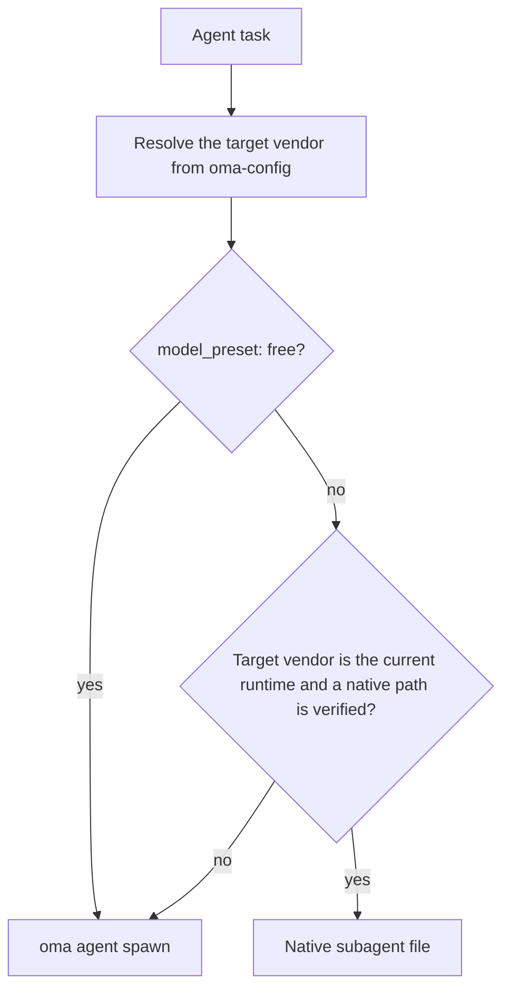
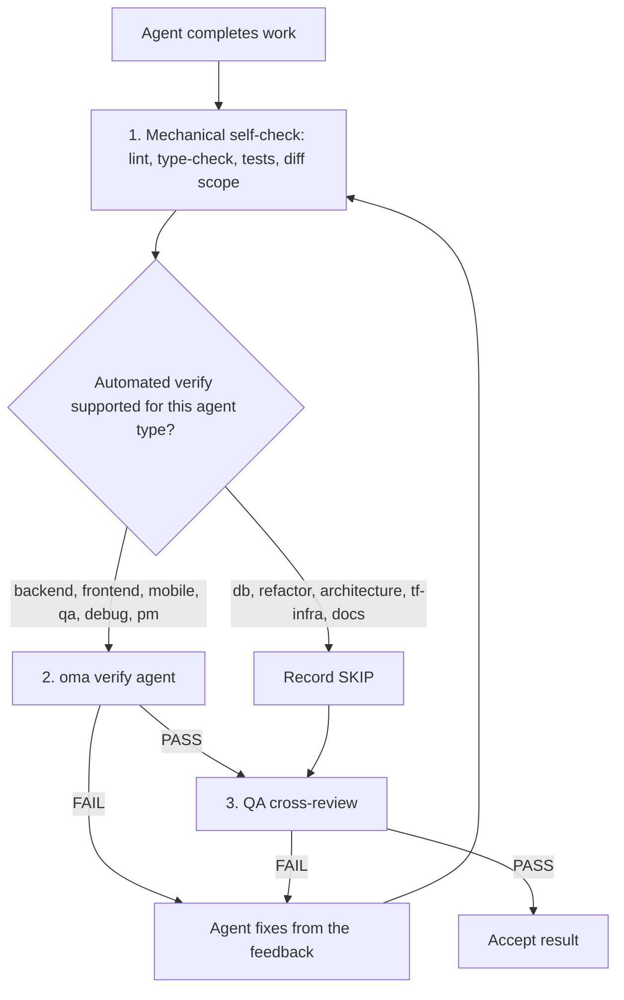

# Agenten

OMA trennt [Skills](../getting-started/glossary.md#skill), Dispatch-Rollen und [Agentendefinitionen](../getting-started/glossary.md#agent-definition). Ein Skill routet und lädt Domänenwissen; eine kanonische Rolle ist die Laufzeitidentität für den Dispatch; eine eingecheckte Definition gibt einem Subagenten eine vendor-native Persona. Diese Ebenen überschneiden sich bewusst. Entscheidend sind Aufgabenbereich und Akzeptanzkriterien, wenn Sie beurteilen, ob ein einzelner Skill genügt.

---

## Skill-Katalog {#skill-catalog}

Diese Tabelle ist die maßgebliche Liste der installierten Skills. Sie wird von `cli/scripts/generate-skill-catalog.mjs` aus dem Frontmatter jeder `.agents/skills/<name>/SKILL.md` generiert; führen Sie das Skript mit `--check` aus, um Abweichungen zu erkennen. Der Abschnitt `## References` in der SKILL.md jedes Skills listet dessen Ressourcendateien auf und gibt an, wann sie zu lesen sind.

<!-- oma:generated skill-catalog:start -->
<!-- Generated from SKILL.md frontmatter under .agents/skills by cli/scripts/generate-skill-catalog.mjs. Do not edit this block by hand. -->

| Skill | Use it for |
|---|---|
| [`oma-academic-writing`](https://github.com/first-fluke/oh-my-agent/blob/main/.agents/skills/oma-academic-writing/SKILL.md) | Draft and revise academic prose against a rubric, evidence, and citation requirements. Use for essays, reports, literature reviews, or academic style audits. |
| [`oma-architecture`](https://github.com/first-fluke/oh-my-agent/blob/main/.agents/skills/oma-architecture/SKILL.md) | Evaluate system boundaries and architectural tradeoffs. Use for architecture decisions, design reviews, and ADRs. |
| [`oma-backend`](https://github.com/first-fluke/oh-my-agent/blob/main/.agents/skills/oma-backend/SKILL.md) | Implement server APIs, authentication, and application data access. Schema modeling and query tuning use oma-db. |
| [`oma-brainstorm`](https://github.com/first-fluke/oh-my-agent/blob/main/.agents/skills/oma-brainstorm/SKILL.md) | Explore goals, constraints, and alternative approaches before choosing a design. Use when the user requests ideation or design exploration. |
| [`oma-coordination`](https://github.com/first-fluke/oh-my-agent/blob/main/.agents/skills/oma-coordination/SKILL.md) | Coordinate assigned specialist tasks and handoffs manually. Use when supervising a multi-agent project step by step. |
| [`oma-db`](https://github.com/first-fluke/oh-my-agent/blob/main/.agents/skills/oma-db/SKILL.md) | Design schemas and migrations, tune queries, or plan vector retrieval and database operations. Application API implementation uses oma-backend. |
| [`oma-debug`](https://github.com/first-fluke/oh-my-agent/blob/main/.agents/skills/oma-debug/SKILL.md) | Diagnose a reproducible failure, fix its cause, and verify the regression. Use for crashes, incorrect behavior, and failing tests. |
| [`oma-design`](https://github.com/first-fluke/oh-my-agent/blob/main/.agents/skills/oma-design/SKILL.md) | Define or review a visual system, DESIGN.md, or redesign direction. Use for typography, layout, color, motion, and interaction design decisions. |
| [`oma-dev-workflow`](https://github.com/first-fluke/oh-my-agent/blob/main/.agents/skills/oma-dev-workflow/SKILL.md) | Configure development tasks, git hooks, CI/CD, or release automation. Use when creating or fixing a repository development workflow. |
| [`oma-docs`](https://github.com/first-fluke/oh-my-agent/blob/main/.agents/skills/oma-docs/SKILL.md) | Check documentation references, sync docs to code changes, and detect translation drift. Use for documentation maintenance in a repository. |
| [`oma-explanation`](https://github.com/first-fluke/oh-my-agent/blob/main/.agents/skills/oma-explanation/SKILL.md) | Create an offline HTML explanation of a code change (diff, PR, branch) or of a topic, system, or question. Use when a visual walkthrough document is requested. |
| [`oma-frontend`](https://github.com/first-fluke/oh-my-agent/blob/main/.agents/skills/oma-frontend/SKILL.md) | Implement or modify web UI in React, Next.js, or Angular. Use for components, pages, styles, forms, and frontend state or data flows. |
| [`oma-hwp`](https://github.com/first-fluke/oh-my-agent/blob/main/.agents/skills/oma-hwp/SKILL.md) | Convert Hangul HWP, HWPX, or HWPML documents to Markdown with kordoc. Use for text, table, and image extraction from these formats. |
| [`oma-image`](https://github.com/first-fluke/oh-my-agent/blob/main/.agents/skills/oma-image/SKILL.md) | Generate raster images or reference-guided variations through the OMA image CLI. Use for image assets or explicit vendor comparisons; pixel editing uses an editor. |
| [`oma-market`](https://github.com/first-fluke/oh-my-agent/blob/main/.agents/skills/oma-market/SKILL.md) | Research customer pain points, trends, and competitors through the OMA market engine. Use for market discovery or voice-of-customer analysis. |
| [`oma-mobile`](https://github.com/first-fluke/oh-my-agent/blob/main/.agents/skills/oma-mobile/SKILL.md) | Implement Flutter, React Native, or native Swift apps. Use for mobile screens, widgets, platform integrations, and application data flows. |
| [`oma-observability`](https://github.com/first-fluke/oh-my-agent/blob/main/.agents/skills/oma-observability/SKILL.md) | Design or troubleshoot telemetry, SLOs, and incident diagnostics. Route to the relevant signal, system boundary, or vendor guide. |
| [`oma-orchestration`](https://github.com/first-fluke/oh-my-agent/blob/main/.agents/skills/oma-orchestration/SKILL.md) | Dispatch and supervise parallel specialist agents with durable task state. Use when automated multi-agent execution is requested. |
| [`oma-pdf`](https://github.com/first-fluke/oh-my-agent/blob/main/.agents/skills/oma-pdf/SKILL.md) | Extract PDF text, headings, tables, and images into Markdown using opendataloader-pdf. Use for PDF parsing, not PDF layout creation. |
| [`oma-pm`](https://github.com/first-fluke/oh-my-agent/blob/main/.agents/skills/oma-pm/SKILL.md) | Turn product requirements into scoped tasks with dependencies and acceptance criteria. Use for implementation planning and prioritization. |
| [`oma-qa`](https://github.com/first-fluke/oh-my-agent/blob/main/.agents/skills/oma-qa/SKILL.md) | Review changes for correctness, security, accessibility, and performance. Use for scoped quality reviews or verification plans; bug fixes use oma-debug. |
| [`oma-recap`](https://github.com/first-fluke/oh-my-agent/blob/main/.agents/skills/oma-recap/SKILL.md) | Summarize AI conversation histories for a specified date or period. Use for daily work recaps and cross-tool activity summaries. |
| [`oma-refactor`](https://github.com/first-fluke/oh-my-agent/blob/main/.agents/skills/oma-refactor/SKILL.md) | Restructure existing code while preserving observable behavior. Use for targeted technical debt or hotspot work with characterization tests. |
| [`oma-scholar`](https://github.com/first-fluke/oh-my-agent/blob/main/.agents/skills/oma-scholar/SKILL.md) | Search academic literature and generate, validate, or compare Knows paper sidecars. Use for claim/evidence analysis and literature synthesis. |
| [`oma-scm`](https://github.com/first-fluke/oh-my-agent/blob/main/.agents/skills/oma-scm/SKILL.md) | Manage Git branches, merges, conflicts, commits, and release baselines. Use for repository history and change-management operations. |
| [`oma-search`](https://github.com/first-fluke/oh-my-agent/blob/main/.agents/skills/oma-search/SKILL.md) | Find external documentation, web sources, or remote code with citations. Local code navigation uses the configured code tools. |
| [`oma-security`](https://github.com/first-fluke/oh-my-agent/blob/main/.agents/skills/oma-security/SKILL.md) | Scan application source, agent skills, and MCP components; run penetration tests against scoped web test deployments, validate findings, and configure scan gates. Use oma-qa for broad quality reviews and domain skills for remediation. |
| [`oma-skill-creation`](https://github.com/first-fluke/oh-my-agent/blob/main/.agents/skills/oma-skill-creation/SKILL.md) | Create or revise OMA skills and their references. Use for skill routing, execution contracts, conditional loading, and authoring validation. |
| [`oma-slide`](https://github.com/first-fluke/oh-my-agent/blob/main/.agents/skills/oma-slide/SKILL.md) | Create, import, revise, or export presentation decks through the OMA slide CLI. Use for HTML slides and PDF, PNG, or PPTX deck delivery. |
| [`oma-tf-infra`](https://github.com/first-fluke/oh-my-agent/blob/main/.agents/skills/oma-tf-infra/SKILL.md) | Create or review Terraform infrastructure and plans. Use for cloud resources, IAM, networking, state management, and infrastructure changes. |
| [`oma-translation`](https://github.com/first-fluke/oh-my-agent/blob/main/.agents/skills/oma-translation/SKILL.md) | Translate or revise localized UI strings and prose while preserving meaning, terminology, placeholders, and structure. |
| [`oma-video`](https://github.com/first-fluke/oh-my-agent/blob/main/.agents/skills/oma-video/SKILL.md) | Create videos through the OMA video CLI, or analyze and edit existing clips with media tools. Use for frame extraction, visual analysis, silence cuts, dubbing assembly, scripts, and composition; audio-only work uses oma-voice. |
| [`oma-voice`](https://github.com/first-fluke/oh-my-agent/blob/main/.agents/skills/oma-voice/SKILL.md) | Generate or transcribe speech with Voicebox, or process existing audio locally. Use for narration, transcripts, timed speech, and loudness conversion; video editing uses oma-video. |
<!-- oma:generated skill-catalog:end -->

---

## Dispatch-Rollen {#dispatch-roles}

Die Laufzeit dispatcht nach kanonischer Rolle. Jede Rolle außer `orchestrator` hat genau eine eingecheckte Definition unter `.agents/agents/`, deren `skills:`-Frontmatter die geladenen Skills nennt. Der zuerst aufgeführte Skill ist für die Aufgabe zuständig.

| Rolle | Definitionsdatei | Ebenfalls akzeptiert | Skills |
|------|-----------------|---------------|--------|
| `orchestrator` | keine (Laufzeit-Koordinationsrolle) | | |
| `pm` | `pm-planner.md` | `pm-planner` | oma-pm |
| `architecture` | `architecture-reviewer.md` | `architecture-reviewer` | oma-architecture |
| `qa` | `qa-reviewer.md` | `qa-reviewer` | oma-qa |
| `backend` | `backend-engineer.md` | `backend-engineer` | oma-backend |
| `frontend` | `frontend-engineer.md` | `frontend-engineer` | oma-frontend, oma-design |
| `mobile` | `mobile-engineer.md` | `mobile-engineer` | oma-mobile |
| `db` | `db-engineer.md` | `db-engineer` | oma-db |
| `debug` | `debug-investigator.md` | `debug-investigator` | oma-debug |
| `refactor` | `refactor-engineer.md` | `refactor-engineer` | oma-refactor |
| `docs` | `docs-curator.md` | `docs-curator` | oma-docs |
| `tf-infra` | `tf-infra-engineer.md` | `tf-infra-engineer` | oma-tf-infra |
| `explore` | `research-explorer.md` | `research-explorer`, `explorer` | oma-search, oma-market, oma-scholar |

Ein angehängtes Suffix `-agent` wird ebenfalls akzeptiert (`qa-agent` wird zu `qa` aufgelöst).

### Native Agentendateien {#native-agent-files}

Die Agentendefinitionen unter `.agents/agents/` sind die Quelle der Wahrheit. OMA projiziert sie für Laufzeiten mit Unterstützung für benutzerdefinierte Subagenten in vendor-native Dateien:

| Laufzeit | Native Agentendateien |
|---------|--------------------|
| Claude Code | `.claude/agents/<name>.md` |
| Codex CLI | `.codex/agents/<name>.toml` |
| Cursor | `.cursor/agents/` |
| OpenCode | `.opencode/agents/` |
| Kiro | `.kiro/agents/` |
| Grok | `.grok/agents/` |
| CommandCode | `.commandcode/agents/` |
| Qwen Code | `.qwen/agents/` |

pi hat kein System für Agentendateien, daher fügt `oma agent spawn` die Persona der Definition direkt in den Prompt ein. Die generierten Dateien werden von `oma link`, `oma install` und `oma update` aktualisiert.

### Wie eine Rolle dispatcht wird {#how-a-role-is-dispatched}

Ordnet ein Workflow einen Agenten demselben Vendor wie die aktuelle Laufzeit zu, verwendet er zuerst die native Agentendatei dieser Laufzeit. Vendorübergreifende Aufgaben fallen auf `oma agent spawn` zurück.



> **Modell-Dispatch pro Agent:** Vendor, Modell und Aufwand jeder Rolle stammen aus `.agents/oma-config.yaml` (oder `.agents/oma-config.cue`, mit optionalem `.local`-Overlay). Mit `model_preset: auto`, dem Standard für neue Installationen, folgen Rollen ohne `agents:`-Überschreibung den nativen Agenten- und Modelleinstellungen der aktuellen Laufzeit; `model_preset: free` dispatcht immer über `oma agent spawn`. Siehe [Agentenmodelle](../guide/per-agent-models.md) für Konfigurationsdetails und [`oma doctor --profile`](../cli-interfaces/commands.md#doctor), um die aktive Matrix zu prüfen.

---

## Skill-Kategorien {#agent-categories}

| Kategorie | Skills | Zuständigkeit |
|----------|--------|---------------|
| **Ideenfindung** | oma-brainstorm | Ideen erkunden, Ansätze vorschlagen, Designdokumente erstellen |
| **Architektur** | oma-architecture | System-/Modul-/Service-Grenzen, Analyse im Stil von ADR/ATAM/CBAM, Trade-off-Aufzeichnungen |
| **Planung** | oma-pm | Anforderungszerlegung, Aufgabenaufschlüsselung, API-Verträge, Prioritätszuweisung |
| **Implementierung** | oma-frontend, oma-backend, oma-mobile, oma-db | Code in ihren jeweiligen Domänen schreiben |
| **Design** | oma-design | Design-Systeme, DESIGN.md, Tokens, Typografie, Farbe, Bewegung, Barrierefreiheit |
| **Infrastruktur** | oma-tf-infra | Multi-Cloud-Terraform-Bereitstellung, IAM, Kostenoptimierung, Policy-as-Code |
| **DevOps** | oma-dev-workflow | mise Task Runner, CI/CD, Migrationen, Release-Koordination, Monorepo-Automatisierung |
| **Observability** | oma-observability | Observability-Pipelines, Traceability-Routing, MELT+P-Signale (metrics/logs/traces/profiles/cost/audit/privacy), SLO-Management, Incident-Forensik, Transport-Tuning |
| **Qualität** | oma-qa | Sicherheitsaudit (OWASP), Performance, Barrierefreiheit (WCAG), Code-Qualitäts-Review |
| **Debugging** | oma-debug | Bug-Reproduktion, Grundursachenanalyse, minimale Korrekturen, Regressionstests |
| **Lokalisierung** | oma-translation | Kontextbewusste Übersetzung unter Bewahrung von Ton, Register und Fachbegriffen |
| **Koordination** | oma-orchestration, oma-coordination | Automatisierte und manuelle Multi-Agenten-Orchestrierung |
| **Git** | oma-scm | Conventional-Commits-Generierung, Feature-basierte Commit-Aufteilung |
| **Suche & Retrieval** | oma-search | Intent-basierter Such-Router mit Trust-Scoring (Context7-Dokumente, Web, `gh`/`glab`-Code, lokale Code-Intelligenz) |
| **Retrospektive** | oma-recap | Werkzeugübergreifende Analyse von Konversationshistorien und themenbezogene Arbeitszusammenfassungen |
| **Dokumentenverarbeitung** | oma-hwp, oma-pdf | HWP/HWPX/HWPML- und PDF-zu-Markdown-Konvertierung für LLM/RAG-Ingest |
| **Dokumentation** | oma-docs | Dokumentationspflege: fehlerhafte Verweise, von einem Diff betroffene Dokumente, Übersetzungsdrift und Linting übersetzter Dokumente |
| **Erklärung** | oma-explanation | Offline-HTML-Erklärungen einer Codeänderung (Diff, PR, Branch, Commit-Bereich) oder eines Themas, Systems oder einer Frage |
| **Wissenschaftliches Schreiben** | oma-academic-writing, oma-scholar | Entwurf und Prüfung publikationsreifer akademischer Prosa sowie wissenschaftliche Recherche, Suche und Peer-Review mit Knows-Sidecars |
| **Sicherheit** | oma-security | Scannen von Anwendungsquellcode, Agenten-Skill-Paketen, MCP-Komponenten und autorisierten Web-Testdeployments (Deepsec, Cisco-Scanner, ARTEX) mit unabhängiger Validierung der Befunde und CI-Gates |
| **Refactoring** | oma-refactor | Verhaltenserhaltende, inkrementelle Umstrukturierung mit Hotspot-Fokus, Sicherheitsnetzen aus Charakterisierungstests und reinen Refactor-Commits |
| **Marktforschung** | oma-market | Schmerzpunkte, Trends, Wettbewerber und Entdeckung aus Community-Signalen mit absichtsabhängig automatisch gewählten SWOT-/Porter-5F-/PESTEL-Rahmen untersuchen |
| **Skill-Autorenschaft** | oma-skill-creation | OMA-Skills im SSL-lite-Format erstellen und validieren |
| **Medienerzeugung** | oma-image, oma-slide, oma-video, oma-voice | KI-Bilder, HTML-Präsentationen, Kurz-/Erklär-/Demo-Videos sowie lokale TTS-/STT-Verarbeitung |

---

## Detaillierte Agenten-Referenz {#detailed-agent-reference}

Diese Zusammenfassungen erläutern die Domäne und die wichtigsten Regeln jedes Skills. Maßgeblich ist die SKILL.md des jeweiligen Skills: Ihr Abschnitt `## References` listet die Ressourcendateien und die Bedingung, unter der jede gelesen wird. Diese Seite übernimmt diese Listen daher nicht.

### oma-brainstorm

**Domäne:** Design-first-Ideenfindung vor Planung oder Implementierung.

**Einsatzbereich:** Neue Feature-Ideen erkunden, Benutzerabsichten verstehen, Ansätze vergleichen. Vor `/plan` für komplexe oder mehrdeutige Anfragen verwenden.

**Nicht verwenden bei:** Klaren Anforderungen (an oma-pm weitergeben), Implementierung (an Domänenagenten weitergeben), Code-Review (an oma-qa weitergeben).

**Kernregeln:**
- Keine Implementierung oder Planung vor der Design-Genehmigung
- Eine klärende Frage auf einmal (keine Bündel)
- Zwei oder drei tragfähige Ansätze vergleichen, wenn Alternativen die Entscheidung unterstützen; lassen die Rahmenbedingungen weniger zu, dies begründen, statt Optionen zu erfinden
- Das Design abschnittsweise vorstellen und dabei nur offene wesentliche Entscheidungen klären
- YAGNI: nur entwerfen, was benötigt wird

**Workflow:** 7 Phasen: Kontext, Fragen, Ansätze (optional mit TRIZ-lite angestoßen), Design, Blind Review, Dokumentation (speichert nach `docs/plans/designs/`), Überleitung zu `/plan`.

---

### oma-architecture

**Domäne:** Software-/Systemarchitektur, einschließlich Modul- und Service-Grenzen, Trade-off-Analyse, Stakeholder-Synthese und Entscheidungsprotokollen.

**Einsatzbereich:** Auswahl oder Überprüfung der Systemarchitektur, Definition von Modul-/Service-/Ownership-Grenzen, Vergleich von Architekturoptionen mit expliziten Trade-offs, Untersuchung architektonischer Probleme (Change Amplification, versteckte Abhängigkeiten, umständliche APIs), Priorisierung von Architekturinvestitionen oder Refactorings, Verfassen von Architekturempfehlungen oder ADRs.

**Nicht verwenden bei:** Visuellen/Design-Systemen (oma-design verwenden), Feature-Planung und Aufgabenzerlegung (oma-pm verwenden), Terraform-Implementierung (oma-tf-infra verwenden), Bug-Diagnose (oma-debug verwenden), Sicherheits-/Performance-/Barrierefreiheits-Review (oma-qa verwenden).

**Methoden:** Diagnostisches Routing, Design-Twice-Vergleich, Risikoanalyse im ATAM-Stil, Priorisierung im CBAM-Stil, Entscheidungsprotokolle im ADR-Stil.

**Kernregeln:**
- Das Architekturproblem vor der Methodenwahl diagnostizieren
- Die leichteste hinreichende Methode für die aktuelle Entscheidung verwenden
- Architekturentwurf von UI-/Visualdesign und Terraform-Umsetzung unterscheiden
- Stakeholder-Agenten nur konsultieren, wenn die Entscheidung übergreifend genug ist, um die Kosten zu rechtfertigen
- Qualität der Empfehlung ist wichtiger als Konsens-Theater: breit beraten, explizit entscheiden
- Jede Empfehlung muss Annahmen, Trade-offs, Risiken und Validierungsschritte nennen
- Standardmäßig kostenbewusst: Implementierungskosten, Betriebskosten, Teamkomplexität, zukünftige Änderungskosten

---

### oma-pm

**Domäne:** Produktmanagement, einschließlich Anforderungsanalyse, Aufgabenzerlegung und API-Verträgen.

**Einsatzbereich:** Komplexe Features aufschlüsseln, Machbarkeit bestimmen, Arbeit priorisieren, API-Verträge definieren.

**Kernregeln:**
- API-first-Design: Verträge vor Implementierungsaufgaben definieren
- Jede Aufgabe enthält: Agent, Titel, Akzeptanzkriterien, Priorität, Abhängigkeiten
- Abhängigkeiten minimieren für maximale parallele Ausführung
- Sicherheit und Tests sind Bestandteil jeder Aufgabe (keine separaten Phasen)
- Aufgaben müssen von einem einzelnen Agenten abschließbar sein
- JSON-Plan plus ein sitzungsbezogenes Task-Board für Orchestrator-Kompatibilität ausgeben

**Ausgabe:** `.agents/results/plan-{sessionId}.json` mit numerischen Prioritätsstufen (`1` = unabhängig, niedrigere Stufen laufen zuerst) sowie der run-bezogene Bericht `result-{agentId}-{taskId}-{runId}-{sessionId}.md` im konfigurierten Memory-Speicher.

---

### oma-frontend

**Domäne:** Web-UI in React/Next.js oder Angular mit TypeScript. React-Projekte verwenden FSD-lite; Angular-Projekte folgen `resources/angular-rules.md`.

**Einsatzbereich:** Benutzeroberflächen, Komponenten, clientseitige Logik, Styling, Formularvalidierung, API-Integration.

**Tech-Stack:**
- React + Next.js (Server-Components Standard, Client-Components für Interaktivität)
- TypeScript (strict)
- TailwindCSS v4 + shadcn/ui (schreibgeschützte Primitiven, Erweiterung via cva/Wrapper)
- FSD-lite: Root `src/` + Feature `src/features/*/` (keine Feature-übergreifenden Imports)

**Bibliotheken (React/Next.js-Projekte):**
| Zweck | Bibliothek |
|---------|---------|
| Datum | luxon |
| Styling | TailwindCSS v4 + shadcn/ui |
| Hooks | ahooks oder @mantine/hooks |
| Hilfsfunktionen | es-toolkit |
| Typen | type-fest |
| URL-Status | nuqs |
| Server-Status | TanStack Query (von orval generierte Hooks bei vorhandener OpenAPI-Spezifikation) |
| Client-Status | Jotai oder Zustand, nach Zweck gewählt, ohne Standardvorgabe (Verwendung minimieren) |
| Formulare | @tanstack/react-form + Zod |
| Authentifizierung | better-auth |
| Animation | motion (`motion/react`) für neue Projekte |

**Kernregeln:**
- shadcn/ui zuerst, Erweiterung via cva, niemals `components/ui/*` direkt modifizieren
- Design-Tokens 1:1-Zuordnung (niemals Farben hardcoden)
- Request-Proxy: eine bestehende `proxy.ts`-Konvention von Next.js 16+ beibehalten; vor dem Vorschlag einer Umbenennung in `middleware.ts` die installierte Version und das Routing prüfen
- Kein Prop-Drilling über 3 Ebenen hinaus; die Client-State-Bibliothek des Projekts verwenden (Jotai-Atoms oder einen Zustand-Store)
- Absolute Imports mit `@/` sind Pflicht
- FCP-Ziel < 1 s
- Responsive Breakpoints: 320px, 768px, 1024px, 1440px

**Qualitäts-Gate-Checkliste:**
- Barrierefreiheit: ARIA-Labels, semantische Überschriften, Tastaturnavigation
- Mobil: auf mobilen Viewports verifiziert
- Performance: kein CLS, schnelle Ladezeit
- Resilienz: Error Boundaries und Lade-Skelette
- Tests: Logik durch Vitest abgedeckt
- Qualität: Typecheck und Lint bestehen

---

### oma-backend

**Domäne:** APIs, serverseitige Logik, Authentifizierung, Datenbankoperationen.

**Einsatzbereich:** REST-/GraphQL-APIs, Datenbankmigrationen, Authentifizierung, serverseitige Geschäftslogik, Hintergrundjobs.

**Architektur:** Router (HTTP) -> Service (Geschäftslogik) -> Repository (Datenzugriff) -> Modelle.

**Stack-Erkennung:** Liest Projektmanifeste (pyproject.toml, package.json, Cargo.toml, go.mod usw.), um Sprache und Framework zu bestimmen. Wenn projektspezifische Konventionen fehlen, fordert sie den Benutzer auf, `/stack-set` auszuführen; dieser Befehl materialisiert die aufgelösten `stack/`-Referenzen aus dem ausgelieferten Schema und den Vorlagen.

**Kernregeln:**
- Clean Architecture: keine Geschäftslogik in Route-Handlern
- Alle Eingaben mit der Validierungsbibliothek des Projekts validiert
- Nur parametrisierte Abfragen (niemals String-Interpolation in SQL)
- JWT + Argon2id für Authentifizierung (bcrypt ist für Legacy-Kompatibilität zulässig); Rate-Limiting für Auth-Endpunkte
- Async wo unterstützt; Typannotationen auf allen Signaturen
- Benutzerdefinierte Exceptions über zentrales Fehlermodul
- Explizite ORM-Ladestrategie, Transaktionsgrenzen, sicherer Lebenszyklus

<!-- oma-docs:ignore-start -->
Projektspezifische `stack/stack.yaml`, `stack/tech-stack.md`, Snippets und API-Vorlagen werden bei Bedarf durch `/stack-set` erzeugt; sie fehlen, bis der Stack materialisiert wurde.
<!-- oma-docs:ignore-end -->

---

### oma-mobile

**Domäne:** Plattformübergreifende und native mobile Apps (Flutter, React Native und native Swift-iOS-Apps).

**Einsatzbereich:** Native mobile Apps (iOS + Android), mobilspezifische UI-Muster, Plattformfunktionen (Kamera, GPS, Push-Benachrichtigungen), Offline-first-Architektur sowie native Swift-iOS-Apps mit SwiftUI und `swift-openapi-generator`.

**Architektur:** Clean Architecture: Domäne -> Daten -> Präsentation. Für Swift-iOS: Projektstruktur `App/Core/Features/Shared`.

**Tech-Stacks:**
- Flutter/Dart: Riverpod/Bloc (Zustandsverwaltung), Dio mit Interceptors (API), GoRouter (Navigation), Material Design 3 (Android) + iOS HIG.
- Native Swift-iOS-Apps (iOS 17+): SwiftUI + `@Observable` (Observation-Framework), Apples `swift-openapi-generator` für API-Clients, Layout `App/Core/Features/Shared`.

**Kernregeln:**
- Riverpod/Bloc für Zustandsverwaltung (kein rohes setState für komplexe Logik)
- Alle Controller in der `dispose()`-Methode freigeben
- Dio mit Interceptors für API-Aufrufe; Offline-Zustand elegant behandeln
- 60 fps-Ziel; auf beiden Plattformen testen
- Swift: Unter iOS 17+ `@Observable` statt `ObservableObject` verwenden; API-Clients aus OpenAPI-Spezifikationen mit `swift-openapi-generator` generieren

**Plattform-Seeds:** `variants/` liefert `flutter/`, `react-native/` und `swift-ios/`, jeweils mit `stack.yaml`, `tech-stack.md`, `snippets.md` und einer API-Vorlage, dazu das gemeinsame `stack.schema.json`. Sie sind Ausgangsmaterial für `/stack-set` und keine Pflichtlektüre für Änderungen an bestehendem Code.

---

### oma-db

**Domäne:** Datenbankarchitektur für SQL-, NoSQL- und Vektordatenbanken.

**Einsatzbereich:** Schema-Design, ERD, Normalisierung, Indizierung, Transaktionen, Kapazitätsplanung, Backup-Strategie, Migrationsdesign, Vektordatenbank-/RAG-Architektur, Anti-Pattern-Review, Compliance-bewusstes Design (ISO 27001/27002/22301).

**Standard-Workflow:** Erkunden (Entitäten, Zugriffsmuster, Volumen identifizieren) -> Entwerfen (Schema, Constraints, Transaktionen) -> Optimieren (Indizes, Partitionierung, Archivierung, Anti-Patterns).

**Kernregeln:**
- Zuerst das Modell wählen, dann die Engine
- 3NF-Standard für relational; BASE-Tradeoffs für verteilt dokumentieren
- Alle drei Schema-Schichten dokumentieren: extern, konzeptionell, intern
- Integrität als erstklassiges Prinzip: Entitäts-, Domänen-, referentielle und Geschäftsregel-Integrität
- Nebenläufigkeit ist niemals implizit: Transaktionsgrenzen und Isolationsebenen definieren
- Vektordatenbanken sind Abruf-Infrastruktur, nicht Quellsystem
- Vektorsuche niemals als direkten Ersatz für lexikalische Suche behandeln

**Erforderliche Ergebnisse:** Zusammenfassung des externen Schemas, konzeptionelles Schema, internes Schema, Datenstandards-Tabelle, Glossar, Kapazitätsschätzung, Backup-/Recovery-Strategie. Für Vektor/RAG: Embedding-Versionierungsrichtlinie, Chunking-Richtlinie, hybride Abrufstrategie.

---

### oma-design

**Domäne:** Design-Systeme, UI/UX, DESIGN.md-Verwaltung.

**Einsatzbereich:** Design-Systeme und DESIGN.md erstellen oder überarbeiten, eine bestehende Website oder App neu gestalten (bewahren oder grundlegend überarbeiten), Landingpages, Design-Tokens, Farbpaletten, Typografie, responsive Layouts, Barrierefreiheits-Review.

**Workflow:** 7 Phasen: Setup (Kontexterfassung) -> Extraktion (optional, aus Referenz-URLs) -> Anreicherung (vage Prompt-Erweiterung) -> Vorschlag (2-3 Designrichtungen) -> Generierung (DESIGN.md + Tokens) -> Audit (Responsive, WCAG, Nielsen, KI-Kitsch-Prüfung) -> Übergabe.

**Anti-Pattern-Durchsetzung ("kein KI-Kitsch"):**
- Typografie: System-Font-Stack als Standard; keine Standard-Google-Fonts ohne Begründung
- Farbe: keine Lila-zu-Blau-Verläufe, keine Verlaufskugeln/-kleckse, kein reines Weiß auf reinem Schwarz
- Layout: keine verschachtelten Karten, keine rein Desktop-optimierten Layouts, keine schablonenhaften 3-Metrik-Statistik-Layouts
- Bewegung: nicht überall Bounce-Easing, keine Animationen > 800 ms, prefers-reduced-motion muss respektiert werden
- Komponenten: nicht überall Glassmorphismus, alle interaktiven Elemente benötigen Tastatur-/Touch-Alternativen

**Kernregeln:**
- `.design-context.md` und `DESIGN.md` wiederverwenden, sofern vorhanden; `.design-context.md` nur anlegen, wenn ein substanzieller Erkundungsdurchlauf die Entscheidung stützt
- Bei einer bestehenden Website oder App `resources/redesign-protocol.md` folgen und vor einem Vorschlag zwischen Preserve und Overhaul einordnen
- System-Font-Stack als Standard (CJK-fähige Schriftarten für ko/ja/zh)
- WCAG AA-Minimum für alle Designs
- Responsive-first (Mobil als Standard)
- 2-3 Richtungen präsentieren, Bestätigung einholen

---

### oma-tf-infra

**Domäne:** Infrastructure-as-Code mit Terraform, Multi-Cloud.

**Einsatzbereich:** Bereitstellung auf AWS/GCP/Azure/Oracle Cloud, Terraform-Konfiguration, CI/CD-Authentifizierung (OIDC), CDN/Load-Balancer/Storage/Netzwerk, Zustandsverwaltung, ISO-Compliance-Infrastruktur.

**Cloud-Erkennung:** Liest Terraform-Provider und Ressourcenpräfixe (`google_*` = GCP, `aws_*` = AWS, `azurerm_*` = Azure, `oci_*` = Oracle Cloud). Enthält eine vollständige Multi-Cloud-Ressourcenzuordnungstabelle.

**Kernregeln:**
- Provider-agnostisch: Cloud aus Projektkontext erkennen
- Remote-State mit Versionierung und Locking
- OIDC-first für CI/CD-Authentifizierung
- Immer Plan vor Apply
- Minimale IAM-Berechtigungen
- Alles taggen (Environment, Project, Owner, CostCenter)
- Keine Secrets im Code
- Alle Provider und Module versionspinnen
- Kein Auto-Approve in der Produktion

---

### oma-dev-workflow

**Domäne:** Monorepo-Aufgabenautomatisierung und CI/CD.

**Einsatzbereich:** Dev-Server starten, Lint/Format/Typecheck über Apps hinweg ausführen, Datenbankmigrationen, API-Generierung, i18n-Builds, Produktions-Builds, CI/CD-Optimierung, Pre-Commit-Validierung.

**Kernregeln:**
- Immer `mise run`-Tasks anstelle direkter Paketmanager-Befehle verwenden
- Lint/Test nur auf geänderten Apps ausführen
- Commit-Nachrichten mit commitlint validieren
- CI sollte unveränderte Apps überspringen
- Niemals direkte Paketmanager-Befehle verwenden, wenn mise-Tasks existieren

---

### oma-observability

**Domäne:** Intent-basierter Observability- und Traceability-Router über Schichten, Grenzen und Signale hinweg.

**Einsatzbereich:**
- Pipeline-Aufbau: OTel SDK + Collector + Vendor-Backend
- Traceability über Service- und Domänengrenzen hinweg: W3C-Propagatoren, Baggage, Multi-Tenant, Multi-Cloud
- Transport-Tuning: UDP/MTU-Schwellenwerte, OTLP gRPC vs. HTTP, Collector DaemonSet vs. Sidecar-Topologie, Sampling-Rezepte
- Incident-Forensik: 6-dimensionale Lokalisierung (code / service / layer / host / region / infra)
- Auswahl der Vendor-Kategorie: OSS Full-Stack vs. kommerzielles SaaS vs. High-Cardinality-Spezialist vs. Profiling-Spezialist
- Observability-as-Code: Grafana-Jsonnet-Dashboards, PrometheusRule CRD, OpenSLO YAML, SLO-Burn-Rate-Alerts
- Meta-Observability: Pipeline-Selbst-Health, Clock-Skew, Cardinality-Guardrails, Retention-Matrix
- MELT+P-Signalabdeckung: metrics, logs, traces, profiles, cost, audit, privacy
- Migrationen von Log-Pipelines, bewertet anhand der aktuellen Upstream-Unterstützung und der Projektanforderungen

**Nicht verwenden bei:** LLM-Ops / gen_ai-Observability (Langfuse, Arize Phoenix, LangSmith, Braintrust verwenden), Data-Pipeline-Lineage (OpenLineage + Marquez, dbt test, Airflow Lineage), IoT / Rechenzentrums-Physical-Layer-Telemetrie (Nlyte, Sunbird, Device42), Chaos-Engineering-Orchestrierung (Chaos Mesh, Litmus, Gremlin, ChaosToolkit), GPU-/TPU-Infrastruktur (NVIDIA DCGM Exporter), Software-Supply-Chain (sigstore, in-toto, SLSA), Incident-Response-Workflow / Paging (PagerDuty, OpsGenie, Grafana OnCall), Single-Vendor-Setup, das bereits vom vendor-eigenen Skill abgedeckt ist.

**Kernregeln:**
- Intent vor dem Routing klassifizieren: setup | migrate | investigate | alert | trace | tune | route
- Kategorie-first statt Vendor-Registry: an vendor-eigene Skills über `resources/vendor-categories.md` delegieren; Vendor-Dokumentation nicht duplizieren
- Transport-Tuning ist der Burggraben: UDP/MTU-Schwellenwerte, OTLP-Protokollwahl, Collector-Topologie und Sampling-Rezepte sind Tiefen, die andere Skills nicht abdecken
- Meta-Observability ist nicht verhandelbar: Pipeline-Selbst-Health, Clock-Sync (< 100 ms Drift), Cardinality und Retention validieren, bevor das Setup als abgeschlossen erklärt wird
- CNCF-first-Präferenz: Prometheus, Jaeger, Thanos, Fluent Bit, OpenTelemetry, Cortex, OpenCost, OpenFeature, Flagger, Falco
- Fluentd bleibt CNCF Graduated; der CNCF-Leitfaden 2025-10 von Fluentd zu Fluent Bit ist ein Migrationsleitfaden, keine Abkündigung. Fluentd, Fluent Bit oder den OTel Collector nach Workload-, Plugin- und Betriebsanforderungen wählen
- W3C Trace Context als Standard-Propagator; pro Cloud übersetzen (AWS X-Ray `X-Amzn-Trace-Id`, GCP Cloud Trace, Datadog, Cloudflare, Linkerd)
- Privacy vor Features: PII-Redaction, sampling-bewusste Baggage-Regeln, SOC2/ISO unveränderliches Audit + GDPR/PIPA-Löschung werden bei der Erfassung angewendet, nicht erst im Storage

---

### oma-qa

**Domäne:** Qualitätssicherung für Sicherheit, Performance, Barrierefreiheit und Code-Qualität.

**Einsatzbereich:** Abschließendes Review vor dem Deployment, Sicherheitsaudits, Performance-Analyse, Barrierefreiheits-Compliance, Testabdeckungsanalyse.

**Review-Prioritätsreihenfolge:** Sicherheit > Performance > Barrierefreiheit > Code-Qualität.

**Schweregrade:**
- **CRITICAL**: Sicherheitslücke, Risiko von Datenverlust
- **HIGH**: Blockiert den Start
- **MEDIUM**: In diesem Sprint beheben
- **LOW**: Backlog

**Kernregeln:**
- Jeder Befund muss Datei:Zeile, Beschreibung und Korrektur enthalten
- Zuerst automatisierte Tools ausführen (npm audit, bandit, lighthouse)
- Keine Fehlalarme; jeder Befund muss reproduzierbar sein
- Behebungscode bereitstellen, nicht nur Beschreibungen

---

### oma-debug

**Domäne:** Bug-Diagnose und -Behebung.

**Einsatzbereich:** Vom Benutzer gemeldete Bugs, Abstürze, Performance-Probleme, intermittierende Fehler, Race Conditions, Regressions-Bugs.

**Methodik:** Zuerst reproduzieren, dann diagnostizieren. Niemals Korrekturen erraten.

**Kernregeln:**
- Grundursache identifizieren, nicht nur Symptome
- Minimale Korrektur: nur das Notwendige ändern
- Jede Korrektur erhält einen Regressionstest
- Nach ähnlichen Mustern an anderen Stellen suchen
- In `.agents/results/` dokumentieren

**Verwendete Code-Intelligenz-Tools (Gortex oder Serena):**
- `find_symbol("functionName")` oder Gortex-Symbolnavigation: Funktion lokalisieren
- `find_referencing_symbols("Component")` oder Gortex-Impact-Analyse: alle Verwendungen finden
- `search_for_pattern("error pattern")` oder Gortex-Suche: ähnliche Probleme finden

---

### oma-translation

**Domäne:** Kontextbewusste mehrsprachige Übersetzung.

**Einsatzbereich:** UI-Strings, Dokumentation, Marketingtexte übersetzen, vorhandene Übersetzungen prüfen, Glossare erstellen.

**Sechs-Phasen-Ablauf:** Vorbereiten, Erfassen, Überlegen, Ausführen, Verifizieren und Abschließen. Die Übersetzungsmethode umfasst vier Schritte: Bedeutung und geschützte Syntax lesen, Register wählen, im Zieltext rekonstruieren und den passenden Autorenstil bewahren.

**Kernregeln:**
- Vorhandene Locale-Dateien zuerst scannen, um Konventionen zu übernehmen
- Bedeutung übersetzen, nicht Wörter
- Emotionale Konnotationen bewahren
- Niemals wörtliche Übersetzungen produzieren
- Niemals Register innerhalb eines Textes mischen
- Domänenspezifische Terminologie unverändert beibehalten

---

### oma-orchestration

**Domäne:** Automatisierte Multi-Agenten-Koordination via CLI-Spawning.

**Einsatzbereich:** Komplexe Features, die mehrere parallele Agenten erfordern, automatisierte Ausführung, Full-Stack-Implementierung.

**Konfigurationsstandards:**

| Einstellung | Standard | Beschreibung |
|---------|---------|-------------|
| MAX_PARALLEL | 3 | Maximale gleichzeitige Subagenten |
| MAX_RECOVERY_ATTEMPTS | 3 | Gesamtzahl der Wiederholungen und Explorationshypothesen pro Aufgabe, einschließlich des ursprünglichen Versuchs |
| POLL_INTERVAL | 30 s | Intervall für Statusprüfungen bei `oma agent spawn`-Läufen (native Claude-Code-Subagenten kehren synchron zurück) |

**Workflow-Phasen:** Plan → Referenzen (Referenzen pro Aufgabe auswählen) → Setup (Sitzungs- und Task-Board-Artefakte) → Ausführung (bereite Aufgaben innerhalb von MAX_PARALLEL dispatchen) → Überwachung → Verifikation (Review-Schleife) → Sammlung (Claims und run-bezogene Berichte).

**Agenten-zu-Agenten-Review-Schleife:** siehe [Orchestrierungs-Ablauf](#orchestration-flow) für das Diagramm und die Schleifenlimits.

**Sitzungsbelege:** Hält bei Bedarf wesentliche Korrekturen und beurteilte Review-Befunde mit Ursache, Auswirkung und Verifikation fest. Es gibt weder eine Strafpunktzahl noch eine durch einen Punktestand ausgelöste Pause.

---

### oma-scm

**Domäne:** Software Configuration Management (SCM) und Git, einschließlich Branching, Merges, Worktrees, Baselines, Audit-Bereitschaft und Conventional Commits.

**Einsatzbereich:** Nach Codeänderungen (`/scm`), bei Merge-Konflikten, Branch-Strategie, Releases/Tags oder jeder Frage zum Konfigurationsmanagement eines Repositorys.

**Commit-Typen:** feat, fix, docs, style, refactor, perf, test, chore, build, ci, revert.

**Workflow (Commits):** Änderungen analysieren → bei Bedarf nach Feature aufteilen → Typ → Scope → Beschreibung (Imperativ, unter 72 Zeichen, Kleinschreibung, kein abschließender Punkt) → mit expliziten Pfaden committen.

**Regeln:**
- `git add -A` oder `git add .` nicht ohne ausdrückliche Autorisierung verwenden
- Niemals Secrets-Dateien committen
- Beim Staging immer Dateien explizit angeben
- Die Nachricht in eine Datei schreiben und mit `git commit -F <message-file>` committen
- Geteilte Historie nicht ohne ausdrückliche Autorisierung umschreiben; `--force-with-lease` verwenden, niemals einfaches `--force`
- Co-Author-Trailer werden nur eingefügt, wenn die wirksame Konfiguration `scm.co_author` sie aktiviert und Name und E-Mail-Adresse bereitstellt.

---

### oma-coordination

**Domäne:** Leitfaden für manuelle, schrittweise Multi-Agenten-Koordination.

**Einsatzbereich:** Arbeit über mehrere Domänen, bei der Sie Spawnen, Überwachung, Vertragsabstimmung und QA Schritt für Schritt beaufsichtigen möchten, statt vollautomatisch zu orchestrieren.

**Nicht verwenden bei:** Vollautomatischer paralleler Ausführung (oma-orchestration verwenden), Aufgaben in einer einzelnen Domäne (den Domänenagenten direkt verwenden).

**Kernregeln:**
- Einen gültigen Plan wiederverwenden; oma-pm nur aufrufen, wenn sich Zerlegung oder Verträge ändern müssen
- Unabhängige Aufgaben derselben Prioritätsstufe parallel spawnen, jeweils in einem eigenen Workspace oder mit `--isolation worktree`
- Verträge für geänderte API-Grenzen vor abhängiger Frontend- oder Mobile-Arbeit aktualisieren
- QA-Review ist immer der letzte Schritt
- Blockierende QA-Mängel und erforderliche Verifikationslücken an den zuständigen Agenten zurückgeben und anschließend die betroffenen Prüfungen erneut ausführen

**Workflow:** Plan (wiederverwenden oder PM) → Spawn nach Prioritätsstufe → Überwachen → QA-Review → Probleme beheben → Ausliefern.

**Unterschied zu oma-orchestration:** Coordination ist manuell und geführt (der Benutzer steuert das Tempo), Orchestrator ist automatisiert (Agenten werden mit minimaler Benutzerintervention gespawnt und ausgeführt).

---

### oma-search

**Domäne:** Intent-basierter Such-Router mit Domain-Trust-Scoring. Leitet Anfragen an Context7 (Dokumente), native Websuche, `gh`/`glab` (Code) und lokale Code-Intelligenz (Gortex oder Serena) weiter.

**Einsatzbereich:** Auffinden offizieller Bibliotheks-/Framework-Dokumentation, Webrecherche zu Tutorials/Beispielen/Vergleichen/Lösungen, GitHub/GitLab-Codesuche nach Implementierungsmustern, Anfragen mit unklarem Suchkanal (Auto-Routing), andere Skills, die Suchinfrastruktur benötigen (geteilte Invokation).

**Nicht verwenden bei:** Ausschließlich lokaler Codebase-Erkundung (Code-Intelligence-MCP direkt verwenden), Git-Historien- oder Blame-Analyse (oma-scm verwenden), vollständiger Architekturrecherche (oma-architecture verwenden, das diesen Skill intern aufrufen kann).

**Kernregeln:**
- Explizites `--docs`, `--code` oder `--web` wählt die Route; andernfalls den Intent mit `resources/intent-rules.md` klassifizieren
- Eine Anfrage, eine beste Route; redundantes Multi-Routing vermeiden, sofern der Intent nicht mehrdeutig ist
- Trust-Score für jedes Ergebnis; alle nicht-lokalen Ergebnisse erhalten Domain-Trust-Labels aus der Registry
- Weitere Flags: `--strict` filtert Ergebnisse nach dem Scoring nach Trust, `--wide` behält gekennzeichnete Ergebnisse mit geringerem Trust, und `--gitlab` wählt GitLab als Code-Host
- Fail forward: bei Ausfall der primären Route kontrolliert zurückfallen (docs→web, web→`oma search fetch`-Strategien)
- Kein zusätzliches MCP erforderlich: Context7 für Dokumente, runtime-nativ für Web, CLI für Code, konfigurierter Provider (Gortex oder Serena) für lokal
- Vendor-neutrale Websuche: was auch immer die aktuelle Runtime bietet (WebSearch, Google, Bing)
- Nur Domain-Level-Trust; keine Sub-Path- oder Seiten-Scores

---

### oma-recap

**Domäne:** Analyse von Konversationshistorien über mehrere KI-Tools hinweg (Claude, Codex, Gemini, Antigravity, Qwen, Cursor, Grok) mit themenbezogenen täglichen/periodischen Arbeitszusammenfassungen.

**Einsatzbereich:** Zusammenfassung eines Tages oder Zeitraums von Arbeitsaktivität, Verständnis des Arbeitsflusses über mehrere KI-Tools hinweg, Analyse von Tool-Wechselmustern zwischen Sitzungen, Vorbereitung täglicher Standups/wöchentlicher Retros/Arbeitsprotokolle.

**Nicht verwenden bei:** Git-Commit-basierter Code-Änderungsretrospektive (`oma retro` verwenden), Echtzeit-Agenten-Überwachung (`oma dashboard terminal` verwenden), Produktivitätsmetriken (`oma stats get` verwenden).

**Prozess:**
1. Datum oder Zeitfenster aus natürlichsprachiger Eingabe auflösen (today, yesterday, last Monday, explizites Datum)
2. Konversationsdaten mit `oma recap --date YYYY-MM-DD --json` für einen Kalendertag oder mit `oma recap --window 7d --json` für ein gleitendes Zeitfenster (`1d`, `3d`, `7d`, `2w`, `30d`) abrufen; mit `--tool` eingrenzen
3. Nach Inhalt (Projekten und Themen) gruppieren, nicht nach Tool; ein Zeitfenster von 3 Tagen oder mehr wird nach Projekt statt nach Tag gruppiert
4. Themen extrahieren (bearbeitete Features, behobene Bugs, erkundete Tools)
5. Themenbezogene Tages-/Zeitraumzusammenfassung rendern

---

### oma-hwp

**Domäne:** HWP / HWPX / HWPML (koreanische Textverarbeitung) → Markdown-Konvertierung mittels `kordoc`.

**Einsatzbereich:** Konvertierung koreanischer HWP-Dokumente (`.hwp`, `.hwpx`, `.hwpml`) in Markdown, Aufbereitung koreanischer Regierungs-/Unternehmensdokumente für LLM-Kontext oder RAG, Extraktion strukturierter Inhalte (Tabellen, Überschriften, Listen, Bilder, Fußnoten, Hyperlinks) aus HWP.

**Nicht verwenden bei:** PDF-Dateien (oma-pdf verwenden), XLSX/DOCX (außerhalb des Umfangs), Erstellen/Bearbeiten von HWP (außerhalb des Umfangs), bereits vorhandenen Textdateien (Read-Tool direkt verwenden).

**Kernregeln:**
- Ausführung mit `bunx kordoc@latest` (keine Installation erforderlich); immer `@latest` oder eine fixierte Version übergeben
- Standardausgabeformat ist Markdown
- Ohne angegebenes Ausgabeverzeichnis wird in das Eingangsverzeichnis geschrieben
- kordoc kümmert sich um die Strukturerhaltung (Überschriften, Tabellen, verschachtelte Tabellen, Fußnoten, Hyperlinks, Bilder)
- Sicherheitsabwehr (ZIP-Bombe, XXE, SSRF, XSS) wird von kordoc bereitgestellt; keine eigenen ergänzen
- Bei verschlüsseltem oder DRM-gesperrtem HWP die Einschränkung dem Benutzer klar melden
- Nachbearbeitung mit `resources/flatten-tables.ts`, um HTML-`<table>`-Blöcke in GFM-Pipe-Tabellen zu konvertieren und Hancom-Private-Use-Area-Zeichen zu entfernen

---

### oma-pdf

**Domäne:** PDF-zu-Markdown-Konvertierung mittels `opendataloader-pdf`.

**Einsatzbereich:** Konvertierung von PDF-Dokumenten in Markdown für LLM-Kontext oder RAG, Extraktion strukturierter Inhalte (Tabellen, Überschriften, Listen) aus PDFs, Aufbereitung von PDF-Daten für KI-Verwendung.

**Nicht verwenden bei:** Erzeugen/Erstellen von PDFs (geeignete Dokumenten-Tools verwenden), Bearbeiten bestehender PDFs (außerhalb des Umfangs), einfaches Lesen bereits vorhandener Textdateien (Read-Tool direkt verwenden).

**Kernregeln:**
- Ausführung mit `uvx opendataloader-pdf` (keine Installation erforderlich)
- Standardausgabeformat ist Markdown
- Ohne angegebenes Ausgabeverzeichnis wird in das Eingangsverzeichnis der PDF geschrieben
- Dokumentstruktur erhalten (Überschriften, Tabellen, Listen, Bilder)
- Für gescannte PDFs Hybridmodus mit OCR verwenden
- Immer `uvx mdformat` auf die Ausgabe anwenden, um die Markdown-Formatierung zu normalisieren
- Prüfen, dass die Markdown-Ausgabe lesbar und gut strukturiert ist
- Konvertierungsprobleme (fehlende Tabellen, verstümmelter Text) dem Benutzer melden

---

### oma-academic-writing

**Domäne:** Publikationsreife akademische englische Prosa: Essays, Berichte, Analyseabschnitte, Executive Summaries, Schlussfolgerungen und Literaturüberblicke entwerfen, überarbeiten und prüfen.

**Einsatzbereich:** Akademische Berichte, Essays und Analyseabschnitte entwerfen oder überarbeiten, Executive Summaries, Schlussfolgerungen oder Literaturüberblicke schreiben, KI-typische Prosa in natürliche akademische englische Prosa umformulieren, Entwürfe auf Spitzenqualität nach einer Bewertungsrubrik (HD, A, Top-Band) bringen sowie Satzvariation, Verbqualität, Hedging und Anti-KI-Konformität prüfen.

**Nicht verwenden bei:** Übersetzungen (oma-translation verwenden), Quellenfindung, Zitataufbereitung oder Literaturrecherche (oma-scholar verwenden), Rubrikanalyse und Aufgabenzerlegung (oma-pm verwenden), Code-Dokumentation, README- oder API-Referenztexten (passenden Domänen-Skill verwenden), informeller oder Marketingprosa sowie nichtenglischem akademischem Schreiben (zuerst auf Englisch verfassen, dann an oma-translation übergeben).

**Modi:** `draft` (Überschrift + Prosa + Writing Notes + Claim-Evidence Map), `revise` (Original + Überarbeitung + Änderungsliste), `review` (PASS/FAIL-Bericht über Satzstruktur, Verbqualität, Anti-KI, Spezifität, Hedging, Absatzklarheit, Rhythmus und Claim-Evidence-Zuordnung).

**Kernregeln:**
- Vor dem Urteil zitieren: den wörtlichen Rubrik- oder Einschränkungstext nennen, bevor eine Regel angewendet wird
- Jeder Satz muss überprüfbar sein; Daten, Statistiken oder Zitate niemals erfinden
- Verbotene allgemeine Verben (`show`, `have`, `make`, `do`, `get`, `use`, …) dürfen keine Hauptverben sein
- Satzart, Länge und Einstiege variieren; niemals drei oder mehr Sätze desselben Typs hintereinander
- Hedging-Stärke an die Evidenzstärke anpassen; kein Ich-Denken mit `I think` oder `I believe`
- Jede Behauptung in der Claim-Evidence Map einer Evidenz zuordnen; unbelegte Behauptungen abschwächen oder entfernen

**Workflow:** 6 Schritte — RUBRIK/ENTWURF LESEN und Einschränkungen zitieren, Absätze als Topic-Support-Conclude PLANEN, unter allen vier Protokollen ENTWERFEN, anhand der Anti-KI-Checkliste PRÜFEN, REVERSE-OUTLINE + Claim-Evidence Map erstellen, POLIEREN (laut lesen, Kohäsion, Spezifität, Wortzahl, Rhythmus).

---

### oma-security

**Domäne:** Sicherheitsscans und -validierung für Anwendungsquellcode, Agenten-Skill-Pakete, MCP-Komponenten und autorisierte Web-Testdeployments.

**Einsatzbereich:** Ein Repository oder einen Quellcode-Diff scannen; ein Skill-Paket oder einen MCP-Server bzw. eine MCP-Konfiguration untersuchen; einen begrenzten Penetrationstest gegen ein konkretes, autorisiertes Testdeployment ausführen; Scanner-Kandidaten validieren; ein enginespezifisches CI-Gate konfigurieren; Zugangsdaten, Abdeckung, Matcher, Quota oder fortsetzbaren Zustand eines Scanners untersuchen.

**Nicht verwenden bei:** Allgemeinem Review von Korrektheit, Performance, Barrierefreiheit oder Qualität (oma-qa verwenden), Toolvergleichen oder Recherche ohne Ausführung (oma-search verwenden), Entscheidungen zur Sicherheitsarchitektur (oma-architecture verwenden), Behebung im Produktcode (oma-debug oder den zuständigen Backend-/Frontend-/Mobile-/Infrastruktur-Skill verwenden).

**Standard-Engine nach Ziel:**

| Ziel | Standard-Engine |
|--------|----------------|
| Anwendungsquellcode oder Quellcode-Diff | Deepsec (Cisco AI Deep SAST bei ausdrücklicher Auswahl) |
| Agenten-Skill-Verzeichnis oder -Paket | Cisco Skill Scanner |
| MCP-Quellcode, -Konfiguration oder -Server | Cisco MCP Scanner |
| Web-Testdeployment | ARTEX |
| Begrenzte lokale Reproduktion | Cloudflare-Validierungsmethode (kein externes Netzwerk) |

**Kernregeln:**
- Ein allgemeiner Repository-Scan wählt nur den Quellcode; Skill-, MCP- und Laufzeit-Scans werden nicht stillschweigend ergänzt
- Ein fehlgeschlagenes oder leeres Ergebnis wählt niemals automatisch eine andere Engine, ein anderes Modell oder einen kostenpflichtigen Analyzer
- Vorhandenen `.deepsec/`-Zustand erhalten und fortsetzen; niemals neu initialisieren, um einen fehlgeschlagenen oder verrauschten Lauf zu löschen
- Ein installierter Schlüssel oder ein installiertes Tool autorisiert weder kostenpflichtige Aufrufe noch einen erweiterten Umfang; bestehende Autorisierung gemäß der gemeinsamen Ausführungsrichtlinie wiederverwenden
- Jeder eindeutige Kandidat geht an einen neuen Verifizierer, der ihn nicht entdeckt hat; `confirmed` erfordert einen unabhängig beobachteten Nachweis
- Kein Ergebnis belegt, dass ein Ziel sicher ist; ein Gate kann nicht bestehen, solange erforderliche Prüfungen unvollständig sind

**Ausgabe:** ein `.agents/results/security/<run-id>/` pro Aufruf mit `run.json`, `findings.json` und `report.md` (plus `runtime.json` für Web-Laufzeit-Scans und `gate.json` für CI).

---

### oma-docs

**Domäne:** Dokumentationspflege in vier Modi: `verify` (fehlerhafte Verweise; erzeugt `docs/generated/doc-refs.json` neu), `sync` (Dokumente, die in einem Diff geänderte Dateien referenzieren), `i18n` (Übersetzungsdrift) und `lint` (Stilprobleme in übersetzten Dokumenten).

**Einsatzbereich:** Nach einem Refactoring, einer Umbenennung oder Dateilöschung veraltete Verweise in Dokumenten finden; vor einem Release bestätigen, dass CLI-Befehle, Dateipfade und Konfigurationsschlüssel noch existieren; nach einem größeren Git-Diff Dokumente finden, die geänderte Dateien referenzieren; routinemäßige Prüfungen auf Übersetzungsdrift.

**Nicht verwenden bei:** Allgemeiner Quellenrecherche (oma-search verwenden), Anwendungsimplementierung (den zuständigen Spezialisten verwenden), Übersetzung bekannter Texte (oma-translation verwenden).

**Kernregeln:**
- Reine Review-Anfragen erzeugen Vorschläge; eine bestehende, eingegrenzte Bearbeitungsanfrage autorisiert das Anwenden dieser Korrekturen ohne weitere Genehmigung pro Datei
- Die CLI erzeugt strukturierte Daten; das Host-LLM übernimmt Synthese und Patch-Entwurf. Keine CLI-Befunde erfinden und keine Vendor-LLM-API aus der Docs-CLI aufrufen
- Dateien mit Geheimnissen (`.env*`, private Schlüssel, Zugangsdaten) erscheinen nie in Diff-Berichten oder Patches
- Ignore-Blöcke, `oma-docs: skip` und konfigurierte Ausschlüsse beachten
- URL-Prüfung wird an `lychee` delegiert (optional); der Workflow-Hook läuft nur, wenn `docs.auto_verify` aktiviert ist, und gibt nur Warnungen aus

**Workflow:** `oma docs verify --json`, `oma docs sync <range> --json`, `oma docs i18n --json` oder `oma docs lint --json` → strukturierte Ergebnisse prüfen → jede Korrektur am aktuellen Code verifizieren → autorisierte Korrekturen anwenden → betroffene Prüfungen erneut ausführen. `verify` endet mit 0, wenn alles sauber ist, und mit 1, wenn es fehlerhafte Verweise findet.

---

### oma-explanation

**Domäne:** Eigenständige Offline-HTML-Erklärungen in zwei Modi: Änderungsmodus (ein Diff, PR, Branch oder Commit-Bereich mit Hintergrund, Intuition, Code-Walkthrough und einem Quiz mit fünf Fragen) und Themenmodus (ein Konzept, System oder eine Frage als einseitiges visuelles Blatt).

**Einsatzbereich:** Einen Diff, Pull Request, Branch oder Commit-Bereich oder ein Thema, System oder eine Frage als eine offlinefähige HTML-Seite erklären.

**Workflow:** Das Modell schreibt einen Markdown-Entwurf; `oma explain render` macht daraus eine HTML-Datei unter `.agents/results/explain/{YYYY-MM-DD}-{slug}.html`, und `oma explain validate` prüft sie. Aktiviert wird der Skill nur über `/explain`, durch Nennung des Skills oder per Delegation; von Keyword-Hinweisen ist er ausgeschlossen.

**Nicht verwenden bei:** Einer normalen Dokumentationsseite, einer laufenden Feature-Implementierung oder einer Präsentation (für Präsentationen `oma-slide` verwenden).

---

### oma-image

**Domäne:** Multi-Vendor-KI-Bilderzeugung mit authentifizierungsbewusstem Parallel-Dispatch (Codex `gpt-image-2`, Antigravity-Gemini-Modelle der Familie „nano-banana“ über `agy` mit intern gewähltem Modell, Pollinations flux/zimage).

**Einsatzbereich:** Bilder, visuelle Assets, Illustrationen, Produktfotos, Konzeptkunst oder Mockups erzeugen, die Ausgabe mehrerer Bildmodelle für denselben Prompt vergleichen oder Bilder aus Prompts in Editor-Workflows erzeugen.

**Nicht verwenden bei:** Bearbeiten bestehender Bilder oder Fotos, Video- oder Audioerzeugung (oma-video / oma-voice verwenden), Inline-Vektor-/SVG-Komposition aus strukturierten Daten oder einfachem Skalieren bzw. Konvertieren von Assets.

**Kernregeln:**
- Vor dem Aufruf klären: Bei unklarem Motiv, Stil, Aufbau oder Verwendungszweck zuerst fragen oder den Prompt ausbauen und die erweiterte Fassung zeigen
- Authentifizierungsbewusst dispatchen: nur authentifizierte Vendors ausführen; mit `--vendor all` müssen alle angeforderten Vendors verfügbar sein
- Kostengrenze: Vor Läufen mit erwarteten Kosten ab $0.20 bestätigen (`--yes`/`OMA_IMAGE_YES=1` umgehen die Bestätigung); `pollinations` und `antigravity` sind standardmäßig kostenlos
- Pfadsicherheit: Ausgabe außerhalb von `$PWD` erfordert `--allow-external-output`; `n` ist auf 5 begrenzt
- Aufgezeichnete Ausgaben: Jeder Lauf schreibt neben den Bildern ein `manifest.json` mit Prompt, Vendor/Modell, Eingaben und Artefaktmetadaten. Es hält Reproduzierbarkeitsdaten fest, verspricht aber keine pixelidentischen Bilder.
- Angefügte Referenzbilder automatisch über `--reference <path>` weiterreichen (codex/antigravity)

**Workflow:** PREPARE (Prompt klären/erweitern, Vendor wählen) → ACQUIRE (Authentifizierung, Referenzen und Ausgabepfad prüfen) → ACT (`oma image generate`) → VERIFY (Manifest, Dateien, Exit-Code) → FINALIZE (Ausgabepfade + Warnungen).

---

### oma-market

**Domäne:** Marktforschung aus Community-Signalen: Schmerzpunkte, Trends, Wettbewerbspositionierung und Entdeckung. Die Recherche läuft auf der Upstream-Engine [`last30days`](https://github.com/mvanhorn/last30days-skill) (Reddit, X, YouTube, TikTok, Instagram, HN, Polymarket, GitHub, arXiv, Techmeme, Digg, LinkedIn, StockTwits, Bluesky, Web und weitere), die OMA automatisch auf der neuesten Version hält.

**Einsatzbereich:** Reale Schmerzpunkte aus Community-Beiträgen extrahieren, Trends in einer Kategorie über 7/30/90/180 Tage erkennen, Wettbewerberstimmung mit SWOT-/Porter-5F-Positionierung analysieren, offene Entdeckung mit `--discover`, Personen-, Unternehmens- oder Ticker-Recherche, Hiring-Signale und Folgeuntersuchungen.

**Nicht verwenden bei:** Allgemeiner Webrecherche ohne Marktrahmen (oma-search direkt verwenden), akademischer Literatur (oma-scholar verwenden), Live-Dashboards oder geplanter Überwachung (mit `oma schedule <action>` umschließen).

**Kernregeln:**
- Zuerst detect-trap: die Engine nie ohne Preflight ausführen (`--force` nur nach ausdrücklicher erneuter Bestätigung)
- Eine Engine, immer aktuell: `oma market resolve` aktualisiert vor der Verwendung die verwaltete Kopie (`~/.cache/oma-market/last30days/<tag>/`); eine veraltete benutzerinstallierte Kopie ist nur ein Fallback, wenn offline nichts gecacht ist
- Die `SKILL.md` der aufgelösten Engine wörtlich befolgen; einzige Ersetzung ist `oma market run <args>` anstelle des rohen Aufrufs `python3 scripts/last30days.py`
- Niemals nur WebSearch: Keine Engine, kein Python 3.12+ oder ein Exit ungleich null bedeutet stoppen und melden
- Schlüsselbasierte Quellen nur über den Upstream-Einrichtungsassistenten mit Einwilligung des Benutzers aktivieren; übersprungene Quellen im Footer sichtbar halten
- Frameworks nur mit Engine-Clustern belegen; Badge in der ersten Zeile und Upstream-LAWs vor dem Schreiben der Datei erzwingen
- Ein Brief pro Lauf unter `.agents/results/market/{topic-slug}-{YYYYMMDD}.md`; Frameworks werden nach Absicht automatisch gewählt (Schmerz/Trend → SWOT, Wettbewerber → SWOT + Porter's 5F, Discovery → SWOT + PESTEL)

**Workflow:** detect-trap → `oma market resolve` → Upstream-`SKILL.md` lesen → Upstream-Vorrecherche (Einrichtungsassistent, Handle-/Subreddit-Auflösung, Abfrageplan) → `oma market run … --emit=compact` → gemäß Upstream-OUTPUT-CONTRACT synthetisieren → Frameworks anhängen → Selbstprüfung → schreiben.

---

### oma-refactor

**Domäne:** Verhaltenserhaltendes Refactoring: sichere inkrementelle Umstrukturierung mit Code-Smell-, SATD- und Hotspot-Fokus, Sicherheitsnetzen aus Charakterisierungstests und reinen Refactor-Commits.

**Einsatzbereich:** Refactoring bestimmter Dateien oder Module ausführen (extrahieren, verschieben, umbenennen, zerlegen, Idiome angleichen), vorbereitendes Refactoring vor einem Feature, Legacy-/Brownfield-Rettung (Seam-Findung + Charakterisierungstests), Refactoring-Ziele nach Hotspot (Churn × Komplexität) auswählen oder prüfen, ob Code jetzt sicher refaktoriert werden kann.

**Nicht verwenden bei:** Beheben eines gemeldeten Bugs oder fehlerhaften Verhaltens (oma-debug verwenden; Refactoring darf Verhalten nicht ändern), Sicherheits-/Performance-/Barrierefreiheitsprüfung (oma-qa verwenden), Systemdesign, Modulgrenzen oder ADRs (oma-architecture verwenden), DB-Schemaentwurf oder Migrationen (oma-db verwenden), Commit-Aufteilung oder Staging (oma-scm verwenden) oder Performanceoptimierung als Ziel.

**Kernregeln:**
- Verhalten erhalten: Der Verbrauchervertrag (Hyrum-bewusst) ist unverletzlich; Tuning ist Nebenwirkung, nie Ziel
- Überprüfbar: Nie ohne Sicherheitsnetz umstrukturieren; fehlt es oder ist es schwach, zuerst Charakterisierungstests (Golden Master) als getrennte Commits schreiben
- Inkrementell: Eine benannte Transformation pro Commit; bei wiederholtem Fehlschlag Mikado verwenden (Voraussetzung notieren, vollständig zurücksetzen, rekursiv fortfahren)
- Getrennt (zwei Hüte): Verhaltensänderungen nie mit Refactor-Commits mischen (nur `refactor:`-Typ)
- Wirtschaftlich: Lesbarkeit ist das Hauptziel; Code, der gelöscht werden soll, oder kalter Code mit wenig Änderungsaktivität wird nicht refaktoriert
- Abweichungen von Konventionen über den ADR-Weg von oma-architecture klären, nicht lokal ändern; alle Metriken sind nur Näherungen (Goodhart)

**Workflow:** PREPARE (Greenfield/Brownfield klassifizieren, Größen-Gates, Hotspots ordnen) → ACQUIRE (Code mit Symboltools lesen, Metriken und Git-Signale sammeln) → REASON (atomare Transformationsfolge / Expand-Contract planen) → ACT (eine Engine-first-Transformation) → VERIFY (Tests unverändert erneut ausführen → committen oder Mikado-Rücksetzung) → FINALIZE (Metrikdelta + Lesbarkeitsurteil).

---

### oma-scholar

**Domäne:** Wissenschaftlicher Recherchebegleiter mit der Knows-Sidecar-Spezifikation `.knows.yaml`: strukturierte Paper-Sidecars erzeugen, validieren, prüfen, abfragen und vergleichen sowie von knows.academy abrufen.

**Einsatzbereich:** Papers tokeneffizient über Sidecars lesen (ungefähr 700 Tokens nur für Claims statt etwa 10K beim vollständigen PDF), `.knows.yaml` aus Entwürfen, LaTeX oder Notizen erzeugen, Sidecar-Struktur vor dem Teilen validieren, Peer-Reviews als Sidecars erstellen, vorhandene Sidecars abfragen oder zusammenfassen, zwei Papers strukturell vergleichen sowie knows.academy durchsuchen und daraus abrufen.

**Nicht verwenden bei:** Allgemeiner Websuche oder nichtakademischen Inhalten (oma-search verwenden), Übersetzen von Papers (oma-translation verwenden), reiner PDF-Analyse ohne Sidecar (oma-pdf verwenden) oder vollständigem Peer-Review-Workflow mit Editorsystem.

**Modi:** Generate, Validate, Review, Analyze, Compare, Remote (Suche/Abruf).

**Kernregeln:**
- Zielspezifikation ist Profil v0.9.0 / `paper@1`; das Host-LLM erzeugt Sidecars (niemals ein externes LLM-SDK per Shell aufrufen)
- Anti-Fabrikation: Wenn DOI, Venue oder Jahr in der Quelle nicht sichtbar sind, Schlüssel vollständig auslassen; niemals `doi: TODO` schreiben oder raten
- Exakte Feldnamen, genau ein `provenance.actor`-Objekt, geschlossene Enums, unquotierte Zahlen
- Claims mit Evidenz verwenden `supported_by`; Definitionen und offene Fragen können an der Quelle verankert bleiben. `oma scholar lint` warnt unterhalb von 1,5 Relationen pro Aussage, doch das Verhältnis ist eine Diagnose, keine Quote
- Vor dem Teilen validieren (`oma scholar lint`); für Sidecars Dritter `--lenient` verwenden
- knows.academy → OpenAlex-Fallback für ältere oder nicht aus 2026 stammende Papers; die öffentliche Proxy-API benötigt keine Authentifizierung

**Workflow:** PREPARE (Modus + Quelle) → ACQUIRE (Metadaten, Abschnitte oder lokalen Text) → REASON (Claims, Evidenz und Relationen extrahieren) → ACT (erzeugen/linten/reviewen/analysieren/vergleichen/abrufen) → VERIFY (Schema, Enums, IDs, Relationen) → FINALIZE (Sidecar/Bericht/Zusammenfassung mit Einschränkungen).

---

### oma-skill-creation

**Domäne:** OMA-Skills im SSL-lite-Markdown-Format (Scheduling / Structural Flow / Logical Operations / References) schreiben und validieren.

**Einsatzbereich:** Einen neuen Skill unter `.agents/skills/{name}/SKILL.md` erstellen, einen vorhandenen Skill auf das SSL-lite-Format umstellen, einen kanonischen Befehls-/Workflow-Pfad zu einem ausführungsintensiven Skill hinzufügen, prüfen, ob ein Skill genügend Routing-, Ausführungs-, Validierungs- und Wiederherstellungsdetails enthält, oder entscheiden, ob Beispiele inline oder in `resources/` gehören.

**Nicht verwenden bei:** Drittanbieter-Skills in `$CODEX_HOME/skills` installieren (extern), ein Codex-Plugin-Bundle erstellen (extern), einen allgemeinen Projektplan ohne Skill-Autorenschaft schreiben (oma-pm verwenden) oder Produkt-/Infrastruktur-/Frontend-/Backend-/Mobile-Code direkt bearbeiten (passenden Spezialisten verwenden).

**Kernregeln:**
- Die vier obersten Abschnitte exakt beibehalten: Scheduling, Structural Flow, Logical Operations, References
- YAML-Frontmatter mit eindeutigem `name` und `description` beibehalten; nach dem Bearbeiten der Beschreibung `oma skill audit` ausführen (Warnung ab 60 %, Fehler ab 75 % TF-IDF-Kosinus-Kollision)
- Konkrete `When NOT to use`-Grenzen mit Verweisen auf benachbarte Skills aufnehmen
- Genau einen kanonischen Inline-Pfad aufnehmen (`Canonical command path` für fragile/wiederholbare Befehle, `Canonical workflow path` für Ermessens- oder Rechercheabläufe)
- Lange variantenabhängige Details in `resources/` statt im Haupttext ablegen; keine README-, Changelog- oder Installationsdokumente in einem Skill anlegen

**Workflow:** PREPARE (Zweck, Auslöser, Grenzen, Ein-/Ausgaben, Abhängigkeiten) → ACQUIRE (1–3 analoge Skills + Konventionen lesen) → REASON (inline vs. `resources/`) → ACT (aus SSL-lite-Vorlage entwerfen) → VERIFY (Struktur-, Routing-, Ausführungs- und Formatierungsprüfungen) → FINALIZE (geänderte Dateien + Validierungsbericht).

---

### oma-slide

**Domäne:** Animationsreiche HTML-Präsentationen auf einer festen Bühne mit 1920×1080 erzeugen und deterministisch über die `oma slide`-CLI als PDF/PNG/PPTX validieren, bündeln und exportieren.

**Einsatzbereich:** Eine Präsentation aus Thema oder Gliederung erstellen, ein vorhandenes Deck verbessern oder neu formatieren, animiertes Slide-HTML mit Design-Doctrine-Ästhetik erzeugen, ein Deck als PDF/PNG/PPTX exportieren, ein benanntes Style-Preset anwenden sowie nach Canva exportieren oder aus Canva importieren.

**Nicht verwenden bei:** Normalen Dokumenten ohne Folien, alleiniger Bilderzeugung (direkt oma-image verwenden), Definition einer Marke oder eines Design-Systems (oma-design verwenden), rein deterministischen CLI-Operationen (Validieren/Bündeln/Exportieren ohne Erzeugung; `oma slide` direkt aufrufen).

**Kernregeln:**
- Der Skill schreibt HTML; die CLI übernimmt alles Weitere (Scaffold, Validierung, Bündelung, Export)
- Nur lokale Assets: keine externen URLs in ``/`<video src>`, ausschließlich `./assets/<file>`
- CJK → Pretendard-Schrift für jede koreanische, japanische oder chinesische Folie erforderlich
- `prefers-reduced-motion`-Wrapper, sichtbare Fokuszustände und `data-om-validate` auf jeder Folie erforderlich
- Höchstens 3 automatische Korrekturschleifen bei der Validierung, danach Diff dem Benutzer vorlegen
- Bilderzeugung an oma-image delegieren; Canva MCP ist optional und wird nur mit ausdrücklicher Zustimmung des Benutzers automatisch bereitgestellt

**Workflow:** 7 Phasen — DETECT (Modus), DISCOVER (Assets klären und bewerten), STYLE (3 Live-Vorschauen → Benutzer wählt), GENERATE (`slide-NN.html` bei 1920×1080), VALIDATE (`oma slide validate`, höchstens 3 automatische Korrekturschleifen), REVIEW (Viewer + optionaler Bounding-Box-Editor), DELIVER (`bundle` + optionaler PDF/PNG/PPTX-Export).

---

### oma-video

**Domäne:** Kurz-, Erklär- und menschengeführte Demo-Videos über die `oma video`-CLI erzeugen; dabei Skript → Narration → Visuals → Untertitel → HyperFrames-Rendering komponieren.

**Einsatzbereich:** Kurzvideos (Shorts/Reels, 9:16) aus einem Thema, Erklärvideos (16:9/9:16) aus README/Code/Daten, Demos und Walkthroughs aus einem Screen-Capture (`--source file`) oder einer überwachten Browseraufnahme einer beliebigen URL (`--source web`) erzeugen sowie einen vorhandenen Lauf deterministisch neu rendern.

**Nicht verwenden bei:** Einzelnes Standbild erzeugen (oma-image verwenden), ein Slide-Deck erzeugen (oma-slide verwenden; Video ruft es intern für Erklärbilder auf), nur Sprach-Audio erzeugen (oma-voice verwenden), nichtlinearem Schnitt eines fertigen MP4 oder Livestreaming (überwachtes Web-Capture ist enthalten).

**Kernregeln:**
- Modus vor dem Aufruf klären oder ableiten; den abgeleiteten Plan zeigen, statt aus einem vagen Brief still zu rendern
- Provider-Konfiguration ist für unterstützte Asset-Fallbacks optional; kostenpflichtige Provider (Pexels, Pixelle) werden nur aktiviert, wenn ihr Env-Key vorhanden ist, während ein Compositor-Fehler niemals durch ein Fallback-Video ersetzt wird
- Kostengrenze ab `$0.20` (`--yes`/`OMA_VIDEO_YES=1` umgehen sie); Begrenzung auf 180 Sekunden / 40 Szenen
- Rendereingaben werden in `render-spec.json`, Assets, Seed und eingebettetem Pretendard aufgezeichnet; `OMA_VIDEO_MOCK=1` ist ein Test-Harness für Golden Fixtures, kein Benutzerartefakt
- Demo ist Human-in-the-Loop: Web-Capture öffnet nur einen sichtbaren Browser und zeichnet auf, während ein Mensch den Ablauf steuert — keine automatisierte Zugangsdatenverarbeitung; `--url` und Tokens werden in Logs/Manifest maskiert
- Pfadsicherheit (`--allow-external-output` für Ausgabe außerhalb von `$PWD`)

**Workflow:** PREPARE (Modus/Seitenverhältnis/Locale, Brief klären/erweitern) → ACQUIRE (Providerverfügbarkeit abfragen, Capture-Pfad validieren, Kosten prüfen) → ACT (Skript → Stimme ∥ Visuals ∥ Untertitel → Render-Spezifikation → Render) → VERIFY (Schema, Manifest-Hashes, Exit-Code, MP4) → FINALIZE (Laufverzeichnis + MP4-Pfad + Abdeckungswarnungen).

---

### oma-voice

**Domäne:** Local-first Text-to-Speech und Speech-to-Text über den Voicebox-MCP-Server — vollständig auf dem Gerät, ohne Cloud, API-Schlüssel oder Kosten pro Aufruf.

**Einsatzbereich:** Kurze Benachrichtigungsaudios für den Abschluss oder Blocker einer Agentenaufgabe erzeugen, Voiceover/Narration/Audio-Assets (mp3 oder wav) erstellen, lokale Audiodateien (mp3, wav, m4a, webm, flac) in Markdown transkribieren oder Sprachprofile durch denselben Text mit verschiedenen Profil-IDs vergleichen.

**Nicht verwenden bei:** Cloud-TTS oder hochauflösenden mehrsprachigen Cloud-Stimmen, Echtzeit-Diktat über ein Terminalmikrofon (Voicebox-Hotkey-Diktat verwenden), Hochladen von Cloning-Samples oder Anlegen von Profilen (erfolgt in der Voicebox-Desktop-App) sowie Video-, Musik- oder Sounddesign.

**Kernregeln:**
- Voicebox erforderlich: Bei Handshake- oder `GET /health`-Fehler einmalig Installations-/Start-Hinweis ausgeben, nicht erneut versuchen oder automatisch neu starten
- Profil erforderlich: Wenn `voicebox_list_profiles` leer ist, auf die App-Oberfläche verweisen und beenden
- Längenlimits: TTS maximal 5000 Zeichen pro Aufruf (Warnung ab 2000), STT maximal 30 Minuten; v1 teilt nicht automatisch in Blöcke
- Transparenz bei automatischem Aufruf: Benachrichtigungen nur auslösen, wenn die Aufgabe länger als `auto_notify_after_sec` (Standard 60 s) dauert; Absicht immer in einer Zeile ankündigen
- Pfadsicherheit (Warnung + Bestätigung bei Ausgabe außerhalb von `$PWD`); SIGINT schreibt keine Teilausgabe
- Bei jeder Erzeugung ein Manifest schreiben; keine Kostengrenze (Voicebox ist kostenlos)

**Workflow:** PREPARE (Text/Audio/Sprache/Pfad/Profil validieren) → ACQUIRE (bei fehlendem Signal einmal klären) → ACT (MCP `voicebox_speak` oder `voicebox_transcribe`) → VERIFY (Audio/Transkript vorhanden + Manifestfelder) → FINALIZE (`manifest.json` schreiben, Pfad melden).

---

## Autorisierung und Klärung {#charter-preflight-charter_check}

Agenten geben keinen festen Preflight-Block aus. Jede Definition in `.agents/agents/` verweist auf `.agents/skills/_shared/core/execution-policy.md`, das `oma agent spawn` zusammen mit `.agents/skills/_shared/runtime/result-contract.md` in jeden Subagenten-Prompt injiziert.

| Situation | Was der Agent tut |
|-----------|---------------------|
| Ziel und Autorisierung sind klar; Routinedetails sind noch offen | Verwendet die Konventionen des Repositorys, nennt folgenreiche Annahmen und fährt fort |
| Eine Präferenz könnte das Ergebnis verbessern | Stellt eine knappe optionale Frage und setzt unabhängige Arbeit fort |
| Fehlende Informationen ändern Korrektheit oder Umfang wesentlich | Stellt die konkrete Frage und pausiert nur die davon abhängige Arbeit |
| Eine Aktion erfordert eine noch nicht erteilte Autorisierung | Bereitet das prüfbare Ergebnis vor, erläutert die Aktion und fragt dann |

Ein gespawnter Subagent kann den Benutzer nicht direkt befragen. Er meldet die genau fehlende Information und bereits erledigte unabhängige Arbeit in einem strukturierten Ergebnis `blocked` oder `partial`, und der Koordinator antwortet aus dem vorhandenen Kontext oder fragt den Benutzer. Siehe `.agents/skills/_shared/core/clarification-protocol.md`.

---

## Skill-Loading {#two-layer-skill-loading}

Ein Agent liest die SKILL.md des zuständigen Skills vollständig und liest `resources/`-Dateien einzeln, und zwar nur, wenn die Aufgabe den jeweils angegebenen Auslöser erfüllt: Checklistenabschnitte für offene Verifikation, ein Fehler-Playbook erst nach einem beobachteten Fehler, `common-checklist.md` nur für ein breites domänenübergreifendes Review. Der Schwierigkeitsgrad legt ein weiches Größenbudget fest; er fügt nie Skills oder vollständige Checklisten hinzu. Siehe [Skills](./skills.md) für das Lademodell und [Ressourcenladen nach Aufgabe](./skills.md#resource-loading-by-task).

---

## Begrenzte Ausführung {#scoped-execution}

Agenten arbeiten unter strikten Domänengrenzen:

- Ein Frontend-Agent wird keinen Backend-Code modifizieren
- Ein Backend-Agent wird keine UI-Komponenten berühren
- Ein DB-Agent wird keine API-Endpunkte implementieren
- Agenten dokumentieren domänenfremde Abhängigkeiten für andere Agenten

Wird während der Ausführung eine Aufgabe entdeckt, die zu einer anderen Domäne gehört, dokumentiert der Agent sie in seiner Ergebnisdatei als Eskalationspunkt, anstatt sie selbst zu bearbeiten.

---

## Workspace-Strategie {#workspace-strategy}

Für Multi-Agenten-Projekte verhindern separate Workspaces Dateikonflikte:

```text
./apps/api → backend agent workspace
./apps/web → frontend agent workspace
./apps/mobile → mobile agent workspace
```

Workspaces werden mit dem `-w`-Flag beim Starten von Agenten angegeben:

```bash
oma agent spawn backend "Implement auth API" session-01 -w ./apps/api
oma agent spawn frontend "Build login form" session-01 -w ./apps/web
```

`-w` ist optional; ohne Angabe wird der Workspace automatisch erkannt. Verwenden Sie `--task-id`, damit jeder Lauf zu seiner Planaufgabe passt, `--isolation worktree`, um jedem Spawn einen eigenen Git-Worktree zu geben, und `--read-only`, um einen Review-Durchlauf auf nicht destruktive Tools zu beschränken:

```bash
oma agent spawn backend prompts/auth-api.md session-01 --task-id task-2 --isolation worktree
oma agent spawn qa prompts/review.md session-01 --task-id task-5 --read-only
```

---

## Orchestrierungs-Ablauf {#orchestration-flow}

Beim Ausführen eines Multi-Agenten-Workflows (`/orchestrate` oder `/work`):

1. **PM-Agent** zerlegt die Anfrage in Aufgaben mit numerischen Prioritätsstufen (`1` = keine Abhängigkeiten; niedrigere Stufen laufen zuerst), Abhängigkeiten und Akzeptanzkriterien. Ein gültiger bestehender Plan wird wiederverwendet
2. **Sitzung initialisiert**: Sitzungs-ID generiert, `orchestrator-session-{sessionId}.md` und `task-board-{sessionId}.md` im konfigurierten Memory-Speicher erstellt
3. **Aufgaben der Stufe 1** starten parallel (bis zu MAX_PARALLEL gleichzeitige Agenten)
4. **Fortschritt überwacht**: Bei `oma agent spawn`-Läufen fragt der Orchestrator die run-bezogenen Dateien `progress-{agentId}-{taskId}-{runId}-{sessionId}.md` alle POLL_INTERVAL ab; native Claude-Code-Subagenten kehren synchron zurück
5. **Spätere Stufen** starten, sobald ihre Abhängigkeiten abgeschlossen sind
6. **Review-Schleife** läuft für jeden abgeschlossenen Agenten (siehe unten)
7. **Ergebnisse gesammelt** aus run-bezogenen Ergebnisdateien und strukturierten Claims
8. **Abschlussbericht** mit Sitzungszusammenfassung, geänderten Dateien, verbleibenden Problemen

### Agenten-zu-Agenten-Review-Schleife {#agent-to-agent-review-loop}

Quelle: `.agents/skills/oma-orchestration/SKILL.md` (PHASE 4.5).



Der Selbstcheck ist rein mechanisch. Designqualität und Akzeptanzkriterien werden im QA-Gegen-Review beurteilt, weil Agenten ihre eigene Ausgabe tendenziell überschätzen.

| Zähler | Max | Bei Überschreitung |
|---------|-----|-------------|
| Selbstcheck- und Korrekturzyklen | 3 | Unabhängig davon an das Gegen-Review eskalieren |
| Ablehnungen im Gegen-Review | 2 | Dem Benutzer mit der Review-Historie melden |
| Schleifendurchläufe insgesamt | 5 | Wiederherstellung stoppen; fehlgeschlagene Prüfungen erhalten und `partial` oder `failed` zurückgeben |

---

## Agenten-Definitionen {#agent-definitions}

`.agents/agents/` enthält 12 eingecheckte Subagent-Definitionen als Quelle der Wahrheit, eine pro Rolle in der Tabelle [Dispatch-Rollen](#dispatch-roles). Jede Datei legt die Identität des Agenten und `skills:` fest, enthält einen Abschnitt zum Ausführungsprotokoll, der auf die gemeinsame Ausführungsrichtlinie und den Ergebnisvertrag verweist, sowie Domänenregeln; einige ergänzen eine Architektur- oder Prozesszusammenfassung. Sie werden beim Starten von Subagenten über das Task-/Agent-Tool (Claude Code) oder die CLI verwendet, und OMA projiziert sie in die [nativen Agentendateien](#native-agent-files) jeder Laufzeit.

---

## Laufzeitzustand (Projekt-Memory-Speicher) {#runtime-state-project-memory-store}

Während Orchestrierungssitzungen koordinieren sich Agenten über gemeinsame Memory-Dateien in `.agents/state/memories/` (ältere Projekte greifen auf den Legacy-Pfad `.serena/memories/` zurück). Pfad oder Tool-Namen ändern Sie mit `memoryConfig` in `.agents/mcp.json`, nicht in der `.mcp.json` im Repository-Root, die die MCP-Serverliste von Claude Code enthält:

| Datei | Eigentümer | Zweck | Andere |
|------|-------|---------|--------|
| `orchestrator-session-{sessionId}.md` | Orchestrator | Sitzungs-ID, Status, Startzeit, Phasenverfolgung | Nur lesend |
| `task-board-{sessionId}.md` | Orchestrator | Aufgabenzuweisungen, Prioritäten, Statusaktualisierungen | Nur lesend |
| `progress-{agentId}-{taskId}-{runId}-{sessionId}.md` | Dieser Lauf | Zugweiser Fortschritt: durchgeführte Aktionen, gelesene/modifizierte Dateien, aktueller Status | Orchestrator liest |
| `result-{agentId}-{taskId}-{runId}-{sessionId}.md` | Dieser Lauf | Endergebnis: Status (abgeschlossen/fehlgeschlagen), Zusammenfassung, geänderte Dateien, Akzeptanzkriterien-Checkliste | Orchestrator liest |
| `session-metrics-{sessionId}.md` | Orchestrator | Optionale Sitzungsbelege: wesentliche Korrekturen, Nacharbeit, beurteilte Review-Befunde | QA liest |
| `lessons-{sessionId}.md` | Orchestrator | Belegte Lessons für die Sitzung | Alle lesen |
| `experiment-ledger-{sessionId}.md` | Orchestrator/QA | Belege für tatsächliche Experimente | Alle lesen |

Memory-Tools sind konfigurierbar. Standardmäßig lesen und schreiben Agenten diese Koordinationsdateien direkt mit ihren nativen Dateitools (`Read`, `Write`, `Edit`); benutzerdefinierte Tools und ein eigener Basispfad können in `.agents/mcp.json` konfiguriert werden:

```json
{
  "memoryConfig": {
    "provider": "file",
    "basePath": ".agents/state/memories",
    "tools": {
      "read": "Read",
      "write": "Write",
      "edit": "Edit"
    }
  }
}
```

Dashboards (`oma dashboard terminal` und `oma dashboard web`) überwachen diese Memory-Dateien für Echtzeit-Monitoring.

---

## Verwandte Seiten {#related}

- [Skills](./skills.md): wie ein Skill ausgewählt wird und wie seine Ressourcen geladen werden
- [Workflows](./workflows.md): Slash-Workflows, die Skills lesen
- [Parallele Ausführung](./parallel-execution.md)
- [Agentenergebnisse und Fortsetzen](../guide/agent-results-and-resume.md): der Lebenszyklus `oma agent begin` → `oma agent verify` → `oma agent finish`
- [Agentenmodelle](../guide/per-agent-models.md)
- [Dashboard-Monitoring](../guide/dashboard-monitoring.md)
