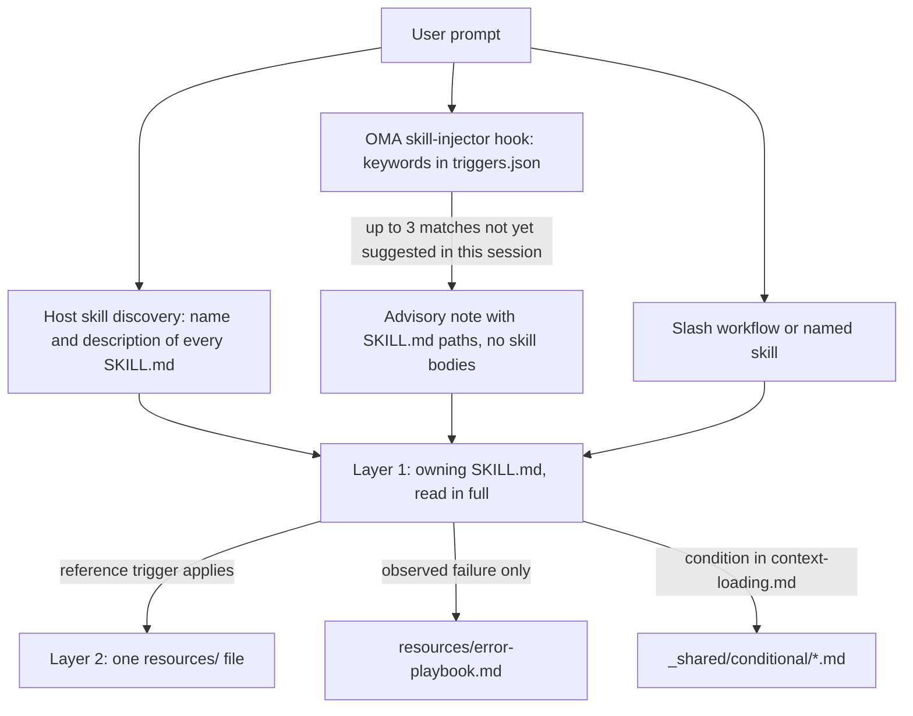
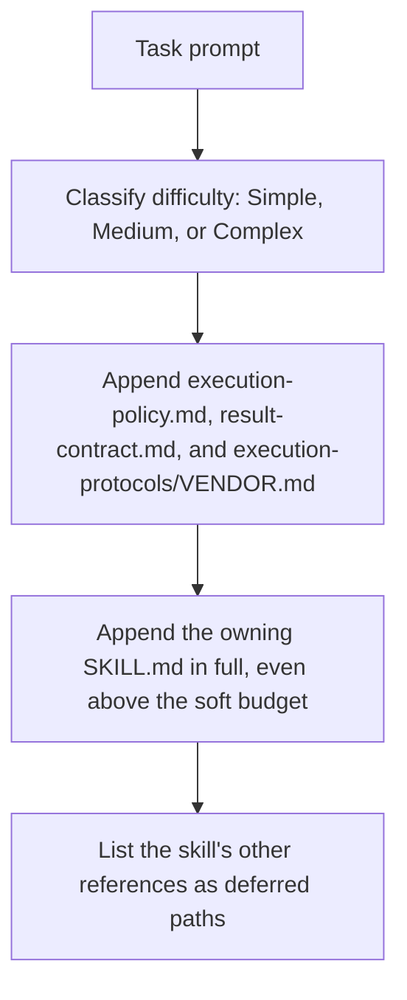

# Skills

[Skills](../getting-started/glossary.md#skill) sind strukturierte Wissenspakete, die einer Dispatch-Rolle ihre Domänenleitlinien vermitteln. Sie enthalten Ausführungsprotokolle, Tech-Stack-Referenzen, Code-Vorlagen, Fehler-Playbooks, Qualitätschecklisten und Beispiele, soweit der Skill sie bereitstellt, organisiert in einer Zwei-Schichten-Architektur, die auf Token-Effizienz ausgelegt ist. Die Liste der installierten Skills finden Sie im [Skill-Katalog](./agents.md#skill-catalog).

---

## Das Zwei-Schichten-Design {#the-two-layer-design}

Ein Skill gelangt in Stufen in den Kontext. Die Auswahl legt dem Modell nur einen Pfad oder eine Beschreibung vor; die SKILL.md des zuständigen Skills wird vollständig gelesen, sobald der Skill gewählt ist; unterstützende Dateien werden einzeln gelesen, wenn ihr Auslöser zutrifft.



Quellen: `.agents/hooks/core/skill-injector.ts`, `.agents/skills/_shared/core/skill-routing.md` und `.agents/skills/_shared/core/context-loading.md`.

### Schicht 1: SKILL.md (gelesen, wenn der Skill ausgewählt wird) {#layer-1-skillmd-read-when-the-skill-is-selected}

Jeder Skill hat eine `SKILL.md`-Datei im Stammverzeichnis. Der Injector-Hook übergibt eine **Pfadangabe**, nicht den Inhalt; ein nicht ausgewählter Skill kostet daher außer seiner `description` nichts. Jede `SKILL.md` hat YAML-Frontmatter und dieselben vier obersten Abschnitte; `oma skill lint` meldet einen Skill, dem einer davon fehlt oder dessen Hauptteil 500 Zeilen überschreitet.

| Teil | Inhalt |
|------|----------|
| Frontmatter | `name` und eine Routing-`description` (was der Skill tut und wann er zu verwenden ist) |
| `## Scheduling` | Ziel, Intent-Signatur, wann verwenden, wann NICHT verwenden, erwartete Ein- und Ausgaben, Abhängigkeiten |
| `## Structural Flow` | Übergänge, Fehler und Wiederherstellung, Endzustände |
| `## Logical Operations` | Kanonischer Befehls- oder Workflow-Pfad, Ressourcenumfang, Guardrails |
| `## References` | Schicht-2-Dateien, jeweils mit der Bedingung, die ihr Lesen rechtfertigt |

Aktuelles Frontmatter von `oma-frontend`:

```yaml
---
name: oma-frontend
description: "Implement or modify web UI in React, Next.js, or Angular. Use for components, pages, styles, forms, and frontend state or data flows."
---
```

Host-Laufzeiten zeigen dem Modell die `description` jedes Skills, daher ist sie als Routing-Satz formuliert. Der Keyword-Hook von OMA liest sie nicht; seine Keywords stehen in `.agents/hooks/core/triggers.json`.

### Schicht 2: resources/ (bedarfsgesteuert geladen) {#layer-2-resources-loaded-on-demand}

Das `resources/`-Verzeichnis enthält ausführliches Ausführungswissen. Diese Dateien werden nur geladen, wenn:
1. Der Host oder Workflow den Skill ausgewählt hat (etwa durch einen nativen Skill-Match oder einen ausdrücklichen Befehl)
2. Die aktuelle Aufgabe die Ladebedingung der Referenz erfüllt

Dieses bedarfsgesteuerte Laden wird durch den Context-Loading-Leitfaden (`.agents/skills/_shared/core/context-loading.md`) gesteuert, der zwischen Einstiegsanweisungen und je nach Aufgabe ausgewählten Referenzen unterscheidet.

### Was `oma agent spawn` injiziert {#what-oma-agent-spawn-injects}

Der CLI-Dispatch stellt den Subagenten-Prompt selbst zusammen, sodass der Subagent mit den Verträgen und dem zuständigen Skill bereits im Kontext startet:



Quelle: `cli/commands/agent/spawn-status.ts`, `cli/platform/agent-config/loaders.ts` und `cli/platform/context-loader.ts`. Native Subagenten erhalten denselben Aufgabenkontext über `oma agent context <agent-id>` und lesen die Richtlinie und den Ergebnisvertrag selbst, wenn die Laufzeit sie nicht bereitgestellt hat.

---

## Beispiel der Dateistruktur {#file-structure-example}

```text
.agents/skills/oma-frontend/
├── SKILL.md                          ← Layer 1: read when selected
└── resources/
    ├── execution-protocol.md         ← Layer 2: step-by-step workflow
    ├── tech-stack.md                 ← Layer 2: detailed technology specs
    ├── tailwind-rules.md             ← Layer 2: Tailwind conventions
    ├── angular-rules.md              ← Layer 2: Angular-specific conventions
    ├── snippets.md                   ← Layer 2: copy-paste code patterns
    ├── error-playbook.md             ← Layer 2: error recovery procedures
    └── checklist.md                  ← Layer 2: quality verification checklist

.agents/skills/oma-backend/
├── SKILL.md
├── resources/
│   ├── execution-protocol.md
│   ├── orm-reference.md              ← Domain-specific (ORM queries, N+1, transactions)
│   ├── checklist.md
│   └── error-playbook.md
└── variants/                          ← Starter seeds for /stack-set
    ├── stack.schema.json
    ├── node/
    ├── python/
    └── rust/

.agents/skills/oma-mobile/
├── SKILL.md
├── resources/
│   ├── execution-protocol.md
│   ├── tech-stack.md
│   ├── screen-template.dart
│   ├── screen-template.swift         ← Swift native iOS screen template
│   ├── screen-template.tsx            ← React Native screen template
│   ├── checklist.md
│   └── error-playbook.md
└── variants/                          ← Platform seeds for /stack-set
    ├── README.md
    ├── stack.schema.json
    ├── flutter/                       ← stack.yaml, tech-stack.md, snippets.md, api-template.dart
    ├── react-native/                  ← stack.yaml, tech-stack.md, snippets.md, api-template.ts
    └── swift-ios/                     ← stack.yaml, tech-stack.md, snippets.md, api-template.swift

.agents/skills/oma-design/
├── SKILL.md
├── resources/
│   ├── execution-protocol.md
│   ├── anti-patterns.md
│   ├── asset-strategy.md
│   ├── checklist.md
│   ├── design-md-spec.md
│   ├── design-tokens.md
│   ├── getdesign-fetcher.md
│   ├── prompt-enhancement.md
│   ├── redesign-protocol.md
│   ├── stitch-integration.md
│   └── error-playbook.md
└── reference/                         ← Deep reference material
    ├── typography.md
    ├── color-and-contrast.md
    ├── spatial-design.md
    ├── motion-design.md
    ├── responsive-design.md
    ├── component-patterns.md
    ├── accessibility.md
    ├── visual-hierarchy.md
    └── shader-and-3d.md
```

---

## Ressourcentypen pro Skill {#per-skill-resource-types}

| Ressourcentyp | Dateinamenmuster | Zweck | Wann geladen |
|--------------|-----------------|---------|-------------|
| **Ausführungsprotokoll** | `execution-protocol.md` | Schritt-für-Schritt-Workflow: Analysieren -> Planen -> Implementieren -> Verifizieren | Die ausgewählte Operation benötigt ihre Befehls- oder Vertragsdetails |
| **Tech-Stack** | `tech-stack.md` | Detaillierte Technologiespezifikationen, Versionen, Konfiguration | Ausgewählte Framework- oder Stack-Entscheidung |
| **Fehler-Playbook** | `error-playbook.md` | Schritte vom Symptom zur Wiederherstellung; fehlende Informationen oder Befugnisse pausieren nur die davon abhängige Aktion | Nur nach einem beobachteten Fehler |
| **Checkliste** | `checklist.md` | Domänenspezifische Qualitätsverifikation | Relevante Abschnitte, für offene Verifikation |
| **Snippets** | `snippets.md` | Kopierbereite Code-Muster | Ungewohnte Implementierung oder Ausgabeform |
| **Beispiele** | `examples.md` | Ausgearbeitete Ein-/Ausgabebeispiele (oma-pm, oma-db, oma-tf-infra, oma-observability, oma-search) | Ungewohnte Implementierung oder Ausgabeform |
| **Varianten** | `variants/`-Verzeichnis | Sprach-/Framework-Starter-Seeds. Backend liefert `node`, `python` und `rust`; Mobile liefert `flutter`, `react-native` und `swift-ios`. `/stack-set` erzeugt daraus das `stack/` des Projekts. | Wenn ein passender Stack eingerichtet wird |
| **Vorlagen** | `screen-template.{dart,swift,tsx}` (oma-mobile), `variants/*/api-template.*` | Boilerplate für einen neuen Screen oder ein neues API-Modul | Beim Erstellen dieser Datei |
| **Domänenreferenz** | `orm-reference.md`, `anti-patterns.md` usw. | Vertiefte Domänenkenntnisse für spezifische Teilaufgaben | Aufgabentypspezifisch |

---

## Gemeinsame Ressourcen (_shared/) {#shared-resources-_shared}

Alle Agenten teilen gemeinsame Grundlagen aus `.agents/skills/_shared/`. Diese sind in drei Kategorien organisiert:

### Kernressourcen (`.agents/skills/_shared/core/`) {#core-resources-agentsskills_sharedcore}

| Ressource | Zweck | Wann geladen |
|----------|---------|-------------|
| **`execution-policy.md`** | Regeln zu Autorisierung, Klärung, Verifikation und Abschluss für jeden Skill und Workflow. | In jeden `oma agent spawn`-Prompt injiziert; native Agenten lesen sie, wenn sie nicht bereitgestellt wird |
| **`skill-routing.md`** | Routet nach Aufgabenergebnis, Zuständigkeit und tatsächlichen Abhängigkeiten; keine zwingende Agentenkette und kein Zugkontingent. | Von Orchestrator- und Koordinations-Skills referenziert |
| **`context-loading.md`** | Zuständige Einstiegsdatei, bedingte Referenzen und Grenzen des Ladens zur Laufzeit. | Beim Zusammenstellen des Kontexts |
| **`prompt-structure.md`** | Gibt Orientierung für ungewohnte Aufgabenübergaben mit Ziel, Kontext, echten Einschränkungen und Akzeptanznachweis; keine verpflichtende Vorlage für direkte Aufgaben. | Beim Zusammenstellen einer ungewohnten Übergabe; kein verpflichtendes Vorladen |
| **`clarification-protocol.md`** | Klärt Routinedetails anhand des Kontexts und fragt nur nach wesentlichen fehlenden Informationen oder einer Autorisierung. | Bei unklaren Anforderungen |
| **`code-intelligence.md`** | Die konfigurierte Code-Intelligence-Fähigkeit für Codesuche, Navigation und Impact-Analyse verwenden. | Codesuche oder Navigation |
| **`test-approach.md`** | Aufgabenspezifischer `test_approach` aus dem PM-Plan und der `TDD_EVIDENCE`-Block für `tdd`-Aufgaben. | Aufgaben, deren Plan `test_approach` festlegt |
| **`context-budget.md`** | Dateigrößenschätzungen, Messung des tatsächlichen Prompts, eingegrenzte Lesezugriffe und Checkpoints. | Lange Aufgaben oder Diagnose von Kontext-Overhead |
| **`difficulty-guide.md`** | Wählt Planungstiefe und Liefergegenstände anhand von Abhängigkeiten und Verifikationsbedarf. | Wenn die Zerlegung eine Schwierigkeitsschätzung benötigt |
| **`quality-principles.md`** | Leitlinien zu Umfang, Wartbarkeit, Nachweisen und verhältnismäßiger Verifikation. | Beim Workflow-Start qualitätsorientierter Workflows (ultrawork) |
| **`vendor-detection.md`** | Ermittelt den Ziel-Vendor jedes Agenten aus der Konfiguration und wählt nativen Dispatch oder `oma agent spawn`. | Wenn Dispatch-Details ungeklärt sind |
| **`session-metrics.md`** | Optionale Sitzungsnachweise ohne gesprächs- oder evaluatorbezogene Strafpunkte. | Angeforderte Retrospektive oder wesentliche Korrektur |
| **`common-checklist.md`** | Anwendbare domänenübergreifende Prüfungen; keine globalen Zeilenzahl-Limits und keine pauschale Catch-Pflicht. | Domänenübergreifendes Review, wenn relevant |
| **`lessons-learned.md`** | Erfassen und Anwenden belegter Lessons mit Versions- und Auslösebedingungen; kein automatischer RCA-Schwellenwert. | Nach Fehlern und am Sitzungsende referenziert |
| **`anti-ai-prose.md`** | Gemeinsame Diagnosen für Prosa. | Audits akademischer Prosa und Stilprüfungen von Übersetzungen |
| **`stack-verify.schema.json`** | Gemeinsame `verify:`-Definitionen, die von den Stack-Schemata für Backend und Mobile wiederverwendet werden. | Validierung von Stack-Schemata |
| **`api-contracts/`** | Optionale Vertragsvorlage. Projektschemata wiederverwenden; generierte Verträge liegen außerhalb der Skill-Quelle. | Wenn grenzüberschreitende Arbeit geplant wird |

### Laufzeit-Ressourcen (`.agents/skills/_shared/runtime/`) {#runtime-resources-agentsskills_sharedruntime}

| Ressource | Zweck |
|----------|---------|
| **`result-contract.md`** | Run-Identität, Claim-Pfad und Abschlussvertrag für Agentenergebnisse. Wird in jeden `oma agent spawn`-Prompt injiziert; native Agenten befolgen ihn mit `oma agent begin`, `oma agent verify` und `oma agent finish`. |
| **`memory-protocol.md`** | Speicherdateiformat und Operationen für CLI-Subagenten. Definiert die Protokolle On Start, During Execution und On Completion mit konfigurierbaren Speicherwerkzeugen (read/write/edit). Enthält eine Erweiterung zur Experimentverfolgung. |
| **`event-spec.md`** | Vertrag für dauerhafte Workflow-Ereignisse, die an `events.jsonl` im OMA-Home-Profil angehängt und mit `oma state get` oder `oma state list` geprüft werden. |
| **`execution-protocols/claude.md`** | Claude-Code-spezifische Ausführungsmuster. Wird von `oma agent spawn` bei Vendor `claude` injiziert. |
| **`execution-protocols/antigravity.md`** | Ausführungsmuster für die Antigravity-CLI (`agy`). |
| **`execution-protocols/codex.md`** | Codex-CLI-spezifische Ausführungsmuster. |
| **`execution-protocols/commandcode.md`** | Ausführungsmuster für CommandCode. |
| **`execution-protocols/grok.md`** | Ausführungsmuster für Grok. |
| **`execution-protocols/kimi.md`** | Ausführungsmuster für Kimi Code. |
| **`execution-protocols/kiro.md`** | Ausführungsmuster für Kiro. |
| **`execution-protocols/opencode.md`** | Ausführungsmuster für die OpenCode-Erweiterung. |
| **`execution-protocols/pi.md`** | Ausführungsmuster für die pi-Erweiterung. |
| **`execution-protocols/qwen.md`** | Qwen-CLI-spezifische Ausführungsmuster. |

Vendor-spezifische Ausführungsprotokolle werden für per CLI gestartete Agenten automatisch durch `oma agent spawn` injiziert. Native Subagenten verwenden die Integrationsregeln des ausgewählten Vendors.

### Bedingte Ressourcen (`.agents/skills/_shared/conditional/`) {#conditional-resources-agentsskills_sharedconditional}

Diese werden nur geladen, wenn bestimmte Bedingungen während der Ausführung erfüllt sind:

| Ressource | Auslösebedingung | Geladen von |
|----------|-------------------|-----------|
| **`quality-score.md`** | Eine definierte Baseline oder ein Experimentvergleich wird benötigt | Orchestrator (wird an QA-Agent-Prompt übergeben) |
| **`experiment-ledger.md`** | Eine tatsächliche Hypothese wird mit einer Baseline oder einem anderen Ansatz verglichen | Koordinator (pflegt das gemeinsame Ledger; parallele Agenten schreiben aufgaben- bzw. run-bezogene Ergebnisse, die er zusammenführt) |
| **`exploration-loop.md`** | Wiederholte Wiederherstellungsversuche scheitern und es lohnt sich, Alternativen im Rahmen des Budgets zu testen | Orchestrator (inline, vor dem Starten von Hypothesen-Agenten) |
| **`diagram-engine.md`** | Ein Workflow ist im Begriff, ein Strukturdiagramm auszugeben (Architektur, Sequenz, Datenfluss, Lebenszyklus) | Der Workflow, der das Diagramm ausgibt |

Diese Ressourcen bleiben zurückgestellt, bis ihre jeweiligen Auslöser zutreffen. Der Schwierigkeitsgrad allein injiziert sie nicht.

---

## Wie ein Skill ausgewählt wird {#how-skills-route-via-skill-routingmd}

Drei Wege bringen einen Skill in den Kontext. Keiner davon startet für sich allein einen Workflow oder autorisiert eine Delegation.

1. **Host-native Erkennung.** Laufzeiten mit Skill-Unterstützung listen `name` und `description` jedes Skills auf; das Modell liest die SKILL.md, deren Beschreibung zum angeforderten Ergebnis passt.
2. **OMA-Keyword-Hinweis.** Wo OMA seinen Prompt-Hook installiert, gleicht `skill-injector` den Prompt mit mehrsprachigen Keywords in `.agents/hooks/core/triggers.json` ab und fügt einen beratenden Hinweis `[OMA SKILLS DETECTED: ...]` mit bis zu drei SKILL.md-Pfaden hinzu. Bei "Build a login form with Tailwind CSS" passt nur das Keyword `tailwind`, daher schlägt der Hinweis `oma-frontend` vor.
3. **Expliziter Aufruf.** Ein Slash-Workflow wie `/plan`, `/review` oder `/debug` oder die Nennung des Skills im Prompt.

### Zuständigkeit nach Ergebnis {#ownership-by-outcome}

Ein zuständiger Skill bearbeitet eine eingegrenzte Aufgabe; eine Übergabe kommt nur hinzu, wenn ein anderer Skill eine eigenständige Fähigkeit beisteuert. Diese Tabelle spiegelt `.agents/skills/_shared/core/skill-routing.md`. Für andere Domänen wählen Sie anhand der Beschreibungen der installierten Skills im [Skill-Katalog](./agents.md#skill-catalog).

| Angefordertes Ergebnis | Zuständiger Skill |
|-------------------|--------------|
| Anwendungs-API, Server-Authentifizierung, Service-/Datenzugriffslogik | oma-backend |
| Schema, Migrationsdesign, Indizierung, Query-Tuning, Datenbankbetrieb | oma-db |
| Web-Komponenten, Seiten, Formulare, Client-State | oma-frontend |
| Mobile Screens, Widgets, Plattformintegration | oma-mobile |
| Systemgrenzen, Architektur-Trade-offs, ADR | oma-architecture |
| Fehlerhaftes Verhalten diagnostizieren und beheben | oma-debug |
| Korrektheit, Sicherheit, Barrierefreiheit, Performance prüfen | oma-qa |
| Visuelles System, DESIGN.md, Redesign-Richtung | oma-design |
| Angeforderte Ideenfindung oder Erkundung von Alternativen | oma-brainstorm |
| Anforderungen, Abhängigkeiten, Akzeptanzkriterien | oma-pm |
| Angeforderte parallele Ausführung durch Spezialisten | oma-orchestration |
| Angeforderte manuelle Multi-Agenten-Koordination | oma-coordination |
| Git-Branches, Commits, Merges, Repository-Historie | oma-scm |

### Abhängigkeiten zwischen Skills {#dependencies-between-skills}

Es gibt keine feste Ausführungskette. Ordnen Sie die Arbeit nach tatsächlichen Abhängigkeiten:

- Eine offene Architektur- oder Produktentscheidung klären, bevor davon abhängige Arbeit beginnt. Bestehende Entscheidungen müssen nicht erneut Architektur, Brainstorming oder PM durchlaufen.
- Backend- und Client-Arbeit können unabhängig voneinander voranschreiten, wenn ihr gemeinsamer API-Vertrag nutzbar ist. Fehlt er, diese Grenze zuerst mit den jeweils Zuständigen klären.
- Ein Review kann an einem abgeschlossenen, prüfbaren Teil beginnen, während unabhängige Implementierung weiterläuft. Ein instabiles Artefakt nicht als endgültigen Nachweis prüfen.
- Ein während der Implementierung gefundener Bug kann von seinem Zuständigen behoben werden. Debug-Unterstützung hinzuziehen, wenn die Diagnose es erfordert; eine Pflichtkette von Implementierung zu Debug gibt es nicht.
- Bei einem domänenübergreifenden Defekt den fehlschlagenden Vertrag und den Zuständigen anhand von Belegen ermitteln. Eine API-Abweichung bedeutet nicht automatisch, dass sich das Backend ändern muss.

### Wenn kein Skill-Hinweis erscheint {#when-a-skill-hint-does-not-appear}

Alle diese Verhaltensweisen stammen aus `.agents/hooks/core/skill-injector.ts`.

| Symptom | Ursache | Vorgehen |
|---------|-------|------------|
| Überhaupt kein Hinweis `[OMA SKILLS DETECTED]` | Der Prompt beginnt mit `/`, für die Sitzung ist ein [persistenter Workflow](../getting-started/glossary.md#persistent-workflow) aktiv, oder die Nachricht ist eine weitergeleitete Agentennachricht | Erwartet: Der Workflow verantwortet den Kontext. Nennen Sie den Skill, wenn Sie ihn benötigen |
| Ein erwarteter Skill fehlt im Hinweis | Nur die drei besten Treffer werden aufgeführt (10 Punkte pro passendem Keyword) | Einen spezifischeren Begriff verwenden oder den Skill nennen |
| Ein früher vorgeschlagener Skill wird nicht erneut vorgeschlagen | Ein SKILL.md-Pfad wird einmal pro Sitzung vorgeschlagen; der Eintrag in `.agents/state/skill-sessions.json` läuft nach einer Stunde ohne neue Vorschläge ab | Der frühere Vorschlag gilt weiterhin |
| Ein Keyword wird ignoriert | Text in Code-Fences, Backticks oder doppelten Anführungszeichen wird vor dem Abgleich entfernt | Den Begriff im Fließtext erwähnen |
| oma-academic-writing, oma-docs, oma-explanation, oma-scholar oder oma-skill-creation wird nie vorgeschlagen | Diese Skills haben keine Keywords in `triggers.json` | `/docs` oder `/explain` verwenden oder den Skill nennen; die Host-Erkennung sieht ihre Beschreibungen weiterhin |
| Der Hinweis nennt einen unpassenden Skill | Der Abgleich ist keyword-basiert und nur beratend | Das gewünschte Ergebnis nennen; der Hinweis weist das Modell an, nach eigenem Urteil zu handeln |

---

## Token-Einsparungsberechnung {#token-savings-math}

Messen Sie die Kontextkosten, bevor Sie Einsparungen behaupten. Zwei verschiedene Dinge verwenden die Begriffe simple, medium und complex:

- **Skript-Szenarien** (`routed`, `simple`, `medium`, `complex`, `all`) sind kumulative Dateigrößenvergleiche, die `scripts/measure-skill-context.ts` ausgibt. Sie sind keine Laderichtlinien, und `all` ist nur eine Obergrenze.
- **Loader-Schwierigkeit** (Simple, Medium, Complex) wählt das weiche Budget für den Kontext, den der CLI-Dispatch injiziert. Siehe [Ressourcenladen nach Aufgabe](#resource-loading-by-task).

```bash
bun scripts/measure-skill-context.ts
bun scripts/measure-skill-context.ts --skills oma-pm,oma-backend,oma-frontend --json
oma agent context backend --difficulty Medium
```

Das Skript meldet Schätzwerte (UTF-8-Bytes / 4). `routed` umfasst nur die Einstiegsdatei; `simple`, `medium` und `complex` fügen zum Vergleich hypothetische Protokoll-, Beispiel- und Stack-Dateien hinzu. Ihre Namen bleiben aus Gründen der Skriptkompatibilität erhalten und sind keine Anweisungen zum Vorladen. Ein frischer Checkout kann einen einzelnen Plattform-Seed als Größenproxy verwenden; dabei werden nicht alle Plattformen geladen.

Der Context-Befehl gibt die tatsächliche Injektion des Aufgabenkontexts aus: einen Header `## Task context (graph-selected, approximately N tokens)`, die SKILL.md des zuständigen Skills und die Liste der zurückgestellten Referenzen. Er enthält weder den übrigen Gesprächsverlauf noch sämtliche Host- und Laufzeitanweisungen, und ein gespawnter Prompt ist größer, weil `oma agent spawn` zusätzlich die Ausführungsrichtlinie, den Ergebnisvertrag und das Vendor-Protokoll hinzufügt. Gesamte Eingabe-Tokens, Latenz und Kosten für ein konkret benanntes Modell mit einem zusammengestellten Prompt oder mit Nutzungstelemetrie messen. Diese Werte nicht aus der Repository-Größe oder aus der Anzahl generierter Spiegelkopien ableiten.

## Ressourcenladen nach Aufgabe {#resource-loading-by-task}

Jede Schwierigkeitsstufe beginnt mit dem zuständigen Skill. Der Graph ist ein Referenzindex; Nachbarschaft im Graphen berechtigt nicht zum Laden eines anderen Spezialisten, eines Fehler-Playbooks oder eines bedingten Experiment-Workflows.

Der Loader verwendet weiche Budgets von 1.500 / 4.000 / 8.000 geschätzten Tokens für Simple / Medium / Complex. Eine Einstiegsdatei, die das Budget überschreitet, bleibt erhalten, und die Überschreitung wird gemeldet. Unterstützende Referenzen bleiben zurückgestellt, es sei denn, sie werden ausdrücklich ausgewählt, nachdem ihr aufgabenbezogener Auslöser geklärt wurde. Eine erforderliche Einstiegsdatei wird nie durch kleinere, nicht zugehörige Dokumente ersetzt.

Die Verifikation richtet sich nach dem Risiko der Aufgabe und den Projektanforderungen. Eine Schwierigkeitseinstufung verlangt weder eine vollständige Test-Suite noch eine feste Preflight-Antwort noch eine zweite Genehmigung bereits autorisierter Arbeit.

## Context-Loading-Aufgabenzuordnungen (pro Agent) {#context-loading-task-maps-per-agent}

Dies sind Beispiele für Referenzen, die herangezogen werden, wenn die Aufgabe sie benötigt. Den aktuellen Index des zuständigen Skills verwenden und nur anwendbare Abschnitte auswählen:

### Backend-Agent {#backend-agent}

<!-- oma-docs:ignore-start -->

| Aufgabentyp | Erforderliche Ressourcen |
|-----------|-------------------|
| CRUD-API-Erstellung | `stack/snippets.md` und `stack/api-template.*` des Projekts (von `/stack-set` erzeugt), sofern vorhanden; andernfalls vorhandener Projektcode |
| Authentifizierung | `stack/snippets.md` + `stack/tech-stack.md`, sofern vorhanden |
| DB-Migration | `stack/snippets.md`, sofern vorhanden; Schemadesign geht an oma-db |
| Performance-Optimierung | `orm-reference.md` und passende vom Skill bereitgestellte Beispiele |
| Vorhandenen Code modifizieren | projektweiter Code-Intelligence-Provider und relevante Ausführungsressourcen |

<!-- oma-docs:ignore-end -->

`variants/node`, `variants/python` und `variants/rust` sind Starter-Seeds für `/stack-set`; Agenten lesen sie nicht für Änderungen an bestehendem Code.

### Frontend-Agent {#frontend-agent}

| Aufgabentyp | Erforderliche Ressourcen |
|-----------|-------------------|
| Komponentenerstellung | snippets.md + vorhandene Komponenten-Muster des Projekts |
| Formularimplementierung | snippets.md (Formular + Zod) |
| API-Integration | snippets.md (TanStack Query) |
| Styling | tailwind-rules.md |
| Seitenlayout | snippets.md (Grid) |

### Design-Agent {#design-agent}

| Aufgabentyp | Erforderliche Ressourcen |
|-----------|-------------------|
| Design-System-Erstellung | reference/typography.md + reference/color-and-contrast.md + reference/spatial-design.md + design-md-spec.md |
| Landingpage-Design | reference/component-patterns.md + reference/motion-design.md + prompt-enhancement.md |
| Design-Audit | checklist.md + anti-patterns.md |
| Design-Token-Export | design-tokens.md |
| 3D- / Shader-Effekte | reference/shader-and-3d.md + reference/motion-design.md |
| Barrierefreiheits-Review | reference/accessibility.md + checklist.md |

### QA-Agent {#qa-agent}

| Aufgabentyp | Erforderliche Ressourcen |
|-----------|-------------------|
| Sicherheits-Review | checklist.md (Sicherheitsabschnitt) |
| Performance-Review | checklist.md (Performance-Abschnitt) |
| Barrierefreiheits-Review | checklist.md (Barrierefreiheitsabschnitt) |
| Vollständiges Audit | checklist.md (alle Abschnitte), plus iso-quality.md, wenn ein normbasiertes Review angefordert wird |
| Vergleich einer definierten Metrik | quality-score.md (bedingt) |

---

## Orchestrator-Prompt-Zusammenstellung {#orchestrator-prompt-composition}

Wenn der Orchestrator einen Subagenten-Prompt schreibt (`oma-orchestration/resources/subagent-prompt-template.md`), liefert er nur Aufgabendaten: Agentenrolle, Aufgaben-ID, Workspace, erlaubte Pfade, Aufgabenbeschreibung, Akzeptanzkriterien, Aufgabenreferenzen mit ihren Ladebedingungen und wesentliche Einschränkungen.

- Beim CLI-Dispatch injiziert `oma agent spawn` bereits `execution-policy.md`, `result-contract.md`, das Vendor-Ausführungsprotokoll und die SKILL.md des zuständigen Skills, daher wiederholt der Prompt sie nicht.
- Beim nativen Dispatch die Pfade dieser Dateien und des zuständigen Skills übergeben, wenn die Laufzeit sie nicht bereitgestellt hat.
- Einen Abschnitt aus dem Fehler-Playbook erst nach einem beobachteten Fehler hinzufügen und `runtime/memory-protocol.md` nur, wenn der Agent dauerhaften Aufgabenzustand koordiniert oder fortsetzt.

Diese zielgerichtete Zusammenstellung vermeidet unnötige Ressourcen und maximiert den verfügbaren Kontext des Subagenten für die eigentliche Arbeit.

---

## Sitzungsnachweise und retrospektive Auswertung {#session-evidence-and-retrospective-review}

Sitzungsaufzeichnungen halten wesentliche Korrekturen, Umfangsänderungen, Nacharbeit und beurteilte Review-Befunde mit Nachweisen fest. Notwendige Klärung zieht keine Strafe nach sich. Die früheren gewichteten CD- und EA-Scores sowie die durch Schwellenwerte ausgelösten RCA-Regeln wurden entfernt; sie waren Prompt-Anweisungen und keine per CLI berechneten Metriken.

Nach Möglichkeit vorhandene Aufgabenergebnisse verwenden. Eine separate `session-metrics-{sessionId}.md` ist im konfigurierten Koordinationsspeicher optional. Ein wiederholter Fehlschlag oder eine angeforderte Retrospektive kann eine Lesson rechtfertigen; eine gewöhnliche fehlschlagende Prüfung oder ein strittiger Befund begründet jedoch nicht automatisch eine. Historische Protokolle beibehalten und nicht in das neue Format umschreiben.

`oma stats` meldet die Produktivität sowie erfasste Nutzungs- und Kostenzusammenfassungen. `oma retro` gruppiert tatsächliche Ereignisse (Gate, Blocker, fehlende Entscheidung) zu Vorschlägen. Keiner von beiden berechnet CD-/EA-Scores aus diesen Markdown-Artefakten.

## Aufgabenzerlegung und Kontextwiederherstellung {#task-decomposition-and-context-recovery}

Die Planung an Abhängigkeiten und unabhängig verifizierbarem Verhalten ausrichten. Feste Sprint-Anzahlen, Dateizahlen und Zugschätzungen bestimmen weder die Review-Tiefe noch den Abschluss. Tests und Fehlerbehandlung bei dem Verhalten belassen, das sie verifizieren.

Bei einem beobachteten Stillstand oder Verlust nützlichen Kontexts vor dem Fortsetzen oder einem erneuten Dispatch abgeschlossene Arbeit, verbleibende Kriterien, relevante Pfade und Verifikationsnachweise speichern. Vorhandene Arbeit erhalten und einen laufenden Versuch nicht duplizieren. Ein Verhältnis von Zügen zu Fortschritt allein erfordert keinen Reset.

## Bedingte Messung und Exploration {#conditional-measurement-and-exploration}

Eine definierte Baseline oder ein Experimentvergleich aktiviert die Leitlinien zur Messung; das bloße Vorhandensein von Tests oder Lint tut das nicht. Vergleichbare Metriken mit Einheiten, Methode, Revision und Nachweisen aufzeichnen. Erforderliche Korrektheits- und Sicherheitsprüfungen bleiben davon unabhängig. OMA kennt keine zusammengesetzte Standardformel, kein Gate mit Buchstabennoten und keinen durch Scores ausgelösten Rollback.

Ein tatsächliches Experiment zeichnet seine Hypothese, Baseline- und Kandidatennachweise, erforderliche Prüfungen, Entscheidung und zugeordnete Dateien auf. Wiederholte Fehlschläge können es rechtfertigen, einen anderen Mechanismus innerhalb des bestehenden Wiederherstellungsbudgets zu testen. Experimentänderungen isolieren, nicht zugehörige Änderungen erhalten und den integrierten Kandidaten verifizieren, bevor das Gate fortgesetzt wird.

---

## Verwandte Seiten {#related}

- [Agenten](./agents.md): Skill-Katalog, Dispatch-Rollen, Definitionen und native Agentendateien
- [Workflows](./workflows.md): Slash-Workflows, die Skills lesen
- [Projektstruktur](./project-structure.md): wo `.agents/skills/` nach der Installation liegt
- [Agentenergebnisse und Fortsetzen](../guide/agent-results-and-resume.md): der native Lebenszyklus `oma agent begin` → `oma agent finish`
- [Skill-Evaluierung](../guide/skill-eval.md) und [Skill-Optimierung](../guide/skill-opt.md)
- Autorenschaft: den Skill `oma-skill-creation` verwenden, dann `oma skill lint` und `oma skill audit` ausführen
