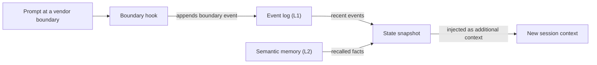

# Glossar

Jeder Eintrag enthält eine kurze Definition und verweist auf die Seite, die den Begriff ausführlich behandelt. Wo ein Wort in verschiedenen Teilen von OMA Unterschiedliches bedeutet, sagt der Eintrag das.

## Bausteine

### Skill {#skill}

Ein Skill ist ein Paket mit Domänenwissen unter `.agents/skills/oma-<name>/`. Seine `SKILL.md` gelangt in den Kontext, wenn der Skill geroutet wird; die Dateien in `resources/` werden nur geladen, wenn die Aufgabe sie benötigt. Ein Skill steuert, wie ein Agent in einer Domäne arbeitet; einen mehrstufigen Prozess definiert er nicht. Siehe [Skills](../core-concepts/skills.md).

### Workflow {#workflow}

Ein Workflow ist ein mehrstufiger Prozess, der in `.agents/workflows/<name>.md` definiert ist. Sie starten ihn mit seinem Slash-Befehl, etwa `/plan` oder `/orchestrate`; wo der Hook zur Keyword-Erkennung aktiviert ist, kann ihn auch eine passende Trigger-Phrase injizieren. Workflows koordinieren einen oder mehrere Skills und Agenten. Siehe [Workflows](../core-concepts/workflows.md) und [Skill oder Workflow auswählen](../core-concepts/workflows.md#choosing-a-skill-or-workflow).

### Agentendefinition {#agent-definition}

Eine Agentendefinition ist eine versionierte Subagenten-Datei in `.agents/agents/`, etwa `backend-engineer.md` oder `qa-reviewer.md`. Sie legt die Identität des Agenten fest, die Skills, die er lädt (Frontmatter `skills:`), einen Abschnitt zum Ausführungsprotokoll und Domänenregeln. OMA überträgt diese Dateien in Vendor-native Formate wie `.claude/agents/*.md` und `.codex/agents/*.toml`. Die Dokumentation verwendet „Agent“ außerdem für eine Dispatch-Rolle (`backend`, `qa`, `explore`) und für einen Skill wie `oma-backend`. Siehe [Agentendefinitionen](../core-concepts/agents.md#agent-definitions).

## Presets

### Skill-Preset {#skill-preset}

Ein Skill-Preset ist das Bündel von Skills, das der Installer einem Projekt hinzufügt, etwa `all`, `fullstack`, `backend` oder `research`. Die gemeinsamen `_shared/`-Ressourcen werden mit jedem Preset installiert. Ein Skill-Preset hat keinen Einfluss darauf, welches Modell einen Agenten ausführt. Siehe [Presets](./installation.md#presets).

### Modell-Preset {#model-preset}

Das Modell-Preset ist der Wert `model_preset` in `.agents/oma-config.yaml` (oder `.cue`). Es bestimmt, welchen Vendor und welches Modell jeder Agent verwendet. `auto`, der Standard für neue Installationen, folgt den eigenen Agenten- und Modelleinstellungen der aktuellen Laufzeit; feste Presets wie `claude`, `codex` oder `mixed` legen sie fest. Überschreibungen unter `agents.<id>` haben Vorrang vor dem Preset, außer bei `free`, wo `free.model` die Modellfestlegungen pro Agent ersetzt. Siehe [Eingebaute Presets](../guide/per-agent-models.md#built-in-presets).

## Workflow-Ausführung

### Persistenter Workflow {#persistent-workflow}

Ein persistenter Workflow läuft über mehrere Gesprächszüge weiter, bis seine Arbeit erledigt ist oder Sie ihn deaktivieren. Die persistenten Workflows sind `/orchestrate`, `/work`, `/ultrawork` und `/ralph`, und nur ein expliziter Aufruf aktiviert den persistenten Modus. Solange einer aktiv ist, injiziert ein Hook bei jedem Prompt erneut `[OMA PERSISTENT MODE: ...]`, und der Stop-Hook verhindert das Ende der Sitzung, bis ein Verstärkungslimit oder ein Inaktivitäts-Timeout erreicht ist. Sagen Sie `workflow done`, um ihn zu deaktivieren. Siehe [Mechanik des persistenten Modus](../core-concepts/workflows.md#persistent-mode-mechanics).

### Stop-Gate {#stop-gate}

Ein Stop-Gate ist eine optionale Abschlussprüfung, die Sie mit `oma goal set --gate typecheck|test|lint` an einen aktiven persistenten Workflow anhängen. Der Stop-Hook lässt den Workflow dann nur enden, wenn das gleichnamige `package.json`-Skript besteht. Fehlschläge des Gates zählen zum Verstärkungslimit, sodass ein fehlschlagendes Gate das Beenden nicht unbegrenzt blockieren kann. Siehe [`goal set`](../cli-interfaces/commands.md#goal-set).

## Sitzungen und Zustand

„Sitzung“ hat in OMA zwei Bedeutungen: die Sitzung, die OMA selbst verfolgt, und die Gesprächssitzung der KI-CLI oder IDE, die Sie verwenden. Halten Sie beide auseinander, wenn Sie Zustandsdateien oder Befehlsoptionen lesen.

### OMA-Sitzung {#oma-session}

Eine OMA-Sitzung ist Arbeit, die OMA unter einer eigenen Sitzungs-ID verfolgt, unabhängig von jeder Vendor-Konversation. Die Orchestrierung benennt mit dieser ID den Plan, das Task Board, Fortschritts- und Ergebnisdateien sowie die Laufdatensätze der Agenten; der Orchestrator erzeugt sie im Format `session-YYYYMMDD-HHMMSS`. Der Workflow-Zustand verwendet eine OMA-Sitzungs-ID (`sid`) als Schlüssel für das [Ereignisprotokoll](#event-log), das `oma state list` und `oma state get <sid>` auslesen. Siehe [Sitzungs-ID-Strategie](../guide/multi-agent-project.md#session-id-strategy).

### Vendor-Sitzungs-ID {#vendor-session-id}

Eine Vendor-Sitzungs-ID ist die Konversations-ID, die die KI-CLI oder IDE vergibt, etwa eine Sitzungs-ID von Claude Code oder Codex. OMA zeichnet sie in Ereignissen als `vendorSid` auf, und die Zustandsdateien des persistenten Modus verwenden sie als Schlüssel (`.agents/state/<workflow>-state-<vendor-session-id>.json`). Ist eine OMA-Sitzung aktiv und kommt ein Prompt aus einer anderen Vendor-Sitzung, von einem anderen Vendor oder aus einer gerade komprimierten Sitzung, zeichnet ein Hook ein `boundary`-Ereignis auf und injiziert einen Zustands-Snapshot, damit die Arbeit im neuen Kontext weitergeht. Siehe [`state`](../cli-interfaces/commands.md#state).

Ist das semantische Memory nicht verfügbar, verwendet der Snapshot nur die lokalen Ereignisse.

### Ereignisprotokoll {#event-log}

Das Ereignisprotokoll ist der nur anhängbare Verlauf einer OMA-Sitzung, gespeichert als `events.jsonl` unter `${OMA_STATE_HOME:-~/.oma}/u/<profile>/sessions/<sid>/`. Jede Zeile ist ein Ereignis, etwa `session.created`, `workflow.phase`, `gate.passed`, `decision.made` oder `session.ended`. Workflows hängen erforderliche Entscheidungen mit `oma state emit` an und prüfen sie mit `oma state verify`; lesen Sie das Protokoll mit `oma state get` oder `oma state trajectory`, statt die Datei direkt zu öffnen. Siehe [`state`](../cli-interfaces/commands.md#state).

## Review und Belege

### Judge {#judge}

„Judge“ hat zwei Bedeutungen. In `/ralph` ist der Judge die Phase nach jeder ultrawork-Iteration, die jedes Abschlusskriterium gegen den tatsächlichen Projektzustand prüft und PASS, FAIL, REGRESSED oder BLOCKED festhält. Ein separat gestarteter Agent mit frischem Kontext führt sie aus, damit der Orchestrator seine eigene Arbeit nicht selbst bewertet. Bei der Evaluierung und Optimierung von Skills ist `judge` der Standard-Prüfertyp: Ein Modell bewertet die Ausgabe eines Arms anhand einer Rubrik und gibt PASS oder FAIL zurück. Siehe [/ralph](../core-concepts/workflows.md#ralph) und [den Judge-Prüfer](../guide/skill-eval.md#judge-default).

### Cross-Context Review (CCR) {#cross-context-review-ccr}

Cross-Context Review ist die Regel, dass jeder Review-Schritt in `/ultrawork` in einem frischen, kontextisolierten Reviewer-Subagenten läuft. Der Reviewer erhält nur die zu prüfenden Artefakte, per Pfad referenziert (Diff, geänderte Dateien, Plan, frühere Ergebnisse, Testausgabe), sowie den Leitfaden für genau dieses Review; den Verlauf der Hauptsitzung oder die Überlegungen des Implementierers sieht er nie. Jeder Reviewer schreibt ein strukturiertes Urteil, das der Phasenkoordinator einsammelt. Siehe [/ultrawork](../core-concepts/workflows.md#ultrawork).

### Charter {#charter}

Die Charter ist der Preflight-Block `CHARTER_CHECK`, den Implementierungsagenten früher vor jeglichem Code schreiben mussten. Aktuelle Agentendefinitionen verlangen keine feste Preflight-Ausgabe. Stattdessen folgen Agenten der gemeinsamen Ausführungsrichtlinie: Sie nennen wesentliche Annahmen, fragen nur nach, wenn fehlende Informationen Korrektheit oder Umfang verändern, und pausieren nur die Arbeit, die von der Antwort abhängt. Ein gestarteter Subagent kann Sie nicht direkt fragen; er meldet die fehlende Information daher in einem Ergebnis mit `blocked` oder `partial`. Siehe [Autorisierung und Klärung](../core-concepts/agents.md#charter-preflight-charter_check).

### Laufdatensatz und Ergebnisdeklaration (Run Record und Claim) {#run-record-and-claim}

Ein Laufdatensatz (Run Record) ist der maschinenlesbare Beleg für einen Agentenversuch, gespeichert im projektbezogenen Zustandsverzeichnis des Profils, `~/.oma/u/<profile>/projects/<project-hash>/agent-runs/` (ältere Versionen verwendeten `.agents/state/agent-runs/`); `oma agent begin` legt ihn an und hält einen Snapshot des Aufgabenvertrags fest. Die Ergebnisdeklaration (Claim) ist der eigene Bericht des Agenten im zugehörigen Pfad `.claim.json`, mit dem Status `completed`, `partial`, `blocked` oder `failed` sowie geänderten Dateien, offener Arbeit und Artefakten. `oma agent finish` prüft die Ergebnisdeklaration gegen den aktuellen Vertrag, die Ausführungsbelege der Verifikation und die Artefakt-Hashes, sodass eine Ergebnisdeklaration mit veralteten Belegen nicht als abgeschlossen bestehen bleibt. Siehe [Agentenergebnisse und Fortsetzen](../guide/agent-results-and-resume.md).

## Memory und Provider

### L1- und L2-Memory {#l1-and-l2-memory}

L1 ist das [Ereignisprotokoll](#event-log): lokaler, nur anhängbarer Workflow-Zustand, den `oma state verify` und der Boundary-Snapshot lesen. L2 ist das semantische Memory, also abgerufene Fakten, die der ausgewählte Provider `providers.semantic_memory` bereitstellt: `agentmemory` (Standard), `honcho` oder `none`. Erforderliche Entscheidungen liegen in L1 und überstehen Sitzungsgrenzen daher auch ohne L2. „L1“ und „L2“ bedeuten außerdem anderes: Layer 1 und Layer 2 eines Skills sind seine `SKILL.md` und sein bedarfsweise geladenes Verzeichnis `resources/`, und `oma docs verify` meldet „L2 references“, also die Datei-, URL-, CLI-, Skript-, Umgebungs- und Konfigurationsreferenzen, die es aus der Dokumentation extrahiert. Siehe [`memory`](../cli-interfaces/commands.md#memory) und [Semantischer Honcho-Speicher](../guide/configuration-reference.md#honcho-semantic-memory).

### Capability-Provider {#capability-provider}

Ein Capability-Provider ist das externe Tool oder der externe Dienst, den OMA für eine Fähigkeit verwendet, ausgewählt unter `providers` in `.agents/oma-config.yaml`. Die Fähigkeiten sind Dokumentation (`docs`, Standard `context7`), Websuche (`web`, Standard `native`), Code-Intelligenz (`code_intelligence`, Standard `serena`) und semantisches Memory (`semantic_memory`, Standard `agentmemory`). Führen Sie nach dem Wechsel eines Providers `oma link` aus. Siehe [Schlüssel der obersten Ebene](../guide/configuration-reference.md#top-level-keys) und [Wichtige Standardwerte](./important-defaults.md).

## Pläne und Quelldateien

### Plan {#plan}

Ein Plan ist die maschinenlesbare Aufgabenzerlegung unter `.agents/results/plan-<sessionId>.json`, die `/plan` schreibt und `/orchestrate` sowie `/work` verwenden; `/orchestrate` erstellt einen, wenn kein verwendbarer Plan existiert. Jede Aufgabe nennt ihren Agenten, Workspace, ihre Abhängigkeiten, Akzeptanzkriterien und erforderlichen Prüfungen, und Laufdatensätze halten einen Snapshot dieses Vertrags fest. Mit der Modellauflösung pro Agent, die `oma doctor --profile` anzeigt und die manche Seiten einen geerbten Plan nennen, hat er nichts zu tun. Siehe [/plan](../core-concepts/workflows.md#plan) und [Nativen Lauf starten](../guide/agent-results-and-resume.md#start-a-native-run).

### SSOT {#ssot}

Die einzige Wahrheitsquelle (Single Source of Truth, SSOT) ist das Verzeichnis `.agents/`: `<project>/.agents/` bei einer Projektinstallation oder `~/.oma/.agents/` bei einer globalen Installation. Skills, Workflows, Agentendefinitionen, Regeln und Konfiguration liegen dort, und `oma install`, `oma update` und `oma link` erzeugen daraus die Vendor-nativen Dateien (`.claude/`, `.codex/` und weitere). Bearbeiten Sie `.agents/` und führen Sie `oma link` aus, statt die generierten Dateien zu bearbeiten. Manche Seiten verwenden SSOT für eine engere Quelle, etwa das Manifest der geplanten Agenten. Siehe [.agents/: die zentrale Wahrheitsquelle](../core-concepts/project-structure.md#agents-the-source-of-truth).
