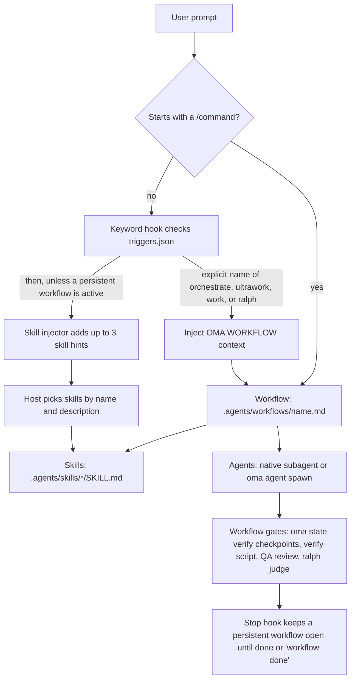

# Einführung

oh-my-agent ist ein Multi-Agenten-Orchestrierungsframework für KI-gestützte IDEs und CLI-Tools. Statt sich für alles auf einen einzelnen KI-Assistenten zu verlassen, verteilt oh-my-agent die Arbeit auf 33 Skill-Pakete und 13 kanonische Dispatch-Rollen. Zwölf eingecheckte Subagent-Definitionsdateien stellen wiederverwendbare Personas für Implementierung, Review, Planung, Debugging, Dokumentation, Recherche und Infrastruktur bereit. `research-explorer.md` ist der kanonischen Rolle `explore` zugeordnet; `orchestrator` ist eine reine Laufzeitrolle für die Koordination ohne eigene Definitionsdatei.

OMA führt mechanische Prüfungen aus, wenn Sie sie aufrufen oder einen Workflow mit solchen Prüfungen auswählen. `oma verify agent <agent-type>` prüft den ausgewählten Agententyp; `/ralph` ergänzt artefaktbasierte Verifikation und eine [Judge](./glossary.md#judge)-Schleife; aktivierte Vendor-Stop-Hooks (das [Stop-Gate](./glossary.md#stop-gate)) können einen Workflow offenhalten, während seine konfigurierten Prüfungen laufen. Das Laden eines Skills begründet allein noch keine Abnahme, und ein einfacher Prompt führt nicht automatisch jedes Workflow-Gate aus. Entscheiden Sie anhand der Akzeptanzkriterien des Workflows und der erzeugten Dateien, was abgeschlossen ist.

Das gesamte System liegt in einem portablen `.agents/`-Verzeichnis innerhalb Ihres Projekts. Sie können zwischen Claude Code, Codex CLI, Antigravity CLI oder IDE, Cursor, OpenCode und anderen unterstützten Tools wechseln; Ihre Agentenkonfiguration bleibt bei Ihrem Code.

Beginnen Sie mit [Setup wählen](./choose-setup.md): Laden Sie einen Skill für eine Aufgabe in Ihrem aktuellen Agenten, wählen Sie ein Laufzeit-Skill-Preset für Hooks und Workflows oder installieren Sie das Claude-Code-Plugin. Temporäres Laden eines Skills liefert Anweisungen und Support-Dateien; Abhängigkeiten von CLI, Projektregeln und externen Diensten bleiben ausdrücklich. Die Laufzeitinstallation erstellt die [SSOT](./glossary.md#ssot) und Vendor-Integrationen.

Verwenden Sie den [Schnellstart](./quick-start.md) für eine erste Aufgabe und ihre beobachteten Prüfungen. `oma doctor` prüft eine Laufzeitinstallation; [Wichtige Standardwerte](./important-defaults.md) erklärt deren Provider und Konfiguration. Wechseln Sie zu `/work` oder `/orchestrate`, wenn Koordination nötig ist und die referenzierten Skills installiert sind.

---

## Das Multi-Agenten-Paradigma {#the-multi-agent-paradigm}

Herkömmliche KI-Coding-Assistenten bearbeiten Frontend, Backend, Datenbank, Sicherheit und Infrastruktur häufig aus einem einzigen Prompt-Kontext. Daraus können folgende Probleme entstehen:

- **Kontextverwässerung:** Wissen für jede Domäne zu laden, verbraucht das Kontextfenster.
- **Unklare Zuständigkeit:** Eine domänenübergreifende Aufgabe hat keine ausdrückliche Grenze für die einzelnen Teile.
- **Manuelle Koordination:** Komplexe Features über mehrere Domänen benötigen Übergaben, die der Host oder die Benutzer auswählen müssen.

oh-my-agent löst das durch Spezialisierung:

1. **Jeder Skill hat eine primäre Domäne.** Der Frontend-Skill kennt React/Next.js, shadcn/ui, TailwindCSS v4 und FSD-lite-Architektur. Der Backend-Skill kennt das Repository-Service-Router-Muster, parametrisierte Abfragen und JWT-Authentifizierung. Domänen können sich an Grenzen überschneiden; verwenden Sie deshalb die Akzeptanzkriterien der Aufgabe, um zu entscheiden, wann ein zweiter Skill oder ein koordinierender Workflow nötig ist.
2. **Agenten können parallel laufen.** Während ein Backend-Agent eine API erstellt, kann ein Frontend-Agent in seinem eigenen Workspace arbeiten. Der Orchestrator koordiniert über dauerhafte, laufbezogene Dateien und Ausführungsnachweise.
3. **Qualitätsleitlinien sind eingebaut.** Skills enthalten domänenspezifische Checklisten, Fehler-Playbooks und [Charter](./glossary.md#charter)-Regeln. Das Charter-Preflight grenzt den Umfang ein, bevor Code geschrieben wird; ein QA-Review läuft, wenn der ausgewählte Workflow es vorsieht oder Sie es anfordern.

---

## Der aktuelle Katalog: 33 Skills, 12 Definitionen, 20 Workflows {#the-current-catalog-33-skills-12-definitions-20-workflows}

Der Katalog trennt drei Dinge, die leicht verwechselt werden:

- **[Skills](./glossary.md#skill)** sind die 33 Domänenwissenspakete unter `.agents/skills/*/SKILL.md`. Sie routen anhand der natürlichsprachlichen Absicht und laden Ressourcen schrittweise.
- **[Agentendefinitionen](./glossary.md#agent-definition)** sind die 12 Dateien unter `.agents/agents/`. Sie stellen Vendor-native Subagent-Personas bereit und verweisen auf einen oder mehrere Skills.
- **[Workflows](./glossary.md#workflow)** sind die 20 Prozessdefinitionen unter `.agents/workflows/`. Vier davon sind [persistent](./glossary.md#persistent-workflow) (`orchestrate`, `work`, `ultrawork` und `ralph`); die übrigen erstellen einen Bericht und halten den persistenten Modus nicht aktiv.

Die folgenden Abschnitte bewahren den detaillierten Skill-Katalog. Wenn sich ein Name oder eine Beschreibung ändert, ist das Frontmatter der aktuellen `SKILL.md` maßgeblich.

Die 12 eingecheckten Definitionsdateien decken über Aliase 13 Laufzeitrollen ab: `research-explorer.md` ist der Rolle `explore` zugeordnet, während `orchestrator` nur zur Laufzeit existiert. Die übrigen Definitionsdateien entsprechen den in [Agenten](../core-concepts/agents.md) aufgeführten Rollen.

### Ideenfindung, Architektur und Planung

| Agent | Rolle | Kernfähigkeiten |
|-------|------|-----------------|
| **oma-brainstorm** | Designorientierte Ideenfindung | Erkundet die Benutzerabsicht, schlägt 2–3 Ansätze mit Trade-off-Analyse vor und erstellt vor jedem Code ein Designdokument. Der Workflow `/brainstorm` umfasst 7 Schritte: Kontext, Fragen, Ansätze, Design, Blind Review, Dokumentation (`docs/decisions/`), Überleitung zu `/plan`. |
| **oma-architecture** | Spezialist für Systemarchitektur | Modul-, Service- und Zuständigkeitsgrenzen, Trade-off-Analyse und Synthese von Stakeholder-Anforderungen. Methoden: diagnostisches Routing, Design-Twice-Vergleich, ATAM-Risikoanalyse, CBAM-Priorisierung und ADR-Entscheidungsprotokolle. Standardmäßig kostenbewusst. |
| **oma-pm** | Produktmanager | Zerlegt Anforderungen mit Abhängigkeiten in priorisierte Aufgaben, definiert API-Verträge und erzeugt `.agents/results/plan-{sessionId}.json` als Übergabe an den Orchestrator; der Orchestrator erstellt und verantwortet das Aufgabenboard. Unterstützt ISO-21500-Konzepte, ISO-31000-Risikobetrachtung und ISO-38500-Governance. |

### Implementierung

| Agent | Rolle | Tech-Stack und Ressourcen |
|-------|------|--------------------------|
| **oma-frontend** | UI/UX-Spezialist | React, Next.js, TypeScript, TailwindCSS v4, shadcn/ui und FSD-lite-Architektur. Bibliotheken: luxon (Datumswerte), ahooks oder @mantine/hooks (Hooks), es-toolkit (Hilfsfunktionen), Jotai/Zustand (Client-Zustand), TanStack Query über orval-generierte Hooks (Server-Zustand), @tanstack/react-form + Zod (Formulare), better-auth (Authentifizierung), nuqs (URL-Zustand). Ressourcen: `execution-protocol.md`, `tech-stack.md`, `tailwind-rules.md`, `snippets.md`, `angular-rules.md`, `error-playbook.md`, `checklist.md`. |
| **oma-backend** | API- und Server-Spezialist | Clean Architecture (Router-Service-Repository-Modelle). Stack-agnostisch; erkennt Python/Node.js/Rust/Go/Java/Elixir/Ruby/.NET anhand von Projektmanifesten. JWT + Argon2id für Authentifizierung. Mitgelieferte Presets: Python (Litestar mit SQLAlchemy 2 (async) über Advanced Alchemy, msgspec-Modelle, integrierte JWT-Authentifizierung), Node.js (NestJS + Prisma, getestet mit Vitest) und Rust (Axum + SQLx); ein Projekt, das mit dem früheren FastAPI-Preset installiert wurde, behält FastAPI. Ressourcen: `execution-protocol.md`, `orm-reference.md`, `checklist.md`, `error-playbook.md` sowie die Stack-Referenz (`stack/`, falls vorhanden, sonst das passende `variants/<language>/`). Unterstützt `/stack-set` zum Erzeugen sprachspezifischer `stack/`-Referenzen. |
| **oma-mobile** | Plattformübergreifende Mobile-Entwicklung | Flutter, Dart, Riverpod/Bloc für Zustandsverwaltung, Dio mit Interceptors für API-Aufrufe und GoRouter für Navigation. Clean Architecture: Domäne–Daten–Präsentation. Material Design 3 (Android) und iOS HIG. Ziel sind 60 fps. Unterstützt außerdem React Native, natives Swift-iOS (SwiftUI + `@Observable` ab iOS 17, Apples `swift-openapi-generator` für API-Clients und das Layout `App/Core/Features/Shared`) und natives Kotlin-Android (Jetpack Compose, Hilt, generierte `*Api`-Clients über Ktor). Ressourcen: `execution-protocol.md`, `tech-stack.md`, `checklist.md`, `error-playbook.md`; `stack.yaml`, `tech-stack.md` und `snippets.md` jeder Plattform (Muster für Screens, Zustand, Datenschicht und API) liegen in `variants/<platform>/`. Der Skill liest `stack/`, wenn `/stack-set` es erzeugt hat, und sonst die passende Variante. |
| **oma-db** | Datenbankarchitektur | Modellierung von SQL-, NoSQL- und Vektordatenbanken. Schema-Design (3NF als Standard), Normalisierung, Indizierung, Transaktionen, Kapazitätsplanung und Backup-Strategie. Unterstützt ISO-27001/27002/22301-bewusstes Design. Ressourcen: `execution-protocol.md`, `document-templates.md`, `anti-patterns.md`, `vector-db.md`, `migration-playbook.md`, `query-tuning.md`, `iso-controls.md`, `checklist.md`, `error-playbook.md`, `examples.md`. |

### Design

| Agent | Rolle | Kernfähigkeiten |
|-------|------|-----------------|
| **oma-design** | Visuelles System und Designrichtung | Definiert oder prüft ein visuelles System, `DESIGN.md` oder eine Redesign-Richtung: Entscheidungen zu Typografie, Layout, Farbe, Bewegung und Interaktion. Ermittelt die Designabsicht des Projekts und lädt pro Operation einen externen Design-Skill (Interface Design für Produktoberflächen, Impeccable für Kritik, Audit und Feinschliff, Taste für sonstige Web-Art-Direction); reine Dokumentations- und Token-Vertragsaufgaben bleiben lokal. Bewahrt die bestehende Marke, den Stack und die CJK-Schriftabdeckung, mit WCAG AA als Standardziel für Barrierefreiheit. Fragt nur bei einer wesentlichen offenen Entscheidung nach und stellt alternative Richtungen nur vor, wenn eine offen ist. Schreibt keinen Implementierungscode; übergibt an `oma-frontend` oder `oma-mobile`. Optionale Eingaben aus Stitch und getdesign. Ressourcen: `execution-protocol.md`, `external-design-skills.md`, `product-interface-review.md`, `redesign-protocol.md`, `design-md-spec.md`, `design-tokens.md`, `data-grid.md`, `asset-strategy.md`, `getdesign-fetcher.md`, `stitch-integration.md`, `checklist.md`, `error-playbook.md`. |

### Infrastruktur, DevOps und Observability

| Agent | Rolle | Kernfähigkeiten |
|-------|------|-----------------|
| **oma-tf-infra** | Infrastructure-as-Code | Multi-Cloud-Terraform (AWS, GCP, Azure, Oracle Cloud). OIDC-first-Authentifizierung, minimale IAM-Berechtigungen, Policy-as-Code (OPA/Sentinel) und Kostenoptimierung. Unterstützt ISO/IEC-42001-KI-Kontrollen, ISO-22301-Kontinuität und ISO/IEC/IEEE-42010-Architekturdokumentation. Ressourcen: `multi-cloud-examples.md`, `cost-optimization.md`, `policy-testing-examples.md`, `iso-42001-infra.md`, `checklist.md`. |
| **oma-dev-workflow** | Automatisierung von Monorepo-Aufgaben | mise Task Runner, CI/CD-Pipelines, Datenbankmigrationen, Release-Koordination, Git-Hooks und Pre-Commit-Validierung. Konfiguriert außerdem sprachspezifische Lint-, Format- und Typecheck-Tools sowie commitlint. Ressourcen: `mise-basics.md`, `tooling-profiles.md`, `validation-pipeline.md`, `example-task-wiring.md` (Migrationen, API-Client-Generierung, i18n-Builds), `release-coordination.md`, `troubleshooting.md`. |
| **oma-observability** | Intent-basierter Observability-Router | MELT+P-Signalabdeckung (Metriken, Logs, Traces, Profile, Kosten, Audit, Datenschutz), Transport-Tuning (UDP/MTU, OTLP gRPC vs. HTTP, Collector-Topologie, Sampling), W3C-Trace-Context-Propagation, SLO-Management und Burn-Rate-Alerts, Incident-Forensik (Lokalisierung in sechs Dimensionen) und Meta-Observability (Self-Health, Uhrensynchronisation, Kardinalität, Retention). Ressourcen werden bei ihren Auslösern geladen; Fluentd, Fluent Bit oder der OTel Collector wird anhand der Anforderungen an Workload, Plugins und Betrieb gewählt. |

### Qualität und Debugging

| Agent | Rolle | Kernfähigkeiten |
|-------|------|-----------------|
| **oma-qa** | Qualitätssicherung | Sicherheitsaudit (OWASP Top 10), Performance-Analyse, Barrierefreiheit (WCAG 2.2 AA) und Codequalitäts-Review. Schweregrade: CRITICAL/HIGH/MEDIUM/LOW mit Datei:Zeile und Behebungscode. Unterstützt ISO/IEC 25010 und die Testausrichtung nach ISO/IEC 29119. Scanner-gestützte Scans und Penetrationstests gehören zu `oma-security`. Ressourcen: `execution-protocol.md`, `iso-quality.md`, `checklist.md`, `error-playbook.md`. |
| **oma-debug** | Fehlerdiagnose und -behebung | Reproduzieren-zuerst-Methodik, Grundursachenanalyse, minimale Korrekturen, obligatorische Regressionstests und Suche nach ähnlichen Mustern. Verwendet Code-Intelligence-MCP-Tools (Gortex oder Serena) zur Symbolverfolgung. Ressourcen: `execution-protocol.md`, `checklist.md`, `debugging-checklist.md` (verdichteter Bug-Bericht, Tool-Referenz, Übergabe-Routing), `bug-report-template.md` (Bugs der Stufe Complex oder CRITICAL/HIGH), `error-playbook.md`. |
| **oma-refactor** | Verhaltenserhaltendes Refactoring | Sichere schrittweise Umstrukturierung mit Charakterisierungstests als Schutz. Hotspot-Auswahl (Komplexität × Änderungsrate), Code-Smell-/SATD-Auswahl, Rückkehr nach der Mikado-Methode bei Fehlschlag, Expand-Contract für zustandsbehaftete Änderungen und reine Refactoring-Commits ohne Verhaltensänderung. Engine-first-Transformationen (IDE-Umbenennung, jscodeshift/ast-grep), Metriken über `uvx lizard` / `uvx radon`. Lesbarkeit ist das Ziel; Metriken sind nur Näherungen. |

### Lokalisierung, Koordination und Git

| Agent | Rolle | Kernfähigkeiten |
|-------|------|-----------------|
| **oma-translation** | Kontextbewusste Übersetzung | Die Übersetzungsmethode liest Bedeutung und geschützte Syntax, wählt das Register, rekonstruiert in der Zielsprache und bewahrt den passenden Autorenstil. Zielsprachprofile (`resources/lang/{code}.md`) enthalten Register- und Typografieregeln. Ressourcen: `translation-rubric.md`, `anti-ai-patterns.md`, `style-skills.md`, `lang/{ko,ja,zh,en}.md`. |
| **oma-orchestration** | Automatisierte Multi-Agenten-Koordination | Startet CLI-Subagenten parallel, koordiniert über dauerhafte Sitzungs-, Aufgabenboard-, Fortschritts- und Ergebnisdateien und überwacht Verifikationsschleifen. Standardwerte: MAX_PARALLEL 3 und MAX_RECOVERY_ATTEMPTS 3 (Wiederholungen und Explorationshypothesen pro Aufgabe, einschließlich des ursprünglichen Versuchs); Fortschrittsabfragen nutzen begrenztes Backoff und nur dann, wenn keine Abschlussbenachrichtigungen verfügbar sind. Wählt Skill-Referenzen pro Aufgabe aus und hält sie als Koordinator-Notizen fest. Enthält Agenten-zu-Agenten-Review und optionale Sitzungsbelege. Ressourcen: `subagent-prompt-template.md`, `memory-schema.md`. |
| **oma-scm** | Software Configuration Management (SCM) und Git | Behandelt Branching-, Merge-/Rebase-/Konflikt-Workflows, Worktrees, Baselines und Release-Zustände. Unterstützt außerdem Conventional-Commit-Nachrichten mit sicherem Staging; Co-Author-Trailer stammen bei Aktivierung aus der wirksamen Konfiguration `scm.co_author`. |
| **oma-coordination** | Gemeinsame Koordinationsregeln | Koordinationsregeln für Multi-Agenten-Arbeit: Wiederverwendung von Plänen, Vertragsabgleich, Workspace-Zuständigkeit und QA-Übergabe. Wird von den Workflows `/work`, `/orchestrate` und `/ultrawork` geladen und eignet sich auch für die manuelle, schrittweise Koordination mit `oma agent spawn`: den Plan wiederverwenden oder erstellen, gleich priorisierte Aufgaben in getrennten Workspaces starten, laufbezogene Fortschritts-/Ergebnisdateien überwachen, API- und Datenverträge vor Frontend-/Mobile-Arbeit abstimmen und mit dem QA-Review enden. Die automatisierte Ausführung liegt bei `oma-orchestration`. |

### Suche, Retrospektive und Dokumentverarbeitung

| Agent | Rolle | Kernfähigkeiten |
|-------|------|-----------------|
| **oma-search** | Such-Router für externe Quellen | Wählt pro Anfrage eine primäre Route: `docs` (Context7, bei Bedarf Ermittlung der offiziellen Website), `web` (der konfigurierte Provider `native`, `brave` oder `exa`), `code` (`oma search code` über `gh`/`glab`) oder `fetch` (eine bekannte URL). Liefert Quellen mit Route, tatsächlichem Provider, Lesestatus des Inhalts, stützenden Belegen und Einschränkungen; numerische Vertrauenswerte vergibt er nicht. Eine weitere Route kommt nur hinzu, wenn eine Beleglücke sie erfordert, und ein fehlgeschlagener, ausdrücklich gewählter Provider wird gemeldet, nicht stillschweigend ersetzt. Flags: `--docs`, `--code`, `--web`, `--strict`, `--wide`, `--gitlab`. Lokale Code-Navigation nutzt die konfigurierten Code-Tools. |
| **oma-recap** | Werkzeugübergreifende Arbeitsretrospektive | Analysiert Konversationshistorien aus Grok, Claude, Codex, Gemini, Qwen, Cursor und Antigravity. Löst natürlichsprachliche Datums-/Zeitraumangaben auf, gruppiert nach Arbeitsinhalt (bei Zeiträumen ab 3 Tagen nach Projekt), extrahiert Themen, erzeugt Tages-/Zeitraumberichte und vermerkt, wenn die CLI einen angeforderten Zeitraum auf 30 Tage begrenzt. |
| **oma-hwp** | HWP/HWPX/HWPML → Markdown | Konvertiert koreanische Textverarbeitungsdokumente über `bunx kordoc@latest`. Bewahrt Überschriften, Tabellen (auch verschachtelte), Fußnoten, Hyperlinks und Bilder. Entfernt Hancom-Private-Use-Area-Zeichen mit dem Nachbearbeiter `flatten-tables.ts`. |
| **oma-pdf** | PDF → Markdown | Konvertiert PDF-Dokumente über `uvx opendataloader-pdf`. Bewahrt Überschriften, Tabellen, Listen und Bilder; Hybrid-OCR für gescannte PDFs; Ausgabe wird mit `uvx mdformat` normalisiert. |

### Wissenschaftliches und akademisches Schreiben

| Agent | Rolle | Kernfähigkeiten |
|-------|------|-----------------|
| **oma-academic-writing** | Publikationsfähige englische Prosa | Erstellt, überarbeitet und prüft Essays, Berichte, Abstracts, Management-Zusammenfassungen, Schlussfolgerungen und Literaturübersichten. Wendet Leitlinien zur Satzstruktur (Rhythmus, Einstiege, Absatzkohäsion) und zu Verben (`academic-verb-guide.md`: genaue Bedeutung und Evidenzstärke) an, dazu an die Evidenz angepasstes Hedging und das Anti-KI-Prosa-Audit. Zitiert vorgegebene Rubrik-Vorgaben vor dem Urteil und nutzt Claim-Evidence-Map und Reverse Outlining. Modi: `draft` / `revise` / `review`. |
| **oma-scholar** | Begleiter für wissenschaftliche Paper-Sidecars | Sucht, erzeugt, validiert, prüft und vergleicht wissenschaftliche Arbeiten über die Knows-Sidecar-Spezifikation `.knows.yaml` (v0.9.0 / `paper@1`). Anspruchs-, Evidenz- und Beziehungszugriff ist tokeneffizient (~700 Tokens nur für Claims gegenüber ~10K für das vollständige PDF). `oma scholar search/resolve/get/lint` nutzt knows.academy mit einem Fallback auf OpenAlex und Semantic Scholar für Arbeiten, die knows.academy nicht führt. Gegen Erfindungen werden unbekannte Felder ausgelassen statt geraten. |

### Sicherheit

| Agent | Rolle | Kernfähigkeiten |
|-------|------|-----------------|
| **oma-security** | Sicherheitsscans und Validierung | Scannt Anwendungsquellcode, Agenten-Skills und MCP-Komponenten, validiert Befunde und konfiguriert Scan-Gates. Standard-Engines je Ziel: Deepsec für Anwendungsquellcode oder Diffs, Cisco Skill Scanner für Agenten-Skill-Pakete und Cisco MCP Scanner für MCP-Komponenten. Für Laufzeit-Penetrationstests gibt es keine Standard-Engine: Ein Penetrationstest eines abgegrenzten Web-Test-Deployments läuft nur auf ausdrückliche ARTEX-Anfrage und auf einer vom Benutzer bereitgestellten, geprüften ARTEX-Plattform. Für breite Qualitätsreviews `oma-qa` verwenden, für die Behebung die jeweiligen Domänen-Skills. |

### Dokumentation und Meta-Tooling

| Agent | Rolle | Kernfähigkeiten |
|-------|------|-----------------|
| **oma-docs** | Prüfer für Dokumentationsdrift | Der Modus `verify` prüft `docs/**/*.md` deterministisch auf defekte Verweise (Pfade, CLI-Befehle, Konfigurationsschlüssel, Umgebungsvariablen, Skripte) und beendet sich mit 0/1; der Modus `sync` ordnet einen Git-Diff möglichen Dokumenten zu und erstellt vom Host-LLM formulierte Patch-Vorschläge, die pro Dokument bestätigt werden (keine automatische Anwendung). URL-Prüfung delegiert an `lychee`; die CLI gibt strukturiertes JSON aus, die Synthese übernimmt das Host-LLM (keine Vendor-SDK-Aufrufe). `.agents/` wird nie geändert. |
| **oma-skill-creation** | Spezialist für SSL-lite-Skill-Autorenschaft | Erstellt, aktualisiert und prüft OMA-Skills im SSL-lite-Format mit den vier Pflichtabschnitten (Scheduling / Structural Flow / Logical Operations / References). Klassifiziert den Skill-Typ, fügt genau einen kanonischen Inline-Pfad ein, erzwingt `When NOT to use`-Querverweise und führt `oma skill audit` aus, um Beschreibungsüberschneidungen zu erkennen (Warnung ab 60 %, Fehler ab 75 % TF-IDF-Kosinus). Verschiebt lange Varianteninformationen in `resources/`. |
| **oma-explanation** | Erklärer für Änderungen und Themen | Wandelt einen Diff, PR, Branch oder Commit-Bereich in ein eigenständiges Offline-HTML-Dokument mit den Abschnitten Background, Intuition, Code und Quiz um oder erklärt ein Thema als einseitiges visuelles Blatt. Das Modell schreibt einen Entwurf, `oma explain render` schreibt die Seite unter `.agents/results/explain/`, `oma explain validate` prüft sie, und `oma explain render --open` öffnet sie. |

### Marktforschung

| Agent | Rolle | Kernfähigkeiten |
|-------|------|-----------------|
| **oma-market** | Intelligence für Community-Signale | Führt die Upstream-Engine `last30days` (Reddit mit echten Upvotes und Kommentaren, X, YouTube-Transkripte, TikTok, HN, Polymarket, GitHub, arXiv, Techmeme, Bluesky, Web und mehr) über `oma market run` aus; die Engine ist eine skills-CLI-Installation (`oma market update`), und oma sperrt jeden Lauf über `detect-trap`, klassifiziert die Absicht (Pain / Trend / Competitor / Discovery) und ergänzt SWOT-, Porters-5F- und PESTEL-Abschnitte. Erzeugt ein LAW-konformes Briefing unter `.agents/results/market/{slug}-{YYYYMMDD}.md`. |

### Medien- und Content-Erzeugung

| Agent | Rolle | Kernfähigkeiten |
|-------|------|-----------------|
| **oma-image** | Multi-Vendor-Bildrouter | Authentifizierungsbewusster paralleler Dispatch an Codex (`gpt-image-2` über ChatGPT OAuth, CLI-first), Gemini-Familienmodelle „nano-banana“ von Antigravity über die `agy`-CLI + Gemini Code Assist (das konkrete Modell wird intern gewählt) und Pollinations (kostenlose `flux`/`zimage`). Löst das Briefing aus den gelieferten Angaben und sinnvollen Standardwerten auf und fragt nur bei einer wesentlichen fehlenden Entscheidung nach, bis zu 10 Referenzbilder, Kostenbegrenzung (Bestätigung ab ≥ $0.20), `manifest.json` zur Reproduzierbarkeit. Einstellungen stehen unter `image:` in `.agents/oma-config.yaml`. CLI: `oma image generate`, `oma image doctor` und `oma image vendor list`. |
| **oma-slide** | Generator für animationsreiche HTML-Decks | Erzeugt eigenständige Präsentationsdecks auf einer festen Bühne von 1920×1080, validiert Geometrie deterministisch, bündelt zu einer einzelnen HTML-Datei und exportiert über die CLI `oma slide` nach PDF/PNG/PPTX. Stil-Presets und markante Templates, CJK→Pretendard-Regel, `prefers-reduced-motion` und sichtbarer Fokus sind erforderlich; maximal drei automatische Validierungs-/Reparaturschleifen. Bilder kommen über `oma-image`; optional ist Canva-MCP-Export/Import. CLI: `oma slide create`, `oma slide style get`, `oma slide asset fetch-video`, `oma slide validate`, `oma slide bundle`, `oma slide export pdf|png|pptx`. |
| **oma-video** | Router für Shorts, Explainer und Demos | Erstellt Shorts/Reels (9:16), Explainer (16:9) und aufgezeichnete Demos (16:9) über die CLI `oma video`. Der deterministische Asset-Bus (`script.json` → `timing.json` → `render-spec.json`) speist einen verwalteten HyperFrames-Kompositor; Provider dürfen lokale Fallbacks verwenden, während fehlende Komposition/Toolchain oder Renderfehler den Lauf fehlschlagen lassen. Stock- und AIGC-Visuals werden mit `--visual stock|aigc` erreicht; ein Slide-Visual braucht ein `visual.ref`, das auf ein vorhandenes Deck zeigt. Eine Demo braucht `--polish`, um ein maskiertes, auslieferbares Video zu erzeugen; ohne diese Option ist die Ausgabe die rohe Aufnahme. Menschliche Aufnahmen automatisieren niemals Zugangsdaten. Einstellungen stehen unter `video:` in `.agents/oma-config.yaml`. |
| **oma-voice** | Lokales TTS und STT | Steuert den Voicebox-MCP-Server für On-Device-Benachrichtigungen, TTS für Assets und Transkription ohne Cloud-Aufrufe oder Kosten pro Aufruf. TTS verwendet standardmäßig WAV und kann lokal nach MP3 transkodiert werden; Transkription akzeptiert Audio-Pfade oder Base64. TTS-Aufrufe sind auf 5000 Zeichen, STT-Eingaben auf 30 Minuten begrenzt; gespeicherte Asset-/Transkriptionsläufe schreiben ein Manifest. |

---

## Progressives Offenlegungsmodell {#progressive-disclosure-model}

oh-my-agent verwendet eine Zwei-Schichten-Skill-Architektur, damit das Kontextfenster nicht erschöpft wird:

**Schicht 1: SKILL.md (beim Routing des Skills geladen)**
Enthält Identität des Agenten, Routing-Bedingungen, Kernregeln und Hinweise zu „wann verwenden / wann NICHT verwenden“. Das ist alles, was geladen wird, wenn der Agent nicht aktiv arbeitet.

**Schicht 2: resources/ (bei Bedarf geladen)**
Enthält Ausführungsprotokolle, Tech-Stack-Referenzen, Code-Snippets, Fehler-Playbooks, Checklisten und Beispiele. Diese Ressourcen werden erst beim Aufruf des Agenten für eine Aufgabe und dann nur für den jeweiligen Aufgabentyp geladen (abhängig von Schwierigkeitsbewertung und Zuordnung in `context-loading.md`).

Wie viel Kontext das spart, hängt von den Skills und der Aufgabe ab; messen Sie es daher, statt eine Zahl anzunehmen. Die [Berechnung der Token-Einsparung](../core-concepts/skills.md#token-savings-math) enthält das Skript und erklärt, was seine Schätzungen abdecken.

---

## .agents/: die einzige Wahrheitsquelle (SSOT) {#.agents-the-single-source-of-truth-ssot}

Alles, was oh-my-agent benötigt, befindet sich im Verzeichnis `.agents/`:

```text
.agents/
├── oma-config.yaml   # Shared preferences and provider/model settings
├── oma-config.cue    # Optional schema-backed configuration
├── mcp.json          # MCP server configuration
├── skills/           # 33 skill directories + _shared resources
│   ├── _shared/      # Core resources used by all agents
│   └── oma-{skill}/  # Per-skill SKILL.md + resources/variants
├── workflows/        # 20 workflow definitions
├── agents/           # 12 subagent definitions
├── hooks/            # Hook sources, including core/triggers.json
├── rules/            # Project rules projected into vendor files
├── results/          # Plans (plan-{sessionId}.json) and agent results
└── state/            # Active workflow state files
```

Das `.claude/`-Verzeichnis ist ausschließlich eine IDE-Integrationsschicht. Es enthält Symlinks zurück auf `.agents/` sowie Hooks für Keyword-Erkennung und HUD-Statuszeile. `.agents/state/memories/` enthält den Laufzeit-Koordinationszustand während Orchestrierungssitzungen; ältere Projekte fallen auf den Legacy-Pfad `.serena/memories/` zurück.

Diese Architektur macht Ihre Agentenkonfiguration:
- **Portabel:** Sie können die IDE wechseln, ohne neu zu konfigurieren.
- **Versionskontrolliert:** Committen Sie `.agents/` zusammen mit Ihrem Code.
- **Teilbar:** Teammitglieder erhalten dasselbe Agenten-Setup.

---

## Unterstützte IDEs und CLI-Tools {#supported-ides-and-cli-tools}

oh-my-agent funktioniert mit den ausgewählten KI-gestützten IDEs und CLIs über deren natives Skill-/Prompt-Laden oder erzeugte Integrationsdateien:

| Tool | Integrationsmethode | Parallele Agenten |
|------|---------------------|------------------|
| **Claude Code** | Native Skills + Agent-Tool | Agent-Tool für echte Parallelität |
| **Antigravity CLI/IDE** | Skills und MCP-Einstellungen für `agy` projiziert | `oma agent spawn` |
| **Codex CLI** | Skills automatisch geladen | Modellvermittelte parallele Anfragen |
| **Cursor** | Skills über `.cursor/`-Integration | `@agent-name` + `oma agent spawn` |
| **OpenCode** | Skills + In-Process-Plugin-Bridge + erzeugte Subagenten (`.opencode/agents/`) | `oma agent spawn --vendor opencode` |
| **Kimi Code CLI** | Hooks + Skills in `~/.kimi-code/` (zustimmungsgebundener HOME-Schreibzugriff; liest auch SSOT `.agents/skills/` nativ); projektbezogenes Serena-MCP | `oma agent spawn --vendor kimi` |

Das Starten von Agenten passt sich über Vendor-Erkennung und die aktive Konfiguration an jeden ausgewählten Vendor an. Laufzeiten desselben Vendors können native Subagenten verwenden; domänenübergreifende Arbeit fällt auf `oma agent spawn` zurück. Die Dispatch-Regeln stehen unter [Parallele Ausführung](../core-concepts/parallel-execution.md).

---

## Wie eine Anfrage verläuft {#how-a-request-flows}

Das Diagramm zeigt, was zwischen einem Prompt und einem fertigen Ergebnis passiert. Keyword-Hook, Skill-Injector und Stop-Hook laufen nur auf Hosts, deren Hook-Integration aktiviert ist. Keyword-Hook und Skill-Injector laufen nacheinander auf demselben Prompt, und ihr injizierter Kontext wird zusammengeführt.



Quellen: `.agents/hooks/core/keyword-detector.ts` (Überspringen von Slash-Befehlen, Trigger-Abgleich, persistenter Vorschlag), `.agents/hooks/core/skill-injector.ts`, `.agents/hooks/core/persistent-mode.ts` und die Workflow-Dateien unter `.agents/workflows/`. Nicht jeder Workflow hat jedes Gate: `/orchestrate` führt das Verify-Skript aus, `/review` das QA-Review, und `/ralph` ergänzt den [Judge](./glossary.md#judge).

---

## Skill-Routing-System {#skill-routing-system}

Der Host wählt einen Skill anhand der Namen und Beschreibungen der installierten Skills. Die Routing-Karte von OMA (`.agents/skills/_shared/core/skill-routing.md`) legt fest, welcher Skill für welches Ergebnis zuständig ist; geroutet wird nach dem angeforderten Ergebnis und seinen Abhängigkeiten, nicht allein nach einem Keyword. Die Wahl eines Skills startet keinen Workflow und autorisiert keine Delegation.

| Angefordertes Ergebnis | Zuständiger Skill |
|---|---|
| Anwendungs-API, Server-Authentifizierung, Service-/Datenzugriffslogik | oma-backend |
| Schema, Migrationsdesign, Indizierung, Query-Tuning, Datenbankbetrieb | oma-db |
| Web-Komponenten, Seiten, Formulare, Client-Zustand | oma-frontend |
| Mobile Screens, Widgets, Plattformintegration | oma-mobile |
| Systemgrenzen, Architektur-Trade-offs, ADR | oma-architecture |
| Fehlerhaftes Verhalten diagnostizieren und beheben | oma-debug |
| Korrektheit, Sicherheit, Barrierefreiheit, Performance prüfen | oma-qa |
| Visuelles System, DESIGN.md, Redesign-Richtung | oma-design |
| Angeforderte Ideenfindung oder Erkundung von Alternativen | oma-brainstorm |
| Anforderungen, Abhängigkeiten, Akzeptanzkriterien | oma-pm |
| Angeforderte parallele Ausführung durch Spezialisten | oma-orchestration |
| Angeforderte manuelle Multi-Agenten-Koordination | oma-coordination |
| Git-Branches, Commits, Merges, Repository-Historie | oma-scm |

Für andere Domänen wählt der Host anhand der installierten Skill-Beschreibungen. Multi-Domain-Arbeit folgt keiner festen Kette: Eine offene Architektur- oder Produktentscheidung wird zuerst geklärt, und Backend- und Client-Arbeit können parallel laufen, sobald ihr gemeinsamer API-Vertrag nutzbar ist.

---

## HUD-Statuszeile {#hud-statusline}

Bei der Ausführung in Claude Code zeigt oh-my-agent einen dauerhaften Statusindikator `[OMA]` in der Statuszeile:
- Modellname (z. B. Opus, Sonnet)
- Kontextnutzung mit Farbcodierung (grün < 70 %, gelb 70–85 %, rot > 85 %)
- Aktiver Workflow-Zustand, wenn ein persistenter Workflow läuft

Das HUD wird von `.claude/hooks/hud.ts` über die Claude-Code-Funktion `statusLine` bereitgestellt.

---

## Automatische Erkennung {#automatic-detection}

Ein Slash-Befehl startet einen Workflow. Bei einer einfachen Anfrage gleicht das Hook-System von oh-my-agent die Eingabe mit den Keyword-Tabellen in `.agents/hooks/core/triggers.json` ab (in die `oma`-Binärdatei eingebettet und von jedem Vendor gemeinsam verwendet), die 11 Sprachen abdecken (Englisch, Koreanisch, Japanisch, Chinesisch, Spanisch, Französisch, Deutsch, Portugiesisch, Russisch, Niederländisch und Polnisch).

- **Skill-Hinweise** (z. B. „run a security audit“) → der Skill-Injector nennt bis zu drei passende Skills; der Hinweis ist unverbindlich und startet keinen Workflow.
- **Persistente Workflows** (`orchestrate`, `work`, `ultrawork`, `ralph`) → starten aus Klartext nur, wenn der Prompt den expliziten Namen des Workflows verwendet (zum Beispiel `ultrawork: add rate limiting`).
- **Jeder andere Workflow** → startet nur über seinen `/command`.
- **Informative Eingabe** (z. B. „what is orchestrate?“) → wird herausgefiltert, kein Workflow wird ausgelöst.
- **Expliziter `/command`** → der Hook überspringt die Erkennung, damit nichts doppelt ausgelöst wird.
- **Aktive persistente Workflows** injizieren den Kontext bei jeder Nachricht erneut, bis Sie „workflow done“ sagen.

Jedes Hook-Ereignis wird über die kanonische ABI `oma hook run` zugestellt: Der Vendor ruft `oma-hook.sh --vendor <v> --event <nativeEvent>` auf, das die In-Process-Handlerkette ausführt und die Vendor-spezifische Darstellung nach stdout schreibt (immer Exit 0, Fail-open).

---

## Unterstützung mehrerer Vendors {#cross-vendor-support}

oh-my-agent ist nicht auf Claude Code beschränkt. Hook-fähige Vendors verwenden dieselbe ABI `oma hook run`; Erweiterungs-Vendors nutzen ihre In-Process-Bridge:

| Vendor | Hook-Zustellung | StatusLine |
|--------|-----------------|------------|
| **Claude Code** | `oma-hook.sh --vendor claude --event UserPromptSubmit` / `PreToolUse` / `Stop` | `bun .claude/hooks/hud.ts` (direkt, unverändert) |
| **Codex CLI** | `oma-hook.sh --vendor codex --event UserPromptSubmit` / `PreToolUse` / `Stop` | — |
| **Qwen Code** | `oma-hook.sh --vendor qwen --event UserPromptSubmit` / `PreToolUse` / `Stop` | `bun`-Pfad über `ui.statusLine` |
| **Cursor** | `oma-hook.sh --vendor cursor --event beforeSubmitPrompt` / `preToolUse` / `stop` | — |
| **Grok** | `oma-hook.sh --vendor grok --event UserPromptSubmit` / `PreToolUse` / `Stop` | — |
| **Kiro** | `oma-hook.sh --vendor kiro --event userPromptSubmit` / `preToolUse` / `stop` | — |
| **Kimi Code** | `oma-hook.sh --vendor kimi --event UserPromptSubmit` / `PreToolUse` / `Stop` (globales TOML `[[hooks]]` in `~/.kimi-code/config.toml`) | — |
| **Antigravity** | `.agents/hooks.json` → `bun .agents/hooks/core/*.ts` (`PreInvocation` / `PostToolUse` / `Stop`) | `statusLine` → `~/.gemini/antigravity-cli/settings.json` |
| **CommandCode** | `oma-hook.sh --vendor commandcode --event SessionStart` / `PostToolUse` / `Stop` | — |
| **OpenCode** | In-Process-Bridge (`installOpencodePlugin`) — nicht über `oma hook run` geroutet | — |
| **pi** | In-Process-Bridge (`installPiExtension`) — nicht über `oma hook run` geroutet | — |

Das Verzeichnis `.agents/` bleibt die Wahrheitsquelle. Die Installation verlinkt oder projiziert Skills, Workflows, Hooks und Agentendefinitionen in die von Ihnen ausgewählten Vendors; deren Fähigkeiten unterscheiden sich. Native Subagenten desselben Vendors und CLI-gestartete Cross-Vendor-Agenten lesen beide aus dieser Quelle.

---

## Nächste Schritte {#what-is-next}

- **[Installation](./installation.md):** Drei Installationsmethoden, Presets, CLI-Einrichtung und Verifikation
- **[Agenten](/docs/core-concepts/agents):** Vertiefung in die 33 Skills, 13 Dispatch-Rollen und die Richtlinie zu Autorisierung und Klärung
- **[Skills](/docs/core-concepts/skills):** Erklärung der Zwei-Schichten-Architektur
- **[Workflows](/docs/core-concepts/workflows):** Alle 20 Workflows mit Triggern und Phasen
- **[Nutzungsleitfaden](/docs/guide/usage):** Praxisbeispiele von Einzelaufgaben bis zur vollständigen Orchestrierung
