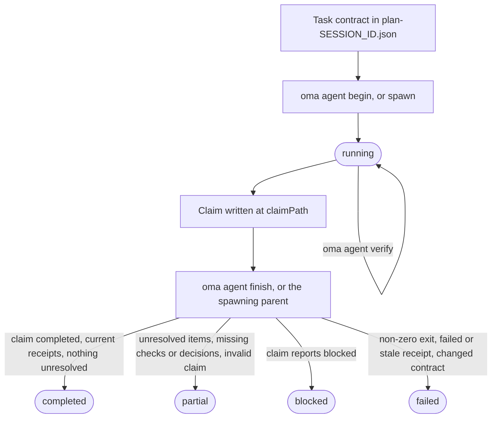
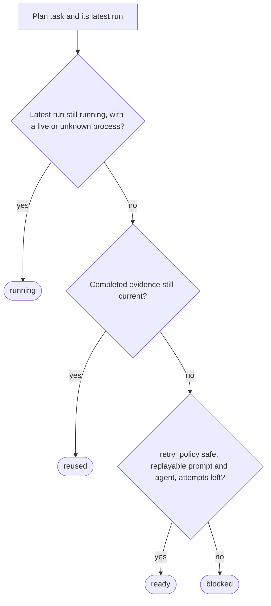

# Agentenergebnisse und Fortsetzen

OMA behandelt ein Agentenergebnis als kleinen Evidenzdatensatz und nicht nur als Exit-Code des Prozesses. Ein Lauf zeichnet Task- und Sitzungs-IDs, den Workspace-Fingerprint, Verifizierungsbelege (Receipts), geänderte Dateien, offene Arbeit und Artefakt-Hashes auf. Dadurch kann ein Koordinator eine erledigte Aufgabe nur so lange wiederverwenden, wie ihr Abnahmevertrag und ihre Eingaben noch übereinstimmen.

Verwenden Sie diesen Lebenszyklus direkt, wenn Sie einen nativen Agenten ausführen. Workflows und `oma agent spawn` erzeugen dieselben Datensätze für Sie und überlassen die abschließende Verarbeitung des verwalteten Laufs dem übergeordneten Koordinator. Die hier verwendeten Begriffe finden Sie im Glossar unter [Laufdatensatz und Claim](../getting-started/glossary.md#run-record-and-claim) und [Plan](../getting-started/glossary.md#plan).

## Lebenszyklus im Überblick

| Schritt | Befehl | Zeichnet auf | Behalten |
| --- | --- | --- | --- |
| 1. Vertrag | `.agents/results/plan-SESSION_ID.json` bearbeiten | `acceptance_criteria` und `required_checks` der Aufgabe | Sitzungs-ID, Task-ID |
| 2. Start | `oma agent begin AGENT TASK SESSION_ID --workspace .` | Laufdatensatz mit Status `running` | `runId`, `claimPath` |
| 3. Kontext (optional) | `oma agent context AGENT --difficulty Medium` | Nichts | Prompt-Kontext |
| 4. Verifizieren | `oma agent verify RUN_ID --required` | Ein Ausführungsbeleg pro Prüfung | Exit-Code |
| 5. Claim | JSON unter `claimPath` schreiben | Claim-Datei | Nichts |
| 6. Abschließen | `oma agent finish RUN_ID CLAIM_PATH` | Endstatus | `status` |
| 7. Wiederherstellen | `oma agent resume SESSION_ID --dry-run`, danach ohne `--dry-run` | Wiederherstellungs-Checkpoint und Sitzungs-Lease | Status pro Aufgabe |

`oma agent spawn` und `oma agent parallel` führen die Schritte 2 und 6 für Sie aus: Der übergeordnete Prozess startet den Lauf und finalisiert ihn, wenn das Kind endet.



Ein Claim kann auch direkt `partial` oder `failed` melden. Finish stuft einen Claim nie herauf: Es stuft einen `completed`-Claim herab, dessen Belege nicht standhalten, und ein Exit-Code ungleich null macht jeden Lauf zu `failed`.

## Nativen Lauf starten {#start-a-native-run}

Definieren Sie Aufgabe, `acceptance_criteria` und `required_checks` zuerst in einem Plan unter `.agents/results/plan-SESSION_ID.json`. Für eine kleine allgemeine Projektprüfung kann der Plan eine einzelne Aufgabe wie diese enthalten:

```json
{
  "tasks": [
    {
      "id": "docs",
      "agent": "docs",
      "task": "Review README.md and report any documentation issues",
      "workspace": ".",
      "acceptance_criteria": [
        { "id": "diff-clean", "description": "The current Git diff has no whitespace errors" }
      ],
      "required_checks": [
        { "id": "whitespace", "criteria": ["diff-clean"], "command": ["git", "diff", "--check"], "cwd": "." }
      ],
      "retry_policy": "manual"
    }
  ]
}
```

Diese Prüfung belegt nur, dass der Git-Diff keine Whitespace-Fehler enthält. Ersetzen Sie Aufgabe, Kriterium und Prüfung durch den echten Abnahmevertrag des Projekts. Starten Sie den Lauf aus dem Projekt-Root:

```bash
oma agent begin docs docs SESSION_ID --workspace .
```

Ersetzen Sie `SESSION_ID` durch die im Plan verwendete Sitzungs-ID. Der Befehl gibt JSON mit der erzeugten UUID `runId` und einem `claimPath` aus, zum Beispiel:

```json
{
  "runId": "<generated-run-id>",
  "taskId": "docs",
  "sessionId": "<your-session-id>",
  "status": "running",
  "claimPath": ".agents/state/agent-runs/<generated-run-id>.claim.json"
}
```

Die Werte in spitzen Klammern sind Platzhalter; verwenden Sie die tatsächlichen Werte aus Ihrem Lauf. Ein erfolgreicher Start legt den Laufdatensatz unter `.agents/state/agent-runs/` an und speichert den Aufgabenvertrag als Snapshot. Der Pfad der Ergebnisdeklaration (Claim) ist immer der Laufdatensatz-Pfad mit `.claim.json` anstelle von `.json`.

## Kontext laden und Aufgabe ausführen

Laden Sie vor dem Bearbeiten die vom Graphen ausgewählten Referenzen:

```bash
oma agent context docs --difficulty Medium
```

Die Schwierigkeit muss `Simple`, `Medium` oder `Complex` sein. Der Befehl gibt den für den ausgewählten Agenten zusammengestellten Kontext aus. Wenn kein graphgestützter Kontext vorhanden ist, korrigieren Sie die Aufgabendefinition oder verwenden Sie weiterhin den dokumentierten nativen Suchpfad des Projekts. Erfinden Sie keinen Kontextbeleg.

Führen Sie die Aufgabe in dem von `begin` aufgezeichneten Workspace aus. Halten Sie den Sitzungsplan fest, solange der Lauf aktiv ist. Wenn die Aufgabe ihre Abnahmekriterien oder erforderlichen Prüfungen ändert, aktualisieren Sie den Plan und starten Sie danach einen neuen Lauf.

## Verifizierung aufzeichnen

Führen Sie jede Prüfung aus, die im Abnahmevertrag festgeschrieben ist:

```bash
oma agent verify RUN_ID --required
```

Ersetzen Sie `RUN_ID` durch die von `begin` zurückgegebene UUID. Der Befehl führt die deklarierte argv aus und zeichnet den echten Exit-Code sowie die Workspace-Fingerprints vor und nach der Prüfung auf. Wenn der Aufgabenvertrag diese Prüfung enthält, kann auch ein einzelner exakter Befehl aufgezeichnet werden:

```bash
oma agent verify RUN_ID -- git diff --check
```

Verwenden Sie die Form mit dem exakten Befehl nur für eine Prüfung, die zum Vertrag der Aufgabe gehört. Andernfalls behalten Sie die `required_checks` des Plans bei und verwenden `--required`, damit der Ausführungsbeleg die deklarierten Abnahmekriterien belegt.

Verwenden Sie `--affected PATH...` nur, wenn der Graph eine vollständige Testauswahl für diese Pfade besitzt. Prüfungen laufen pro Lauf seriell. Ein Exit-Code ungleich null oder eine Änderung des Workspace während einer Prüfung macht diesen Ausführungsbeleg ungültig.

## Ergebnisdeklaration (Claim) schreiben und Lauf beenden

Für Aufgaben, die einen API-Vertrag, eine Authentifizierungsrichtlinie, ein Datenmodell, eine Migrationsstrategie, einen Zustandseigentümer, einen Zugriffsbereich für Infrastruktur oder eine andere Entscheidung festlegen, auf die spätere Arbeit aufbaut, deklarieren Sie vor dem Dispatch `required_decisions` in der Aufgabe:

```json
"required_decisions": [
  {
    "subject": "db.migration-strategy",
    "description": "Choose the compatibility window and rollback strategy for the account migration."
  }
]
```

Lassen Sie dieses Feld bei Aufgaben weg, die einer bereits bestehenden Entscheidung folgen. Anforderungen werden mit dem Aufgabenvertrag festgeschrieben und können nach dem Dispatch weder entfernt noch geändert werden. Vorgeschlagene Themen für einen Agenten listen Sie mit `oma state decisions list --agent db-engineer --json` auf. Diese Themen sind Auswahlmöglichkeiten für den Bedarfsfall; der Katalog macht nicht jede Entscheidung verpflichtend.

Schreiben Sie die Datei der Ergebnisdeklaration an den exakten, von `begin` ausgegebenen Pfad:

```json
{
  "status": "completed",
  "changedFiles": [],
  "unresolved": [],
  "artifacts": []
}
```

`status` ist einer von `completed`, `partial`, `blocked` oder `failed`. Pfade sind relativ zum Projekt-Root, und jedes Artefakt muss eine reguläre Datei innerhalb des Workspace sein. Verwenden Sie `verificationSkipped` nur für eine bestimmte Prüfung ohne ausführbaren Check; damit wird eine fehlgeschlagene Prüfung nicht erfolgreich.

Nehmen Sie wesentliche Entscheidungen in das optionale Array `decisions` der Ergebnisdeklaration auf:

```json
"decisions": [
  {
    "subject": "db.migration-strategy",
    "decision": "Use an expand-and-contract migration; retain the old column for one release.",
    "rationale": "Both deployed app versions must work during the rollout; rollback switches reads to the retained column.",
    "alternatives": ["Replace the column during a maintenance window"],
    "evidence": ["docs/account-migration.md"]
  }
]
```

Der übergeordnete Prozess speichert jede Entscheidung als Ereignis `decision.made` in der Sitzung des Laufs und hängt die tatsächlichen Agenten-, Task- und Lauf-IDs an. Fehlt eine erforderliche Entscheidung, bleibt das Ergebnis partial, auch wenn die ausführbaren Prüfungen bestehen. Entscheidungen aus einer anderen Aufgabe oder einem anderen Versuch können die Anforderung nicht erfüllen. Der Ausführungsbeleg schreibt die IDs und Inhalts-Hashes der Entscheidungsereignisse fest; bei der Wiederverwendung wird geprüft, ob diese Ereignisse noch existieren, gültig sind und unveränderte Inhalte haben. Optionale Entscheidungen werden ebenfalls aufgezeichnet. Schreibgeschützte Agenten geben dasselbe Array in ihrem `OMA_RESULT_JSON`-Claim zurück, damit der übergeordnete Prozess es speichern kann.

Finalisieren Sie einen nativen Lauf nach dem Schreiben der Ergebnisdeklaration:

```bash
oma agent finish RUN_ID CLAIM_PATH
```

Setzen Sie beide Werte aus der JSON-Ausgabe von `begin` ein. `CLAIM_PATH` ist der erzeugte `.claim.json`-Pfad; erfinden Sie keinen neuen Dateinamen.

Der Finish-Befehl prüft die Ergebnisdeklaration, den aktuellen Vertrag, die aktuellen Ausführungsbelege und die Artefakt-Hashes. Eine abgeschlossene Ergebnisdeklaration mit veralteten Belegen erhält den Status failed oder partial. Der Befehl verweigert die Finalisierung eines verwalteten Laufs, dessen Lebenszyklus der übergeordnete Prozess besitzt.

## Verhalten bei Spawns und nativen Läufen

`oma agent spawn` und `oma agent parallel` erzeugen einen Lauf, injizieren Laufidentität und Ergebnisanweisungen in den Kinder-Prompt und lassen den übergeordneten Prozess den Exit-Code des Kindes erfassen. Ein Kind schreibt seine Ergebnisdeklaration und meldet seine Artefakte; der übergeordnete Prozess finalisiert den verwalteten Ausführungsbeleg. Ein schreibgeschütztes Kind gibt eine Zeile `OMA_RESULT_JSON: {...}` zurück; der übergeordnete Prozess speichert sie, und die Erklärung zu `verificationSkipped` bleibt von der ausführbaren Prüfung getrennt.

Die menschenlesbaren Ergebnisdateien unter `.agents/results/` und Speichernotizen unter `.agents/state/memories/` helfen Menschen, den Fortschritt nachzuverfolgen. Der maschinenlesbare Ausführungsbeleg unter `.agents/state/agent-runs/` ist der für Wiederverwendung und Fortsetzen verwendete Beleg.

## Wiederherstellung vor dem erneuten Versuch prüfen

Fragen Sie zuerst ab, was OMA tun würde:

```bash
oma agent resume SESSION_ID --dry-run
```

Der Bericht ordnet jede Aufgabe als `reused`, `ready`, `running` oder `blocked` ein und nennt den Grund:



Eine Abhängigkeit, die nicht `reused` ist, setzt eine abhängige `reused`-Aufgabe zurück auf `ready` (oder auf `blocked`, wenn sie nicht wiederholt werden kann), und eine `ready`-Aufgabe, deren Abhängigkeit `blocked` oder `running` ist, wird zu `blocked`. Ein gültiger abgeschlossener Ausführungsbeleg wird nur wiederverwendet, wenn Vertrag, Eingaben, Artefakt-Hashes und Abhängigkeitsbelege weiterhin aktuell sind. Ein laufender verwalteter Prozess oder ein nativer Lauf ohne Nachweis, dass der Prozess noch aktiv ist, wird nicht dupliziert.

Wenn der Bericht die Ausführung zulässt, setzen Sie bereite Aufgaben in Abhängigkeitsreihenfolge fort:

```bash
oma agent resume SESSION_ID
```

Automatisches Wiederholen erfordert `retry_policy: "safe"` sowie einen wiederholbaren Prompt und Agenten im Plan oder gespeicherten Dispatch. Der Standardwert ist `manual`. `--max-attempts` ist standardmäßig `3`, einschließlich des ursprünglichen Versuchs:

```bash
oma agent resume SESSION_ID --max-attempts 2
```

OMA schreibt den Wiederherstellungs-Checkpoint unter `.agents/state/agent-resume/` und verwendet ein Sitzungs-Lease, damit zwei Koordinatoren dieselbe Sitzung nicht gleichzeitig erneut versuchen. Während der Wiederherstellung bleibt der Plan festgeschrieben. Wenn sich Plan oder Abhängigkeit ändern oder ein späterer Versuch eine frühere Eingabe ändert, werden die betroffenen Aufgaben blockiert und benötigen einen neuen Verifizierungslauf.

Das Fortsetzen startet einen neuen Versuch; die unterbrochene Modellunterhaltung wird nicht wiederhergestellt. Markieren Sie vor dem Fortsetzen eines unterbrochenen nativen Laufs den alten Lauf mit seinem tatsächlichen Ergebnis und offenen Arbeiten als `partial` oder `failed`. Prüfen Sie anschließend den Dry-Run-Bericht und versuchen Sie nur Aufgaben mit einem sicheren Wiederholungsweg erneut.

## Beispiele für die Wiederherstellung

| Situation | Aktion | Erwartetes Ergebnis |
| --- | --- | --- |
| Eine erforderliche Prüfung ist fehlgeschlagen | Aufgabe korrigieren, erneut `oma agent verify RUN_ID --required` ausführen und danach mit einer neuen Ergebnisdeklaration abschließen. | Der neueste Ausführungsbeleg ersetzt das fehlgeschlagene Ergebnis, wenn der Workspace-Fingerprint aktuell ist. |
| Der Prozess endet vor einem Claim | Lauf als partial oder failed markieren und danach `oma agent resume SESSION_ID --dry-run` ausführen. | Der alte Versuch bleibt erhalten; eine sichere Aufgabe ist `ready`, eine manuelle Aufgabe `blocked`. |
| Eine Abhängigkeit hat sich geändert | Abhängigkeit erneut ausführen und den Bericht wieder prüfen. | Die Wiederverwendung abhängiger Aufgaben wird ungültig, auch wenn ihre eigenen Dateien unverändert sind. |
| Plan oder Eingaben haben sich geändert | Nach Stabilisierung des Plans einen neuen Lauf starten. | Der neue Lauf speichert den neuen Vertrag; alte Belege werden nicht wiederverwendet. |
| Eine Aufgabe benötigt eine Entscheidung | Mit Erklärung als `blocked` aufzeichnen. | Das Fortsetzen lässt sie blockiert, bis Entscheidung und Prompt verfügbar sind. |

## Nächste Schritte

- Fehlermeldungen von `begin`, `verify`, `finish` und `resume`: [Fehlerbehebung](./troubleshooting.md#find-your-error)
- Parse-Fehler, fehlende Vendor-Tools, Dashboard-Zustand, Zeitpläne und veraltete Evaluierungsdaten: [Fehlerbehebung](./troubleshooting.md)
- Verwaltete Läufe während der Arbeit beobachten: [Dashboard-Überwachung](./dashboard-monitoring.md)
- Pläne mit Aufgabenverträgen definieren: [Multi-Agenten-Projekte](./multi-agent-project.md)
