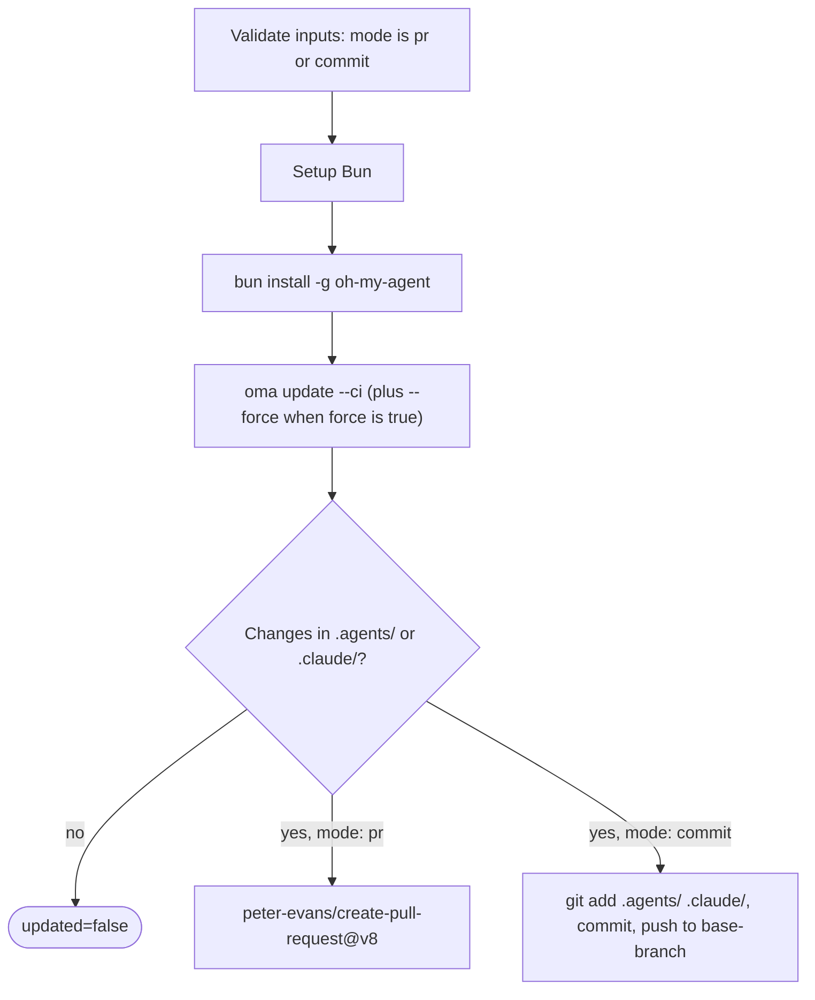

# Anleitung: Automatische Updates

## Überblick

Die oh-my-agent-GitHub-Action (`first-fluke/oma-update-action@v1`) aktualisiert die Agenten-Skills Ihres Projekts automatisch, indem sie `oma update` in CI ausführt. Sie unterstützt zwei Modi: einen Pull Request zur Prüfung zu erstellen oder direkt in einen Branch zu committen.

---

## Schnelleinrichtung

<!-- oma-docs:ignore-start -->
Fügen Sie diese Datei unter `.github/workflows/update-oh-my-agent.yml` in Ihrem Projekt hinzu:
<!-- oma-docs:ignore-end -->

```yaml
name: Update oh-my-agent

on:
  schedule:
    - cron: '0 9 * * 1'  # Every Monday at 9am UTC
  workflow_dispatch:        # Allow manual trigger

permissions:
  contents: write
  pull-requests: write

jobs:
  update:
    runs-on: ubuntu-latest
    steps:
      - uses: actions/checkout@v4

      - uses: first-fluke/oma-update-action@v1
```

Das ist die Minimalkonfiguration. Wenn sich eine installierte Komponente ändert, sollte die Action mit `updated=true`, einer Versionsausgabe und einem Pull Request enden. Wenn sich keine Datei ändert, endet sie mit `updated=false` und ohne PR.

---

## Alle Action-Eingaben

| Eingabe | Typ | Erforderlich | Standard | Beschreibung |
|:------|:-----|:---------|:--------|:-----------|
| `mode` | string | Nein | `"pr"` | Gibt an, wie Änderungen angewendet werden. `"pr"` erstellt einen Pull Request. `"commit"` pusht direkt in den Basis-Branch. |
| `base-branch` | string | Nein | `"main"` | Basis-Branch für den PR (im `pr`-Modus) oder Ziel-Branch für direkte Commits (im `commit`-Modus). Die Eingabe ändert nicht, was ausgecheckt wird; setzen Sie `ref:` von `actions/checkout` auf denselben Branch. |
| `force` | string | Nein | `"false"` | Übergibt `--force` an `oma update`. Bei `"true"` werden benutzerdefinierte Konfigurationsdateien (`oma-config.yaml`, `mcp.json`) und `stack/`-Verzeichnisse überschrieben. Normalerweise bleiben diese erhalten. |
| `pr-title` | string | Nein | `"chore(deps): update oh-my-agent skills"` | Benutzerdefinierter Titel für den Pull Request. Wird nur im `pr`-Modus verwendet. |
| `pr-labels` | string | Nein | `"dependencies,automated"` | Durch Kommas getrennte Labels für den PR. Wird nur im `pr`-Modus verwendet. |
| `commit-message` | string | Nein | `"chore(deps): update oh-my-agent skills"` | Benutzerdefinierte Commit-Nachricht. Wird in beiden Modi verwendet (als PR-Commit-Nachricht oder als direkte Commit-Nachricht). |
| `token` | string | Nein | `${{ github.token }}` | GitHub-Token zum Erstellen von PRs. Verwenden Sie ein Personal Access Token (PAT), wenn der PR andere Workflows auslösen soll (das Standard-`GITHUB_TOKEN` löst keine Workflow-Läufe für von ihm erstellte PRs aus). |

---

## Alle Action-Ausgaben

| Ausgabe | Typ | Beschreibung | Verfügbar |
|:-------|:-----|:-----------|:----------|
| `updated` | string | `"true"`, wenn nach dem Ausführen von `oma update` Änderungen erkannt wurden. `"false"`, wenn bereits alles aktuell ist. | Immer |
| `version` | string | Die oh-my-agent-Version nach dem Update. Wird aus `.agents/skills/_version.json` gelesen. | Wenn `updated` den Wert `"true"` hat |
| `pr-number` | string | Die Nummer des Pull Requests. | Nur im `pr`-Modus, wenn ein PR erstellt wird |
| `pr-url` | string | Die vollständige URL des erstellten Pull Requests. | Nur im `pr`-Modus, wenn ein PR erstellt wird |

---

## Detaillierte Beispiele

### Beispiel 1: Standard-PR-Modus

Die häufigste Konfiguration. Erstellt jeden Montag einen PR, wenn Updates verfügbar sind.

```yaml
name: Update oh-my-agent

on:
  schedule:
    - cron: '0 9 * * 1'
  workflow_dispatch:

permissions:
  contents: write
  pull-requests: write

jobs:
  update:
    runs-on: ubuntu-latest
    steps:
      - uses: actions/checkout@v4

      - uses: first-fluke/oma-update-action@v1
        id: update

      - name: Summary
        if: steps.update.outputs.updated == 'true'
        run: |
          echo "Updated to version ${{ steps.update.outputs.version }}"
          echo "PR: ${{ steps.update.outputs.pr-url }}"
```

**Was passiert:**
- Das Repository wird ausgecheckt.
- Bun wird installiert, danach oh-my-agent global.
- `oma update --ci` wird ausgeführt.
- Es wird geprüft, ob `.agents/` oder `.claude/` Änderungen enthalten.
- Wenn Änderungen vorhanden sind, erstellt `peter-evans/create-pull-request@v8` einen PR auf dem Branch `chore/update-oh-my-agent`.
- Der PR erhält die Labels `dependencies,automated` und enthält die neue Versionsnummer im Body.

### Beispiel 2: Direkt-Commit-Modus mit PAT

Für Teams, die Updates sofort ohne PR-Prüfung anwenden möchten. Dabei wird ein PAT verwendet, damit der Commit nachgelagerte Workflows auslösen kann.

```yaml
name: Update oh-my-agent (Direct)

on:
  schedule:
    - cron: '0 6 * * *'  # Daily at 6am UTC
  workflow_dispatch:

permissions:
  contents: write

jobs:
  update:
    runs-on: ubuntu-latest
    steps:
      - uses: actions/checkout@v4
        with:
          ref: develop
          token: ${{ secrets.OH_MY_AGENT_PAT }}

      - uses: first-fluke/oma-update-action@v1
        with:
          mode: commit
          token: ${{ secrets.OH_MY_AGENT_PAT }}
          commit-message: "chore: auto-update oh-my-agent skills"
          base-branch: develop
```

**Was passiert:**
- Der Branch `develop` wird mit einem PAT ausgecheckt. `ref: develop` ist erforderlich: `base-branch` legt nur das Push-Ziel fest, und die Action pusht den `HEAD`, den das Auschecken erzeugt hat.
- `oma update --ci` wird ausgeführt.
- Wenn Änderungen vorhanden sind, wird Git als `github-actions[bot]` konfiguriert und direkt nach `develop` committet.
- Das PAT stellt sicher, dass der Commit alle Workflows auslöst, die auf Pushes nach `develop` hören.

**Wichtig:** Verwenden Sie `secrets.OH_MY_AGENT_PAT` (ein Fine-Grained PAT mit der Berechtigung Contents: Write) anstelle von `github.token`. Das Standard-`GITHUB_TOKEN` erstellt Commits, die keine anderen Workflows auslösen. Dadurch können CI-Pipelines ausfallen, die Push-Events erwarten.

### Beispiel 3: Bedingte Benachrichtigung

Update mit Slack-Benachrichtigung, wenn eine neue Version verfügbar ist.

```yaml
name: Update oh-my-agent

on:
  schedule:
    - cron: '0 9 * * 1'
  workflow_dispatch:

permissions:
  contents: write
  pull-requests: write

jobs:
  update:
    runs-on: ubuntu-latest
    steps:
      - uses: actions/checkout@v4

      - uses: first-fluke/oma-update-action@v1
        id: update

      - name: Notify Slack
        if: steps.update.outputs.updated == 'true'
        uses: slackapi/slack-github-action@v2
        with:
          webhook: ${{ secrets.SLACK_WEBHOOK }}
          webhook-type: incoming-webhook
          payload: |
            {
              "text": "oh-my-agent updated to v${{ steps.update.outputs.version }}. PR: ${{ steps.update.outputs.pr-url }}"
            }

      - name: Skip notification
        if: steps.update.outputs.updated == 'false'
        run: echo "Already up to date, no notification needed."
```

**Wichtiges Muster:** Verwenden Sie `steps.update.outputs.updated == 'true'`, um nachgelagerte Schritte nur bei einem tatsächlichen Update bedingt auszuführen. So vermeiden Sie unnötige Meldungen bei Läufen ohne Änderungen.

### Beispiel 4: Force-Modus mit benutzerdefinierten Labels

Für Projekte, die beim Update alle Konfigurationsdateien auf die Standardwerte zurücksetzen möchten.

```yaml
name: Update oh-my-agent (Force)

on:
  workflow_dispatch:  # Manual trigger only for force updates

permissions:
  contents: write
  pull-requests: write

jobs:
  update:
    runs-on: ubuntu-latest
    steps:
      - uses: actions/checkout@v4

      - uses: first-fluke/oma-update-action@v1
        with:
          force: 'true'
          pr-title: "chore(deps): force-update oh-my-agent skills (reset configs)"
          pr-labels: "dependencies,automated,force-update"
          commit-message: "chore(deps): force-update oh-my-agent skills"
```

**Warnung:** Der Force-Modus überschreibt `oma-config.yaml`, `mcp.json` und `stack/`-Verzeichnisse. Verwenden Sie ihn nur, wenn Sie alle Anpassungen auf die Standardwerte zurücksetzen möchten. Für reguläre Updates lassen Sie die Eingabe `force` weg.

---

## Funktionsweise im Detail

Die Action ist eine [Composite Action](https://docs.github.com/en/actions/creating-actions/creating-a-composite-action), die in `action/action.yml` definiert ist. Sie prüft zuerst, ob `mode` den Wert `pr` oder `commit` hat, führt dann die folgenden Schritte aus und endet mit einem Pull Request oder einem direkten Commit:



### Schritt 1: Bun einrichten

```yaml
- uses: oven-sh/setup-bun@v2
```

Installiert die Bun-Laufzeit, die zum Ausführen der oh-my-agent-CLI benötigt wird.

### Schritt 2: oh-my-agent installieren

```bash
bun install -g oh-my-agent
```

Installiert die CLI global aus der npm-Registry. Dadurch wird der Befehl `oma` verfügbar.

### Schritt 3: oma update ausführen

```yaml
- name: Run oma update
  shell: bash
  env:
    FORCE: ${{ inputs.force }}
  run: |
    FLAGS="--ci"
    if [ "$FORCE" = "true" ]; then
      FLAGS="$FLAGS --force"
    fi
    oma update $FLAGS
```

Eingaben erreichen das Skript über `env:` statt über `${{ }}`-Interpolation innerhalb von `run:`. Dadurch kann ein Eingabewert nicht als Shell-Code ausgeführt werden.

Das `--ci`-Flag führt das Update im nicht-interaktiven Modus aus (überspringt alle Eingabeaufforderungen und gibt Klartext statt Spinner-Animationen aus). Das `--force`-Flag überschreibt bei Aktivierung benutzerdefinierte Konfigurationsdateien.

Was `oma update --ci` intern tut:

1. Ruft `prompt-manifest.json` vom Main-Branch ab, um die neueste Versionsnummer zu erhalten.
2. Vergleicht sie mit der lokalen Version in `.agents/skills/_version.json`.
3. Bei übereinstimmenden Versionen wird mit „Already up to date.“ beendet.
4. Wenn eine neue Version verfügbar ist, wird das neueste Tarball heruntergeladen und entpackt.
5. Bewahrt benutzerdefinierte Dateien auf (außer bei `--force`): `oma-config.yaml`, `mcp.json` und Stack-Verzeichnisse.
6. Kopiert neue Dateien über das vorhandene `.agents/`-Verzeichnis.
7. Stellt die aufbewahrten Dateien wieder her.
8. Aktualisiert Vendor-Anpassungen (Hooks, Einstellungen, Agenten-Definitionen) für die Vendoren in der Liste `vendors:` der Konfiguration (eine leere Liste bedeutet keine). Ohne Liste `vendors:` werden nur Vendoren aktualisiert, deren Projektverzeichnisse bereits existieren.
9. Erneuert CLI-Symlinks.

Die Action ruft `oma update --ci` ohne `--with-new-skills` auf. Dadurch wird die installierte Skill-Menge aktualisiert und es werden neu verfügbare Skills gemeldet. Führen Sie `oma update --with-new-skills` bewusst aus, wenn ein Projekt neue Skills als Teil des Updates hinzufügen soll.

### Schritt 4: Auf Änderungen prüfen

```bash
if [ -n "$(git status --porcelain .agents/ .claude/ 2>/dev/null)" ]; then
  echo "updated=true" >> "$GITHUB_OUTPUT"
  if [ -f ".agents/skills/_version.json" ]; then
    VERSION=$(jq -r '.version' .agents/skills/_version.json)
    echo "version=$VERSION" >> "$GITHUB_OUTPUT"
  fi
else
  echo "updated=false" >> "$GITHUB_OUTPUT"
fi
```

Prüft, ob `oma update` tatsächlich Dateien in `.agents/` oder `.claude/` geändert hat. Setzt die Ausgaben `updated` und `version` entsprechend. Änderungen außerhalb dieser beiden Verzeichnisse (zum Beispiel `.codex/` oder `AGENTS.md`) setzen nicht `updated=true`.

Danach hängt das weitere Verhalten von der Eingabe `mode` ab:

- **`pr`-Modus:** Verwendet `peter-evans/create-pull-request@v8`, um einen PR auf dem Branch `chore/update-oh-my-agent` zu erstellen. Der PR enthält die neue Versionsnummer, einen Link zum oh-my-agent-Repository und die konfigurierten Labels. Wenn der Branch bereits existiert (etwa wegen eines vorherigen offenen PRs), wird der bestehende PR aktualisiert.

- **`commit`-Modus:** Konfiguriert Git als `github-actions[bot]`, staged `.agents/` und `.claude/`, committet mit der konfigurierten Nachricht und pusht in den Basis-Branch.

---

## Siehe auch

- [Globale Installation](./global-install.md): `oma update --global` und Hinweise zu CI bei benutzerweiten Installationen
- [Konfigurationsreferenz](./configuration-reference.md#update-and-ownership-rules): welche Konfigurationsdateien `oma update` bewahrt
- [Integration in bestehende Projekte](./integration.md): die Dateien, die `oma update` in einem Projekt aktualisiert
