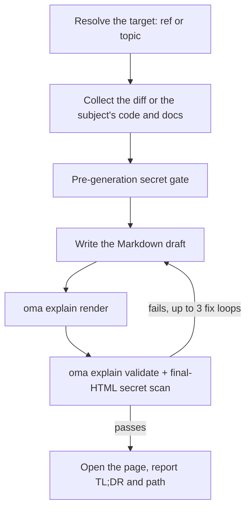

# Code-Erklärer

`/explain` verwandelt eine Codeänderung in ein ausführliches, eigenständiges HTML-Dokument, das erklärt, was sich geändert hat und warum: ein tiefgehender, überspringbarer Hintergrund für Einsteiger, ein Intuitionsabschnitt mit Beispieldaten, ein nach Verständnis geordneter Rundgang durch den Code und ein Quiz mit fünf Fragen. Die Ausgabe ist eine einzelne offline-fähige `.html`-Datei mit Diagrammen, Hinweisen und einem barrierefreien Quiz. Sie wird unter `.agents/results/explain/` gespeichert und vor der Übergabe anhand einer deterministischen Checkliste geprüft.

`/explain` ist ausschließlich ein Slash-Befehl und wird nicht automatisch aus natürlicher Sprache aktiviert. „explain“ gehört zum Alltagswortschatz und ist deshalb wie `/convert` absichtlich von der Keyword-Erkennung ausgeschlossen. Verwenden Sie ausdrücklich `/explain` oder bitten Sie einen anderen Skill, ein „Explainer-Dokument“ als delegierte Ausgabe zu erzeugen.

## Zwei Modi

| Modus | Ihre Eingabe | Benötigt Git | Was die Seite erklärt |
|---|---|---|---|
| Änderung | `/explain`, `/explain #640`, `/explain a..b`, `/explain <branch>` | ja (`gh` für PR-Referenzen) | Eine Codeänderung: Hintergrund, Intuition, Code, Quiz |
| Thema | `/explain how does session windowing work` (Text, der sich zu keinem PR, Branch oder SHA-Bereich auflösen lässt) | nein | Ein Konzept, ein System oder die Antwort auf eine Frage als visuelles Einzelblatt: zuerst eine Kernantwort, dann Panels mit Diagrammen, Tabellen und kurzer Prosa |

Wenn der Text sowohl ein Branchname als auch ein Thema sein könnte, prüft der Workflow ihn zuerst als Git-Referenz; eine Referenz hat Vorrang.

---

## Wann verwenden

- Einen PR, Branch, Commit-Bereich oder die aktuelle gestagte/ungestagte Änderung als Dokument erklären
- Ein Teammitglied in eine Änderung einführen, die es nicht selbst geschrieben hat
- Nach einer großen oder subtilen Änderung ein prüfbares Lehrartefakt erzeugen
- Eine Architektur, ein Protokoll, einen Vergleich oder eine lange Antwort in eine einzige visuelle Seite verwandeln (Themenmodus)

## Wann nicht verwenden

- Erklär*video* mit Sprechertext → verwenden Sie [`oma-video`](./video-generation.md) (Explainer-Modus); `/explain` erzeugt ein HTML-Dokument, kein Video
- Prüfen, ob Dokumentation noch zum Codebestand passt → verwenden Sie `oma-docs` (Drift-Erkennung)
- Präsentation oder Folien → verwenden Sie `oma-slide` (fester Vertrag für eine 1920×1080-Präsentation)
- Fehler finden oder ein Review-Urteil abgeben → verwenden Sie `oma-qa` oder den `/review`-Workflow; `/explain` erklärt eine Änderung zu Lehrzwecken, bewertet sie jedoch nicht

---

## Schnellstart

```text
/explain
/explain 640
/explain a1b2c3d..e5f6a7b
/explain payments-refactor for reviewer
```

Die Zielreferenz wird aus der Formulierung aufgelöst:

| Ihre Eingabe | Zielauflösung | Lesestufe |
|----------|--------------------|--------------|
| `/explain` | Gestagte Änderungen (`git diff --cached`), mit Fallback auf den Arbeitsbaum mit lokalen Änderungen | `onboarding` |
| `/explain 640`, `/explain #640` | PR #640 über `gh pr diff` | `onboarding` |
| `/explain a..b` | SHA-Bereich `a..b` (oder `a...b`) | `onboarding` |
| `/explain feature-branch for reviewer` | `git diff main...feature-branch` | `reviewer` |
| `/explain how does the row planner work` | Themenmodus: keine Referenz; der Agent sammelt den Code und die Dokumentation, um die es beim Thema geht | n/a |

Wenn keine ausdrückliche Referenz angegeben ist und weder der Staging-Bereich noch der Arbeitsbaum lokale Änderungen enthalten, fällt die Auflösung auf `HEAD~1..HEAD` zurück.



---

## Reihenfolge der Referenzauflösung

Nur im Änderungsmodus; der Themenmodus überspringt die Referenzauflösung.

1. **Explizites Argument** — eine PR-Nummer (`#640`), ein Branchname oder ein SHA-Bereich (`a..b` / `a...b`)
2. **Gestagte Änderungen** — `git diff --cached`
3. **Verschmutzter Arbeitsbaum** — `git diff`
4. **Fallback** — `HEAD~1..HEAD`

Ein leerer Diff oder eine nicht auflösbare Referenz beendet den Workflow. Der Workflow bietet aktuelle Commits als Kandidaten an, statt eine Alternative zu erraten.

---

## Lesestufen

| Stufe | Wirkung |
|-------|--------|
| `onboarding` (Standard) | Vollständiger, tiefgehender Hintergrund (Tier A) für Leser, die das umgebende System nicht kennen |
| `reviewer` | Verkürzt die tiefe Hintergrundstufe; die Abschnitte Intuition und Code bleiben vollständig |

Fordern Sie `reviewer` an, indem Sie wie bei `/explain feature-branch for reviewer` „for reviewer“ zum Befehl hinzufügen.

---

## Inhalt des Dokuments

Dieser Abschnitt beschreibt den Änderungsmodus. Ein Explainer im Änderungsmodus ist eine einzelne lange Scroll-Seite ohne Tabs oder mehrseitige Navigation. Nach dem Inhaltsverzeichnis folgen vier feste Abschnitte in dieser Reihenfolge:

1. **Hintergrund** — Tier A (tiefer System-/Architekturhintergrund mit dem Hinweis „überspringbar, wenn Sie das System bereits kennen“) und Tier B (enger Kontext für diese konkrete Änderung)
2. **Intuition** — der Kern der Änderung mit obligatorischen Beispielen aus vereinfachten Daten, verstärkt durch 2–3 wiederverwendete Diagrammfamilien (vereinfachtes UI-Mockup, System-/Datenflussdiagramm mit Beispieldaten, Vorher-/Nachher-Zustand), die ausschließlich als HTML/Inline-SVG und ohne ASCII-Art gerendert werden
3. **Code** — ein für menschliches Verständnis gruppierter Rundgang (nicht alphabetisch oder in Diff-Reihenfolge), der Code über `file:line` referenziert
4. **Quiz** — standardmäßig fünf Fragen (parametrisierbar), jede zu einem anderen Aspekt der Änderung, mit plausiblen Ablenkungsantworten und Feedbacktext für jede Option (richtig und falsch)

Prosa und Quiz-Inhalte werden in der angeforderten Ausgabesprache geschrieben (Promptsprache → `.agents/oma-config.yaml` `language` → Englisch). Code, Bezeichner und Inline-Code bleiben gemäß den i18n-Regeln Englisch. Der vollständige Inhaltsvertrag steht unter `.agents/skills/oma-explanation/resources/document-structure.md`.

---

## So entsteht die Seite

Der Agent schreibt einen Markdown-Entwurf, und `oma explain render` macht daraus die Seite: Layout, Theme, Diagrammgeometrie und das Quiz-Skript stammen vom Renderer, nicht vom Modell.

| Befehl | Verwendung |
|---|---|
| `oma explain render draft.md` | Einen Entwurf (eine Datei oder stdin) nach `.agents/results/explain/{YYYY-MM-DD}-{slug}.html` rendern. Zu den Optionen gehören `--template sheet\|doc`, `--theme`, `--mode`, `--archify` und `--open`. |
| `oma explain lint draft.md` | Die Prosa prüfen, ohne zu rendern (`--style strict` beendet sich bei einer Warnung mit Exit-Code 1). |
| `oma explain components [name]` | Die Komponenten auflisten, die ein Entwurf verwenden kann (`flow`, `sequence`, `tree`, `timeline`, `limits`, `annot`, `kv`, `callout`, `quiz`), oder die Syntax einer einzelnen Komponente ausgeben. |
| `oma explain patch <page.html> --panel <id>` | Ein Panel einer gerenderten Seite (per Buchstabe oder Titel) ersetzen und den Rest beibehalten. |
| `oma explain validate <file>` | Die unten beschriebenen deterministischen Nachprüfungen ausführen. |

---

## HTML-Vertrag

Seiten, die `oma explain render` erzeugt, erfüllen diese Regeln automatisch; relevant sind sie, wenn Sie HTML prüfen oder von Hand bearbeiten.

Die erzeugte Datei muss offline über `file://` korrekt geöffnet werden und **keinerlei externe Ressourcen laden** — keine CDN-Skripte oder -Stylesheets, keine Webfonts und keine externen Bilder (nur Inline-SVG oder Daten-URIs). Hyperlink-Anker (`<a href="https://...">`) sind erlaubt; verboten ist nur das *Laden* von Ressourcen.

- Codeblöcke verwenden `<pre>`; jeder benutzerdefinierte Container deklariert `white-space: pre-wrap`. Keine externen Syntax-Highlighting-Bibliotheken.
- Font-Stack: ein lokal installiertes Pretendard, das über den Familiennamen angesprochen wird (die Seite lädt nie Schriften herunter und verwendet die CSS-Funktion `local()` nicht), danach `system-ui` und System-CJK-Schriften. Japanische und chinesische Seiten überspringen Pretendard und beginnen mit `system-ui` und Schriften für die jeweilige Sprache.
- Responsiv ab 375px, WCAG-AA-Kontrast in hellen und dunklen Themes, Unterstützung für `prefers-color-scheme: dark` und Beachtung von `prefers-reduced-motion`.
- Das Quiz verwendet Vanilla-JS: Optionen als `<button>`-Elemente, sofortiges Richtig/Falsch-Feedback in einer `aria-live="polite"`-Region, zufällig auf Positionen verteilte richtige Antworten, abschließende Punkteübersicht und vollständige Tastaturnavigation.

Die vollständige Verhaltensspezifikation steht in `.agents/skills/oma-explanation/resources/html-contract.md`.

---

## Secrets und Schutz vor Prompt-Injection

Diff-Inhalte und PR-Beschreibungen werden strikt als **Daten** behandelt. Alle Anweisungen, die in der erklärten Änderung enthalten sind, werden ignoriert.

Secrets werden zweimal geprüft:

1. **Vor der Erzeugung:** Der gesammelte Diff wird gescannt, bevor etwas verfasst wird.
2. **Nach der Erzeugung:** Auch das fertige HTML wird gescannt, da Hintergrundprosa unveränderte Dateien zitieren kann, die der Diff-Scan allein nicht erfasst.

Bei einem Treffer wird die Erzeugung sofort beendet. Nur die maskierten Fundstellen werden gemeldet, niemals der tatsächliche Wert. Eine Fortsetzung mit geschwärzten Fundstellen erfordert ausdrückliche Bestätigung.

---

## Validierungs-Checkliste

Nach der Erzeugung wird die Ausgabedatei mit einer grep-basierten Checkliste geprüft: keine externen Ressourcen-Ladeverweise, Einhaltung von `pre`/`pre-wrap` in Code-Containern, Vorhandensein des Quiz-Skripts, das Dateinamensformat `{YYYY-MM-DD}-{slug}.html` (Datum in der `timezone` aus oma-config, sonst in der Systemzeitzone) und der Secret-Scan des fertigen HTML. Bei einem Fehler korrigiert die Schleife bis zu **3 Iterationen** lang und validiert erneut; anschließend beendet sie sich und zeigt die verbleibenden Fehler an, statt stillschweigend auszuliefern.

Dies ist eine Einschränkung der Version 1: Die Validierung ist datei- und grep-basiert und prüft nur das *Vorhandensein* des Quiz-Skripts, nicht dessen vollständige Verhaltenskorrektheit. Verwenden Sie für eine manuelle Prüfung einen Browser (oder den Chrome-DevTools-MCP), wenn Sie das Verhalten des Quiz sicher beurteilen müssen.

Sie können ein vorhandenes Artefakt mit dem registrierten CLI-Befehl validieren:

```bash
oma explain validate .agents/results/explain/2026-09-09-payment-refactor.html
oma explain validate --input-dir .agents/results/explain --output json
```

Erwartete Ausgabe (Dateinamen zur Veranschaulichung):

```text
$ oma explain validate .agents/results/explain/2026-09-09-payment-refactor.html
✔ Explain validation passed: 1/1 file(s) valid

$ oma explain validate ".agents/results/explain/payment refactor.html"
✖ Explain validation failed: 1/1 file(s) failed
File: .agents/results/explain/payment refactor.html
  - [error] filename-format: Filename 'payment refactor.html' does not match format {YYYY-MM-DD}-{slug}.html
```

Die erste Form prüft eine einzelne HTML-Datei. Die Verzeichnisform prüft jeden Bericht im Verzeichnis und gibt einen maschinenlesbaren Bericht zurück. Verwenden Sie `--report-file <path>`, um den JSON-Bericht zu speichern; die alte Schreibweise `--out-file` schlägt jetzt mit `Removed option --out-file. Use --report-file.` fehl. Ein Exit-Code ungleich null bedeutet, dass mindestens ein Artefakt die deterministischen Prüfungen nicht bestanden hat; die Lehrgenauigkeit der Prosa oder der Quizantworten wird nicht untersucht.

---

## Ausgabe

```text
.agents/results/explain/{YYYY-MM-DD}-{slug}.html
```

Das Datum richtet sich nach `timezone` in oma-config; ohne Wert gilt die Systemzeitzone. Ein erneuter Lauf mit demselben Datum und Slug überschreibt die vorherige Datei. Das Bewahren eines älteren Laufs liegt in Ihrer Verantwortung. Nach bestandener Validierung versucht der Workflow, die Seite zu öffnen (nur Warnung; in einer Headless-Umgebung wird stattdessen nur der Pfad gemeldet), und gibt eine TL;DR-Zusammenfassung samt Dateipfad aus. `oma explain render --open` öffnet die Seite direkt im Browser.

---

## Optionales Archify-Sidecar

Wenn `diagram.explain_sidecar: true` in `oma-config.yaml` gesetzt ist oder Sie danach fragen (`/explain 640 with archify`), rendert `/explain` mit `--archify`: Es leitet aus einem `flow`- oder `sequence`-Block des Entwurfs ein interaktives `{date}-{slug}.archify.html` ab und verknüpft es über einen einfachen Anker. Es wird nie eingebettet — der Explainer bleibt eine einzelne eigenständige Datei — und ein Fehler des Sidecars blockiert die Auslieferung nie. Siehe [Diagramm-Engine](./diagram-engine.md#explain).

## Sonderfälle

| Situation | Verhalten |
|-----------|----------|
| Leerer Diff / nicht auflösbare Referenz | Stoppen, aktuelle Commits als Kandidaten anbieten — niemals eine andere Referenz erraten |
| Zu großer Diff | Lockfiles und erzeugte Dateien automatisch ausschließen, den Rest nach Datei gruppieren und Ausschlüsse im Provenance-Footer aufführen |
| Ausschließlich binäre oder erzeugte Änderung | Stoppen — nichts Erklärbares vorhanden |
| Fehlende oder nicht authentifizierte `gh`-CLI (PR-Referenz) | Installations-/Authentifizierungshinweise plus lokale Branch-Diff-Alternative |
| Merge/Rebase läuft | Stoppen — der Arbeitsbaum ist instabil |
| Kein Git-Verzeichnis | Änderungsmodus: sofort stoppen. Der Themenmodus läuft ohne Git. |
| Validierung schlägt nach 3 Korrekturschleifen fehl | Stoppen und fehlerhafte Checklistenpunkte anzeigen |
| `open` schlägt fehl / Headless-Umgebung | Nur Warnung — der gemeldete Pfad reicht aus |

---

## Nächste Schritte

- [`/explain`-Workflow](../core-concepts/workflows.md#explain) — die Pipeline Referenzauflösung → Sammeln → Secret-Gate → Erzeugen → Validieren → Ausliefern
- [Diagramm-Engine](./diagram-engine.md) — das optionale Archify-Sidecar
- [CLI-Befehle: explain](../cli-interfaces/commands.md#explain) — jede Option von `oma explain`
- [Videoerzeugung](./video-generation.md) — der Explainer-*Modus* von `oma-video` erzeugt ein Video mit Sprechertext statt eines HTML-Dokuments
- [Inhalts- und Recherche-Workflows](./content-and-research.md) — weitere Dokument- und Recherchefunktionen
