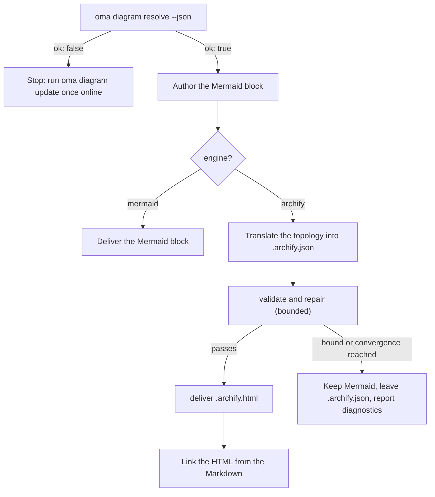

# Diagramm-Engine

`/architecture` (ADRs, Empfehlungen, Reviews) und `/explain` (Erklärungen zu Codeänderungen) erzeugen beide Strukturdiagramme. Bei `/architecture` sind das immer **Mermaid**-Blöcke im Markdown-Artefakt (`/explain` zeichnet eigene Inline-SVG-Diagramme), und zusätzlich — sobald [archify](https://github.com/tt-a1i/archify) aufgelöst werden kann, was dem Normalfall entspricht — ein **interaktives, validiertes HTML-Diagramm** neben dem Artefakt: mit dunklem/hellem Theme, Pan-Zoom, Suche, Nachverfolgung von Beziehungen und PNG-/SVG-/WebM-Export, aus einer typisierten JSON-Spezifikation gerendert.

Mermaid bleibt erhalten: Es ist die Text-SSOT im Markdown und in Git-Diffs. archify ist ein abgeleitetes Artefakt.

---

## Immer das neueste archify — nichts zu installieren {#always-the-latest-archify--nothing-to-install}

archify ist ein MIT-lizenzierter Agenten-Skill (Node ≥ 18, keine Laufzeitabhängigkeiten). oh-my-agent verlässt sich nicht auf eine einmalig installierte Kopie, sondern hält eine **eigene verwaltete Kopie** vor und verfolgt das neueste Release:

- Cache: `~/.cache/oma-diagram/archify/<tag>/` plus die Zeigerdatei `state.json`.
- Vor jeder Nutzung fragt `oma diagram resolve` GitHub nach dem neuesten Release-Tag (höchstens einmal pro `check_interval_min`, standardmäßig 60 Minuten), lädt den Quell-Tarball bei einem neueren Tag herunter (atomisches Verzeichnis pro Tag; ältere Tags werden entfernt) und verwendet ansonsten die gecachte Kopie erneut.
- Netzwerkfehler sind nie fatal: Die gecachte Kopie wird verwendet und mit dem Grund als `stale` gemeldet. Nur ein erster Lauf ohne Netzwerk und ohne Cache fällt auf eine benutzerinstallierte Skill-Kopie und danach auf Mermaid zurück.

```bash
# Illustrative output; the release tag, cache path, and quality can vary.
oma diagram update          # force a check / download now
oma diagram resolve
# engine:   archify  (requested: auto)
# reason:   archify 2.15.0 via managed:v2.15.0 (current)
# root:     /Users/you/.cache/oma-diagram/archify/v2.15.0
# bin:      /Users/you/.cache/oma-diagram/archify/v2.15.0/bin/archify.mjs
# version:  2.15.0
# quality:  showcase
# sidecar:  off (explain)
oma diagram resolve --offline   # never touch the network
```

Auflösungsreihenfolge (der erste Treffer gewinnt und ist für jede Vendor-Laufzeit gleich):

1. `diagram.archify.path` in `oma-config.yaml` — expliziter Pin, deaktiviert Auto-Latest
2. Umgebungsvariable `ARCHIFY_HOME` — expliziter Pin
3. **Verwaltete neueste Version** (`~/.cache/oma-diagram/archify`)
4. Benutzerinstallierte Skill-Verzeichnisse: Projekt `.agents` / `.claude` / `.codex` / `.cursor` / `.qwen` / `.kiro` `/skills/archify`, danach dieselben Verzeichnisse unter `~` sowie `~/.raven/workspace/skills/archify`

<!-- oma-docs:ignore-start -->
Ein Treffer erfordert, dass die verwaltete oder angeheftete archify-Installation `bin/archify.mjs` enthält.
<!-- oma-docs:ignore-end -->

---

## Konfiguration

Der sparsame Konfigurationsabschnitt in `.agents/oma-config.yaml` (fehlende Schlüssel verwenden die angegebenen Standardwerte):

```yaml
diagram:
  engine: auto                # auto | archify | mermaid
  explain_sidecar: false      # /explain also writes an archify sidecar
  archify:
    managed: true             # false = never download; use pins / skill dirs only
    channel: stable           # stable (latest GitHub Release) | main (HEAD of main)
    check_interval_min: 60    # minutes between remote checks; 0 = every call
    path: null                # explicit install dir (pin)
    quality: showcase         # showcase | standard  → --quality
    open: false               # pass --open to deliver
```

### Welche Engine läuft {#which-engine-runs}

Eine einzige Entscheidung deckt den Konfigurationswert ab, ob archify aufgelöst wird und was der Workflow ausliefert. „Aufgelöst“ bedeutet, dass ein beliebiger Schritt der [Auflösungsreihenfolge](#always-the-latest-archify--nothing-to-install) eine Installation findet: einen Pin, die verwaltete neueste Kopie oder ein benutzerinstalliertes Skill-Verzeichnis.

| `diagram.engine` | archify aufgelöst? | `oma diagram resolve --json` | Ergebnis von `/architecture` |
|---|---|---|---|
| `auto` (Standard) | ja | `engine: archify`, `ok: true` | Mermaid-Block + verlinktes `.archify.html` |
| `auto` | nein (zum Beispiel erster Lauf offline oder `managed: false` ohne Skill-Verzeichnis) | `engine: mermaid`, `ok: true` | Nur Mermaid; der Bericht empfiehlt, einmal online `oma diagram update` auszuführen |
| `archify` | ja | `engine: archify`, `ok: true` | Mermaid-Block + verlinktes `.archify.html` |
| `archify` | nein | `engine: mermaid`, `ok: false`, Exit-Code 1 | Der Workflow stoppt mit dem Hinweis auf `oma diagram update`, statt still herunterzustufen |
| `mermaid` | nicht geprüft | `engine: mermaid`, `ok: true` | Nur Mermaid; archify wird nie aufgerufen |

`oma diagram resolve --engine <auto|archify|mermaid>` überschreibt die Konfiguration für einen Aufruf, und ein Prompt kann dasselbe für einen Lauf tun (`/explain 640 with archify`).

---

## CLI

```bash
oma diagram resolve [--engine auto|archify|mermaid] [--refresh] [--offline] [--json]
oma diagram update  [--json]
oma diagram archify <archify args…>
```

`oma diagram update` erzwingt eine Aktualisierung und beendet sich mit Exit-Code 1, wenn keine archify-Installation aufgelöst werden kann.

`oma diagram archify` führt die aufgelöste archify-Binärdatei mit `ARCHIFY_UPDATE_CHECK_DISABLED=1` (kein Netzwerk) aus und reicht den Exit-Code weiter. Daher verhalten sich `validate` / `deliver` / `visual-check` genau so, wie es die archify-Dokumentation beschreibt:

```bash
oma diagram archify guide "show the auth request lifecycle" --json
oma diagram archify validate architecture adr-auth.archify.json --quality showcase --json
oma diagram archify deliver  architecture adr-auth.archify.json adr-auth.archify.html --quality showcase --json
oma diagram archify visual-check adr-auth.archify.html --json   # exit 2 = no Chrome (skipped), or archify itself could not be resolved
```

`--json` bei `resolve` gibt `{ ok, requested, engine, quality, open, explainSidecar, archify?: { root, bin, version, source, status?, note? }, reason, probed }` zurück. `source` ist `managed:<tag>`, `config:…`, `env:…` oder eine Bezeichnung des Skill-Verzeichnisses; bei verwalteten Kopien werden `status` (`fresh` / `current` / `stale`) und `note` gesetzt.

---

## Nutzung durch die Workflows

Das gemeinsame Protokoll liegt in `.agents/skills/_shared/conditional/diagram-engine.md`. `/architecture` folgt dieser Reihenfolge:

1. `oma diagram resolve --json`
2. Zuerst den Mermaid-Block schreiben (immer).
3. Bei `engine: archify` die Mermaid-Topologie in das JSON-IR von archify (`architecture` / `sequence` / `dataflow` / `lifecycle` / `workflow`) übersetzen und dabei nur das passende Schema und ein Beispiel aus der Installation lesen.
4. `validate` → reparieren → `deliver`, begrenzt: Stoppen, wenn die Spezifikation besteht, wenn archifys Konvergenzregel greift, nach 3 Reparaturversuchen, nach insgesamt 10 Minuten oder wenn sich dieselbe Diagnose wiederholt. Semantische Labels werden nie nur zum Bestehen gelöscht.
5. Das HTML verlinken — niemals einbetten.



### `/architecture` {#architecture}

Nur für strukturelle Entscheidungen (Grenzen, Abhängigkeiten, Datenfluss). Ausgabe neben dem Markdown-Artefakt unter `.agents/results/architecture/`:

```text
adr-notification-service.md            # Mermaid block + "Interactive:" link
adr-notification-service.archify.json  # frozen spec (kept even on failure)
adr-notification-service.archify.html  # delivered viewer
```

### `/explain` {#explain}

Opt-in, weil der eigene Vertrag des Explainers (eine eigenständige Datei mit CSS-Variablen-Theming) das Einbetten eines zweiten vollständigen HTML-Dokuments nicht zulässt. Aktivieren Sie es mit `diagram.explain_sidecar: true`, übergeben Sie `oma explain render --archify` oder fragen Sie im Prompt danach („with archify“). Es gibt keinen Mermaid-Block und kein handgeschriebenes JSON: Der Renderer leitet die archify-Spezifikation aus einem `flow`- oder `sequence`-Block des Entwurfs ab (dem mit `{archify}` markierten Panel), führt `deliver` aus (mit einmaligem Fallback von der Qualität `showcase` auf `standard`) und verlinkt `{date}-{slug}.archify.html` mit einem einfachen `<a href>`. Der Befehl meldet `linked`, `skipped` (mit dem Grund) oder `failed` (erste Diagnose). Der Workflow wiederholt ein fehlgeschlagenes Sidecar nicht, und ein Fehler des Sidecars blockiert den Explainer nie.

---

## Fehlerfälle

Ein nicht auflösbares archify behandelt die [Entscheidungstabelle der Engine](#which-engine-runs). Die übrigen Fälle:

| Situation | Ergebnis |
|---|---|
| Update-Prüfung schlägt fehl (offline, rate-limitiert) | Gecachte Kopie wird verwendet und mit dem Grund als `stale` gemeldet |
| `validate` konvergiert nie | Mermaid bleibt das ausgelieferte Diagramm; die letzte `.archify.json` bleibt für eine manuelle Prüfung liegen und Diagnosen werden wörtlich gemeldet |
| Chrome fehlt für `visual-check` | Als `skipped` gemeldet, niemals als bestanden |
| `oma diagram archify …` endet mit Exit-Code 2 | Entweder fehlt Chrome (`visual-check`) oder archify konnte nicht aufgelöst werden; prüfen Sie zuerst `oma diagram resolve --json` |

---

## Nächste Schritte

- [Code-Erklärer](./code-explainer.md) — der `/explain`-Workflow und sein optionales archify-Sidecar
- [`/architecture`-Workflow](../core-concepts/workflows.md#architecture) — ADRs und Reviews, die den Mermaid-Block enthalten
- [Semantik von oma-config.yaml](./oma-config-semantics.md) — wie der Abschnitt `diagram:` zusammengeführt wird
- [CLI-Befehle: diagram](../cli-interfaces/commands.md#diagram) — vollständige Optionsliste
- [Marktforschung](./market-research.md) — dasselbe Muster der verwalteten neuesten Version für die last30days-Engine
- archify upstream: [tt-a1i/archify](https://github.com/tt-a1i/archify)
