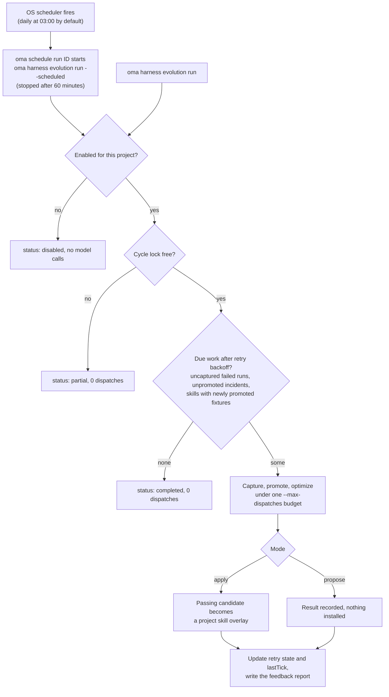

# Projekt-Harness-Evolution

OMA kann aus nachverfolgten Agentenläufen Belege sammeln und Ausfälle in einem geplanten Rückkopplungszyklus verarbeiten. Automatische Skill-Änderungen sind **aus, bis Sie sie für ein Projekt aktivieren**. Jeder Zyklus hat ein endliches Budget an Modellaufrufen, und eine angewendete Änderung muss die vorhandenen Gates der Skill-Evaluierung bestehen.

Der automatisierte Pfad verbessert Skill-Dokumente. Änderungen am Verfahren von Optimierer oder Maintainer bleiben eine separate, manuell aufgerufene [Meta-Optimierung](./skill-opt.md#meta-optimization-the-procedure-as-the-candidate).

## Ein Projekt aktivieren

Führen Sie die Befehle im Stammverzeichnis des Projekts aus:

```bash
# Example allowance: at most 300 model dispatches per scheduled cycle
oma harness evolution enable --max-dispatches 300

# Evaluate proposals without applying them
oma harness evolution enable --max-dispatches 300 --mode propose

# Choose a schedule in the operating system's local time
oma harness evolution enable --max-dispatches 300 --cron "0 3 * * *"

oma harness evolution status --json
```

`enable` gibt die gespeicherten Einstellungen und die Job-ID des Schedulers aus:

```json
{
  "enabled": true,
  "scheduleId": "sch_abcdefgh2345",
  "mode": "apply",
  "maxDispatches": 300
}
```

`status --json` liefert `config`, `schedule` (den Scheduler-Eintrag oder `exists: false`), `pending` (die Anzahl nicht abgeschlossener Wiederholungsversuche), `conflicts` (Overlay-Konflikte pro Skill) und `state` (Wiederholungsversuche und `lastTick`).

Der Standardzeitplan ist täglich um 03:00 Uhr lokaler Zeit, und der Standardmodus ist `apply`. `--max-dispatches` ist beim Aktivieren erforderlich und muss eine positive ganze Zahl sein. Der Beispielwert ist ein Aufrufkontingent und weder eine Preisschätzung noch ein Versprechen, dass ein Zyklus abgeschlossen wird. Größere Fixture-Suites und wiederholte Bewertung verbrauchen mehr Aufrufe.

<!-- oma-docs:ignore-start -->
Einstellungen werden in `.agents/evolution/harness-evolution.json` gespeichert. Erzeugte Belege, der Retry-Zustand und die Zyklus-Sperre liegen unter `.agents/state/harness-evolution/`.
<!-- oma-docs:ignore-end -->

Das Aktivieren registriert einen integrierten Job beim vorhandenen [OS-Scheduler](./scheduled-agents.md) von OMA; er erscheint in `oma schedule list` mit dem Agenten `__builtin__`. Zum Auslösezeitpunkt startet `oma schedule run <id>` in diesem Projekt `oma harness evolution run --scheduled` und beendet es nach 60 Minuten. Bemessen Sie `--max-dispatches` daher für einen Zyklus, der in eine Stunde passt. Ein erneutes Aktivieren aktualisiert den Job des Projekts, statt einen weiteren anzulegen. Beenden Sie den Zeitplan mit `oma harness evolution disable` statt mit `oma schedule delete`, damit die gespeicherten Einstellungen konsistent bleiben.

```bash
# Run one cycle now under the saved mode and budget
oma harness evolution run --json

# Stop future cycles; retain evidence and applied improvements
oma harness evolution disable
```

`run --json` liefert `status` (`completed`, `partial` oder `disabled`), `dispatchesUsed` und `maxDispatches`. Hält ein anderer Zyklus die Sperre, liefert `run` `partial` mit 0 Dispatches. Ein Zyklus, der mit einem Fehler abbricht, etwa wegen eines erschöpften Kontingents, endet mit diesem Fehler und zeichnet `partial` oder `failed` in `state.lastTick` auf.

Ein deaktiviertes Projekt führt über den Evolution-Befehl keine Modellaufrufe aus, auch nicht bei einem verspäteten geplanten Aufruf. Das Deaktivieren rollt bereits angewendete Änderungen nicht zurück.

## Was automatisch geschieht

Das Diagramm zeigt einen Zyklus, unabhängig davon, ob der Scheduler ihn auslöst oder Sie ihn manuell starten.



1. **Abschlussbelege aufzeichnen.** Von OMA nachverfolgte Läufe hinterlassen lokale Verweise auf ihr Ergebnis und ihre Verifizierungsbelege. Dieser Abschlussschritt verursacht keine zusätzlichen Modellaufrufe. Wiederholtes Abschließen desselben Laufs erzeugt keine doppelten Belege.
2. **Ausfälle nach Zeitplan sammeln.** Der Zyklus scannt infrage kommende fehlgeschlagene Läufe, leitet Erwartungen aus ihren aufgezeichneten Aufgabenverträgen ab und prüft, dass eine vorgeschlagene Regressions-Fixture die erhaltene fehlgeschlagene Ausgabe tatsächlich ablehnt.
3. **Betroffene Skills optimieren.** Incidents werden nach Skill gruppiert. Jeder Skill wird unter den vorhandenen Prüfungen für Training, Validierung, Final-Test, Isolation und negative Übertragung optimiert.
4. **Anwenden oder berichten.** Im Modus `apply` wird ein bestandener Kandidat zu einem Projekt-Skill-Overlay. Im Modus `propose` zeichnet der Zyklus das Ergebnis auf, ohne es zu installieren.
5. **Änderungen berichten.** Prüfen Sie die Ergebnisse über den Status und die vorhandene Hochstufungshistorie. Angewendete Änderungen speisen außerdem den Evolutionshinweis der nächsten Sitzung.

OMA beobachtet nicht automatisch jede native Konversation oder jede Korrektur durch Benutzer. Die Eingabe sind die Lauf-Belege, die OMA tatsächlich nachverfolgt. Ein Lauf ohne erhaltene Ausgabe oder Abnahmevertrag kann eine manuell verfasste [Incident-Spezifikation](./harness-incidents.md#capture-an-incident) erfordern.

## Budget und Wiederholungsversuche

Der Zyklus teilt sich ein Aufrufkontingent über Erfassung, Rubrik-Entwurf, Routing, Bewertung, Skill-Optimierung, Nachbaraufgaben und finale Evaluierung. Ein Modellaufruf belastet das Kontingent vor dem Dispatch. Auch von der Ausführungsschicht wiederholte Aufrufe zählen mit. Ein strengeres Constitution-Limit eines Skills gilt weiterhin.

Ist das Kontingent erschöpft, bleibt die Evaluierung unvollständig, und der betroffene Kandidat kann nicht angewendet werden. Der Bericht zeichnet die Nutzung und die ausstehende Arbeit auf. Es läuft immer nur ein Projektzyklus gleichzeitig.

Das Anlegen einer Fixture markiert die Optimierung des Incidents nicht als abgeschlossen. Eine unterbrochene oder fehlgeschlagene Optimierung bleibt ausstehend und kann nach einem Backoff fortgesetzt werden, ohne die Fixture zu duplizieren. Der Backoff verdoppelt sich mit jedem fehlgeschlagenen Versuch: 2, 4, 8, … Minuten, bis zu 1024 Minuten (etwa 17 Stunden). Ein vollständig evaluiertes Ergebnis ohne akzeptable Änderung wird als verarbeitet aufgezeichnet, sodass dieselben Belege nicht unbegrenzt wiederholte Optimierungen auslösen. Neue Belege können einen weiteren Versuch auslösen.

Beim Wechsel vom Vorschlagsmodus in den Anwendungsmodus kommen nicht angewendete Vorschläge für die Verarbeitung infrage. Das Anwenden erfordert weiterhin eine aktuelle Evaluierung und unveränderten Quellinhalt; ein alter Vorschlag ist keine bedingungslose Schreibanweisung.

## Dauerhafte Skill-Overlays

Automatische Änderungen werden getrennt von den verwalteten Skill-Definitionen im benutzereigenen Evolutionsbereich des Projekts gespeichert, `.agents/evolution/skills/<skill>/` (mit einem `overlay.json`-Eintrag). Die Evaluierung und projektlokale Vendor-Skill-Links verwenden den effektiven Text, der aus der verwalteten Basis und ihrem zulässigen Overlay ausgewählt wird. Vendor-Installationen im HOME-Bereich werden nicht auf ein Projekt-Overlay umgelenkt. Eine nicht verwaltete Kopie in einem Vendor-Verzeichnis des Projekts muss vor der automatischen Anwendung aufgelöst werden. Skill-Ressourcen bleiben unter ihren relativen Pfaden verfügbar.

Ein Overlay zeichnet die Basis auf, gegen die es evaluiert wurde. Nach `oma update`:

- Eine unveränderte Basis verwendet weiterhin ihr Overlay.
- Bei einer geänderten Basis bleibt das Overlay erhalten, wird aber als Konflikt markiert, und die aktualisierte Basis wird verwendet. Die alte Evaluierung kann nicht belegen, dass das Overlay auf der neuen Basis sicher ist.

Eine Änderung, die während einer laufenden Optimierung vorgenommen wird, verhindert, dass der Kandidat diesen geänderten Inhalt überschreibt. Der Status meldet Konflikte zur Prüfung.

## Prüfen und rückgängig machen

```bash
oma harness evolution status --json
oma skill promotions --all
oma skill rollback --skill oma-docs
```

Hochstufungseinträge bewahren die Hashes von Kandidat und Parent, die Evaluierungsbelege und einen prüfbaren Patch auf. Das Zurückrollen des ersten Overlays stellt die Nutzung der verwalteten Basis wieder her; das Zurückrollen eines späteren Overlays stellt das vorherige Overlay wieder her. Unbekannte Änderungen bleiben erhalten: Der Rollback verweigert es, Inhalte zu verwerfen, die nicht mehr zum aufgezeichneten Kandidaten passen.

Ein manuelles `oma skill optimize --apply` schreibt weiterhin die verwaltete `SKILL.md`, verweigert dies jedoch, solange für diesen Skill ein Projekt-Overlay aktiv ist (`[oma skill opt] an active project overlay owns this skill; ...`). Rollen Sie das Overlay zuerst mit `oma skill rollback --skill <id>` zurück, oder lassen Sie den Evolutionszyklus die Änderung anwenden. Die geplante Evolution wählt ausdrücklich den Pfad der Overlay-Anwendung.

## Reichweite der Belege

Ein bestandener Softwaretest bestätigt die Verdrahtung und die Evaluierungsregeln. Er belegt nicht, dass wiederholte automatische Änderungen die tatsächliche Arbeit eines Projekts im Lauf der Zeit verbessern. Prüfen Sie die tatsächlichen Hochstufungen, Kosten, Regressionen und die Rollback-Historie, bevor Sie das Kontingent erhöhen oder die Automatisierung ausweiten. Die L5-Hochstufung des Verfahrens wird von dieser geplanten Rückkopplungsschleife nicht aufgerufen.

## Siehe auch

- [Incident-Regressionsfälle](./harness-incidents.md) — die Incidents erfassen, hochstufen und reproduzieren, die dieser Zyklus verarbeitet.
- [Skill-Optimierung](./skill-opt.md) — die Gates, die jede angewendete Änderung besteht.
- [Geplante Agenten](./scheduled-agents.md) — der OS-Scheduler, der den Zyklus auslöst.
