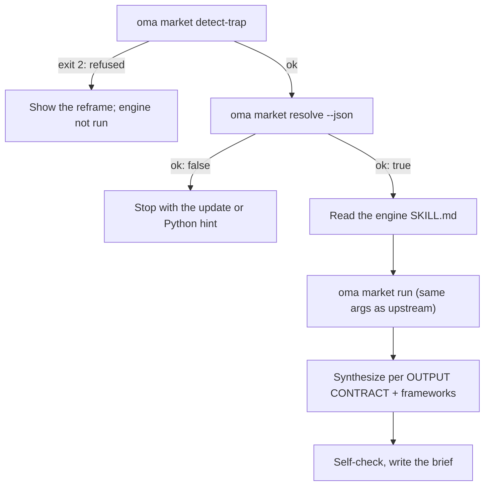

# Marktforschung

`oma-market` beantwortet die Frage „Was sagen Menschen in den letzten N Tagen tatsächlich über X?“ — mit Schmerzpunkten, Trends, Wettbewerber-Sentiment und Discovery aus Community-Quellen mit echten Interaktionszahlen: Reddit (Upvotes und Top-Kommentare), X, YouTube-Transkripte, TikTok, Instagram, Hacker News, Polymarket, GitHub, arXiv, Techmeme, Digg, LinkedIn, StockTwits, Bluesky, das Web und weitere Quellen.

Die Recherche selbst läuft auf der Upstream-[**last30days**](https://github.com/mvanhorn/last30days-skill)-Engine (MIT, Python 3.12+). oh-my-agent forkt sie nicht: Es hält eine **immer aktuelle verwaltete Kopie** vor, führt vor jedem Lauf Gates aus und ergänzt eine strategische Framework-Schicht. Release-Rhythmus, Star-Zahl und Provider-Abdeckung gehören zum Upstream-Projekt und können sich ändern.

---

## Schnellstart

Fragen Sie Ihren Agenten in normaler Sprache. Formulierungen wie „Marktforschung“, „Schmerzpunkte“, „Wettbewerbsanalyse“, „Voice of Customer“ oder „Trenderkennung“ aktivieren den Skill `oma-market`:

```text
Finde die wichtigsten Schmerzpunkte, die Entwickler in den letzten 30 Tagen zu VS Code Remote Containers melden.
Vergleiche das Community-Sentiment zu Cursor vs Windsurf über die letzten 90 Tage, frameworks swot,5f.
```

| Steuern mit | Wirkung |
|---|---|
| „A vs B“ oder `--vs B` | Wettbewerber-Intention: Upstream-Vergleichsablauf + SWOT + Porter's 5F |
| `--days 7`, `30`, `90` oder `180` | Recherchezeitraum |
| `--intent pain`, `trend`, `competitor` oder `discovery` | Überschreibt die automatische Klassifizierung der Intention |
| `--frameworks none` oder eine Liste wie `swot,5f,pestel` | Schaltet Framework-Abschnitte ab oder wählt sie aus |

Das Ergebnis ist ein einzelnes Briefing unter `.agents/results/market/{topic-slug}-{YYYYMMDD}.md`. Die erste Zeile ist das Engine-Badge (`🌐 last30days v<version> · synced <date>`), gefolgt von nach Rang geordneten Evidenzclustern mit Links, den Framework-Abschnitten und dem Engine-Footer, der übersprungene Quellen auflistet.

| Läuft ohne Schlüssel | Benötigt den Upstream-Einrichtungsassistenten (Schlüssel oder Cookies) |
|---|---|
| Reddit, Hacker News, GitHub, Polymarket, arXiv, Techmeme, Digg, Web | X, YouTube-Transkripte, TikTok, Instagram und weitere schlüsselpflichtige Quellen; übersprungene Quellen werden im Footer aufgeführt |

---

## Immer die neueste Engine (Python 3.12+ erforderlich) {#always-the-latest-engine--nothing-to-install}

```bash
# Illustrative output; the release tag, cache path, and Python version vary.
oma market resolve
# engine:   last30days
# reason:   last30days 3.21.1 via managed:v3.21.1 (current)
# root:     ~/.cache/oma-market/last30days/v3.21.1
# skill:    ~/.cache/oma-market/last30days/v3.21.1/SKILL.md
# version:  3.21.1
# python:   python3.14 (3.14.7, PATH)
# save_dir: <workspace>/.agents/results/market/raw
```

- Cache: `~/.cache/oma-market/last30days/<tag>/` sowie `state.json`.
- Vor jeder Nutzung fragt `resolve` GitHub nach dem neuesten Release (höchstens einmal pro `check_interval_min`, standardmäßig 60 Minuten), lädt ein neueres Tag in ein eigenes Verzeichnis herunter (ältere Tags werden entfernt) und verwendet ansonsten den Cache weiter. Bei Netzwerkfehlern wird die gecachte Kopie verwendet und `stale` gemeldet.
- Python: `LAST30DAYS_PYTHON` → `market.python` → `python3.14`, `python3.13`, `python3.12`, `python3`, `python` aus dem PATH (mindestens 3.12) → `uv python find '>=3.12'`. Wenn keine Version gefunden wird, ist `resolve` nicht erfolgreich und gibt einen Installationshinweis aus; der Skill beendet sich, statt auf reine Websuche zurückzufallen.
- Engine-Konfiguration und API-Schlüssel liegen in `~/.config/last30days/` (vom Upstream-Einrichtungsassistenten mit Ihrer Zustimmung geschrieben) und bleiben daher bei Engine-Upgrades erhalten.

Auflösungsreihenfolge (der erste Treffer gewinnt): `market.path` → `LAST30DAYS_HOME` → **verwaltete neueste Version** → benutzerinstallierte Kopien (`.agents|.claude|.codex|.cursor|.qwen|.kiro/skills/last30days` im Projekt und unter `~`, danach der Claude-Code-Plugin-Cache).

```bash
oma market update            # force a check / download now
oma market resolve --offline # never touch the network
oma market run -- --help     # the engine's own flags (without `--`, oma prints its own help)
```

---

## Konfiguration

```yaml
market:
  managed: true                   # false = never download; pins / skill dirs only
  channel: stable                 # stable (latest Release) | main (HEAD)
  check_interval_min: 60          # 0 = check on every call
  path: null                      # explicit engine dir (pin)
  python: null                    # interpreter override
  save_dir: .agents/results/market/raw
```

---

## So läuft ein Durchgang ab



1. `oma market detect-trap "<topic>"` — verweigert Keyword-Trap- und demografische Shopping-Themen (Exit 2) und schlägt eine neue Formulierung vor. Ein leeres Thema oder eines mit mehr als 200 Zeichen endet mit Exit 4.
2. `oma market resolve --json` — Engine und Python; bei `ok: false` wird angehalten.
3. Der Agent liest die `SKILL.md` der aufgelösten Engine vollständig und folgt ihr: Einrichtungsassistent beim ersten Lauf, Auflösung von Handles/Subreddits/Hashtags vor der Recherche (wenn WebSearch verfügbar ist), Query-Planung und das Precondition-Gate.
4. `oma market run "<topic>" <flags> --emit=compact` — identische Argumente wie beim Upstream-Aufruf `python3 scripts/last30days.py`; `--save-dir` wird aus `market.save_dir` ergänzt.
5. Die Synthese folgt dem Upstream-OUTPUT-CONTRACT (Badge in der ersten Zeile, nach Rang geordnete Evidenzcluster, LAWs 1–8). Anschließend ergänzt oma Framework-Abschnitte, die ausschließlich auf Engine-Cluster verweisen:

| Intention | Aufbereitung durch die Engine | Frameworks |
|---|---|---|
| pain | Beschwerdeorientiertes Thema, `--days 30`, bei dünner Datenlage `--deep` | SWOT |
| trend | `--days 7/30/90/180`, `--discover "<domain>"` für „Was ist angesagt?“ | SWOT |
| competitor | `"A vs B"` → Upstream-Vergleichsablauf | SWOT + Porter's 5F |
| discovery | `--discover`, danach Folgeabfragen mit `--drill` | SWOT + PESTEL |

6. Selbstprüfung; anschließend wird `.agents/results/market/{topic-slug}-{YYYYMMDD}.md` geschrieben.

---

## Fehlerfälle

| Situation | Ergebnis |
|---|---|
| Thema von detect-trap abgelehnt | Neue Formulierung wird angezeigt; die Engine läuft nicht. `--force` erst nach ausdrücklicher erneuter Bestätigung des Benutzers verwenden |
| Keine Engine im Cache und offline | `ok: false` → einmal online `oma market update` ausführen |
| Kein Python 3.12+ | `ok: false` mit Installationshinweis (brew / apt / `uv python install 3.12`), oder `LAST30DAYS_PYTHON` / `market.python` setzen; kein Ersatz durch reine Websuche |
| Release-Prüfung schlägt fehl | Die gecachte Engine wird verwendet und als `stale` gemeldet |
| Quellen ohne Schlüssel | Werden innerhalb der Engine übersprungen und im Footer aufgeführt; über den Upstream-Einrichtungsassistenten aktivieren |

---

## Nächste Schritte

- [Content- und Recherche-Workflows](./content-and-research.md) — die passende Fähigkeit für andere Recherche- und Dokumentaufgaben wählen
- [Diagramm-Engine](./diagram-engine.md) — dasselbe Muster mit einer verwalteten aktuellen Version für archify
- [Semantik von oma-config.yaml](./oma-config-semantics.md) — wie der Abschnitt `market:` zusammengeführt wird
- [CLI-Befehle: market](../cli-interfaces/commands.md#market) — vollständige Optionsliste
- Upstream: [mvanhorn/last30days-skill](https://github.com/mvanhorn/last30days-skill)
