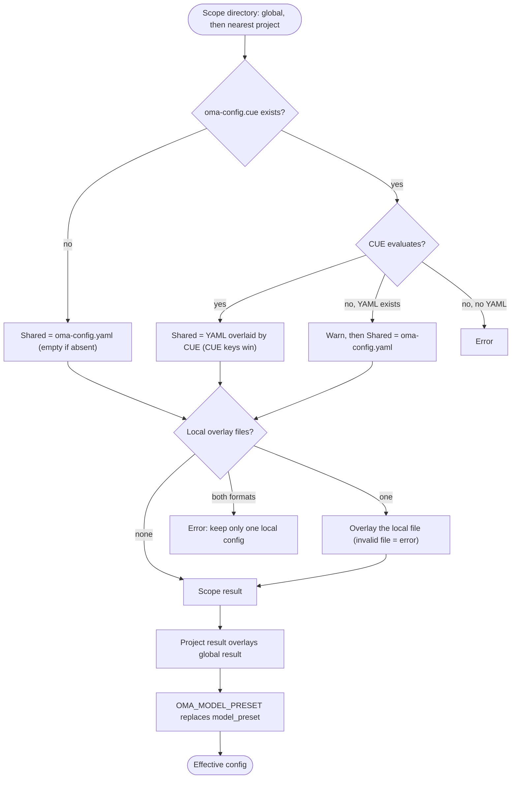

## Überblick

OMA liest globale Standardwerte aus `$OMA_HOME/.agents/` (Standard `~/.oma/.agents/`)
und legt anschließend das nächste Projektverzeichnis `.agents/` darüber, das oberhalb des Arbeitsverzeichnisses gefunden wird.
Jeder Bereich kann diese Ebenen haben:

- **Gemeinsam:** `.agents/oma-config.yaml` und `.agents/oma-config.cue`. Wenn beide vorhanden sind und die CUE-Datei ausgewertet werden kann, überschreibt jeder Schlüssel, den die CUE-Datei setzt, denselben Schlüssel in der YAML-Datei; Schlüssel, die nur in der YAML-Datei stehen, bleiben als Standardwerte erhalten. Wenn die CUE-Datei nicht ausgewertet werden kann, gibt OMA eine Warnung aus und verwendet nur die YAML-Datei.
- **Lokal:** `.agents/oma-config.local.cue` oder `.agents/oma-config.local.yaml` (eine Datei als Overlay über dem gemeinsamen Ergebnis; halten Sie diese Datei privat).

Gemeinsame und lokale Projekteinstellungen überschreiben globale Einstellungen. Verschiedene übergeordnete
Projektstämme werden nie zusammengeführt; auch ein leeres nächstes `.agents/` bildet eine Projektgrenze.
Globale Standardwerte ändern die Projektidentität nicht. Unterstützte Schlüssel und Standardwerte finden Sie in der
[Konfigurationsreferenz](/docs/guide/configuration-reference).

## Ablauf der Auflösung

OMA führt dieselben Schritte für den globalen Bereich und für den nächsten Projektbereich aus und führt dann beide Ergebnisse zusammen:



Wenn kein Projektverzeichnis `.agents/` gefunden wird oder die Suche das globale Verzeichnis `.agents/` selbst erreicht, wird nur das globale Ergebnis verwendet.

## Vorrangtabelle {#precedence-table}

Spätere Zeilen haben Vorrang. Normale Maps werden rekursiv zusammengeführt; Arrays, Skalare und `null` ersetzen den früheren Wert.

| Reihenfolge | Ebene | Regel |
|:-----:|-------|------|
| 1 | Globale `oma-config.yaml` | Standardwerte unterhalb der globalen CUE-Datei, wenn beide vorhanden sind. |
| 2 | Globale `oma-config.cue` | Überschreibt globales YAML Schlüssel für Schlüssel. Schlägt die Auswertung fehl (z. B. weil die `cue`-CLI fehlt) und ist YAML vorhanden, gibt OMA `[config] CUE evaluation failed at ... Falling back to oma-config.yaml` aus und verwendet nur das YAML. |
| 3 | Globale `oma-config.local.cue` oder `oma-config.local.yaml` | Nur eine Datei. Eine fehlerhafte lokale Datei ist ein Fehler. |
| 4 | Projekt-`oma-config.yaml` | Nächstes Projektverzeichnis `.agents/` im oder oberhalb des Arbeitsverzeichnisses. |
| 5 | Projekt-`oma-config.cue` | Überschreibt Zeile 4 Schlüssel für Schlüssel, mit demselben Fallback wie in Zeile 2. |
| 6 | Projekt-`oma-config.local.cue` oder `oma-config.local.yaml` | Nur eine Datei. Eine fehlerhafte lokale Datei ist ein Fehler. |
| 7 | `OMA_MODEL_PRESET` | Ein nichtleerer Wert ersetzt `model_preset` für diesen Prozess. Ein leerer Wert ist ein Fehler. |

:::tip[Welche Datei bearbeite ich?]
Wenn `.agents/oma-config.cue` existiert, überschreibt ein dort gesetzter Schlüssel denselben Schlüssel in `oma-config.yaml`. Ändern Sie diesen Schlüssel in der CUE-Datei oder legen Sie einen maschinenspezifischen Wert in einem lokalen Overlay ab. `oma doctor --profile` listet die geladenen Dateien unter **Configuration sources** auf.
:::

Für eine lokale Projektüberschreibung tragen Sie nur die geänderten Blätter in die lokale Datei ein. So kann beispielsweise eine lokale Modellauswahl aus der gemeinsamen Datei herausgehalten werden:

```yaml
# .agents/oma-config.local.yaml
model_preset: claude
agents:
  backend:
    model: anthropic/claude-sonnet-5-5
```

Führen Sie den Befehl aus dem Projekt aus, damit das nächste `.agents/`-Verzeichnis ausgewählt wird. Eine fehlerhafte lokale Datei führt zu einem deutlichen Fehler; korrigieren oder entfernen Sie sie vor dem nächsten Versuch.

## Konfiguration prüfen

```bash
oma doctor --profile                           # loaded files, resolved preset, per-role model and CLI
cue export --out json .agents/oma-config.cue   # what the CUE layer evaluates to (requires the cue CLI)
```

| Symptom oder Meldung | Ursache | Lösung |
|--------------------|-------|-----|
| Eine YAML-Änderung hat keine Wirkung | `oma-config.cue` setzt denselben Schlüssel | Ändern Sie den Schlüssel in der CUE-Datei oder überschreiben Sie ihn in einer lokalen Datei |
| `[config] CUE evaluation failed at ... Falling back to oma-config.yaml` | Die `cue`-CLI fehlt oder die CUE-Datei lässt sich nicht auswerten | Installieren Sie `cue` oder beheben Sie den Fehler, den `cue export` meldet |
| `Both local CUE and YAML configs exist in ...; keep only one local config.` | Zwei lokale Overlay-Dateien | Löschen Sie eine davon |
| `OMA_MODEL_PRESET must be non-empty` | Die Variable ist exportiert, aber leer | `unset OMA_MODEL_PRESET` |
| `Unknown model_preset "..."` | Tippfehler oder fehlender Eintrag in `custom_presets` | Verwenden Sie ein in der Fehlermeldung genanntes Preset |
| `Legacy preset name "..." is no longer valid` | Ein Schlüssel aus der Zeit vor der Umbenennung, etwa `claude-only` | Benennen Sie ihn wie in der Meldung angegeben um oder führen Sie `oma update` aus |
| `[model-registry] User inline model "..." failed validation` | Ein unvollständiger oder ungültiger `models:`-Eintrag | Siehe [Modell-Slugs inline angeben](/docs/guide/per-agent-models#inlining-model-slugs) |

## Standardwerte

| Schlüssel | Standardwert | Wann angewendet |
|-----|---------|--------------|
| `auto_update_cli` | `true` | Beide Dateien fehlen oder der Schlüssel fehlt |
| `serena.mode` | `bridge` | Beide Dateien fehlen oder der Schlüssel fehlt |
| `serena.auto_update` | `true` | Beide Dateien fehlen oder der Schlüssel fehlt |
| `telemetry` | `false` | Beide Dateien fehlen oder der Schlüssel fehlt |
| `language` | `en` | Beide Dateien fehlen oder der Schlüssel fehlt |
| `model_preset` | Erforderlich | Die ausgelieferte Projektvorlage verwendet `auto`; das Schema verlangt einen nichtleeren Wert. |
| `translation_voice` | `balanced` | Beide Dateien fehlen oder der Schlüssel fehlt |
| `timezone` | Systemzeitzone | Beide Dateien fehlen oder der Schlüssel fehlt |

## Begründung der Lesereihenfolge

Bearbeiten Sie `~/.oma/.agents/oma-config.yaml` (mit gesetztem `OMA_HOME`: `<OMA_HOME>/.agents/oma-config.yaml`)
für benutzerweite Standardwerte. Gemeinsame und lokale Projektdateien überschreiben diese Standardwerte,
ohne Einstellungen aus nicht zugehörigen übergeordneten Projekten zu erben. Eine Projektauswahl von `none`
für das semantische Gedächtnis überschreibt eine globale AgentMemory-Auswahl.

## Hinweise

- `language` in `oma-config.yaml` steuert die Antwortsprache des Agenten. Es wird **nicht** verwendet, um Warnmeldungen bei Installation und Update festzulegen — diese verwenden das Systemlocale (`$LANG`), da `oma-config.yaml` zum Installationszeitpunkt noch nicht geladen ist.
- `auto_update_cli` berücksichtigt Projektüberschreibungen vor globalen Standardwerten und ist standardmäßig aktiviert, wenn keiner der beiden Bereiche den Schlüssel setzt.
- `telemetry` (Standard `false`) wird über `oma install`, `oma update` oder `oma link` auf die jeweilige Deaktivierungsoption des Vendors abgebildet: Claude `DISABLE_TELEMETRY` und `CLAUDE_CODE_DISABLE_FEEDBACK_SURVEY`, Gemini/Qwen `privacy.usageStatisticsEnabled`, Codex `analytics.enabled` und `feedback.enabled`, Grok `[features] telemetry` sowie Antigravity (agy) `enableTelemetry` in `~/.gemini/antigravity-cli/settings.json`. Mit `telemetry: true` aktivieren Sie die Telemetrie wieder, indem OMAs Deaktivierung für diesen Vendor entfernt wird.
- `diagram` (Engine `auto` / `archify` / `mermaid`, `explain_sidecar`, `archify.managed|channel|check_interval_min|path|quality|open`) ist wie `video` und `image` ein sparsamer Skill-Override-Abschnitt; siehe [Diagramm-Engine](/docs/guide/diagram-engine).
- `video.hyperframes.check_interval_min` begrenzt die Prüfungen auf die neueste Version der HyperFrames-Toolchain und von heygen-com/hyperframes pro Ausführung (`oma video compose`, `oma update`). Das ausgelieferte CUE-Schema definiert `video.hyperframes` noch nicht, daher lehnt `cue export` den Schlüssel innerhalb des Schemablocks ab (`field not allowed`); setzen Sie ihn in `oma-config.yaml` oder in einem lokalen YAML-Overlay.
- `market` (`managed|channel|check_interval_min|path|python|save_dir`) konfiguriert die immer aktuelle `last30days`-Engine hinter `oma market`; siehe [Marktforschung](/docs/guide/market-research).
- Das typisierte Laufzeitschema umfasst `providers`, `free`, `agents`, `models`, `custom_presets`, `vendors`, `session`, `docs` und die sparsamen Skill-Abschnitte. Ausgelieferte Vorlagen enthalten außerdem verbrauchereigene Blöcke wie `scm`, `memory`, `serena_reaper` und `mcp`; deren Verbraucher besitzen die jeweiligen Unterschlüssel. Leiten Sie aus dieser Liste keinen Schlüssel ab, sondern verwenden Sie die [Konfigurationsreferenz](/docs/guide/configuration-reference) und den Leitfaden des jeweiligen Features.
- Das direkte Bearbeiten von `oma-config.yaml` ist sicher. `oma install` und `oma update` ersetzen Felder auf Regex-Ebene und bewahren benutzerseitig bearbeitete Schlüssel, die sie nicht verwalten (z. B. eigene `agents:`-Überschreibungen oder `session.quota_cap`).
- `oma update` hängt zusätzlich Top-Level-Schlüssel an, die die ausgelieferte Vorlage definiert, die Ihre Datei aber nicht enthält (mit Vorlagenstandards unter einem Marker `# Added by oma update`). Bereits vorhandene Schlüssel werden nie geändert; ihr Inhalt bleibt byte-identisch. Absichtlich gelöschte Schlüssel erscheinen mit dem Vorlagenstandard erneut. Setzen Sie den Wert ausdrücklich, statt den Schlüssel zu löschen, wenn Sie ihn deaktivieren möchten.
