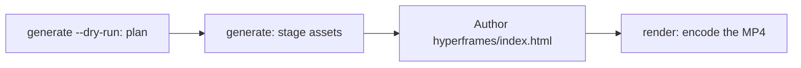

# Videoerzeugung

`oma-video` ist der Video-Router für oh-my-agent. Aus einem einzeiligen Briefing erstellt er Skript, Sprechertext, Bildmaterial und Captions und hält den Plan anschließend in einem Laufverzeichnis fest. Für die Provider-Stufen sind Schlüssel optional; sie können lokale oder deterministische Fallbacks verwenden. Ein echtes MP4 erfordert jedoch weiterhin einen funktionierenden Kompositor und eine gültige Komposition.

Der Skill aktiviert sich bei „shorts“, „reels“, „screencast“ oder Formulierungen wie „make a video“, „explainer video“, „demo video“, „walkthrough video“ oder „video from README“ sowie wenn ein anderer Skill nebenbei ein Video benötigt.

> **Kurzfassung** `oma video generate` plant einen Lauf und stellt Assets bereit. Mit dem Standard-Kompositor HyperFrames kodiert es kein MP4: Erstellen Sie `<runDir>/hyperframes/index.html` (der Workflow `/video` erledigt das für Sie) und führen Sie danach `oma video render <runDir>` aus. Beginnen Sie beim ersten Lauf mit `oma video doctor --install`.

---

## Wann verwenden

- Ein Briefing, eine README, Code oder Daten in einen kurzen Clip umwandeln.
- Einen vertonten Explainer oder eine Demo-/Walkthrough-Aufzeichnung erstellen.
- Eine reproduzierbare Pipeline „Briefing → `.mp4`“ aufsetzen, die sich deterministisch erneut ausführen lässt.

## Wann nicht verwenden

- Einzelne Standbilder → verwenden Sie [`oma-image`](/docs/guide/image-generation).
- Live-Bildschirmübertragung oder Streaming → außerhalb des Umfangs (oma nimmt niemals den Bildschirm auf; die Aufnahme liefern Sie selbst).
- Eigenständiges Sprecher-Audio → verwenden Sie `oma-voice`.

---

## Modi im Überblick

| Modus | Seitenverhältnis | Zusammensetzung |
|------|--------|------------------|
| `shorts` | 9:16 | Vertikaler Kurzclip (Skript → Sprechertext → Bildmaterial → Captions). |
| `explainer` | 16:9 | Horizontaler Explainer aus einer README, Code- oder Datenbeschreibung. |
| `demo` | abgeleitet | Ein Walkthrough aus Ihrer eigenen Bildschirmaufnahme, bereitgestellt mit `--capture <file>`. `--source web --url <url>` speichert nur die maskierte URL als Kontext; oma öffnet niemals einen Browser, nimmt den Bildschirm nicht auf und automatisiert keinen Login. |

Der Modus wählt sinnvolle Standardwerte. Übergeben Sie die relevanten Flags, wenn andere Werte nötig sind.

---

## Schnellstart

In einem Agenten führt `/video three quick tips for better focus` alle folgenden Schritte für Sie aus. Von Hand besteht die Pipeline aus vier Schritten:



```bash
oma video doctor --install   # first run only: HyperFrames toolchain, Chrome Headless Shell, Pretendard

# 1. Plan from an agent-authored script (schema: .agents/skills/oma-video/resources/script-schema.md)
oma video generate "three quick tips for better focus" --mode shorts --script ./script.json --dry-run --output json

# 2. Stage assets (narration needs --voice <profile>; the default is a silent video)
oma video generate "three quick tips for better focus" --mode shorts --script ./script.json --output json

# 3. Author <runDir>/hyperframes/index.html per its AUTHORING.md, then encode
oma video compose <runDir>
oma video render <runDir> --output json

# Demo from your own recording; without --polish the recording itself becomes the output
oma video generate "product walkthrough" --mode demo --capture ./capture.mp4
```

<!-- oma-docs:ignore-start -->

| Schritt | Befehl | Ergebnis |
|---|---|---|
| Planen | `generate --dry-run` | `script.json`, `render-spec.json`, `manifest.json`; kein Rendering |
| Assets bereitstellen | `generate` | Bildmaterial, Captions, optional Audio und Musik, ein `hyperframes/`-Gerüst und die Warnung `composition pending` |
| Erstellen | `hyperframes/index.html` bearbeiten | die Komposition |
| Rendern | `render <runDir>` | `{mode}-{slug}.mp4` und ein aktualisiertes Manifest |

<!-- oma-docs:ignore-end -->

Ohne `--script` baut die CLI aus dem Briefing-Text ein deterministisches Gerüst mit drei Szenen. `--locale` setzt das Sprach-Tag für Sprechertext und Captions, übersetzt sie aber nicht; schreiben Sie das Briefing oder `script.json` in der Zielsprache.

Jeder Lauf gibt sein Laufverzeichnis aus. Ein festes `--seed` stabilisiert die deterministischen Eingaben der Planung; Live-Provider-Ausgabe und Aufnahmematerial können dennoch variieren. Rendern Sie ein bestehendes Laufverzeichnis erneut, wenn Sie dessen gespeicherte Render-Spezifikation und Assets wiederverwenden möchten.

Andere Tools, die `oma video generate --output json` als Shell-Aufruf verwenden, lesen ein JSON-Envelope aus stdout: `{exitCode, runDir, manifestPath, scriptPath, renderSpecPath, warnings, error}`. Es gibt keinen Schlüssel `outputs`; lesen Sie Ausgabe- und Asset-Pfade aus dem Manifest unter `manifestPath`.

---

## HyperFrames immer aktuell — Sie erstellen die Komposition

oh-my-agent liefert **keinen HyperFrames-Kompositionscode** mit. Jeder Lauf erhält unter `<runDir>/hyperframes/` ein eigenes Projekt, das `oma video compose` mit dem neuesten npm-HyperFrames aufbaut (Toolchain-Cache `~/.cache/oma-video/hyperframes/<version>/`, gemeinsam verwendet über einen `node_modules`-Symlink) und [heygen-com/hyperframes](https://github.com/heygen-com/hyperframes) auf HEAD (`~/.cache/oma-video/hyperframes-skills/`) nutzt. Der Agent erstellt den Quelltext der Komposition anhand von `AUTHORING.md` des Gerüsts, den Skills und der Modusspezifikation unter `.agents/skills/oma-video/resources/hyperframes-authoring/`.

```bash
oma video generate "…"                     # → render-spec.json + <runDir>/hyperframes/ (composition pending)
oma video compose <runDir> --output json   # refresh scaffold / print the contract (idempotent)
#   author hyperframes/index.html as instructed by AUTHORING.md
oma video render <runDir> --output json    # lint → render with the cached HyperFrames CLI → ffprobe; exit 1 on any failure
```

- Prüfungen auf die neueste Version (npm und GitHub) werden durch `video.hyperframes.check_interval_min` gedrosselt (Standard 60; `0` = jedes Compose). `oma update` beachtet das Intervall; `oma video doctor --upgrade` erzwingt eine Prüfung; Offline-Läufe verwenden die gecachte Toolchain und melden `stale`.
- Die Reproduzierbarkeit liegt im Laufverzeichnis: `render-spec.json`, der Quelltext der erstellten Komposition und die in den generierten HyperFrames-Paketmetadaten aufgezeichnete Toolchain-Version. Ein erneutes Rendern desselben Laufs verwendet denselben Rendervertrag; ein neuer Lauf prüft das neueste HyperFrames.
- Ein Lint- oder Rendering-Fehler wird **nicht** hinter einem Platzhalter verborgen (dieser existiert nur für `OMA_VIDEO_MOCK=1`): `oma video render` beendet sich mit 1 und Diagnosen, und der Agent repariert die Komposition anhand der neuesten Skills. Ein Fehler nach einem neuen HyperFrames-Release ist ein Kompositionsfehler und kein Grund zum Pinnen.

```yaml
video:
  hyperframes:
    check_interval_min: 60    # 0 = check on every compose
```

---

## CLI-Referenz

```bash
oma video generate <brief...> [options]
oma video doctor [--install|--upgrade|--install-mpt|--install-strudel]  # toolchain readiness / provisioning
oma video compose <runDir>       # prepare HTML project and authoring contract
oma video render <runDir>        # re-render from render-spec.json (deterministic)
oma video provider list         # provider availability + key/fallback status
```

### Wichtige Flags

| Flag | Zweck |
|------|---------|
| `--mode <m>` | `shorts` \| `explainer` \| `demo`. |
| `--aspect <a>` | `9:16` \| `16:9` \| `1:1` \| `auto`. |
| `--locale <lang>` | Sprach-Tag für Sprechertext und Captions. |
| `--captions <s>` | `tiktok` \| `lower-third` \| `none` (Ausrichtung ohne Schlüssel). |
| `--visual <m>` | `auto` \| `generate` \| `stock` \| `aigc` \| `slide`. |
| `--voice <profile>` | Sprecherstimme oder `none` (Standard; ohne Angabe wird das Video still gerendert und die Caption-Zeit geschätzt). |
| `--music <mode>` | `upbeat`, `calm`, `cinematic`, `lofi`, `piano` oder `none`. |
| `--compositor <c>` | `hyperframes` (Standard) \| `mpt`. |
| `--capture <path>` | Ihre Aufnahme für den Demo-Modus: `.mp4`, `.mov`, `.webm` oder `.mkv`, gespeichert innerhalb des Projekts. |
| `--source <k>` | Quelle der Demo-Aufnahme: `file` oder `web` (Standard: `file`). |
| `--url <url>` | Kontext-URL für `--source web`, maskiert in `manifest.json` gespeichert. Mit `--source web` erforderlich; sie startet nie eine Aufnahme und ersetzt `--capture` nicht. |
| `--polish` | HyperFrames-Komposition über dem aufgenommenen Material einblenden. |
| `--device`, `--ready-selector`, `--show-cursor`, `--capture-timeout`, `--capture-stop` | Werden akzeptiert, aber nicht verwendet: oma steuert keinen Browser und nimmt den Bildschirm nicht auf. |
| `--output-dir <path>` | Basisverzeichnis für die Ausgabe. Pfade außerhalb von `$PWD` benötigen `--allow-external-output`. |
| `--allow-external-output` | Ausgabepfade außerhalb von `$PWD` zulassen. |
| `--max-usd <n>` | Kostenobergrenze (Standard `0.2`). Erreicht die laufende Schätzung diesen Wert, stoppt der Lauf mit Exit-Code 1; führen Sie ihn mit `-y` oder einem höheren Wert erneut aus. |
| `--duration <sec>` | Ziel-Länge in Sekunden (1–180) oder `auto`. |
| `--seed <n>` | Deterministischer Seed. |
| `--dry-run` | Skript, Render-Spezifikation und Manifest ausgeben, Rendering überspringen. |
| `--script <path>` | Vom Agenten erstelltes `script.json` zum Injizieren (überschreibt das Gerüst; steuert Sprechertext, On-Screen-Text und visuelle Prompts pro Szene). |
| `-y, --yes` | Provider zulassen, deren Schätzung `--max-usd` erreicht (wie `OMA_VIDEO_YES=1`). |
| `--timeout <sec>` | Zeitlimit in ganzen Sekunden für jeden Aufruf eines Visual- oder Musik-Providers (Standard `600`). Einheitensuffixe werden nicht ausgewertet: `2m` bedeutet 2 Sekunden. |
| `--output <f>` | CLI-Ausgabe: `text` (Standard) oder `json`. |
| `--no-brief-in-manifest` | Einen SHA-256-Hash des Briefings statt des Rohtexts speichern. |

---

## Provider mit optionalen Schlüsseln

Provider-Stufen werden zu einem **echten Pfad** aufgelöst und, sofern die Stufe dies unterstützt, zu einem **deterministischen Fallback**. Fehlende Schlüssel können deshalb einen geplanten Lauf mit geschätztem Timing oder lokalen Assets hinterlassen. Der Kompositor ist eine erforderliche letzte Stufe und besitzt keinen normalen Platzhalter-Fallback:

| Fähigkeit | Echter Pfad (was ihn aktiviert) | Fallback |
|------------|-------------|----------|
| script | vom Agenten erstelltes `script.json`, übergeben mit `--script <path>` (der Workflow `/video` schreibt es) | deterministisches Gerüst mit drei Szenen aus dem Briefing-Text |
| voice | `oma-voice` (Voicebox oder VoiceStudio, lokal; Auswahl über `voice.backend`) mit `--voice <profile>` | stilles Video mit geschätztem Timing (`--voice none`, der Standard) |
| visual | `oma-image`, `oma-slide`, Pexels-Stockclips, wenn `PEXELS_API_KEY` gesetzt ist | Platzhalter-Asset |
| visual: `aigc` | noch nicht angebunden; `RUNNINGHUB_API_KEY` aktiviert den Provider, der aber weiterhin Platzhalter schreibt | Platzhalter-Asset |
| caption | `.srt` und `.vtt`, ausgerichtet an `timing.json`, in der Sprache des Skripts | identisch; die Übersetzung nach `--locale` ist noch nicht angebunden |
| music | Strudel-Musikbett nach `oma video doctor --install-strudel` | keine Musikspur |
| capture | eine Aufnahme, die Sie mit `--capture <file>` bereitstellen | keiner: Ohne `--capture` gibt der Demo-Modus Aufnahmeanweisungen aus und beendet sich mit Exit-Code 3 |
| compositor | HyperFrames (verwaltet) oder MoneyPrinterTurbo | kein Kompositor-Fallback; der Lauf schlägt mit Diagnosen fehl |

Anmeldedaten werden nicht automatisiert eingegeben: Jeden Login auf dem Bildschirm führen Sie während der Aufnahme selbst aus; URLs und Query-Tokens werden in Logs und Manifest maskiert.

Captions werden als **statische, fensterbasierte Cues** gerendert — eine einzelne Caption-Zeile ist im aktuellen Frame aktiv und wird per CSS umgebrochen; eine Animation pro Wort gibt es nicht.

---

## Toolchain und `doctor`

Die umfangreiche Toolchain (das `node_modules`-Verzeichnis des verwalteten HyperFrames-Projekts, die eingebettete Pretendard-Schrift, der MoneyPrinterTurbo-Checkout, das Strudel-Musikprojekt, Chrome Headless Shell) wird **bei Bedarf bereitgestellt** und niemals im Paket ausgeliefert. Der einfache `doctor`-Aufruf erstellt nur einen Bericht und installiert nichts:

```bash
oma video doctor
```

Er meldet `node`, `chromium`, `ffmpeg`, `ffprobe`, `hyperframes-toolchain`, `hyperframes-skills`, `pretendard-font`, `mpt-project`, `strudel`, `voicebox`, `voicestudio`, `oma-image`, `pixelle` und `cap` und gibt für Fehlendes einen Installationshinweis aus. Die maßgebliche Liste liefert `oma video doctor --output json`. Die Grundausstattung erfordert Node.js 22+, die HyperFrames-Toolchain mit ihrem Chrome-Browser, FFmpeg/FFprobe und `oma-image`. Für ein echtes MP4 ist außerdem verfasstes HTML erforderlich.

Verwenden Sie die Installationsflags, um die Toolchain bereitzustellen:

```bash
oma video doctor --install             # warm the latest HyperFrames toolchain + Chrome Headless Shell + Pretendard + heygen-com/hyperframes
oma video doctor --upgrade             # force a latest-version check now
oma video doctor --install-mpt         # MoneyPrinterTurbo checkout (clone + venv + deps) for --compositor mpt
oma video doctor --install-strudel     # Strudel music renderer for --music (installs AGPL-3.0-or-later packages locally)
```

`--install` lädt außerdem die eingebettete Pretendard-Schrift (gepinntes Release) in den gemeinsamen Toolchain-Cache. Das gehört zur Determinismusgrenze. Bei einem Netzwerkfehler wird gewarnt und das Rendering fällt auf Systemschriften zurück; Unterschiede bei Browser und Betriebssystem können die kodierte Ausgabe dennoch beeinflussen.

---

## Ausgabelayout

```text
.agents/results/videos/{timestamp}-{shortid}-{mode}/
├── script.json          # scenes + narration
├── render-spec.json     # the deterministic render contract
├── timing.json          # per-segment timing (voicebox-stt, voicestudio-stt, or estimated)
├── captions.srt / .vtt
├── audio/narration-01.wav     # one track; absent when the video is silent
├── music/                     # pattern.strudel, bgm.wav, bgm.mp3 (with --music and Strudel installed)
├── visuals/scene-*.{png,svg,…}
├── hyperframes/         # index.html, AUTHORING.md, local assets and toolchain link
├── {mode}-{slug}.mp4    # the rendered output (slug derived from the script title)
└── manifest.json        # providers, assets, cost, warnings
```

`render-spec.json` und die Assets bilden die Determinismusgrenze.

---

## Fehlerbehebung

<!-- oma-docs:ignore-start -->

| Symptom | Ursache / Behebung |
|---------|-------------|
| Kein MP4 wird erzeugt | Eine Prüfung von Kompositor, Komposition oder Toolchain ist fehlgeschlagen. Führen Sie `oma video doctor` und danach `oma video compose <runDir>` aus, beheben Sie die gemeldete Komposition und starten Sie dann `oma video render <runDir>` erneut. |
| Sprechertext ist stumm (`source: estimated`) | `--voice` ist standardmäßig `none`, oder kein Sprach-Backend ist erreichbar. Übergeben Sie `--voice <profile>` mit einem Profil des gewählten Backends (aus der Voicebox-App oder eine VoiceStudio-Profil-ID bei `voice.backend: voicestudio` oder `auto`) und starten Sie diese App, oder akzeptieren Sie das geschätzte Timing. |
| Der Demo-Lauf endet mit Exit-Code 3 und Aufnahmeanweisungen | Es wurde keine `--capture`-Datei angegeben (auch bei `--source web`); oma nimmt den Bildschirm nicht auf. Nehmen Sie den Ablauf mit Cap, QuickTime oder OBS auf, speichern Sie ihn im Projekt und führen Sie den Lauf mit `--capture ./walkthrough.mp4` erneut aus. |
| `--capture` wird abgelehnt (Exit-Code 4) | Die Datei existiert nicht, liegt außerhalb des Projektverzeichnisses oder ist keine `.mp4` / `.mov` / `.webm` / `.mkv`. Kopieren Sie die Aufnahme ins Projekt, zum Beispiel nach `./captures/demo.mp4`. |
| Der Lauf stoppt an der Kostenobergrenze (Exit-Code 1) | Die laufende Schätzung hat `--max-usd` erreicht. Führen Sie den Lauf mit `-y` oder einem höheren `--max-usd` erneut aus. |
| `--out path "…" is outside $PWD. Use --allow-external-out to override.` (Exit-Code 1) | `--output-dir` zeigt außerhalb des Projekts. Führen Sie den Lauf mit `--allow-external-output` erneut aus (die Meldung zeigt noch den alten Flag-Namen), oder wählen Sie ein Verzeichnis innerhalb des Projekts. |
| `oma video doctor` führt `oma-image` als fehlend auf | Lautet das Detail `Removed option --format. Use --output.`, ist die Bereitschaftsprüfung selbst fehlgeschlagen und sagt nichts über Ihre Vendors aus; prüfen Sie diese direkt mit `oma image doctor`. Andernfalls ist kein Bild-Vendor bereit, sodass das Bildmaterial auf Platzhalter zurückfällt: Führen Sie `oma image doctor` aus und richten Sie einen Vendor ein. |
| Der erste Lauf rendert langsam | HyperFrames-Browser bzw. MPT-Checkout werden einmal bereitgestellt; spätere Läufe verwenden den Cache erneut. |

<!-- oma-docs:ignore-end -->

---

## Nächste Schritte

- [`/video`-Workflow](../core-concepts/workflows.md#video) — die Pipeline Briefing → Skript → Assets → Render-Spezifikation → HyperFrames.
- [Bilderzeugung](./image-generation.md) — der als Video-Bildprovider wiederverwendete Standbild-Router.
- [Content- und Recherche-Workflows](./content-and-research.md) — Sprache, Folien und weitere Content-Fähigkeiten.
- [CLI-Befehle: video](../cli-interfaces/commands.md#video) — vollständige Optionsliste von `oma video`.
