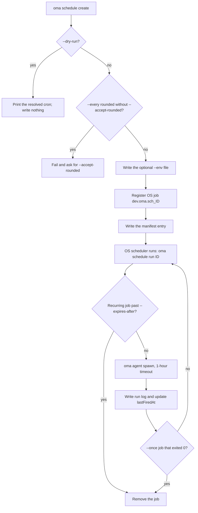
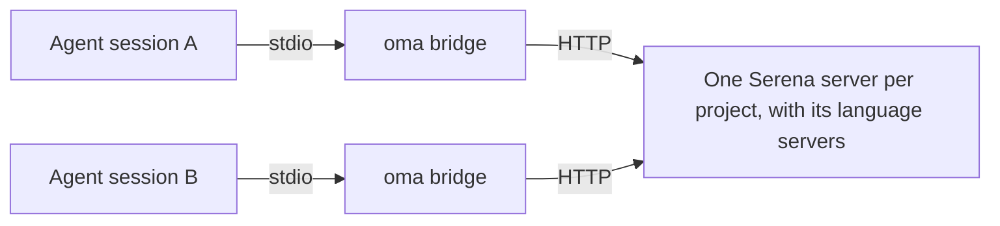
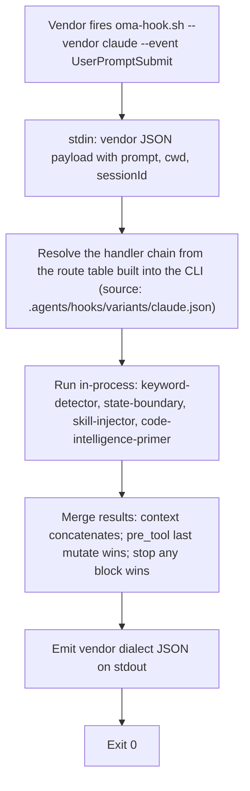

# Comandos CLI

Después de instalar globalmente (`bun install --global oh-my-agent`), usa `oma` o `oh-my-agent`. Para usarlo una sola vez sin instalarlo, ejecuta `npx oh-my-agent`.

La variable de entorno `OH_MY_AG_OUTPUT_FORMAT` se puede establecer en `json` para que JSON sea la salida predeterminada en los comandos que usan las opciones compartidas `--json` / `--output`. Un `--output text` explícito sigue teniendo prioridad.

Si un comando falla con `Unknown command`, `Unexpected argument` o `Removed option`, consulta [Formas eliminadas](#aliases) en esta página; para problemas de instalación, hooks y runtime, consulta [Solución de problemas](../guide/troubleshooting.md).

## Comenzar con una tarea {#start-with-a-task}

Elige el comando más pequeño que responda a tu pregunta. Cada comando de abajo imprime una ruta o un informe que puedes revisar antes de pasar al siguiente paso.

| Tarea | Empieza aquí | Resultado esperado |
|:-----|:-----------|:----------------|
| Instalar o reparar un proyecto | `oma install` y luego `oma doctor` | Recursos instalados y un informe de salud; usa `oma doctor --profile` cuando la duda sea la resolución del modelo. |
| Encontrar un comando u opción desde un agente | `oma describe` o `oma describe "image generate"` | JSON con los argumentos, las opciones y los comandos anidados. |
| Generar una imagen | `oma image generate "<prompt>" --output json` | Rutas de imágenes y un manifiesto en `.agents/results/images/`. |
| Planificar o renderizar un video | `oma video generate "<brief>" --dry-run` | Un directorio de ejecución con artefactos de planificación; ejecuta compose y render después de escribir la composición. |
| Crear un explicador de código interactivo | `/explain` | Un artefacto HTML autocontenido y validado en `.agents/results/explain/`. |
| Resolver un motor de diagramas | `oma diagram resolve --output json` | El motor Mermaid o archify seleccionado y el motivo de la selección. |
| Investigar señales de la comunidad | `oma market detect-trap "<topic>"` | Un resultado de preflight; continúa con `oma market resolve --output json` y la ejecución upstream solo si pasa. |
| Convertir o inspeccionar un artículo | `oma scholar search "<query>"` | Resultados de búsqueda de Knows, OpenAlex o Semantic Scholar; obtén un sidecar con `oma scholar get`. |
| Crear una presentación | `oma slide create --output-dir <dir>` | Un directorio de trabajo que se puede escribir, validar, empaquetar y exportar. |
| Revisar el drift de la documentación | `oma docs verify --json` | Un informe estructurado de referencias rotas y un índice de referencias regenerado. |
| Programar un agente recurrente | `oma schedule create backend "<task>" --every 2h --dry-run` | La expresión cron resuelta; no se registra nada hasta que lo vuelvas a ejecutar sin `--dry-run`. |
| Comprobar la calidad de las skills o del harness | `oma skill lint` o `oma skill audit` | Informes offline; consulta [Elegir un comando de skill o de harness](#choosing-a-skill-or-harness-command) antes de usar cualquier comando que llame a modelos. |

Los nombres canónicos de abajo proceden de `oma describe`. Solo se aceptan estas rutas separadas por espacios: las formas antiguas como `slide new`, `slide viewer`, `image list-vendors` y `video list-providers`, las formas con dos puntos como `agent:parallel` y los nombres cortos `viz`, `s` e `img` fallan con `Unknown command` o `Unexpected argument`. Consulta [Alias y formas eliminadas](#aliases).

## Superficie actual de comandos {#current-command-surface}

La tabla agrupa las rutas registradas por familia. Usa `--help` para consultar la gramática exacta de los argumentos o ejecuta `oma describe <path>`; [Opciones del CLI](./options.md) contiene la matriz completa de flags del registro.

| Familia | Rutas registradas |
|:-------|:-----------------|
| `install` | `install` |
| `describe` | `describe` |
| `uninstall` | `uninstall` |
| `update` | `update`, `update mcp` |
| `link` | `link` |
| `intel` | `intel`, `intel suggest` |
| `market` | `market`, `market detect-trap`, `market resolve`, `market update`, `market run` |
| `doctor` | `doctor` |
| `profile` | `profile`, `profile list`, `profile show`, `profile create`, `profile use`, `profile run` |
| `home` | `home`, `home migrate` |
| `retro` | `retro` |
| `recap` | `recap` |
| `docs` | `docs`, `docs verify`, `docs sync`, `docs i18n`, `docs lint` |
| `emit` | `emit` |
| `cleanup` | `cleanup` |
| `bridge` | `bridge` |
| `verify` | `verify`, `verify agent`, `verify triggers` |
| `vault` | `vault`, `vault store`, `vault get`, `vault list`, `vault delete` |
| `star` | `star` |
| `visualize` | `visualize` |
| `search` | `search`, `search providers`, `search web`, `search fetch`, `search meta`, `search media`, `search archive`, `search trust`, `search code`, `search doctor`, `search api`, `search api fetch`, `search api search`, `search rss`, `search rss fetch`, `search rss google` |
| `harness` | `harness`, `harness eval`, `harness incident`, `harness incident scan`, `harness incident capture`, `harness incident show`, `harness incident export`, `harness incident promote`, `harness incident reproduce`, `harness feedback`, `harness evolution`, `harness evolution enable`, `harness evolution status`, `harness evolution disable`, `harness evolution run` |
| `slide` | `slide`, `slide validate`, `slide bundle`, `slide edit`, `slide doctor`, `slide create`, `slide preview`, `slide export`, `slide export pdf`, `slide export png`, `slide export pptx`, `slide import`, `slide import pptx`, `slide asset`, `slide asset fetch-video`, `slide style`, `slide style list`, `slide style preview`, `slide style get` |
| `scholar` | `scholar`, `scholar search`, `scholar resolve`, `scholar get`, `scholar lint` |
| `image` | `image`, `image generate`, `image doctor`, `image vendor`, `image vendor list` |
| `video` | `video`, `video generate`, `video doctor`, `video compose`, `video render`, `video provider`, `video provider list` |
| `serena` | `serena`, `serena check`, `serena setup`, `serena reap`, `serena daemon`, `serena daemon gc`, `serena reaper`, `serena reaper enable`, `serena reaper disable` |
| `explain` | `explain`, `explain render`, `explain lint`, `explain patch`, `explain components`, `explain validate` |
| `diagram` | `diagram`, `diagram resolve`, `diagram update`, `diagram archify` |
| `help` | `help` |
| `version` | `version` |
| `dashboard` | `dashboard`, `dashboard terminal`, `dashboard web` |
| `auth` | `auth`, `auth status` |
| `hook` | `hook`, `hook run`, `hook probe` |
| `state` | `state`, `state emit`, `state migrate`, `state get`, `state list`, `state repair`, `state verify`, `state decisions`, `state decisions list`, `state inject-log`, `state inject-log list`, `state inject-log get`, `state summary`, `state trajectory`, `state heal-check`, `state activate`, `state archive`, `state purge` |
| `ralph` | `ralph`, `ralph verify` |
| `goal` | `goal`, `goal set` |
| `stats` | `stats`, `stats get`, `stats reset` |
| `agent` | `agent`, `agent context`, `agent resume`, `agent begin`, `agent verify`, `agent finish`, `agent spawn`, `agent status`, `agent parallel`, `agent review` |
| `model` | `model`, `model check`, `model probe`, `model propose` |
| `memory` | `memory`, `memory keys`, `memory init`, `memory setup`, `memory daemon`, `memory daemon status`, `memory daemon start`, `memory daemon stop`, `memory daemon restart`, `memory service`, `memory service install`, `memory service uninstall`, `memory status`, `memory retry`, `memory retry drain`, `memory import`, `memory maintain`, `memory maintain backup`, `memory maintain prune`, `memory maintain vacuum`, `memory gc`, `memory upgrade` |
| `skill` | `skill`, `skill audit`, `skill lint`, `skill eval`, `skill optimize`, `skill meta-optimize`, `skill procedure`, `skill evolution-stats`, `skill promotions`, `skill rollback`, `skill matrix` |
| `schedule` | `schedule`, `schedule create`, `schedule list`, `schedule delete`, `schedule run`, `schedule sync` |

Otros procesos de OMA llaman a algunos puntos de entrada internos (`agent parallel-supervisor`, `hook script`, `schedule inspect`, `schedule builtin-evolution-add`). Siguen funcionando, pero la ayuda y `oma describe` los ocultan; no hace falta ejecutarlos a mano.

Cuando un comando delega los argumentos restantes a otra herramienta, el registro deja sus opciones abiertas de forma deliberada. Esto se aplica a `market run` y `diagram archify`; lee la ayuda upstream resuelta antes de ejecutar una operación que modifique datos o use la red.

---

## Configuración e instalación {#setup-installation}

### install

`oma` sin argumentos inicia el instalador interactivo. `oma install` es la forma explícita y acepta opciones para seleccionar proveedores.

```bash
oma
oma install
oma install --web-search native --code-intelligence gortex --semantic-memory agentmemory
```

| Opción | Valores aceptados |
|:-------|:----------------|
| `--web-search <provider>` | `native`, `brave` |
| `--code-intelligence <provider>` | `serena`, `gortex` |
| `--semantic-memory <provider>` | `agentmemory`, `honcho`, `none` |
| `--honcho-url <url>` | Origen de la API de Honcho (predeterminado para conexiones nuevas: `http://127.0.0.1:8000`) |
| `--honcho-workspace <id>` | ID del workspace de Honcho (predeterminado para conexiones nuevas: `oma`) |

Si omites `--web-search`, `--code-intelligence` y `--semantic-memory`, se conserva la selección de proveedor guardada. `--honcho-url` y `--honcho-workspace` configuran una conexión nueva de Honcho cuando se selecciona ese proveedor. El flag raíz `-y, --yes` omite los prompts y usa los valores predeterminados; `--global` apunta a `$OMA_HOME/.agents/` (predeterminado: `~/.oma/.agents/`). La instalación de proyecto permanece en `<cwd>/.agents/` aunque `OMA_HOME` esté establecido.

**Qué hace:**
1. Comprueba si existe el directorio legacy `.agent/` y lo migra a `.agents/` si lo encuentra.
2. Detecta herramientas competidoras y ofrece eliminarlas.
3. Solicita el tipo de proyecto (All, Fullstack, Frontend, Backend, Mobile, DevOps, Custom).
4. Si se selecciona backend, solicita la variante del lenguaje (Python, Node.js, Rust, Other).
5. Pregunta por los symlinks de GitHub Copilot.
6. Descarga el tarball más reciente del registro.
7. Instala recursos compartidos, workflows, configuraciones y las skills seleccionadas.
8. Instala adaptaciones de los proveedores seleccionados (configuración local del proyecto; no escribe silenciosamente en el nivel HOME del proveedor).
9. Crea symlinks del CLI.
10. Ofrece la configuración **global** recomendada de git (requiere confirmación explícita):
    - `rerere.enabled=true` — reutilización de conflictos de merge entre agentes
    - `init.defaultBranch=main` — rama predeterminada coherente para repositorios nuevos
    - Se omite por completo con `--yes` / CI (muestra indicaciones para corregirlo manualmente)
11. Ofrece configurar MCP cuando corresponde.
12. Solicita la estrella de GitHub si `gh` está autenticado.

**Ejemplo:**
```bash
cd /path/to/my-project
oma
# Follow the interactive prompts
```

### doctor

Comprobación de salud de las instalaciones del CLI, las configuraciones MCP y el estado de las skills.

```text
oma doctor [--json] [--output <format>] [--profile] [--heal-check <agent-type>]
```

**Opciones:**

| Flag | Descripción |
|:-----|:-----------|
| `--json` | Salida como JSON. El comando termina con `1` cuando el recuento `issues` del informe es mayor que cero. |
| `--output <format>` | Formato de salida (`text` o `json`) |
| `--profile` | Muestra la matriz de salud del perfil. Presenta el slug del modelo resuelto, el CLI y el estado de autenticación de cada agente a partir de `model_preset` y las sobrescrituras `agents:` activas. Consulta [Modelos por agente](../guide/per-agent-models.md). |
| `--heal-check <agent-type>` | Incluye en el informe la comprobación de la puerta de autorreparación de ese agente. |

**Qué verifica:**
- Instalaciones del CLI: `claude`, `codex`, `qwen`, `agy`, `grok`, `kiro-cli`, `kimi` y `pi` (versión y ruta).
- Estado de autenticación de cada CLI.
- Configuración MCP de Claude Code (`~/.claude.json`) y Codex (`~/.codex/config.toml`).
- Skills instaladas: cuáles están presentes y cuál es su estado.
- Directorio del almacén de memoria: existencia y cantidad de archivos de `.agents/state/memories/` (los proyectos antiguos usan como fallback la ruta legacy `.serena/memories/`).
- Marcadores de instalación duplicados (proyecto frente a global) y advertencias relacionadas.
- Configuración **global** recomendada de git (`gitRecommended` en JSON):
  - `rerere.enabled=true`
  - `init.defaultBranch=main`
  - Cada discrepancia cuenta para el total de incidencias (`issues` en JSON)
- Archivo de contexto del proveedor del proyecto (bloque OMA de `AGENTS.md` cuando está instalado Codex, Qwen o Claude Code ≥ 2.1.277).
- Salud de AgentMemory y de state/hooks, diagnósticos del reaper de Serena y contadores de incidencias relacionados.

**Reparación automática:** Si detecta skills ausentes, `doctor` ofrece instalarlas de forma interactiva. Si falta la configuración de git recomendada o es incorrecta, ofrece las mismas correcciones globales opt-in que install/update.

**Ejemplos:**
```bash
# Interactive text output
oma doctor

# JSON output for CI pipelines
oma doctor --json

# Pipe to jq for specific checks
oma doctor --json | jq '.clis[] | select(.installed == false)'

# Inspect the profile resolution matrix
oma doctor --profile
```

### update

Actualiza las skills a la versión más reciente del registro.

```text
oma update [-f, --force] [--with-new-skills] [--ci] [-y, --yes] [--all] [--vendor <vendors>]
```

**Opciones:**

| Flag | Descripción |
|:-----|:-----------|
| `-f, --force` | Sobrescribe los archivos de configuración personalizados (`oma-config.yaml`, `mcp.json`, directorios `stack/`) |
| `--with-new-skills` | Instala las skills nuevas de esta versión; sin este flag, solo actualiza las skills ya instaladas. |
| `--ci` | Ejecuta en modo CI no interactivo (omite prompts y usa salida de texto plano) |
| `-y, --yes` | Omite los prompts. El alcance de proveedores no cambia: solo se actualizan los directorios de proveedores existentes, salvo que se indique `--all` o `--vendor`. |
| `--all` | Crea o actualiza todos los proveedores compatibles con alcance de proyecto. |
| `--vendor <vendors>` | Crea o actualiza proveedores concretos. Acepta una lista separada por comas, como `claude,qwen`. |

**Qué hace:**
1. Obtiene `prompt-manifest.json` del registro para comprobar la versión más reciente.
2. La compara con la versión local en `.agents/skills/_version.json`.
3. Si ya está actualizada, termina.
4. Descarga y extrae el tarball más reciente.
5. Conserva los archivos personalizados por el usuario (salvo que se use `--force`).
6. Copia los archivos nuevos sobre `.agents/`.
7. Restaura los archivos conservados.
8. Actualiza las adaptaciones de proveedores y refresca los symlinks. De forma predeterminada, solo toca los directorios de proveedores que ya existen en el proyecto.
9. Ofrece la configuración **global** recomendada de git (el mismo opt-in que en install: `rerere.enabled`, `init.defaultBranch`). Se omite con `--yes` / `--ci`.

**Ejemplos:**
```bash
# Standard update (preserves config)
oma update

# Force update (resets all config to defaults)
oma update --force

# CI mode (no prompts, no spinners)
oma update --ci

# CI mode with force
oma update --ci --force

# Update existing vendors without prompts
oma update --yes

# Create/update every supported project-scoped vendor
oma update --all

# Create/update only Claude and Qwen integrations
oma update --vendor claude,qwen

# Also refresh browser MCP selections
oma update mcp --ci
```

`oma update mcp` tiene sus propias opciones `--yes`, `--ci`, `--all` y `--vendor <vendors>`. Selecciona servidores MCP de navegador compatibles (Aside, Chrome DevTools o Firefox DevTools) para los proveedores elegidos con alcance de proyecto.

### uninstall

Previsualiza o elimina archivos propiedad de OMA del directorio raíz de instalación seleccionado:

```bash
oma uninstall --dry-run
oma uninstall --yes
```

`--dry-run` enumera las eliminaciones sin cambiar archivos. `--yes` omite el prompt de confirmación. Según la descripción registrada del comando, este conserva `oma-config.yaml`, `mcp.json` y las skills escritas por el usuario. Si la previsualización incluye un archivo que todavía necesitas, detente y conserva la salida de dry-run para revisarla.

### link

Regenera los archivos nativos de los proveedores a partir de la fuente de verdad `.agents/` sin reinstalar.

```text
oma link [vendors...] [--dry-run] [--global]
```

`--dry-run` previsualiza lo que se escribiría sin cambiar archivos.

**Ejemplos:**

```bash
# Preview the files link would write
oma link --dry-run

# Regenerate all configured vendors
oma link

# Regenerate only Claude and Codex files
oma link claude codex

# Regenerate the global install (~/.oma/.agents/) from any directory
oma link opencode --global
```

Sin `--global`, link apunta a `<cwd>/.agents/`; con él, apunta a `~/.oma/.agents/` (o `$OMA_HOME/.agents/`). `OMA_HOME` no cambia el destino del proyecto. Consulta [Instalación global](../guide/global-install.md).

**Qué hace:**
1. Reconstruye los archivos de agentes nativos de los proveedores a partir de `.agents/agents/`.
2. Refresca los hooks y la configuración local de los proveedores seleccionados.
3. Regenera el bloque de integración de `AGENTS.md` para cada proveedor configurado, incluido Claude Code. `CLAUDE.md` y `GEMINI.md` nunca se crean ni reciben un bloque OMA. Claude Code ≥ 2.1.277 lee `AGENTS.md` de forma nativa, pero lo ignora siempre que existe un `CLAUDE.md`, así que, cuando hay un `CLAUDE.md` propiedad del usuario, link añade una única línea de importación `@AGENTS.md`; `oma update` también elimina el bloque OMA legacy de `CLAUDE.md` en cuanto se detecta esa versión.
4. Refresca el enlace MCP de Cursor y los symlinks de skills del CLI cuando corresponde.

Úsalo después de editar `.agents/agents/`, `.agents/workflows/`, `.agents/rules/` o las definiciones de hooks.

**Comportamiento del modelo:**
- El dispatch nativo del mismo proveedor usa el modelo definido en el archivo de agente generado por el proveedor.
- El dispatch de fallback externo usa el `default_model` de cada proveedor en `.agents/skills/oma-orchestration/config/cli-config.yaml`.

**Comportamiento del dispatch:**
- Si el proveedor de destino coincide con el runtime actual y ese runtime admite agentes de rol nativos, OMA usa el dispatch nativo.
- De lo contrario, OMA recurre a `oma agent spawn`.

### Reconfigurar una instalación existente {#setup-workflow}

No existe un workflow `/setup`. Para cambiar un proyecto instalado, vuelve a ejecutar `oma install`, usa `oma update mcp` solo para los servidores MCP de navegador o ejecuta `/tools` dentro de una sesión de agente para activar o desactivar herramientas MCP. Comprueba la resolución de modelos por agente con `oma doctor --profile`; los modelos fijados por agente se configuran en `agents:` de `.agents/oma-config.yaml` ([Modelos por agente](../guide/per-agent-models.md)).

---

## Supervisión y métricas {#monitoring-metrics}

### dashboard terminal {#dashboard}

Inicia el dashboard de terminal para supervisar agentes en tiempo real.

```text
oma dashboard terminal [--project-root <path>]
```

Observa `<project>/.agents/state/memories/`, donde el proyecto es `--project-root` (predeterminado: el directorio actual). No hay fallback automático a la ruta legacy `.serena/memories/`. Muestra una interfaz de caracteres de caja con el estado de la sesión, una tabla de agentes y un feed de actividad. Se actualiza con cada cambio de archivo. Pulsa `Ctrl+C` para salir.

La variable de entorno `MEMORIES_DIR` permite cambiar el directorio de memorias.

**Ejemplo:**
```bash
# Standard usage
oma dashboard terminal

# Custom memories directory
MEMORIES_DIR=/path/to/.agents/state/memories oma dashboard terminal
```

### dashboard web {#dashboard-web}

Inicia el dashboard web.

```text
oma dashboard web [--project-root <path>]
```

Inicia un servidor HTTP en `http://127.0.0.1:9847` con una conexión WebSocket para actualizaciones en vivo. Abre en un navegador la URL impresa para ver el dashboard.

**Variables de entorno:**

| Variable | Predeterminado | Descripción |
|:---------|:--------|:-----------|
| `DASHBOARD_PORT` | `9847` | Puerto del servidor HTTP/WebSocket |
| `MEMORIES_DIR` | `<project-root>/.agents/state/memories` | Ruta del directorio de memorias; tiene precedencia sobre `--project-root` |

**Ejemplo:**
```bash
# Standard usage
oma dashboard web

# Custom port
DASHBOARD_PORT=8080 oma dashboard web
```

### stats {#stats}

Muestra las métricas de productividad.

```text
oma stats get [--json] [--output <format>]
oma stats reset [--json] [--output <format>]
```

**Opciones:**

| Flag | Descripción |
|:-----|:-----------|
| `--json` | Salida como JSON |
| `--output <format>` | Formato de salida (`text` o `json`) |

**Métricas registradas:**
- Cantidad de sesiones
- Skills usadas (con su frecuencia)
- Tareas completadas
- Tiempo total de sesión
- Archivos modificados, líneas añadidas y líneas eliminadas
- Marca de tiempo de la última actualización

**Telemetría de costes** (agregada a partir de todos los archivos `session-cost-*.md` bajo `.agents/state/memories/`):
- Total de tokens de entrada (aproximación basada en caracteres del prompt; todavía no incluye tokens de salida)
- Total de spawns
- USD estimados mediante una tabla conservadora de tarifas por token de entrada y proveedor (Claude $3/M, Codex $5/M, Gemini $0.3/M, Qwen $0/M, Cursor $5/M, Antigravity $0.3/M)
- Desglose por proveedor (tokens · spawns · USD)

La estimación es un mínimo, no un importe exacto de facturación. Configura `session.quota_cap` en `.agents/oma-config.yaml` para imponer límites estrictos en el momento del spawn.

Las métricas se almacenan en `.agents/state/metrics.json`; cuando existe, también se lee el archivo legacy `.serena/metrics.json`. Los datos se recopilan de las estadísticas de git y de los archivos de memoria.

**Ejemplos:**
```bash
# View current metrics
oma stats get

# JSON output
oma stats get --json

# Reset all metrics
oma stats reset
```

### recap {#recap}

Resume el historial de conversaciones de herramientas de IA entre sesiones de Claude, Codex, Gemini, Antigravity, Qwen, Cursor y Grok.

```text
oma recap [--window <period>] [--date <date>] [--tool <tools>] [--top <n>] [--sort <metric>] [--mermaid] [--graph] [--json] [--output <format>]
```

**Opciones:**

| Flag | Descripción | Predeterminado |
|:-----|:-----------|:--------|
| `--window <period>` | Ventana temporal: `1d`, `3d`, `7d`, `2w`, `30d` | `1d` |
| `--date <date>` | Fecha específica (`YYYY-MM-DD`); tiene precedencia sobre `--window` | |
| `--tool <tools>` | Filtro separado por comas: `grok,claude,codex,gemini,qwen,cursor,antigravity` | todas |
| `--top <n>` | Muestra los N proyectos o temas principales | |
| `--sort <metric>` | Ordena por `count` o `duration` | `count` |
| `--mermaid` | Genera un gráfico de Gantt de Mermaid | |
| `--graph` | Abre un gráfico interactivo en el navegador | |
| `--json` / `--output <format>` | Salida legible por máquina | `text` |

**Ejemplos:**

```bash
oma recap                                     # Today (1d)
oma recap --window 7d                         # Last week
oma recap --date 2026-04-20 --tool grok,claude
oma recap --window 7d --mermaid > week.mmd
oma recap --window 30d --graph                # Interactive browser graph
```

### retro {#retro}

Retrospectiva de ingeniería con métricas y tendencias.

```text
oma retro [window] [--json] [--output <format>] [--interactive] [--compare]
```

**Argumentos:**

| Argumento | Descripción | Predeterminado |
|:---------|:-----------|:--------|
| `window` | Ventana temporal `<n>h`, `<n>d` o `<n>w` (por ejemplo, `24h`, `7d`, `2w`). No se aceptan meses; usa `30d`. | Últimos 7 días |

**Opciones:**

| Flag | Descripción |
|:-----|:-----------|
| `--json` | Salida como JSON |
| `--output <format>` | Formato de salida (`text` o `json`) |
| `--interactive` | Modo interactivo con entrada manual |
| `--compare` | Compara la ventana actual con la ventana anterior de la misma duración |

**Qué muestra:**
- Resumen apto para un tuit (métricas en una línea)
- Tabla de resumen (commits, archivos modificados, líneas añadidas/eliminadas y contribuidores)
- Tendencias frente a la última retrospectiva (si existe una instantánea anterior)
- Clasificación de contribuidores
- Distribución horaria de los commits (histograma por hora)
- Sesiones de trabajo
- Desglose de tipos de commit (feat, fix, chore, etc.)
- Hotspots (archivos con más cambios)

**Ejemplos:**
```bash
# Last 7 days (default)
oma retro

# Last 30 days
oma retro 30d

# Last 2 weeks
oma retro 2w

# Compare with previous period
oma retro 7d --compare

# Interactive mode
oma retro --interactive

# JSON for automation
oma retro 7d --json
```

---

## Home global, sesiones y perfiles locales {#global-home-sessions-and-local-profiles}

### home migrate {#home-migrate}

Copia las definiciones globales propiedad de OMA y los metadatos de runtime en el home unificado:

```bash
oma home migrate --dry-run --json
oma home migrate --json
oma schedule sync
```

`OMA_HOME` selecciona la raíz de almacenamiento global; su valor predeterminado es `~/.oma`. Las definiciones
usan su `.agents/`; las programaciones usan `schedule/`; Serena y el índice de nombres de claves del vault
usan `state/`. El almacenamiento de perfiles usa `u/`, salvo que `OMA_STATE_HOME` seleccione explícitamente
otra raíz de perfiles.

La migración conserva el contenido original, omite las copias idénticas, combina los nombres de
claves del vault e informa de los conflictos de destino o de los datos en uso. Los directorios de skills
verificados como propiedad de OMA se pueden archivar en `$OMA_HOME/backup/legacy-global-skills/`
antes de que sus antiguas rutas de descubrimiento se conviertan en enlaces gestionados hacia las copias migradas.
Las skills del usuario y los enlaces ajenos permanecen en su sitio. No mueve la autenticación
de los proveedores, los secretos del llavero del sistema operativo ni los datos de memoria externos. La instalación
y la actualización globales ejecutan esta migración automáticamente. El registro de trabajos del sistema operativo es independiente:
ejecuta `oma schedule sync` después de la migración cuando existan programaciones.

### state list {#state-list}

Enumera las sesiones de workflow de OMA del proyecto actual. El descubrimiento global explícito
enumera las sesiones de todos los proyectos del perfil local seleccionado:

```bash
oma state list
oma state list --all-projects --json
oma state list --all-projects --project /path/to/project
oma state list --all-projects --search migration
```

`--all-projects` es de solo lectura. No se puede combinar con la activación ni el
mantenimiento de sesiones. Las lecturas y escrituras normales de sesiones conservan el alcance del proyecto.
Las sesiones legacy de otros repositorios primero deben migrar al almacenamiento de HOME para
aparecer en el listado agregado.

### profile {#profile}

Gestiona los perfiles de almacenamiento local en `~/.oma/u/<slot>/`. Los slots son
enteros decimales no negativos; son independientes de los presets de modelos y
de las cuentas de inicio de sesión de los proveedores.

```bash
oma profile list --json
oma profile create 1
oma profile show
eval "$(oma profile use 1 --shell zsh)"
oma profile show
oma profile run 1 -- oma state list --all-projects --json
```

`profile use` imprime la activación del shell; al evaluarla se establece `OMA_PROFILE` en el
shell actual. Ejecutarlo por sí solo no modifica el shell padre, no cambia las
aplicaciones ya ejecutándose ni guarda un valor predeterminado separado solo para el CLI. Los comandos del CLI
y los hooks del proveedor iniciados desde el shell activado heredan el mismo perfil.
El perfil predeterminado es `0`; el almacenamiento sigue a `OMA_HOME` (predeterminado: `~/.oma`). Un `OMA_STATE_HOME` explícito solo sobrescribe el almacenamiento de perfiles.
`profile run <slot> -- <command> [args...]` selecciona el perfil únicamente para ese
comando y sus hijos. El separador mantiene opciones del hijo como `--help`
y `--json` asociadas al comando hijo.

---

## Gestión de agentes {#agent-management}

### agent spawn {#agent-spawn}

Inicia un proceso de subagente.

```text
oma agent spawn <agent-id> <prompt> <session-id> [--vendor <vendor>] [-w <workspace>] [--isolation <mode>]
```

**Argumentos:**

| Argumento | Obligatorio | Descripción |
|:---------|:---------|:-----------|
| `agent-id` | Sí | Tipo de agente. Uno de: `orchestrator`, `architecture`, `qa`, `pm`, `backend`, `frontend`, `mobile`, `db`, `debug`, `refactor`, `docs`, `tf-infra`, `explore` |
| `prompt` | Sí | Descripción de la tarea. Puede ser texto inline o una ruta a un archivo. |
| `session-id` | Sí | Identificador de sesión (formato: `session-YYYYMMDD-HHMMSS`) |

**Opciones:**

| Flag | Descripción |
|:-----|:-----------|
| `--vendor <vendor>` | Sobrescritura del proveedor CLI: `antigravity`, `claude`, `codex`, `cursor`, `opencode`, `qwen`, `grok`, `pi` |
| `-w, --workspace <path>` | Directorio de trabajo del agente. Si se omite, se autodetecta a partir de la configuración del monorepo. |
| `--resumed-from <run-id>` | Vincula un reintento con el ID de la ejecución anterior. |
| `--task-id <id>` | ID de la tarea del plan de sesión. Por defecto, el ID del agente. |
| `--isolation <mode>` | Modo de aislamiento por spawn. Actualmente admite `worktree`: crea un worktree git nuevo en `${tmpdir}/oma-worktrees/{sessionId}/{agentId}`, en la rama `oma/{sessionId}/{agentId}`, y ejecuta allí el agente. El worktree se conserva después de terminar; se imprimen comandos de merge o descarte para revisión manual (sin merge automático). |
| `--read-only` | Restringe el agente iniciado a herramientas no destructivas (suprime los flags de autoaprobación). `oma skill eval --live` lo usa internamente para ambos brazos de evaluación. |
| `--fallback-vendors <vendors>` | Activa una cadena ordenada y separada por comas de hasta tres proveedores CLI configurados. La continuación requiere un fallo reconocido de cuota, límite de tasa o carácter transitorio, y un checkpoint nuevo de transferencia segura. |

**Orden de resolución del proveedor:** flag `--vendor` > sobrescritura `agents:` en `oma-config.yaml` > valores predeterminados de agentes del `model_preset` activo.

**Resolución del prompt:** Si el argumento del prompt es la ruta de un archivo existente, se usa el contenido del archivo como prompt. En caso contrario, el argumento se usa como texto inline. Los protocolos de ejecución específicos del proveedor se añaden automáticamente.

**Códigos de salida:**

| Código | Significado |
|:-----|:--------|
| `0` | El registro de ejecución terminó como `completed`. |
| `3` | El proceso del proveedor terminó con 0, pero la ejecución no terminó como una ejecución `completed` verificada (por ejemplo, `partial`, `blocked` o `failed`), y se registra un evento `blocker.raised` con el código `spawn.incomplete-result`. También se devuelve cuando no puede iniciarse un sucesor de `--fallback-vendors`. No consideres completado el spawn. |
| `130` | Interrumpido (Ctrl+C o SIGTERM). |
| otro | El proceso del proveedor falló; se propaga su código de salida. |

Consulta [Resultados y reanudación de agentes](../guide/agent-results-and-resume.md) para conocer el registro de ejecución y el claim que deciden `completed`.

**Ejemplos:**
```bash
# Inline prompt, auto-detect workspace
oma agent spawn backend "Implement /api/users CRUD endpoint" session-20260324-143000

# Prompt from file, explicit workspace
oma agent spawn frontend ./prompts/dashboard.md session-20260324-143000 -w ./apps/web

# Override vendor to Claude
oma agent spawn backend "Implement auth" session-20260324-143000 --vendor claude -w ./api

# Allow a prepared task handoff to another configured vendor
oma agent spawn backend "Implement auth" session-20260324-143000 --vendor claude --fallback-vendors codex,qwen -w ./api

# Mobile agent with auto-detected workspace
oma agent spawn mobile "Add biometric login" session-20260324-143000

# Run inside an isolated git worktree (useful for hypothesis spawns or
# when parallel agents would touch shared files)
oma agent spawn backend "Try a Drizzle-based rewrite" session-20260324-143000 --isolation worktree
```

**Failover de proveedores:** los candidatos de fallback deben tener una entrada de proveedor en la
configuración del CLI instalado. Cada intento usa la configuración de modelo de su proveedor de destino
y pasa por las comprobaciones de cuota de sesión existentes. El proxy multi-proveedor `pi`
queda excluido de esta primera función de fallback de proveedores.
No se crean credenciales de proveedor ni rutas de API de pago adicionales.

Cuando se habilita el failover, la tarea recibe instrucciones para preparar un
registro de transferencia segura específico de la ejecución en `.agents/results/`. El sucesor lee
ese registro y comprueba el workspace antes de continuar el trabajo pendiente.
El agotamiento de cuota sin un checkpoint utilizable termina con un
registro needs-review. La cancelación, los fallos normales de tareas y las ejecuciones completadas no inician
otro intento. `--read-only` no exime del requisito de checkpoint.

Los eventos de sesión registran el motivo de la transición y los proveedores de origen y destino; cada
intento tiene su propia identidad de ejecución y el sucesor enlaza con su predecesor.
Esto se aplica a los subprocesos iniciados por `oma agent spawn`; no
cambia automáticamente una conversación interactiva existente en una aplicación de proveedor.
Si omites `--fallback-vendors`, se conserva la ejecución habitual con un solo proveedor.

### agent status {#agent-status}

Comprueba el estado de uno o más subagentes.

```text
oma agent status <session-id> [agent-ids...] [--project-root <path>]
```

**Argumentos:**

| Argumento | Obligatorio | Descripción |
|:---------|:---------|:-----------|
| `session-id` | Sí | El ID de la sesión que se comprobará |
| `agent-ids` | No | Lista de IDs de agentes separados por espacios. Si se omite, no hay salida. |

**Opciones:**

| Flag | Descripción | Predeterminado |
|:-----|:-----------|:--------|
| `--project-root <path>` | Proyecto cuyos registros de ejecución, memorias y archivos PID se comprueban | Directorio actual |

**Valores de estado:**
- `running`, `completed`, `partial`, `blocked`, `failed`: el estado del registro de ejecución más reciente de ese agente en la sesión. Un registro `running` cuyo proceso runner ya no existe se informa como `failed`.
- `stale`: la ejecución está registrada como `completed`, pero su evidencia ya no se valida.
- `legacy-<status>`, `unverified`, `legacy-completed`: se leen de un archivo `result-<agent>.md` antiguo o de un archivo de estado temporal cuando no existe un registro de ejecución.
- `running` / `crashed` a partir de un archivo PID: el proceso está activo o ya no existe.
- `crashed`: no se encontró ningún registro de ejecución, archivo de resultado, archivo de estado ni archivo PID.

**Formato de salida:** Una línea por agente: `{agent-id}:{status}`

**Ejemplos:**
```bash
# Check specific agents
oma agent status session-20260324-143000 backend frontend

# Output:
# backend:running
# frontend:completed

# Check another project
oma agent status session-20260324-143000 qa --project-root /path/to/project
```

### agent parallel {#agent-parallel}

Ejecuta varios subagentes en paralelo.

```text
oma agent parallel [tasks...] [--session-id <id>] [--vendor <vendor>] [-i, --inline] [--no-wait]
```

**Argumentos:**

| Argumento | Obligatorio | Descripción |
|:---------|:---------|:-----------|
| `tasks` | Sí | Una ruta a un archivo YAML de tareas o, con `--inline`, especificaciones de tareas inline |

**Opciones:**

| Flag | Descripción |
|:-----|:-----------|
| `--session-id <id>` | Vincula los resultados a una sesión existente; los valores `id` del YAML se convierten en los IDs de tarea |
| `--vendor <vendor>` | Sobrescritura del proveedor CLI para todos los agentes |
| `-i, --inline` | Modo inline: especifica las tareas como argumentos `agent:task[:workspace]` |
| `--no-wait` | Modo en segundo plano (inicia los agentes y vuelve inmediatamente) |

**Formato del archivo YAML de tareas:**
```yaml
tasks:
  - id: user-api        # optional task ID
    agent: backend
    task: "Implement user API"
    workspace: ./api    # optional, auto-detected if omitted
  - agent: frontend
    task: "Build user dashboard"
    workspace: ./web
```

`id`, `agent`, `task` y `workspace` pertenecen al mismo elemento de la lista, así que indéntalos bajo el `-`.

**Formato de tarea inline:** `agent:task` o `agent:task:workspace` (el workspace debe ser `.` o comenzar por `./` o `/`).

**Directorio de resultados:** `<project-root>/.agents/results/parallel-<timestamp>-<id>/` contiene los archivos de log de cada agente.

**Ejemplos:**
```bash
# From YAML file
oma agent parallel tasks.yaml

# Inline mode
oma agent parallel --inline "backend:Implement auth API:./api" "frontend:Build login:./web"

# Background mode (no wait)
oma agent parallel tasks.yaml --no-wait

# Override vendor for all agents
oma agent parallel tasks.yaml --vendor claude
```

### agent review {#agent-review}

Ejecuta una revisión de código mediante un CLI externo de IA (codex, claude, qwen o grok).

```text
oma agent review [--vendor <vendor>] [-p <prompt>] [-w <path>] [--no-uncommitted]
```

**Opciones:**

| Flag | Descripción |
|:-----|:-----------|
| `--vendor <vendor>` | Proveedor CLI que se usará: `codex`, `claude`, `qwen` o `grok`. Usa `codex` cuando el proveedor resuelto en la configuración no es compatible. |
| `-p, --prompt <prompt>` | Prompt de revisión personalizado. Si se omite, se usa un prompt de revisión de código predeterminado. |
| `-w, --workspace <path>` | Ruta que se revisará. De forma predeterminada es el directorio de trabajo actual. |
| `--no-uncommitted` | Omite la revisión de cambios sin commit. Al indicarlo, solo se revisan los cambios confirmados de la sesión. |

**Qué hace:**
- Detecta automáticamente el ID de la sesión actual a partir del entorno o de la actividad reciente de git.
- Para `codex`: usa el subcomando nativo `codex review`.
- Para `claude`, `qwen`: construye una solicitud de revisión basada en un prompt e invoca el CLI con el prompt de revisión.
- De forma predeterminada, revisa los cambios sin commit del directorio de trabajo.
- Con `--no-uncommitted`, limita la revisión a los cambios confirmados durante la sesión actual.

**Ejemplos:**
```bash
# Review uncommitted changes with default vendor
oma agent review

# Review with codex (uses native codex review command)
oma agent review --vendor codex

# Review with claude using a custom prompt
oma agent review --vendor claude -p "Focus on security vulnerabilities and input validation"

# Review a specific path
oma agent review -w ./apps/api

# Review only committed changes (skip working tree)
oma agent review --no-uncommitted

# Review committed changes in a specific workspace with qwen
oma agent review --vendor qwen -w ./apps/web --no-uncommitted
```

### goal set {#goal-set}

Asocia un contrato de objetivo a un workflow persistente activo (orchestrate, ultrawork, work, ralph). El hook Stop del modo persistente aplica el contrato de forma mecánica: la finalización deja de depender del criterio del modelo.

```text
oma goal set [--workflow <name>] [--session-id <id>] [--gate <keyword>] [--budget-minutes <n>] [--description <text>]
```

Pasa al menos uno de `--gate`, `--budget-minutes` o `--description`; de lo contrario, el comando falla con `Nothing to set`. Consulta [Workflow persistente](../getting-started/glossary.md#persistent-workflow) y [Puerta de parada](../getting-started/glossary.md#stop-gate) en el glosario.

**Opciones:**

| Flag | Descripción |
|:-----|:-----------|
| `--gate <keyword>` | Puerta de parada determinista: `typecheck`, `test` o `lint`. Se asigna al script de package.json con el mismo nombre y se ejecuta como un array argv sin shell. Mientras esté definida, el hook Stop solo permite terminar el workflow **cuando el script pasa**; si falla, bloquea la salida con el final del resultado para que el agente sepa qué corregir. Se rechazan los comandos libres: el valor de la puerta vive en un archivo de estado escribible por el agente, por lo que ejecutar cadenas arbitrarias desde él eludiría la capa de permisos. |
| `--budget-minutes <n>` | Presupuesto de tiempo de reloj medido desde la activación del workflow. Al superarlo, el hook Stop desactiva el workflow y permite una parada parcial honesta (veredicto de la máquina, registrado como `gate.failed` con `gate: "budget"` en el historial de eventos de sesión). |
| `--description <text>` | Descripción humana del objetivo. Solo informativa. |
| `--workflow <name>` | Workflow de destino cuando hay varios workflows persistentes activos. |
| `--session-id <id>` | Sufijo del ID de sesión del proveedor en el archivo de estado; solo es necesario cuando hay varios workflows persistentes activos. |

**Notas de comportamiento:**
- Si la puerta pasa, el workflow se desactiva, se emite `gate.passed` y se permite la parada.
- Cada ejecución de la puerta tiene un presupuesto de 25 segundos (`OMA_GATE_TIMEOUT_MS` solo puede reducirlo). El fallo de la puerta y el timeout cuentan para el límite de refuerzo (5), de modo que una puerta permanentemente roja no puede bloquear las paradas para siempre; la caducidad por antigüedad de 2 horas sigue siendo el último respaldo. Usa `--gate test` solo cuando el script `test` termine holgadamente dentro de ese presupuesto.
- Sin un contrato de objetivo, el modo persistente se comporta exactamente igual que antes (solo prompts de refuerzo): el contrato es completamente opt-in.

**Ejemplos:**
```bash
# After starting /ultrawork: require typecheck to pass before the session may end
oma goal set --gate typecheck

# Bound an autonomous run: stop honestly after 2 hours even if incomplete
oma goal set --workflow ultrawork --gate typecheck --budget-minutes 120
```

---

## Agentes programados {#scheduled-agents}

### Ciclo de vida de una programación {#schedule-lifecycle}

Un trabajo programado pasa por los comandos de abajo. Cada ejecución la dispara el planificador del sistema operativo, no un proceso `oma` en ejecución.



| Etapa | Desencadenada por | Qué ocurre | Dónde se registra |
|:------|:-------------|:-------------|:------------|
| Previsualización | `schedule create ... --dry-run` | Resuelve la expresión cron e imprime cualquier nota de redondeo de `--every` | solo stdout |
| Registro | `schedule create` | Escribe el archivo de `--env` cuando se solicita, registra el trabajo del sistema operativo y después escribe la entrada del manifiesto | planificador del sistema operativo; `~/.oma/schedule/schedules.json`; `~/.oma/schedule/env/<id>` |
| Disparo | planificador del sistema operativo | Ejecuta `oma schedule run <id>`; un trabajo recurrente que superó su antigüedad de `--expires-after` se elimina en lugar de ejecutarse | — |
| Ejecución | `schedule run` | Ejecuta `oma agent spawn` para el trabajo con un timeout de 1 hora | `~/.oma/schedule/runs/<id>/` |
| Registro del resultado | `schedule run` | Actualiza `lastFiredAt`; elimina un trabajo `--once` solo después de una ejecución que termina con 0 | manifiesto |
| Inspección y reparación | `schedule list`, `schedule sync` | Compara el manifiesto con el planificador del sistema operativo y repara el drift | — |
| Eliminación | `schedule delete <id>` | Elimina el trabajo del manifiesto y del planificador del sistema operativo | — |

`~/.oma` es el `OMA_HOME` predeterminado. Para síntomas como un trabajo que nunca se dispara, consulta [Solución de problemas](../guide/troubleshooting.md).

### schedule create {#schedule-create}

Registra un trabajo de agente programado. Se requiere exactamente uno de `--cron` o `--every`.

```text
oma schedule create <agent-id> <prompt> (--cron <expr> | --every <phrase>) [--vendor <vendor>] [-w <path>] [--once] [--expires-after <duration>] [--env <KEY1,KEY2>] [--dry-run] [--accept-rounded]
```

**Argumentos:**

| Argumento | Obligatorio | Descripción |
|:---------|:---------|:-----------|
| `agent-id` | Sí | ID del agente que se pasa a `oma agent spawn` cuando se dispara el trabajo, por ejemplo `backend`, `frontend`, `qa` o un alias de archivo de agente como `qa-reviewer`. No se valida hasta que se dispara el trabajo. |
| `prompt` | Sí | Descripción de la tarea que se pasa al agente cuando se ejecuta |

**Opciones:**

| Flag | Descripción |
|:-----|:-----------|
| `--cron "<expr>"` | Expresión cron de 5 campos (por ejemplo, `"0 9 * * *"`). Es mutuamente excluyente con `--every`. |
| `--every "<phrase>"` | Intervalo en lenguaje natural: `5m`, `2h`, `1d`, `every 20m`, `every 5 minutes`. Un valor que no es un paso cron exacto (por ejemplo, `7m`) se redondea, y el trabajo **no** se registra salvo que añadas `--accept-rounded`. Es mutuamente excluyente con `--cron`. |
| `--vendor <vendor>` | Sobrescritura del proveedor CLI que se pasa a `oma agent spawn`: `antigravity`, `claude`, `codex`, `cursor`, `opencode`, `qwen`, `grok`, `pi`. Se autodetecta de forma predeterminada. |
| `-w, --workspace <path>` | Directorio de trabajo del agente. De forma predeterminada es el directorio actual en el momento del registro. |
| `--once` | Modo de una sola ejecución: se ejecuta una vez y luego se elimina tras una ejecución correcta. |
| `--expires-after <duration>` | Elimina un trabajo recurrente en su primer disparo después de esta antigüedad. Indica días completos con la unidad `d`, por ejemplo `30d`; `0` significa nunca. Se rechazan un número sin unidad como `30` y valores como `12h` o `2w`. |
| `--env <KEY1,KEY2>` | Captura variables de entorno con nombre en `~/.oma/schedule/env/<id>` (0600) para inyectarlas al ejecutarse. Solo se capturan las claves indicadas; nunca se vuelca todo el entorno. |
| `--dry-run` | Imprime el cron resuelto y cualquier nota de redondeo sin crear un trabajo del sistema operativo, una entrada de manifiesto ni un archivo de entorno. |
| `--accept-rounded` | Registra un intervalo que `--every` redondeó, después de revisar la previsualización. |

**Qué hace:**
1. Analiza y valida la expresión cron (o convierte la frase de `--every` a cron). Con `--dry-run`, se detiene aquí.
2. Con `--env`, escribe las variables indicadas en `~/.oma/schedule/env/<id>`.
3. Registra el trabajo en el planificador del sistema operativo: launchd en macOS; en Linux, un temporizador `--user` de systemd o, si systemd no está disponible, el crontab del usuario; Task Scheduler (`schtasks`) en Windows; crontab en otros sistemas POSIX. El trabajo del sistema llama a `oma schedule run <id>` en el intervalo configurado.
4. Escribe el trabajo en `~/.oma/schedule/schedules.json` (manifiesto global, permisos 0600).

**Ejemplos:**
```bash
# Exact cron: weekdays at 9 AM
oma schedule create qa-reviewer "Run QA review on latest changes" --cron "0 9 * * 1-5"

# Natural language: every 2 hours
oma schedule create backend "Check for slow queries" --every "2h"

# One-shot, pinned vendor and workspace
oma schedule create pm "Generate sprint plan" --cron "0 9 * * 1" --once --vendor claude -w /path/to/project

# Capture specific env vars for the job
oma schedule create backend "Sync external data" --cron "0 * * * *" --env SYNC_API_KEY,SYNC_TARGET_URL

# Expire a recurring job after 30 days
oma schedule create backend "Check for slow queries" --every "2h" --expires-after 30d

# Preview a rounded interval, then register it
oma schedule create backend "Check logs" --every 7m --dry-run
oma schedule create backend "Check logs" --every 7m --accept-rounded
```

La previsualización de `--every 7m` imprime:

```text
Preview: requested interval resolves to */6 * * * *
Note: Requested every 7m -- 7 is not a divisor of 60; rounded to every 6m (*/6 * * * *).
Preview only: no OS job, manifest entry, or env file was written.
```

Consulta la [guía de agentes programados](../guide/scheduled-agents.md) para ver el recorrido completo.

### schedule list {#schedule-list}

Enumera todos los trabajos programados de todos los proyectos, agrupados por proyecto y con el estado de drift del sistema operativo.

```text
oma schedule list [--json] [--output <format>]
```

**Opciones:**

| Flag | Descripción |
|:-----|:-----------|
| `--json` | Salida como JSON |
| `--output <format>` | Formato de salida (`text` o `json`) |

**Estados de drift:**

| Estado | Significado | Reparación |
|:------|:--------|:-------|
| `synced` | La entrada del manifiesto y el trabajo del sistema operativo coinciden | — |
| `stale` | El registro del sistema operativo invoca un comando que el CLI actual ya no acepta | `oma schedule sync` (`oma update` también lo hace) |
| `missing-in-os` | Una entrada del manifiesto no tiene trabajo en el sistema operativo | `oma schedule sync` |
| `orphan-in-os` | El sistema operativo tiene un trabajo que no está en el manifiesto | `oma schedule sync --prune` |

**Ejemplos:**
```bash
oma schedule list
oma schedule list --json | jq '.jobs[] | select(.drift != "synced")'
```

### schedule delete {#schedule-delete}

Elimina un trabajo programado tanto del manifiesto como del planificador del sistema operativo.

```text
oma schedule delete <id>
```

**Argumentos:**

| Argumento | Obligatorio | Descripción |
|:---------|:---------|:-----------|
| `id` | Sí | ID del trabajo obtenido de `schedule list` (formato: `sch_` seguido de 12 caracteres de `a-z` y `2-7`) |

**Ejemplo:**
```bash
oma schedule delete sch_k7d2mq4xa3pz
```

### schedule run {#schedule-run}

Ejecuta un trabajo programado por ID. Este es el punto de entrada que llama el planificador del sistema operativo cuando llega la hora de ejecución. Normalmente no se invoca a mano, pero se puede usar para depurar un trabajo.

```text
oma schedule run <id>
```

**Qué hace:**
1. Busca `<id>` en el manifiesto (termina con un valor distinto de cero si no lo encuentra).
2. Elimina un trabajo recurrente cuya antigüedad de `--expires-after` ya ha pasado, en lugar de ejecutarlo.
3. Carga las variables de entorno capturadas desde `~/.oma/schedule/env/<id>` y las inyecta.
4. Llama a `oma agent spawn <agentId> <prompt> schedule-<id>-<epoch-ms> [--vendor <vendor>] --workspace <workspace>` con un timeout de 1 hora. `--vendor` solo se pasa cuando el trabajo tiene uno.
5. Escribe el resultado en `~/.oma/schedule/runs/<id>/<timestamp>.md`.
6. Actualiza `lastFiredAt` en el manifiesto. Un trabajo `--once` solo se elimina después de una ejecución que termina con 0; un trabajo de una sola ejecución que falla se vuelve a disparar en su siguiente hora coincidente.
7. Falla de forma explícita cuando caduca la autenticación: termina con un valor distinto de cero e imprime `re-auth required: <vendor>` en stderr. Los demás fallos también terminan con un valor distinto de cero. Nunca termina correctamente en silencio.

**Ejemplo:**
```bash
# Invoke manually to debug a job
oma schedule run sch_k7d2mq4xa3pz
```

### schedule sync {#schedule-sync}

Vuelve a sincronizar el manifiesto con el planificador del sistema operativo. Repara el drift después de migraciones del sistema o reinicios del planificador.

```text
oma schedule sync [--prune]
```

**Opciones:**

| Flag | Descripción |
|:-----|:-----------|
| `--prune` | También elimina los trabajos del sistema operativo que no están en el manifiesto (orphan-in-os). Sin `--prune`, los huérfanos se informan, pero no se eliminan. |

**Ejemplos:**
```bash
# Repair missing-in-os jobs
oma schedule sync

# Repair missing-in-os AND remove orphans
oma schedule sync --prune
```

---

## Gestión de memoria {#memory-management}

### memory init {#memory-init}

Inicializa el esquema del almacén de memoria de coordinación.

```text
oma memory init [--json] [--output <format>] [--force]
```

**Opciones:**

| Flag | Descripción |
|:-----|:-----------|
| `--json` | Salida como JSON |
| `--output <format>` | Formato de salida (`text` o `json`) |
| `--force` | Sobrescribe los archivos de esquema vacíos o existentes |

**Qué hace:** Crea la estructura de directorios `.agents/state/memories/` con los archivos de esquema iniciales que los agentes y workflows usan para leer y escribir el estado de coordinación.

**Ejemplos:**
```bash
# Initialize memory
oma memory init

# Force overwrite existing schema
oma memory init --force
```

---

## Integración y utilidades {#integration-utilities}

### auth status {#auth-status}

Comprueba el estado de autenticación de todos los CLI compatibles.

```text
oma auth status [--json] [--output <format>]
```

**Opciones:**

| Flag | Descripción |
|:-----|:-----------|
| `--json` | Salida como JSON |
| `--output <format>` | Formato de salida (`text` o `json`) |

**Comprobaciones:** GitHub CLI (`gh`), Claude CLI, Codex CLI, Command Code, Cursor CLI, Qwen CLI, Antigravity CLI (`agy`), Grok, Kimi Code CLI, Kiro CLI, pi y OpenCode CLI. `--json` imprime un booleano por clave, por ejemplo `{ "github": true, "claude": true, "codex": false, ... }`.

**Ejemplos:**
```bash
oma auth status
oma auth status --json
```

### bridge {#bridge}

Envía MCP stdio a un servidor Serena compartido por proyecto.

```text
oma bridge [url] [--context <name>]
```

**Argumentos:**

| Argumento | Obligatorio | Descripción |
|:---------|:---------|:-----------|
| `url` | No | Conecta con un endpoint gestionado por quien llama en lugar de resolver un daemon compartido. `OMA_BRIDGE_URL` tiene el mismo efecto. |

**Opciones:**

| Flag | Descripción |
|:-----|:-----------|
| `--context <name>` | Contexto de Serena para el daemon (predeterminado `ide`); los daemons se identifican por él |

**Qué hace:** Esto es lo que ejecuta de forma predeterminada la entrada MCP de serena de cada proveedor;
no se invoca a mano. El transporte stdio de Serena da a cada sesión de agente
su propio proceso de Python y una pila completa de servidor de lenguaje, por lo que el coste crece
con el número de sesiones abiertas. El bridge lo reduce a un servidor por
proyecto: resuelve la raíz del proyecto a partir del directorio de trabajo, inicia un
servidor HTTP de Serena fijado con `--project` si no hay uno en ejecución y conecta la
sesión con él.

Fijar `--project` es importante: un servidor iniciado sin él expone la
herramienta `activate_project`, lo que permite que cualquier sesión cambie el proyecto por debajo de
las demás.

**Arquitectura:**



**Ciclo de vida:** la primera sesión inicia el servidor, las siguientes lo reutilizan y
cada proxy se registra como cliente. Cuando se desconecta la última sesión, el servidor
se mantiene caliente durante 10 minutos —un reinicio vuelve a conectarlo— y, de lo contrario,
el siguiente bridge que se inicia lo apaga. No hay fallback automático a stdio: si
el servidor compartido no puede iniciarse, la conexión MCP falla con
`Shared Serena is unavailable for <root>`. Ejecuta `oma doctor` y después reintenta la
conexión MCP.

Puedes desactivarlo con `serena.mode: stdio` en `.agents/oma-config.yaml`.

**Ejemplo:**
```bash
# Connect to a server you manage yourself
oma bridge http://localhost:12341/mcp
```

### verify {#verify}

Verifica la salida del subagente frente a los criterios esperados.

```text
oma verify agent <agent-type> [-w <workspace>] [--session-id <id>] [--task-id <id>] [--run-id <id>] [--json] [--output <format>]
oma verify triggers [--corpus <path>] [--max-false-fire <pct>] [--max-missed-fire <pct>] [--json] [--output <format>]
```

**Argumentos de `verify agent`:**

| Argumento | Obligatorio | Descripción |
|:---------|:---------|:-----------|
| `agent-type` | Sí | Uno de: `backend`, `frontend`, `mobile`, `qa`, `debug`, `pm` |

**Opciones:**

| Flag | Descripción | Predeterminado |
|:-----|:-----------|:--------|
| `-w, --workspace <path>` | Ruta del workspace que se verificará | Directorio actual |
| `--session-id <id>` | Selecciona el plan de sesión y los informes | |
| `--task-id <id>` | Selecciona el alcance y el informe de una tarea; requiere un ID de sesión o de ejecución | |
| `--run-id <id>` | Selecciona el informe exacto de la ejecución; infiere la sesión y la tarea a partir de su recibo local | |
| `--json` | Salida como JSON | |
| `--output <format>` | Formato de salida (`text` o `json`) | |

**Qué hace:** Ejecuta las comprobaciones configuradas para el tipo de agente indicado, incluidas pruebas, inspecciones estáticas y cumplimiento del alcance. Las comprobaciones de código del workspace siguen inspeccionando el workspace cuando se selecciona una tarea o una ejecución.

Cuando coinciden varios planes de sesión o recibos de ejecución, la verificación falla y pide una identidad explícita en lugar de seleccionar un archivo por nombre. Una ejecución nueva sin informe no puede reutilizar el informe de una ejecución anterior. `--run-id` comprueba el agente y el workspace del recibo antes de usar su sesión/tarea. Sin un recibo local, proporciona los tres IDs. Los informes TDD legacy sin alcance solo se aceptan con el plan legacy `.agents/plan.json`.

`verify triggers` mide la precisión del detector de palabras clave frente a un corpus de prompts etiquetado. Los umbrales porcentuales son puertas de control. La ruta registrada es `verify agent`; la forma antigua de nivel superior `oma verify <agent-type>` se rechaza con `Unexpected argument`.

**Comprobaciones comunes (todos los tipos de agente):**
- **Comprobación de alcance**: Lee los alcances de tarea de `.agents/results/plan-{sessionId}.json`. Compara los archivos modificados por `git diff` con los patrones de alcance definidos. Falla si se modifican archivos fuera del alcance asignado al agente.
- **Preflight del charter**: Verifica que el informe de resultado seleccionado contenga un bloque `CHARTER_CHECK:` correctamente completado y sin placeholders sin rellenar.
- **Evidencia TDD**: Requiere que el informe seleccionado de cada tarea aplicable contenga su ID de tarea exacto y sus propias entradas `red:` y `green:` no vacías. Los informes de otra sesión o de un reintento no pueden sustituir al informe seleccionado.
- **Secretos hardcodeados**: Busca en archivos `.py`, `.ts`, `.tsx`, `.js`, `.dart` patrones como `password = "..."`, `api_key = "..."` (excluye archivos de prueba o ejemplo).
- **Comentarios TODO/FIXME**: Cuenta los comentarios `TODO`, `FIXME`, `HACK`, `XXX` (muestra una advertencia si encuentra alguno).

**Comprobaciones específicas del agente:**

| Tipo de agente | Comprobaciones adicionales |
|:-----------|:-----------------|
| `backend` | Validación de sintaxis, detección de inyección SQL (patrones de SQL sin procesar) y pruebas, todo a partir de los comandos `verify` de `.agents/skills/oma-backend/stack/stack.yaml` (generado por `/stack-set`). Se omiten si ese archivo no existe |
| `frontend` | Validación de sintaxis y pruebas a partir de los comandos `verify` de `.agents/skills/oma-frontend/stack/stack.yaml` (o de `.agents/skills/angular-developer/stack/stack.yaml` si esa skill está instalada); sin ese archivo, compilación de TypeScript (`tsc --noEmit`) y pruebas de frontend (`vitest`). Siempre: detección de estilos inline (`style={{`, solo advierte), uso del tipo `any` (falla si supera 3) |
| `mobile` | Validación de sintaxis y pruebas a partir de los comandos `verify` de `.agents/skills/oma-mobile/stack/stack.yaml`; sin ese archivo, análisis de Flutter/Dart (`flutter analyze` o `dart analyze`) y pruebas de Flutter (`flutter test`) |
| `qa` | Sin chequeos mecánicos; registra un único chequeo `QA Report` como `PASS` |
| `debug` | Ejecuta pruebas Python o de frontend según el tipo de proyecto detectado |
| `pm` | Valida que exista `.agents/results/plan-{sessionId}.json` y que sea JSON válido |

**Formato de salida:**
Cada comprobación informa `PASS`, `FAIL`, `WARN` o `SKIP` con un mensaje detallado. El resultado general es `ok: true` solo si no falla ninguna comprobación.

**Ejemplos:**
```bash
# Verify backend output in default workspace
oma verify agent backend

# Verify frontend in specific workspace
oma verify agent frontend -w ./apps/web

# JSON output for CI
oma verify agent backend --json

# Verify one run's scope and evidence
oma verify agent backend --run-id run-123 --json
```

### hook run {#hook}

Envía un evento hook de proveedor a través del único punto de entrada de hooks de oma. Es la ABI canónica que invoca el wrapper `oma-hook.sh` generado para cada proveedor. También se puede usar directamente para depurar o probar cadenas de handlers de forma aislada.

```text
oma hook run --vendor <v> --event <nativeEvent> [--matcher <tool>]
```

**Opciones:**

| Flag | Obligatorio | Descripción |
|:-----|:---------|:-----------|
| `--vendor <v>` | Sí | Identidad del proveedor. Uno de: `antigravity`, `claude`, `codex`, `commandcode`, `cursor`, `grok`, `kimi`, `kiro` o `qwen`. (El proveedor `pi` **no** es válido aquí: usa el bridge `installPiExtension` dentro del proceso en lugar de `oma hook run`.) |
| `--event <e>` | Sí | Nombre del evento hook nativo registrado en la configuración del proveedor (por ejemplo, `UserPromptSubmit`, `PreToolUse`, `Stop`) |
| `--matcher <m>` | No | Nombre de herramienta o matcher opcional reenviado desde el registro del hook (por ejemplo, `Bash`) |

**Contrato de stdin / stdout:**
- **stdin**: payload JSON nativo del proveedor (el mismo objeto que el proveedor pasa a los procesos hook).
- **stdout**: JSON del dialecto del proveedor (o texto plano para los prompts de kiro) cuando se activa un handler; vacío cuando ningún handler produce salida.
- **exit code**: siempre `0` (fail-open: los errores se escriben en stderr y el agente nunca queda bloqueado).

**Flujo de datos en runtime:**



**Depuración aislada de cadenas de handlers:**

```bash
# Test what keyword-detector injects for a given prompt (Claude)
echo '{"prompt":"orchestrate the auth feature","cwd":"/path/to/project"}' \
  | oma hook run --vendor claude --event UserPromptSubmit

# Test a Bash pre_tool block (Claude): scm-guard denies staging a likely-secret file
echo '{"tool_name":"Bash","tool_input":{"command":"git add .env"},"cwd":"/path/to/project"}' \
  | oma hook run --vendor claude --event PreToolUse --matcher Bash

# Test persistent-mode Stop enforcement (Codex)
echo '{"cwd":"/path/to/project"}' \
  | oma hook run --vendor codex --event Stop

# Test Antigravity prompt-time injection (agy fires PreInvocation)
echo '{"prompt":"brainstorm","cwd":"/path/to/project"}' \
  | oma hook run --vendor antigravity --event PreInvocation
```

Un stdout vacío significa que la cadena no produjo ninguna operación para ese evento. Un nombre de evento que la tabla de rutas del proveedor no registra (por ejemplo, `BeforeTool` para `antigravity`) ejecuta una cadena vacía y no imprime nada. Un objeto JSON en stdout es el dialecto del proveedor que recibiría la sesión del agente.

**Notas de alcance:**
- Las entradas `statusLine`/hud no pasan por `oma hook run` (la visualización del hot path permanece en una ruta directa de `bun`).
- El proveedor pi usa su bridge `installPiExtension` dentro del proceso, no `oma hook run`.
- Las entregas duplicadas de una doble instalación (proyecto + global) se descartan dentro de `oma hook run` (payload idéntico lanzado por otro wrapper `oma-hook.sh`); los eventos distintos, incluidas las llamadas paralelas a herramientas, siempre se ejecutan.

Consulta `cli/commands/hook/command.ts` para la implementación del router y `cli/commands/hook/probe/` para la matriz de compatibilidad por proveedor.

**Ejemplos:**
```bash
# Inspect Claude keyword-detection output for a real prompt
echo '{"prompt":"plan the new checkout feature","cwd":"'$(pwd)'"}' \
  | oma hook run --vendor claude --event UserPromptSubmit

# Verify a Qwen Stop event fires the persistent-mode block
echo '{"cwd":"'$(pwd)'"}' | oma hook run --vendor qwen --event Stop

# Check Antigravity hook output format
echo '{"prompt":"brainstorm","cwd":"'$(pwd)'"}' \
  | oma hook run --vendor antigravity --event PreInvocation
```

`oma hook script --vendor <v> --script <name>` ejecuta un handler de hook instalado mediante el adaptador de memoria del CLI.

---

### hook probe {#hook-probe}

Sondea la compatibilidad de hooks por proveedor e imprime una matriz de cobertura.

```text
oma hook probe [--vendor <list>] [--output <fmt>] [--hooks-dir <dir>]
```

**Opciones:**

| Flag | Descripción | Predeterminado |
|:-----|:-----------|:--------|
| `--vendor <list>` | Proveedores que se sondearán, separados por comas | `claude,codex,cursor,grok,kimi,kiro,qwen,antigravity` |
| `--output <fmt>` | Formato de salida: `text`, `md` o `json` | `text` |
| `--hooks-dir <dir>` | Sobrescribe el directorio `.agents/hooks/core` | Autodetectado |

**Qué verifica:** Para cada proveedor, comprueba si están presentes los scripts de hook principales (`keyword-detector`, `persistent-mode`, etc.) y si el JSON de variante asigna correctamente los eventos a las cadenas de handlers. El código de salida es `1` si algún proveedor informa del estado `failed`.

**Ejemplos:**
```bash
# Text matrix for all vendors
oma hook probe

# Markdown matrix (useful in CI PR comments)
oma hook probe --output md

# JSON for programmatic consumption
oma hook probe --output json | jq '.results[] | select(.status == "failed")'

# Probe a subset of vendors
oma hook probe --vendor claude,codex,antigravity
```

---

### vault {#vault}

Gestiona claves de API y otros secretos en el llavero del sistema operativo (macOS Keychain, Linux Secret Service o Windows Credential Manager), respaldado por `@napi-rs/keyring`. Los valores nunca aparecen en el historial del shell ni en archivos de entorno; solo se registran los nombres de las claves en `~/.oma/state/vault-index.json`, de modo que `oma vault list` puede enumerarlas sin exponer sus valores.

```text
oma vault store <name> [--value <value>]
oma vault get <name>
oma vault list [--json]
oma vault delete <name>
```

**Subcomandos:**

| Subcomando | Descripción |
|:------------|:-----------|
| `store <name>` | Solicita un valor secreto (entrada oculta) y lo escribe bajo `name` en el llavero del sistema operativo. `--value <value>` acepta el valor inline para uso no interactivo (visible en el historial del shell; se recomienda el prompt). |
| `get <name>` | Imprime el valor guardado en stdout sin decoración para poder usarlo en el shell: `export ANTHROPIC_API_KEY=$(oma vault get anthropic)`. Termina con el código `2` cuando la clave no existe. |
| `list` | Enumera los nombres de las claves guardadas con sus marcas de tiempo `createdAt`. Los valores nunca se muestran. |
| `delete <name>` | Elimina el secreto del llavero y del índice. La forma antigua `vault rm` se rechaza. |

**Reglas para nombres de claves:** de 1 a 64 caracteres de `[A-Za-z0-9._-]`. Ejemplos: `anthropic`, `openai-prod`, `github_pat`, `sentry.dsn`.

**Dependencia nativa:** El módulo nativo `@napi-rs/keyring` se carga de forma diferida; si no se puede cargar (por ejemplo, en Linux sin interfaz y sin `libsecret` o `gnome-keyring`), el comando muestra un error explícito con una indicación de instalación en lugar de usar un fallback silencioso.

**Ejemplos:**
```bash
# Store with a hidden interactive prompt
oma vault store anthropic

# Non-interactive (note: value is visible in shell history)
oma vault store openai --value sk-test-...

# Use in a shell pipeline
export ANTHROPIC_API_KEY=$(oma vault get anthropic)
oma agent spawn backend "Refactor /api/auth" session-20260517-150000

# List entries (names only)
oma vault list

# Remove
oma vault delete anthropic
```

### cleanup {#cleanup}

Limpia procesos de subagentes huérfanos y archivos temporales.

```text
oma cleanup [--dry-run] [-y, --yes] [--json] [--output <format>]
```

**Opciones:**

| Flag | Descripción |
|:-----|:-----------|
| `--dry-run` | Muestra lo que se limpiaría sin hacer cambios |
| `-y, --yes` | Omite los prompts de confirmación y limpia todo |
| `--json` | Salida como JSON |
| `--output <format>` | Formato de salida (`text` o `json`) |

**Qué limpia:**
- Archivos `subagent-*.pid` huérfanos en el directorio temporal del sistema operativo (`os.tmpdir()`: normalmente `/tmp` en Linux, `$TMPDIR` en macOS y `%TEMP%` en Windows).
- Archivos `subagent-*.log` huérfanos en el mismo directorio.
- **Servidores de lenguaje Serena huérfanos**: cuando sale un cliente MCP (por ejemplo, Claude), su `serena start-mcp-server` se reasigna a init y sus procesos LSP hijos (`tsserver`, `pyright`, …, cientos de MB) siguen ejecutándose sin cliente. Aquí se recuperan. El caso *inactivo pero todavía conectado* lo gestiona por separado [`serena reap`](#serena).
- Directorios de Gemini Antigravity (brain, implicit, knowledge) bajo `.gemini/antigravity/`.

**Ejemplos:**
```bash
# Preview what would be cleaned
oma cleanup --dry-run

# Clean with confirmation prompts
oma cleanup

# Clean everything without prompts
oma cleanup --yes

# JSON output for automation
oma cleanup --json
```

### serena {#serena}

Recupera memoria de los servidores de lenguaje de Serena por proyecto. Serena inicia una pila LSP
(`tsserver`, `pyright`, …, ~300 MB) por cada proyecto abierto y la mantiene activa durante
toda la sesión; con varios proyectos abiertos, el consumo se acumula. El reaper termina
los procesos LSP hijos inactivos; Serena se repara sola y los vuelve a iniciar en la siguiente llamada de herramienta (sin
necesidad de reiniciar).

```text
oma serena reap [--dry-run] [--quiet]
oma serena reaper enable [--dry-run]
oma serena reaper disable [--dry-run]
oma serena daemon gc [--quiet]
oma serena check [--project <path>] [--dart-sdk <path>] [--timeout <duration>] [--staged]
oma serena setup
```

**Subcomandos:**

| Comando | Descripción |
|:--------|:-----------|
| `serena reap` | Recupera ahora los LSP inactivos una vez. Las ejecuciones interactivas siempre se realizan; `--quiet` (la ruta programada) respeta el opt-in `enabled`. |
| `serena reap --dry-run` | Previsualiza los objetivos y la memoria que se liberaría; nunca termina procesos. |
| `serena reaper enable` | Instala una tarea en segundo plano que ejecuta `serena reap --quiet` cada 5 minutos (launchd / temporizador de systemd / Windows Task Scheduler). |
| `serena reaper disable` | Elimina la tarea en segundo plano. |
| `serena daemon gc` | Detiene los daemons compartidos de Serena que no han tenido clientes durante el periodo de gracia por inactividad. `--quiet` suprime la salida para la tarea de limpieza periódica. |
| `serena check` | Analiza un paquete Dart mediante el LSP compartido y gestionado de Serena. `--project` es `apps/mobile` de forma predeterminada; `--timeout` (predeterminado `60s`) se aplica al arranque y al análisis; `--staged` rechaza las entradas que difieren del índice de Git. |
| `serena setup` | Repara el adaptador gestionado e instala el lanzador de compatibilidad `oma-dart-check`. |

**Política:** `lru` (predeterminada) mantiene activos los proyectos más recientes hasta `keepWarm`
y recupera el resto; `idle` recupera cualquier proyecto inactivo más allá de `idleMinutes`. Una
ventana `graceSeconds` protege las llamadas de herramientas en curso.

**Configuración** (`.agents/oma-config.yaml`, opt-in; desactivada de forma predeterminada):

```yaml
serena_reaper:
  enabled: false     # gates the scheduled (--quiet) path; interactive reap always runs
  policy: lru        # lru | idle
  keepWarm: 2        # LRU: keep this many most-recently-active projects warm
  idleMinutes: 10    # idle threshold / LRU secondary floor
  graceSeconds: 90   # in-flight protection; SIGTERM→SIGKILL window
```

Los diagnósticos (estado KEEP/REAP por proyecto y fuente de la señal de actividad) se
muestran con [`oma doctor`](#doctor). Los LSP de Serena huérfanos (con el cliente muerto) se recuperan
con [`oma cleanup`](#cleanup) independientemente de esta configuración.

**Ejemplos:**
```bash
# See what would be reclaimed across all open projects
oma serena reap --dry-run

# Reap idle LSPs once, right now
oma serena reap

# Turn on automatic 5-minute background reaping
#   (set serena_reaper.enabled: true in oma-config.yaml first)
oma serena reaper enable

# Turn it back off
oma serena reaper disable
```

### visualize {#visualize}

Visualiza la estructura del proyecto como un grafo de dependencias.

```text
oma visualize [--focus <node-or-path>] [--affected <paths...>] [--json] [--output <format>]
```

**Opciones:**

| Flag | Descripción |
|:-----|:-----------|
| `--focus <node-or-path>` | Selecciona solo las referencias que requiere el nodo o la ruta (de forma transitiva) |
| `--affected <paths...>` | Encuentra las definiciones, los workflows y las comprobaciones afectados por cambios en estas rutas |
| `--json` | Salida como JSON |
| `--output <format>` | Formato de salida (`text` o `json`) |

**Qué hace:** Analiza la estructura del proyecto y genera un grafo de dependencias que muestra las relaciones entre skills, agentes, workflows y recursos compartidos.

**Ejemplos:**
```bash
oma visualize
oma visualize --json
```

### search {#search}

Primitivas mecánicas de búsqueda para fetch, metadatos, RSS, medios, código y puntuación de confianza. La mayoría de los subcomandos escriben JSON en stdout (con formato legible mediante `--pretty`); `rss google` imprime una URL.

```text
oma search <subcommand> ...
```

**Subcomandos:**

| Subcomando | Propósito |
|:-----------|:--------|
| `fetch <url>` | Obtiene una URL mediante un pipeline de estrategias con escalado automático (api → probe → impersonate → browser → archive) |
| `api fetch <url>` | Obtiene contenido mediante el handler de API de plataforma correspondiente (la primera estrategia que prueba `fetch`) |
| `api search <query>` | Distribuye la búsqueda de palabras clave entre las plataformas que la admiten (`--platforms <list>`) |
| `meta <url>` | Extrae metadatos OGP / JSON-LD / Schema.org |
| `rss fetch <url>` | Descubre y analiza un feed RSS / Atom |
| `rss google <query>` | Construye una URL RSS de Google News para una consulta (`--locale`, predeterminado `en-US`) |
| `web <query>` | Busca con el proveedor web seleccionado (`--provider`, `--limit`, `--timeout`) |
| `providers` | Enumera los proveedores registrados sin hacer ninguna solicitud de red |
| `media <url>` | Extrae metadatos de medios mediante `yt-dlp` (1858 sitios) |
| `archive <url>` | Obtiene contenido mediante el fallback AMP / archive.today / Wayback |
| `trust <domain>` | Resuelve el nivel o la puntuación de confianza de un dominio |
| `code <query>` | Busca código mediante `gh` (GitHub) o `glab` (GitLab) |
| `doctor` | Comprueba dependencias (Chrome, `python3` + `curl_cffi`, `yt-dlp`, `gh`) |

**Opciones comunes de los subcomandos de URL/consulta:**

| Flag | Descripción | Predeterminado |
|:-----|:-----------|:--------|
| `--timeout <duration>` | Timeout por estrategia, por ejemplo `15s` (no lo aceptan `trust` ni `code`) | `15s` (`30s` para `media`) |
| `--locale <value>` | Cabecera `Accept-Language` | `en-US,en;q=0.9` |
| `--pretty` | Imprime el JSON con formato legible | `false` |

**Opciones adicionales de `fetch`:**

| Flag | Descripción |
|:-----|:-----------|
| `--only <strategies>` | Estrategias que se ejecutarán, separadas por comas (`api,probe,impersonate,browser,archive`) |
| `--skip <strategies>` | Estrategias que se omitirán, separadas por comas |
| `--include-archive` | Añade la estrategia archive como último fallback |

**Opciones adicionales de `media`:**

| Flag | Descripción |
|:-----|:-----------|
| `--subs` | Escribe subtítulos |
| `--sub-lang <list>` | Idiomas de los subtítulos, separados por comas (predeterminado: `en`) |
| `--format <spec>` | Especificación de formato de yt-dlp |

**Opciones adicionales de `code`:**

| Flag | Descripción | Predeterminado |
|:-----|:-----------|:--------|
| `--host <github\|gitlab>` | Host | `github` |
| `--language <lang>` | Filtro de lenguaje | |
| `--repo <owner/repo>` | Limita la búsqueda a un repositorio | |
| `--limit <n>` | Máximo de resultados | `20` |

**Códigos de salida:** `0` correcto, `1` error, `2` bloqueado, `3` no encontrado, `4` entrada no válida, `5` autenticación requerida, `6` timeout.

**Ejemplos:**

```bash
# Auto-escalating fetch
oma search fetch https://example.com/article --pretty

# Force a single strategy
oma search fetch https://example.com --only browser

# Cross-platform keyword search via API handlers
oma search api search "RAG patterns" --platforms hackernews,reddit

# Find a repo's trust score
oma search trust github.com

# Code search (defaults to GitHub)
oma search code "useEffect cleanup" --language ts --limit 10

# Verify your local dependencies
oma search doctor
```

El registro también expone estos helpers explícitos de descubrimiento:

```bash
# Inspect which providers are registered without making a network request
oma search providers --json

# Use the selected web provider with bounded output
oma search web "latest browser automation" --limit 10 --timeout 30s --pretty

# Fetch metadata and feeds directly
oma search meta https://example.com/article --pretty
oma search media https://example.com/video --subs --sub-lang en --pretty
oma search archive https://example.com/article --pretty

# Platform API and RSS routes
oma search api fetch https://example.com/article --pretty
oma search api search "RAG patterns" --platforms hackernews,reddit --pretty
oma search rss fetch https://example.com/feed.xml --pretty
oma search rss google "browser automation"
```

`search` emite JSON incluso sin `--json` (excepto `rss google`, que imprime una URL). `--pretty` solo cambia la presentación; no cambia el esquema del resultado. `search web` acepta `--provider`, `--limit`, `--timeout`, `--json` y `--pretty`. Si una estrategia está bloqueada o falta una dependencia, usa la tabla de códigos de salida de arriba y vuelve a ejecutar `oma search doctor` antes de cambiar de estrategia.

### image {#image}

Generación de imágenes con IA mediante varios proveedores y dispatch paralelo consciente de la autenticación.

```text
oma image <subcommand> ...
```

**Subcomandos:**

| Subcomando | Propósito |
|:-----------|:--------|
| `generate <prompt...>` | Genera imágenes mediante `pollinations` (flux/zimage, gratis), `codex` (gpt-image-2 mediante OAuth de ChatGPT) o `antigravity` (nano-banana mediante la suscripción de Gemini Code Assist, sin clave) |
| `doctor` | Comprueba la autenticación y el estado de instalación por proveedor |
| `vendor list` | Enumera los proveedores registrados y los modelos compatibles |

**Opciones de `image generate`:**

| Flag | Descripción | Predeterminado |
|:-----|:-----------|:--------|
| `--vendor <name>` | `auto` \| `pollinations` \| `codex` \| `antigravity` \| `all` | `auto` |
| `--size <size>` | Cualquier `WxH` cuyos bordes sean divisibles por 16, estén entre 16 y 3840 y tengan una relación de aspecto de 1:3 a 3:1; también se acepta `auto`. | `1024x1024` |
| `--quality <level>` | `low` \| `medium` \| `high` \| `auto` | `auto` |
| `-n, --count <n>` | Número de imágenes (1..5) | `1` |
| `--output-dir <path>` | Directorio de salida | `.agents/results/images/{timestamp}-{shortid}/` (sufijo `-compare` cuando se ejecutan varios proveedores) |
| `--allow-external-output` | Permite rutas de salida fuera de `$PWD` | `false` |
| `--model <name>` | Sobrescritura del modelo específica del proveedor; `antigravity` la ignora porque su modelo es opaco. | predeterminado del proveedor |
| `--timeout <duration>` | Timeout por imagen | `180s` |
| `-r, --reference <path>` | Imagen o imágenes de referencia; repetible o separada por comas. Compatible con `codex` y `antigravity`; se rechaza en `pollinations`. Cada archivo debe ser PNG/JPEG/GIF/WebP de ≤5 MB (validado por magic bytes); máximo 10. | |
| `-y, --yes` | Omite la confirmación del coste | `false` |
| `--no-prompt-in-manifest` | Guarda el SHA256 del prompt en lugar del texto sin procesar | `false` |
| `--dry-run` | Imprime el plan y la estimación de coste; no ejecuta nada | `false` |
| `--output <format>` | Formato de salida del CLI: `text` \| `json` | `text` |

Cada ejecución escribe un `manifest.json` junto a las imágenes generadas, con el proveedor, el modelo, el prompt (o su hash), el tamaño, la calidad y el coste.

**Ejemplos:**

```bash
# Needs at least one authenticated vendor: POLLINATIONS_API_KEY (free key),
# a Codex login, or a signed-in agy. Check first with: oma image doctor
oma image generate "minimalist sunrise over mountains"

# Specific vendor + size + count, skip cost prompt
oma image generate "logo concept" --vendor codex --size 1024x1024 -n 3 -y

# All vendors in parallel for comparison
oma image generate "cat astronaut" --vendor all

# Cost estimate without spending
oma image generate "test prompt" --dry-run

# Use a reference image to guide style / subject (codex or antigravity)
oma image generate "same otter in dramatic lighting" --vendor codex -r ~/Downloads/otter.jpeg

# Multiple references (repeatable or comma-separated)
oma image generate "blend these styles" --vendor antigravity -r a.png -r b.png
oma image generate "blend these styles" --vendor antigravity -r a.png,b.png

# Per-vendor doctor check
oma image doctor --output json
```

### video {#video}

Planifica, escribe y renderiza videos cortos, explicativos y de demostración. `generate` crea el brief, el guion, la especificación de render y el manifiesto de ejecución; antes de renderizar un MP4 real se necesita una composición y un compositor operativo.

```text
oma video generate "three ways to reduce build times" --mode shorts --dry-run --output json
oma video generate "product walkthrough" --mode demo --capture ./capture.mp4 --output json
oma video doctor --output json
oma video provider list --output json
oma video compose <runDir> --output json
oma video render <runDir> --output json
```

`generate` acepta `--mode shorts|explainer|demo`, `--aspect`, `--locale`, `--captions`, `--visual`, `--voice`, `--music`, `--duration`, `--compositor hyperframes|mpt`, `--capture`, `--source file|web`, `--url`, `--device`, `--ready-selector`, `--show-cursor`, `--polish`, `--capture-timeout` y `--capture-stop duration:<seconds>|selector:<css>`. Usa `--source web --url <url>` para capturar un navegador; `--source file` es el valor predeterminado. `--output-dir` selecciona la raíz de ejecución, `--allow-external-output` permite una ruta fuera de `$PWD`, `--max-usd` establece un límite de coste, `-y, --yes` omite la confirmación del coste, `--seed` estabiliza las entradas de planificación, `--timeout` limita cada llamada a un proveedor visual o de música, `--script` inyecta un `script.json` escrito por el agente y `--no-brief-in-manifest` guarda el hash del brief en lugar de su texto. `--dry-run` se detiene después de planificar. `--output text|json` controla el envoltorio del CLI.

`doctor` comprueba la toolchain almacenada en caché de HyperFrames/MPT y acepta `--install`, `--upgrade`, `--install-mpt` y `--install-strudel`. `provider list` informa de la disponibilidad del proveedor y del estado de sus claves. `compose` crea o refresca la composición de la ejecución e informa del contrato de autoría; `render` ejecuta lint, renderiza y sondea la salida. La falta de compositor, composición o dependencias de la toolchain son errores. La ruta exclusiva de pruebas `OMA_VIDEO_MOCK=1` es el único modo placeholder; una ejecución normal nunca sustituye el MP4 por un archivo de texto o diminuto.

La salida JSON correcta contiene `runDir`, `manifestPath`, `scriptPath` y `renderSpecPath`; el manifiesto registra los proveedores seleccionados, las entradas y los recursos generados. Después de `compose`, escribe la composición generada según su `AUTHORING.md` y vuelve a ejecutar `render`. Si no hay una clave de proveedor disponible, ejecuta `oma video doctor`; si falla la captura, comprueba la URL, el selector, el dispositivo y el timeout; si falla el render, corrige los diagnósticos de la composición antes de reintentarlo.

### star {#star}

Da una estrella a oh-my-agent en GitHub.

```text
oma star
```

No tiene opciones. Requiere que el CLI `gh` esté instalado y autenticado. Da una estrella al repositorio `first-fluke/oh-my-agent`.

**Ejemplo:**
```bash
oma star
```

### describe {#describe}

Describe los comandos CLI como JSON para la introspección en runtime.

```text
oma describe [command-path]
```

**Argumentos:**

| Argumento | Obligatorio | Descripción |
|:---------|:---------|:-----------|
| `command-path` | No | Comando que se describirá. Si se omite, describe el programa raíz. |

**Qué hace:** Produce un objeto JSON con el nombre, la descripción, los argumentos, las opciones y los subcomandos del comando. Los agentes de IA lo usan para comprender las capacidades disponibles del CLI. Las rutas usan espacios, por ejemplo `skill eval`; las formas con dos puntos y las demás formas eliminadas devuelven `Unknown command`.

**Ejemplos:**
```bash
# Describe all commands
oma describe

# Describe a specific command
oma describe "agent spawn"

# Describe a subcommand
oma describe "agent parallel"
```

---

## Comandos de investigación y artefactos {#research-and-artifact-commands}

Estas familias son útiles cuando la salida es un artefacto de investigación, una presentación o un informe. Aquí se mantienen deliberadamente breves; las guías enlazadas explican el workflow y las decisiones de recuperación.

### intel suggest {#intel-suggest}

Sugiere trabajo de producto a partir de señales del mercado y del repositorio:

```bash
oma intel suggest --topic "developer onboarding" --target ./my-product --dry-run
oma intel suggest --config .agents/intel.yaml --json
```

`--config` proporciona la configuración completa. Para ejecuciones puntuales, `--topic`, `--target`, `--repos`, `--since` y `--last-commits` seleccionan las entradas. `--output-dir` controla los informes locales y `--fixture` proporciona un fixture JSON local para una revisión determinista. `--create-issue` crea en GitHub los candidatos aceptados y requiere un destino configurado y confirmación; combínalo con `--base-repo <owner/name>` para seleccionar el repositorio y usa `--yes` solo en un contexto de automatización ya aprobado. `--dry-run` y `--json` son rutas seguras de inspección.

### market {#market}

La familia market delega en el motor upstream `last30days` resuelto. Empieza por la puerta y el resolver:

```bash
TOPIC="browser automation pain points"
oma market detect-trap "$TOPIC"
oma market resolve --output json
oma market run "$TOPIC" --days 30 --emit=compact
```

`market detect-trap` devuelve el código de salida 2 con una reformulación para temas keyword-trap o demasiado amplios; `--force` omite esa puerta solo cuando el usuario quiere continuar de forma explícita. `market resolve` acepta `--refresh` y `--offline`, y `market update` refresca la caché gestionada del motor. `market run` pasa sus argumentos restantes al motor Python resuelto y añade `--save-dir` de `market.save_dir` cuando se proporciona un tema. Lee [Investigación de mercado](../guide/market-research.md) antes de elegir flags upstream; su salida de `--help` pertenece al motor gestionado y cambia con cada versión.

### docs {#docs}

Usa la familia docs para inspeccionar el drift de la documentación. Los comandos están orientados a informes; `sync` enumera candidatos para el agente anfitrión y no edita archivos por sí mismo.

```bash
oma docs verify --json
oma docs verify --no-urls --report-file .agents/results/docs-drift.md
oma docs sync HEAD~3..HEAD --json
oma docs i18n --json --min-severity HIGH
oma docs lint --json --locales ko,ja
```

`verify` comprueba las referencias locales y regenera `docs/generated/doc-refs.json`; `--urls-sync` espera la pasada opcional de URLs con `lychee`. `sync` usa por defecto los cambios staged y después `HEAD~1..HEAD`, y emite candidatos `{doc, changedFiles, matchedRefs}`. `i18n` informa del drift estructural entre inglés y traducción, mientras que `lint` informa de problemas de estilo en los documentos traducidos. Ninguno de estos subcomandos edita automáticamente los docs.

### slide {#slide}

`oma slide` opera sobre un directorio de trabajo con fragmentos de diapositivas HTML de 1920×1080. El recorrido mínimo es:

```bash
oma slide create --output-dir .agents/results/slides/demo
# author slide-01.html and meta.json in that directory
oma slide validate --workspace .agents/results/slides/demo --output json
oma slide preview --workspace .agents/results/slides/demo
oma slide bundle --workspace .agents/results/slides/demo
```

La puerta de calidad informa de desbordamientos, solapamientos y problemas de tamaño de fuente. Usa `--slide <file>` para comprobar una sola diapositiva y `--report-file <path>` con salida JSON. Exporta solo después de validar:

```text
oma slide export pdf --workspace <dir> --output-file <file> --mode capture
oma slide export png --workspace <dir> --output-dir <dir> --resolution 1080p
oma slide export pptx --workspace <dir> --output-file <file>
```

La exportación PPTX es experimental y se basa en raster. `slide import pptx <file>`, `slide asset fetch-video <url>` y `slide style list|preview|get <slug>` cubren los recursos de entrada y el descubrimiento de estilos. Usa [oma-slide](../guide/content-and-research.md#slides-and-presentations) para las decisiones de autoría y las restricciones del escenario fijo.

### scholar {#scholar}

Busca artículos y metadatos de trabajos; después valida los sidecars antes de compartirlos:

```bash
oma scholar search "vision language action" --limit 10
oma scholar resolve "Attention Is All You Need"
oma scholar get --section statements "knows:generated/reconvla/1.0.0"
oma scholar get "10.48550/arXiv.1706.03762"
oma scholar lint paper.knows.yaml
```

`search` puede limitar los resultados de OpenAlex con `--year-min` y forzar proveedores de fallback con `--always-fallback`. `get --section` acepta `statements`, `evidence`, `relations`, `artifacts` o `citation`. `lint --lenient` convierte las referencias entre registros sin destino en advertencias; `--fail-on-warning` hace que las advertencias fallen en CI. El CLI busca primero en Knows y después usa OpenAlex y Semantic Scholar como fallback; no envía sidecars upstream.

### explain {#explain}

`/explain` es el flujo de trabajo de autoría. La CLI renderiza el borrador que escribe el flujo y valida el resultado:

```bash
oma explain render draft.md --archify
oma explain render draft.md --template doc --theme card
oma explain lint draft.md
oma explain components flow
oma explain patch .agents/results/explain/2026-09-09-change.html --panel C panel.md
oma explain validate .agents/results/explain/2026-09-09-change.html
oma explain validate --input-dir .agents/results/explain --output json --report-file .agents/results/explain/report.json
```

`render` convierte un borrador en Markdown (un archivo, o stdin con `-`) en una página HTML autocontenida en `.agents/results/explain/{YYYY-MM-DD}-{slug}.html`; `--output-file` elige otra ruta. El borrador solo contiene contenido: un panel por cada encabezado `## ` y, dentro, bloques de componentes (`flow`, `sequence`, `tree`, `timeline`, `limits`, `annot`, `kv`, `callout`, `quiz`). El renderizador calcula la disposición de los diagramas, reparte los paneles en filas y aplica el tema (`--theme blueprint|card`, `--mode auto|light|dark`). `--style off|warn|strict` fija la revisión de la prosa; con `strict`, una sola advertencia hace fallar el renderizado. `--archify` genera un diagrama interactivo de archify a partir de un bloque `flow` o `sequence` y lo enlaza; si ese paso falla, la página se escribe igualmente. `components [name]` muestra la sintaxis de un componente. `patch` sustituye un solo panel usando el borrador incrustado en la página. `render --template sheet|doc` elige entre una cuadrícula de paneles y una columna con índice. `lint` revisa solo la prosa de un borrador, sin renderizar.

Pasa un archivo o `--input-dir`, pero no ambos. La validación cubre el contrato HTML autocontenido e informa de fallos legibles por máquina; no juzga la precisión de la explicación. Consulta [Explicador de código](../guide/code-explainer.md).

### diagram {#diagram}

Resuelve el motor antes de que un workflow emita un diagrama estructural:

```text
oma diagram resolve --output json
oma diagram resolve --engine mermaid --offline
oma diagram update
oma diagram archify validate architecture <stem>.archify.json --quality showcase --json
oma diagram archify deliver architecture <stem>.archify.json <stem>.archify.html --quality showcase --json
```

`diagram resolve` acepta `--engine auto|archify|mermaid`, `--refresh` y `--offline`. `diagram update` refresca la copia gestionada de archify. `diagram archify` reenvía los argumentos restantes al ejecutable upstream resuelto y propaga su código de salida. Mermaid sigue siendo la fuente de verdad en Markdown; el HTML es un artefacto derivado. Consulta [Motor de diagramas](../guide/diagram-engine.md).

## Inspección del estado, los modelos y la memoria {#state-model-and-memory-inspection}

Las siguientes familias exponen el estado persistente de los workflows y diagnósticos de modelos y proveedores. Prefiere `--dry-run` en acciones de estilo cleanup y `--json` cuando otro programa vaya a consumir el resultado.

### state {#state}

```text
oma state list --json
oma state list --all-projects --project /path/to/project --search migration
oma state get <session-id> --json
oma state trajectory <session-id>
oma state trajectory <session-id> --open
oma state decisions list work --json
oma state verify --workflow work --checkpoint remediation-choice --instance <finding-id> --json
oma state archive --older-than 90d --dry-run --json
oma state purge --older-than 90d --dry-run --json
```

`state verify` requiere `--workflow`, `--checkpoint` e `--instance`; enumera los checkpoints de un workflow con `state decisions list <workflow>`. `state summary [session-id]` exporta un resumen de la sesión al almacén de coordinación, y `state heal-check --agent <type>` informa de si la autorreparación está permitida para un agente.

`state emit` registra un evento [L1](../getting-started/glossary.md#l1-and-l2-memory) con categoría y metadatos de sesión explícitos. `state migrate` mueve las sesiones legacy al perfil seleccionado. `state repair` repara los archivos de estado malformados. `state decisions list` y `state inject-log list|get` inspeccionan las decisiones requeridas y las entradas de auditoría de inyección. `state trajectory` combina los eventos L1 de una sesión con las transcripciones de las sesiones de proveedor en las que se ejecutó. El resultado es un único registro, turno a turno, de prompts, respuestas del modelo, llamadas a herramientas, duraciones y uso de tokens; `--open` lo muestra en el dashboard web, en `/trajectory`. Las transcripciones se leen del almacén de sesiones de cada proveedor: Claude Code, Codex, Antigravity, Grok, Qwen Code, Kiro, pi, Command Code, Kimi, DeepSeek Harness y Cursor. Se respetan `CLAUDE_CONFIG_DIR`, `CODEX_HOME`, `KIMI_SHARE_DIR` y `DSH_HOME`. Kiro solo registra la hora de los prompts, y Cursor no registra ni horas ni resultados de herramientas, por lo que una transcripción de Cursor se muestra completa en lugar de recortarse a la sesión. Un proveedor sin transcripción legible aparece solo con sus eventos L1. `state activate`, `state archive` y `state purge` son acciones explícitas; los antiguos flags booleanos de acción se rechazan. Archiva o purga solo después de revisar un dry-run, porque estos comandos cambian el estado local.

### model {#model}

```bash
oma model check --json
oma model check --owner openai --fail-on-drift
oma model probe openai/gpt-5 --timeout 30s --json
oma model propose --owner anthropic --json
```

`model check` compara el registro con las listas activas de los proveedores y puede sondear candidatos nuevos. `model probe` prueba un slug contra el CLI de su proveedor. `model propose` emite un parche de `oma-config` con `models:`; usa `--write` solo cuando tengas intención de cambiar la configuración. La disponibilidad y la cuota del proveedor pueden hacer que los sondeos fallen aunque la entrada del registro sea válida.

### comandos de evidencia de agentes {#agent-evidence-commands}

Las ejecuciones nativas de agentes usan una secuencia respaldada por evidencias:

```bash
SESSION_ID="session-$(date +%Y%m%d-%H%M%S)"
oma agent context docs --difficulty Medium
oma agent begin docs docs "$SESSION_ID" --workspace .
# Use the runId and claimPath printed by begin.
oma agent verify "<run-id>" --required
# Or record one check and its real exit code
oma agent verify "<run-id>" -- bun run test
oma agent finish "<run-id>" "<claim-path>"
# Inspect, then resume a session
oma agent resume "$SESSION_ID" --dry-run
```

`agent context` carga el contexto seleccionado por el grafo; `begin` inicia una ejecución e imprime un ID de ejecución generado y una ruta de claim; `verify` recibe ese ID y ejecuta las comprobaciones fijadas (`--required`), las limita con `--affected` o ejecuta el comando que sigue a `--` y registra su código de salida; `finish` recibe el ID y la ruta del archivo de claim. `agent resume <session-id> --dry-run` informa de las tareas listas y reutilizables, y `agent resume <session-id> --max-attempts <n>` (predeterminado: `3`) reintenta solo las tareas permitidas por el plan. `agent verify` y `agent resume` aceptan `--project-root <path>` para apuntar a otro proyecto. Consulta [Resultados y reanudación de agentes](../guide/agent-results-and-resume.md) para conocer la forma del plan y del claim. Estos comandos pertenecen al contrato de ejecución de OMA; para el trabajo normal del usuario se pueden usar `agent spawn`, `agent parallel` o `agent review`.

### memory {#memory}

```bash
oma memory status --json
oma memory keys --kind connection --dry-run --json
oma memory init --json
oma memory setup --port 3111 --dry-run --json
oma memory import --source claude --since 7d --dry-run --json
oma memory gc --scope sessions --keep 20 --dry-run --json
```

`memory gc --scope` acepta `all` (predeterminado), `sessions` o `serena`. `--max-age <duration>` necesita una unidad, por ejemplo `50d`; `0` desactiva la poda por antigüedad.

`memory keys` configura la conexión de Honcho o las credenciales de embeddings; `--dry-run` previsualiza los destinos sin leer ni escribir claves. `memory setup` prepara un endpoint de AgentMemory y opcionalmente puede `--install` o `--start`. `memory daemon` y `memory service` gestionan la integración con procesos locales o servicios del sistema operativo. `memory maintain backup|prune|vacuum`, `memory retry drain`, `memory upgrade` y `memory gc` son acciones de mantenimiento; inspecciona su JSON o la salida de dry-run antes de aplicarlas.

## Gestión de skills {#skill-management}

### Elegir un comando de skill o de harness {#choosing-a-skill-or-harness-command}

Empieza por los comandos offline. Los comandos marcados como **en vivo** llaman a modelos mediante los CLI de proveedor que tengas configurados, lo que consume cuota o dinero; la mayoría imprime una estimación de coste y pide confirmación salvo que pases `--yes`.

| Objetivo | Comando | Llamadas a modelos | Escribe | Requisito previo |
|:-----|:--------|:------------|:-------|:-------------|
| Comprobar el solapamiento de descripciones entre skills | `oma skill audit` | Ninguna | Nada | Skills instaladas |
| Analizar la autoría de SKILL.md | `oma skill lint [--skill <id>]` | Ninguna | Nada | Skills instaladas |
| Reproducir veredictos de utilidad registrados | `oma skill eval --skill <id>` (mock, el predeterminado) | Ninguna | Nada | Fixtures de tareas en `.agents/eval/<id>/` con `_rollouts/` registrados; al menos 5 tareas puntuables para una decisión |
| Medir la utilidad de una skill | `oma skill eval --skill <id> --live [--record]` | **En vivo**: un brazo baseline y otro treatment por tarea (repetidos con `--trials`), más llamadas al juez | `_rollouts/` solo con `--record` | Fixtures de tareas |
| Proponer cambios en SKILL.md | `oma skill optimize --skill <id> --live` | **En vivo**, en cada época | Evidencia de evolución; SKILL.md no cambia | Al menos 5 fixtures de tareas |
| Aplicar un cambio que mejora | `oma skill optimize --skill <id> --live --apply` | **En vivo**, en cada época | SKILL.md (primero se respalda el original); las skills `oma-*` también necesitan `--yes` | Tanto validation lift como final-test lift mejoran estrictamente |
| Deshacer el último cambio aplicado | `oma skill rollback --skill <id>` | Ninguna | SKILL.md | Una promoción registrada |
| Revisar el historial de evolución | `oma skill promotions --skill <id>`, `oma skill evolution-stats --skill <id>` | Ninguna | Nada | Ejecuciones de optimización registradas |
| Ajustar el propio optimizador | `oma skill meta-optimize --skill <ids...> --live` | **En vivo**, muchas ejecuciones internas (`--live` es obligatorio) | Archivo de procedimiento solo con `--apply` | Skills reservadas con fixtures |
| Comprobar el descubrimiento nativo de skills | `oma skill matrix [--live]` | **En vivo** solo con `--live` (ejecuta los CLI `claude` y `codex`); de lo contrario, imprime el plan | Un informe JSON solo con `--report <path>` | Los CLI de proveedor instalados |
| Reproducir una comparación del harness | `oma harness eval --suite <yaml> --candidate <dir>` (mock, el predeterminado) | Ninguna | Nada | Una ejecución registrada que coincida con la suite, el baseline y el candidato |
| Comparar un overlay del harness | `oma harness eval --suite <yaml> --candidate <dir> --live [--record]` | **En vivo**: un brazo baseline y otro candidate por tarea | Una grabación solo con `--record` | Suite y fixtures dentro del proyecto |
| Convertir una ejecución fallida en un fixture | `oma harness incident scan`, después `capture --spec <file>` y después `promote <id>` | Solo `promote`: una llamada de enrutamiento cuando se omite `--skill`; con `--draft`, un borrador de rúbrica del opt-agent y una comprobación del juez | Registro del incidente; fixture de regresión | Una ejecución de agente fallida, bloqueada o parcial |
| Optimizar las skills que hay detrás de los incidentes | `oma harness feedback [--live \| --apply]` | **En vivo** solo con `--live` o `--apply` | Fixtures; cambios aceptados en SKILL.md solo con `--apply` | Incidentes capturados, o `--scan-runs` |
| Ejecutar feedback de forma programada | `oma harness evolution enable --max-dispatches <n>` | **En vivo**, hasta el presupuesto de cada ejecución programada | Un trabajo programado (consulta [Agentes programados](#scheduled-agents)); `--mode apply` de forma predeterminada, o `--mode propose` | Un planificador del sistema operativo |

`skill optimize` sin `--live` termina con `1`: el CLI no tiene una fuente de propuestas registrada para la optimización mock. Para reproducir evaluaciones offline, usa `oma skill eval`. Para resultados "no coverage" o "insufficient", consulta [Solución de problemas](../guide/troubleshooting.md).

### skill audit {#skills-audit}

Comprueba si las skills instaladas tienen descripciones solapadas, generalismo de tipo agujero negro o degradación del enrutamiento por el tamaño de la biblioteca.

```text
oma skill audit [--json] [--output <format>]
```

**Opciones:**

| Flag | Descripción |
|:-----|:-----------|
| `--json` | Salida como JSON para CI/CD |
| `--output <format>` | Formato de salida (`text` o `json`) |

**Qué comprueba:**
- **Similitud por pares de descripciones**: similitud coseno TF-IDF entre cada par de skills instaladas. Advierte a partir de ≥ 60 % y falla a partir de ≥ 75 %.
- **Detección de agujero negro**: marca cualquier skill cuya similitud media con las demás sea un valor atípico positivo (≥ media + 1,5 × desviación estándar), lo que indica una descripción demasiado genérica que podría secuestrar el enrutamiento.
- **Degradación por tamaño de biblioteca**: advierte cuando hay más de 60 skills instaladas (la precisión del enrutamiento cae logarítmicamente a medida que crece la biblioteca).
- **Comprobación de enfoque**: advierte cuando una skill se convierte en un paquete: más de 20 documentos de referencia (archivos `.md` aparte de `SKILL.md`, excluyendo árboles vendorizados) o un cuerpo de `SKILL.md` de más de 25.000 caracteres. Las skills enfocadas rinden mejor que los paquetes (SkillsBench, arXiv:2602.12670); la solución es dividir, no eliminar.

**Códigos de salida:** `0` si todos los hallazgos están en la banda de advertencia o no hay hallazgos; `1` si al menos un par está en la banda de fallo.

**Ejemplos:**
```bash
oma skill audit
oma skill audit --json | jq '.findings'
```

### skill lint {#skills-lint}

Detecta problemas de autoría por skill: defectos de calidad dentro de un solo `SKILL.md`, a diferencia de `skill audit`, que comprueba las relaciones *entre* skills. Se basa en la taxonomía de problemas de skills de arXiv:2607.01456 (más del 99 % de los archivos SKILL.md reales presentan al menos uno).

```text
oma skill lint [--skill <id>] [--json] [--output <format>]
```

**Opciones:**

| Flag | Descripción |
|:-----|:-----------|
| `--skill <id>` | Analiza una sola skill |
| `--json` | Salida como JSON para CI/CD |
| `--output <format>` | Formato de salida (`text` o `json`) |

**Problemas genéricos (todas las skills):**

| Problema | Gravedad | Significado |
|:------|:---------|:--------|
| `missing-name` | fail | falta `name` en el frontmatter o está vacío |
| `missing-description` | fail | falta `description` en el frontmatter o está vacío; el enrutamiento depende de ella |
| `weak-description` | warn | descripción de menos de 40 caracteres; es demasiado escasa para enrutar |
| `body-too-long` | warn | cuerpo de SKILL.md de más de 500 líneas; mueve los detalles a `resources/` mediante divulgación progresiva |
| `template-placeholder` | warn | queda texto `{Placeholder}` fuera de spans de código |
| `broken-reference` | fail | referencia un archivo de `resources/`, `config/`, `scripts/` o `assets/` que no existe |
| `verbose-description` | warn | descripción de más de 350 caracteres; conserva en ella los desencadenantes de enrutamiento y las exclusiones, y mueve los detalles operativos a las referencias |
| `malformed-frontmatter` | fail | SKILL.md no empieza con un mapeo de frontmatter YAML válido |
| `invalid-directory`, `missing-skill-file`, `unreadable-skill-file` | fail | la skill seleccionada con `--skill` no es un directorio, no tiene SKILL.md o no se puede leer |

**Problemas SSL-lite** (la validación SSL-lite es obligatoria cuando el nombre declarado de una skill o el nombre de su directorio o alias expuesto empieza por `oma-`, incluso sin `## Scheduling`; un alias sin prefijo no puede eludir un nombre declarado con `oma-`. Las skills normales sin prefijo adoptan el formato al incluir `## Scheduling`):

| Problema | Gravedad | Significado |
|:------|:---------|:--------|
| `ssl-structure` | fail | las secciones de nivel superior se apartan de `Scheduling / Structural Flow / Logical Operations / References` |
| `canonical-path` | fail | no hay exactamente un `### Canonical command path` o `### Canonical workflow path` |
| `missing-boundaries` | warn | no existe `### When NOT to use`; las skills sin límites secuestran el enrutamiento |
| `empty-failure-recovery` | warn | falta `### Failure and recovery` o está vacío (acepta bullets o filas de tabla); codifica los mecanismos de fallo según SkillLens |

**Códigos de salida:** `0` si no hay problemas de gravedad fail; `1` si hay al menos uno.

**Ejemplos:**
```bash
oma skill lint
oma skill lint --skill oma-scholar
oma skill lint --json | jq '.smells'
```

### skill eval {#skills-eval}

Mide la utilidad de cada skill: ¿cargar una skill mejora realmente los resultados de tareas reservadas? Es la contraparte de *utility* de `skill audit` (que mide el solapamiento de límites de descripciones). Mientras `audit` pregunta «¿son redundantes dos skills?», `eval` pregunta «¿esta skill ayuda?».

```text
oma skill eval [--skill <id>] [--mock | --live] [--record] [--yes]
               [--task-dir <path>] [--max-tasks <n>] [--trials <n>]
               [--neg-transfer] [--routing] [--require-coverage]
               [--json] [--output <format>]
```

**Opciones:**

| Flag | Descripción |
|:-----|:-----------|
| `--skill <id>` | ID de la skill que se evaluará (nombre simple, sin separadores de ruta). Predeterminado: `_all`. |
| `--mock` | Reproduce rollouts registrados desde `_rollouts/` (predeterminado; determinista y sin dispatch de LLM). Seguro para CI. |
| `--live` | Dispatch de agentes en vivo: ejecuta dos brazos (baseline y treatment) por tarea mediante dispatch interno. Muestra una estimación de coste y solicita confirmación salvo que se indique `--yes`. |
| `--record` | Escribe los rollouts en vivo capturados (incluidos los veredictos del juez) en `_rollouts/` para reproducirlos después con `--mock`. Solo tiene efecto con `--live`. |
| `--yes` | Omite el prompt de confirmación de la estimación de coste. Solo tiene efecto con `--live`. |
| `--task-dir <path>` | Sobrescribe el directorio de fixtures de tareas (debe estar dentro de la raíz del workspace). Predeterminado: `.agents/eval/<skill>/`. |
| `--max-tasks <n>` | Limita la cantidad de tareas evaluadas (aplicado en orden de clasificación determinista). |
| `--trials <n>` | Repite cada brazo n veces en orden alterno (de 1 a 10; solo con `--live`). |
| `--neg-transfer` | También muestrea tareas vecinas del mismo dominio para detectar transferencia negativa (desactivado de forma predeterminada). |
| `--routing` | Mide la activación: qué skill instalada cargaría el modelo para cada tarea (`--live` mide; mock reproduce la grabación). |
| `--require-coverage` | Termina con un valor distinto de cero cuando encuentra menos de 5 tareas (evita un resultado verde silencioso en CI). |
| `--json` | Salida como JSON para CI/CD |
| `--output <format>` | Formato de salida (`text` o `json`) |

**Cómo funciona:**

Para cada fixture de tarea en `.agents/eval/<skill>/`:
1. **Brazo baseline**: el prompt de la tarea se envía sin cargar la skill.
2. **Brazo treatment**: se antepone `SKILL.md` al prompt y después se envía.
3. Cada brazo recibe una puntuación de su checker (judge de forma predeterminada; assert o regex para opt-ins deterministas).
4. `utilityLift = weighted_mean(treatment scores) − weighted_mean(baseline scores)`.

**Decisiones:**

| Decisión | Condición |
|:---------|:---------|
| `pass` | `utilityLift ≥ 5%` |
| `warn` | `0% < utilityLift < 5%` |
| `fail` | `utilityLift ≤ 0%` (código de salida 1) |
| `insufficient` | Menos de 5 tareas puntuables (código de salida 1 solo con `--require-coverage`) |

**Modo recomendado:** Usa `--live` con checkers judge para medir la utilidad real de la skill. Usa `--mock` para reproducir offline veredictos judge registrados o ejecutar comprobaciones deterministas del contrato con `assert`/`regex`.

**Selección de modo:** solo los flags eligen el modo. Una ejecución es en vivo únicamente cuando se pasa `--live`; la reproducción mock es la opción predeterminada. Ninguna variable de entorno lo sobrescribe, así que no incluyas `--live` en los comandos de CI.

**Códigos de salida:** `0` para pass o warn; `1` para fail o insufficient con `--require-coverage`.

**Ejemplos:**
```bash
# Replay recorded rollouts (CI-safe)
oma skill eval --skill oma-scholar

# Live run with cost preview
oma skill eval --skill oma-scholar --live

# Live run, record results for future mock replay, skip prompt
oma skill eval --skill oma-scholar --live --record --yes

# JSON output for CI
oma skill eval --skill oma-scholar --json

# Fail CI when no tasks exist
oma skill eval --skill oma-scholar --require-coverage

# Limit to 10 tasks
oma skill eval --skill oma-scholar --max-tasks 10
```

Consulta la [guía de evaluación de utilidad de skills](../guide/skill-eval.md) para conocer el formato de fixtures de `.agents/eval/` y los tipos de checker.

---

### skill optimize {#skills-opt}

Optimiza el `SKILL.md` de una skill mediante una evolución persistente al estilo WikiSkill. Un Maintainer consolida la evidencia observable de los rollouts en conocimiento acotado, un Proposer emite cambios limitados de adición/eliminación/reemplazo y los resultados rechazados persisten entre ejecuciones. Los candidatos deben mejorar estrictamente la división de validación reservada; `--apply` también requiere una mejora estricta en una división final de pruebas propiedad del runner. Base de investigación: WikiSkill (arXiv:2608.27454).

```text
oma skill optimize [--skill <id>] --live [--dry-run | --apply]
                   [--max-epochs <n>] [--edits-per-epoch <k>] [--lr <chars>]
                   [--memory <mode>] [--yes] [--json] [--output <format>]
```

**Opciones:**

| Flag | Predeterminado | Descripción |
|:-----|:--------|:-----------|
| `--skill <id>` | `_all` | ID de la skill que se optimizará (nombre simple, sin separadores de ruta). |
| `--dry-run` | **sí (predeterminado)** | Propone cambios e imprime el diff sin cambiar `SKILL.md`; la evidencia de evolución generada se sigue registrando. |
| `--apply` | — | Aplica los cambios aceptados; respalda el original antes de una escritura atómica y solo escribe una mejora validada. |
| `--mock` | — | No se puede ejecutar desde el CLI: la optimización no tiene una fuente de propuestas registrada y termina con `1`. Para reproducir evaluaciones, usa `oma skill eval --mock`. |
| `--live` | obligatorio | Dispatch de optimización LLM en vivo: realiza llamadas reales al modelo en cada época. Muestra una estimación de coste y solicita confirmación salvo que se indique `--yes`. |
| `--max-epochs <n>` | `8` | Número máximo de épocas de optimización. |
| `--edits-per-epoch <k>` | `4` | Cambios candidatos propuestos por época. |
| `--lr <chars>` | `600` | Presupuesto de tasa de aprendizaje textual: cambio neto máximo de caracteres por edición. |
| `--memory <mode>` | `recall` | `recall` reutiliza el conocimiento de evolución persistente; `none` empieza con una memoria vacía para una comparación con el mismo presupuesto. |
| `--yes` | — | Omite la confirmación de la estimación de coste (solo con `--live`). |
| `--json` | — | Salida como JSON para CI/CD. |
| `--output <format>` | `text` | Formato de salida (`text` o `json`). |

**Dependencia estricta:** Requiere al menos 5 fixtures de tareas en `.agents/eval/<skill>/`. Emite un mensaje claro de error cuando encuentra menos. Consulta la [guía de evaluación de utilidad de skills](../guide/skill-eval.md) para crearlas.

**División train/validation/test:** Los fixtures se dividen de forma determinista en 60/20/20. Maintainer y Proposer solo ven la evidencia TRAIN, la selección de candidatos usa tareas VALIDATION reservadas y la división TEST propiedad del runner permanece oculta hasta que termina la evolución. `--apply` solo escribe cuando mejoran estrictamente tanto validation lift como final-test lift.

**Advertencia sobre SSOT:** Las skills cuyo ID empieza por `oma-` se sobrescriben con `oma update`. Para esas skills, se desaconseja `--apply`: usa el `--dry-run` predeterminado y sube el diff propuesto. En las skills `oma-*`, `--apply` solo escribe cuando también se pasa `--yes`; de lo contrario, imprime una advertencia y no escribe nada. Las skills escritas por el usuario se pueden aplicar libremente.

**Códigos de salida:** `0` si la optimización terminó; `1` si faltan fixtures, si se ejecuta sin `--live` o si un argumento no es válido.

**Ejemplos:**
```bash
# Propose edits with a cost preview (SKILL.md unchanged)
oma skill optimize --skill oma-scholar --live

# Skip confirmation and apply only if validation and final-test lift improve
# (--yes is also required to apply to an oma-* skill)
oma skill optimize --skill oma-scholar --live --apply --yes

# JSON output
oma skill optimize --skill oma-scholar --live --json

# Tune epochs and edits budget
oma skill optimize --skill oma-scholar --live --max-epochs 4 --edits-per-epoch 2 --lr 300

# Offline alternative: replay recorded evaluations
oma skill eval --skill oma-scholar --json
```

Consulta la [guía de optimización de skills](../guide/skill-opt.md) para ver el recorrido completo y los detalles de las protecciones de SSOT y sobreajuste.

---

### harness eval {#harness-eval}

Compara un overlay candidato de `.agents/` con el harness actual de OMA en tareas emparejadas y aisladas del repositorio. El agente de destino y la ruta del proveedor permanecen fijos; las comprobaciones deterministas puntúan los archivos y la salida producida por cada brazo.

```text
oma harness eval --suite <path> --candidate <path> [--partition <name>]
                 [--mock | --live | --action <mode>] [--transcript <path>]
                 [--record] [--record-file <path>] [--yes]
                 [--timeout <duration>] [--require-coverage]
                 [--json] [--output <format>]
```

| Flag | Descripción |
|:-----|:------------|
| `--suite <path>` | YAML de suite obligatorio. La suite y los workspaces de fixtures deben estar dentro de la raíz del proyecto. |
| `--candidate <path>` | Raíz candidata obligatoria que contiene un overlay de `.agents/` acotado. |
| `--partition <name>` | `validation` (predeterminado) o `final-test`. |
| `--mock` | Inspecciona los veredictos registrados que coinciden con la suite, el baseline y el candidato (predeterminado; sin reproducir el agente). |
| `--action <mode>` | `inspect`, `rescore`, `fixture-replay` o `rerun`. |
| `--transcript <path>` | Transcripción de fixtures de herramientas para `fixture-replay`. |
| `--live` | Ejecuta los brazos baseline y candidate mediante el agente de destino de la suite. |
| `--record` | Persiste una ejecución en vivo para reproducirla después con mock. Requiere `--live`. |
| `--record-file <path>` | Sobrescribe la ruta del registro; debe permanecer dentro de la raíz del proyecto. |
| `--yes` | Omite la confirmación de coste de la ejecución en vivo. |
| `--timeout <duration>` | Timeout por brazo con unidad, idéntico para baseline y candidate. Predeterminado: `15m`. La forma antigua `--timeout-minutes` se rechaza. |
| `--require-coverage` | Termina con un valor distinto de cero cuando se pueden puntuar menos de cinco tareas emparejadas. |
| `--json` | Salida de la evaluación completa como JSON. |
| `--output <format>` | Formato de salida (`text` o `json`). |

**Puerta de decisión:** pass requiere al menos 5 tareas emparejadas puntuadas, un lift de al menos 5 puntos porcentuales y cero regresiones. Con al menos 5 pares, cualquier regresión o lift negativo falla, y un lift inferior a 5 puntos sin regresiones es `warn`. Un error de dispatch siempre falla. La cobertura inferior al mínimo es `insufficient` y termina con un valor distinto de cero solo con `--require-coverage`.

**Aislamiento:** los archivos candidatos solo pueden sustituir el contenido de `.agents/agents`, `.agents/rules`, `.agents/skills` y `.agents/workflows` en el brazo candidato temporal. Se rechazan hooks, configuración, estado, fixtures de evaluación, symlinks, variantes de proveedores, cambios protegidos del frontmatter de ejecución del agente y archivos del harness del proveedor propiedad de los fixtures. Un brazo falla si modifica definiciones protegidas durante la ejecución. La evaluación en vivo rechaza el descubrimiento de proveedores basado en HOME. La ruta del agente principal es fija; el anclaje del modelo de subagentes anidados todavía no se aplica.

```bash
# Generate a live measurement and recording
oma harness eval --suite harness-eval/suite.yaml --candidate candidate --live --record

# Replay the same measurement in CI
oma harness eval --suite harness-eval/suite.yaml --candidate candidate --mock --require-coverage --json
```

Consulta la [guía de evaluación del harness](../guide/harness-eval.md) para conocer el esquema de la suite, las comprobaciones compatibles, el modelo de aislamiento y las limitaciones actuales.

### harness incident promote {#harness-incident-promote}

Convierte un incidente capturado en un fixture de regresión para la skill que usó el agente que falló.

```text
oma harness incident promote <id> [--skill <id>] [--draft] [--force] [--json]
```

Sin `--skill`, una llamada de enrutamiento en vivo elige la skill, y la skill de la definición del agente actúa como fallback. `--draft` pide al opt-agent que redacte una rúbrica de juez cuando las comprobaciones no son aserciones sobre la salida. `--force` admite un fixture que no se puede validar frente a la salida observada.

Los demás comandos de incidentes:

| Comando | Propósito | Opciones principales |
|:--------|:--------|:------------|
| `oma harness incident scan` | Enumera las ejecuciones de agentes fallidas, bloqueadas o parciales a las que todavía no hace referencia ningún incidente capturado | `--limit <n>`, `--skeleton <run-id>` (imprime un esqueleto de especificación) |
| `oma harness incident capture --spec <path>` | Captura un incidente a partir de un JSON de especificación | `--run <id>` importa metadatos observables de una ejecución de agente |
| `oma harness incident show <id>` | Muestra la procedencia del incidente | `--json` |
| `oma harness incident export <id>` | Exporta el fixture del incidente | `--json` |
| `oma harness incident reproduce <id> --candidate <path>` | Evalúa un overlay candidato de `.agents/` sobre el incidente; sin `--action`, inicia una ejecución en vivo nueva | `--action inspect\|rescore\|fixture-replay\|rerun`, `--record`, `--record-file`, `--transcript`, `--yes`, `--timeout <duration>` (`15m`) |

### harness feedback {#harness-feedback}

Promueve todos los incidentes sin promover y, con `--live` o `--apply`, optimiza cada skill afectada frente a su suite ampliada.

```text
oma harness feedback [--scan-runs] [--live] [--apply] [--max-epochs <n>] [--incident <ids...>] [--json]
```

`--apply` implica `--live` y solo escribe los cambios aceptados que superan todas las puertas. `--max-epochs` es `1` de forma predeterminada. `--scan-runs` primero captura como incidentes, a partir de sus contratos de tarea, las ejecuciones fallidas que aún no se han capturado.

Consulta la [guía de casos de regresión de incidentes](../guide/harness-incidents.md).

### harness evolution {#harness-evolution}

Programa ciclos de feedback con presupuesto para el proyecto actual.

```text
oma harness evolution enable --max-dispatches <n> [--cron <expr>] [--mode apply|propose]
oma harness evolution status
oma harness evolution run
oma harness evolution disable
```

`enable` registra un trabajo programado (cron predeterminado `0 3 * * *`, modo predeterminado `apply`) con un presupuesto finito de dispatch de modelos por ejecución; `disable` lo elimina. `run` inicia un ciclo ahora y `status` muestra la configuración y su trabajo programado. Consulta la [guía de evolución del harness](../guide/harness-evolution.md).

---

### help {#help}

Muestra información de ayuda.

```text
oma help
```

Muestra el texto completo de ayuda con todos los comandos disponibles.

### version {#version}

Muestra el número de versión.

```text
oma version
```

Imprime la versión actual del CLI y termina.

---

## Solución de problemas {#troubleshooting}

| Síntoma | Causa | Solución |
|:--------|:------|:----|
| `Unknown command: ... Use oma --help.` | Un alias corto (`viz`, `s`, `img`), una forma con dos puntos (`agent:parallel`, `memory:init`) o un plural `skills audit` / `lint` / `eval` / `opt` | Usa la ruta canónica de [Alias y formas eliminadas](#aliases) |
| `Unexpected argument for oma <path>. Use oma <replacement>.` | Un subcomando renombrado, como `vault rm`, `search api <url>` o `verify backend` | `vault delete`, `search api fetch <url>`, `verify agent backend` |
| `Removed option -r. Use --project-root.` (también `--root`, `--session`, `--timeout-minutes`, `--max-age-days`) | La opción se renombró | Usa la forma que imprime el mensaje: `--project-root`, `--session-id`, `--timeout`, `--expires-after` o `--max-age` |
| `Invalid duration: 30. Include a unit, e.g. 30s or 2m.` | Una opción de duración como `--expires-after` o `--max-age` recibió un número sin unidad | Añade una unidad, por ejemplo `30d` |
| `Interval was rounded. Review with --dry-run, then re-run with --accept-rounded to register it.` | El valor de `--every` no es un paso cron exacto | Previsualiza con `--dry-run` y después añade `--accept-rounded` o usa `--cron` |
| `Nothing to set: pass at least one of --gate, --budget-minutes, --description` | `oma goal set` se ejecutó sin contrato | Añade `--gate`, `--budget-minutes` o `--description` |

Para problemas de instalación, proveedores, hooks, dashboard y programaciones, consulta la [guía de solución de problemas](../guide/troubleshooting.md).

---

## Variables de entorno {#environment-variables}

| Variable | Descripción | Usada por |
|:---------|:-----------|:--------|
| `OH_MY_AG_OUTPUT_FORMAT` | Establece `json` para que JSON sea la salida predeterminada; un `--output text` explícito tiene prioridad | Comandos que usan las opciones compartidas `--json` / `--output` |
| `DASHBOARD_PORT` | Puerto del dashboard web | `dashboard web` |
| `MEMORIES_DIR` | Sobrescribe la ruta del directorio de memorias | `dashboard terminal`, `dashboard web` |
| `OMA_BRIDGE_URL` | Conecta `oma bridge` a un endpoint de Serena gestionado por quien llama, igual que el argumento `url` | `bridge` |
| `OMA_GATE_TIMEOUT_MS` | Reduce el presupuesto de 25 segundos de la puerta de parada establecido por `oma goal set --gate` | hook Stop del modo persistente |
| `OMA_HOOK_DEDUP` | Establece `0` para desactivar la supresión de entregas duplicadas en `oma hook run`. | `hook run` |
| `OMA_HOOK_DEDUP_DIR` | Sobrescribe el directorio privado de claims usado para suprimir las entregas duplicadas de hooks (predeterminado: `$XDG_RUNTIME_DIR/oma-hook-dedup`; en caso contrario, `<tmpdir>/oma-hook-dedup-<uid>`). | `hook run` |

`oma skill eval` no tiene ninguna sobrescritura de entorno para su modo; solo `--live` hace que una ejecución sea en vivo.

---

## Alias y formas eliminadas {#aliases}

`oma` es el único alias: es el nombre corto del binario de `oh-my-agent`, y ambos se instalan con el paquete.

Las formas antiguas se rechazan con `Unknown command`, `Unexpected argument` o `Removed option`. Usa la forma canónica:

| Forma antigua | Usa |
|:-------------|:----|
| `viz`, `s`, `img`, `vid`, `sl` | `visualize`, `search`, `image`, `video`, `slide` |
| Formas con dos puntos como `agent:parallel`, `memory:init`, `schedule:add` | `agent parallel`, `memory init`, `schedule create` |
| `skills audit`, `skills lint`, `skills eval`, `skills opt`, `skills matrix` | `skill audit`, `skill lint`, `skill eval`, `skill optimize`, `skill matrix` |
| `verify <agent-type>` | `verify agent <agent-type>` |
| `vault rm` | `vault delete` |
| `search api <url>`, `search api:search`, `search rss <url>`, `search rss:google` | `search api fetch <url>`, `search api search`, `search rss fetch <url>`, `search rss google` |
| `slide new`, `slide viewer`, `image list-vendors`, `video list-providers` | `slide create`, `slide preview`, `image vendor list`, `video provider list` |
| `-r`, `--root` | `--project-root` |
| `--session` | `--session-id` |
| `--timeout-minutes <n>` | `--timeout <duration>` |
| `--max-age-days <n>` | `--expires-after <duration>` (`schedule create`) o `--max-age <duration>` (`memory gc`) |

Solo `schedule:run` y `serena daemon:gc` siguen resolviéndose, para que las entradas del planificador del sistema operativo registradas por versiones anteriores sigan funcionando.
