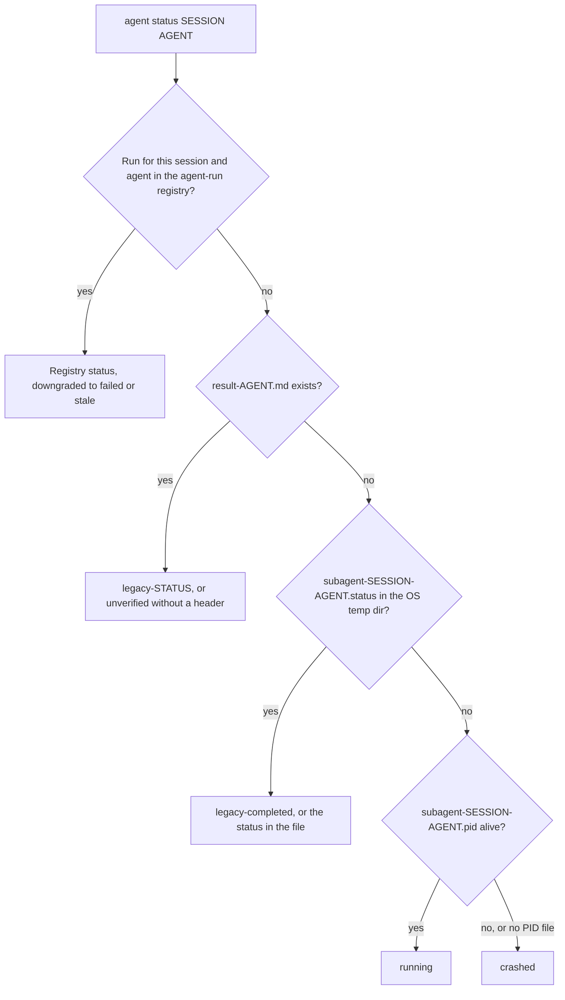

# Opciones del CLI

## Referencia rápida {#quick-reference}

| Quiero... | Usa |
|:-------------|:----|
| Ejecutar sin prompts | `-y` / `--yes` (también se respetan `OMA_YES=1` y `CI=true`); `oma update --ci` para una salida plana y no interactiva |
| Obtener JSON | `--json`, `--output json` u `OH_MY_AG_OUTPUT_FORMAT=json`. Consulta las excepciones en [Opciones de salida](#output-options) |
| Apuntar a la instalación global | `-g` / `--global` u `OMA_INSTALL_GLOBAL=1`; `OMA_HOME` cambia la raíz del almacenamiento global |
| Previsualizar antes de cambiar nada | `--dry-run` donde el comando lo indique. Consulta [Qué comandos admiten JSON](#commands-supporting-json-output) |
| Ver los flags de un comando | `oma <command> --help`, `oma describe "<command>"` o el [registro](#complete-public-option-registry) al final de esta página |
| Arreglar un script que dejó de funcionar tras una actualización | [Comandos y opciones renombrados](#renamed-commands-and-options) |
| Ramificar según los fallos en un script | [Códigos de salida](#exit-codes) |

---

## Opciones globales {#global-options}

Estas opciones están disponibles en el comando raíz `oma` / `oh-my-agent`:

| Flag | Descripción |
|:-----|:-----------|
| `-g, --global` | Opera sobre la instalación global de OMA (`~/.oma/.agents/` o `$OMA_HOME/.agents/`) en lugar de `<cwd>/.agents/` |
| `-y, --yes` | Omite los prompts cuando el comando seleccionado admite confirmación; las comprobaciones de seguridad específicas del comando se siguen aplicando. También respeta `OMA_YES=1` y `CI=true` |
| `-V, --version` | Muestra el número de versión y termina |
| `-h, --help` | Muestra la ayuda del comando |

Todos los subcomandos también admiten `-h, --help` para mostrar su texto de ayuda específico.

`--global` establece la raíz de instalación para todo el proceso, por lo que `install`, `update`, `link` y `uninstall` resuelven en la instalación global independientemente del directorio actual:

| Modo | Cómo seleccionarlo | Ubicación de `.agents/` |
|:-----|:-----------------|:--------------------|
| Proyecto (predeterminado) | nada | `<cwd>/.agents/` |
| Global | `--global` u `OMA_INSTALL_GLOBAL=1` | `$OMA_HOME/.agents/` (predeterminado `~/.oma/.agents/`) |

`OMA_HOME=<abs-path>` cambia la raíz del almacenamiento global; debe ser una ruta absoluta. Las instalaciones de proyecto siguen usando cwd. Ejecuta `oma home --json` para mostrar las ubicaciones resueltas y `oma home migrate --dry-run` para previsualizar una migración de datos heredados. Consulta [Instalación global](../guide/global-install.md).

---

## Comandos y opciones renombrados {#renamed-commands-and-options}

Las rutas de comando usan espacios, no dos puntos, y varios comandos y opciones se han renombrado. Las grafías antiguas se rechazan; no se mantienen como alias:

- Un comando antiguo falla con `Unknown command: ... Use oma --help.` o `Unexpected argument for oma <group>. Use --help.`
- Los nombres de grupo sin subcomando `dashboard`, `state` y `stats` ahora imprimen la ayuda del grupo en lugar de ejecutarse.
- Una opción antigua falla con `Removed option <old>. Use <new>.`; los flags de acción eliminados de `state` y `stats` fallan con `Removed option <old>. Use an explicit action; see oma --help.`

Solo `schedule:run` y `serena daemon:gc` se siguen resolviendo, para que las entradas del programador del sistema operativo escritas por versiones anteriores sigan funcionando.

| Comando antiguo | Usa ahora |
|:------------|:--------|
| cualquier ruta con dos puntos `a:b` (`agent:spawn`, `state:emit`, ...) | la ruta separada por espacios (`agent spawn`, `state emit`) |
| `dashboard`, `dashboard:web` | `dashboard terminal`, `dashboard web` |
| `hook --vendor ...` | `hook run --vendor ...` |
| `intel run` | `intel suggest` |
| `state`, `state:get <id>` | `state list`, `state get <id>` |
| `state --activate` / `--archive` / `--purge` | `state activate` / `state archive` / `state purge` |
| `state:required-decisions` | `state decisions list` |
| `state:inject-log ... --entry <file>` | `state inject-log list`, `state inject-log get <session-id> <file>` |
| `stats`, `stats --reset` | `stats get`, `stats reset` |
| `memory:retry-drain` | `memory retry drain` |
| `vault rm` | `vault delete` |
| `search api <url>`, `search rss <url>` | `search api fetch <url>`, `search rss fetch <url>` |
| `search api:search`, `search rss:google` | `search api search`, `search rss google` |
| `skills audit` / `lint` / `eval` / `promotions` / `rollback` / `procedure` / `meta-optimize` / `evolution-stats` / `matrix` | `skill ...` (en singular) |
| `skills opt` | `skill optimize` |
| `slide new`, `slide viewer` | `slide create`, `slide preview` |
| `slide pdf` / `png` / `pptx` | `slide export pdf` / `png` / `pptx` |
| `slide import-pptx`, `slide fetch-video`, `slide styles ...` | `slide import pptx`, `slide asset fetch-video`, `slide style ...` |
| `image list-vendors`, `video list-providers` | `image vendor list`, `video provider list` |
| `schedule:add`, `schedule:remove` | `schedule create`, `schedule delete` |
| `verify <agent-type>` | `verify agent <agent-type>` |

| Opción antigua | Usa ahora |
|:-----------|:--------|
| `-m, --model <vendor>` | `--vendor <vendor>` |
| `-r, --root <path>` | `--project-root <path>` |
| `--sid`, `--session` | `--session-id <id>` |
| `--format <fmt>` | `--output <format>` (`search media --format` no cambia) |
| `--out <dir>`, `--out-dir` | `--output-dir <path>` |
| `--out <file>`, `--out-file` | `--output-file <path>`; `--report-file <path>` en `slide validate` y `explain validate` |
| `--dir` | `--workspace <path>` en los comandos `slide`, `--output-dir <path>` en `slide create`, `--input-dir <path>` en `explain validate` |
| `--max` | `--limit <n>` en `scholar search` |
| `--allow-external-out` | `--allow-external-output` |
| `--timeout <seconds>`, `--timeout <ms>`, `--timeout-minutes` | `--timeout <duration>` (`30s`, `2m`). Se requiere una unidad donde el valor antiguo estaba en milisegundos o minutos |
| `--max-age-days` | `--max-age <duration>`; `--expires-after <duration>` en `schedule create` |

---

## Opciones de salida {#output-options}

Muchos comandos admiten salida legible por máquina para pipelines de CI/CD y automatización. Hay tres formas de solicitar salida JSON.

### 1. Flag --json {#json-flag}

```bash
oma stats get --json
oma doctor --json
oma cleanup --json
```

El flag `--json` solo está disponible en las rutas que lo indican. No infieras la compatibilidad a partir de una familia de comandos: por ejemplo, las hojas `image`, `video` y `slide` exponen `--output` cuando el registro lo indica, mientras que `search` siempre imprime JSON.

### 2. Flag --output {#output-flag}

```bash
oma stats get --output json
oma doctor --output text
```

En la mayoría de los comandos, `--output` acepta `text` o `json`. Ofrece la misma función que `--json`, pero también permite solicitar explícitamente una salida de texto, algo útil cuando la variable de entorno está configurada como `json`.

**Validación:** Si se proporciona un formato no válido, el CLI lanza: `Invalid output format: {value}. Expected one of text, json`.

### 3. Variable de entorno OH_MY_AG_OUTPUT_FORMAT {#oh-my-ag-output-format-environment-variable}

```bash
export OH_MY_AG_OUTPUT_FORMAT=json
oma stats get # outputs JSON
oma doctor # outputs JSON
oma retro # outputs JSON
```

Establece esta variable de entorno en `json` para que JSON sea el formato predeterminado en los comandos que lo admiten. Solo se reconoce `json`; cualquier otro valor se ignora y la salida sigue siendo texto.

### Cómo se elige el formato {#how-the-format-is-chosen}

Un flag en la línea de comandos tiene prioridad sobre la variable de entorno. Pasar a la vez `--json` y un `--output` que no sea JSON es un error, no una regla de precedencia.

| Lo que pasas | Variable sin definir | `OH_MY_AG_OUTPUT_FORMAT=json` |
|:---------|:---------------|:------------------------------|
| nada | texto | JSON |
| `--json` o `--output json` | JSON | JSON |
| `--output text` | texto | texto |
| `--json --output text` | error: `--json conflicts with --output. Choose one output format.` | el mismo error |

Algunos comandos usan sus propios valores de formato:

| Comandos | Control del formato |
|:---------|:---------------|
| `search ...` | Siempre JSON; `--pretty` solo añade sangría. `search providers` y `search web` también aceptan `--json` |
| `describe` | Siempre JSON |
| `image ...`, `video ...` | `--output text\|json` (predeterminado `text`) |
| `slide validate` | `--output json\|concise` (predeterminado `concise`) |
| `explain validate` | `--output concise\|json` (predeterminado `concise`) o `--json` |
| `hook probe` | `--output text\|md\|json` |

### Qué comandos admiten JSON {#commands-supporting-json-output}

Todo comando que acepta `--json` o `--output` informa `supportsJsonOutput: true` en `oma describe`, y el [registro](#complete-public-option-registry) al final de esta página enumera los flags por ruta. Los comandos que siempre imprimen JSON sin ningún flag (`describe` y la mayoría de los subcomandos de `search`) no están marcados. Para enumerar las rutas desde el CLI:

```bash
oma describe | jq -r '.. | objects | select(.supportsJsonOutput? == true) | .path'
```

Usa `select(.supportsDryRun? == true)` de la misma forma para encontrar los comandos con `--dry-run`.

---

## Opciones por comando {#per-command-options}

### install

```text
oma install [--web-search <provider>] [--code-intelligence <provider>] [--semantic-memory <provider>] [--honcho-url <url>] [--honcho-workspace <id>]
```

El instalador interactivo escribe en `.agents/oma-config.yaml` la configuración de proveedores seleccionada. Los flags de proveedor seleccionan las integraciones de web-search, code-intelligence y semantic-memory; `--honcho-url` y `--honcho-workspace` configuran el servicio de memoria Honcho cuando se selecciona ese proveedor. El flag raíz `-y, --yes` se aplica cuando un flujo de instalación solicita confirmación.

### doctor

```text
oma doctor [--json] [--output <format>] [--profile] [--heal-check <agentType>]
```

| Flag | Descripción | Predeterminado |
|:-----|:-----------|:--------|
| `--json` | Emite JSON en lugar de texto con formato. | `false` |
| `--output <format>` | Formato de salida explícito (`text` o `json`). Consulta [Opciones de salida](#output-options). | `text` |
| `--profile` | Muestra la matriz de salud del perfil (slug de modelo resuelto, CLI y estado de autenticación por agente a partir de `model_preset` y las sobrescrituras `agents:` activas). Consulta [Modelos por agente](../guide/per-agent-models.md). | `false` |
| `--heal-check <agentType>` | Incluye la comprobación de la puerta de autorreparación para un agente. | |

Con `--json`, el informe tiene los campos de nivel superior `ok` e `issues`, y `doctor` termina con `1` cuando `issues` es mayor que cero.

### update

```text
oma update [-f | --force] [--with-new-skills] [--ci] [-y | --yes] [--all] [--vendor <vendors>]
oma update mcp [-y | --yes] [--ci] [--all] [--vendor <vendors>]
```

| Flag | Corto | Descripción | Predeterminado |
|:-----|:------|:-----------|:--------|
| `--force` | `-f` | Sobrescribe los archivos de configuración personalizados durante la actualización. Afecta a `oma-config.yaml`, `mcp.json` y los directorios `stack/`. Sin este flag, estos archivos se respaldan antes de actualizar y se restauran después. | `false` |
| `--with-new-skills` | | Instala las skills añadidas al registro desde la instalación actual. | `false` |
| `--ci` | | Ejecuta en modo CI no interactivo. Omite todos los prompts de confirmación y usa salida de consola plana en lugar de spinners y animaciones. Es necesario para pipelines de CI/CD donde stdin no está disponible. | `false` |
| `--yes` | `-y` | Omite los prompts. No crea directorios de proveedores ausentes salvo que se combine con `--all` o `--vendor`. | `false` |
| `--all` | | Crea o actualiza todos los proveedores compatibles con alcance de proyecto. | `false` |
| `--vendor <vendors>` | | Crea o actualiza una lista de proveedores separada por comas, por ejemplo `claude,qwen`. | Solo directorios de proveedores existentes |

`oma update mcp` usa los mismos controles `--yes`, `--ci`, `--all` y `--vendor` al elegir servidores MCP de navegador. No usa `--force` ni `--with-new-skills`.

**Comportamiento con --force:**
- `oma-config.yaml` se reemplaza por el valor predeterminado del registro.
- `mcp.json` se reemplaza por el valor predeterminado del registro.
- Se reemplaza el directorio `stack/` de backend (recursos específicos del lenguaje).
- Todos los demás archivos se actualizan siempre, independientemente de este flag.

**Comportamiento con --ci:**
- No se ejecuta `console.clear()` al inicio.
- `@clack/prompts` se sustituye por `console.log` plano.
- Se omiten los prompts de detección de competidores.
- Los errores se lanzan en lugar de llamar a `process.exit(1)`.

**Alcance de proveedores:**
- `oma update` solo actualiza los directorios de proveedores que ya existen.
- `oma update --yes` usa el mismo alcance de proveedores, sin prompts.
- `oma update --all` crea o actualiza todos los proveedores compatibles con alcance de proyecto.
- `oma update --vendor claude,qwen` solo crea o actualiza los proveedores enumerados.

### stats

```text
oma stats get [--json | --output <format>]
oma stats reset [--json | --output <format>]
```

| Flag | Descripción | Predeterminado |
|:-----|:-----------|:--------|
| `--json` | Emite JSON. `stats get` imprime el objeto de métricas; `stats reset` imprime `{"reset":true}`. | `false` |
| `--output <format>` | Emite `text` o `json`. | `text` |

`oma stats reset` es el comando de reset; `oma stats get --reset` falla con `Removed option --reset`.

:::note
`stats get` no es de solo lectura. Cada llamada cuenta como una sesión y suma el diff de los últimos 10 commits a los contadores acumulados de archivos y líneas en `.agents/state/metrics.json`, así que no lo consultes en bucle.
:::

### retro

```text
oma retro [window] [--json] [--output <format>] [--interactive] [--compare]
```

| Flag | Descripción | Predeterminado |
|:-----|:-----------|:--------|
| `--interactive` | Entrada guiada heredada: pregunta qué lograste, los aprendizajes clave y los siguientes pasos. Ignora la ventana, `--compare` y `--json`. | `false` |
| `--compare` | Compara la ventana temporal actual con la anterior de la misma duración. Muestra métricas delta (por ejemplo, commits +12, líneas añadidas -340). | `false` |

**Formato del argumento de ventana:** un número seguido de `h`, `d` o `w`.
- `24h`: 24 horas
- `7d`: 7 días
- `2w`: 2 semanas
- Omitir para usar el valor predeterminado (7 días)

Los meses no se admiten: `oma retro 1m` falla con `Invalid window: 1m. Use: 24h, 7d, 14d, 30d, 2w`.

### cleanup

```text
oma cleanup [--dry-run] [-y | --yes] [--json] [--output <format>]
```

| Flag | Corto | Descripción | Predeterminado |
|:-----|:------|:-----------|:--------|
| `--dry-run` | | Modo de previsualización. Enumera todos los elementos que se limpiarían, pero no hace cambios. El código de salida es 0 independientemente de los hallazgos. | `false` |
| `--yes` | `-y` | Omite todos los prompts de confirmación. Limpia todo sin preguntar. Es útil en scripts y CI. | `false` |

**Qué se limpia:**
1. Archivos PID huérfanos: `/tmp/subagent-*.pid` cuyo proceso referenciado ya no está en ejecución.
2. Archivos de log huérfanos: `/tmp/subagent-*.log` que coinciden con PIDs terminados.
3. Directorios de Gemini Antigravity: `.gemini/antigravity/brain/`, `.gemini/antigravity/implicit/`, `.gemini/antigravity/knowledge/`. Acumulan estado con el tiempo y pueden crecer mucho.

### agent spawn

```text
oma agent spawn <agent-id> <prompt> <session-id> [options]
```

| Flag | Corto | Descripción | Predeterminado |
|:-----|:------|:-----------|:--------|
| `--resumed-from` | — | Enlaza un reintento con el ID de su ejecución anterior. | |
| `--fallback-vendors` | — | Cadena explícita y ordenada de proveedores de fallback, separada por comas. | |
| `--task-id` | — | ID de tarea del plan de sesión. | ID del agente |
| `--vendor` | — | Sobrescritura del proveedor CLI. `--help` enumera `antigravity`, `claude`, `codex`, `cursor`, `opencode`, `qwen`, `grok` y `pi`. | Resuelto desde la configuración |
| `--workspace` | `-w` | Directorio de trabajo del agente. Si se omite o se establece en `.`, el CLI detecta automáticamente el workspace a partir de archivos de configuración del monorepo (pnpm-workspace.yaml, package.json, lerna.json, nx.json, turbo.json, mise.toml). | Detectado automáticamente o `.` |
| `--isolation` | — | Modo de aislamiento: `worktree` crea un worktree de git por ejecución; el valor predeterminado es `none`. | `none` |
| `--read-only` | — | Restringe el agente iniciado a herramientas no destructivas y suprime los flags de aprobación automática. | `false` |

**Validación:**
- `agent-id` y `session-id` no deben contener `..`, `?`, `#`, `%` ni caracteres de control. `agent spawn` no tiene una lista fija de IDs de agente; el enrutamiento de modelos y proveedores reconoce `orchestrator`, `architecture`, `qa`, `pm`, `backend`, `frontend`, `mobile`, `db`, `debug`, `refactor`, `docs`, `tf-infra` y `explore`, además de alias como `backend-engineer`, `qa-reviewer` y `research-explorer`.
- `--vendor` debe ser un ID de proveedor de oma: `antigravity`, `claude`, `codex`, `commandcode`, `copilot`, `cursor`, `grok`, `hermes`, `kimi`, `kiro`, `opencode`, `pi`, `qwen` o `zcode`. La tabla siguiente cubre los ocho proveedores que nombra `--help`.

**Comportamiento específico del proveedor:**

| Proveedor | Comando | Flag de aprobación automática | Flag de prompt |
|:-------|:--------|:-----------------|:-----------|
| antigravity | `agy` | `--dangerously-skip-permissions` | `-p` |
| claude | `claude` | (ninguno) | `-p` |
| codex | `codex` | `--sandbox workspace-write` | (ninguno; el prompt es posicional) |
| cursor | `cursor-agent` | específico del proveedor | `-p` |
| opencode | `opencode` | específico del proveedor | `-p` |
| qwen | `qwen` | `--yolo` | `-p` |
| grok | `grok` | específico del proveedor | `-p` |
| pi | `pi` | suprimido en modo `--read-only` | el prompt es posicional |

Estos valores predeterminados se pueden sobrescribir en `.agents/skills/oma-orchestration/config/cli-config.yaml`.

Codex conserva su sandbox workspace-write. oma habilita el acceso a la red y añade como directorios escribibles la raíz del proyecto, el directorio de estado de OMA (`~/.oma`) y las cachés de gestores de paquetes que ya existen. `oma update` reemplaza `cli-config.yaml`, así que define un modo persistente con `OMA_CODEX_SANDBOX`: `read-only`, `workspace-write` (predeterminado) o `danger-full-access` (sin sandbox y sin aprobaciones).

### agent status

```text
oma agent status <session-id> [agent-ids...] [--project-root <path>]
```

| Flag | Descripción | Predeterminado |
|:-----|:-----------|:--------|
| `--project-root <path>` | Proyecto cuyo registro de ejecuciones de agentes y archivos `.agents/state/memories/result-{agent}.md` se leen. `-r` y `--root` se eliminaron y fallan con `Removed option -r. Use --project-root.` | Directorio de trabajo actual |

El comando imprime una línea `{agent-id}:{status}` por cada agente solicitado. Para cada agente usa la primera fuente que exista:



| Estado | Significado |
|:-------|:--------|
| `running`, `completed`, `partial`, `blocked`, `failed` | Estado registrado en el registro de ejecuciones de agentes |
| `failed` | También se informa cuando una ejecución registrada está en `running` pero su proceso ejecutor ya no existe |
| `stale` | La ejecución registrada está en `completed`, pero su evidencia de resultado ya no se valida |
| `legacy-<status>` | No hay ejecución registrada; `result-{agent}.md` tiene un encabezado `## Status: <status>` |
| `unverified` | No hay ejecución registrada; `result-{agent}.md` no tiene encabezado de estado |
| `legacy-completed` | No hay ejecución ni archivo de resultado; el archivo `.status` de la sesión indica `completed` (cualquier otro valor se imprime tal cual) |
| `crashed` | No se encontró nada, o el archivo PID heredado apunta a un proceso terminado |

Consulta [Resultados de agentes y reanudación](../guide/agent-results-and-resume.md) para ver cómo se registran las ejecuciones.

### agent parallel

```text
oma agent parallel [tasks...] [--session-id <id>] [--vendor <vendor>] [-i | --inline] [--no-wait]
```

| Flag | Corto | Descripción | Predeterminado |
|:-----|:------|:-----------|:--------|
| `--session-id <id>` | — | ID de sesión para todas las ejecuciones iniciadas. Pasa el mismo ID a `oma agent status`. | Nombre del directorio de ejecución, `parallel-<timestamp>-<suffix>` |
| `--vendor` | — | Sobrescritura del proveedor CLI aplicada a todos los agentes iniciados. | Resuelto por agente desde la configuración |
| `--inline` | `-i` | Interpreta los argumentos de tareas como cadenas `agent:task[:workspace]` en lugar de una ruta de archivo. | `false` |
| `--no-wait` | | Modo en segundo plano. Inicia todos los agentes y vuelve inmediatamente sin esperar a que terminen. La lista de PIDs y los logs se guardan en `.agents/results/parallel-<timestamp>-<suffix>/`. | `false` (espera la finalización) |

**Formato de tarea inline:** `agent:task` o `agent:task:workspace`
- El workspace se detecta comprobando si el último segmento separado por dos puntos empieza por `./`, `/` o es igual a `.`.
- Ejemplo: `backend:Implement auth API:./api`: agent=backend, task="Implement auth API", workspace=./api.
- Ejemplo: `frontend:Build login page`: agent=frontend, task="Build login page", workspace=autodetectado.

**Formato del archivo YAML de tareas:**

```yaml
tasks:
  - id: api            # optional; default <agent>-<index>
    agent: backend
    task: "Implement user API"
    workspace: ./api   # optional; auto-detected when omitted
  - agent: frontend
    task: "Build user dashboard"
```

### recap

```text
oma recap [--window <period>] [--date <date>] [--tool <tools>] [--top <n>] [--sort <metric>] [--mermaid] [--graph] [--json] [--output <format>]
```

| Flag | Descripción | Predeterminado |
|:-----|:-----------|:--------|
| `--window <period>` | Ventana temporal como `<n>h`, `<n>d` o `<n>w` (por ejemplo `1d`, `3d`, `7d`, `2w`, `30d`). Los valores superiores a 30 días se limitan a 30 días con una advertencia. Se ignora cuando se establece `--date`. | `1d` |
| `--date <date>` | Fecha específica (`YYYY-MM-DD`). Tiene precedencia sobre `--window`. | |
| `--tool <tools>` | Filtra sesiones por herramienta. Separadas por comas: `antigravity`, `claude`, `codex`, `cursor`, `gemini`, `grok`, `qwen`. | todas las herramientas |
| `--top <n>` | Muestra solo los N proyectos o temas principales del resumen. | sin límite |
| `--sort <metric>` | Ordena las sesiones por `count` o `duration`. | `count` |
| `--mermaid` | Genera un gráfico de Gantt de Mermaid en lugar del resumen predeterminado. `--json` tiene precedencia. | `false` |
| `--graph` | Abre el grafo interactivo en el dashboard web (`/recap`). Tiene precedencia sobre `--mermaid` y `--json`. | `false` |

### search

```text
oma search <subcommand> [...]
```

Todos los subcomandos de `search` escriben JSON en stdout sin necesidad de ningún flag; `providers` y `web` también aceptan `--json`. Ninguno acepta `--output`. `--pretty` solo cambia la sangría.

| Subcomando | Opciones destacadas |
|:-----------|:---------------|
| `providers` | `--json`, `--pretty` |
| `web <query>` | `--provider <id>`, `--limit <n>` (predeterminado `10`), `--timeout <duration>` (predeterminado `15s`), `--json`, `--pretty` |
| `fetch <url>` | `--only`, `--skip`, `--include-archive`, `--timeout <duration>` (predeterminado `15s`), `--locale`, `--pretty` |
| `meta <url>` / `archive <url>` / `api fetch <url>` / `rss fetch <url>` | `--timeout <duration>` (predeterminado `15s`), `--locale` (predeterminado `en-US,en;q=0.9`), `--pretty` |
| `api search <query>` | `--platforms <list>`, `--timeout <duration>`, `--locale`, `--pretty` |
| `rss google <query>` | `--locale` (predeterminado `en-US`) |
| `media <url>` | `--subs`, `--sub-lang <list>` (predeterminado `en`), `--format <spec>`, `--timeout <duration>` (predeterminado `30s`), `--pretty` |
| `code <query>` | `--host <github\|gitlab>` (predeterminado `github`), `--language`, `--repo`, `--limit` (predeterminado `20`), `--pretty` |
| `trust <domain>` | `--pretty` |
| `doctor` | ninguno (ejecuta comprobaciones binarias para Chrome / `python3 curl_cffi` / `yt-dlp` / `gh`) |

`search` usa la escala compartida de códigos de salida; consulta [Códigos de salida](#exit-codes).

### image

```text
oma image <subcommand> [...]
```

El formato de salida se controla por subcomando mediante `--output <text|json>`.

`image generate` acepta:

| Flag | Corto | Descripción | Predeterminado |
|:-----|:------|:-----------|:--------|
| `--vendor <name>` | | `auto` \| `pollinations` \| `codex` \| `antigravity` \| `all`. `auto` se resuelve a partir de la configuración `image:` activa y la autenticación disponible. | `auto` |
| `--size <size>` | | `WxH` con ambos bordes divisibles por 16, entre 16 y 3840, con una relación de aspecto de 1:3 a 3:1, o `auto`. | predeterminado del proveedor |
| `--quality <level>` | | `low` \| `medium` \| `high` \| `auto`. | predeterminado del proveedor |
| `--count <n>` | `-n` | Número de imágenes, 1..5. | `1` |
| `--output-dir <dir>` | | Directorio de salida. Debe estar dentro de `$PWD`, salvo que se establezca `--allow-external-output`. | `.agents/results/images/{timestamp}/` |
| `--allow-external-output` | | Permite rutas de `--output-dir` fuera de `$PWD`. | `false` |
| `--model <name>` | | Sobrescritura del modelo específica del proveedor. `agy` selecciona el modelo de antigravity. | predeterminado del proveedor |
| `--timeout <duration>` | | Timeout por imagen mediante un valor de duración. | predeterminado del proveedor |
| `--reference <path>` | `-r` | Imagen de referencia para transferir estilo o tema. Repetible (`-r a.png -r b.png`) o separada por comas. Se valida el tamaño (≤5 MB), el formato (PNG/JPEG/GIF/WebP mediante magic bytes) y la cantidad (≤10). Compatible con `codex` y `antigravity`; se rechaza con el código de salida 4 en `pollinations`. | |
| `--yes` | `-y` | Omite el prompt de confirmación del coste. | `false` |
| `--no-prompt-in-manifest` | | Guarda el SHA256 del prompt en lugar del texto sin procesar en `manifest.json`. | `false` |
| `--dry-run` | | Imprime el plan y la estimación de coste; no ejecuta nada. | `false` |
| `--output <format>` | | `text` \| `json`. | `text` |

`image doctor` y `image vendor list` aceptan `--output <text|json>`. Usa `image vendor list` para descubrir proveedores; la grafía antigua `image list-vendors` falla.

### video

```text
oma video generate <brief...> [options]
oma video doctor [--output <format>] [--install|--upgrade|--install-mpt|--install-strudel]
oma video compose <run-dir> [--output <format>] [--refresh] [--offline]
oma video render <run-dir> [--output <format>]
oma video provider list [--output <format>]
```

`video generate` acepta los controles de planificación y captura `--mode`, `--aspect`, `--locale`, `--captions`, `--visual`, `--voice`, `--music`, `--duration`, `--compositor`, `--capture`, `--source`, `--url`, `--device`, `--ready-selector`, `--show-cursor`, `--polish`, `--capture-timeout` y `--capture-stop`. También acepta `--output-dir`, `--allow-external-output`, `--max-usd`, `--seed`, `--timeout`, `--script`, `--dry-run`, `--yes`, `--output` y `--no-brief-in-manifest`. La captura del navegador usa `--source web --url <url>`; `file` es la fuente predeterminada. Un render normal requiere una composición escrita y un compositor operativo; los placeholders se limitan a la ruta de pruebas `OMA_VIDEO_MOCK=1`.

`video doctor` informa o provisiona la toolchain de HyperFrames/MPT/Strudel. `compose` prepara el contrato de composición de la ejecución y `render` ejecuta lint, renderiza y sondea la salida. `provider list` informa del estado del proveedor y de sus claves. Lee [Generación de videos](../guide/video-generation.md) para consultar el manifiesto de ejecución y la secuencia de recuperación.

### memory init

```text
oma memory init [--json] [--output <format>] [--force]
```

| Flag | Descripción | Predeterminado |
|:-----|:-----------|:--------|
| `--force` | Sobrescribe los archivos de esquema vacíos o existentes en `.agents/state/memories/`. Sin este flag, no se tocan los archivos existentes. | `false` |

### verify

```text
oma verify agent <agent-type> [-w <workspace>] [--session-id <id>] [--task-id <id>] [--run-id <id>] [--json] [--output <format>]
oma verify triggers [--corpus <path>] [--max-false-fire <pct>] [--max-missed-fire <pct>] [--json] [--output <format>]
```

| Flag | Corto | Descripción | Predeterminado |
|:-----|:------|:-----------|:--------|
| `--workspace` | `-w` | Ruta del directorio del workspace que se verificará. | Directorio de trabajo actual |
| `--session-id <id>` | | Selecciona el plan de sesión y los informes. Es obligatorio cuando existen varios planes, salvo que un comprobante de ejecución identifique la sesión. | |
| `--task-id <id>` | | Selecciona el alcance y el informe de una tarea. Requiere `--session-id` o `--run-id`. | |
| `--run-id <id>` | | Selecciona el informe exacto de una ejecución. Infiere la sesión y la tarea a partir del comprobante local; si no existe, proporciona ambos IDs explícitamente. | |

**Tipos de agente:** `backend`, `frontend`, `mobile`, `qa`, `debug`, `pm`.

`verify triggers` mide la precisión de keyword-detector frente a un corpus etiquetado. Los umbrales porcentuales son puertas de control; usa salida JSON cuando un trabajo de CI necesite inspeccionar hallazgos individuales. La grafía antigua `oma verify <agent-type>` falla; usa `verify agent <agent-type>`.

---

## Códigos de salida {#exit-codes}

**Escala compartida (`image`, `video`, `search`):**

| Código | Significado |
|:-----|:--------|
| `0` | éxito |
| `1` | error genérico |
| `2` | bloqueado, o rechazo de seguridad del proveedor |
| `3` | no encontrado |
| `4` | entrada no válida |
| `5` | se requiere autenticación, o el binario del proveedor no está instalado |
| `6` | timeout |

**Específicos de cada comando:**

| Comando | Códigos |
|:--------|:------|
| `doctor --json` | `0` sin problemas, `1` uno o más problemas |
| `verify agent` | `0` todas las comprobaciones pasan, `1` una comprobación falló o el tipo de agente no es válido, `2` no se encontró el workspace |
| `verify triggers` | `0` dentro de los umbrales, `1` se superó un umbral |
| `docs verify` | `1` se encontraron referencias rotas |
| `vault get` | `1` nombre de clave no válido, `2` no existe la entrada |

---

## Ejemplos prácticos {#practical-examples}

### Pipeline de CI: actualizar y verificar {#ci-pipeline-update-and-verify}

```bash
# Update in CI mode, then fail the job when doctor reports any issue
oma update --ci
oma doctor --json | jq -e '.ok' > /dev/null
```

### Ejecución por lotes de agentes con supervisión de estado {#batch-agent-execution-with-status-monitoring}

```bash
# Choose the session ID first and pass it to both commands
SESSION_ID="session-$(date +%Y%m%d-%H%M%S)"
oma agent parallel tasks.yaml --session-id "$SESSION_ID" --no-wait

# Check status every 5 seconds
watch -n 5 "oma agent status $SESSION_ID backend frontend mobile"
# Without `watch` (stock macOS), loop instead:
# while sleep 5; do oma agent status "$SESSION_ID" backend frontend mobile; done
```

### Limpieza en CI después de las pruebas {#cleanup-in-ci-after-tests}

```bash
# Clean up all orphaned processes without prompts
oma cleanup --yes --json
```

### Verificación consciente del workspace {#workspace-aware-verification}

```bash
# Verify each domain in its workspace
oma verify agent backend -w ./apps/api
oma verify agent frontend -w ./apps/web
oma verify agent mobile -w ./apps/mobile
```

### Retro con comparación para revisiones de sprint {#retro-with-comparison-for-sprint-reviews}

```bash
# Two-week sprint retro with comparison to previous sprint
oma retro 2w --compare
```

### Script completo de comprobación de salud {#full-health-check-script}

```bash
#!/usr/bin/env bash
set -euo pipefail

echo "=== oh-my-agent Health Check ==="

report="$(mktemp)"
# doctor exits 1 when it finds issues; keep the report and continue
oma doctor --json > "$report" || true

# Check CLI installations
jq -r '.clis[] | "\(.name): \(if .installed then "OK (\(.version // "unknown"))" else "MISSING" end)"' "$report"
jq -r '"Issues: \(.issues)"' "$report"

# Check auth status (an object of booleans keyed by github and each vendor ID)
oma auth status --json | jq -r 'to_entries[] | "\(.key): \(if .value then "authenticated" else "not authenticated" end)"'

echo "=== Done ==="
```

### Describe para la introspección de agentes {#describe-for-agent-introspection}

```bash
# An AI agent can discover available commands
oma describe | jq '.command.subcommands[] | {name, description}'

# Get details about a specific command
oma describe "agent spawn" | jq '.command.options[] | {flags, description}'
```

---

## Registro completo de opciones públicas {#complete-public-option-registry}

Cada fila es una ruta de comando que se ejecuta por sí sola; se omiten los grupos que solo imprimen ayuda, y los flags raíz compartidos se describen en [Opciones globales](#global-options). Los valores predeterminados aparecen junto a su opción. Ejecuta `oma describe "<path>"` para obtener el JSON completo de una ruta.

:::note
Esta tabla se genera a partir de `oma describe`. No la edites a mano: ejecuta `node cli/scripts/generate-cli-reference.mjs` para regenerarla, o añade `--check` para que falle cuando esté desactualizada.
:::

<!-- oma:generated cli-registry:start -->

| Command | Arguments | Options | Description |
|:--|:--|:--|:--|
| `agent begin` | `<agent-id> <task-id> <session-id>` | `--project-root <path>`, `-w, --workspace <path>` | Start an evidence-backed native agent run |
| `agent context` | `<agent-id>` | `--project-root <path>`, `--difficulty <level>` (default: `Medium`) | Load graph-selected context for a native dispatch prompt |
| `agent finish` | `<run-id> <result-file>` | `--project-root <path>` | Validate a native agent result against its verification receipts |
| `agent parallel` | `[tasks...]` | `--session-id <id>`, `--vendor <vendor>`, `-i, --inline`, `--no-wait` | Run multiple sub-agents in parallel |
| `agent parallel-supervisor` | `<manifest>` | — | — |
| `agent resume` | `<session-id>` | `--project-root <path>`, `--dry-run`, `--max-attempts <count>` (default: `3`) | Resume safe incomplete tasks, reusing current acceptance evidence |
| `agent review` | — | `--vendor <vendor>`, `-p, --prompt <prompt>`, `-w, --workspace <path>`, `--no-uncommitted` | Run code review using external CLI (codex/claude/qwen/grok) |
| `agent spawn` | `<agent-id> <prompt> <session-id>` | `--resumed-from <run-id>`, `--fallback-vendors <vendors>`, `--task-id <id>`, `--vendor <vendor>`, `-w, --workspace <path>`, `--isolation <mode>`, `--read-only` | Spawn a subagent (prompt can be inline text or a file path) |
| `agent status` | `<session-id> [agent-ids...]` | `--project-root <path>` (default: current directory) | Check status of subagents |
| `agent verify` | `<run-id> [command...]` | `--project-root <path>`, `--required`, `--affected <paths...>` | Execute verification argv after -- and record its real exit code |
| `auth status` | — | `--json`, `--output <format>` | Check authentication status of all supported CLIs |
| `bridge` | `[url]` | `--context <name>` (default: `ide`), `--oma-home <path>`, `--oma-state-home <path>` | Proxy MCP stdio to a shared per-project Serena server (started on demand) |
| `cleanup` | — | `--dry-run`, `-y, --yes`, `--json`, `--output <format>` | Clean up orphaned subagent processes and temp files |
| `dashboard terminal` | — | `--project-root <path>` | Start terminal dashboard (real-time agent monitoring) |
| `dashboard web` | — | `--project-root <path>` | Start web dashboard on http://127.0.0.1:9847 |
| `describe` | `[command-path]` | — | Describe CLI commands as JSON for runtime introspection |
| `diagram archify` | `[args...]` | — | Run the installed archify CLI (doctor \| guide \| validate \| deliver \| visual-check …) with update checks disabled |
| `diagram resolve` | — | `--engine <engine>`, `--refresh`, `--offline`, `--json`, `--output <format>` | Report which diagram engine workflows should use, and where archify lives |
| `diagram update` | — | `--json`, `--output <format>` | Download the latest archify release into oma's managed cache (~/.cache/oma-diagram/archify) |
| `docs i18n` | — | `--json`, `--min-severity <level>` (default: `MEDIUM`) | Detect drift between English source docs (web/docs) and i18n translations (web/i18n/{lang}/...). Emits structural signals (line count, heading count, last-commit timestamp) per pair so the host LLM can decide which translations need a diff-sync patch. The CLI never edits translations. |
| `docs lint` | — | `--json`, `--locales <list>` | Lint translated docs for content-level anti-patterns (em-dashes in CJK targets, etc.). Complements `oma docs i18n` (structural drift) with style/anti-pattern checks per oma-translation SKILL.md § Stage 4. The CLI never auto-fixes — it only reports issues for the host LLM to restructure. |
| `docs sync` | `[diff-range]` | `--json` | Given a git diff, list docs that reference changed files. The host LLM (skill runtime) is expected to read this list plus the diff and propose patches per the SKILL.md contract — the CLI never auto-edits docs. Default diff-range: --cached (staged changes), fallback to HEAD~1..HEAD. |
| `docs verify` | `[path]` | `--json`, `--report-file <path>`, `--no-urls`, `--urls-sync` | Extract L2 references from docs and report broken targets. Regenerates docs/generated/doc-refs.json as a side effect. Exit code: 0 = clean, 1 = broken refs found. URL link checking is delegated to `lychee` (install: brew install lychee). |
| `doctor` | — | `--profile`, `--heal-check <agentType>`, `--json`, `--output <format>` | Check CLI installations, MCP configs, and skill status |
| `emit` | — | `--target <target>` (default: `all`), `--output-dir <path>` (default: `.`), `--json`, `--output <format>` | Emit standards-conformant artifacts from the .agents/ SSOT (Agent Skills spec, Agent Plugins package, Claude Code plugin marketplace, AGENTS.md, cli/AGENTS.md) |
| `explain components` | `[name]` | `--json`, `--output <format>` | List the components a draft can use, or print one component's syntax |
| `explain lint` | `[file]` | `--style <level>`, `--lang <code>`, `--json`, `--output <format>` | Check the prose of a draft (file or stdin) without rendering |
| `explain patch` | `<html> [file]` | `--panel <id>`, `--open`, `--json`, `--output <format>` | Replace one panel of a rendered page from its embedded draft (new panel from file or stdin) |
| `explain render` | `[file]` | `--output-file <path>`, `--template <name>`, `--theme <name>`, `--mode <mode>`, `--style <level>`, `--lang <code>`, `--archify`, `--no-archify`, `--open`, `--json`, `--output <format>` | Render a Markdown draft (file or stdin) into one self-contained HTML explanation |
| `explain validate` | `[file]` | `--input-dir <path>`, `--output <format>` (default: `concise`), `--report-file <path>`, `--json` | Validate self-contained explain HTML report artifacts |
| `goal set` | — | `--workflow <name>`, `--session-id <id>`, `--gate <keyword>`, `--budget-minutes <n>`, `--description <text>`, `--json`, `--output <format>` | Attach a goal contract (deterministic stop gate / wall-clock budget) to an active persistent workflow |
| `harness eval` | — | `--suite <path>`, `--candidate <path>`, `--partition <name>` (default: `validation`), `--mock`, `--action <mode>`, `--transcript <path>`, `--live`, `--record`, `--record-file <path>`, `--yes`, `--timeout <duration>` (default: `15m`), `--require-coverage`, `--json`, `--output <format>` | Compare a candidate .agents overlay with the current baseline |
| `harness evolution disable` | — | `--json`, `--output <format>` | — |
| `harness evolution enable` | — | `--max-dispatches <n>`, `--cron <expr>` (default: `0 3 * * *`), `--mode <mode>` (default: `apply`), `--json`, `--output <format>` | — |
| `harness evolution run` | — | `--scheduled`, `--json`, `--output <format>` | — |
| `harness evolution status` | — | `--json`, `--output <format>` | — |
| `harness feedback` | — | `--live`, `--apply`, `--max-epochs <n>` (default: `1`), `--incident <ids...>`, `--scan-runs`, `--json`, `--output <format>` | Promote captured incidents to skill fixtures and optimize the affected skills |
| `harness incident capture` | — | `--spec <path>`, `--run <id>`, `--json`, `--output <format>` | — |
| `harness incident export` | `<id>` | `--json`, `--output <format>` | — |
| `harness incident promote` | `<id>` | `--skill <id>`, `--draft`, `--force`, `--json`, `--output <format>` | — |
| `harness incident reproduce` | `<id>` | `--candidate <path>`, `--action <mode>`, `--record-file <path>`, `--transcript <path>`, `--record`, `--yes`, `--timeout <duration>` (default: `15m`), `--json`, `--output <format>` | — |
| `harness incident scan` | — | `--limit <n>`, `--skeleton <run-id>`, `--json`, `--output <format>` | List failed, blocked, or partial agent runs that no captured incident references yet |
| `harness incident show` | `<id>` | `--json`, `--output <format>` | — |
| `help` | — | — | Show help information |
| `home` | — | `--json`, `--output <format>` | Inspect and migrate OMA global storage |
| `home migrate` | — | `--dry-run`, `--json`, `--output <format>` | Copy legacy OMA global files; preserve originals |
| `hook probe` | — | `--vendor <list>`, `--output <format>` (default: `text`), `--hooks-dir <dir>` | Probe per-vendor L1 hook compatibility and print a matrix (D63) |
| `hook run` | — | `--vendor <v>`, `--event <e>`, `--matcher <m>` | Dispatch a vendor hook event through the centralised oma hook router (design 019) |
| `hook script` | — | `--vendor <v>`, `--script <name>` | Run one installed hook handler through the CLI memory adapter |
| `image doctor` | — | `--output <format>` (default: `text`) | Check authentication and install status per vendor |
| `image generate` | `<prompt...>` | `--vendor <name>` (default: `auto`), `--size <size>`, `--quality <level>`, `-n, --count <n>`, `--output-dir <path>`, `--allow-external-output`, `--model <name>`, `--timeout <duration>`, `-r, --reference <path>`, `-y, --yes`, `--no-prompt-in-manifest`, `--dry-run`, `--output <format>` (default: `text`) | Generate images via pollinations (flux/zimage, free), codex (gpt-image-2, ChatGPT OAuth), or antigravity (gemini nano-banana via `agy` CLI, free with Gemini Code Assist sign-in) |
| `image vendor list` | — | `--output <format>` (default: `text`) | List registered vendors and supported models |
| `install` | — | `--web-search <provider>`, `--code-intelligence <provider>`, `--semantic-memory <provider>`, `--honcho-url <url>`, `--honcho-workspace <id>` | Install oh-my-agent skills and configurations |
| `intel suggest` | — | `--config <path>`, `--topic <topic>`, `--target <target>`, `--repos <repos>`, `--since <window>`, `--last-commits <n>`, `--output-dir <path>`, `--dry-run`, `--fixture <path>`, `--create-issue`, `--base-repo <owner/name>`, `--yes`, `--json`, `--output <format>` | Suggest high-value product work from market/code intelligence |
| `link` | `[vendors...]` | `--dry-run` | Regenerate vendor files (.claude/, .cursor/, etc.) from .agents/ SSOT |
| `market detect-trap` | `<topic>` | `--force` | Preflight check that refuses keyword-trap queries |
| `market resolve` | — | `--refresh`, `--offline`, `--json`, `--output <format>` | Report the last30days engine oma will run (managed latest, pin, or local copy) and the Python it uses |
| `market run` | `[args...]` | — | Run the last30days engine (scripts/last30days.py) with the given arguments; --save-dir defaults to market.save_dir |
| `market update` | — | `--json`, `--output <format>` | Download the latest last30days release into oma's managed cache (~/.cache/oma-market/last30days) |
| `memory daemon restart` | — | `--port <port>` (default: `3111`), `--dry-run`, `--json`, `--output <format>` | Restart the OMA-owned AgentMemory daemon |
| `memory daemon start` | — | `--port <port>` (default: `3111`), `--dry-run`, `--json`, `--output <format>` | Start AgentMemory in the background |
| `memory daemon status` | — | `--json`, `--output <format>` | Show daemon status |
| `memory daemon stop` | — | `--dry-run`, `--json`, `--output <format>` | Stop the OMA-owned AgentMemory daemon |
| `memory gc` | — | `--scope <scope>` (default: `all`), `--keep <count>`, `--max-age <duration>`, `--dry-run`, `--json`, `--output <format>` | Garbage-collect project-local memory: prune old L1 sessions and ephemeral Serena files |
| `memory import` | — | `--source <source>` (default: `all`), `--since <since>` (default: `30d`), `--dry-run`, `--force-partial`, `--json`, `--output <format>` | Import vendor conversation history into AgentMemory |
| `memory init` | — | `--force`, `--json`, `--output <format>` | Initialize the coordination store in .agents/state/memories |
| `memory keys` | — | `--kind <kind>` (default: `connection`), `--profile <name>` (default: `oma`), `--key-env <name>` (default: `LLM_OPENAI_API_KEY`), `--from-env <name>`, `--dry-run`, `--json`, `--output <format>` | Configure Honcho connection or local embedding credentials |
| `memory maintain` | `<action>` | `--keep <count>` (default: `5`), `--dry-run`, `--json`, `--output <format>` | Maintain AgentMemory local storage: backup, prune, vacuum |
| `memory maintain backup` | — | `--keep <count>` (default: `5`), `--dry-run`, `--json`, `--output <format>` | Maintain AgentMemory local storage: backup, prune, vacuum |
| `memory maintain prune` | — | `--keep <count>` (default: `5`), `--dry-run`, `--json`, `--output <format>` | Maintain AgentMemory local storage: backup, prune, vacuum |
| `memory maintain vacuum` | — | `--keep <count>` (default: `5`), `--dry-run`, `--json`, `--output <format>` | Maintain AgentMemory local storage: backup, prune, vacuum |
| `memory retry drain` | — | `--dry-run`, `--json`, `--output <format>` | Drain queued semantic-memory deliveries |
| `memory service install` | — | `--port <port>` (default: `3111`), `--dry-run`, `--json`, `--output <format>` | Install AgentMemory launchd/systemd service integration |
| `memory service uninstall` | — | `--dry-run`, `--json`, `--output <format>` | Uninstall AgentMemory launchd/systemd service integration |
| `memory setup` | — | `--endpoint <url>`, `--port <port>`, `--install`, `--start`, `--dry-run`, `--json`, `--output <format>` | Prepare AgentMemory endpoint configuration |
| `memory status` | — | `--json`, `--output <format>` | Show selected semantic-memory provider health |
| `memory upgrade` | — | `--port <port>`, `--dry-run`, `--json`, `--output <format>` | Stop, backup, upgrade, restart, and health-check AgentMemory |
| `model check` | — | `--json`, `--fail-on-drift`, `--owner <name>`, `--probe` | Check model registry against live vendor model lists |
| `model probe` | `<slug>` | `--json`, `--timeout <duration>` | Probe a model slug against its vendor CLI to verify it is accepted |
| `model propose` | — | `--json`, `--owner <name>`, `--write`, `--timeout <duration>` | Run model:check --probe internally and generate an oma-config `models:` patch for accepted candidates |
| `profile create` | `<slot>` | `--json`, `--output <format>` | Create a local profile |
| `profile list` | — | `--json`, `--output <format>` | List local profiles |
| `profile run` | `<slot> <command> [args...]` | — | Run one command with OMA_PROFILE set for the child process |
| `profile show` | `[slot]` | `--json`, `--output <format>` | Show a local profile |
| `profile use` | `<slot>` | `--shell <shell>`, `--json`, `--output <format>` | Print shell code to activate an existing profile |
| `ralph verify` | — | `--session-id <id>`, `--newer-than <iso>`, `--no-emit`, `--json`, `--output <format>` | Verify ralph EXEC artifacts (anti-circumvention gate, ralph.md Step 1.3) |
| `recap` | — | `--window <period>` (default: `1d`), `--date <date>`, `--tool <tools>`, `--top <n>`, `--sort <metric>` (default: `count`), `--mermaid`, `--graph`, `--json`, `--output <format>` | Recap AI tool conversation history |
| `retro` | `[window]` | `--interactive`, `--compare`, `--json`, `--output <format>` | Engineering retrospective with metrics & trends |
| `schedule builtin-evolution-add` | `<workspace>` | `--cron <expr>` | — |
| `schedule create` | `<agent-id> <prompt>` | `--cron <expr>`, `--every <phrase>`, `--vendor <vendor>`, `-w, --workspace <path>`, `--once`, `--expires-after <duration>`, `--env <keys>`, `--dry-run`, `--accept-rounded` | Register a scheduled agent job |
| `schedule delete` | `<id>` | — | Remove a scheduled job from manifest and OS scheduler |
| `schedule inspect` | `<id>` | — | Inspect one scheduler manifest entry for internal callers |
| `schedule list` | — | `--json`, `--output <format>` | List scheduled jobs with OS drift state (synced/stale/missing-in-os/orphan-in-os), grouped by project |
| `schedule run` | `<id>` | `--oma-home <path>`, `--oma-state-home <path>`, `--registration <identity>` | Execute a scheduled job by id (invoked by OS scheduler; not normally called directly) |
| `schedule sync` | — | `--prune` | Re-sync manifest → OS scheduler (registers missing jobs, rewrites stale commands). Use --prune to remove orphan OS jobs. |
| `scholar get` | `<id>` | `--section <name>` | Fetch a sidecar (knows record_id) or work metadata (W-id, DOI, arXiv:&lt;id&gt;, CorpusId:&lt;n&gt;, S2 paperId) |
| `scholar lint` | `<file>` | `--lenient`, `--fail-on-warning` | Validate a .knows.yaml or .knows.json sidecar (v0.9.0) |
| `scholar resolve` | `<query...>` | — | Find best paper match across knows.academy, OpenAlex, Semantic Scholar |
| `scholar search` | `<query...>` | `--limit <n>` (default: `10`), `--year-min <year>`, `--always-fallback` | Search papers (knows.academy → OpenAlex → Semantic Scholar) |
| `search api fetch` | `<url>` | `--timeout <duration>` (default: `15s`), `--locale <value>` (default: `en-US,en;q=0.9`), `--pretty` | Fetch via matched platform API (Phase 0) |
| `search api search` | `<query>` | `--platforms <list>`, `--timeout <duration>` (default: `15s`), `--locale <value>` (default: `en-US,en;q=0.9`), `--pretty` | Fan-out keyword search across platforms that support it |
| `search archive` | `<url>` | `--timeout <duration>` (default: `15s`), `--locale <value>` (default: `en-US,en;q=0.9`), `--pretty` | Fetch via AMP / archive.today / Wayback |
| `search code` | `<query>` | `--host <github\|gitlab>` (default: `github`), `--language <lang>`, `--repo <owner/repo>`, `--limit <n>` (default: `20`), `--pretty` | Search code via gh / glab |
| `search doctor` | — | — | Check dependencies (Chrome, python3 curl_cffi, yt-dlp, gh) |
| `search fetch` | `<url>` | `--only <strategies>`, `--skip <strategies>`, `--include-archive`, `--timeout <duration>` (default: `15s`), `--locale <value>` (default: `en-US,en;q=0.9`), `--pretty` | Fetch URL via auto-escalating strategy pipeline |
| `search media` | `<url>` | `--subs`, `--sub-lang <list>` (default: `en`), `--format <spec>`, `--timeout <duration>` (default: `30s`), `--pretty` | Extract media metadata via yt-dlp (1858 sites) |
| `search meta` | `<url>` | `--timeout <duration>` (default: `15s`), `--locale <value>` (default: `en-US,en;q=0.9`), `--pretty` | Extract OGP / JSON-LD / Schema.org from URL |
| `search providers` | — | `--json`, `--pretty` | List registered search providers and inspect selection without network calls |
| `search rss fetch` | `<url>` | `--timeout <duration>` (default: `15s`), `--locale <value>` (default: `en-US,en;q=0.9`), `--pretty` | Discover and parse RSS/Atom feed for a URL |
| `search rss google` | `<query>` | `--locale <value>` (default: `en-US`) | Build Google News RSS URL for a query |
| `search trust` | `<domain>` | `--pretty` | Resolve trust level / score for a domain |
| `search web` | `<query>` | `--provider <id>`, `--limit <n>` (default: `10`), `--timeout <duration>` (default: `15s`), `--json`, `--pretty` | Search with the selected web provider (Brave has a CLI adapter) |
| `serena check` | — | `--project <path>` (default: `apps/mobile`), `--dart-sdk <path>`, `--timeout <duration>` (default: `60s`), `--staged` | Analyze a Dart package using the managed shared Serena LSP |
| `serena daemon gc` | — | `--quiet` | Stop shared Serena daemons with no clients after the idle grace period |
| `serena reap` | — | `--dry-run`, `--quiet` | Kill idle Serena LSP children to reclaim memory (Serena self-heals on next tool call) |
| `serena reaper disable` | — | `--dry-run` | Uninstall the periodic Serena Reaper scheduled task |
| `serena reaper enable` | — | `--dry-run` | Install the periodic Serena Reaper scheduled task (runs every 5 minutes) |
| `serena setup` | — | — | Repair the managed adapter and install the oma-dart-check compatibility launcher |
| `skill audit` | — | `--json`, `--output <format>` | Check frontmatter description similarity between installed skills |
| `skill eval` | — | `--skill <id>`, `--mock`, `--live`, `--record`, `--yes`, `--task-dir <path>`, `--max-tasks <n>`, `--trials <n>`, `--require-coverage`, `--neg-transfer`, `--routing`, `--json`, `--output <format>` | Measure per-skill utility lift (treatment vs baseline on held-out tasks) |
| `skill evolution-stats` | — | `--skill <id>`, `--json`, `--output <format>` | Aggregate recorded optimization runs: proposals, acceptance, verified improvements, rollbacks, by memory mode and procedure |
| `skill lint` | — | `--skill <id>`, `--json`, `--output <format>` | Detect per-skill authoring smells (frontmatter, structure, broken refs) |
| `skill matrix` | — | `--suite <path>`, `--project-root <path>`, `--skills <names>`, `--delivery <mode>` (default: `native`), `--vendors <ids>` (default: `claude,codex`), `--cases <ids>`, `--live`, `--yes`, `--timeout-seconds <n>` (default: `120`), `--claude-model <model>`, `--codex-model <model>`, `--report <path>`, `--json`, `--output <format>` | Test native skill discovery, references and output contracts across CLI vendors |
| `skill meta-optimize` | — | `--target <part>` (default: `optimizer`), `--skill <ids...>`, `--anchor <ids...>`, `--repeats <n>` (default: `3`), `--candidates <n>` (default: `2`), `--max-epochs <n>` (default: `1`), `--edits-per-epoch <k>` (default: `4`), `--live`, `--apply`, `--memory <mode>` (default: `none`), `--yes`, `--json`, `--output <format>` | Propose and score changes to the evolution procedure itself on held-out skills; promote only with a paired bootstrap interval above zero |
| `skill optimize` | — | `--skill <id>`, `--dry-run`, `--apply`, `--mock`, `--live`, `--max-epochs <n>` (default: `8`), `--edits-per-epoch <k>` (default: `4`), `--lr <chars>` (default: `600`), `--yes`, `--memory <mode>` (default: `recall`), `--json`, `--output <format>` | Optimize a skill's SKILL.md to maximize measured held-out utility lift |
| `skill procedure` | — | `--export`, `--json`, `--output <format>` | Show the evolution procedure (optimizer/maintainer prompts, constitution) and its hashes; --export writes editable defaults |
| `skill promotions` | — | `--skill <id>`, `--all`, `--json`, `--output <format>` | List recorded SKILL.md promotions and rollbacks for a skill, or every skill and the procedure with --all |
| `skill rollback` | — | `--skill <id>`, `--json`, `--output <format>` | Restore the SKILL.md body replaced by the most recent recorded promotion |
| `slide asset fetch-video` | `<url>` | `--workspace <path>`, `--output-name <name>` | Download video via yt-dlp into ./assets/ and print local ref |
| `slide bundle` | — | `--workspace <path>`, `--output-file <path>`, `--inline-fonts` | Merge per-slide files into a single self-contained .html deliverable |
| `slide create` | — | `--output-dir <path>` (default: `my-deck`), `--force` | Scaffold a new slide working directory with starter HTML, assets/, and meta.json |
| `slide doctor` | — | — | Probe required deps (chrome, puppeteer-core) and optional deps (yt-dlp, pptxgenjs) |
| `slide edit` | — | `--workspace <path>`, `--port <n>` (default: `0`) | Open browser bbox editor (node:http server at 127.0.0.1, dispatches to oma agent runner) |
| `slide export pdf` | — | `--workspace <path>`, `--output-file <path>`, `--mode <mode>` (default: `capture`) | Export slides to PDF via puppeteer-core |
| `slide export png` | — | `--workspace <path>`, `--output-dir <path>`, `--resolution <res>` (default: `1080p`) | Export each slide as a PNG image via puppeteer-core |
| `slide export pptx` | — | `--workspace <path>`, `--output-file <path>` | [EXPERIMENTAL] Export to PPTX via pptxgenjs (raster-backed, gradients rasterized) |
| `slide import pptx` | `<file>` | `--workspace <path>` | Import a .pptx file into slide fragments via officeparser (bunx, best-effort) |
| `slide preview` | — | `--workspace <path>` | Build viewer.html (deck-stage web component + speaker-notes panel, toggle with `n`) |
| `slide style get` | `<slug>` | `--refresh` | Fetch a bold template design.md (always-latest main; cached for offline fallback) |
| `slide style list` | — | — | List available style presets (vendored + bold-template index) |
| `slide style preview` | `<slug>` | — | Preview a style preset in the terminal |
| `slide validate` | — | `--workspace <path>`, `--output <format>` (default: `concise`), `--slide <file>`, `--report-file <path>` | Geometric quality gate — renders slides via puppeteer-core and checks overflow/overlap/font-size |
| `star` | — | — | Star oh-my-agent on GitHub |
| `state activate` | `<session-id>` | `--category <category>` (default: `main`), `--archived`, `--all-projects`, `--project <project>`, `--search <text>`, `--older-than <duration>` (default: `90d`), `--dry-run`, `--json`, `--output <format>` | Inspect OMA L1 workflow state |
| `state archive` | — | `--category <category>` (default: `main`), `--archived`, `--all-projects`, `--project <project>`, `--search <text>`, `--older-than <duration>` (default: `90d`), `--dry-run`, `--json`, `--output <format>` | Inspect OMA L1 workflow state |
| `state decisions list` | `[workflow]` | `--agent <id>`, `--json`, `--output <format>` | List workflow checkpoints or available agent decision subjects |
| `state emit` | `<kind> [payload]` | `--session-id <id>`, `--category <category>` (default: `main`), `--vendor <vendor>`, `--vendor-sid <vendorSid>`, `--parent-event-id <eventId>`, `--causality-key <key>`, `--ts <iso>`, `--no-mirror`, `--json`, `--output <format>` | Append an OMA L1 workflow event |
| `state get` | `<sid>` | `--json`, `--output <format>` | Inspect one OMA L1 session by ID |
| `state heal-check` | — | `--agent <agentType>`, `--json`, `--output <format>` | Check whether self-healing is allowed for an agent |
| `state inject-log get` | `<session-id> <file>` | `--json`, `--output <format>` | List or view per-boundary inject audit logs (D52) |
| `state inject-log list` | `<sid>` | `--entry <file>`, `--json`, `--output <format>` | List or view per-boundary inject audit logs (D52) |
| `state list` | — | `--category <category>` (default: `main`), `--archived`, `--all-projects`, `--project <project>`, `--search <text>`, `--older-than <duration>` (default: `90d`), `--dry-run`, `--json`, `--output <format>` | Inspect OMA L1 workflow state |
| `state migrate` | — | `--runtime`, `--include-active`, `--dry-run`, `--json`, `--output <format>` | Migrate project state to the home profile |
| `state purge` | — | `--category <category>` (default: `main`), `--archived`, `--all-projects`, `--project <project>`, `--search <text>`, `--older-than <duration>` (default: `90d`), `--dry-run`, `--json`, `--output <format>` | Inspect OMA L1 workflow state |
| `state repair` | — | `--dry-run`, `--json`, `--output <format>` | Repair OMA L1 workflow state files |
| `state summary` | `[sid]` | `--category <category>` (default: `main`), `--json`, `--output <format>` | Export a session summary to the coordination store |
| `state trajectory` | `[sid]` | `--category <category>` (default: `main`), `--open`, `--width <columns>`, `--sequence`, `--ascii`, `--json`, `--output <format>` | Show a session trajectory: L1 events joined with vendor transcripts |
| `state verify` | — | `--workflow <workflow>`, `--checkpoint <checkpoint>`, `--instance <id>`, `--session-id <id>`, `--category <category>` (default: `main`), `--no-emit-missing`, `--json`, `--output <format>` | Verify required L1 events for a workflow checkpoint |
| `stats get` | — | `--json`, `--output <format>` | View productivity metrics |
| `stats reset` | — | `--json`, `--output <format>` | View productivity metrics |
| `uninstall` | — | `--dry-run`, `-y, --yes` | Remove oh-my-agent's owned files (preserves oma-config.yaml, mcp.json, and user-authored skills) |
| `update` | — | `-f, --force`, `--with-new-skills`, `--ci`, `-y, --yes`, `--all`, `--vendor <vendors>` | Update skills to latest version from registry |
| `update mcp` | — | `-y, --yes`, `--ci`, `--all`, `--vendor <vendors>` | Choose browser MCP servers (Aside, Chrome DevTools, Firefox DevTools) |
| `vault delete` | `<name>` | — | Remove a secret from the keychain and the index |
| `vault get` | `<name>` | — | Print stored value to stdout (for: export KEY=$(oma vault get &lt;name&gt;)) |
| `vault list` | — | `--json` | List stored secret names (values never displayed) |
| `vault store` | `<name>` | `--value <value>` | Store a secret under &lt;name&gt; (interactive password prompt) |
| `verify agent` | `<agent-type>` | `-w, --workspace <path>` (default: current directory), `--session-id <id>`, `--task-id <id>`, `--run-id <id>`, `--json`, `--output <format>` | — |
| `verify triggers` | — | `--corpus <path>`, `--max-false-fire <pct>`, `--max-missed-fire <pct>`, `--json`, `--output <format>` | Measure keyword-detector trigger accuracy against a labeled prompt corpus |
| `version` | — | — | Show version number |
| `video compose` | `<runDir>` | `--output <format>` (default: `text`), `--refresh`, `--offline` | Scaffold the run's Hyperframes project on the latest toolchain + heygen-com/hyperframes; prints the authoring contract |
| `video doctor` | — | `--output <format>` (default: `text`), `--install`, `--upgrade`, `--install-mpt`, `--install-strudel` | Check video provider and compositor readiness |
| `video generate` | `<brief...>` | `--mode <mode>`, `--aspect <aspect>`, `--locale <lang>`, `--captions <style>`, `--visual <mode>`, `--voice <profile>`, `--music <mode>`, `--duration <sec>`, `--compositor <name>`, `--capture <path>`, `--source <kind>` (default: `file`), `--url <url>`, `--device <name>`, `--ready-selector <css>`, `--show-cursor`, `--polish`, `--capture-timeout <sec>`, `--capture-stop <mode>`, `--output-dir <path>`, `--allow-external-output`, `--max-usd <n>`, `--seed <n>`, `--timeout <duration>`, `-y, --yes`, `--dry-run`, `--script <path>`, `--output <format>` (default: `text`), `--no-brief-in-manifest` | Generate a video run directory from a brief |
| `video provider list` | — | `--output <format>` (default: `text`) | List video providers and availability |
| `video render` | `<runDir>` | `--output <format>` (default: `text`) | Re-render a run directory from render-spec.json |
| `visualize` | — | `--focus <node-or-path>`, `--affected <paths...>`, `--json`, `--output <format>` | Visualize project structure as a dependency graph |

<!-- oma:generated cli-registry:end -->

---

## Ver también {#see-also}

- [Comandos del CLI](./commands.md): comportamiento y ejemplos de cada comando.
- Los archivos de reglas de proveedores (`.cursor/rules`, ...) los regenera [`oma link <vendor>`](./commands.md#link), no un comando `export` separado.
- [Referencia de configuración](../guide/configuration-reference.md): las claves de configuración que estos flags sobrescriben.
- [Actualizaciones automatizadas](../guide/automated-updates.md): cómo ejecutar `oma update` desde la GitHub Action.
- [Supervisión con dashboards](../guide/dashboard-monitoring.md): `agent status` y los dashboards.
- [Instalación global](../guide/global-install.md): raíces de instalación de proyecto y global.
- [Solución de problemas](../guide/troubleshooting.md)
