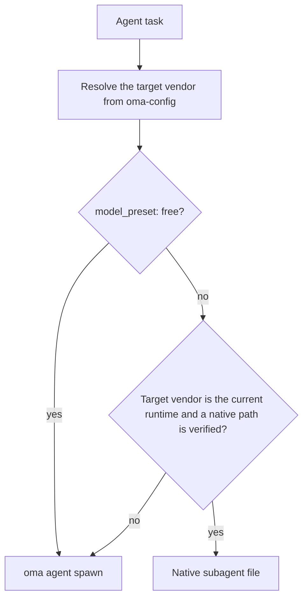
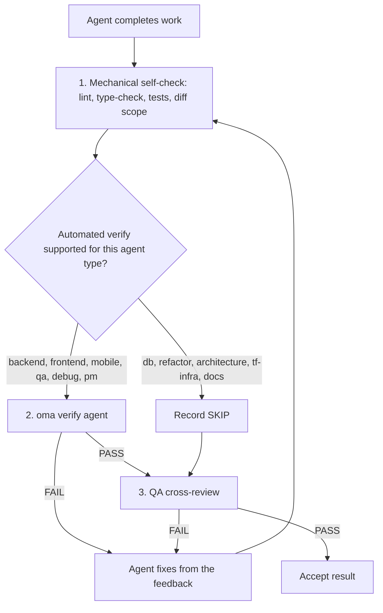

# Agentes

OMA separa las [habilidades](../getting-started/glossary.md#skill), los roles de despacho y las [definiciones de agentes](../getting-started/glossary.md#agent-definition). Una habilidad enruta y carga orientación del dominio; un rol canónico es la identidad de runtime usada para el despacho; una definición registrada proporciona una personalidad nativa del proveedor a un subagente. Estas capas se superponen por diseño, así que usa el límite de la tarea y los criterios de aceptación para decidir si basta una habilidad.

---

## Catálogo de habilidades {#skill-catalog}

Esta tabla es la lista autorizada de habilidades instaladas. `cli/scripts/generate-skill-catalog.mjs` la genera a partir del frontmatter de cada `.agents/skills/<name>/SKILL.md`; ejecuta el script con `--check` para detectar desviaciones. La sección `## References` del SKILL.md de cada habilidad enumera sus archivos de recursos y cuándo leerlos.

<!-- oma:generated skill-catalog:start -->
<!-- Generated from SKILL.md frontmatter under .agents/skills by cli/scripts/generate-skill-catalog.mjs. Do not edit this block by hand. -->

| Skill | Use it for |
|---|---|
| [`oma-academic-writing`](https://github.com/first-fluke/oh-my-agent/blob/main/.agents/skills/oma-academic-writing/SKILL.md) | Draft and revise academic prose against a rubric, evidence, and citation requirements. Use for essays, reports, literature reviews, or academic style audits. |
| [`oma-architecture`](https://github.com/first-fluke/oh-my-agent/blob/main/.agents/skills/oma-architecture/SKILL.md) | Evaluate system boundaries and architectural tradeoffs. Use for architecture decisions, design reviews, and ADRs. |
| [`oma-backend`](https://github.com/first-fluke/oh-my-agent/blob/main/.agents/skills/oma-backend/SKILL.md) | Implement server APIs, authentication, and application data access. Schema modeling and query tuning use oma-db. |
| [`oma-brainstorm`](https://github.com/first-fluke/oh-my-agent/blob/main/.agents/skills/oma-brainstorm/SKILL.md) | Explore goals, constraints, and alternative approaches before choosing a design. Use when the user requests ideation or design exploration. |
| [`oma-coordination`](https://github.com/first-fluke/oh-my-agent/blob/main/.agents/skills/oma-coordination/SKILL.md) | Shared coordination rules for multi-agent work: plan reuse, contract alignment, workspace ownership, and QA handoff. Loaded by the /work, /orchestrate, and /ultrawork workflows; also use for manual step-by-step coordination. |
| [`oma-db`](https://github.com/first-fluke/oh-my-agent/blob/main/.agents/skills/oma-db/SKILL.md) | Design schemas and migrations, tune queries, or plan vector retrieval and database operations. Application API implementation uses oma-backend. |
| [`oma-debug`](https://github.com/first-fluke/oh-my-agent/blob/main/.agents/skills/oma-debug/SKILL.md) | Diagnose a reproducible failure, fix its cause, and verify the regression. Use for crashes, incorrect behavior, and failing tests. |
| [`oma-design`](https://github.com/first-fluke/oh-my-agent/blob/main/.agents/skills/oma-design/SKILL.md) | Define or review a visual system, DESIGN.md, or redesign direction. Use for typography, layout, color, motion, and interaction design decisions. |
| [`oma-dev-workflow`](https://github.com/first-fluke/oh-my-agent/blob/main/.agents/skills/oma-dev-workflow/SKILL.md) | Configure development tasks, git hooks, CI/CD, or release automation. Use when creating or fixing a repository development workflow. |
| [`oma-docs`](https://github.com/first-fluke/oh-my-agent/blob/main/.agents/skills/oma-docs/SKILL.md) | Check documentation references, sync docs to code changes, and detect translation drift. Use for documentation maintenance in a repository. |
| [`oma-explanation`](https://github.com/first-fluke/oh-my-agent/blob/main/.agents/skills/oma-explanation/SKILL.md) | Create an offline HTML explanation of a code change (diff, PR, branch) or of a topic, system, or question. Use when a visual walkthrough document is requested. |
| [`oma-frontend`](https://github.com/first-fluke/oh-my-agent/blob/main/.agents/skills/oma-frontend/SKILL.md) | Implement or modify web UI in React, Next.js, or Angular. Use for components, pages, styles, forms, and frontend state or data flows. |
| [`oma-hwp`](https://github.com/first-fluke/oh-my-agent/blob/main/.agents/skills/oma-hwp/SKILL.md) | Convert Hangul HWP, HWPX, or HWPML documents to Markdown with kordoc. Use for text, table, and image extraction from these formats. |
| [`oma-image`](https://github.com/first-fluke/oh-my-agent/blob/main/.agents/skills/oma-image/SKILL.md) | Generate raster images or reference-guided variations through the OMA image CLI. Use for image assets or explicit vendor comparisons; pixel editing uses an editor. |
| [`oma-market`](https://github.com/first-fluke/oh-my-agent/blob/main/.agents/skills/oma-market/SKILL.md) | Research customer pain points, trends, and competitors through the OMA market engine. Use for market discovery or voice-of-customer analysis. |
| [`oma-mobile`](https://github.com/first-fluke/oh-my-agent/blob/main/.agents/skills/oma-mobile/SKILL.md) | Implement Flutter, React Native, native Swift, or native Kotlin Android apps. Use for mobile screens, widgets, platform integrations, and application data flows. |
| [`oma-observability`](https://github.com/first-fluke/oh-my-agent/blob/main/.agents/skills/oma-observability/SKILL.md) | Design or troubleshoot telemetry, SLOs, and incident diagnostics. Route to the relevant signal, system boundary, or vendor guide. |
| [`oma-orchestration`](https://github.com/first-fluke/oh-my-agent/blob/main/.agents/skills/oma-orchestration/SKILL.md) | Dispatch and supervise parallel specialist agents with durable task state. Use when automated multi-agent execution is requested. |
| [`oma-pdf`](https://github.com/first-fluke/oh-my-agent/blob/main/.agents/skills/oma-pdf/SKILL.md) | Extract PDF text, headings, tables, and images into Markdown using opendataloader-pdf. Use for PDF parsing, not PDF layout creation. |
| [`oma-pm`](https://github.com/first-fluke/oh-my-agent/blob/main/.agents/skills/oma-pm/SKILL.md) | Turn product requirements into scoped tasks with dependencies and acceptance criteria. Use for implementation planning and prioritization. |
| [`oma-qa`](https://github.com/first-fluke/oh-my-agent/blob/main/.agents/skills/oma-qa/SKILL.md) | Review changes for correctness, security, accessibility, and performance. Use for scoped quality reviews or verification plans; bug fixes use oma-debug. |
| [`oma-recap`](https://github.com/first-fluke/oh-my-agent/blob/main/.agents/skills/oma-recap/SKILL.md) | Summarize AI conversation histories for a specified date or period. Use for daily work recaps and cross-tool activity summaries. |
| [`oma-refactor`](https://github.com/first-fluke/oh-my-agent/blob/main/.agents/skills/oma-refactor/SKILL.md) | Restructure existing code while preserving observable behavior. Use for targeted technical debt or hotspot work with characterization tests. |
| [`oma-scholar`](https://github.com/first-fluke/oh-my-agent/blob/main/.agents/skills/oma-scholar/SKILL.md) | Search academic literature and generate, validate, or compare Knows paper sidecars. Use for claim/evidence analysis and literature synthesis. |
| [`oma-scm`](https://github.com/first-fluke/oh-my-agent/blob/main/.agents/skills/oma-scm/SKILL.md) | Manage Git branches, merges, conflicts, commits, and release baselines. Use for repository history and change-management operations. |
| [`oma-search`](https://github.com/first-fluke/oh-my-agent/blob/main/.agents/skills/oma-search/SKILL.md) | Find external documentation, web sources, or remote code with citations. Local code navigation uses the configured code tools. |
| [`oma-security`](https://github.com/first-fluke/oh-my-agent/blob/main/.agents/skills/oma-security/SKILL.md) | Scan application source, agent skills, and MCP components, validate findings, and configure scan gates. Penetration tests of a scoped web test deployment run only on a user-supplied, reviewed runtime platform. Use oma-qa for broad quality reviews and domain skills for remediation. |
| [`oma-skill-creation`](https://github.com/first-fluke/oh-my-agent/blob/main/.agents/skills/oma-skill-creation/SKILL.md) | Create or revise OMA skills and their references. Use for skill routing, execution contracts, conditional loading, and authoring validation. |
| [`oma-slide`](https://github.com/first-fluke/oh-my-agent/blob/main/.agents/skills/oma-slide/SKILL.md) | Create, import, revise, or export presentation decks through the OMA slide CLI or the ppt-master route. Use for HTML slides, editable PPTX, and PDF, PNG, or PPTX deck delivery. |
| [`oma-tf-infra`](https://github.com/first-fluke/oh-my-agent/blob/main/.agents/skills/oma-tf-infra/SKILL.md) | Create or review Terraform infrastructure and plans. Use for cloud resources, IAM, networking, state management, and infrastructure changes. |
| [`oma-translation`](https://github.com/first-fluke/oh-my-agent/blob/main/.agents/skills/oma-translation/SKILL.md) | Translate or revise localized UI strings and prose while preserving meaning, terminology, placeholders, and structure. |
| [`oma-video`](https://github.com/first-fluke/oh-my-agent/blob/main/.agents/skills/oma-video/SKILL.md) | Create videos through the OMA video CLI, or analyze and edit existing clips with media tools. Use for frame extraction, visual analysis, silence cuts, dubbing assembly, sound effects, scripts, and composition; audio-only work uses oma-voice. |
| [`oma-voice`](https://github.com/first-fluke/oh-my-agent/blob/main/.agents/skills/oma-voice/SKILL.md) | Generate or transcribe speech with Voicebox or VoiceStudio, or process existing audio locally. Use for narration, transcripts, timed speech, and loudness conversion; video editing uses oma-video. |
<!-- oma:generated skill-catalog:end -->

---

## Roles de despacho {#dispatch-roles}

El runtime despacha por rol canónico. Cada rol, salvo `orchestrator`, tiene una definición registrada en `.agents/agents/`, cuyo frontmatter `skills:` nombra las habilidades que carga. La primera habilidad de la lista es la responsable de la tarea.

| Rol | Archivo de definición | También se acepta | Habilidades |
|-----|-----------------------|-------------------|-------------|
| `orchestrator` | ninguno (rol de coordinación de runtime) | | |
| `pm` | `pm-planner.md` | `pm-planner` | oma-pm |
| `architecture` | `architecture-reviewer.md` | `architecture-reviewer` | oma-architecture |
| `qa` | `qa-reviewer.md` | `qa-reviewer` | oma-qa |
| `backend` | `backend-engineer.md` | `backend-engineer` | oma-backend |
| `frontend` | `frontend-engineer.md` | `frontend-engineer` | oma-frontend, oma-design |
| `mobile` | `mobile-engineer.md` | `mobile-engineer` | oma-mobile |
| `db` | `db-engineer.md` | `db-engineer` | oma-db |
| `debug` | `debug-investigator.md` | `debug-investigator` | oma-debug |
| `refactor` | `refactor-engineer.md` | `refactor-engineer` | oma-refactor |
| `docs` | `docs-curator.md` | `docs-curator` | oma-docs |
| `tf-infra` | `tf-infra-engineer.md` | `tf-infra-engineer` | oma-tf-infra |
| `explore` | `research-explorer.md` | `research-explorer`, `explorer` | oma-search, oma-market, oma-scholar |

También se acepta un sufijo final `-agent` (`qa-agent` se resuelve como `qa`).

### Archivos nativos de agentes {#native-agent-files}

Las definiciones de agentes bajo `.agents/agents/` son la fuente de verdad. OMA las proyecta en archivos nativos del proveedor para los runtimes que admiten subagentes personalizados:

| Runtime | Archivos nativos de agentes |
|---------|-----------------------------|
| Claude Code | `.claude/agents/<name>.md` |
| Codex CLI | `.codex/agents/<name>.toml` |
| Cursor | `.cursor/agents/` |
| OpenCode | `.opencode/agents/` |
| Kiro | `.kiro/agents/` |
| Grok | `.grok/agents/` |
| CommandCode | `.commandcode/agents/` |
| Qwen Code | `.qwen/agents/` |

pi no tiene un sistema de archivos de agentes, así que `oma agent spawn` incorpora la personalidad de la definición directamente en el prompt. Los archivos generados se actualizan mediante `oma link`, `oma install` y `oma update`.

### Cómo se despacha un rol {#how-a-role-is-dispatched}

Cuando un flujo asigna un agente al mismo proveedor que el runtime actual, usa primero el archivo nativo de ese runtime. Las tareas entre proveedores recurren a `oma agent spawn`.



> **Despacho de modelos por agente:** el proveedor, el modelo y el esfuerzo de cada rol provienen de `.agents/oma-config.yaml` (o de `.agents/oma-config.cue`, con una sobrecarga `.local` opcional). Con `model_preset: auto`, el valor predeterminado en instalaciones nuevas, los roles sin una sobrescritura en `agents:` siguen la configuración nativa de agente y modelo del runtime actual; `model_preset: free` siempre despacha mediante `oma agent spawn`. Consulta [Modelos por agente](../guide/per-agent-models.md) para los detalles de configuración y [`oma doctor --profile`](../cli-interfaces/commands.md#doctor) para inspeccionar la matriz activa.

---

## Categorías de habilidades {#agent-categories}

| Categoría | Habilidades | Responsabilidad |
|-----------|-------------|-----------------|
| **Ideación** | oma-brainstorm | Explorar ideas, proponer enfoques, producir documentos de diseño |
| **Arquitectura** | oma-architecture | Límites de sistema/módulo/servicio, análisis al estilo ADR/ATAM/CBAM, registros de compromisos |
| **Planificación** | oma-pm | Descomposición de requisitos, desglose de tareas, contratos de API, asignación de prioridad |
| **Implementación** | oma-frontend, oma-backend, oma-mobile, oma-db | Escribir código en sus respectivos dominios |
| **Diseño** | oma-design | Sistemas de diseño, DESIGN.md, tokens, tipografía, color, movimiento, accesibilidad |
| **Infraestructura** | oma-tf-infra | Aprovisionamiento Terraform multi-nube, IAM, optimización de costos, política como código |
| **DevOps** | oma-dev-workflow | mise task runner, CI/CD, migraciones, coordinación de releases, automatización de monorepos |
| **Observabilidad** | oma-observability | Pipelines de observabilidad, enrutamiento de trazabilidad, señales MELT+P (metrics/logs/traces/profiles/cost/audit/privacy), gestión de SLO, forense de incidentes, ajuste de transporte |
| **Calidad** | oma-qa | Auditoría de seguridad (OWASP), rendimiento, accesibilidad (WCAG), revisión de calidad de código |
| **Depuración** | oma-debug | Reproducción de bugs, análisis de causa raíz, correcciones mínimas, pruebas de regresión |
| **Localización** | oma-translation | Traducción consciente del contexto preservando tono, registro y términos del dominio |
| **Coordinación** | oma-orchestration, oma-coordination | Orquestación multiagente automatizada; reglas de coordinación compartidas y coordinación manual paso a paso |
| **Git** | oma-scm | Generación de Conventional Commits, división de commits por funcionalidad |
| **Búsqueda y Recuperación** | oma-search | Enrutador de búsqueda para fuentes externas con citas (documentos Context7, proveedores web, código remoto `gh`/`glab`, obtención de URLs conocidas) |
| **Retrospectiva** | oma-recap | Análisis de historiales de conversación entre herramientas y resúmenes de trabajo temáticos |
| **Procesamiento de Documentos** | oma-hwp, oma-pdf | Conversión de HWP/HWPX/HWPML y PDF a Markdown para ingesta de LLM/RAG |
| **Documentación** | oma-docs | Mantenimiento de la documentación: referencias rotas, documentos afectados por un diff, drift de traducciones y lint de documentos traducidos |
| **Explicación** | oma-explanation | Explicaciones HTML offline de un cambio de código (diff, PR, branch, rango de commits) o de un tema, sistema o pregunta |
| **Redacción académica** | oma-academic-writing, oma-scholar | Redacción/auditoría de prosa académica de calidad editorial e investigación, búsqueda y revisión por pares académicas con sidecars Knows |
| **Seguridad** | oma-security | Escaneo de código fuente de aplicaciones, paquetes de habilidades de agentes y componentes MCP (Deepsec, escáneres de Cisco), con validación independiente de hallazgos y puertas de CI; pruebas de penetración de un despliegue web de prueba acotado solo en una plataforma ARTEX aportada y revisada por el usuario |
| **Refactorización** | oma-refactor | Reestructuración incremental preservando comportamiento, con hotspots, redes de seguridad de pruebas de caracterización y commits solo de refactorización |
| **Investigación de mercado** | oma-market | Investigación de señales comunitarias sobre problemas, tendencias, competidores y descubrimiento con marcos SWOT/Porter's 5F/PESTEL elegidos automáticamente según la intención |
| **Creación de habilidades** | oma-skill-creation | Creación y validación de habilidades OMA en formato SSL-lite |
| **Generación multimedia** | oma-image, oma-slide, oma-video, oma-voice | Generación de imágenes con IA, presentaciones HTML y PPTX editables, vídeo corto/explainer/demo y TTS/STT local |

---

## Referencia detallada de agentes {#detailed-agent-reference}

Estos resúmenes explican el dominio y las reglas clave de cada habilidad. El propio SKILL.md de la habilidad es la fuente de verdad: su sección `## References` enumera los archivos de recursos y la condición para leer cada uno, por lo que esta página no copia esas listas.

### oma-brainstorm

**Dominio:** Ideación orientada al diseño antes de la planificación o implementación.

**Cuándo usar:** Explorando una nueva idea de funcionalidad, entendiendo la intención del usuario, comparando enfoques. Usar antes de `/plan` para solicitudes complejas o ambiguas.

**Cuándo NO usar:** Requisitos claros (ir a oma-pm), implementación (ir a agentes de dominio), revisión de código (ir a oma-qa).

**Reglas principales:**
- No implementar ni planificar antes de la aprobación del diseño
- Una pregunta clarificadora a la vez (no en lotes)
- Comparar dos o tres enfoques viables cuando las alternativas ayuden a decidir; si las restricciones dejan menos, explicar por qué en lugar de inventar opciones
- Presentar el diseño sección por sección, resolviendo solo las elecciones relevantes que sigan abiertas
- YAGNI: diseñar solo lo necesario

**Flujo de trabajo:** El flujo `/brainstorm` ejecuta 7 pasos: Contexto, Preguntas, Enfoques (opcionalmente sembrados con TRIZ-lite), Diseño, Revisión ciega, Documentación (guarda en `docs/decisions/`), Transición a `/plan`.

---

### oma-architecture

**Dominio:** Arquitectura de software/sistemas, incluidos los límites de módulos y servicios, el análisis de compromisos, la síntesis de partes interesadas y los registros de decisiones.

**Cuándo usar:** Elección o revisión de la arquitectura del sistema, definición de límites de módulo/servicio/propiedad, comparación de opciones arquitectónicas con compromisos explícitos, investigación de dolores arquitectónicos (amplificación de cambios, dependencias ocultas, APIs incómodas), priorización de inversiones o refactorizaciones arquitectónicas, redacción de recomendaciones de arquitectura o ADRs.

**Cuándo NO usar:** Sistemas visuales/de diseño (usar oma-design), planificación de funcionalidades y desglose de tareas (usar oma-pm), implementación de Terraform (usar oma-tf-infra), diagnóstico de bugs (usar oma-debug), revisión de seguridad/rendimiento/accesibilidad (usar oma-qa).

**Metodologías:** Enrutamiento diagnóstico, comparación design-twice, análisis de riesgo al estilo ATAM, priorización al estilo CBAM, registros de decisiones al estilo ADR.

**Reglas principales:**
- Diagnosticar el problema arquitectónico antes de seleccionar un método
- Usar la metodología más ligera que sea suficiente para la decisión actual
- Distinguir el diseño arquitectónico del diseño de UI/visual y de la entrega de Terraform
- Consultar a agentes de partes interesadas solo cuando la decisión sea lo suficientemente transversal para justificar el costo
- La calidad de la recomendación importa más que el teatro del consenso: consultar ampliamente, decidir explícitamente
- Cada recomendación debe declarar suposiciones, compromisos, riesgos y pasos de validación
- Ser consciente del costo por defecto: costo de implementación, costo operativo, complejidad del equipo, costo de cambios futuros

---

### oma-pm

**Dominio:** Gestión de producto, incluidos el análisis de requisitos, la descomposición de tareas y los contratos de API.

**Cuándo usar:** Desglosar funcionalidades complejas, determinar viabilidad, priorizar trabajo, definir contratos de API.

**Reglas principales:**
- Diseño API-first: definir contratos antes de tareas de implementación
- Cada tarea tiene: agente, título, criterios de aceptación, prioridad, dependencias
- Minimizar dependencias para máxima ejecución paralela
- Seguridad y pruebas son parte de cada tarea (no fases separadas)
- Las tareas deben ser completables por un solo agente
- Salida del plan JSON como traspaso al orquestador; el orquestador crea el task board y es su propietario

**Salida:** `.agents/results/plan-{sessionId}.json` con niveles de prioridad numéricos (`1` = independiente; los niveles más bajos se ejecutan primero), más el informe con ámbito de ejecución `result-{agentId}-{taskId}-{runId}-{sessionId}.md` en el almacén de memoria configurado.

---

### oma-frontend

**Dominio:** UI web en React/Next.js o Angular con TypeScript. Los proyectos React usan FSD-lite; los proyectos Angular siguen `resources/angular-rules.md`.

**Cuándo usar:** Construir interfaces de usuario, componentes, lógica del lado del cliente, estilos, validación de formularios, integración con API.

**Stack tecnológico:**
- React + Next.js (Server Components por defecto, Client Components para interactividad)
- TypeScript (estricto)
- TailwindCSS v4 + shadcn/ui (primitivos de solo lectura, extender vía cva/wrappers)
- FSD-lite: raíz `src/` + funcionalidad `src/features/*/` (sin importaciones entre funcionalidades)

**Librerías (proyectos React/Next.js):**
| Propósito | Librería |
|-----------|----------|
| Fechas | luxon |
| Estilos | TailwindCSS v4 + shadcn/ui |
| Hooks | ahooks o @mantine/hooks |
| Utilidades | es-toolkit |
| Tipos | type-fest |
| Estado URL | nuqs |
| Estado Servidor | TanStack Query (hooks generados por orval cuando existe una especificación OpenAPI) |
| Estado Cliente | Jotai o Zustand, elegido según la intención y sin opción predeterminada (minimizar su uso) |
| Formularios | @tanstack/react-form + Zod |
| Autenticación | better-auth |
| Animación | motion (`motion/react`) para proyectos nuevos |

**Reglas principales:**
- shadcn/ui primero, extender vía cva, nunca modificar `components/ui/*` directamente
- Mapeo 1:1 de tokens de diseño (nunca codificar colores en duro)
- Proxy de solicitudes: conservar una convención `proxy.ts` existente de Next.js 16+; comprobar la versión instalada y el enrutamiento antes de proponer renombrarlo a `middleware.ts`
- Sin prop drilling más allá de 3 niveles; usar la librería de estado de cliente del proyecto (átomos de Jotai o un store de Zustand)
- Importaciones absolutas con `@/` obligatorias
- Objetivo FCP < 1s
- Breakpoints responsive: 320px, 768px, 1024px, 1440px

**Lista de verificación de puerta de calidad:**
- Accesibilidad: etiquetas ARIA, encabezados semánticos, navegación por teclado
- Móvil: verificado en viewports móviles
- Rendimiento: sin CLS, carga rápida
- Resiliencia: Error Boundaries y Loading Skeletons
- Pruebas: lógica cubierta por Vitest
- Calidad: typecheck y lint pasan

---

### oma-backend

**Dominio:** APIs, lógica del lado del servidor, autenticación, operaciones de base de datos.

**Cuándo usar:** APIs REST/GraphQL, el código de acceso a datos y las migraciones que necesita un cambio de API, autenticación, lógica de negocio del servidor, trabajos en segundo plano.

**Cuándo NO usar:** Modelado de esquemas, diseño de índices y ajuste de consultas (usar oma-db), UI de frontend (usar oma-frontend), código móvil (usar oma-mobile).

**Arquitectura:** Router (HTTP) -> Service (Lógica de Negocio) -> Repository (Acceso a Datos) -> Models.

**Detección de stack:** Lee primero los manifiestos del proyecto (pyproject.toml, package.json, Cargo.toml, go.mod, etc.) y el código existente para determinar lenguaje y framework. La referencia de stack es complementaria: `stack/` cuando existe; en caso contrario, el `variants/<language>/` correspondiente. Un proyecto instalado con un preset elegido tiene `stack/` y no tiene `variants/`; las estructuras de plugin y de código fuente tienen `variants/` y no tienen `stack/`. Si no se aplica ninguno de los dos casos, el agente pregunta al usuario o sugiere `/stack-set`.

**Presets distribuidos:** Python (Litestar con SQLAlchemy 2 (async) mediante Advanced Alchemy, modelos msgspec, autenticación JWT integrada), Node.js (NestJS + Prisma, probado con Vitest) y Rust (Axum + SQLx). Un proyecto instalado con el anterior preset de FastAPI conserva FastAPI. Estos valores predeterminados solo se aplican cuando el proyecto de destino no tiene una elección establecida; una edición acotada no autoriza una migración de stack.

**Reglas principales:**
- Arquitectura limpia: sin lógica de negocio en manejadores de ruta
- Todas las entradas validadas con la librería de validación del proyecto
- Solo consultas parametrizadas (nunca interpolación de strings en SQL)
- JWT + Argon2id para autenticación (bcrypt es aceptable por compatibilidad con sistemas legacy); limitar la tasa en endpoints de autenticación
- Async donde sea soportado; anotaciones de tipo en todas las firmas
- Excepciones personalizadas vía módulo centralizado de errores
- Estrategia de carga ORM explícita, límites de transacciones, ciclo de vida seguro
- Los comandos de verificación se seleccionan a partir del proyecto (con preferencia por el bloque `verify:` de `stack/stack.yaml`) y se ejecutan solo cuando el usuario o el flujo activo lo requieren; se informa de las comprobaciones no ejecutadas

<!-- oma-docs:ignore-start -->
La referencia de stack contiene `stack.yaml` (la declaración estructurada y el contrato `verify:` que ejecuta `oma verify agent backend`), `tech-stack.md`, `snippets.md` y `api-template.*`. `/stack-set` genera un `stack/` específico del proyecto a partir del código base detectado.
<!-- oma-docs:ignore-end -->

---

### oma-mobile

**Dominio:** Aplicaciones móviles multiplataforma y nativas (Flutter, React Native, Swift nativo para iOS y Kotlin nativo para Android).

**Cuándo usar:** Apps móviles nativas (iOS + Android), patrones de UI específicos para móvil, funcionalidades de plataforma (cámara, GPS, notificaciones push), arquitectura offline-first; apps nativas de iOS en Swift usando SwiftUI y `swift-openapi-generator`.

**Arquitectura:** Clean Architecture: domain -> data -> presentation. Para iOS en Swift: estructura de proyecto `App/Core/Features/Shared`. Para Android en Kotlin: `app/{ui,data,di}` + `api-client`. La lógica de negocio nunca reside en widgets, vistas ni composables.

**Stacks tecnológicos:**
- Flutter/Dart: Riverpod/Bloc (gestión de estado), Dio con interceptores (API), GoRouter (navegación), Material Design 3 (Android) + iOS HIG.
- React Native: Zustand + TanStack Query (estado), axios detrás de hooks de TanStack Query (API).
- Swift nativo para iOS (iOS 17+): SwiftUI + `@Observable` (Observation framework), `swift-openapi-generator` de Apple para clientes de API, estructura `App/Core/Features/Shared`.
- Kotlin nativo para Android (API 26+): Jetpack Compose + Material 3, `@HiltViewModel` + `StateFlow`, clientes de OpenAPI Generator (`kotlin` / `jvm-ktor`) sobre Ktor con un motor OkHttp inyectado, estructura `app/{ui,data,di}` + `api-client`.

**Reglas principales:**
- La gestión de estado es la solución de la variante (Flutter: Riverpod/Bloc; React Native: Zustand + TanStack Query; Swift: `@MainActor @Observable`; Kotlin: `@HiltViewModel` + `StateFlow`); sin setState directo ni estado ad hoc para lógica compleja
- Liberar los recursos con el ciclo de vida de la plataforma: controladores de Flutter en `dispose()`, limpiezas de efectos en React Native, `.task {}` estructurado en Swift, `viewModelScope` en Kotlin
- Usar el transporte de la plataforma con interceptación de autenticación/reintentos/logging; manejar offline con gracia
- Objetivo 60fps; cubrir todas las plataformas en las que se publica la app
- Los secretos residen solo en almacenamiento seguro (flutter_secure_storage, Keychain, react-native-keychain, almacenamiento respaldado por Android Keystore)
- E2E para los flujos de usuario críticos: Maestro (Flutter, React Native, Kotlin) o XCUITest (Swift nativo)
- Las pruebas y las comprobaciones E2E se ejecutan solo cuando el usuario o el flujo activo lo requieren; las builds se ejecutan solo ante una solicitud explícita
- Swift: usar `@Observable` en lugar de `ObservableObject` en iOS 17+; generar clientes de API a partir de especificaciones OpenAPI con `swift-openapi-generator`
- Kotlin: llamar a la `*Api` generada para los endpoints cubiertos por la especificación; Ktor es una capa independiente del motor, así que el motor OkHttp se inyecta donde se construye el cliente y `MockEngine` lo sustituye en las pruebas

**Variantes de plataforma:** `variants/` incluye `flutter/`, `react-native/`, `swift-ios/` y `kotlin-android/`, cada una con `stack.yaml`, `tech-stack.md` y `snippets.md` (patrones de capa de datos, estado, pantalla y pruebas, incluido el snippet del servicio o repositorio de API), además del `stack.schema.json` compartido. El agente usa `stack/` cuando existe y, en caso contrario, lee directamente el `variants/<platform>/` correspondiente; `/stack-set` escribe `stack/` a partir del proyecto detectado, sembrado desde la variante. Una habilidad instalada sin una variante conserva su directorio `variants/`.

---

### oma-db

**Dominio:** Arquitectura de bases de datos en SQL, NoSQL y bases de datos vectoriales.

**Cuándo usar:** Diseño de esquemas, ERD, normalización, indexación, transacciones, planificación de capacidad, estrategia de respaldos, diseño de migraciones, arquitectura de base de datos vectorial/RAG, revisión de anti-patrones, diseño consciente de cumplimiento (ISO 27001/27002/22301).

**Flujo por defecto:** Explorar (identificar entidades, patrones de acceso, volumen) -> Diseñar (esquema, restricciones, transacciones) -> Optimizar (índices, particionamiento, archivado, anti-patrones).

**Reglas principales:**
- Elegir modelo primero, motor después
- 3NF por defecto para relacional; documentar compromisos BASE para distribuido
- Documentar las tres capas de esquema: externa, conceptual, interna
- La integridad es de primera clase: entidad, dominio, referencial, regla de negocio
- La concurrencia nunca es implícita: definir límites de transacción y niveles de aislamiento
- Las BDs vectoriales son infraestructura de recuperación, no fuente de verdad
- Nunca tratar la búsqueda vectorial como reemplazo directo de la búsqueda léxica

**Entregables requeridos:** Resumen de esquema externo, esquema conceptual, esquema interno, tabla de estándares de datos, glosario, estimación de capacidad, estrategia de respaldo/recuperación. Para vectorial/RAG: política de versión de embeddings, política de chunking, estrategia de recuperación híbrida.

---

### oma-design

**Dominio:** Sistemas visuales, `DESIGN.md` y dirección de rediseño: decisiones de tipografía, layout, color, movimiento y diseño de interacción.

**Cuándo usar:** Definir o modificar un sistema visual o una dirección de diseño sustancial, revisar una UI existente o refinar una dirección elegida, extraer decisiones de diseño de una UI existente, de capturas de pantalla o de referencias proporcionadas.

**Cuándo NO usar:** Implementar la UI de la aplicación o exportar tokens específicos de un framework (usar oma-frontend u oma-mobile), planificar el alcance del producto (usar oma-pm), generar una imagen (usar oma-image), revisión general de corrección o de seguridad (usar oma-qa u oma-security).

**Selección del proveedor de diseño:** La habilidad resuelve la intención de diseño del proyecto y carga una habilidad de diseño externa por operación mediante `resources/external-design-skills.md`:

| Operación | Proveedor de diseño |
|-----------|---------------------|
| Dirección visual para dashboards, paneles de administración, UI de productos SaaS o herramientas internas | Interface Design |
| Revisión posterior a la implementación de la jerarquía, la densidad, la consistencia o el acabado de una interfaz de producto | Interface Design `design-review` |
| Otras críticas de una UI existente, auditoría de accesibilidad o técnica, pulido o extracción del sistema | Impeccable |
| Otra dirección de arte web nueva o una renovación visual autorizada | Taste |
| Tarea solo de documentación o de contrato de tokens sin un nuevo juicio visual | Se queda en local |

**Flujo de trabajo:** Inspeccionar la UI, los artefactos de diseño y el brief, y establecer el alcance, la plataforma, el stack existente, los idiomas, la preservación de la marca y la verificación -> seleccionar y cargar el proveedor de diseño -> aplicar el resultado a la decisión o al artefacto solicitado -> comprobar el resultado afectado con `resources/checklist.md` y pasar la implementación al especialista de frontend o de mobile.

**Reglas principales:**
- Reutilizar `.design-context.md` y `DESIGN.md` cuando existan; actualizar `DESIGN.md` solo cuando cambie el sistema visual, y crear `.design-context.md` solo cuando una fase de descubrimiento sustancial informe la decisión
- Una corrección acotada reutiliza la UI y los tokens afectados; no necesita un documento de descubrimiento
- Para un sitio o una app existente, seguir `resources/redesign-protocol.md` y clasificar Preserve frente a Overhaul antes de proponer
- Conservar la marca, el contenido, las URLs, la navegación, los contratos de formularios, la analítica y los textos legales existentes dentro del alcance autorizado
- Conservar las fuentes existentes cuando sean adecuadas; para ko/ja/zh, verificar la cobertura de glifos, el fallback, los saltos de línea y unas métricas legibles
- WCAG AA es el objetivo de accesibilidad predeterminado, o el más estricto que fije el proyecto; los requisitos de responsive, de movimiento reducido y de plataforma se trasladan al proveedor de diseño seleccionado
- Usar los recursos y las afirmaciones reales del proyecto; etiquetar los conceptos y los placeholders
- Conservar el stack de implementación existente; el especialista de implementación es responsable del CSS, de Tailwind, de la sintaxis de la librería de componentes y de las dependencias
- Las operaciones de solo revisión se mantienen en solo lectura
- Preguntar solo por la elección relevante sin resolver; si un proveedor de diseño solicitado explícitamente no está disponible, se informa de ello y no se sustituye

**Salida:** La decisión de diseño, los hallazgos o el traspaso a implementación solicitados, con la evidencia observada, el proveedor de diseño y la operación seleccionados y los límites de capacidad o de verificación. `DESIGN.md` y `.design-context.md` se escriben solo cuando se cumplen las condiciones anteriores. Stitch y getdesign son entradas opcionales.

---

### oma-tf-infra

**Dominio:** Infraestructura como código con Terraform, multi-nube.

**Cuándo usar:** Aprovisionamiento en AWS/GCP/Azure/Oracle Cloud, configuración Terraform, autenticación CI/CD (OIDC), CDN/balanceadores de carga/almacenamiento/redes, gestión de estado, infraestructura de cumplimiento ISO.

**Detección de nube:** Lee proveedores Terraform y prefijos de recursos (`google_*` = GCP, `aws_*` = AWS, `azurerm_*` = Azure, `oci_*` = Oracle Cloud). Incluye tabla completa de mapeo de recursos multi-nube.

**Reglas principales:**
- Agnóstico al proveedor: detectar nube desde el contexto del proyecto
- Estado remoto con versionado y bloqueo
- OIDC-first para autenticación CI/CD
- Plan antes de apply siempre
- IAM de mínimo privilegio
- Etiquetar todo (Environment, Project, Owner, CostCenter)
- Sin secretos en el código
- Fijar versión de todos los proveedores y módulos
- Sin auto-approve en producción

---

### oma-dev-workflow

**Dominio:** Automatización de tareas en monorepos y CI/CD.

**Cuándo usar:** Ejecutar servidores de desarrollo, ejecutar lint/format/typecheck a través de apps, migraciones de base de datos, generación de API, builds i18n, builds de producción, optimización CI/CD, validación pre-commit, y configuración de herramientas de lint, format y typecheck específicas de cada lenguaje, lint de Dockerfile y commitlint.

**Reglas principales:**
- Usar tareas `mise run` en lugar de comandos directos del gestor de paquetes; descubrirlas con `mise tasks --all` y leer la definición de una tarea desconocida antes de ejecutarla
- Ejecutar lint y test en el alcance modificado; CI debe omitir apps sin cambios
- Validar mensajes de commit con commitlint mediante un hook `commit-msg` aprovisionado localmente; nunca descargar paquetes desde un hook de Git
- Mantener las tareas de comprobación sin mutaciones: exponer `lint`, `format:check` y `typecheck`, y mantener aparte `format`, que sí modifica archivos
- Una ejecución de validación omitida no es una aprobación; un verificador que no puede ejecutarse se informa como incompleto, no se sustituye por un placeholder ni por una build
- Preferir pruebas herméticas; las pruebas que necesitan Docker o servicios externos pertenecen a una tarea de integración aparte y opt-in, fuera de los hooks por defecto y de las puertas de CI obligatorias
- Nunca codificar secretos en duro en `mise.toml`; nunca ejecutar tareas destructivas sin confirmación

**Recursos:** `mise-basics.md`, `tooling-profiles.md`, `validation-pipeline.md`, `example-task-wiring.md` (migraciones, infraestructura Docker local opcional, generación de clientes de API, builds i18n), `release-coordination.md` y `troubleshooting.md`, cada uno cargado según su disparador indicado.

---

### oma-observability

**Dominio:** Enrutador de observabilidad y trazabilidad basado en intención, a través de capas, fronteras y señales.

**Cuándo usar:**
- Configuración del pipeline: OTel SDK + Collector + backend del proveedor
- Trazabilidad entre fronteras de servicio y dominio: propagadores W3C, baggage, multi-tenant, multi-nube
- Ajuste de transporte: umbrales UDP/MTU, OTLP gRPC vs HTTP, topología Collector DaemonSet vs sidecar, recetas de muestreo
- Forense de incidentes: localización en 6 dimensiones (code / service / layer / host / region / infra)
- Selección de categoría de proveedor: OSS full-stack vs SaaS comercial vs especialista de alta cardinalidad vs especialista en profiling
- Observability-as-code: dashboards Grafana Jsonnet, CRD PrometheusRule, YAML OpenSLO, alertas SLO burn-rate
- Meta-observabilidad: salud propia del pipeline, desfase de reloj, guardarraíles de cardinalidad, matriz de retención
- Cobertura de señales MELT+P: metrics, logs, traces, profiles, cost, audit, privacy
- Migraciones de pipelines de logs evaluadas según el soporte upstream actual y los requisitos del proyecto

**Cuándo NO usar:** Observabilidad de LLM ops / gen_ai (usar Langfuse, Arize Phoenix, LangSmith, Braintrust), lineage de pipelines de datos (OpenLineage + Marquez, dbt test, Airflow lineage), telemetría de capa física de IoT / datacenter (Nlyte, Sunbird, Device42), orquestación de ingeniería del caos (Chaos Mesh, Litmus, Gremlin, ChaosToolkit), infraestructura GPU / TPU (NVIDIA DCGM Exporter), cadena de suministro de software (sigstore, in-toto, SLSA), flujo de respuesta a incidentes / paging (PagerDuty, Jira Service Management, Grafana Cloud IRM), inspección completa de paquetes TLS, escaneo de seguridad o pruebas de penetración (usar oma-security; esta habilidad solo cubre la telemetría de seguridad), configuración de un único proveedor ya cubierta por la habilidad propia de ese proveedor.

**Reglas principales:**
- Clasificar la intención antes de enrutar: setup | migrate | investigate | alert | trace | tune | route
- Cargar los recursos según sus disparadores: el protocolo de ejecución, la única guía que selecciona la ruta de intención y, después, una guía de capa, frontera, señal o transporte solo cuando su disparador está presente. Ninguna referencia es una precarga obligatoria
- Usar `resources/vendor-categories.md` solo cuando haga falta seleccionar una categoría o delegar en un proveedor; delegar a habilidades propias del proveedor en lugar de duplicar su documentación
- Cargar la única guía de transporte que corresponda al problema observado: UDP/MTU, protocolo OTLP, topología del Collector o muestreo
- Antes de declarar completa una configuración, verificar la salud del pipeline, la sincronización de reloj, los límites de cardinalidad y la retención frente a los requisitos del proyecto, y registrar las comprobaciones que no pudieron ejecutarse
- Verificar el soporte upstream actual, la estabilidad de los atributos y la guía de migración en la documentación oficial y en el estado de la CNCF cuando afecten a la recomendación. Los archivos de recursos no fijan versiones de especificación por archivo; `resources/standards.md` contiene la única declaración sobre la vigencia de la especificación y de semconv
- W3C Trace Context como propagador por defecto, con las traducciones por nube de `resources/boundaries/cross-application.md` cuando hagan falta
- Aplicar la redacción de PII y los controles de baggage conscientes del muestreo en la recolección; comprobar los requisitos de retención, borrado y auditoría del sistema de destino
- Entregar configuración funcional o propuestas etiquetadas explícitamente; los scaffolds y las comprobaciones sin verificar no cuentan como configuración completada

La matriz de cobertura tiene cuatro capas (L3, L4, mesh, L7), cuatro fronteras (multi-tenant, cross-application, SLO, release) y siete señales (metrics, logs, traces, profiles, cost, audit, privacy).

---

### oma-qa

**Dominio:** Aseguramiento de calidad que abarca seguridad, rendimiento, accesibilidad y calidad de código.

**Cuándo usar:** Revisión final antes del despliegue, auditorías de seguridad, análisis de rendimiento, cumplimiento de accesibilidad, análisis de cobertura de pruebas.

**Cuándo NO usar:** Escaneos basados en escáneres, pruebas de penetración, validación de hallazgos o puertas de CI de seguridad (usar oma-security), implementación inicial y funcionalidades nuevas (usar los agentes de dominio).

**Orden de prioridad de revisión:** Seguridad > Rendimiento > Accesibilidad > Calidad de Código.

**Niveles de severidad:**
- **CRITICAL**: Brecha de seguridad, riesgo de pérdida de datos
- **HIGH**: Bloquea el lanzamiento
- **MEDIUM**: Corregir este sprint
- **LOW**: Backlog

**Reglas principales:**
- Cada hallazgo debe incluir archivo:línea, descripción y corrección
- Seleccionar las comprobaciones automatizadas que correspondan al stack detectado y al alcance de la revisión (por ejemplo, una auditoría de dependencias, un análisis estático de seguridad o una auditoría de rendimiento en runtime); revisar de forma estática cuando una herramienta o un objetivo no esté disponible
- Ejecutar los comandos de lint, test y cobertura del proyecto cuando la solicitud de revisión o el flujo activo requieran esa evidencia; en caso contrario, informar de que no se ejecutaron
- Cada hallazgo de defecto debe ser reproducible; las hipótesis y las comprobaciones no disponibles se registran como brechas de verificación, y no se emite ningún PASS mientras queden comprobaciones obligatorias sin verificar
- Los hallazgos de seguridad aquí son hallazgos de revisión de código; los candidatos de escáneres, la prueba de explotación y las disposiciones `confirmed` / `needs_validation` pertenecen a oma-security
- Proporcionar código de remediación, no solo descripciones

---

### oma-debug

**Dominio:** Diagnóstico y corrección de bugs.

**Cuándo usar:** Bugs reportados por usuarios, crashes, problemas de rendimiento, fallos intermitentes, condiciones de carrera, bugs de regresión.

**Metodología:** Reproducir primero, luego diagnosticar. Nunca adivinar correcciones.

**Reglas principales:**
- Identificar causa raíz, no solo síntomas
- Corrección mínima: cambiar solo lo necesario
- Cada corrección obtiene una prueba de regresión; volver a ejecutarla con la comprobación original que fallaba (rojo antes de la corrección, verde después)
- Ejecutar suites más amplias solo cuando el usuario o el flujo activo lo requieran; en caso contrario, informar de que no se ejecutaron
- Buscar patrones similares en otros lugares
- Documentar el bug en `.agents/results/bugs/`: el informe condensado de `resources/debugging-checklist.md`, o el `resources/bug-report-template.md` completo para bugs Complex o CRITICAL/HIGH

**Herramientas de inteligencia de código usadas (Gortex o Serena):**
- `find_symbol("functionName")` o navegación de símbolos de Gortex: localizar la función
- `find_referencing_symbols("Component")` o análisis de impacto de Gortex: encontrar todos los usos
- `search_for_pattern("error pattern")` o búsqueda de Gortex: encontrar problemas similares

---

### oma-translation

**Dominio:** Traducción multilingüe consciente del contexto.

**Cuándo usar:** Traducir cadenas de UI, documentación, textos de marketing, revisar traducciones existentes, crear glosarios.

**Método de traducción:** Cuatro pasos: leer el significado y la sintaxis protegida, elegir el registro, reconstruir en el idioma de destino y preservar el estilo del autor donde corresponda. La verificación es proporcional al riesgo del contenido: la sintaxis protegida y la estructura se comprueban siempre; el contenido sustancial y el modo de revisión usan además la rúbrica (naturalidad, exactitud, registro, terminología, integridad técnica).

**Reglas principales:**
- Escanear archivos de locale existentes primero para coincidir convenciones
- Traducir significado, no palabras
- Preservar connotaciones emocionales
- Nunca producir traducciones palabra por palabra
- Nunca mezclar registros dentro de un texto
- Preservar terminología específica del dominio tal cual

---

### oma-orchestration

**Dominio:** Coordinación multiagente automatizada vía generación CLI.

**Cuándo usar:** Funcionalidades complejas que requieren múltiples agentes en paralelo, ejecución automatizada, implementación full-stack.

**Valores de configuración por defecto:**

| Configuración | Predeterminado | Descripción |
|---------------|----------------|-------------|
| MAX_PARALLEL | 3 | Máximo de subagentes concurrentes |
| MAX_RECOVERY_ATTEMPTS | 3 | Total de reintentos e hipótesis de exploración por tarea, incluido el intento original |
| POLL_INTERVAL | backoff acotado | Solo como alternativa cuando no hay notificaciones de finalización disponibles (los subagentes nativos de Claude Code devuelven el resultado de forma síncrona) |

Estos son valores predeterminados del flujo; la configuración de modelo, proveedor, paralelismo y presupuesto se resuelve a partir de la configuración del proyecto.

**Fases del flujo:** Plan → Referencias (seleccionar referencias por tarea) → Configuración (artefactos de sesión y task board) → Ejecución (despachar las tareas listas dentro de MAX_PARALLEL) → Monitoreo → Verificación (bucle de revisión) → Recopilación (declaraciones de resultados e informes con ámbito de ejecución).

**Referencias de tarea:** Cada tarea se compara con las firmas de intención de las habilidades instaladas, y el coordinador selecciona las referencias que necesita. Basta una habilidad que coincida con confianza; el conjunto se amplía solo cuando la clasificación es incierta o una dependencia requiere otro dominio. La selección y su motivo se registran en el task board como notas del coordinador; el lanzador no las impone.

**Bucle de revisión agente a agente:** consulta [Flujo de orquestación](#orchestration-flow) para ver el diagrama y los límites del bucle.

**Evidencia de sesión:** Registra las correcciones relevantes y los hallazgos de revisión dictaminados cuando resulta útil, con su causa, su impacto y su verificación. No se aplica ninguna puntuación de penalización ni pausa desencadenada por una puntuación.

---

### oma-scm

**Dominio:** Gestión de configuración de software (SCM) y Git, que abarca ramas, merges, worktrees, líneas base, preparación para auditoría y Conventional Commits.

**Cuándo usar:** Después de cambios de código (`/scm`), conflictos de merge, estrategia de ramas, releases/tags o cualquier pregunta de gestión de configuración (CM) del repositorio.

**Tipos de commit:** feat, fix, docs, style, refactor, perf, test, chore, build, ci, revert.

**Flujo de trabajo (commits):** Analizar cambios → Dividir por funcionalidad cuando sea necesario → tipo → alcance → descripción (imperativo, menos de 72 caracteres, minúsculas y sin punto final) → commit con rutas explícitas.

**Reglas:**
- No usar `git add -A` ni `git add .` sin autorización explícita
- Nunca hacer commit de archivos de secretos
- Siempre especificar archivos al preparar el staging
- Escribir el mensaje en un archivo y hacer commit con `git commit -F <message-file>`
- No reescribir historial compartido sin autorización explícita; usar `--force-with-lease`, nunca `--force` a secas
- Los trailers de coautor solo se incluyen cuando la configuración efectiva `scm.co_author` los habilita y proporciona nombre y correo.

---

### oma-coordination

**Dominio:** Reglas de coordinación compartidas para el trabajo multiagente: reutilización del plan, alineación de contratos, propiedad de los workspaces y traspaso a QA.

**Cuándo usar:** Cualquier flujo que despache más de un agente especialista. `/work`, `/orchestrate` y `/ultrawork` cargan esta habilidad y aplican sus guardarraíles. Úsala también para la coordinación manual paso a paso en la que tú diriges cada despacho, y cuando los agentes comparten un contrato de API o de datos.

**Cuándo NO usar:** Tareas de un solo dominio (usa el agente de dominio directamente). El despacho, el monitoreo y la verificación automatizados pertenecen a oma-orchestration; esta habilidad solo aporta las reglas que aquella aplica.

**Reglas principales:**
- Reutilizar un plan válido; llamar a oma-pm solo cuando la descomposición o los contratos deban cambiar
- Generar en paralelo las tareas independientes del mismo nivel de prioridad, cada una en su propio workspace o con `--isolation worktree`
- Actualizar los contratos de los límites de API modificados antes del trabajo dependiente de frontend o mobile
- La revisión de QA es siempre el paso final
- Devolver los defectos bloqueantes de QA y las brechas de verificación requeridas al agente responsable y volver a ejecutar las comprobaciones afectadas

**Flujo de trabajo:** Plan (reutilizar o PM) → Generar por nivel de prioridad → Monitorear → Revisión QA → Corregir problemas → Entregar.

**Diferencia con oma-orchestration:** La coordinación aporta las reglas y guía una ejecución manual en la que el usuario controla el ritmo; el orchestrator es responsable de la ejecución automatizada (la resolución del despacho, el límite de paralelismo, el presupuesto de recuperación y el bucle de revisión).

---

### oma-search

**Dominio:** Enrutador de búsqueda para fuentes externas. Selecciona el canal que necesita una solicitud y devuelve las fuentes con la evidencia de respaldo y los límites de recuperación.

**Rutas:**

| Ruta | Ejecución | Alcance |
|------|-----------|---------|
| `docs` | Resolución de bibliotecas y consultas de Context7; descubrimiento del sitio oficial cuando hace falta | Documentación oficial dentro de las restricciones de versión solicitadas |
| `web` | El `providers.web` configurado: herramientas del runtime para `native`, un adaptador de CLI para `brave` o `exa` | Descubrir URLs relevantes para una consulta |
| `code` | `oma search code` mediante el host de código seleccionado (`gh` o `glab`) | Coincidencias de implementación remotas dentro de las restricciones de host y repositorio |
| `fetch` | Un lector de URLs disponible u `oma search fetch <url>` | Leer una URL ya proporcionada o descubierta |

**Cuándo usar:** Documentación de bibliotecas, investigación web, búsqueda de código remoto, lectura de URLs conocidas y solicitudes cuyo canal de fuentes externas hay que seleccionar. Otras habilidades la usan para obtener fuentes externas.

**Cuándo NO usar:** Exploración solo local del código base (usar directamente la inteligencia de código configurada), análisis del historial o blame de Git (usar oma-scm), análisis de arquitectura (usar oma-architecture).

**Reglas principales:**
- `--docs`, `--code` o `--web` explícitos seleccionan la ruta; en caso contrario, la habilidad selecciona una ruta primaria y usa `resources/intent-rules.md` solo cuando la selección no está clara
- Se añade otra ruta solo cuando la brecha de evidencia restante lo necesita; la habilidad no se reparte entre varias rutas por defecto
- `--strict` exige fuentes primarias u oficiales adecuadas cuyo contenido de respaldo se haya inspeccionado; `--wide` incluye resultados más amplios con sus limitaciones; `--gitlab` selecciona GitLab como host de código
- Los resultados llevan la URL de la fuente o la referencia al archivo, la ruta, el proveedor real, el tipo de fuente, el estado de lectura del contenido, la evidencia de respaldo y las limitaciones relevantes
- Los snippets y extractos de búsqueda son evidencia limitada; las fuentes no leídas se identifican
- Sin puntuaciones de confianza fabricadas: un nombre de proveedor o una etiqueta de dominio no verifica una afirmación concreta. `oma search trust <domain>` es un diagnóstico de dominio opcional, y `resources/source-provenance.md` se aplica cuando la procedencia necesita interpretación
- Se informa de un proveedor web no disponible, no autenticado o con límite de tasa; una elección explícita de proveedor no se sustituye en silencio por la búsqueda nativa
- Una búsqueda sin URLs candidatas se refina dentro de las restricciones originales o se informa como sin resultado; la recuperación de URLs no sustituye a los resultados de búsqueda que faltan
- Cuando ninguna fuente cumple `--strict`, se informa de la brecha; un conjunto de resultados más amplio no satisface la solicitud estricta
- No se instala nada automáticamente: ni proveedores, ni navegadores, ni dependencias

---

### oma-recap

**Dominio:** Análisis del historial de conversaciones a través de múltiples herramientas de IA (Claude, Codex, Gemini, Antigravity, Qwen, Cursor, Grok) con resúmenes temáticos de trabajo diarios/periódicos.

**Cuándo usar:** Resumir la actividad de trabajo de un día o período, entender el flujo de trabajo a través de múltiples herramientas de IA, analizar patrones de cambio de herramientas entre sesiones, preparar standups diarios / retros semanales / registros de trabajo.

**Cuándo NO usar:** Retrospectiva de cambios de código basada en commits de Git (usar `oma retro`), monitoreo en tiempo real de agentes (usar `oma dashboard terminal`), métricas de productividad (usar `oma stats get`).

**Proceso:**
1. Resolver fecha o ventana de tiempo desde entrada en lenguaje natural (today, yesterday, last Monday, fecha explícita)
2. Obtener datos de conversación con `oma recap --date YYYY-MM-DD --json` para un día natural o `oma recap --window 7d --json` para una ventana móvil (`1d`, `3d`, `7d`, `2w`, `30d`); acotarla con `--tool`
3. Agrupar por contenido (proyectos y temas), no por herramienta; una ventana de 3 días o más agrupa por proyecto en lugar de por día
4. Extraer temas (funcionalidades trabajadas, bugs corregidos, herramientas exploradas)
5. Renderizar resumen temático diario/periódico

---

### oma-hwp

**Dominio:** Conversión de HWP / HWPX / HWPML (procesador de texto coreano) a Markdown usando `kordoc`.

**Cuándo usar:** Convertir documentos HWP coreanos (`.hwp`, `.hwpx`, `.hwpml`) a Markdown, preparar documentos gubernamentales/empresariales coreanos para contexto de LLM o RAG, extraer contenido estructurado (tablas, encabezados, listas, imágenes, notas al pie, hipervínculos) de HWP.

**Cuándo NO usar:** Archivos PDF (usar oma-pdf), XLSX/DOCX (fuera de alcance), generar/editar HWP (fuera de alcance), archivos ya de texto (usar la herramienta Read directamente).

**Reglas principales:**
- Usar `bunx kordoc@latest` para ejecutar (no se requiere instalación); pasar siempre `@latest` o una versión fijada
- El formato de salida por defecto es Markdown
- Si no se especifica un directorio de salida, la salida va al mismo directorio que la entrada
- kordoc gestiona la preservación de estructura (encabezados, tablas, tablas anidadas, notas al pie, hipervínculos, imágenes)
- Las defensas de seguridad (ZIP bomb, XXE, SSRF, XSS) las proporciona kordoc; no añadir las propias
- Para HWP cifrados o bloqueados con DRM, informar al usuario claramente la limitación
- Postprocesar con `resources/flatten-tables.ts` para convertir bloques `<table>` HTML a tablas pipe GFM y eliminar caracteres del Área de Uso Privado de la fuente Hancom

---

### oma-pdf

**Dominio:** Conversión de PDF a Markdown usando `opendataloader-pdf`.

**Cuándo usar:** Convertir documentos PDF a Markdown para contexto de LLM o RAG, extraer contenido estructurado (tablas, encabezados, listas) de PDFs, preparar datos PDF para consumo de IA.

**Cuándo NO usar:** Generar/crear PDFs (usar herramientas de documento apropiadas), editar PDFs existentes (fuera de alcance), lectura simple de archivos ya de texto (usar la herramienta Read directamente).

**Reglas principales:**
- Usar `uvx opendataloader-pdf` para ejecutar (no se requiere instalación)
- El formato de salida por defecto es Markdown
- Si no se especifica un directorio de salida, la salida va al mismo directorio que el PDF de entrada
- Preservar la estructura del documento (encabezados, tablas, listas, imágenes)
- Para PDFs escaneados, usar el modo híbrido con OCR
- Ejecutar siempre `uvx mdformat` sobre la salida para normalizar el formato Markdown
- Validar que la salida Markdown sea legible y esté bien estructurada
- Reportar cualquier problema de conversión (tablas faltantes, texto distorsionado) al usuario

---

### oma-academic-writing

**Dominio:** Prosa académica en inglés de calidad editorial: redacción, revisión y auditoría de ensayos, informes, secciones de análisis, resúmenes ejecutivos, conclusiones y revisiones bibliográficas.

**Cuándo usar:** Redactar o revisar informes o ensayos académicos y secciones de análisis, escribir resúmenes ejecutivos, conclusiones o revisiones bibliográficas, reescribir prosa que suene a IA en inglés académico natural, pulir un borrador según una rúbrica de nivel alto (HD, A, top-band), o revisar variedad de estructuras, calidad verbal, hedging y cumplimiento anti-IA.

**Cuándo NO usar:** Traducción (usar oma-translation), descubrimiento de fuentes, recopilación de citas o búsqueda bibliográfica (usar oma-scholar), documentación de código/README/referencia de API (usar la habilidad de dominio correspondiente), textos informales o de marketing, redacción académica no inglesa (redactar en inglés y después pasar a oma-translation).

**Modos:** `draft` (encabezado + prosa + Writing Notes + Claim-Evidence Map), `revise` (original + revisión + lista de cambios), `review` (informe PASS/FAIL sobre estructura de frases, calidad verbal, anti-IA, especificidad, hedging, claridad de párrafos, ritmo y alineación de afirmaciones con evidencia).

**Reglas principales:**
- Cita las restricciones de la rúbrica proporcionada antes de juzgar el cumplimiento; sin rúbrica, explica los hallazgos respecto al alcance solicitado en lugar de inventar criterios
- Cada frase debe poder verificarse; nunca inventes datos, estadísticas ni citas
- Elige los verbos por su significado exacto y su respaldo (`resources/academic-verb-guide.md`); conserva un verbo común cuando sea preciso y natural
- Revisa en contexto la estructura repetida y la longitud de las frases (`resources/sentence-structure-reference.md`); cambia el ritmo donde mejore la claridad, sin cuotas por tipo de frase
- Ajusta la fuerza del hedging a la fuerza de la evidencia según `resources/hedging-guide.md`, incluidos sus límites sobre intensificadores y marcadores de opinión en primera persona
- Cada afirmación debe asociarse a evidencia en el Claim-Evidence Map; debilita o elimina las afirmaciones sin respaldo

**Flujo:** 6 pasos: READ (leer la rúbrica/el borrador y citar restricciones), PLAN (párrafos como Topic-Support-Conclude), DRAFT (redactar según la guía de frases, verbos y hedging), AUDIT (comprobar la lista anti-IA), REVERSE-OUTLINE + construir el Claim-Evidence Map, POLISH (cohesión, especificidad, recuento de palabras, ritmo y variación en la longitud de los párrafos).

---

### oma-security

**Dominio:** Escaneo y validación de seguridad para código fuente de aplicaciones, paquetes de habilidades de agentes y componentes MCP. Las pruebas de penetración de un despliegue web de prueba acotado solo se ejecutan en una plataforma de runtime aportada y revisada por el usuario.

**Cuándo usar:** Escanear un repositorio o un diff de código fuente; inspeccionar un paquete de habilidad o un servidor o configuración MCP; ejecutar una prueba de penetración de runtime acotada contra un despliegue de prueba concreto y autorizado, en una plataforma de runtime que tú aportas y has revisado; validar candidatos de escáneres; configurar una puerta de CI específica del motor; resolver problemas de credenciales, cobertura, matchers, cuota o estado reanudable de un escáner.

**Cuándo NO usar:** Revisión amplia de corrección, rendimiento, accesibilidad o calidad (usar oma-qa), comparaciones de herramientas o investigación sin ejecución (usar oma-search), decisiones de arquitectura de seguridad (usar oma-architecture), remediación en código de producto (usar oma-debug o la habilidad responsable de backend/frontend/mobile/infraestructura).

**Motor predeterminado por objetivo:**

| Objetivo | Motor predeterminado |
|----------|----------------------|
| Código fuente de aplicación o diff de código fuente | Deepsec (Cisco AI Deep SAST cuando se selecciona explícitamente) |
| Directorio o paquete de habilidad de agente | Cisco Skill Scanner |
| Código fuente, configuración o servidor MCP | Cisco MCP Scanner |
| Despliegue web de prueba (`web_runtime`, `pentest`) | Ninguno por defecto. ARTEX solo a petición explícita, en una plataforma aportada y revisada por el usuario |
| Reproducción local acotada | Método de validación de Cloudflare (sin red externa) |

**Reglas principales:**
- Un escaneo general del repositorio selecciona solo el código fuente; los escaneos de habilidades, MCP y runtime no se añaden de forma implícita
- Las pruebas de runtime no tienen un motor incluido ni predeterminado. Una solicitud de runtime o de código fuente más runtime no selecciona ARTEX de forma implícita, y la habilidad no instala, construye ni despliega una plataforma ARTEX. Sin una solicitud explícita de ARTEX, un despliegue web de prueba concreto y una plataforma revisada, la etapa de runtime se registra como `skipped` y las demás operaciones seleccionadas continúan
- Un resultado fallido o vacío nunca selecciona automáticamente otro motor, modelo o analizador de pago
- Conservar y reanudar el estado existente de `.deepsec/`; nunca reinicializarlo para borrar una ejecución fallida o ruidosa
- Una clave o herramienta instalada no autoriza llamadas de pago ni un alcance mayor; reutilizar la autorización existente según la política de ejecución compartida
- Cada candidato único pasa a un verificador nuevo que no lo descubrió; `confirmed` requiere una prueba observada independiente
- Ningún resultado establece que un objetivo sea seguro; una puerta no puede aprobarse mientras queden comprobaciones obligatorias incompletas

**Salida:** un directorio `.agents/results/security/<run-id>/` por invocación con `run.json`, `findings.json` y `report.md` (más `runtime.json` para el runtime web y `gate.json` para CI).

---

### oma-docs

**Dominio:** Mantenimiento de la documentación en cuatro modos: `verify` (referencias rotas; regenera `docs/generated/doc-refs.json`), `sync` (documentos que referencian archivos modificados en un diff), `i18n` (drift de traducciones) y `lint` (problemas de estilo en documentos traducidos).

**Cuándo usar:** Después de un refactor, renombrado o eliminación de archivos para encontrar referencias obsoletas en la documentación; antes de una release para confirmar que los comandos CLI, las rutas de archivos y las claves de configuración siguen existiendo; después de un git diff importante para encontrar qué documentos referencian archivos modificados; comprobaciones rutinarias de drift de traducciones.

**Cuándo NO usar:** Investigación general del código fuente (usar oma-search), implementación de aplicaciones (usar el especialista responsable), traducir un texto conocido (usar oma-translation).

**Reglas principales:**
- Las solicitudes de solo revisión producen propuestas; una solicitud de edición acotada existente autoriza aplicar esas correcciones sin otra aprobación por archivo
- La CLI emite datos estructurados; el host LLM hace la síntesis y redacta los parches. No inventar hallazgos de la CLI ni llamar a la API LLM de un proveedor desde la CLI de docs
- Los archivos con secretos (`.env*`, claves privadas, credenciales) nunca aparecen en informes de diff ni en parches
- Respetar los bloques ignore, `oma-docs: skip` y las exclusiones configuradas
- La comprobación de URLs se delega a `lychee` (opcional); el hook del flujo solo se ejecuta cuando `docs.auto_verify` está habilitado y solo emite advertencias

**Flujo:** `oma docs verify --json`, `oma docs sync <range> --json`, `oma docs i18n --json` o `oma docs lint --json` → inspeccionar los resultados estructurados → verificar cada corrección contra el código actual → aplicar las correcciones autorizadas → volver a ejecutar las comprobaciones afectadas. `verify` termina con 0 cuando no hay problemas y con 1 cuando encuentra referencias rotas.

---

### oma-explanation

**Dominio:** Explicaciones HTML offline y autocontenidas en dos modos: modo cambio (un diff, PR, branch o rango de commits, con contexto, intuición, un recorrido por el código y un cuestionario de cinco preguntas) y modo tema (un concepto, sistema o pregunta como hoja visual de una sola página).

**Cuándo usar:** Explicar un diff, pull request, branch o rango de commits, o un tema, sistema o pregunta, como una única página HTML utilizable offline.

**Flujo:** El modelo escribe un borrador en Markdown; `oma explain render` lo convierte en un único archivo HTML en `.agents/results/explain/{YYYY-MM-DD}-{slug}.html`, y `oma explain validate` lo comprueba (corregir y volver a validar como máximo 3 veces). La página se abre con `oma explain render --open`; que la apertura falle no es un fallo. La activación solo ocurre mediante `/explain`, nombrando la habilidad o por delegación; la habilidad queda excluida de las sugerencias por palabras clave.

**Cuándo NO usar:** Una página documental normal, la implementación de una funcionalidad en vivo o una presentación (usar `oma-slide` para presentaciones).

---

### oma-image

**Dominio:** Generación de imágenes con IA de varios proveedores y despacho paralelo consciente de la autenticación (Codex `gpt-image-2`, modelos Gemini-family “nano-banana” de Antigravity mediante `agy` con el modelo concreto seleccionado internamente y Pollinations flux/zimage).

**Cuándo usar:** Generar imágenes, recursos visuales, ilustraciones, fotos de producto, concept art o mockups; comparar varios modelos de imagen con el mismo prompt; crear imágenes desde prompts dentro de flujos de edición.

**Cuándo NO usar:** Editar una imagen o manipular fotos existentes, generar vídeo o audio (usar oma-video u oma-voice), composición vectorial/SVG inline a partir de datos estructurados, redimensionar recursos o convertir formatos de forma simple.

**Reglas principales:**
- Resuelve el brief: usa los detalles proporcionados y valores creativos predeterminados razonables, y pregunta solo cuando una elección que falta cambia de forma relevante el resultado. Un prompt ampliado no necesita una aprobación aparte cuando la generación ya está autorizada
- Despacho consciente de la autenticación: ejecuta solo proveedores autenticados; con `--vendor all`, todos los proveedores solicitados deben estar disponibles
- Guardarraíl de costo: confirma antes de ejecuciones cuyo costo estimado sea ≥ $0.20 (`--yes`/`OMA_IMAGE_YES=1` lo omiten); `pollinations` y `antigravity` son gratuitos por defecto
- Seguridad de rutas: la salida fuera de `$PWD` requiere `--allow-external-output`; `n` máximo = 5
- Salidas registradas: cada ejecución escribe `manifest.json` junto a las imágenes con prompt, proveedor/modelo, entradas y metadatos del artefacto. Registra datos de reproducibilidad; no promete imágenes idénticas píxel a píxel.
- Reenvío automático de imágenes de referencia adjuntas mediante `--reference <path>` (codex/antigravity)
- Los ajustes del proyecto están en `image:` dentro de `.agents/oma-config.yaml`; los valores predeterminados distribuidos están en la CLI

**Flujo:** PREPARE (resolver el brief y elegir proveedor) → ACQUIRE (validar autenticación, referencias y ruta de salida) → ACT (`oma image generate`) → VERIFY (manifest, archivos y código de salida) → FINALIZE (rutas de salida y advertencias).

---

### oma-market

**Dominio:** Investigación de mercado basada en señales comunitarias: extracción de problemas, detección de tendencias, posicionamiento de competidores y descubrimiento. Las ejecuciones usan el motor upstream [`last30days`](https://github.com/mvanhorn/last30days-skill) (Reddit, X, YouTube, TikTok, Instagram, HN, Polymarket, GitHub, arXiv, Techmeme, Digg, LinkedIn, StockTwits, Bluesky, web y más), que se instala como habilidad mediante la CLI de skills.

**Cuándo usar:** Extraer problemas reales de usuarios desde publicaciones comunitarias, detectar tendencias de una categoría en ventanas de 7/30/90/180 días, analizar el sentimiento de competidores y su posicionamiento con SWOT / Porter's 5F, descubrimiento abierto (`--discover`), investigar personas/empresas/tickers, señales de contratación y análisis de seguimiento.

**Cuándo NO usar:** Investigación web general sin marco de mercado (usar oma-search directamente), literatura académica (usar oma-scholar), dashboards en vivo o monitoreo programado (envolver esta habilidad con `oma schedule <action>`).

**Reglas principales:**
- Primero detect-trap: nunca ejecutes el motor sin preflight (`--force` solo después de que el usuario reconfirme explícitamente)
- Un solo motor, instalado como habilidad: `oma market resolve` lee la instalación de la CLI de skills (o una versión fijada); `oma market update` lo instala cuando falta y lo actualiza en caso contrario, después de que el usuario acepte
- Sigue literalmente el `SKILL.md` del motor resuelto; la única sustitución es `oma market run <args>` en lugar de la llamada cruda `python3 scripts/last30days.py`
- Nunca uses solo WebSearch: si no hay motor, no hay Python 3.12+ o hay una salida distinta de cero, detente e informa
- Las fuentes con clave solo se habilitan mediante el asistente de configuración upstream con consentimiento del usuario; las fuentes omitidas permanecen visibles en el pie
- Los marcos citan solo clusters del motor. El badge del motor es la primera línea; primero se escribe el brief candidato y, después, las LAWs 1–8 upstream y el self-check de `resources/output-laws.md` deben pasar sobre el archivo escrito antes de entregarlo
- Un único brief por ejecución en `.agents/results/market/{topic-slug}-{YYYYMMDD}.md`; el framework cambia automáticamente según la intención (pain/trend → SWOT, competitor → SWOT + Porter's 5F, discovery → SWOT + PESTEL)

**Flujo:** detect-trap → `oma market resolve` → leer el SKILL.md upstream → pasos upstream de pre-research (asistente de configuración, resolución de handles/subreddits y plan de consultas) → `oma market run … --emit=compact` → sintetizar según el OUTPUT CONTRACT upstream → añadir las secciones de marcos entre el cuerpo del motor y el pie del motor → escribir → self-check del archivo escrito, corregir y volver a comprobar.

---

### oma-refactor

**Dominio:** Refactorización que preserva el comportamiento: reestructuración incremental segura con objetivos de code smells/SATD/hotspots, redes de seguridad de pruebas de caracterización y commits solo de refactorización.

**Cuándo usar:** Ejecutar una refactorización en archivos o módulos concretos (extraer, mover, renombrar, descomponer, alinear idioms), preparar una refactorización antes de una funcionalidad, rescatar código legacy/brownfield (descubrir seams + pruebas de caracterización), seleccionar objetivos mediante hotspot (churn × complejidad) o auditar si el código está listo para refactorizar.

**Cuándo NO usar:** Corregir un bug o comportamiento fallido reportado (usar oma-debug; una refactorización no debe cambiar el comportamiento), auditar seguridad/rendimiento/accesibilidad (usar oma-qa), diseñar sistemas, límites de módulos o ADRs (usar oma-architecture), diseñar esquemas o la mecánica de migraciones de DB (usar oma-db), dividir commits o preparar staging (usar oma-scm), optimizar rendimiento como objetivo.

**Reglas principales:**
- Preservar comportamiento: el contrato del consumidor (consciente de Hyrum) es inviolable; cualquier mejora de rendimiento es un efecto secundario, nunca el objetivo
- Verificar: nunca reestructures sin una red de seguridad; si falta o es débil, escribe primero pruebas de caracterización (golden-master) en commits separados
- Incrementar: una transformación nombrada por commit; ante fallos repetidos usa Mikado (registra el prerrequisito, revierte por completo y vuelve a entrar de forma recursiva)
- Separar (dos sombreros): nunca mezcles cambios de comportamiento en commits de refactorización (solo tipo `refactor:`)
- Economía: la legibilidad es el objetivo dominante; no refactorices código que se va a eliminar ni código frío y con poco churn
- Una desviación de convenciones requiere la ruta ADR de oma-architecture, no un cambio local; todas las métricas son proxies (Goodhart)

**Flujo:** PREPARE (clasificar green/brownfield, cualquier puerta de tamaño existente del proyecto y ranking de hotspots) → ACQUIRE (leer código mediante herramientas de símbolos, recopilar métricas y señales de Git) → REASON (planificar una secuencia de transformaciones atómicas / expand-contract) → ACT (una transformación engine-first) → VERIFY (volver a ejecutar pruebas sin cambios → commit, o revertir con Mikado; cuando se descarta la ejecución de pruebas, detenerse antes de la siguiente transformación e informar de la aplicada como no verificada) → FINALIZE (delta de métricas y veredicto de legibilidad).

---

### oma-scholar

**Dominio:** Compañero de investigación académica basado en la especificación de sidecars Knows `.knows.yaml`: generar, validar, revisar, consultar y comparar sidecars estructurados de artículos, además de recuperarlos desde knows.academy.

**Cuándo usar:** Leer artículos de forma eficiente mediante sidecars (solo claims de ~700 tokens frente a un PDF completo de ~10K), generar `.knows.yaml` desde borradores/LaTeX/notas, validar la estructura antes de compartir, producir revisiones por pares como sidecars, consultar o resumir sidecars existentes, comparar dos artículos estructuralmente o buscar/recuperar desde knows.academy.

**Cuándo NO usar:** Búsqueda web general o contenido no académico (usar oma-search), traducir artículos (usar oma-translation), analizar PDFs sin sidecar (usar oma-pdf), flujo completo de peer review con sistema editorial.

**Modos:** Generate, Validate, Review, Analyze, Compare, Remote (search/fetch).

**Reglas principales:**
- La especificación objetivo es el perfil v0.9.0 / `paper@1`; el host LLM genera sidecars (nunca invoques un SDK LLM externo desde shell)
- Anti-fabricación: si DOI, venue o año no aparecen en la fuente, omite por completo la clave; nunca escribas `doi: TODO` ni adivines
- Las formas de los campos siguen exactamente `resources/sidecar-spec.md`: nombres de campo, el único objeto `provenance.actor`, enums cerrados, números sin comillas e IDs en kebab-case con prefijo
- Las reglas de generación local y el lint siguen la compatibilidad con producción, no el esquema canónico v0.9 completo; `resources/canonical-delta.md` cubre la diferencia al importar o validar con lint un registro de terceros
- Las afirmaciones con evidencia usan `supported_by`; las definiciones y las preguntas abiertas pueden quedar ancladas a la fuente. `oma scholar lint` advierte por debajo de 1.5 relaciones por enunciado, pero la proporción es un diagnóstico, no una cuota
- Valida antes de compartir (`oma scholar lint`); usa `--lenient` para sidecars de terceros
- knows.academy → fallback a OpenAlex para artículos anteriores o no pertenecientes a 2026; la API proxy pública no requiere autenticación

**Flujo:** PREPARE (modo + fuente) → ACQUIRE (metadatos, secciones o texto local) → REASON (extraer afirmaciones/evidencia/relaciones) → ACT (generar/lint/revisar/analizar/comparar/recuperar) → VERIFY (esquema, enums, IDs y relaciones) → FINALIZE (sidecar/informe/resumen con salvedades).

---

### oma-skill-creation

**Dominio:** Crear y validar habilidades OMA en formato Markdown SSL-lite (Scheduling / Structural Flow / Logical Operations / References).

**Cuándo usar:** Crear una habilidad nueva en `.agents/skills/{name}/SKILL.md`, actualizar una existente al formato SSL-lite, añadir una ruta de comando o flujo canónico a una habilidad con mucha ejecución, auditar si una habilidad tiene suficientes detalles de enrutamiento/ejecución/validación/recuperación o decidir si los ejemplos deben ir inline o en `resources/`.

**Cuándo NO usar:** Instalar habilidades de terceros en `$CODEX_HOME/skills` (externo), crear un bundle de plugin Codex (externo), redactar un plan general no relacionado con la autoría de habilidades (usar oma-pm), editar código de producto/infraestructura/frontend/backend/mobile directamente (usar la habilidad especialista correspondiente).

**Reglas principales:**
- Mantener exactamente las cuatro secciones de nivel superior: Scheduling, Structural Flow, Logical Operations, References
- Mantener frontmatter YAML con `name` y `description` claros; ejecutar `oma skill audit` después de editar la descripción (advertencia ≥ 60%, fallo ≥ 75% de colisión por similitud coseno TF-IDF)
- Incluir límites concretos de `When NOT to use` con rutas a habilidades adyacentes
- Añadir exactamente una ruta canónica inline (`Canonical command path` para comandos frágiles/repetibles, `Canonical workflow path` para flujos de juicio/investigación)
- Colocar los detalles largos específicos de variantes en `resources/`, no en el cuerpo principal; no crear README/changelog/docs de instalación dentro de una habilidad

**Flujo:** PREPARE (propósito, disparadores, límites, I/O y dependencias) → ACQUIRE (leer 1-3 habilidades análogas y convenciones) → REASON (inline frente a `resources/`) → ACT (redactar desde la plantilla SSL-lite) → VERIFY (comprobaciones estructurales, de enrutamiento, ejecución y formato) → FINALIZE (archivos modificados e informe de validación).

---

### oma-slide

**Dominio:** Generación de presentaciones HTML con muchas animaciones en un escenario fijo de 1920×1080, con validación, empaquetado y exportación deterministas a PDF/PNG/PPTX mediante la CLI `oma slide`, además de una ruta `native-pptx` que produce archivos PowerPoint editables mediante la habilidad upstream [ppt-master](https://github.com/hugohe3/ppt-master).

**Cuándo usar:** Crear una presentación desde un tema o esquema, mejorar o reformatear un deck existente, generar HTML por diapositiva con animaciones y estética de doctrina de diseño, exportar a PDF/PNG/PPTX, aplicar un preset de estilo o exportar a/importar desde Canva. Usa la ruta `native-pptx` para un PPTX editable, para rellenar o editar un PPTX existente conservando su diseño, para convertir un documento en un deck PPTX, para plantillas reutilizables o para PPTX/MP4 narrados.

**Cuándo NO usar:** Crear documentos sin diapositivas, generar imágenes de forma aislada (usar oma-image directamente), definir un sistema de marca/diseño (usar oma-design), operaciones CLI deterministas (validar/empaquetar/exportar) sin generación (invocar directamente la CLI `oma slide`).

**Reglas principales:**
- La habilidad escribe el HTML; la CLI hace todo lo demás (scaffold, validar, empaquetar y exportar)
- Solo recursos locales: no uses URLs remotas en ``/`<video src>`, solo `./assets/<file>`
- CJK requiere la fuente Pretendard en cualquier diapositiva coreana, japonesa o china
- Cada diapositiva requiere un wrapper `prefers-reduced-motion`, estados de foco visibles y la estructura canónica de diapositiva: `oma slide validate` mide cada `.slide` dentro de `.deck-stage` como el marco de 1920×1080, sin exclusiones por diapositiva ni por elemento
- Máximo 3 iteraciones de auto-fix en la validación; después muestra el diff al usuario
- Delega la generación de imágenes en oma-image; Canva MCP es opcional y solo se aprovisiona automáticamente con consentimiento explícito del usuario
- `native-pptx`: carga ppt-master desde el catálogo de habilidades del runtime o con `bunx skills use hugohe3/ppt-master@ppt-master`, nunca lo modifica, instala sus paquetes de Python solo con consentimiento y sigue sus propias puertas

**CLI:** `oma slide create` (scaffold del workspace), `oma slide style get` (obtener un archivo de estilo), `oma slide asset fetch-video` (descarga de vídeo), `oma slide import pptx`, `oma slide validate`, `oma slide bundle`, `oma slide export pdf|png|pptx`, `oma slide edit` y `oma slide doctor`.

**Flujo:** 7 fases: DETECT (ruta + modo), DISCOVER (reutilizar el propósito, la audiencia, el número de diapositivas y los recursos proporcionados; una sola pregunta agrupada únicamente para las elecciones que faltan y que afectan de forma relevante al deck), STYLE (el estilo proporcionado, las convenciones del deck existente o un preset adecuado; 3 vistas previas en vivo solo cuando se solicita explorar estilos o la dirección es una elección relevante abierta), GENERATE (`slide-NN.html` a 1920×1080), VALIDATE (`oma slide validate`, ≤3 bucles de auto-fix), REVIEW (visor + editor bbox opcional), DELIVER (`bundle` + exportación opcional a PDF/PNG/PPTX).

---

### oma-video

**Dominio:** Creación de vídeo mediante la CLI `oma video`, además del análisis y la edición de clips existentes con herramientas multimedia locales.

**Cuándo usar:** Generar vídeos cortos y explainers, crear demos a partir de un archivo `--capture` grabado por una persona, volver a renderizar una ejecución existente, extraer frames, analizar objetos visibles, eliminar pausas y montar clips doblados.

**Cuándo NO usar:** Una sola imagen fija (oma-image), un deck de diapositivas (oma-slide), procesamiento solo de audio o generación/transcripción de voz (oma-voice), traducción hablada (oma-translation) o streaming en vivo.

**Reglas principales:**
- Enruta el trabajo sobre clips existentes a la referencia de procesamiento multimedia antes de seleccionar el modo de creación o el proveedor; estas operaciones usan herramientas instaladas, no un nuevo modo de generación de la CLI
- La configuración de proveedores no exige claves para los fallbacks de recursos compatibles. A los proveedores de stock y AIGC (Pexels, Pixelle) solo se llega con `--visual stock` o `--visual aigc` y su clave de entorno; en caso contrario, los visuales son imágenes fijas de `oma-image` que no requieren clave. Un fallo del compositor nunca se sustituye con un vídeo fallback
- Un frame de `oma-slide` solo se usa para una escena cuyo `visual.ref` es un directorio de deck existente; el proveedor no genera un deck, y una escena de diapositiva sin él renderiza un placeholder
- La creación usa el guardarraíl de costo en ≥ `$0.20` (`--yes`/`OMA_VIDEO_YES=1` para trabajo de pago ya autorizado) y límites de 180 s de duración / 40 escenas; estos ajustes están en `video:` dentro de `.agents/oma-config.yaml`
- Las entradas del render se registran en `render-spec.json`, recursos, seed y Pretendard embebido; `OMA_VIDEO_MOCK=1` es un harness de pruebas para fixtures dorados, no un entregable de usuario
- La captura de la demo la realiza una persona; `--source web --url` aporta contexto y no inicia la grabación ni automatiza el inicio de sesión. Enmascara los tokens de URL en logs/manifiesto
- Una demo necesita `--polish` para pasar la captura por la composición `Demo`, donde se enmascara la información personal. Sin `--polish`, el MP4 de salida es la captura en bruto, sin enmascarar, y solo es entregable después de que la comprobación de información personal no haya encontrado nada que enmascarar
- Seguridad de rutas (`--allow-external-output` para salidas fuera de `$PWD`)

**Flujo:** PREPARE (modo/aspecto/locale; indicar los valores predeterminados inferidos y preguntar solo cuando la respuesta cambia el resultado) → ACQUIRE (comprobar disponibilidad de proveedores, validar la ruta de captura y comprobar el costo) → ACT (guion → voz ∥ visuales ∥ subtítulos → render-spec → render) → VERIFY (esquema, hashes del manifest, código de salida y mp4) → FINALIZE (directorio de ejecución + ruta al mp4 + advertencias de cobertura).

Los clips existentes usan la inspección de streams/PTS de la fuente, criterios explícitos de selección de frames o de corte y una línea de tiempo de edición común para audio y vídeo. Los detectores de voz y de amplitud pueden discrepar; resuelve los intervalos en disputa a partir del contenido solicitado en lugar de aumentar los cortes. El doblaje puede copiar la imagen codificada original y sustituir su audio.

---

### oma-voice

**Dominio:** Generación y transcripción de voz local mediante Voicebox, además de conversión de audio existente, ajuste de duración y procesamiento de sonoridad con FFmpeg.

**Cuándo usar:** Generar audio breve de notificación cuando un agente termina una tarea o se bloquea, crear voiceovers/narración/recursos de audio (mp3 o wav), transcribir archivos de audio locales (mp3, wav, m4a, webm, flac) a Markdown o comparar perfiles de voz ejecutando el mismo texto con distintos IDs de perfil.

Úsala también para ajustar voz existente a una ventana solicitada, remuestrear, convertir canales y aplicar los perfiles de sonoridad solicitados. La colocación en el vídeo sigue correspondiendo a oma-video.

**Cuándo NO usar:** TTS en la nube o voces multilingües cloud de alta fidelidad, dictado de micrófono en tiempo real desde la terminal (usar el dictado por hotkey de Voicebox), subir muestras o crear perfiles de clonación de voz (se hace en la UI de la app de escritorio Voicebox), vídeo/música/diseño sonoro.

**Reglas principales:**
- Voicebox es obligatorio para la generación y la transcripción; el procesamiento de audio existente omite sus comprobaciones de salud, perfil y modelo
- Solo TTS requiere un perfil; la transcripción y el procesamiento de archivos locales no lo requieren
- Límites de longitud: TTS máximo 5000 caracteres por llamada, STT máximo 30 minutos; v1 no divide automáticamente
- Transparencia de invocación automática: las notificaciones solo se disparan cuando la tarea supera `auto_notify_after_sec` (60 s por defecto); anuncia siempre la intención en una línea
- Una ruta de salida solicitada explícitamente autoriza ese destino; aclara cualquier sustitución ambigua de archivos no relacionados. Una llamada interrumpida no escribe una salida parcial
- El audio y las transcripciones persistidos incluyen un manifest; el procesamiento registra datos reales de la fuente y de la operación, sin IDs de generación inventados

**Flujo:** PREPARE (validar texto/audio/idioma/ruta/perfil) → ACQUIRE (aclarar una vez si falta una señal) → ACT (MCP `voicebox_speak` o `voicebox_transcribe`) → VERIFY (presencia de audio/transcripción + campos del manifest) → FINALIZE (escribir `manifest.json` e informar de la ruta).

Las solicitudes sobre archivos existentes se despachan al procesamiento local antes de esta secuencia de Voicebox. Conserva el audio en bruto, deriva los objetivos de tempo y sonoridad a partir de la entrega solicitada y mantén las mediciones técnicas separadas de la naturalidad del habla, que no se evalúa.

---

## Autorización y aclaración {#charter-preflight-charter_check}

Los agentes no imprimen un bloque de preflight fijo. Todas las definiciones de `.agents/agents/` remiten a `.agents/skills/_shared/core/execution-policy.md`, que `oma agent spawn` inyecta en el prompt de cada subagente junto con `.agents/skills/_shared/runtime/result-contract.md`.

| Situación | Qué hace el agente |
|-----------|--------------------|
| El objetivo y la autorización están claros; quedan detalles rutinarios | Usa las convenciones del repositorio, declara las suposiciones con consecuencias y continúa |
| Una preferencia podría mejorar el resultado | Hace una pregunta opcional y concisa y continúa con el trabajo independiente |
| La información que falta cambia de forma relevante la corrección o el alcance | Hace la pregunta concreta y pausa solo el trabajo dependiente |
| Una acción necesita una autorización que aún no se ha dado | Prepara el resultado revisable, explica la acción y después pregunta |

Un subagente generado no puede preguntar al usuario directamente. Informa del dato exacto que falta y de cualquier trabajo independiente completado en un resultado estructurado `blocked` o `partial`, y el coordinador responde a partir del contexto existente o pregunta al usuario. Consulta `.agents/skills/_shared/core/clarification-protocol.md`.

---

## Carga de habilidades {#two-layer-skill-loading}

Un agente lee completo el SKILL.md de su habilidad responsable y lee los archivos de `resources/` de uno en uno, solo cuando la tarea cumple el disparador indicado para cada archivo: secciones de la lista de verificación para verificaciones sin resolver, una guía de errores solo después de un fallo observado, `common-checklist.md` solo para una revisión amplia entre dominios. La dificultad fija un presupuesto de tamaño flexible; nunca añade habilidades ni listas de verificación completas. Consulta [Habilidades](./skills.md) para el modelo de carga y [Carga de recursos por tarea](./skills.md#resource-loading-by-task).

---

## Ejecución acotada {#scoped-execution}

Los agentes operan bajo límites estrictos de dominio:

- Un agente frontend no modificará código backend
- Un agente backend no tocará componentes de UI
- Un agente DB no implementará endpoints de API
- Los agentes documentan dependencias fuera de alcance para otros agentes

Cuando se descubre una tarea que pertenece a un dominio diferente durante la ejecución, el agente la documenta en su archivo de resultados como un elemento de escalamiento, en lugar de intentar manejarla.

---

## Estrategia de workspaces {#workspace-strategy}

Para proyectos multiagente, los workspaces separados previenen conflictos de archivos:

```text
./apps/api → backend agent workspace
./apps/web → frontend agent workspace
./apps/mobile → mobile agent workspace
```

Los workspaces se especifican con el flag `-w` al generar agentes:

```bash
oma agent spawn backend "Implement auth API" session-01 -w ./apps/api
oma agent spawn frontend "Build login form" session-01 -w ./apps/web
```

`-w` es opcional; el workspace se detecta automáticamente cuando se omite. Usa `--task-id` para que cada ejecución corresponda a su tarea del plan, `--isolation worktree` para dar a cada generación su propio worktree de git y `--read-only` para restringir una pasada de revisión a herramientas no destructivas:

```bash
oma agent spawn backend prompts/auth-api.md session-01 --task-id task-2 --isolation worktree
oma agent spawn qa prompts/review.md session-01 --task-id task-5 --read-only
```

---

## Flujo de orquestación {#orchestration-flow}

Al ejecutar un flujo multiagente (`/orchestrate` o `/work`):

1. **Agente PM** descompone la solicitud en tareas con niveles de prioridad numéricos (`1` = sin dependencias; los niveles más bajos se ejecutan primero), dependencias y criterios de aceptación. Se reutiliza un plan existente válido
2. **Sesión inicializada:** ID de sesión generado, referencias por tarea seleccionadas, y `orchestrator-session-{sessionId}.md` y `task-board-{sessionId}.md` creados en el almacén de memoria configurado
3. **Tareas del nivel 1** se inician en paralelo (hasta MAX_PARALLEL agentes concurrentes)
4. **Progreso monitoreado:** el orquestador prefiere las notificaciones de finalización del host; para las ejecuciones de `oma agent spawn` que no las tienen, un coordinador sondea con backoff acotado los archivos con ámbito de ejecución `progress-{agentId}-{taskId}-{runId}-{sessionId}.md` que han cambiado. Los subagentes nativos de Claude Code devuelven el resultado de forma síncrona
5. **Niveles posteriores** se inician cuando se completan sus dependencias
6. **Bucle de revisión** ejecutado para cada agente completado (ver abajo)
7. **Resultados recopilados** de los archivos de resultados con ámbito de ejecución y de las declaraciones de resultados estructuradas
8. **Informe final** con resumen de sesión, archivos modificados, problemas pendientes

### Bucle de revisión agente a agente {#agent-to-agent-review-loop}

Fuente: `.agents/skills/oma-orchestration/SKILL.md` (PHASE 4.5).



La autoverificación es solo mecánica. La calidad del diseño y los criterios de aceptación se juzgan en la revisión cruzada de QA, porque los agentes tienden a sobrevalorar su propio trabajo.

| Contador | Máximo | Al superarlo |
|----------|--------|--------------|
| Ciclos de autoverificación y corrección | 3 | Escalar a la revisión cruzada de todos modos |
| Rechazos en la revisión cruzada | 2 | Informar al usuario con el historial de revisiones |
| Iteraciones totales del bucle | 5 | Detener la recuperación; conservar las comprobaciones fallidas y devolver `partial` o `failed` |

---

## Definiciones de agentes {#agent-definitions}

`.agents/agents/` contiene 12 definiciones de subagentes registradas que son la fuente de verdad, una por cada rol de la tabla [Roles de despacho](#dispatch-roles). Cada archivo establece la identidad del agente y `skills:`, una sección de protocolo de ejecución que apunta a la política de ejecución y al contrato de resultados compartidos, y reglas de dominio; algunos añaden un resumen de arquitectura o de proceso. Se usan al generar subagentes mediante la herramienta Task/Agent (Claude Code) o la CLI, y OMA los proyecta en los [archivos nativos de agentes](#native-agent-files) de cada runtime.

---

## Estado en tiempo de ejecución (almacén de memoria del proyecto) {#runtime-state-project-memory-store}

Durante las sesiones de orquestación, los agentes se coordinan mediante archivos de memoria compartidos en `.agents/state/memories/` (los proyectos antiguos recurren a la ruta heredada `.serena/memories/`). Cambia la ruta o los nombres de las herramientas con `memoryConfig` en `.agents/mcp.json`, no en el `.mcp.json` de la raíz del repositorio, que es la lista de servidores MCP de Claude Code:

| Archivo | Propietario | Propósito | Otros |
|---------|-------------|-----------|-------|
| `orchestrator-session-{sessionId}.md` | Orquestador | ID de sesión, estado, hora de inicio, seguimiento de fases | Solo lectura |
| `task-board-{sessionId}.md` | Orquestador | Asignaciones de tareas, prioridades, actualizaciones de estado | Solo lectura |
| `progress-{agentId}-{taskId}-{runId}-{sessionId}.md` | Esa ejecución | Progreso turno a turno: acciones realizadas, archivos leídos/modificados y estado actual | El orquestador lee |
| `result-{agentId}-{taskId}-{runId}-{sessionId}.md` | Esa ejecución | Salida final: estado (`completed`/`failed`), resumen, archivos modificados y lista de criterios de aceptación | El orquestador lee |
| `session-metrics-{sessionId}.md` | Orquestador | Evidencia de sesión opcional: correcciones relevantes, retrabajo, hallazgos de revisión dictaminados | QA lee |
| `lessons-{sessionId}.md` | Orquestador | Lecciones de la sesión respaldadas por evidencia | Todos leen |
| `experiment-ledger-{sessionId}.md` | Orquestador/QA | Evidencia de experimentos reales | Todos leen |

Las herramientas de memoria son configurables. Por defecto los agentes leen y escriben estos archivos de coordinación directamente con sus herramientas nativas (`Read`, `Write`, `Edit`), pero se pueden configurar herramientas personalizadas y una ruta base en `.agents/mcp.json`:

```json
{
  "memoryConfig": {
    "provider": "file",
    "basePath": ".agents/state/memories",
    "tools": {
      "read": "Read",
      "write": "Write",
      "edit": "Edit"
    }
  }
}
```

Los dashboards (`oma dashboard terminal` y `oma dashboard web`) observan estos archivos de memoria para monitoreo en tiempo real.

---

## Relacionado {#related}

- [Habilidades](./skills.md): cómo se selecciona una habilidad y cómo se cargan sus recursos
- [Flujos de trabajo](./workflows.md): flujos slash que leen habilidades
- [Ejecución en paralelo](./parallel-execution.md)
- [Resultados y reanudación de agentes](../guide/agent-results-and-resume.md): el ciclo de vida `oma agent begin` → `oma agent verify` → `oma agent finish`
- [Modelos por agente](../guide/per-agent-models.md)
- [Monitoreo del dashboard](../guide/dashboard-monitoring.md)
