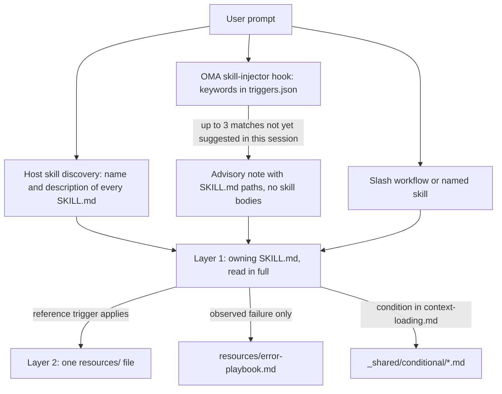
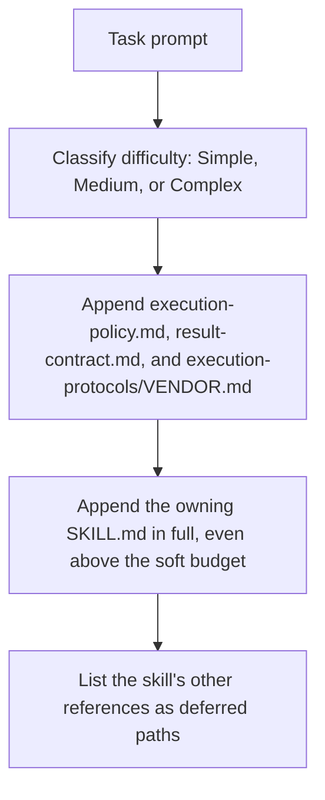

# Habilidades

Las [habilidades](../getting-started/glossary.md#skill) son paquetes de conocimiento estructurado que proporcionan a un rol de despacho la orientación de su dominio. Incluyen protocolos de ejecución, referencias de stack tecnológico, plantillas de código, guías de recuperación de errores, listas de verificación de calidad y ejemplos cuando la habilidad los proporciona, organizados en una arquitectura de dos capas diseñada para ahorrar tokens. Para ver la lista de habilidades instaladas, consulta el [catálogo de habilidades](./agents.md#skill-catalog).

---

## El diseño de dos capas {#the-two-layer-design}

Una habilidad llega al contexto por etapas. La selección solo pone ante el modelo una ruta o una descripción; el SKILL.md responsable se lee completo una vez elegida la habilidad; los archivos de apoyo se leen de uno en uno cuando se cumple su disparador.



Fuentes: `.agents/hooks/core/skill-injector.ts`, `.agents/skills/_shared/core/skill-routing.md` y `.agents/skills/_shared/core/context-loading.md`.

### Capa 1: SKILL.md (se lee cuando se selecciona la habilidad)

Cada habilidad tiene un archivo `SKILL.md` en su raíz. El hook inyector pasa una **referencia de ruta**, no el contenido, de modo que una habilidad no seleccionada no cuesta nada más allá de su `description`. Todos los `SKILL.md` tienen frontmatter YAML y las mismas cuatro secciones de nivel superior; `oma skill lint` informa de una habilidad a la que le falte alguna o cuyo cuerpo supere las 500 líneas.

| Parte | Contenido |
|-------|-----------|
| Frontmatter | `name` y una `description` de enrutamiento (qué hace la habilidad y cuándo usarla) |
| `## Scheduling` | Objetivo, firma de intención, cuándo usarla, cuándo NO usarla, entradas y salidas esperadas, dependencias |
| `## Structural Flow` | Transiciones, fallos y recuperación, estados de salida |
| `## Logical Operations` | Ruta canónica de comando o de flujo, alcance de recursos, salvaguardas |
| `## References` | Archivos de la Capa 2, cada uno con la condición que justifica leerlo |

Frontmatter actual de `oma-frontend`:

```yaml
---
name: oma-frontend
description: "Implement or modify web UI in React, Next.js, or Angular. Use for components, pages, styles, forms, and frontend state or data flows."
---
```

Los runtimes host muestran al modelo la `description` de cada habilidad, por lo que se redacta como una frase de enrutamiento. El hook de palabras clave de OMA no la lee; sus palabras clave están en `.agents/hooks/core/triggers.json`.

### Capa 2: resources/ (cargada bajo demanda)

El directorio `resources/` contiene conocimiento profundo para la ejecución. Estos archivos se cargan solo cuando:
1. El host o el flujo de trabajo ha seleccionado la habilidad (por ejemplo, mediante una coincidencia nativa o un comando explícito)
2. La tarea actual cumple la condición de carga de la referencia

Esta carga bajo demanda está gobernada por la guía de carga de contexto (`.agents/skills/_shared/core/context-loading.md`), que distingue las instrucciones del punto de entrada de las referencias seleccionadas por la tarea.

### Qué inyecta `oma agent spawn`

El despacho mediante CLI ensambla él mismo el prompt del subagente, de modo que el subagente empieza con los contratos y la habilidad responsable ya en contexto:



Fuente: `cli/commands/agent/spawn-status.ts`, `cli/platform/agent-config/loaders.ts` y `cli/platform/context-loader.ts`. Los subagentes nativos obtienen el mismo contexto de tarea con `oma agent context <agent-id>` y leen ellos mismos la política y el contrato de resultados si el runtime no se los ha proporcionado.

---

## Ejemplo de estructura de archivos {#file-structure-example}

```text
.agents/skills/oma-frontend/
├── SKILL.md                          ← Layer 1: read when selected
└── resources/
    ├── execution-protocol.md         ← Layer 2: step-by-step workflow
    ├── tech-stack.md                 ← Layer 2: detailed technology specs
    ├── tailwind-rules.md             ← Layer 2: Tailwind conventions
    ├── angular-rules.md              ← Layer 2: Angular-specific conventions
    ├── snippets.md                   ← Layer 2: copy-paste code patterns
    ├── error-playbook.md             ← Layer 2: error recovery procedures
    └── checklist.md                  ← Layer 2: quality verification checklist

.agents/skills/oma-backend/
├── SKILL.md
├── resources/
│   ├── execution-protocol.md
│   ├── orm-reference.md              ← Domain-specific (ORM queries, N+1, transactions)
│   ├── checklist.md
│   └── error-playbook.md
└── variants/                          ← Starter seeds for /stack-set
    ├── stack.schema.json
    ├── node/
    ├── python/
    └── rust/

.agents/skills/oma-mobile/
├── SKILL.md
├── resources/
│   ├── execution-protocol.md
│   ├── tech-stack.md
│   ├── screen-template.dart
│   ├── screen-template.swift         ← Swift native iOS screen template
│   ├── screen-template.tsx            ← React Native screen template
│   ├── checklist.md
│   └── error-playbook.md
└── variants/                          ← Platform seeds for /stack-set
    ├── README.md
    ├── stack.schema.json
    ├── flutter/                       ← stack.yaml, tech-stack.md, snippets.md, api-template.dart
    ├── react-native/                  ← stack.yaml, tech-stack.md, snippets.md, api-template.ts
    └── swift-ios/                     ← stack.yaml, tech-stack.md, snippets.md, api-template.swift

.agents/skills/oma-design/
├── SKILL.md
├── resources/
│   ├── execution-protocol.md
│   ├── anti-patterns.md
│   ├── asset-strategy.md
│   ├── checklist.md
│   ├── design-md-spec.md
│   ├── design-tokens.md
│   ├── getdesign-fetcher.md
│   ├── prompt-enhancement.md
│   ├── redesign-protocol.md
│   ├── stitch-integration.md
│   └── error-playbook.md
└── reference/                         ← Deep reference material
    ├── typography.md
    ├── color-and-contrast.md
    ├── spatial-design.md
    ├── motion-design.md
    ├── responsive-design.md
    ├── component-patterns.md
    ├── accessibility.md
    ├── visual-hierarchy.md
    └── shader-and-3d.md
```

---

## Tipos de recursos por habilidad {#per-skill-resource-types}

| Tipo de recurso | Patrón de nombre | Propósito | Cuándo se carga |
|-----------------|------------------|-----------|-----------------|
| **Protocolo de ejecución** | `execution-protocol.md` | Flujo paso a paso: Analyze -> Plan -> Implement -> Verify | Cuando la operación seleccionada necesita los detalles de su comando o contrato |
| **Stack tecnológico** | `tech-stack.md` | Especificaciones detalladas de tecnología, versiones y configuración | Framework seleccionado o decisión de stack |
| **Guía de errores** | `error-playbook.md` | Pasos del síntoma a la recuperación; la falta de información o de autoridad pausa solo la acción dependiente | Solo después de un fallo observado |
| **Lista de verificación** | `checklist.md` | Verificación de calidad específica del dominio | Las secciones pertinentes, para verificaciones sin resolver |
| **Snippets** | `snippets.md` | Patrones de código listos para copiar y pegar | Implementación o estructura de salida poco familiares |
| **Ejemplos** | `examples.md` | Ejemplos resueltos de entrada/salida (oma-pm, oma-db, oma-tf-infra, oma-observability, oma-search) | Implementación o estructura de salida poco familiares |
| **Variantes** | Directorio `variants/` | Semillas iniciales por lenguaje o framework. Backend incluye `node`, `python` y `rust`; mobile incluye `flutter`, `react-native` y `swift-ios`. `/stack-set` las usa para generar el `stack/` del proyecto. | Cuando se está configurando un stack coincidente |
| **Plantillas** | `screen-template.{dart,swift,tsx}` (oma-mobile), `variants/*/api-template.*` | Boilerplate para una pantalla o un módulo de API nuevos | Al crear ese archivo |
| **Referencia de dominio** | `orm-reference.md`, `anti-patterns.md`, etc. | Conocimiento profundo del dominio para subtareas específicas | Según el tipo de tarea |

---

## Recursos compartidos (_shared/) {#shared-resources-_shared}

Todos los agentes comparten fundamentos comunes de `.agents/skills/_shared/`. Se organizan en tres categorías:

### Recursos core (`.agents/skills/_shared/core/`)

| Recurso | Propósito | Cuándo se carga |
|---------|-----------|-----------------|
| **`execution-policy.md`** | Reglas de autorización, aclaración, verificación y finalización para todas las habilidades y flujos. | Se inyecta en cada prompt de `oma agent spawn`; los agentes nativos la leen si no se les proporciona |
| **`skill-routing.md`** | Enruta según el resultado de la tarea, la responsabilidad sobre ella y las dependencias reales; sin cadena de agentes obligatoria ni cuota de turnos. | Lo consultan las habilidades de orquestación y coordinación |
| **`context-loading.md`** | Punto de entrada de la habilidad responsable, referencias condicionales y límites de carga en runtime. | Al componer el contexto |
| **`prompt-structure.md`** | Orienta el traspaso de tareas poco familiares con objetivo, contexto, restricciones reales y evidencia de aceptación; sin plantilla obligatoria para tareas directas. | Al componer un traspaso poco familiar; no es una precarga obligatoria |
| **`clarification-protocol.md`** | Resuelve los detalles rutinarios a partir del contexto y solo solicita la información o la autorización relevantes que falten. | Cuando los requisitos son ambiguos |
| **`code-intelligence.md`** | Usa la capacidad de inteligencia de código configurada para buscar, navegar y analizar el impacto en el código. | Búsqueda o navegación de código |
| **`test-approach.md`** | `test_approach` por tarea a partir del plan del PM y el bloque `TDD_EVIDENCE` para las tareas `tdd`. | Tareas cuyo plan define `test_approach` |
| **`context-budget.md`** | Estimaciones de tamaño de archivo, medición del prompt real, lecturas acotadas y checkpoints. | Tareas largas o diagnóstico de sobrecarga de contexto |
| **`difficulty-guide.md`** | Elige la profundidad de planificación y los entregables según las dependencias y las necesidades de verificación. | Cuando la descomposición necesita una estimación de dificultad |
| **`quality-principles.md`** | Orientación sobre alcance, mantenibilidad, evidencia y verificación proporcional. | Al comenzar flujos centrados en calidad (ultrawork) |
| **`vendor-detection.md`** | Resuelve el proveedor objetivo de cada agente a partir de la configuración y elige entre el despacho nativo y `oma agent spawn`. | Cuando los detalles del despacho no están resueltos |
| **`session-metrics.md`** | Evidencia de sesión opcional, sin puntuaciones de penalización conversacional ni del evaluador. | Retrospectiva solicitada o corrección relevante |
| **`common-checklist.md`** | Comprobaciones aplicables entre dominios; sin límites globales de líneas ni requisito generalizado de captura de errores. | Revisión entre dominios cuando es relevante |
| **`lessons-learned.md`** | Captura y aplica lecciones respaldadas por evidencia, con condiciones de versión y de activación; sin umbral automático de RCA. | Se consulta después de errores y al terminar la sesión |
| **`anti-ai-prose.md`** | Diagnósticos de prosa compartidos. | Auditorías de prosa académica y revisiones de estilo de traducciones |
| **`stack-verify.schema.json`** | Definiciones `verify:` compartidas que reutilizan los esquemas de stack de backend y mobile. | Validación del esquema de stack |
| **`api-contracts/`** | Plantilla de contrato opcional. Reutiliza los esquemas del proyecto; los contratos generados viven fuera de los archivos fuente de la habilidad. | Al planificar trabajo entre fronteras |

### Recursos runtime (`.agents/skills/_shared/runtime/`)

| Recurso | Propósito |
|---------|-----------|
| **`result-contract.md`** | Identidad de la ejecución, ruta del claim y contrato de finalización para los resultados de agentes. Se inyecta en cada prompt de `oma agent spawn`; los agentes nativos lo siguen con `oma agent begin`, `oma agent verify` y `oma agent finish`. |
| **`memory-protocol.md`** | Formato y operaciones de archivos de memoria para subagentes CLI. Define los protocolos On Start, During Execution y On Completion con herramientas de memoria configurables (read/write/edit), además de la extensión para seguimiento de experimentos. |
| **`event-spec.md`** | Contrato de eventos de flujo duraderos, que se añaden a `events.jsonl` en el perfil home de OMA y se inspeccionan con `oma state get` u `oma state list`. |
| **`execution-protocols/claude.md`** | Patrones de ejecución específicos de Claude Code. `oma agent spawn` los inyecta cuando el proveedor es claude. |
| **`execution-protocols/antigravity.md`** | Patrones de ejecución de Antigravity CLI (`agy`). |
| **`execution-protocols/codex.md`** | Patrones de ejecución específicos de Codex CLI. |
| **`execution-protocols/commandcode.md`** | Patrones de ejecución de CommandCode. |
| **`execution-protocols/grok.md`** | Patrones de ejecución de Grok. |
| **`execution-protocols/kimi.md`** | Patrones de ejecución de Kimi Code. |
| **`execution-protocols/kiro.md`** | Patrones de ejecución de Kiro. |
| **`execution-protocols/opencode.md`** | Patrones de ejecución de la extensión OpenCode. |
| **`execution-protocols/pi.md`** | Patrones de ejecución de la extensión pi. |
| **`execution-protocols/qwen.md`** | Patrones de ejecución específicos de Qwen CLI. |

Los protocolos de ejecución específicos del proveedor se inyectan automáticamente en los agentes generados por CLI mediante `oma agent spawn`. Los subagentes nativos usan las reglas de integración del proveedor seleccionado.

### Recursos condicionales (`.agents/skills/_shared/conditional/`)

Solo se cargan cuando se cumplen condiciones específicas durante la ejecución:

| Recurso | Condición de activación | Quién lo carga |
|---------|-------------------------|----------------|
| **`quality-score.md`** | Se necesita una línea base definida o una comparación de experimentos | Orquestador (lo pasa al prompt del agente QA) |
| **`experiment-ledger.md`** | Se compara una hipótesis real con una línea base o con otro enfoque | Coordinador (mantiene el registro compartido; los agentes en paralelo escriben resultados con ámbito de tarea o de ejecución para que él los combine) |
| **`exploration-loop.md`** | La recuperación falla repetidamente y las alternativas merecen probarse dentro del presupuesto | Orquestador (inline, antes de generar agentes de hipótesis) |
| **`diagram-engine.md`** | Un flujo está a punto de emitir un diagrama estructural (arquitectura, secuencia, flujo de datos, ciclo de vida) | El flujo que emite el diagrama |

Estos recursos quedan diferidos hasta que se aplica el disparador de cada uno. La dificultad por sí sola no los inyecta.

---

## Cómo se selecciona una habilidad {#how-skills-route-via-skill-routingmd}

Hay tres vías que llevan una habilidad al contexto. Ninguna de ellas inicia un flujo ni autoriza la delegación por sí sola.

1. **Descubrimiento nativo del host.** Los runtimes con soporte de habilidades enumeran el `name` y la `description` de cada habilidad; el modelo lee el SKILL.md cuya descripción coincide con el resultado solicitado.
2. **Sugerencia por palabras clave de OMA.** Donde OMA instala su hook de prompt, `skill-injector` compara el prompt con palabras clave multilingües de `.agents/hooks/core/triggers.json` y añade una nota orientativa `[OMA SKILLS DETECTED: ...]` con hasta tres rutas de SKILL.md. Para "Build a login form with Tailwind CSS", solo coincide la palabra clave `tailwind`, así que la nota sugiere `oma-frontend`.
3. **Invocación explícita.** Un flujo slash como `/plan`, `/review` o `/debug`, o nombrar la habilidad en el prompt.

### Responsabilidad según el resultado {#ownership-by-outcome}

Una habilidad responsable se encarga de una tarea acotada; añade un traspaso solo cuando otra habilidad aporta una capacidad distinta. Esta tabla refleja `.agents/skills/_shared/core/skill-routing.md`. Para otros dominios, elige entre las descripciones de las habilidades instaladas en el [catálogo de habilidades](./agents.md#skill-catalog).

| Resultado solicitado | Habilidad responsable |
|----------------------|-----------------------|
| API de la aplicación, autenticación en el servidor, lógica de servicio/acceso a datos | oma-backend |
| Esquema, diseño de migraciones, indexación, ajuste de consultas, operaciones de base de datos | oma-db |
| Componentes web, páginas, formularios, estado del cliente | oma-frontend |
| Pantallas móviles, widgets, integración con la plataforma | oma-mobile |
| Límites del sistema, compromisos de arquitectura, ADR | oma-architecture |
| Diagnosticar y corregir un comportamiento incorrecto | oma-debug |
| Revisar corrección, seguridad, accesibilidad y rendimiento | oma-qa |
| Sistema visual, DESIGN.md, dirección de rediseño | oma-design |
| Ideación solicitada o exploración de alternativas | oma-brainstorm |
| Requisitos, dependencias, criterios de aceptación | oma-pm |
| Ejecución paralela de especialistas solicitada | oma-orchestration |
| Coordinación multiagente manual solicitada | oma-coordination |
| Ramas, commits, merges e historial del repositorio de Git | oma-scm |

### Dependencias entre habilidades {#dependencies-between-skills}

No existe una cadena de ejecución fija. Ordena el trabajo según las dependencias reales:

- Resuelve una decisión de arquitectura o de producto pendiente antes del trabajo que depende de ella. Las decisiones ya tomadas no necesitan pasar de nuevo por arquitectura, brainstorming o PM.
- El trabajo de backend y de cliente puede avanzar de forma independiente cuando su contrato de API compartido es utilizable. Si falta, define primero ese límite con los responsables pertinentes.
- La revisión puede empezar sobre una parte completada y revisable mientras continúa la implementación independiente. No revises un artefacto inestable como evidencia final.
- Un bug encontrado durante la implementación puede corregirlo su responsable. Añade ayuda de depuración cuando el diagnóstico lo justifique; no hay una cadena obligatoria de implementación a depuración.
- Para un defecto entre dominios, identifica a partir de la evidencia el contrato que falla y al responsable. Un desajuste de API no significa automáticamente que deba cambiar el backend.

### Cuando no aparece una sugerencia de habilidad {#when-a-skill-hint-does-not-appear}

Todos estos comportamientos provienen de `.agents/hooks/core/skill-injector.ts`.

| Síntoma | Causa | Qué hacer |
|---------|-------|-----------|
| No aparece ninguna nota `[OMA SKILLS DETECTED]` | El prompt empieza por `/`, hay un [flujo persistente](../getting-started/glossary.md#persistent-workflow) activo en la sesión o el mensaje es un mensaje reenviado de un agente | Es lo esperado: el flujo controla el contexto. Nombra la habilidad si la necesitas |
| Falta en la nota una habilidad esperada | Solo se listan las 3 mejores coincidencias (10 puntos por palabra clave coincidente) | Usa un término más específico o nombra la habilidad |
| Una habilidad sugerida antes no vuelve a sugerirse | Cada ruta de SKILL.md se sugiere una vez por sesión; el registro en `.agents/state/skill-sessions.json` caduca tras una hora sin nuevas sugerencias | La sugerencia anterior sigue siendo válida |
| Se ignora una palabra clave | El texto dentro de bloques de código, backticks o comillas dobles se elimina antes de la comparación | Menciona el término en texto normal |
| oma-academic-writing, oma-docs, oma-explanation, oma-scholar u oma-skill-creation nunca se sugieren | Estas habilidades no tienen palabras clave en `triggers.json` | Usa `/docs` o `/explain`, o nombra la habilidad; el descubrimiento del host sigue viendo sus descripciones |
| La sugerencia nombra una habilidad no relacionada | La comparación se basa en palabras clave y es orientativa | Indica el resultado que quieres; la nota pide al modelo que aplique su criterio |

---

## Cálculo de ahorro de tokens {#token-savings-math}

Mide el costo del contexto antes de afirmar que hay ahorro. Hay dos cosas distintas que usan las palabras simple, medium y complex:

- **Escenarios del script** (`routed`, `simple`, `medium`, `complex`, `all`): comparaciones acumulativas de tamaño de archivo que imprime `scripts/measure-skill-context.ts`. No son políticas de carga, y `all` es solo un límite superior.
- **Dificultad del cargador** (Simple, Medium, Complex): selecciona el presupuesto flexible del contexto que inyecta el despacho mediante CLI. Consulta [Carga de recursos por tarea](#resource-loading-by-task).

```bash
bun scripts/measure-skill-context.ts
bun scripts/measure-skill-context.ts --skills oma-pm,oma-backend,oma-frontend --json
oma agent context backend --difficulty Medium
```

El script informa estimaciones (bytes UTF-8 / 4). `routed` es solo el punto de entrada; `simple`, `medium` y `complex` añaden archivos hipotéticos de protocolo, ejemplos y stack para comparar. Sus nombres se conservan por compatibilidad con el script, no como instrucciones de precarga. Un checkout nuevo puede usar una semilla de plataforma como proxy de tamaño; no carga todas las plataformas.

El comando de contexto muestra la inyección real del contexto de la tarea: un encabezado `## Task context (graph-selected, approximately N tokens)`, el SKILL.md responsable y la lista de referencias diferidas. No incluye el resto de la conversación ni todas las instrucciones del host o del runtime, y un prompt generado es más grande porque `oma agent spawn` también añade la política de ejecución, el contrato de resultados y el protocolo del proveedor. Usa un prompt ensamblado o la telemetría de uso para medir el total de tokens de entrada, la latencia y el costo en un modelo concreto. No los infieras a partir del tamaño del repositorio ni de los recuentos de copias espejo generadas.

## Carga de recursos por tarea {#resource-loading-by-task}

Todos los niveles de dificultad comienzan con la habilidad responsable. El grafo es un índice de referencias; la adyacencia no autoriza a cargar otro especialista, una guía de errores ni un flujo de experimentos condicional.

El cargador usa presupuestos flexibles de 1,500 / 4,000 / 8,000 tokens estimados para Simple / Medium / Complex. Un punto de entrada que supera el presupuesto se conserva y se informa del exceso. Las referencias de apoyo siguen diferidas, salvo que se seleccionen de forma explícita una vez resuelto su disparador de tarea. Un punto de entrada requerido nunca se sustituye por documentos más pequeños no relacionados.

La verificación se ajusta al riesgo de la tarea y a los requisitos del proyecto. Una etiqueta de dificultad no exige una suite de pruebas completa, una respuesta de preflight fija ni una segunda aprobación de un trabajo ya autorizado.

## Mapas de carga de contexto por tarea (por agente) {#context-loading-task-maps-per-agent}

Usa el índice actual de la habilidad responsable y selecciona solo las secciones aplicables según las necesidades de la tarea:

### Agente backend

<!-- oma-docs:ignore-start -->

| Tipo de tarea | Recursos requeridos |
|---------------|---------------------|
| Creación de API CRUD | los `stack/snippets.md` y `stack/api-template.*` del proyecto (generados por `/stack-set`) cuando existen; en caso contrario, el código existente del proyecto |
| Autenticación | `stack/snippets.md` + `stack/tech-stack.md` cuando existen |
| Migración de base de datos | `stack/snippets.md` cuando existe; el diseño de esquemas corresponde a oma-db |
| Optimización de rendimiento | `orm-reference.md` y cualquier ejemplo coincidente proporcionado por la habilidad |
| Modificación de código existente | Proveedor de inteligencia de código del proyecto y recursos de ejecución relevantes |

<!-- oma-docs:ignore-end -->

`variants/node`, `variants/python` y `variants/rust` son semillas iniciales para `/stack-set`; los agentes no las leen para editar código existente.

### Agente frontend

| Tipo de tarea | Recursos requeridos |
|---------------|---------------------|
| Creación de componentes | snippets.md + patrones de componentes existentes del proyecto |
| Implementación de formularios | snippets.md (formularios + Zod) |
| Integración de API | snippets.md (TanStack Query) |
| Estilos | tailwind-rules.md |
| Layout de página | snippets.md (grid) |

### Agente de diseño

| Tipo de tarea | Recursos requeridos |
|---------------|---------------------|
| Creación de sistema de diseño | reference/typography.md + reference/color-and-contrast.md + reference/spatial-design.md + design-md-spec.md |
| Diseño de landing page | reference/component-patterns.md + reference/motion-design.md + prompt-enhancement.md |
| Auditoría de diseño | checklist.md + anti-patterns.md |
| Exportación de tokens de diseño | design-tokens.md |
| Efectos 3D o shaders | reference/shader-and-3d.md + reference/motion-design.md |
| Revisión de accesibilidad | reference/accessibility.md + checklist.md |

### Agente QA

| Tipo de tarea | Recursos requeridos |
|---------------|---------------------|
| Revisión de seguridad | checklist.md (sección Security) |
| Revisión de rendimiento | checklist.md (sección Performance) |
| Revisión de accesibilidad | checklist.md (sección Accessibility) |
| Auditoría completa | checklist.md (todas las secciones), más iso-quality.md cuando se solicita una revisión basada en estándares |
| Comparación de una métrica definida | quality-score.md (condicional) |

---

## Composición de prompts del orquestador {#orchestrator-prompt-composition}

Cuando el orquestador escribe el prompt de un subagente (`oma-orchestration/resources/subagent-prompt-template.md`), aporta solo datos de la tarea: rol del agente, ID de la tarea, workspace, rutas permitidas, descripción de la tarea, criterios de aceptación, referencias de la tarea con sus condiciones de carga y restricciones relevantes.

- En el despacho mediante CLI, `oma agent spawn` ya inyecta `execution-policy.md`, `result-contract.md`, el protocolo de ejecución del proveedor y el SKILL.md responsable, así que el prompt no los repite.
- En el despacho nativo, pasa las rutas de esos archivos y de la habilidad responsable si el runtime no los ha proporcionado.
- Añade una sección de la guía de errores solo después de un fallo observado, y `runtime/memory-protocol.md` solo cuando el agente coordina o reanuda un estado de tarea duradero.

Esta composición dirigida evita cargar recursos innecesarios y maximiza el contexto disponible para el trabajo real del subagente.

---

## Evidencia de sesión y revisión retrospectiva {#session-evidence-and-retrospective-review}

Los registros de sesión recogen las correcciones relevantes, los cambios de alcance, el retrabajo y los hallazgos de revisión dirimidos, con evidencia. La aclaración necesaria no se penaliza. Las antiguas puntuaciones ponderadas CD y EA y las reglas de RCA activadas por umbrales se han eliminado: eran instrucciones de prompt, no métricas calculadas por la CLI.

Usa los resultados de tareas existentes siempre que sea posible. Un archivo `session-metrics-{sessionId}.md` independiente es opcional en el almacén de coordinación configurado. Un fallo repetido o una retrospectiva solicitada pueden justificar una lección, pero una comprobación fallida ordinaria o un hallazgo en disputa no establecen una automáticamente. Conserva los registros históricos; no los reescribas en el nuevo formato.

`oma stats` informa de la productividad y de los resúmenes de uso y costo registrados. `oma retro` agrupa en sugerencias los eventos reales de puertas, bloqueos y decisiones faltantes. Ninguno calcula puntuaciones CD/EA a partir de estos artefactos Markdown.

## Descomposición de tareas y recuperación de contexto {#task-decomposition-and-context-recovery}

Planifica en torno a las dependencias y al comportamiento que se puede verificar de forma independiente. Un número fijo de sprints, la cantidad de archivos y las estimaciones de turnos no determinan la profundidad de la revisión ni la finalización. Mantén las pruebas y el manejo de errores junto al comportamiento que verifican.

Ante un estancamiento observado o una pérdida de contexto útil, guarda el trabajo completado, los criterios pendientes, las rutas relevantes y la evidencia de verificación antes de reanudar o volver a despachar. Conserva el trabajo existente y evita duplicar un intento en curso. La proporción entre turnos y progreso, por sí sola, no exige un reinicio.

## Medición y exploración condicionales {#conditional-measurement-and-exploration}

Una línea base definida o una comparación de experimentos activa la guía de medición; el mero hecho de tener pruebas o lint no la activa. Registra métricas comparables con unidades, método, revisión y evidencia. Las comprobaciones obligatorias de corrección y seguridad siguen siendo independientes. OMA no tiene ninguna fórmula compuesta predeterminada, puerta de calificación por letras ni reversión activada por puntuación.

Un experimento real registra su hipótesis, la evidencia de la línea base y del candidato, las comprobaciones obligatorias, la decisión y los archivos que le pertenecen. Los fallos repetidos pueden justificar probar otro mecanismo dentro del presupuesto de recuperación existente. Aísla los cambios del experimento, conserva las ediciones no relacionadas y verifica el candidato integrado antes de reanudar la puerta.

---

## Relacionado {#related}

- [Agentes](./agents.md): catálogo de habilidades, roles de despacho, definiciones y archivos nativos de agentes
- [Flujos de trabajo](./workflows.md): flujos slash que leen habilidades
- [Estructura del proyecto](./project-structure.md): dónde queda `.agents/skills/` después de la instalación
- [Resultados y reanudación de agentes](../guide/agent-results-and-resume.md): el ciclo de vida nativo `oma agent begin` → `oma agent finish`
- [Evaluación de habilidades](../guide/skill-eval.md) y [Optimización de habilidades](../guide/skill-opt.md)
- Autoría: usa la habilidad `oma-skill-creation` y después ejecuta `oma skill lint` y `oma skill audit`
