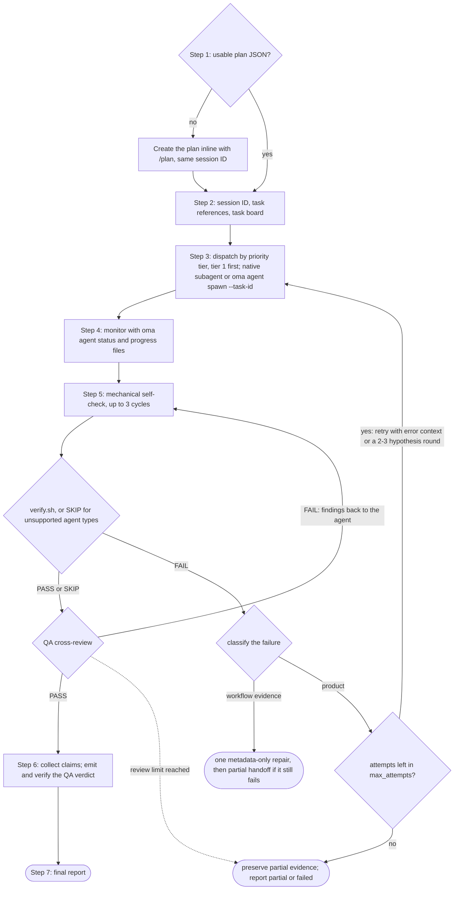
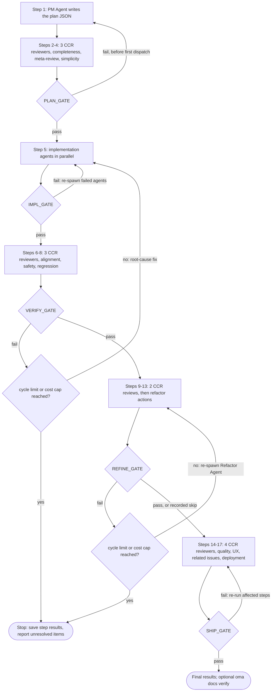
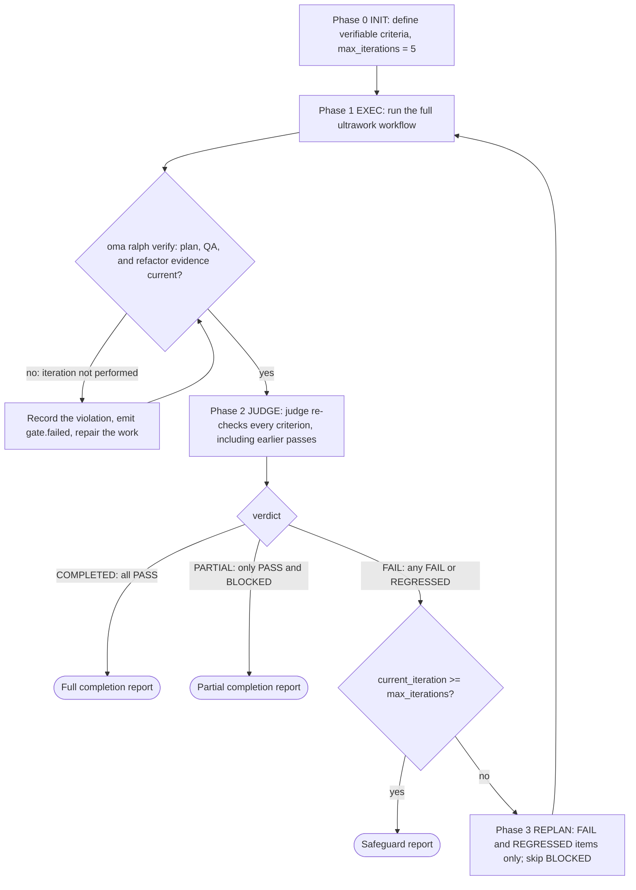

# Flujos de trabajo

Los flujos de trabajo son procesos estructurados de varios pasos que se inician mediante comandos slash; los cuatro modos persistentes también se inician cuando una solicitud en texto plano los nombra. Definen cómo colaboran los agentes en las tareas, desde utilidades de una sola fase hasta puertas de calidad complejas de 5 fases.

Hay 20 flujos de trabajo, 4 de ellos [persistentes](../getting-started/glossary.md#persistent-workflow) (mantienen el estado y no se pueden interrumpir accidentalmente).

## Flujos de trabajo de un vistazo

| Flujo | Úsalo para | Persistente |
|---|---|---|
| [`/orchestrate`](#orchestrate) | Ejecución paralela automatizada de agentes a partir de un plan, con bucles de verificación | Sí |
| [`/work`](#work) | Coordinación multidominio paso a paso: planificar, implementar, QA y corregir | Sí |
| [`/ultrawork`](#ultrawork) | El flujo de calidad de 5 fases con 12 pasos de revisión aislados | Sí |
| [`/ralph`](#ralph) | Repetir ultrawork hasta que pasen criterios verificables mecánicamente | Sí |
| [`/plan`](#plan) | Desglose de tareas del PM con dependencias y contratos de API | No |
| [`/brainstorm`](#brainstorm) | Ideación centrada en el diseño antes de planificar | No |
| [`/architecture`](#architecture) | Decisiones de arquitectura, revisiones y ADRs | No |
| [`/deepinit`](#deepinit) | Generar AGENTS.md, ARCHITECTURE.md y `docs/` para un código base existente | No |
| [`/review`](#review) | Revisión QA: seguridad, rendimiento, accesibilidad y calidad de código | No |
| [`/security`](#security) | Escaneos de seguridad de código fuente, habilidades de agentes y componentes MCP; validación de hallazgos; puertas de CI | No |
| [`/debug`](#debug) | Diagnóstico y corrección de bugs con una prueba de regresión | No |
| [`/design`](#design) | Hallazgos de diseño, DESIGN.md, dirección de rediseño o tokens de diseño | No |
| [`/scm`](#scm) | Operaciones de Git y Conventional Commits | No |
| [`/convert`](#convert) | Convertir documentos y contenido multimedia entre formatos | No |
| [`/docs`](#docs) | Detección de desviaciones en la documentación y sincronización | No |
| [`/recap`](#recap) | Resumen del trabajo diario o de un periodo en varias herramientas de IA | No |
| [`/stack-set`](#stack-set) | Referencias específicas del stack para una habilidad de dominio | No |
| [`/video`](#video) | Generación de MP4 mediante la habilidad `oma-video` | No |
| [`/schedule`](#schedule) | Trabajos de agentes recurrentes y programados por tiempo | No |
| [`/explain`](#explain) | Una explicación HTML interactiva de un cambio de código o de un tema | No |

---

## Elegir una habilidad o un flujo de trabajo {#choosing-a-skill-or-workflow}

Elige según la coordinación y la verificación que necesite la tarea. Si ya has seleccionado un flujo, síguelo; continúa un flujo activo salvo que lo canceles o cambies explícitamente. Para una tarea nueva sin un flujo seleccionado, usa esta guía:

| Necesidad de la tarea | Elige | Ejemplo |
|-----------------------|-------|---------|
| Un solo dominio sin coordinación entre agentes | [Habilidad individual](/docs/guide/single-skill) | Añadir un endpoint de API y probar su validación |
| Varios dominios con planificación, implementación y QA paso a paso | `/work` | Coordinar un cambio de API con sus clientes web y mobile |
| Delegación automatizada de tareas independientes en paralelo | `/orchestrate` | Implementar tareas de backend y frontend en paralelo después de resolver las dependencias |
| Un proceso completo de calidad solicitado explícitamente | `/ultrawork` | Ejecutar las revisiones completas de planificación, implementación, verificación, refinamiento y preparación para la publicación |
| Una solicitud explícita de repetir la ejecución hasta que pasen criterios verificables mecánicamente | `/ralph` | Repetir la implementación y la verificación del juez hasta que pasen las comprobaciones de regresión indicadas, dentro de las salvaguardas del bucle |

`/orchestrate` carga un plan utilizable o crea uno mediante `/plan` antes de generar agentes. No necesitas ejecutar `/plan` primero. La existencia de un plan no distingue, por tanto, `/work` de `/orchestrate`; elige según cómo quieras coordinar el trabajo. Ambos pueden ejecutar tareas independientes en paralelo.

Los criterios de aceptación y las pruebas también forman parte de las tareas con una sola habilidad. Su presencia por sí sola no requiere `/ralph`: cada iteración de Ralph ejecuta el proceso completo de ultrawork y una pasada del juez, así que elígelo cuando quieras ese bucle de verificación repetida. Puede detenerse con trabajo incompleto o bloqueado cuando se aplican las salvaguardas.

Esta tabla es una recomendación de selección, no un enrutador automático de flujos. El agente host puede recomendar un enfoque adecuado; recomendar o explicar un flujo no lo inicia. Un comando slash lo selecciona explícitamente. Cuando el hook de detección de palabras clave está habilitado, las coincidencias con palabras clave o patrones configurados también pueden activar un flujo, sujeto a sus filtros de consultas informativas. El detector no clasifica la cantidad de dominios, no comprueba si el plan está listo ni aplica la tabla como algoritmo de prioridades.

La revisión del plan reutiliza la autorización ya concedida para la tarea. Los agentes solo preguntan si falta una decisión relevante o si una acción queda fuera de ese alcance. Una revisión de preparación para la publicación no autoriza por sí misma a publicar o desplegar.

---

## Flujos de trabajo persistentes {#persistent-workflows}

Los flujos persistentes continúan ejecutándose hasta que todas las tareas terminan. Mantienen el estado en `.agents/state/` y vuelven a inyectar el contexto `[OMA PERSISTENT MODE: ...]` en cada mensaje del usuario hasta que se desactivan explícitamente.

El modo persistente solo se inicia con una **invocación explícita**: el comando slash del flujo (`/ultrawork`, o una forma con namespace como `/oma:ultrawork`), o el propio nombre del flujo en texto plano (la lista `explicit` de `triggers.json`: `"orchestrate"` y las traducciones listadas, `"ultrawork"`/`"ulw"`, `"work mode"`/`"work workflow"`, `"ralph"`/`"랄프"`). El hook de palabras clave no abre ningún flujo desde ninguna otra frase.

### /orchestrate

**Descripción:** Ejecución paralela automatizada de agentes basada en CLI. Genera subagentes mediante CLI, coordina con estado de ejecución y recibos persistentes, monitorea el progreso y ejecuta bucles de verificación.

**Persistente:** Sí. Archivo de estado: `.agents/state/orchestrate-state-{sessionId}.json`.

**Palabras clave de activación:**
| Idioma | Palabras clave |
|--------|----------------|
| Explícita (persistente) | "orchestrate", "オーケストレート", "orquestar", "orchestrer", "orchestrieren", "orquestrar", "оркестровать", "orkestreren", "orkiestrować" |

Frases como `"do everything"`, `"전부 해줘"` o `"build me an app"` no inician este flujo.

**Pasos:**
1. **Paso 0, Preparación:** Lee la habilidad de coordinación, la guía de carga de contexto y el protocolo de memoria. Detecta el proveedor.
2. **Paso 1, Cargar o crear el plan:** Comprueba `.agents/results/plan-{sessionId}.json` y después el `plan-*.json` más reciente. Si no existe ninguno, o el plan no está listo para ejecutarse (a una tarea le falta agente, nivel de prioridad, dependencias o criterios de aceptación), delega en `/plan` dentro del mismo flujo para crear uno conservando el mismo ID de sesión. Presenta el plan y reutiliza la autorización existente; pregunta solo por una decisión relevante o una autorización nueva antes de delegar.
3. **Paso 2, Inicializar la sesión:** Carga `oma-config.yaml`, muestra la tabla de asignación de CLI y reutiliza el ID de sesión creado con el plan o genera uno (`session-YYYYMMDD-HHMMSS`). Para cada tarea, selecciona las referencias de habilidades que necesita comparando la tarea con las firmas de intención de las habilidades instaladas; basta una habilidad coincidente con confianza. Crea `orchestrator-session-{sessionId}.md` y `task-board-{sessionId}.md` en el almacén de memoria configurado y registra allí las referencias seleccionadas para cada tarea y el motivo de la selección. Estas son notas para el coordinador; el lanzador no las impone.
4. **Paso 3, Generar agentes:** Para cada nivel de prioridad (de menor a mayor: primero el nivel 1, después el nivel 2, y así sucesivamente), genera agentes mediante el método apropiado del proveedor (subagentes nativos cuando el runtime actual y el proveedor de destino coinciden; `oma agent spawn` para trabajo externo o entre proveedores). Cada agente recibe su tarea, los contratos de API y sus referencias seleccionadas con sus condiciones de carga. No superes MAX_PARALLEL (3 por defecto).
5. **Paso 4, Monitorear:** Comprueba la salud de los procesos con `oma agent status`. Prefiere las notificaciones de finalización del host; en caso contrario, sondea con backoff acotado los archivos con ámbito de ejecución `progress-{agentId}-{taskId}-{runId}-{sessionId}.md` que hayan cambiado, lee los recibos estructurados y actualiza el task board. Vigila completaciones, fallos y crashes.
6. **Paso 5, Verificar:** Para cada agente completado, ejecuta una autocomprobación mecánica (lint, typecheck, pruebas y alcance del diff; hasta 3 ciclos), después `verify.sh {agent-type} {workspace}` (backend, frontend, mobile, qa, debug y pm; los demás tipos de agente registran `SKIP`) y, por último, una revisión cruzada de QA. Si falla la verificación, vuelve a generarlo con el contexto del error. Los fallos repetidos pueden justificar hipótesis alternativas, pero el intento original, cada reintento y cada hipótesis consumen el mismo presupuesto de recuperación agregado (`max_attempts`, 3 por defecto incluido el intento original). Conserva la evidencia sin resolver si el presupuesto no alcanza para una ronda de comparación.
7. **Paso 6, Recopilar:** Lee los archivos de resultados de ámbito de ejecución y los claims estructurados, y compila el resumen.
8. **Paso 7, Informe final:** Presenta el resumen de la sesión. Si se ejecutaron experimentos, resume la evidencia y las decisiones; captura lecciones solo cuando se haya establecido una causa reutilizable.



**Archivos leídos:** `.agents/results/plan-{sessionId}.json`, `.agents/oma-config.yaml`, archivos de progreso y resultados de ámbito de ejecución y recibos estructurados de ejecución.
**Archivos escritos:** estado de sesión y task board de ámbito de ejecución en el almacén de memoria configurado, recibos y claims estructurados y el informe final.

**Cuándo usar:** Proyectos grandes que requieren el máximo paralelismo con coordinación automatizada.

---

### /work

**Descripción:** Coordinación multidominio paso a paso. PM planifica primero, después los agentes ejecutan dentro del alcance autorizado y finalmente QA revisa y se corrigen los problemas.

**Persistente:** Sí. Archivo de estado: `.agents/state/work-state-{sessionId}.json`.

**Palabras clave de activación:**
| Idioma | Palabras clave |
|--------|----------------|
| Explícita (persistente) | "work mode", "work workflow" |

La palabra `"work"` por sí sola no es un activador: es vocabulario normal ("Does this work on Windows?"). `"step by step"` y sus traducciones tampoco inician este flujo.

**Pasos:**
1. **Paso 0, Preparación:** Lee las habilidades, la carga de contexto y el protocolo de memoria. Registra el inicio de la sesión.
2. **Paso 1, Analizar requisitos:** Identifica los dominios implicados. Si es un solo dominio, sugiere usar directamente el agente correspondiente.
3. **Paso 2, Planificación del agente PM:** PM descompone los requisitos, define los contratos de API, crea el desglose priorizado y lo guarda en `.agents/results/plan-{sessionId}.json`.
4. **Paso 3, Revisar el plan:** Presenta el plan y continúa dentro de la autorización existente. Pregunta solo por una decisión relevante o una autorización nueva.
5. **Paso 4, Generar agentes:** Genera por niveles de prioridad, en paralelo dentro del mismo nivel y con workspaces separados.
6. **Paso 5, Monitorear:** Sondea los archivos de progreso y verifica la alineación del contrato de API entre agentes.
7. **Paso 6, Revisión QA:** Genera un agente QA para seguridad (OWASP), rendimiento, accesibilidad y calidad de código.
8. **Paso 6.1, Mediciones** (condicional): Registra una línea base cuando se necesita una comparación definida.
9. **Paso 7, Iterar:** Si aparecen problemas CRITICAL/HIGH, vuelve a generar los agentes responsables. Si el mismo problema persiste tras 2 intentos, activa Exploration Loop.

**Cuándo usar:** Funcionalidades que abarcan varios dominios y en las que quieres coordinación paso a paso de la planificación, la implementación y la QA.

---

### /ultrawork

**Descripción:** Flujo centrado en la calidad. Tiene 5 fases, 17 pasos en total y 12 pasos de revisión aislados. Cada fase tiene una puerta que debe pasar antes de continuar.

**Persistente:** Sí. Archivo de estado: `.agents/state/ultrawork-state-{sessionId}.json`.

**Palabras clave de activación:**
| Idioma | Palabras clave |
|--------|----------------|
| Explícita (persistente) | "ultrawork", "ulw" |

**Fases y pasos:**

| Fase | Pasos | Agente | Perspectiva de revisión |
|------|-------|--------|-------------------------|
| **PLAN** | 1-4 | Agente PM (autor, paso 1) + revisores CCR (pasos 2-4) | Integridad, meta-revisión, sobreingeniería/simplicidad |
| **IMPL** | 5 | Agentes de desarrollo (generados) | Implementación |
| **VERIFY** | 6-8 | Revisores CCR | Alineación, seguridad (OWASP), prevención de regresiones |
| **REFINE** | 9-13 | Agente de refactorización (pasos 9, 11 y 13) + revisores CCR (pasos 10 y 12) | División de archivos, reutilización, impacto en cascada, consistencia, código muerto |
| **SHIP** | 14-17 | Revisores CCR | Calidad de código (lint/cobertura), flujo UX, problemas relacionados, preparación para el despliegue |

Cada paso de revisión se ejecuta en su propio subagente revisor con contexto nuevo ([revisión entre contextos](../getting-started/glossary.md#cross-context-review-ccr)). El agente PM no revisa su propio plan inline.

**Definiciones de las puertas:**
- **PLAN_GATE:** Plan documentado, suposiciones enumeradas, alternativas consideradas, revisión de sobreingeniería completada y alcance autorizado.
- **IMPL_GATE:** Pasan las comprobaciones y pruebas aplicables que no emiten archivos, solo se modifican los archivos planificados y se registra la evidencia de línea base de los experimentos reales. Las comprobaciones de build solo se ejecutan cuando se solicitan explícitamente.
- **VERIFY_GATE:** La implementación coincide con los requisitos, cero CRITICAL, cero HIGH, sin regresiones y se cumplen los objetivos de medición aplicables del proyecto.
- **REFINE_GATE:** Se siguen las reglas de mantenibilidad del proyecto, se capturaron oportunidades de integración, se verificaron efectos secundarios, se limpió el código y no queda ninguna regresión sin resolver.
- **SHIP_GATE:** Pasan las comprobaciones de calidad, se verifica UX, se resuelven los problemas relacionados, se completa la lista de preparación para el despliegue y se cumplen los objetivos de medición aplicables del proyecto con evidencia actual. Reutiliza la autorización existente; publicar o desplegar requiere autorización para esa acción.

**Comportamiento ante el fallo de una puerta:**
- Primer fallo: vuelve al paso relevante, corrige y reintenta.
- Segundo fallo del mismo problema: reevalúa la causa; si hay alternativas que merezcan probarse dentro del presupuesto restante, compara experimentos aislados con el comportamiento requerido y las métricas definidas.
- Límites: un fallo de PLAN vuelve al paso 1 solo antes del primer despacho de tareas (después, el plan es inmutable). Los reintentos de VERIFY y REFINE se detienen cuando el número de fallos de puerta alcanza el máximo configurado (5 ciclos de VERIFY + REFINE por defecto) o cuando se supera el límite de coste de la sesión.



**Mejoras condicionales:** comparaciones de métricas definidas, decisiones y evidencia de experimentos, exploración de hipótesis con presupuesto y lecciones respaldadas por causas reutilizables.

**Condición para omitir REFINE:** tareas simples de menos de 50 líneas.

**Cuándo usar:** Un proceso completo de revisión antes de decidir si el resultado está listo para publicar. El flujo registra comprobaciones y hallazgos; no toma por ti la decisión de preparación para producción.

---

### /ralph

**Descripción:** Bucle persistente de ejecución autorreferente. Envuelve ultrawork con un [juez](../getting-started/glossary.md#judge) que comprueba los criterios de finalización después de cada iteración. Informa de finalización completa cuando todos pasan, de finalización parcial cuando solo quedan criterios PASS y BLOCKED, o se detiene cuando se activan las salvaguardas.

**Persistente:** Sí. Archivo de estado: `.agents/state/ralph-state-{sessionId}.json`.

**Palabras clave de activación:**
| Idioma | Palabras clave |
|--------|----------------|
| Explícita (persistente) | "ralph", "랄프" |

Las frases sueltas para reanudar ("keep going", "carry on", "계속해", "続けて", "продолжай", …) y las frases de finalización ("don't stop", "끝까지 해") no inician este flujo.

**Fases:**
1. **Fase 0, INIT:** Carga los prerrequisitos (carga de contexto, protocolo de memoria y protocolo del juez). Define y registra criterios de finalización verificables mecánicamente, como aserciones de pruebas, comprobaciones de tipos que no emiten archivos, códigos de salida o existencia de archivos. Incluye comprobaciones de build solo cuando se solicitan explícitamente. Muestra los criterios y continúa dentro del alcance autorizado. Inicializa la sesión con `max_iterations: 5`.
2. **Fase 1, EXEC:** Ejecuta ultrawork (PLAN → IMPL → VERIFY → REFINE → SHIP) como una sola iteración con el ID de sesión de Ralph. Después ejecuta la puerta de artefactos `oma ralph verify --json --session-id <sessionId> --newer-than <iteration start>`. Si falla, la iteración cuenta como no realizada: Ralph registra la infracción, repara el trabajo y vuelve a ejecutar la puerta.
3. **Fase 2, JUDGE:** Un juez comprueba cada criterio contra el estado real del proyecto (ejecuta comprobaciones autorizadas y verifica la existencia de archivos). El prompt del flujo indica al orquestador que genere el juez como un agente aparte con contexto nuevo, informado solo de los criterios; nada confirma mecánicamente esa generación, y a un runtime que no puede generar subagentes se le indica que juzgue inline y registre `ralph.judge-inline-fallback`. Registra la evidencia y el estado del criterio, incluyendo PASS, FAIL, REGRESSED o BLOCKED.
4. **Puerta de decisión:** Si todos los criterios son PASS → informa de finalización completa. Si solo quedan PASS y BLOCKED → informa de finalización parcial. Si hay FAIL o REGRESSED → devuelve el contexto del fallo a la siguiente iteración, sujeto a las salvaguardas.
5. **Fase 3, REPLAN:** Limita la siguiente iteración a los elementos FAIL y REGRESSED (diagnóstico basado en el diff), omite los elementos BLOCKED y mantiene los criterios PASS dentro del alcance del juez. Vuelve a la fase 1.
6. **Salvaguardas:** El bucle se detiene si `current_iteration >= max_iterations` (5 por defecto). Un criterio que falla 3 veces consecutivas por la misma causa raíz pasa a BLOCKED y no se reintenta (detección de atasco).



El nodo del juez es el juez que se genera por indicación del prompt, descrito en la fase 2: el flujo indica al orquestador que lo genere con contexto nuevo, y un runtime que no puede generar subagentes juzga inline y registra el recurso alternativo.

**Diferencia principal con /ultrawork:** Ultrawork ejecuta un proceso de 5 fases con reintentos cuando falla una puerta. Ralph envuelve ultrawork en un bucle de reintentos con un juez, generado por indicación del prompt, que vuelve a verificar cada criterio contra la evidencia del proyecto. El bucle termina con un informe de finalización completa, un informe de finalización parcial para el trabajo bloqueado o un informe de salvaguarda.

**Archivos leídos:** `.agents/workflows/ralph/resources/judge-protocol.md`, todos los archivos de ultrawork.
**Archivos escritos:** `session-ralph-{sessionId}.md` (memoria), registros de iteración e informe final.

**Cuándo usar:** Cuando quieres explícitamente una ejecución repetida y una nueva verificación del juez contra criterios de finalización mecánicos. Las pruebas por sí solas no requieren Ralph; considera todo el proceso ultrawork en cada iteración y sus salvaguardas.

---

## Flujos de trabajo no persistentes

### /plan

**Descripción:** Desglose de tareas dirigido por PM. Analiza requisitos, selecciona el stack tecnológico, descompone tareas priorizadas con dependencias y define contratos de API.

**Palabras clave de activación:** Ninguna. Inícialo con `/plan`. El hook de palabras clave no abre este flujo desde una frase.

**Pasos:** Recopilar requisitos -> Analizar viabilidad técnica (análisis de código con MCP) -> Evaluar complejidad (Simple/Medium/Complex) -> Definir contratos de API (si cruza fronteras) -> Descomponer en tareas -> Revisar con el usuario -> Guardar artefactos del plan (JSON legible por máquina y tracker Markdown legible por humanos para Medium/Complex).

**Salida:** `.agents/results/plan-{sessionId}.json`, escritura de memoria y, para Medium/Complex, `docs/plans/work/{NNN}-{name}.md` con tabla de tareas, registro de decisiones y notas de progreso. El ciclo de vida se sigue mediante el campo `Status` de la cabecera Markdown (`Active` -> `Completed`); los planes no se mueven entre carpetas. Los enfoques seleccionados mediante `/brainstorm` se guardan en `docs/decisions/{NNN}-{name}.md`.

**Ejecución:** Inline (sin generar subagentes). Lo consumen `/orchestrate` o `/work`, que actualizan los campos de tarea y estado durante la ejecución.

---

### /brainstorm

**Descripción:** Ideación orientada al diseño. Explora la intención, aclara restricciones, propone enfoques y produce un documento de diseño aprobado antes de planificar.

**Palabras clave de activación:** Ninguna. Inícialo con `/brainstorm`. El hook de palabras clave no abre este flujo desde una frase.

**Pasos:** Explorar el contexto del proyecto (análisis MCP) -> Hacer preguntas de aclaración (una por vez) -> Proponer 2-3 enfoques con compromisos -> Presentar el diseño sección por sección (con aprobación del usuario en cada paso) -> Ronda de revisión a ciegas -> Guardar el enfoque seleccionado en `docs/decisions/{NNN}-{name}.md` y actualizar `docs/decisions/index.md` -> Transición: sugerir `/plan`.

**Reglas:** No implementar ni planificar antes de aprobar el diseño. No producir código. YAGNI.

---

### /architecture

**Descripción:** Flujo de arquitectura de software que diagnostica problemas de arquitectura, selecciona el método de análisis correcto (enrutamiento diagnóstico / design-twice / ATAM / CBAM / ADR), compara opciones, sintetiza aportes de las partes interesadas y produce una recomendación, revisión o ADR.

**Palabras clave de activación:** Ninguna. Inícialo con `/architecture`. El hook de palabras clave no abre este flujo desde una frase.

**Pasos:** Enmarcar la decisión (arquitectura nueva / revisión / análisis de compromisos / priorización de inversiones / redacción de ADR) -> Seleccionar metodología mediante enrutamiento diagnóstico -> Analizar la arquitectura actual con análisis de código MCP (`get_symbols_overview`, `find_symbol`, `find_referencing_symbols`) -> Sintetizar los aportes de las partes interesadas (solo cuando el alcance transversal lo justifique) -> Producir la recomendación con suposiciones, compromisos, riesgos y pasos de validación explícitos -> Pasar a `/plan` cuando se requiera implementación.

**Reglas:** No escribas código de implementación ni planes de tareas en este flujo. Pasa a `/plan` después de decidir la arquitectura. Usa herramientas MCP durante todo el flujo; no las sustituyas por lecturas de archivos sin procesar o grep.

**Cuándo usar:** Decisiones de arquitectura del sistema, límites de módulos/servicios/propiedad, priorización de refactorizaciones, redacción de ADR e investigación de problemas arquitectónicos (amplificación de cambios, dependencias ocultas y APIs incómodas).

---

### /deepinit

**Descripción:** Inicialización completa del proyecto. Analiza un código existente y genera AGENTS.md, ARCHITECTURE.md y una base de conocimiento estructurada en `docs/`.

**Palabras clave de activación:** Ninguna. Inícialo con `/deepinit`. El hook de palabras clave no abre este flujo desde una frase.

**Pasos:** Preparación -> Analizar el código (tipo de proyecto, arquitectura, reglas implícitas, dominios y fronteras) -> Generar ARCHITECTURE.md (mapa de dominios, menos de 200 líneas) -> Generar la base de conocimiento `docs/` (decisions/, plans/, generated/, product-specs/, references/ y documentos de dominio) -> Generar AGENTS.md raíz (~100 líneas, tabla de contenidos) -> Generar archivos AGENTS.md de frontera (paquetes del monorepo, menos de 50 líneas cada uno) -> Actualizar el harness existente (si se vuelve a ejecutar) -> Validar (sin enlaces muertos ni límites de líneas).

**Salida:** AGENTS.md, ARCHITECTURE.md, docs/decisions/, docs/plans/, docs/PLANS.md, docs/QUALITY-SCORE.md, docs/CODE-REVIEW.md y documentos de dominio según se descubran.

---

### /review

**Descripción:** Pipeline completo de revisión QA. Auditoría de seguridad (OWASP Top 10), análisis de rendimiento, comprobación de accesibilidad (WCAG 2.2 AA) y revisión de calidad de código.

**Palabras clave de activación:** Ninguna. Inícialo con `/review`. El hook de palabras clave no abre este flujo desde una frase.

**Pasos:** Identificar el alcance -> Comprobaciones de seguridad automatizadas (`npm audit`, `bandit` o el equivalente del stack) -> Revisión de seguridad manual (OWASP Top 10) -> Análisis de rendimiento -> Revisión de accesibilidad (WCAG 2.2 AA) -> Revisión de calidad de código -> Generar el informe QA.

**Alcance:** El alcance procede de la solicitud: archivos concretos, una rama de funcionalidad, una PR o todo el proyecto. Una PR o rama se compara mediante diff con su rama base. Si no se indica alcance, el flujo revisa los cambios actuales sin confirmar y los de la rama e indica esa suposición; solo pregunta cuando no hay nada a lo que acotar.

**Bucle opcional de corrección y verificación** (con `--fix`): después del informe QA, genera agentes de dominio para corregir problemas CRITICAL/HIGH, vuelve a ejecutar QA y repite hasta 3 veces.

**Delegación:** Para alcances grandes, delega los pasos 2-7 en un subagente QA generado.

---

### /security

**Descripción:** Ejecuta la habilidad `oma-security` para código fuente, habilidades de agentes o componentes MCP. El flujo selecciona el motor adecuado, registra su cobertura y sus evidencias, valida los hallazgos y aplica una puerta de CI configurada. Una prueba de penetración de un despliegue web de prueba acotado solo se ejecuta ante una solicitud explícita de ARTEX, contra una plataforma ARTEX aportada por el usuario y que haya sido revisada.

**Punto de entrada:** `/security`. El hook de palabras clave no abre este flujo desde una frase. Dentro del flujo, Deepsec y los escáneres de Cisco se seleccionan según el objetivo y la intención. Un escaneo de repositorio selecciona solo código fuente; los escaneos de habilidades, MCP y runtime no se añaden por implicación.

**Objetivos y motores:**

| Objetivo | Motor |
|----------|-------|
| Código fuente | Vercel Deepsec por defecto; Cisco AI Deep SAST cuando se solicite |
| Paquete de habilidades de agente | Cisco Skill Scanner |
| Componente o servidor MCP | Cisco MCP Scanner |
| Despliegue web de prueba (prueba de penetración en runtime) | Ninguno por defecto. ARTEX solo bajo solicitud explícita, sobre una plataforma ARTEX revisada y aportada por el usuario, dentro del objetivo y el alcance de ejecución autorizados |

Las pruebas de runtime no tienen un motor incluido: la habilidad no instala, compila ni despliega una plataforma ARTEX. Sin una solicitud explícita de ARTEX, un despliegue web de prueba concreto y una plataforma revisada, el flujo indica el prerrequisito faltante, registra la etapa de runtime como `skipped` y continúa con el resto de operaciones seleccionadas.

La metodología de auditoría de Cloudflare guía la verificación independiente y la reproducción en un entorno aislado local. No añade otro escáner ni demuestra una mayor precisión de detección.

**Pasos:**

1. Lee `.agents/skills/oma-security/SKILL.md` y solo los recursos necesarios para el objetivo y la intención.
2. Determina el objetivo (`source`, `skill`, `mcp` o `web_runtime`) y la intención (`setup`, `scan`, `diff`, `pentest`, `triage`, `validate`, `ci` o `troubleshoot`). Comprueba la versión, la interfaz disponible, las credenciales y el presupuesto de ejecución del motor seleccionado.
3. Ejecuta el motor seleccionado dentro del alcance acordado. Reutiliza el estado existente de Deepsec cuando corresponda. Para una ejecución de ARTEX solicitada explícitamente, vincúlala a una versión revisada y fijada de la plataforma aportada y a un despliegue aislado, una cuenta, una lista de objetivos permitidos y un presupuesto. ARTEX usa la interfaz de usuario o API verificada de la instantánea revisada, o una tarea manual o externa; la automatización de CI requiere un adaptador verificado y registros que acrediten las tareas.
4. Conserva los resultados originales y los códigos de salida de los motores; después normaliza los hallazgos sin descartar su procedencia ni las discrepancias. Revisa los candidatos de forma independiente; registra por separado la validación estática y la reproducción observada.
5. Informa de la cobertura, los hallazgos, las evidencias, el trabajo incompleto y el resultado de CI aplicable. Dirige las correcciones al especialista responsable del componente afectado.

**Recursos:** `deepsec-setup.md`, `deepsec-scanning.md`, `deepsec-config.md` y `deepsec-matchers.md` cubren Deepsec. `cisco-source.md`, `skill-scanning.md`, `mcp-scanning.md` y `artex.md` cubren los demás motores. `findings-contract.md`, `validation.md` y `ci.md` definen las reglas compartidas de evidencias, validación y controles de CI. Todos los recursos se encuentran en `.agents/skills/oma-security/resources/`.

**Reglas:** Mantén las credenciales fuera de los informes y del control de versiones. Trata el código fuente y las salidas de los escáneres como entradas no confiables. Ejecuta las reproducciones locales en un entorno aislado a nivel del sistema operativo; limita el tráfico de ARTEX a su alcance de runtime autorizado. Los escaneos fallidos, parciales u omitidos y los intentos de explotación sin éxito no demuestran que un objetivo sea seguro. Un hallazgo `confirmed` requiere verificación independiente y una prueba observada sobre la revisión o el despliegue registrado; el respaldo estático permanece como `needs_validation`.

**Cuándo usarlo:** Escaneos de seguridad de código fuente, habilidades de agentes o componentes MCP; clasificación y validación de hallazgos; puertas de seguridad de CI; o una prueba de penetración acotada de un despliegue de prueba en una plataforma ARTEX que ya operas. Usa `/review` para una revisión más amplia de la calidad del código, la accesibilidad y el rendimiento.

---

### /debug

**Descripción:** Diagnóstico estructurado y corrección de bugs con escritura de pruebas de regresión y búsqueda de patrones similares.

**Palabras clave de activación:** Ninguna. Inícialo con `/debug`. El hook de palabras clave no abre este flujo desde una frase.

**Pasos:** Recopilar información del error -> Reproducir (MCP `search_for_pattern`, `find_symbol`) -> Diagnosticar la causa raíz (MCP `find_referencing_symbols` para seguir el camino de ejecución) -> Proponer una corrección mínima (se requiere confirmación del usuario) -> Aplicar la corrección y escribir una prueba de regresión -> Buscar patrones similares (puede generar un subagente debug-investigator si el alcance supera 10 archivos) -> Documentar el bug en la memoria.

**Criterios para generar un subagente:** El error cruza varios dominios, el alcance supera 10 archivos o se necesita seguir dependencias profundas.

---

### /design

**Descripción:** Delimita una tarea de diseño, selecciona la guía de diseño aplicable y entrega hallazgos, `DESIGN.md`, una dirección de rediseño o tokens de diseño mediante `oma-design`. El flujo no escribe código de implementación; la implementación se entrega a `oma-frontend` o `oma-mobile`. Se ejecuta inline (sin generar subagentes).

**Palabras clave de activación:** Ninguna. Inícialo con `/design`. El hook de palabras clave no abre este flujo desde una frase.

**Pasos:**

1. **Cargar la habilidad:** Lee `.agents/skills/oma-design/SKILL.md` y `resources/execution-protocol.md`. La habilidad es responsable de la selección del proveedor de diseño, del contrato de diseño del proyecto y de la evidencia de entrega; el flujo secuencia sus operaciones y no añade reglas visuales propias.
2. **Establecer el alcance y el contexto:** Clasifica el resultado solicitado: hallazgos (una auditoría), un documento de sistema de diseño, una dirección de rediseño o tokens. Lee la solicitud, el `DESIGN.md` existente, `.design-context.md` cuando existe, el material de marca, los idiomas admitidos y la UI afectada. Para un sitio o una aplicación existentes, carga `redesign-protocol.md` y establece Preserve u Overhaul antes de proponer cambios. El flujo solo pregunta por una decisión que cambia sustancialmente el resultado y que ni la solicitud, ni los artefactos ni el código base responden. `.design-context.md` solo se crea o actualiza cuando un análisis exploratorio sustantivo fundamentó la decisión.
3. **Seleccionar la guía y reunir referencias:** Selecciona un proveedor de diseño para la operación mediante `external-design-skills.md` (Interface Design, Taste o Impeccable). Una tarea solo de documentación o de contrato de tokens permanece local. Los insumos opcionales se cargan solo cuando la tarea los requiere: una semilla de proveedor solicitada (`getdesign-fetcher.md`), una operación de Stitch solicitada (`stitch-integration.md`), imágenes y placeholders (`asset-strategy.md`) o una superficie construida en torno a una tabla o cuadrícula de datos (`data-grid.md`). Una integración no disponible se informa como límite de evidencia, no se sustituye silenciosamente.
4. **Decidir la dirección:** Aplica la guía seleccionada a la evidencia del proyecto. Solo se presentan direcciones alternativas cuando una decisión pendiente afecta sustancialmente al resultado; una dirección y una autorización existentes bastan cuando ya lo resuelven.
5. **Producir el artefacto:** Un sistema de diseño crea o actualiza `DESIGN.md` según `design-md-spec.md`, conservando las nueve secciones incluida la Sección 9 (Agent Prompt Guide). Los tokens siguen `design-tokens.md` y asignan roles semánticos al sistema de tokens y formato de tema existentes del proyecto. Una auditoría devuelve hallazgos con la ubicación inspeccionada, la evidencia, el efecto y la recomendación, sin editar nada.
6. **Verificar y hacer el handoff:** Ejecuta las comprobaciones aplicables de `checklist.md` e indica qué se inspeccionó. Informa de los artefactos entregados, la ruta seleccionada y su procedencia, los resultados de la verificación y los límites restantes, y después entrega la implementación a `oma-frontend` (web) u `oma-mobile` (nativo).

**Restricciones:** Toda dirección se mantiene dentro de la marca del proyecto, la cobertura de fuentes CJK donde esos idiomas están admitidos, el stack de implementación existente, el comportamiento responsive desde el viewport más pequeño admitido y WCAG AA salvo que el proyecto fije un objetivo más estricto. Las comprobaciones que requieren una implementación renderizada se especifican, pero quedan sin ejecutar en el trabajo solo documental.

---

### /scm

**Descripción:** Genera Conventional Commits con división automática por funcionalidad.

**Palabras clave de activación:** Ninguna (excluido de la autodetección).

**Pasos:** Analizar cambios (git status, git diff) -> Separar funcionalidades (si hay más de 5 archivos con alcance o tipo distinto) -> Determinar tipo (feat/fix/refactor/docs/test/chore/style/perf) -> Determinar alcance (módulo modificado) -> Escribir descripción (imperativo, < 72 caracteres) -> Ejecutar el commit inmediatamente (sin pedir confirmación).

**Reglas:** Nunca uses `git add -A`. Nunca hagas commit de secretos. Usa HEREDOC para mensajes multilínea. Añade un trailer de coautor solo cuando la configuración efectiva `scm.co_author` lo habilite y proporcione ambos valores.

---

### /convert

**Descripción:** Convierte un archivo de un formato a otro y enruta por categoría de medio. Los **documentos** (PDF mediante `opendataloader-pdf`/`oma-pdf`; HWP/HWPX/HWPML mediante `kordoc`/`oma-hwp`) se extraen a Markdown. Los archivos de **imagen**, **vídeo** y **audio** se transcodifican al formato de destino con `ffmpeg` (ya disponible para `oma-video`).

**Palabras clave de activación:** Ninguna (se invoca explícitamente con una ruta de archivo).

**Pasos:** Validar la entrada y enrutar por categoría (documento `.pdf`/`.hwp*`; imagen `.jpg`/`.png`/`.webp`/…; vídeo `.mp4`/`.mov`/…; audio `.mp3`/`.wav`/…) -> Resolver el formato de destino (documento por defecto = Markdown; medio = `--to` explícito) -> Convertir (PDF: `uvx opendataloader-pdf`, PDF escaneado con OCR híbrido; HWP: `bunx kordoc@latest`; medios: `ffmpeg`) -> Normalizar documentos (PDF: `uvx mdformat`; HWP: `flatten-tables.ts`) -> Verificar (leer Markdown / `ffprobe` de medios) -> Informar el formato origen→destino y las decisiones de calidad o códec.

**Reglas:** Enruta por categoría: nunca ejecutes un convertidor de documentos sobre un medio ni viceversa. La salida se ubica por defecto en el mismo directorio del archivo de entrada. Informa las decisiones de calidad o códec de los medios (la transcodificación no es sin pérdidas). No omitas pasos. El idioma de respuesta sigue `.agents/oma-config.yaml`.

**Cuándo usar:** Convertir documentos PDF o de la familia HWP coreana a Markdown para ingesta LLM/RAG, o transcodificar imágenes (jpg→webp/png), vídeo (mov→mp4, mp4→gif) y audio (wav→mp3) entre formatos.

---

### /docs

**Descripción:** Detecta drift y sincroniza documentación mediante `oma-docs`. El modo verify encuentra referencias rotas en todo el Markdown del repositorio (glob predeterminado `**/*.md`); el modo sync propone parches por documento para la documentación afectada por un diff de Git. Se ejecuta inline (sin generar subagentes); todos los proveedores invocan directamente `oma docs`.

**Palabras clave de activación:** Ninguna. Inícialo con `/docs`. El hook de palabras clave no abre este flujo desde una frase.

**Pasos:** Detectar el modo (`verify` por defecto; `sync` si el prompt menciona sync o proporciona un rango de diff) -> Preflight (`command -v oma`; para sync confirma un diff utilizable y recurre a `HEAD~1..HEAD`) -> Verify: `oma docs verify --json` (salida `0` limpia, `1` con referencias rotas) o Sync: `oma docs sync --json` contra el rango -> Sintetizar hallazgos conforme al contrato del host LLM (verify: agrupar por CRITICAL/HIGH/MEDIUM/LOW con correcciones concretas; sync: redactar parches unified-diff mínimos) -> Presentar cada parche sync de forma interactiva (`[y] apply [n] skip [d] show diff [s] show full proposal`; nunca aplicar automáticamente) -> Al aplicar, regenerar el índice mediante `oma docs verify --json` -> Informar del modo, recuentos por tipo y punteros a `docs/generated/doc-refs.json` / `url-drift.json`.

**Reglas:** Nunca apliques automáticamente parches sync (se requiere confirmación `[y]` por documento). Nunca modifiques `.agents/` (protección SSOT). Si falta `oma docs`, muestra una indicación de instalación y termina; no recurras a grep manual.

**Archivos leídos:** Markdown objetivo (`**/*.md` o el glob solicitado), `git diff` para los `changedFiles` de sync.
**Archivos escritos:** `docs/generated/doc-refs.json` (siempre lo regenera verify), `docs/generated/url-drift.json` (cuando se ejecuta la comprobación de URLs), parches de documentación aprobados (en sync `[y]`).

**Cuándo usar:** Comprobar si la documentación sigue coincidiendo con el código actual (rutas de archivos, comandos CLI, claves de configuración, variables de entorno) o proponer parches después de un cambio de código.

---

### /recap

**Descripción:** Recapitulación diaria o de período mediante `oma-recap`. Resuelve una fecha o ventana a partir del lenguaje natural, invoca `oma recap --json` sobre historiales de varias herramientas de IA (Grok, Claude, Codex, Qwen, Cursor y Antigravity), delega el análisis de temas y el formato Markdown a la habilidad y comunica un TL;DR junto con la ruta guardada. Se ejecuta inline (sin generar subagentes); todos los proveedores invocan directamente `oma recap`.

**Palabras clave de activación:** Ninguna. Inícialo con `/recap`. El hook de palabras clave no abre este flujo desde una frase.

**Pasos:** Detectar el modo y resolver la ventana (`daily` por defecto con hoy; `period` cuando expresiones como "this week" / "지난 7일" se resuelven a `--window Nd`) -> Extraer un filtro `--tool` solo cuando el usuario nombre herramientas explícitamente (`grok, claude, codex, qwen, cursor, antigravity`) -> Preflight (`command -v oma`) -> Ejecutar `oma recap --json` (daily: `--date YYYY-MM-DD` o sin flag; period: `--window 7d` / `30d`) -> Sintetizar y guardar según el contrato de la habilidad (umbral temático de 15 minutos, plantilla diaria o de varios días) -> Informar un TL;DR de 3 viñetas y la ruta de guardado.

**Reglas:** Nunca modifiques `.agents/` (protección SSOT). Nunca traduzcas automáticamente términos técnicos (nombres de proyecto, nombres de herramientas, flags CLI) en el recap guardado. No inventes un recap si no hay fuentes.

**Archivos leídos:** Historiales de conversaciones de herramientas de IA (mediante `oma recap`).
**Archivos escritos:** `.agents/results/recap/{date}.md` o `.agents/results/recap/{start}~{end}.md`.

**Cuándo usar:** Resumir el trabajo realizado en herramientas de IA durante un día o un período (semana/mes), opcionalmente filtrado por herramientas concretas.

---

### /stack-set

**Descripción:** Detecta automáticamente el stack tecnológico del proyecto y genera referencias específicas del lenguaje para la habilidad de dominio resuelta. Los manifiestos de backend enrutan a `oma-backend`; los stacks mobile (Swift/iOS mediante `Package.swift`/`.xcodeproj`, Kotlin/Android mediante `settings.gradle.kts`, Flutter mediante `pubspec.yaml`, React Native mediante `package.json` + react-native) enrutan a `oma-mobile`; los manifiestos de frontend (Angular, Next.js, React, Vue, Svelte) enrutan a `oma-frontend`. Si se detecta más de un dominio y la solicitud no nombra ninguno, el flujo pregunta cuál configurar.

**Palabras clave de activación:** Ninguna (excluido de la autodetección).

<!-- oma-docs:ignore-start -->
**Pasos:** Detectar (escanear manifiestos: pyproject.toml, package.json, Cargo.toml, pom.xml, go.mod, mix.exs, Gemfile, *.csproj, Package.swift, *.xcodeproj, pubspec.yaml) -> Confirmar (mostrar el stack detectado y obtener confirmación del usuario) -> Generar (`stack/stack.yaml`, `stack/tech-stack.md`, `stack/snippets.md` con 8 patrones obligatorios y, para backend, `stack/api-template.*`; un stack mobile guarda su snippet de servicio de API o repositorio en `stack/snippets.md`) -> Verificar.
<!-- oma-docs:ignore-end -->

**Salida:** Archivos en el directorio `stack/` de la habilidad de dominio resuelta (por ejemplo, `.agents/skills/oma-backend/stack/` o `.agents/skills/oma-mobile/stack/`). No modifica `SKILL.md` ni `resources/`.

---

### /video

**Descripción:** Ejecuta de principio a fin la habilidad `oma-video`: brief → guion → narración → visuales → subtítulos → render-spec → compositor HyperFrames gestionado (o MoneyPrinterTurbo). El flujo crea un directorio de ejecución reproducible y emite un `.mp4` real solo después de que el compositor y las comprobaciones de `ffprobe` pasan. La configuración de proveedores permite fallbacks sin clave; si falla un compositor o la toolchain, la ejecución sigue fallando. Se ejecuta inline (sin generar subagentes).

**Palabras clave de activación:** Ninguna. Inícialo con `/video`. El hook de palabras clave no abre este flujo desde una frase.

**Pasos:**
1. **Resolver el brief y el modo:** Elige `shorts` (9:16), `explainer` (16:9) o `demo` (una grabación de pantalla humana proporcionada con `--capture`); aplica los valores por defecto del modo, que los flags pueden sobrescribir.
2. **Componer el guion:** Genera escenas + narración (LLM cuando hay una clave; si no, un esquema determinista del brief).
3. **Sintetizar recursos:** Narración mediante `oma-voice`, visuales mediante `oma-image` por defecto, alineación de subtítulos sin clave y, para `demo`, la grabación humana ingerida. Un frame de `oma-slide` solo se usa en una escena cuyo `visual.ref` nombra un directorio de presentación existente; los visuales de stock (Pexels) y AIGC (Pixelle) se alcanzan con `--visual stock` o `--visual aigc` cuando su clave está configurada. `--source web --url` añade solo contexto de URL; la CLI no abre ni graba un navegador. Cada proveedor recurre a un fallback determinista.
4. **Crear el render-spec:** Escribe `render-spec.json` (la frontera de determinismo) y los recursos en el directorio de ejecución.
5. **Renderizar:** Genera el proyecto HyperFrames gestionado (o MoneyPrinterTurbo) como subproceso. Un fallo normal del compositor o de la toolchain hace fallar la ejecución; el placeholder determinista solo está disponible mediante la ruta explícita de mock/test (`OMA_VIDEO_MOCK=1`). Una ejecución `demo` necesita `--polish` para pasar la captura por la composición `Demo`, donde se enmascara la información personal; sin ello, el MP4 de salida es la captura en bruto sin enmascarar.

**Salida:** Un directorio de ejecución en `.agents/results/videos/{timestamp}-{shortid}-{mode}/` con `script.json`, `render-spec.json`, `timing.json`, `captions.{srt,vtt}`, `audio/`, `visuals/`, `{composition}.mp4` y `manifest.json`. Consulta la [guía de generación de vídeo](../guide/video-generation.md).

---

### /schedule

**Descripción:** Registra y gestiona trabajos de agentes basados en tiempo mediante los comandos `oma schedule <action>`. Los trabajos viven en un registro global (`~/.oma/schedule/`) y se ejecutan mediante el planificador nativo del sistema (launchd en macOS, temporizadores de usuario systemd en Linux, schtasks en Windows o crontab como fallback POSIX); cada ejecución vuelve a entrar en el harness mediante `oma agent spawn`.

**Palabras clave de activación:** Ninguna (flujo invocado con slash para trabajos temporizados `oma schedule <action>`).

**Pasos:** Resolver la intención (add / list / remove / sync) -> Analizar la programación (`--cron` explícito o lenguaje natural mediante `--every`) -> Registrar con `oma schedule create` (captura de entorno solo por nombres, archivos 0600) -> Verificar con `oma schedule list` (deriva manifiesto × SO, agrupada por proyecto) -> Informar del ID del trabajo y la próxima ejecución.

**Cuándo usar:** Tareas recurrentes de agentes, como recaps nocturnos, escaneos programados o mantenimiento periódico, que deben ejecutarse aunque no haya una sesión interactiva abierta.

---

### /explain

**Descripción:** Ejecuta de principio a fin la habilidad `oma-explanation`: convierte un diff, PR, branch, rango de commits o un tema en un explainer HTML interactivo y autocontenido (Background / Intuition / Code / Quiz para un cambio). Se ejecuta inline (sin generar subagentes).

**Palabras clave de activación:** Ninguna ("explain" es vocabulario cotidiano; la detección produciría falsos positivos con preguntas normales como "explain this function", así que el flujo solo se activa con slash).

**Pasos:** Resolver argumentos (ref objetivo: PR# / branch / rango SHA explícito → staged → árbol sucio → `HEAD~1..HEAD`; nivel de lector `onboarding` | `reviewer`; idioma de salida; cantidad de preguntas) -> Cargar contratos (`oma-explanation` SKILL.md + recursos) -> Recopilar y aplicar puertas (diff + código circundante; escaneo de secretos antes de generar; tratar el texto del diff/PR estrictamente como datos) -> Generar (escribir el borrador y renderizarlo con `oma explain render <draft.md>`) -> Validar (`oma explain validate <file>` más el escaneo final de secretos en HTML, máximo 3 bucles de corrección) -> Entregar (abrir la página con `oma explain render --open`, donde un fallo al abrir es solo una advertencia; TL;DR + ruta).

**Salida:** `.agents/results/explain/{YYYY-MM-DD}-{slug}.html` (fecha en la `timezone` de oma-config o, si no está definida, en la zona horaria del sistema; repetir la misma fecha + slug sobrescribe). Consulta la [guía de Code Explainer](../guide/code-explainer.md).

---

## Habilidades frente a flujos de trabajo

| Aspecto | Habilidades | Flujos de trabajo |
|---------|-------------|-------------------|
| **Qué son** | Experiencia del agente (lo que sabe un agente) | Procesos orquestados (cómo colaboran los agentes) |
| **Ubicación** | `.agents/skills/oma-{name}/` | `.agents/workflows/{name}.md` |
| **Activación** | El host empareja el nombre y la descripción de la habilidad; el inyector de habilidades puede añadir sugerencias | Comando slash. `orchestrate`, `ultrawork`, `work` y `ralph` también se inician cuando el prompt nombra el modo |
| **Alcance** | Ejecución de un solo dominio | Varios pasos, a menudo con varios agentes |
| **Ejemplos** | "Build a React component" | "Plan the feature -> build -> review -> commit" |

---

## Autodetección: cómo funciona

### El sistema de hooks

oh-my-agent usa un hook `UserPromptSubmit` que se ejecuta antes de procesar cada mensaje del usuario. La configuración del proveedor registra una única entrada `<hookDir>/oma-hook.sh --vendor <v> --event <e>` que enruta a `oma hook run`, donde la cadena de handlers se ejecuta en proceso. La cadena consta de:

1. **`triggers.json`** (`.agents/hooks/core/triggers.json`, integrado en el binario `oma`): la tabla `workflows` enruta por palabras clave solo `orchestrate`, `ultrawork`, `work` y `ralph`, y únicamente mediante el nombre explícito de cada modo. Las sugerencias por palabras clave para habilidades residen en el mismo archivo y no cambian.

2. **`keyword-detector.ts`** (`.agents/hooks/core/keyword-detector.ts`): lógica TypeScript que compara la entrada del usuario con esos nombres explícitos e inyecta el contexto de activación del flujo.

3. **`persistent-mode.ts`** (`.agents/hooks/core/persistent-mode.ts`): impone la ejecución de flujos persistentes comprobando archivos de estado activos y volviendo a inyectar su contexto.

### Flujo de detección

1. El usuario escribe un prompt.
2. El hook comprueba si el prompt empieza con un `/command` (si es así, omite la inyección de palabras clave; el comando carga el flujo). Un comando slash persistente sigue escribiendo el archivo de estado de ese modo.
3. El hook sanea la entrada (quita bloques de código, cadenas entre comillas y bloques pegados de eco del sistema) y después busca en las listas de palabras clave de `workflows` dentro de `.agents/hooks/core/triggers.json`. Esas listas solo contienen los nombres explícitos de `orchestrate`, `ultrawork`, `work` y `ralph`. Un guard de refuerzo suprime reactivaciones cuando el mismo flujo se disparó 2 o más veces en los últimos 60 segundos.
4. Si encuentra una coincidencia, comprueba si la entrada coincide con patrones informativos.
5. Si es informativa (por ejemplo, "what is orchestrate?"), la filtra (no activa flujos).
6. Si el nombre explícito coincide, inyecta `[OMA WORKFLOW: {workflow-name}]` e indica al agente que inicie ese flujo de inmediato. Cuando coinciden varios nombres explícitos, gana la palabra clave más larga y después el orden de declaración.
7. La misma coincidencia explícita escribe el archivo de estado del modo persistente. Nombrar el modo dentro de una pregunta breve sigue iniciándolo (`ultrawork로 해줄래?`). Una pregunta sobre el modo (`What is ultrawork?`) no lo inicia.
8. El agente lee la etiqueta inyectada y carga el archivo correspondiente desde `.agents/workflows/`.

### Convención de secciones de idioma

`.agents/hooks/core/triggers.json` usa una estructura por idioma para `keywords`, `patterns` e `informationalPatterns`:

| Sección | Comportamiento |
|---------|----------------|
| `*` | Universal. Se usa para contenido en inglés (lingua franca) y tokens realmente transversales, como el nombre de flujo `"orchestrate"`. |
| `en` | Inglés. Funcionalmente equivale a `*`. |
| `ko`, `ja`, `zh`, `es`, `fr`, `de`, `pt`, `ru`, `nl`, `pl` | Formulación específica del idioma. |

Todas las secciones se cargan siempre: los usuarios escriben el prompt en el idioma en el que piensan, y el ajuste `language` de `.agents/oma-config.yaml` solo controla el idioma de las respuestas. Una palabra clave escrita en un idioma solo puede coincidir con un prompt que contenga ese script, por lo que combinar todas las secciones no puede provocar activaciones con prompts no relacionados.

Los límites de palabra dependen únicamente de la propia palabra clave, nunca de `language`: las palabras clave ASCII solo coinciden como palabras completas (así, `"work"` no coincide con `"network"`, y `"ulw"` no coincide con un identificador más largo), mientras que las que contienen texto no ASCII coinciden como subcadenas porque las partículas del CJK se unen directamente a la palabra (`"랄프로"`).

### Campo pattern (regex sin procesar) {#pattern-field-raw-regex}

El detector puede seguir compilando un campo `patterns` de flujo: cadenas regex sin procesar con flags `iu`, para intenciones de varios tokens que una lista de palabras clave no puede expresar. La tabla `workflows` incluida no declara `patterns`. Todo nombre explícito también está presente en `keywords`, porque una coincidencia solo cuenta como explícita cuando el texto de la palabra clave que coincide está en la lista `explicit` de ese flujo.

```jsonc
{
  "workflows": {
    "orchestrate": {
      "persistent": true,
      "explicit": ["orchestrate", "オーケストレート", "orquestar"],
      "keywords": {
        "*": ["orchestrate"],
        "ja": ["オーケストレート"],
        "es": ["orquestar"]
      }
    }
  }
}
```

Reglas de autoría:
- Las cadenas se compilan directamente; escapa las barras inversas una vez para JSON y otra para regex (`\\b`, `\\s+`).
- No se añaden automáticamente límites de palabra; los autores deben encargarse de `\b`.
- Una regex no válida se omite silenciosamente en runtime (se hace visible al editar la configuración mediante fallos de pruebas).

### Filtrado de patrones informativos

La sección `informationalPatterns` de `.agents/hooks/core/triggers.json` define frases que indican preguntas en vez de comandos. Se comprueban en una ventana de 60 caracteres alrededor de cada posible coincidencia del flujo:

| Sección | Ejemplos de patrones |
|---------|----------------------|
| `*` (inglés universal) | "what is", "what are", "how to", "how does", "how do", "should we", "should i", "could we", "would you", "what if", "what about", "why build", "false positive", "trigger when", "auto-trigger" |
| `ko` | "뭐야", "무엇", "어떻게", "설명해", "알려줘", "트리거", "발동", "메타", "왜 만들", "어떻게 만들", "어떨까", "한다면", "할까요" |
| `ja` | "とは", "って何", "どうやって", "説明して" |
| `zh` | "是什么", "什么是", "怎么", "解释" |

Si la entrada coincide tanto con un nombre explícito de modo como con un patrón informativo, el patrón informativo tiene prioridad y no se activa ningún flujo. Esto bloquea prompts como:
- `"what is orchestrate?"`: `what is` en `*` bloquea la palabra clave `orchestrate`.
- `"orchestrate 트리거 해주면 되나요?"`: `트리거` en `ko` bloquea la palabra clave `orchestrate`.

### Flujos de trabajo que el hook de palabras clave no abre

Todo flujo distinto de `orchestrate`, `ultrawork`, `work` y `ralph` se inicia desde su comando slash. El archivo de procedimiento permanece en `.agents/workflows/`. `excludedWorkflows` nombra `stack-set`, `schedule` y `convert`, de modo que un banco de palabras clave no puede enrutar esos tres aunque se añada uno más adelante. `/explain` permanece solo por slash porque `"explain"` es vocabulario cotidiano. Las sugerencias por palabras clave para habilidades en el mismo archivo van aparte y siguen inyectando el contexto de la habilidad.

---

## Mecánica del modo persistente {#persistent-mode-mechanics}

### Archivos de estado

Los flujos persistentes (orchestrate, ultrawork, work, ralph) crean archivos de estado en `.agents/state/` cuando se invocan explícitamente (consulta [Flujos de trabajo persistentes](#persistent-workflows)):

```text
.agents/state/
├── orchestrate-state-{sessionId}.json
├── ultrawork-state-{sessionId}.json
├── work-state-{sessionId}.json
└── ralph-state-{sessionId}.json
```

`{sessionId}` es el ID de sesión del host, de modo que las sesiones concurrentes no comparten archivo. Un archivo registra el nombre del flujo, el ID de sesión, la hora de activación y el recuento de refuerzos, además del contrato de objetivo después de `oma goal set`. El progreso de las fases se guarda en archivos de memoria como `session-ultrawork.md`, no aquí.

### Refuerzo

Mientras un flujo persistente está activo, el hook `persistent-mode.ts` inyecta `[OMA PERSISTENT MODE: {workflow-name}]` en cada mensaje del usuario. Así el flujo continúa ejecutándose entre turnos de la conversación.

### Contrato de objetivo (puerta de parada y presupuesto opcionales)

`oma goal set` asocia un contrato mecánico de finalización con un flujo persistente activo:

- `--gate typecheck|test|lint`: el hook Stop solo permite terminar la sesión cuando pasa el script de `package.json` indicado (se ejecuta como un array de argumentos, sin shell; los comandos libres se rechazan por diseño). Si falla, bloquea con la cola de salida; los fallos y los timeouts cuentan para el límite de refuerzo, de modo que una puerta roja no puede bloquear para siempre.
- `--budget-minutes <n>`: presupuesto de tiempo de pared desde la activación. Al superarlo, se desactiva el flujo y permite una parada parcial honesta, registrada en el historial de eventos de la sesión.

Sin contrato, el modo persistente se comporta como se describió arriba: el contrato es opcional. Consulta `goal set` en la [referencia de comandos CLI](../cli-interfaces/commands.md#goal-set).

### Desactivación

Para desactivar un flujo persistente, el usuario dice "workflow done" (o su equivalente en el idioma configurado). Esto:
1. Elimina el archivo de estado de `.agents/state/`.
2. Deja de inyectar el contexto de modo persistente.
3. Devuelve la operación al funcionamiento normal.

El flujo también puede terminar de forma natural cuando se completan todos los pasos y pasa la puerta final. Si se configura una puerta mediante `goal set`, superar esa puerta desactiva el flujo automáticamente.

---

## Secuencias habituales de flujos

| Objetivo | Secuencia |
|----------|-----------|
| Funcionalidad de un solo dominio | Describe la tarea → habilidad correspondiente → implementación → verificación focalizada |
| Proyecto multidominio complejo | `/work` → el PM planifica → revisión dentro del alcance autorizado → se generan los agentes → QA revisa → corrección de problemas → informe |
| Implementación paralela automatizada | `/orchestrate` → cargar o crear el plan → resolver dependencias → generar tareas independientes → verificar → informe |
| Entrega de máxima calidad | `/ultrawork` → PLAN (plan + 3 revisiones) → IMPL → VERIFY (3 revisiones) → REFINE (2 revisiones + 3 acciones de refactorización) → SHIP (4 revisiones) |
| Investigación de bugs | `/debug` → reproducir → causa raíz → corrección mínima → prueba de regresión → búsqueda de patrones similares |
| Pipeline de diseño a implementación | `/brainstorm` → documento de diseño → `/plan` → desglose de tareas → `/orchestrate` → implementación en paralelo → `/review` → `/scm` |
| Configuración de un código base nuevo | `/deepinit` → AGENTS.md + ARCHITECTURE.md + `docs/` |
| Ejecución repetida con verificación del juez | `/ralph` → definir criterios → ultrawork → puerta de artefactos → juez → repetir según sea necesario → informe de finalización completa, finalización parcial o salvaguarda |

---

## Ver también

- [Ejecución en paralelo](./parallel-execution.md): `oma agent spawn`, `oma agent parallel` y monitoreo
- [Estructura del proyecto](./project-structure.md): dónde viven los archivos de estado y de memoria de los flujos
- [`oma goal set`](../cli-interfaces/commands.md#goal-set): puerta de parada y presupuesto para flujos persistentes
- [Guía de proyectos multiagente](../guide/multi-agent-project.md)
- [Solución de problemas](../guide/troubleshooting.md)
- [Glosario](../getting-started/glossary.md)
