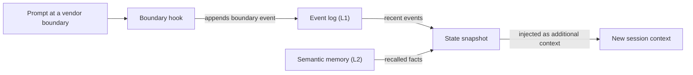

# Glosario

Cada entrada ofrece una definición breve y enlaza con la página que trata el término en profundidad. Cuando una palabra significa cosas distintas en distintas partes de OMA, la entrada lo indica.

## Componentes básicos

### Habilidad (skill) {#skill}

Una habilidad es un paquete de conocimiento de dominio en `.agents/skills/oma-<name>/`. Su `SKILL.md` entra en el contexto cuando se enruta la habilidad, y los archivos de `resources/` se cargan solo cuando la tarea los necesita. Una habilidad orienta cómo trabaja un agente en un dominio; no define un proceso de varios pasos. Consulta [Habilidades](../core-concepts/skills.md).

### Flujo de trabajo (workflow) {#workflow}

Un flujo de trabajo es un proceso de varios pasos definido en `.agents/workflows/<name>.md`. Se inicia con su comando slash, como `/plan` u `/orchestrate`; cuando el hook de detección de palabras clave está habilitado, una frase de activación que coincida también puede inyectarlo. Los flujos de trabajo coordinan una o más habilidades y agentes. Consulta [Flujos de trabajo](../core-concepts/workflows.md) y [Elegir una habilidad o un flujo de trabajo](../core-concepts/workflows.md#choosing-a-skill-or-workflow).

### Definición de agente {#agent-definition}

Una definición de agente es un archivo de subagente versionado en `.agents/agents/`, como `backend-engineer.md` o `qa-reviewer.md`. Establece la identidad del agente, las habilidades que carga (frontmatter `skills:`), una sección de protocolo de ejecución y las reglas del dominio. OMA proyecta estos archivos en formatos nativos del proveedor, como `.claude/agents/*.md` y `.codex/agents/*.toml`. La documentación también usa "agente" para un rol de despacho (`backend`, `qa`, `explore`) y para una habilidad como `oma-backend`. Consulta [Definiciones de agentes](../core-concepts/agents.md#agent-definitions).

## Presets

### Preset de habilidades {#skill-preset}

Un preset de habilidades es el conjunto de habilidades que el instalador añade a un proyecto, como `all`, `fullstack`, `backend` o `research`. Los recursos compartidos de `_shared/` se instalan con todos los presets. Un preset de habilidades no influye en qué modelo ejecuta un agente. Consulta [Presets](./installation.md#presets).

### Preset de modelos {#model-preset}

El preset de modelos es el valor de `model_preset` en `.agents/oma-config.yaml` (o `.cue`). Decide qué proveedor y qué modelo usa cada agente. `auto`, el valor predeterminado en las instalaciones nuevas, sigue la configuración de agentes y modelos del propio runtime actual; los presets fijos como `claude`, `codex` o `mixed` los fijan. Las sobrescrituras `agents.<id>` tienen prioridad sobre el preset, excepto con `free`, donde `free.model` reemplaza los modelos fijados por agente. Consulta [Presets integrados](../guide/per-agent-models.md#built-in-presets).

## Ejecución de flujos de trabajo

### Flujo de trabajo persistente {#persistent-workflow}

Un flujo de trabajo persistente sigue ejecutándose entre turnos hasta que termina su trabajo o lo desactivas. Los flujos persistentes son `/orchestrate`, `/work`, `/ultrawork` y `/ralph`, y solo una invocación explícita activa el modo persistente. Mientras uno está activo, un hook vuelve a inyectar `[OMA PERSISTENT MODE: ...]` en cada prompt, y el hook Stop impide que la sesión termine hasta que se alcanza un límite de refuerzo o un tiempo de inactividad. Di `workflow done` para desactivarlo. Consulta [Mecánica del modo persistente](../core-concepts/workflows.md#persistent-mode-mechanics).

### Puerta de parada {#stop-gate}

Una puerta de parada es una comprobación de finalización opcional que asocias a un flujo persistente activo con `oma goal set --gate typecheck|test|lint`. A partir de ahí, el hook Stop solo permite que el flujo termine cuando pasa el script de `package.json` con ese nombre. Los fallos de la puerta cuentan para el límite de refuerzo, de modo que una puerta que falla no puede bloquear la parada para siempre. Consulta [`goal set`](../cli-interfaces/commands.md#goal-set).

## Sesiones y estado

"Sesión" tiene dos significados en OMA: la sesión que OMA registra por sí mismo y la sesión de conversación de la CLI o el IDE de IA que usas. Distínguelas al leer archivos de estado u opciones de comandos.

### Sesión de OMA {#oma-session}

Una sesión de OMA es el trabajo que OMA registra con su propio ID de sesión, independiente de cualquier conversación del proveedor. La orquestación usa ese ID para nombrar el plan, el task board, los archivos de progreso y de resultados, y los registros de ejecución de los agentes; el orquestador lo genera con el formato `session-YYYYMMDD-HHMMSS`. El estado de los flujos usa un ID de sesión de OMA (`sid`) como clave del [registro de eventos](#event-log), que `oma state list` y `oma state get <sid>` permiten inspeccionar. Consulta [Estrategia de ID de sesión](../guide/multi-agent-project.md#session-id-strategy).

### ID de sesión del proveedor {#vendor-session-id}

Un ID de sesión del proveedor es el ID de conversación que asigna la CLI o el IDE de IA, como un ID de sesión de Claude Code o de Codex. OMA lo registra como `vendorSid` en los eventos, y los archivos de estado del modo persistente usan ese ID como clave (`.agents/state/<workflow>-state-<vendor-session-id>.json`). Cuando hay una sesión de OMA activa y llega un prompt desde otra sesión del proveedor, otro proveedor o una sesión que se acaba de compactar, un hook registra un evento `boundary` e inyecta una instantánea del estado para que el trabajo continúe en el nuevo contexto. Consulta [`state`](../cli-interfaces/commands.md#state).

Si la memoria semántica no está disponible, la instantánea usa solo los eventos locales.

### Registro de eventos {#event-log}

El registro de eventos es el historial de solo anexado de una sesión de OMA, guardado como `events.jsonl` en `${OMA_STATE_HOME:-~/.oma}/u/<profile>/sessions/<sid>/`. Cada línea es un evento, como `session.created`, `workflow.phase`, `gate.passed`, `decision.made` o `session.ended`. Los flujos anexan las decisiones obligatorias con `oma state emit` y las comprueban con `oma state verify`; lee el registro con `oma state get` u `oma state trajectory` en lugar de abrir el archivo. Consulta [`state`](../cli-interfaces/commands.md#state).

## Revisión y evidencia

### Juez {#judge}

"Juez" tiene dos significados. En `/ralph`, el juez es la fase posterior a cada iteración de ultrawork que comprueba cada criterio de finalización contra el estado real del proyecto y registra PASS, FAIL, REGRESSED o BLOCKED. La ejecuta un agente generado aparte con contexto nuevo, de modo que el orquestador no califica su propio trabajo. En la evaluación y la optimización de habilidades, `judge` es el tipo de verificador predeterminado: un modelo califica la salida de una variante según una rúbrica y devuelve PASS o FAIL. Consulta [/ralph](../core-concepts/workflows.md#ralph) y [el verificador judge](../guide/skill-eval.md#judge-default).

### Revisión entre contextos (CCR) {#cross-context-review-ccr}

La revisión entre contextos (cross-context review) es la regla según la cual cada paso de revisión de `/ultrawork` se ejecuta en un subagente revisor nuevo y con el contexto aislado. El revisor recibe solo los artefactos que revisa, referenciados por ruta (diff, archivos modificados, plan, resultados anteriores, salida de las pruebas), más la guía de esa revisión concreta; nunca ve el historial de la sesión principal ni el razonamiento del implementador. Cada revisor escribe un veredicto estructurado que recopila el coordinador de la fase. Consulta [/ultrawork](../core-concepts/workflows.md#ultrawork).

### Charter {#charter}

El charter es el bloque de preflight `CHARTER_CHECK` que los agentes de implementación escribían antes de cualquier código. Las definiciones de agentes actuales no exigen ninguna salida de preflight fija. En su lugar, los agentes siguen la política de ejecución compartida: declaran las suposiciones relevantes, preguntan solo cuando la información que falta cambia la corrección o el alcance, y pausan únicamente el trabajo que depende de la respuesta. Un subagente generado no puede preguntarte directamente, así que informa del dato que falta en un resultado `blocked` o `partial`. Consulta [Autorización y aclaración](../core-concepts/agents.md#charter-preflight-charter_check).

### Registro de ejecución y declaración de resultados (claim) {#run-record-and-claim}

Un registro de ejecución es el registro legible por máquina de un intento de un agente, guardado en el directorio de estado por proyecto del perfil, `~/.oma/u/<profile>/projects/<project-hash>/agent-runs/` (las versiones anteriores usaban `.agents/state/agent-runs/`); `oma agent begin` lo crea y toma una instantánea del contrato de la tarea. La declaración de resultados (claim) es el informe del propio agente en la ruta `.claim.json` correspondiente, con un estado `completed`, `partial`, `blocked` o `failed`, además de los archivos modificados, el trabajo sin resolver y los artefactos. `oma agent finish` contrasta la declaración de resultados con el contrato actual, los registros de verificación (receipts) y los hashes de los artefactos, de modo que una declaración con evidencia obsoleta no sigue como completada. Consulta [Resultados y reanudación de agentes](../guide/agent-results-and-resume.md).

## Memoria y proveedores

### Memoria L1 y L2 {#l1-and-l2-memory}

L1 es el [registro de eventos](#event-log): estado local de los flujos, de solo anexado, que leen `oma state verify` y la instantánea de frontera. L2 es la memoria semántica, hechos recuperados que sirve el proveedor `providers.semantic_memory` seleccionado: `agentmemory` (el predeterminado), `honcho` o `none`. Las decisiones obligatorias viven en L1, así que sobreviven a los límites de sesión sin L2. "L1" y "L2" también significan otras cosas: la capa 1 y la capa 2 de una habilidad son su `SKILL.md` y su directorio `resources/` bajo demanda, y `oma docs verify` informa de "L2 references", que son las referencias a archivos, URLs, CLI, scripts, entorno y configuración que extrae de la documentación. Consulta [`memory`](../cli-interfaces/commands.md#memory) y [Memoria semántica de Honcho](../guide/configuration-reference.md#honcho-semantic-memory).

### Proveedor de capacidades {#capability-provider}

Un proveedor de capacidades es la herramienta o el servicio externo que OMA usa para una capacidad, seleccionado en `providers` dentro de `.agents/oma-config.yaml`. Las capacidades son documentación (`docs`, predeterminado `context7`), búsqueda web (`web`, predeterminado `native`), inteligencia de código (`code_intelligence`, predeterminado `serena`) y memoria semántica (`semantic_memory`, predeterminado `agentmemory`). Ejecuta `oma link` después de cambiar un proveedor. Consulta [Claves de nivel superior](../guide/configuration-reference.md#top-level-keys) y [Valores predeterminados importantes](./important-defaults.md).

## Planes y archivos fuente

### Plan {#plan}

Un plan es el desglose de tareas legible por máquina en `.agents/results/plan-<sessionId>.json`, que escribe `/plan` y consumen `/orchestrate` y `/work`; `/orchestrate` crea uno cuando no existe un plan utilizable. Cada tarea indica su agente, su workspace, sus dependencias, sus criterios de aceptación y las comprobaciones obligatorias, y los registros de ejecución toman una instantánea de este contrato. No tiene relación con la resolución de modelos por agente que muestra `oma doctor --profile`, que algunas páginas llaman plan heredado. Consulta [/plan](../core-concepts/workflows.md#plan) e [Iniciar una ejecución nativa](../guide/agent-results-and-resume.md#start-a-native-run).

### SSOT {#ssot}

La fuente única de verdad (SSOT, single source of truth) es el directorio `.agents/`: `<project>/.agents/` en una instalación de proyecto o `~/.oma/.agents/` en una instalación global. Las habilidades, los flujos de trabajo, las definiciones de agentes, las reglas y la configuración viven ahí, y `oma install`, `oma update` y `oma link` generan a partir de él los archivos nativos del proveedor (`.claude/`, `.codex/` y otros). Edita `.agents/` y ejecuta `oma link` en lugar de editar los archivos generados. Algunas páginas usan SSOT para una fuente más acotada, como el manifiesto de agentes programados. Consulta [.agents/: la fuente de verdad](../core-concepts/project-structure.md#agents-the-source-of-truth).
