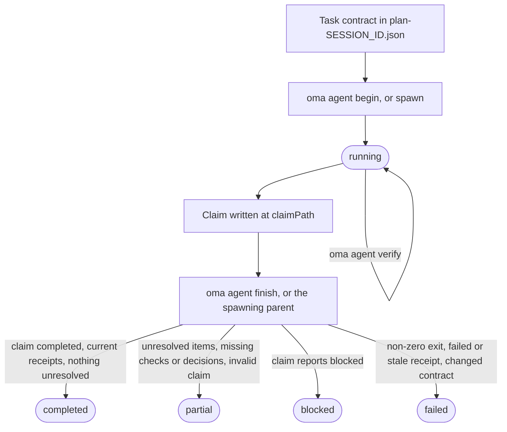
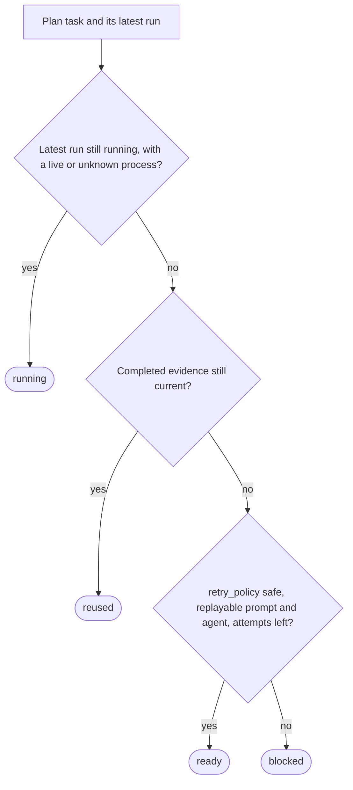

# Resultados y reanudación de agentes

OMA trata el resultado de un agente como un pequeño registro de evidencia, no solo como el código de salida del proceso. Una ejecución registra los identificadores de tarea y sesión, la huella del workspace, los registros de verificación (receipts), los archivos modificados, el trabajo sin resolver y los hashes de los artefactos. Esto permite que un coordinador reutilice una tarea completada solo mientras su contrato de aceptación y sus entradas sigan coincidiendo.

Usa directamente este ciclo de vida cuando ejecutes un agente nativo. Los flujos de trabajo y `oma agent spawn` crean los mismos registros y dejan la finalización de la ejecución gestionada al coordinador padre. Para los términos que se usan aquí, consulta [Registro de ejecución y claim](../getting-started/glossary.md#run-record-and-claim) y [Plan](../getting-started/glossary.md#plan) en el glosario.

## El ciclo de vida de un vistazo

| Paso | Comando | Registra | Conserva |
| --- | --- | --- | --- |
| 1. Contrato | Edita `.agents/results/plan-SESSION_ID.json` | `acceptance_criteria` y `required_checks` de la tarea | ID de sesión, ID de tarea |
| 2. Inicio | `oma agent begin AGENT TASK SESSION_ID --workspace .` | Registro de ejecución con estado `running` | `runId`, `claimPath` |
| 3. Contexto (opcional) | `oma agent context AGENT --difficulty Medium` | Nada | Contexto del prompt |
| 4. Verificación | `oma agent verify RUN_ID --required` | Un registro de verificación por comprobación | Código de salida |
| 5. Declaración | Escribe JSON en `claimPath` | Archivo de la declaración de resultados | Nada |
| 6. Finalización | `oma agent finish RUN_ID CLAIM_PATH` | Estado final | `status` |
| 7. Recuperación | `oma agent resume SESSION_ID --dry-run` y después sin `--dry-run` | Checkpoint de recuperación y lease de sesión | Estado de cada tarea |

`oma agent spawn` y `oma agent parallel` realizan los pasos 2 y 6 por ti: el proceso padre inicia la ejecución y la finaliza cuando el hijo termina.



Una declaración de resultados también puede informar directamente `partial` o `failed`. La finalización nunca mejora una declaración: rebaja una declaración `completed` cuya evidencia no se sostiene, y un código de salida distinto de cero convierte cualquier ejecución en `failed`.

## Inicia una ejecución nativa {#start-a-native-run}

Define primero la tarea y sus `acceptance_criteria` y `required_checks` en un plan ubicado en `.agents/results/plan-SESSION_ID.json`. Para una comprobación genérica pequeña del proyecto, el plan puede contener una tarea como esta:

```json
{
  "tasks": [
    {
      "id": "docs",
      "agent": "docs",
      "task": "Review README.md and report any documentation issues",
      "workspace": ".",
      "acceptance_criteria": [
        { "id": "diff-clean", "description": "The current Git diff has no whitespace errors" }
      ],
      "required_checks": [
        { "id": "whitespace", "criteria": ["diff-clean"], "command": ["git", "diff", "--check"], "cwd": "." }
      ],
      "retry_policy": "manual"
    }
  ]
}
```

Esta comprobación solo demuestra que el diff de Git no contiene errores de espacios; sustituye la tarea, el criterio y la comprobación por el contrato de aceptación real del proyecto. Desde la raíz del proyecto, inicia la ejecución:

```bash
oma agent begin docs docs SESSION_ID --workspace .
```

Sustituye `SESSION_ID` por el identificador de sesión usado en el plan. El comando muestra JSON con un UUID `runId` generado y un `claimPath`, la ruta de la declaración de resultados, por ejemplo:

```json
{
  "runId": "<generated-run-id>",
  "taskId": "docs",
  "sessionId": "<your-session-id>",
  "status": "running",
  "claimPath": ".agents/state/agent-runs/<generated-run-id>.claim.json"
}
```

Los valores entre ángulos son marcadores de posición; usa los valores reales que muestre tu ejecución. Un begin correcto crea el registro de ejecución bajo `.agents/state/agent-runs/` y toma una instantánea del contrato de la tarea. La ruta de esa declaración de resultados siempre es la ruta del registro con `.claim.json` en lugar de `.json`.

## Carga el contexto y ejecuta la tarea

Carga las referencias seleccionadas por el grafo antes de editar:

```bash
oma agent context docs --difficulty Medium
```

La dificultad debe ser `Simple`, `Medium` o `Complex`. El comando muestra el contexto ensamblado para el agente seleccionado. Si no existe contexto respaldado por el grafo, corrige la definición de la tarea o continúa con la ruta de búsqueda nativa documentada por el proyecto; no fabriques un registro de contexto.

Ejecuta la tarea en el workspace registrado por `begin`. Mantén fijo el plan de sesión mientras la ejecución esté activa. Si la tarea cambia sus criterios de aceptación o sus comprobaciones requeridas, actualiza el plan e inicia una nueva ejecución.

## Registra la verificación

Ejecuta todas las comprobaciones fijadas en el contrato de aceptación:

```bash
oma agent verify RUN_ID --required
```

Sustituye `RUN_ID` por el UUID devuelto por `begin`. El comando ejecuta el argv declarado y registra el código de salida real y las huellas del workspace antes y después. Puedes registrar un comando exacto cuando el contrato de la tarea incluya esa comprobación:

```bash
oma agent verify RUN_ID -- git diff --check
```

Usa la forma de comando exacto solo para una comprobación que pertenezca al contrato de la tarea; en los demás casos conserva los `required_checks` del plan y usa `--required` para que el registro de verificación demuestre los criterios de aceptación declarados.

Usa `--affected PATH...` solo cuando el grafo tenga una selección completa de pruebas para esas rutas. Las comprobaciones se ejecutan en serie dentro de cada ejecución. Un código de salida distinto de cero o un cambio en el workspace durante una comprobación invalida ese registro de verificación.

## Escribe y finaliza la declaración de resultados

Para las tareas que eligen un contrato de API, una política de autenticación, un modelo de datos,
una estrategia de migración, un propietario del estado, un alcance de acceso a la infraestructura u otra
decisión de la que depende el trabajo posterior, declara `required_decisions` en la tarea
antes del despacho:

```json
"required_decisions": [
  {
    "subject": "db.migration-strategy",
    "description": "Choose the compatibility window and rollback strategy for the account migration."
  }
]
```

Omite este campo en las tareas que siguen una decisión existente. Los requisitos quedan
fijados con el contrato de la tarea y no se pueden eliminar ni cambiar después del despacho.
Enumera los temas sugeridos para un agente con
`oma state decisions list --agent db-engineer --json`. Estos temas son
opciones para usar cuando sean pertinentes; el catálogo no hace obligatoria cada elección.

Escribe el archivo de la declaración de resultados en la ruta exacta que mostró `begin`:

```json
{
  "status": "completed",
  "changedFiles": [],
  "unresolved": [],
  "artifacts": []
}
```

`status` puede ser `completed`, `partial`, `blocked` o `failed`. Las rutas son relativas a la raíz del proyecto y cada artefacto debe ser un archivo normal dentro del workspace. Usa `verificationSkipped` solo para una revisión concreta que no tenga una comprobación ejecutable; no convierte una comprobación fallida en aprobada.

Incluye las decisiones sustanciales en el array opcional `decisions` de la declaración de resultados:

```json
"decisions": [
  {
    "subject": "db.migration-strategy",
    "decision": "Use an expand-and-contract migration; retain the old column for one release.",
    "rationale": "Both deployed app versions must work during the rollout; rollback switches reads to the retained column.",
    "alternatives": ["Replace the column during a maintenance window"],
    "evidence": ["docs/account-migration.md"]
  }
]
```

El padre guarda cada decisión como un evento `decision.made` en la sesión de la ejecución
y le adjunta los IDs reales de agente, tarea y ejecución. Si falta una decisión requerida,
el resultado se mantiene parcial, incluso cuando pasan las comprobaciones ejecutables. Las decisiones de
otra tarea u otro intento no pueden satisfacer el requisito. El registro de verificación fija los
IDs de los eventos de decisión y los hashes de su contenido; la reutilización comprueba que esos eventos todavía
existen, son válidos y su contenido no ha cambiado.
Las decisiones opcionales también se registran. Los agentes de solo lectura devuelven el mismo array en
su declaración `OMA_RESULT_JSON` para que el padre pueda persistirlo.

Finaliza una ejecución nativa después de escribir la declaración de resultados:

```bash
oma agent finish RUN_ID CLAIM_PATH
```

Sustituye ambos valores por los del JSON de `begin`. `CLAIM_PATH` es la ruta `.claim.json` generada; no inventes otro nombre de archivo.

El comando finish valida la declaración de resultados, el contrato actual, los registros de verificación y los hashes de los artefactos. Una declaración de resultados completada con evidencia obsoleta pasa a failed o partial. El comando rechaza finalizar una ejecución gestionada cuyo ciclo de vida pertenece al proceso padre.

## Comportamiento de ejecuciones nativas y con spawn

`oma agent spawn` y `oma agent parallel` crean una ejecución, inyectan la identidad de ejecución y las instrucciones de resultados en el prompt hijo y permiten que el padre capture el código de salida del hijo. El hijo debe escribir su declaración de resultados e informar de sus artefactos; el padre finaliza el registro de ejecución gestionado. Un hijo de solo lectura devuelve una línea `OMA_RESULT_JSON: {...}`; el padre la persiste y la explicación de `verificationSkipped` sigue diferenciada de la verificación ejecutable.

Los archivos de resultados legibles por personas en `.agents/results/` y las notas de memoria en `.agents/state/memories/` ayudan a seguir el progreso. El registro de ejecución legible por máquinas de `.agents/state/agent-runs/` es la evidencia usada para reutilizar y reanudar.

## Inspecciona la recuperación antes de reintentar

Primero pregunta qué haría OMA:

```bash
oma agent resume SESSION_ID --dry-run
```

El informe clasifica cada tarea como `reused`, `ready`, `running` o `blocked` e incluye el motivo:



Una dependencia que no está en `reused` devuelve a `ready` una tarea dependiente `reused` (o a `blocked` cuando no se puede repetir), y una tarea `ready` cuya dependencia está en `blocked` o `running` pasa a `blocked`. Un registro de ejecución completado válido se reutiliza solo cuando su contrato, sus entradas, los hashes de los artefactos y la evidencia de dependencias siguen vigentes. No se duplica un proceso gestionado activo ni una ejecución nativa sin evidencia de actividad.

Cuando el informe indique que es seguro ejecutar, reanuda las tareas ready en orden de dependencia:

```bash
oma agent resume SESSION_ID
```

La repetición automática requiere `retry_policy: "safe"` y un prompt y agente repetibles en el plan o en el despacho guardado. El valor predeterminado es `manual`. `--max-attempts` tiene el valor predeterminado `3`, incluida la ejecución original:

```bash
oma agent resume SESSION_ID --max-attempts 2
```

OMA escribe el checkpoint de recuperación bajo `.agents/state/agent-resume/` y usa un lease de sesión para impedir que dos coordinadores reintenten la misma sesión. Mantiene fijo el plan mientras se ejecuta la recuperación. Si cambia el plan, cambia una dependencia o un reintento posterior cambia una entrada anterior, las tareas afectadas pasan a blocked y necesitan una nueva ejecución de verificación.

La reanudación inicia un intento nuevo; no restaura la conversación interrumpida del modelo. Antes de reanudar una ejecución nativa interrumpida, marca la ejecución anterior como `partial` o `failed` con su resultado real y el trabajo sin resolver. Después inspecciona el informe de simulación y reintenta solo las tareas que tengan una ruta de repetición segura.

## Ejemplos de recuperación

| Situación | Acción | Resultado esperado |
| --- | --- | --- |
| Falló una comprobación requerida | Corrige la tarea, vuelve a ejecutar `oma agent verify RUN_ID --required` y finaliza con una nueva declaración de resultados. | El registro de ejecución más reciente sustituye el resultado fallido cuando la huella del workspace está actualizada. |
| El proceso murió antes de la declaración de resultados | Marca la ejecución como parcial o fallida y ejecuta `oma agent resume SESSION_ID --dry-run`. | El intento anterior se conserva; una tarea segura queda `ready` y una manual queda `blocked`. |
| Cambió una dependencia | Vuelve a ejecutar la dependencia e inspecciona de nuevo el informe. | Se invalida la reutilización de la tarea dependiente aunque sus propios archivos no hayan cambiado. |
| Cambió el plan o las entradas | Inicia una nueva ejecución cuando el plan sea estable. | La nueva ejecución toma una instantánea del contrato nuevo; la evidencia anterior no se reutiliza. |
| La tarea necesita una decisión | Regístrala como `blocked` con una explicación. | La reanudación la mantiene bloqueada hasta que estén disponibles la decisión y el prompt. |

## Próximos pasos

- Mensajes de error de `begin`, `verify`, `finish` y `resume`: [Solución de problemas](./troubleshooting.md#find-your-error)
- Errores de análisis, herramientas de proveedor ausentes, estado del dashboard, programaciones y datos de evaluación obsoletos: [Solución de problemas](./troubleshooting.md)
- Observa las ejecuciones gestionadas mientras trabajan: [Monitoreo del dashboard](./dashboard-monitoring.md)
- Define planes con contratos de tarea: [Proyectos multiagente](./multi-agent-project.md)
