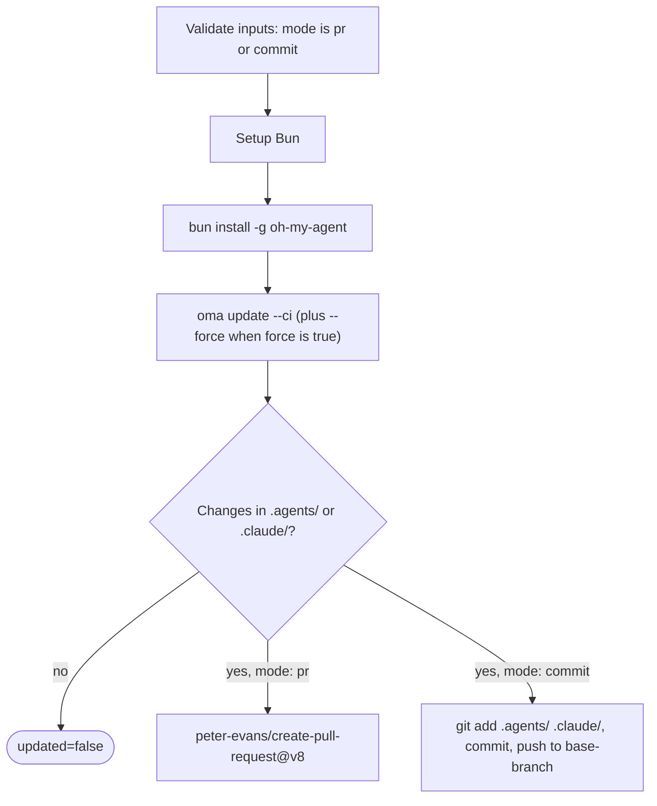

# Guía: Actualizaciones automáticas

## Descripción general

La GitHub Action de oh-my-agent (`first-fluke/oma-update-action@v1`) actualiza automáticamente las skills de agentes de tu proyecto ejecutando `oma update` en CI. Admite dos modos: crear un pull request para revisarlo o hacer commit directamente en una rama.

---

## Configuración rápida

<!-- oma-docs:ignore-start -->
Añade este archivo a tu proyecto como `.github/workflows/update-oh-my-agent.yml`:
<!-- oma-docs:ignore-end -->

```yaml
name: Update oh-my-agent

on:
  schedule:
    - cron: '0 9 * * 1'  # Every Monday at 9am UTC
  workflow_dispatch:        # Allow manual trigger

permissions:
  contents: write
  pull-requests: write

jobs:
  update:
    runs-on: ubuntu-latest
    steps:
      - uses: actions/checkout@v4

      - uses: first-fluke/oma-update-action@v1
```

Esta es la configuración mínima. Cuando cambia un componente instalado, la action debe terminar con `updated=true`, una salida de versión y un pull request. Si no cambia ningún archivo, termina con `updated=false` y sin PR.

---

## Todas las entradas de la action

| Entrada | Tipo | Obligatoria | Predeterminado | Descripción |
|:------|:-----|:---------|:--------|:-----------|
| `mode` | string | No | `"pr"` | Cómo aplicar los cambios. `"pr"` crea un pull request. `"commit"` hace push directamente a la rama base. |
| `base-branch` | string | No | `"main"` | Rama base del PR (en modo `pr`) o rama de destino de los commits directos (en modo `commit`). No cambia lo que se extrae con checkout; establece `ref:` de `actions/checkout` en la misma rama. |
| `force` | string | No | `"false"` | Pasa `--force` a `oma update`. Si vale `"true"`, sobrescribe los archivos de configuración personalizados por el usuario (`oma-config.yaml`, `mcp.json`) y los directorios `stack/`. Normalmente se conservan. |
| `pr-title` | string | No | `"chore(deps): update oh-my-agent skills"` | Título personalizado del pull request. Solo se usa en modo `pr`. |
| `pr-labels` | string | No | `"dependencies,automated"` | Etiquetas separadas por comas que se añadirán al PR. Solo se usan en modo `pr`. |
| `commit-message` | string | No | `"chore(deps): update oh-my-agent skills"` | Mensaje de commit personalizado. Se usa en ambos modos, como mensaje del commit del PR o del commit directo. |
| `token` | string | No | `${{ github.token }}` | Token de GitHub para crear PRs. Usa un Personal Access Token (PAT) si necesitas que el PR active otros workflows (el `GITHUB_TOKEN` predeterminado no activa ejecuciones de workflows en los PRs que crea). |

---

## Todas las salidas de la action

| Salida | Tipo | Descripción | Disponible |
|:-------|:-----|:-----------|:----------|
| `updated` | string | `"true"` si se detectaron cambios después de ejecutar `oma update`. `"false"` si ya estaba actualizado. | Siempre |
| `version` | string | Versión de oh-my-agent después de la actualización. Se lee de `.agents/skills/_version.json`. | Cuando `updated` vale `"true"` |
| `pr-number` | string | Número del pull request. | Solo en modo `pr` cuando se crea un PR |
| `pr-url` | string | URL completa del pull request creado. | Solo en modo `pr` cuando se crea un PR |

---

## Ejemplos detallados

### Ejemplo 1: modo PR predeterminado

Esta configuración crea un PR cada lunes si hay actualizaciones disponibles.

```yaml
name: Update oh-my-agent

on:
  schedule:
    - cron: '0 9 * * 1'
  workflow_dispatch:

permissions:
  contents: write
  pull-requests: write

jobs:
  update:
    runs-on: ubuntu-latest
    steps:
      - uses: actions/checkout@v4

      - uses: first-fluke/oma-update-action@v1
        id: update

      - name: Summary
        if: steps.update.outputs.updated == 'true'
        run: |
          echo "Updated to version ${{ steps.update.outputs.version }}"
          echo "PR: ${{ steps.update.outputs.pr-url }}"
```

**Qué ocurre:**
- Se hace checkout del repositorio.
- Se instala Bun y después oh-my-agent globalmente.
- Se ejecuta `oma update --ci`.
- Se comprueba si hay cambios en `.agents/` o `.claude/`.
- Si hay cambios, se usa `peter-evans/create-pull-request@v8` para crear un PR en la rama `chore/update-oh-my-agent`.
- El PR recibe las etiquetas `dependencies,automated` e incluye el nuevo número de versión en el cuerpo.

### Ejemplo 2: modo de commit directo con PAT

Para equipos que quieren aplicar las actualizaciones de inmediato, sin una revisión mediante PR. Usa un PAT para que el commit pueda activar los workflows posteriores.

```yaml
name: Update oh-my-agent (Direct)

on:
  schedule:
    - cron: '0 6 * * *'  # Daily at 6am UTC
  workflow_dispatch:

permissions:
  contents: write

jobs:
  update:
    runs-on: ubuntu-latest
    steps:
      - uses: actions/checkout@v4
        with:
          ref: develop
          token: ${{ secrets.OH_MY_AGENT_PAT }}

      - uses: first-fluke/oma-update-action@v1
        with:
          mode: commit
          token: ${{ secrets.OH_MY_AGENT_PAT }}
          commit-message: "chore: auto-update oh-my-agent skills"
          base-branch: develop
```

**Qué ocurre:**
- Se hace checkout de `develop` usando un PAT. `ref: develop` es obligatorio: `base-branch` solo establece el destino del push, y la action hace push del `HEAD` que haya producido el checkout.
- Se ejecuta `oma update --ci`.
- Si hay cambios, se configura git como `github-actions[bot]` y se hace commit directamente en `develop`.
- El PAT garantiza que el commit active los workflows que escuchan los pushes en `develop`.

**Importante:** Usa `secrets.OH_MY_AGENT_PAT` (un PAT de granularidad fina con permiso Contents: Write) en lugar de `github.token`. El `GITHUB_TOKEN` predeterminado crea commits que no activan otros workflows, lo que puede romper las pipelines de CI que esperan eventos de push.

### Ejemplo 3: notificación condicional

Actualización con una notificación de Slack cuando hay una nueva versión disponible.

```yaml
name: Update oh-my-agent

on:
  schedule:
    - cron: '0 9 * * 1'
  workflow_dispatch:

permissions:
  contents: write
  pull-requests: write

jobs:
  update:
    runs-on: ubuntu-latest
    steps:
      - uses: actions/checkout@v4

      - uses: first-fluke/oma-update-action@v1
        id: update

      - name: Notify Slack
        if: steps.update.outputs.updated == 'true'
        uses: slackapi/slack-github-action@v2
        with:
          webhook: ${{ secrets.SLACK_WEBHOOK }}
          webhook-type: incoming-webhook
          payload: |
            {
              "text": "oh-my-agent updated to v${{ steps.update.outputs.version }}. PR: ${{ steps.update.outputs.pr-url }}"
            }

      - name: Skip notification
        if: steps.update.outputs.updated == 'false'
        run: echo "Already up to date, no notification needed."
```

Usa `steps.update.outputs.updated == 'true'` para ejecutar los pasos posteriores solo cuando se haya producido una actualización. Así se evitan ejecuciones sin cambios.

### Ejemplo 4: modo force con etiquetas personalizadas

Para proyectos que quieren restablecer todos los archivos de configuración a sus valores predeterminados durante la actualización.

```yaml
name: Update oh-my-agent (Force)

on:
  workflow_dispatch:  # Manual trigger only for force updates

permissions:
  contents: write
  pull-requests: write

jobs:
  update:
    runs-on: ubuntu-latest
    steps:
      - uses: actions/checkout@v4

      - uses: first-fluke/oma-update-action@v1
        with:
          force: 'true'
          pr-title: "chore(deps): force-update oh-my-agent skills (reset configs)"
          pr-labels: "dependencies,automated,force-update"
          commit-message: "chore(deps): force-update oh-my-agent skills"
```

**Advertencia:** El modo force sobrescribe `oma-config.yaml`, `mcp.json` y los directorios `stack/`. Úsalo solo cuando quieras restablecer todas las personalizaciones a los valores predeterminados. Para las actualizaciones normales, omite la entrada `force`.

---

## Cómo funciona internamente

La action es una [acción compuesta](https://docs.github.com/en/actions/creating-actions/creating-a-composite-action) definida en `action/action.yml`. Primero valida que `mode` sea `pr` o `commit`, después ejecuta los pasos siguientes y termina con un pull request o un commit directo:



### Paso 1: configurar Bun

```yaml
- uses: oven-sh/setup-bun@v2
```

Instala el runtime de Bun, necesario para ejecutar la CLI de oh-my-agent.

### Paso 2: instalar oh-my-agent

```bash
bun install -g oh-my-agent
```

Instala la CLI globalmente desde el registro de npm. Esto proporciona acceso al comando `oma`.

### Paso 3: ejecutar oma update

```yaml
- name: Run oma update
  shell: bash
  env:
    FORCE: ${{ inputs.force }}
  run: |
    FLAGS="--ci"
    if [ "$FORCE" = "true" ]; then
      FLAGS="$FLAGS --force"
    fi
    oma update $FLAGS
```

Las entradas llegan al script mediante `env:` en lugar de interpolar `${{ }}` dentro de `run:`, lo que impide que el valor de una entrada se ejecute como código de shell.

El flag `--ci` ejecuta la actualización en modo no interactivo (omite todos los prompts y muestra texto plano en lugar de animaciones de spinner). El flag `--force`, cuando está habilitado, sobrescribe los archivos de configuración personalizados por el usuario.

Esto es lo que hace internamente `oma update --ci`:

1. Obtiene `prompt-manifest.json` de la rama principal para conocer el número de versión más reciente.
2. Lo compara con la versión local de `.agents/skills/_version.json`.
3. Si las versiones coinciden, termina con «Already up to date.»
4. Si hay una versión nueva, descarga y extrae el tarball más reciente.
5. Conserva los archivos personalizados por el usuario (salvo con `--force`): `oma-config.yaml`, `mcp.json` y los directorios `stack/`.
6. Copia los archivos nuevos sobre el directorio `.agents/` existente.
7. Restaura los archivos conservados.
8. Actualiza las adaptaciones de los proveedores (hooks, configuraciones y definiciones de agentes) para los proveedores de la lista `vendors:` de la configuración (una lista vacía significa ninguno). Sin una lista `vendors:`, solo actualiza los proveedores cuyos directorios de proyecto ya existen.
9. Actualiza los symlinks de la CLI.

La action invoca `oma update --ci` sin `--with-new-skills`. Así actualiza el conjunto de skills instalado y muestra las skills nuevas disponibles; ejecuta deliberadamente `oma update --with-new-skills` cuando el proyecto deba añadir skills nuevas como parte de la actualización.

### Paso 4: comprobar los cambios

```bash
if [ -n "$(git status --porcelain .agents/ .claude/ 2>/dev/null)" ]; then
  echo "updated=true" >> "$GITHUB_OUTPUT"
  if [ -f ".agents/skills/_version.json" ]; then
    VERSION=$(jq -r '.version' .agents/skills/_version.json)
    echo "version=$VERSION" >> "$GITHUB_OUTPUT"
  fi
else
  echo "updated=false" >> "$GITHUB_OUTPUT"
fi
```

Comprueba si `oma update` cambió realmente algún archivo en `.agents/` o `.claude/`. Establece las salidas `updated` y `version` según corresponda. Los cambios fuera de esos dos directorios (por ejemplo, `.codex/` o `AGENTS.md`) no establecen `updated=true`.

Después, según la entrada `mode`:

- **Modo `pr`:** Usa `peter-evans/create-pull-request@v8` para crear un PR en la rama `chore/update-oh-my-agent`. El PR incluye el nuevo número de versión, un enlace al repositorio de oh-my-agent y las etiquetas configuradas. Si la rama ya existe (por un PR anterior que sigue abierto), actualiza el PR existente.

- **Modo `commit`:** Configura git como `github-actions[bot]`, prepara `.agents/` y `.claude/`, hace commit con el mensaje configurado y ejecuta push a la rama base.

---

## Consulta también

- [Instalación global](./global-install.md): `oma update --global` y advertencias de CI para instalaciones a nivel de usuario
- [Referencia de configuración](./configuration-reference.md#update-and-ownership-rules): qué archivos de configuración conserva `oma update`
- [Integración de un proyecto existente](./integration.md): los archivos que `oma update` actualiza en un proyecto
